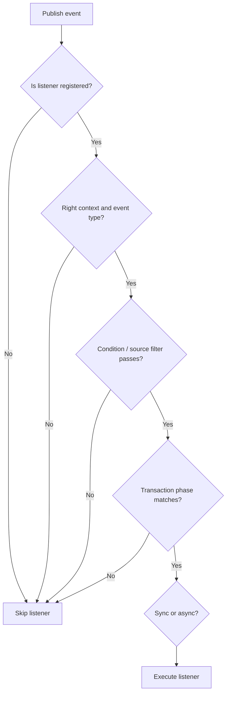

# Conditions for a Listener to Be Invoked

Spring Application Events does not invoke every listener whenever any event is published. Spring dispatches only to listeners that are registered and match the event type; additional filters such as SpEL conditions, transaction phases, or source types further determine whether a listener actually executes. Understanding each layer of conditions helps pinpoint why a listener receives an event, gets skipped, or runs only in certain situations.

## 1. Dispatch Condition Map

A listener is typically invoked when all conditions applicable to it are satisfied:

1. **Registered:** the listener is a bean in the ApplicationContext or registered directly with the context.
2. **Right context scope:** the event is published in a context that can propagate to the context containing the listener.
3. **Compatible event type:** the actual event type is compatible with the type declared by the listener.
4. **Passes filters:** `@EventListener(classes = ...)`, SpEL `condition`, or custom filters accept the event.
5. **Right transaction timing:** if using `@TransactionalEventListener`, the selected transaction phase must occur.
6. **Executable:** synchronous listeners are called during the dispatch pass; asynchronous listeners require an executor to accept the task.

`@Order` only sorts listeners that are already eligible. It does not register listeners, make event types match, or turn a false condition into true.



## 2. The Listener Must Be Registered by Spring

For an `@EventListener` method, the object containing the method must be a Spring-managed bean. Spring processes the annotation during context initialization via `EventListenerMethodProcessor`, then registers the corresponding adapter with the application event multicaster.

Registering via component scanning:

```java
@Component
public class OrderListener {
    @EventListener
    public void onOrderPlaced(OrderPlacedEvent event) {
        System.out.println("Received " + event.orderId());
    }
}
```

Or explicit bean declaration:

```java
@Configuration
public class EventConfiguration {
    @Bean
    OrderListener orderListener() {
        return new OrderListener();
    }
}
```

If you instantiate an object manually with `new OrderListener()` and keep it outside the ApplicationContext, Spring does not automatically detect `@EventListener` on that object. In that case, the method is not registered as a listener. For listeners implementing `ApplicationListener`, the bean must likewise belong to the context or be registered directly using the context API.

Example interface-based listener:

```java
@Component
public class OrderApplicationListener
        implements ApplicationListener<OrderPlacedApplicationEvent> {
    @Override
    public void onApplicationEvent(OrderPlacedApplicationEvent event) {
        System.out.println("Received " + event.orderId());
    }
}
```

`ApplicationListener<E>` accepts events extending `ApplicationEvent`. For directly published POJOs or records, `@EventListener` is usually more convenient because the method parameter can be the payload type.

## 3. The Event Must Be Within the ApplicationContext Scope

Each ApplicationContext has its own event multicaster and set of listeners. In a parent–child context hierarchy, events published in a child context are forwarded up to the parent context. Events published in a parent context do not automatically propagate down to child contexts or across to sibling contexts.

This means a listener in a parent context can receive events emitted by a child context; a listener registered only in a child context does not automatically receive events published in the parent context. When debugging, identify which context publishes the event and which context registers the listener.

```text
Parent ApplicationContext
  ├── ParentListener
  └── Child ApplicationContext
        └── ChildListener

Event published by Child:
  Child multicaster -> ChildListener
                   -> Parent context -> ParentListener

Event published by Parent:
  Parent multicaster -> ParentListener
                      (does not propagate down to ChildListener automatically)
```

Do not register the same listener in multiple contexts unless duplicate processing is intentional. In typical Spring Boot applications with a single primary context, this issue rarely arises; it matters more in web applications with multiple contexts or plugin architectures.

## 4. The Event Type Must Be Compatible with the Listener

Spring selects listeners based on the event type. A listener accepting a specific type can receive events of that exact type or compatible subtypes. A listener accepting a superclass or interface can handle multiple subtype events.

```java
public interface DomainEvent {
}

public record OrderPlacedEvent(String orderId) implements DomainEvent {
}

@Component
public class DomainEventListener {
    @EventListener
    public void onDomainEvent(DomainEvent event) {
        System.out.println("Domain event received: " + event);
    }
}
```

For an `OrderPlacedEvent`, both a listener accepting `OrderPlacedEvent` and a listener accepting `DomainEvent` can match. Spring does not pick only one listener; all registered listeners that satisfy the conditions are dispatched.

### POJO and Record Payloads

Since Spring Framework 4.2, any object can be published via `ApplicationEventPublisher.publishEvent(Object)`. Spring represents that payload using `PayloadApplicationEvent`. The `@EventListener` adapter unwraps the payload to pass the right type to the parameter:

```java
public record OrderPlacedEvent(String orderId, long totalInCents) {
}

@EventListener
public void onOrderPlaced(OrderPlacedEvent event) {
    System.out.println(event.orderId());
}
```

The listener can receive `OrderPlacedEvent` directly. If you need to work with the envelope, you can declare a `PayloadApplicationEvent<OrderPlacedEvent>` parameter and read `getPayload()` or `getSource()`.

### Generic Events and Type Erasure

Spring uses `ResolvableType` to match generic types when full type metadata can be determined. Java type erasure can remove generic type arguments on instances; thus not every generic payload can be distinguished from its runtime class alone.

If you need to distinguish `EntityCreatedEvent<Order>` from `EntityCreatedEvent<Customer>`, the event can implement `ResolvableTypeProvider` to supply the exact `ResolvableType`. Another option is to use distinct event classes when two event kinds have different business meanings. Do not assume that generics of collections or nested objects always remain intact at runtime.

## 5. Filtering Events Using `classes`

`@EventListener` has a `classes` attribute (an alias for `value`) to explicitly list the event classes the method is interested in. This is suitable when the method does not need to receive event data:

```java
@EventListener(classes = {
        OrderPlacedEvent.class,
        OrderCancelledEvent.class
})
public void onOrderLifecycleChanged() {
    System.out.println("Order lifecycle event received");
}
```

When using `classes`, the listener method must not declare parameters. If you need access to the payload, declare a parameter with the desired event type and let Spring infer the type from that parameter; do not combine `classes` with method parameters.

`classes` filters by event type, not by properties inside the payload. To check data such as total amount, status, or sales channel, use a SpEL `condition`.

## 6. Filtering by Payload Using SpEL `condition`

The `condition` attribute of `@EventListener` accepts a Spring Expression Language (SpEL) expression. The listener is called only when the event type matches and the expression evaluates to `true`.

Example handling only orders with a total of at least 100,000 cents:

```java
@EventListener(condition = "#a0.totalInCents() >= 100000")
public void onHighValueOrder(OrderPlacedEvent event) {
    System.out.println("High-value order: " + event.orderId());
}
```

In the SpEL context of an event listener:

- `#root.event` is the event currently being processed.
- `#root.args` are the arguments passed to the listener method.
- `#a0` and `#p0` are aliases for the first parameter; `#a1`/`#p1` are for the second parameter.
- Parameter names such as `#event` work only if parameter names can be discovered from the corresponding compilation metadata.

Example filtering by channel:

```java
@EventListener(condition = "#a0.channel() == 'WEB'")
public void onWebOrder(OrderPlacedEvent event) {
    System.out.println("Web order: " + event.orderId());
}
```

### Combining Multiple Conditions

SpEL allows combining conditions with `and`, `or`, `not`, and comparison operators:

```java
@EventListener(
    condition = "#a0.totalInCents() >= 100000 and #a0.channel() == 'WEB'"
)
public void onHighValueWebOrder(OrderPlacedEvent event) {
    System.out.println("High-value web order: " + event.orderId());
}
```

Conditions should be short and rely only on available event data. If you need to call repositories, evaluate numerous business rules, or perform logic with side effects, move that logic into a dedicated service. Errors when evaluating expressions can interrupt synchronous dispatch.

## 7. Filtering by Event Type and Source Type Using `GenericApplicationListener`

When listener selection logic needs to be more complex than annotations allow, `GenericApplicationListener` provides two filtering hooks: `supportsEventType(ResolvableType)` and `supportsSourceType(Class<?>)`.

Example listener that receives only `OrderPlacedApplicationEvent` emitted from `WebCheckout`:

```java
public class WebCheckoutListener implements GenericApplicationListener {
    @Override
    public boolean supportsEventType(ResolvableType eventType) {
        return ResolvableType.forClass(OrderPlacedApplicationEvent.class)
                .isAssignableFrom(eventType);
    }

    @Override
    public boolean supportsSourceType(Class<?> sourceType) {
        return WebCheckout.class.isAssignableFrom(sourceType);
    }

    @Override
    public void onApplicationEvent(ApplicationEvent event) {
        OrderPlacedApplicationEvent orderEvent =
                (OrderPlacedApplicationEvent) event;
        System.out.println("Web checkout order: " + orderEvent.orderId());
    }
}
```

A bean implementing `GenericApplicationListener` must be registered in the context. `supportsEventType` checks the event type; `supportsSourceType` checks the source type of the `ApplicationEvent`. This is a low-level API and is usually unnecessary if `@EventListener` with SpEL already expresses the requirement.

Source is not synonymous with payload. When publishing a POJO, Spring wraps the object in `PayloadApplicationEvent`; the source is typically the publisher/context that emitted the event. If you need to filter by business origin, verify the actual source accurately or place the origin information inside the payload.

## 8. Transaction Phase as a Separate Condition

`@TransactionalEventListener` invokes a listener only at the chosen transaction phase. The default phase is `AFTER_COMMIT`:

```java
@TransactionalEventListener(phase = TransactionPhase.AFTER_COMMIT)
public void onOrderPlaced(OrderPlacedEvent event) {
    // Handle only after the transaction commits successfully
}
```

Main phases:

| Phase | When the Listener Runs |
|---|---|
| `BEFORE_COMMIT` | Before the transaction commits |
| `AFTER_COMMIT` | After a successful commit; this is the default |
| `AFTER_ROLLBACK` | After the transaction rolls back |
| `AFTER_COMPLETION` | After the transaction completes, whether committed or rolled back |

The listener requires an active transaction at the time of publishing. If there is no transaction, the listener does not run by default. You can set `fallbackExecution = true` to allow the listener to run when no transaction exists, but do so only when business logic accepts both cases.

A regular `@EventListener` does not wait for transaction commit. If published inside a transaction, a synchronous listener can run before commit; external actions such as HTTP requests or emails are not automatically rolled back when the transaction rolls back.

## 9. Synchronous, Asynchronous, and Execution Order

### Synchronous Listeners

With the default `SimpleApplicationEventMulticaster` without a configured executor, listeners run on the thread calling `publishEvent`. The publisher waits for listeners to finish. Exceptions from a listener can propagate back to the publisher if no `ErrorHandler` handles them.

### Asynchronous Listeners

You can combine `@EnableAsync` and `@Async` to move listeners onto an executor:

```java
@Configuration
@EnableAsync
public class AsyncConfiguration {
}

@Component
public class AsyncOrderListener {
    @Async
    @EventListener
    public void onOrderPlaced(OrderPlacedEvent event) {
        // Background task
    }
}
```

The publisher does not wait for background processing to complete. You must configure the executor, queue capacity, rejection policy, and async exception recording. Do not assume async listeners finish in `@Order` sequence. Async listeners are also not durable queues and do not automatically retry if the process stops.

### `@Order`

Place `@Order` on a listener method or bean to specify priority among synchronous listeners receiving the same event. Smaller values have higher priority. `@Order` does not guarantee completion order of async work and does not affect whether a listener matches an event.

## 10. Complete Example: Multiple Listeners and Multiple Conditions

This example uses Java 17 and Spring Framework 6.2.0. The publisher emits a record; four listeners are registered, but only listeners with matching types and true conditions execute.

### Directory Structure

```text
listener-conditions/
├── pom.xml
└── src/
    └── main/
        └── java/
            └── demo/
                └── ListenerConditionsDemo.java
```

### pom.xml

```xml
<project xmlns="http://maven.apache.org/POM/4.0.0"
         xmlns:xsi="http://www.w3.org/2001/XMLSchema-instance"
         xsi:schemaLocation="http://maven.apache.org/POM/4.0.0 https://maven.apache.org/xsd/maven-4.0.0.xsd">
    <modelVersion>4.0.0</modelVersion>
    <groupId>demo</groupId>
    <artifactId>listener-conditions</artifactId>
    <version>1.0.0</version>
    <properties>
        <maven.compiler.release>17</maven.compiler.release>
        <project.build.sourceEncoding>UTF-8</project.build.sourceEncoding>
    </properties>
    <dependencies>
        <dependency>
            <groupId>org.springframework</groupId>
            <artifactId>spring-context</artifactId>
            <version>6.2.0</version>
        </dependency>
    </dependencies>
    <build>
        <plugins>
            <plugin>
                <groupId>org.apache.maven.plugins</groupId>
                <artifactId>maven-compiler-plugin</artifactId>
                <version>3.13.0</version>
            </plugin>
            <plugin>
                <groupId>org.codehaus.mojo</groupId>
                <artifactId>exec-maven-plugin</artifactId>
                <version>3.3.0</version>
            </plugin>
        </plugins>
    </build>
</project>
```

### src/main/java/demo/ListenerConditionsDemo.java

```java
package demo;

import org.springframework.context.ApplicationEventPublisher;
import org.springframework.context.annotation.AnnotationConfigApplicationContext;
import org.springframework.context.annotation.Bean;
import org.springframework.context.annotation.Configuration;
import org.springframework.context.event.EventListener;
import org.springframework.core.annotation.Order;

public class ListenerConditionsDemo {

    public record OrderPlacedEvent(
            String orderId,
            long totalInCents,
            String channel) {
    }

    public static class OrderPublisher {
        private final ApplicationEventPublisher publisher;

        public OrderPublisher(ApplicationEventPublisher publisher) {
            this.publisher = publisher;
        }

        public void publish() {
            OrderPlacedEvent event =
                    new OrderPlacedEvent("ORD-3001", 125000, "WEB");
            System.out.println("Publisher: publishing " + event.orderId());
            publisher.publishEvent(event);
            System.out.println("Publisher: dispatch returned");
        }
    }

    public static class OrderListeners {
        @EventListener
        @Order(1)
        public void onEveryOrder(OrderPlacedEvent event) {
            System.out.println("1. General listener: " + event.orderId());
        }

        @EventListener(condition = "#a0.totalInCents() >= 100000")
        @Order(2)
        public void onHighValueOrder(OrderPlacedEvent event) {
            System.out.println("2. High-value listener: " + event.orderId());
        }

        @EventListener(condition = "#a0.channel() == 'WEB'")
        @Order(3)
        public void onWebOrder(OrderPlacedEvent event) {
            System.out.println("3. Web listener: " + event.orderId());
        }

        @EventListener(classes = OrderPlacedEvent.class)
        @Order(4)
        public void onOrderType() {
            System.out.println("4. Class-filter listener: OrderPlacedEvent");
        }
    }

    @Configuration(proxyBeanMethods = false)
    public static class AppConfig {
        @Bean
        OrderPublisher orderPublisher(ApplicationEventPublisher publisher) {
            return new OrderPublisher(publisher);
        }

        @Bean
        OrderListeners orderListeners() {
            return new OrderListeners();
        }
    }

    public static void main(String[] args) {
        try (var context = new AnnotationConfigApplicationContext(AppConfig.class)) {
            context.getBean(OrderPublisher.class).publish();
        }
    }
}
```

### Running the Program

Inside the `listener-conditions/` directory, run:

```bash
mvn -q compile exec:java -Dexec.mainClass=demo.ListenerConditionsDemo
```

Expected stdout:

```text
Publisher: publishing ORD-3001
1. General listener: ORD-3001
2. High-value listener: ORD-3001
3. Web listener: ORD-3001
4. Class-filter listener: OrderPlacedEvent
Publisher: dispatch returned
```

### Experimenting with Payload Changes

- If `totalInCents` is `50000`, the high-value listener is skipped; the other three listeners still run.
- If `channel` is `STORE`, the WEB channel listener is skipped; the other three listeners still run.
- If the total is `50000` and the channel is `STORE`, only the general listener and the class-filter listener run.

The event is still published in all three scenarios. A false condition only skips the corresponding listener; it does not cancel the event or prevent other listeners from handling it.

## 11. Common Reasons a Listener Does Not Run

| Symptom | Cause | How to Check or Fix |
|---|---|---|
| No listeners run | Bean not registered or published from another context | Check component scan, `@Bean`, and actual context |
| Only subtype listener runs | Declared type incompatible with actual event | Check inheritance, interfaces, and generic `ResolvableType` |
| POJO listener is not called | Confusing payload with `PayloadApplicationEvent` envelope | Receive payload directly via `@EventListener` or declare envelope explicitly |
| Matching-type listener is still skipped | SpEL condition returns false | Check `#a0`, payload, and expression |
| Transactional listener does not run | No active transaction or phase has not occurred | Check transaction at publish time and selected phase |
| Listeners run out of expected order | `@Order` omitted or async listeners | Set `@Order` for synchronous listeners; do not assume async order |
| Async listener does not process | Executor rejected the task or is shut down | Check executor, queue, rejection policy, and exception handler |
| Some listeners run then publisher fails | Synchronous listener threw an exception | Locate the failing listener and define the error policy |

## 12. Ordered Debugging Process

1. **Confirm event publication:** place a log or breakpoint right before `publishEvent`; inspect the object and its runtime type.
2. **Confirm registration:** verify the listener bean belongs to the ApplicationContext receiving the event.
3. **Confirm context:** check parent–child relationships and event propagation direction.
4. **Confirm type matching:** check parameter types, superclasses/interfaces, payload wrappers, and generic metadata.
5. **Check filters:** re-evaluate `classes`, SpEL `condition`, or `supportsEventType`/`supportsSourceType`.
6. **Check transaction:** confirm an active transaction exists and the chosen phase actually occurs.
7. **Check execution:** verify sync/async mode, exceptions, executor, and ordering.

Do not switch to async or add new listeners blindly hoping it works. Isolate the first unmet condition and fix that exact point.

## 13. Key Takeaways

Spring invokes a listener when the bean is registered, the context can receive the event, the event type is compatible, and all applicable filters pass. `@EventListener` supports type selection and SpEL conditions; `GenericApplicationListener` allows filtering by event type and source type; `@TransactionalEventListener` adds a transaction phase condition. Async changes execution threads and completion timing, while `@Order` orders synchronous listeners. When a listener does not run, check registration, context, event type, filters, transactions, and executor in order.