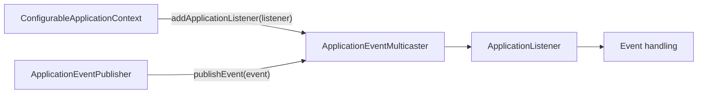

# Registering Listeners Directly with ApplicationContext in Spring Framework

Spring allows registering an event-handling object directly into the application context using the **addApplicationListener(...)** API. This approach is useful when a listener is created conditionally at runtime, comes from an extension module, or needs to be added to the context programmatically rather than declared as a bean.

There is an important API detail: **ApplicationContext** is the interface used to access beans, publish events, and read resources; it does not declare the **addApplicationListener** method. The registration method resides on **ConfigurableApplicationContext**. Therefore, when you need to register a listener this way, work with a context typed as **ConfigurableApplicationContext**.

This article explains how to register listeners before and after refresh, how Spring distributes events, the difference between directly registered listeners and Spring-managed listeners, along with a runnable Java 17 example.

## 1. ApplicationContext and ConfigurableApplicationContext

**ApplicationContext** is Spring's central container interface. It provides bean lookup, manages relationships between beans, accesses messages/resources, and publishes application events through **ApplicationEventPublisher**.

**ConfigurableApplicationContext** extends context lifecycle management capabilities, including:

- Configuring the environment and parent context.
- Adding a **BeanFactoryPostProcessor**.
- Registering an **ApplicationListener** with **addApplicationListener(...)**.
- Calling **refresh()** to initialize or refresh the context.
- Closing the context with **close()**.

Therefore, the following code does not compile if the variable is only declared with the **ApplicationContext** interface:

```java
ApplicationContext context = ...;

// ApplicationContext does not declare addApplicationListener:
context.addApplicationListener(new AuditListener());
```

Declare it using the interface that provides that method:

```java
ConfigurableApplicationContext context = ...;
context.addApplicationListener(new AuditListener());
```

Not every object typed as ApplicationContext exposes the configuration API. In typical Spring applications, implementations such as **AnnotationConfigApplicationContext**, **GenericApplicationContext**, or **ClassPathXmlApplicationContext** are all configurable contexts.

If a component only needs to look up beans and publish events, it should depend on **ApplicationContext** or **ApplicationEventPublisher**. Only depend on **ConfigurableApplicationContext** when the component genuinely needs to control the lifecycle or dynamically register listeners.

## 2. What does addApplicationListener(...) do?

The **ConfigurableApplicationContext.addApplicationListener(ApplicationListener<?>)** method accepts an instance implementing **ApplicationListener** and registers that instance so the context forwards matching events to the listener.

High-level flow:



During refresh, Spring prepares the event multicaster and brings registered listeners into the dispatch mechanism. When a publisher calls **publishEvent(event)**, the multicaster finds listeners matching the event type and invokes the handler method.

A directly registered listener still participates in Spring's event distribution mechanism. You do not need to invoke the listener method yourself or maintain a list of listeners to iterate over manually.

API example:

```java
ConfigurableApplicationContext context =
        new AnnotationConfigApplicationContext();

context.addApplicationListener(new AuditListener());
context.refresh();

context.publishEvent(new OrderCreatedEvent(
        context,
        "ORD-1001"
));
```

In this example, the listener is registered before the context refreshes. Once refresh completes, the publisher emits an event and the listener can receive the corresponding event.

## 3. ApplicationListener and event types

Direct registration typically uses the **ApplicationListener<E extends ApplicationEvent>** interface. The generic type specifies the kind of event the listener is interested in.

Event example:

```java
public class OrderCreatedEvent extends ApplicationEvent {
    private final String orderId;

    public OrderCreatedEvent(Object source, String orderId) {
        super(source);
        this.orderId = orderId;
    }

    public String getOrderId() {
        return orderId;
    }
}
```

Listener:

```java
public class AuditListener
        implements ApplicationListener<OrderCreatedEvent> {

    @Override
    public void onApplicationEvent(OrderCreatedEvent event) {
        System.out.println(
                "Recorded order " + event.getOrderId()
        );
    }
}
```

When the context receives an **OrderCreatedEvent**, this listener is invoked. A listener declaring a different event type will not receive that event merely because it is also registered in the same context.

With **ApplicationListener**, the event type must be a class extending **ApplicationEvent**. Spring also supports publishing a plain payload object via **publishEvent(Object)**; in that case Spring wraps the payload in a **PayloadApplicationEvent**. If you want to handle POJOs/records directly without creating a class extending ApplicationEvent, an **@EventListener** method is usually a more convenient choice. Do not declare **ApplicationListener<MyRecord>** for a record that does not extend ApplicationEvent because the interface's generic bound does not allow that type.

## 4. Register before or after refresh?

Registration timing affects which events the listener has a chance to receive.

### Registering before refresh

```java
ConfigurableApplicationContext context =
        new AnnotationConfigApplicationContext();

context.addApplicationListener(new StartupListener());

context.refresh();
```

This is the appropriate approach when a listener needs to observe events during context startup, such as **ContextRefreshedEvent**. The listener is already registered before Spring emits the corresponding lifecycle events.

If a listener only needs to receive custom events after the application is ready, registering before refresh is still a simple and clear option.

### Registering after refresh

```java
ConfigurableApplicationContext context =
        new AnnotationConfigApplicationContext(AppConfig.class);

// The context already refreshed in the constructor taking the configuration class.
context.addApplicationListener(new RuntimeAuditListener());

context.publishEvent(new OrderCreatedEvent(
        context,
        "ORD-1002"
));
```

Registering after refresh is also valid. Spring adds the listener to the active event multicaster, and the listener will receive matching events published after the registration time.

A listener does not retroactively receive events published before it was registered. Application events are in-memory notifications, not an event history for newly added listeners to replay automatically.

### Which timing to choose?

| Requirement | Appropriate timing |
|---|---|
| Observe startup or refresh events | Before calling refresh |
| Add listener based on a runtime feature flag or plugin | When the condition is determined; can be after refresh |
| Listener only handles business events after the application is ready | Before or after refresh, as long as before target events are published |
| Need to process past events again | Requires a separate storage/replay mechanism; addApplicationListener does not do this |

## 5. Complete example with Java 17 and Spring Framework

The example creates an empty context, registers two listeners directly, refreshes the context, and then publishes an event. Both listeners receive the same event but perform two different responsibilities.

### 5.1. Project structure

```text
spring-context-programmatic-listener/
├── pom.xml
└── src/
    └── main/
        └── java/
            └── dev/
                └── example/
                    └── listener/
                        └── Application.java
```

### 5.2. Maven dependencies

```xml
<project xmlns="http://maven.apache.org/POM/4.0.0"
         xmlns:xsi="http://www.w3.org/2001/XMLSchema-instance"
         xsi:schemaLocation="http://maven.apache.org/POM/4.0.0 https://maven.apache.org/xsd/maven-4.0.0.xsd">
    <modelVersion>4.0.0</modelVersion>

    <groupId>dev.example</groupId>
    <artifactId>spring-context-programmatic-listener</artifactId>
    <version>1.0.0</version>

    <properties>
        <maven.compiler.release>17</maven.compiler.release>
        <project.build.sourceEncoding>UTF-8</project.build.sourceEncoding>
    </properties>

    <dependencies>
        <dependency>
            <groupId>org.springframework</groupId>
            <artifactId>spring-context</artifactId>
            <version>6.2.6</version>
        </dependency>
    </dependencies>

    <build>
        <plugins>
            <plugin>
                <groupId>org.apache.maven.plugins</groupId>
                <artifactId>maven-compiler-plugin</artifactId>
                <version>3.13.0</version>
                <configuration>
                    <release>17</release>
                </configuration>
            </plugin>
            <plugin>
                <groupId>org.codehaus.mojo</groupId>
                <artifactId>exec-maven-plugin</artifactId>
                <version>3.5.0</version>
                <configuration>
                    <mainClass>dev.example.listener.Application</mainClass>
                </configuration>
            </plugin>
        </plugins>
    </build>
</project>
```

### 5.3. Source code

Create the file **src/main/java/dev/example/listener/Application.java**:

```java
package dev.example.listener;

import org.springframework.context.ApplicationEvent;
import org.springframework.context.ApplicationListener;
import org.springframework.context.ConfigurableApplicationContext;
import org.springframework.context.annotation.AnnotationConfigApplicationContext;

public class Application {

    public static void main(String[] args) {
        try (ConfigurableApplicationContext context =
                     new AnnotationConfigApplicationContext()) {

            // Register listeners directly with the context.
            context.addApplicationListener(new AuditListener());
            context.addApplicationListener(new NotificationListener());

            // Complete context initialization after listeners are registered.
            context.refresh();

            // Publish an event; both listeners receive this event.
            context.publishEvent(
                    new OrderCreatedEvent(context, "ORD-1001", "C-200")
            );
        }
    }

    public static class OrderCreatedEvent extends ApplicationEvent {
        private final String orderId;
        private final String customerId;

        public OrderCreatedEvent(
                Object source,
                String orderId,
                String customerId
        ) {
            super(source);
            this.orderId = orderId;
            this.customerId = customerId;
        }

        public String getOrderId() {
            return orderId;
        }

        public String getCustomerId() {
            return customerId;
        }
    }

    public static class AuditListener
            implements ApplicationListener<OrderCreatedEvent> {

        @Override
        public void onApplicationEvent(OrderCreatedEvent event) {
            System.out.printf(
                    "Audit: recorded order %s for customer %s%n",
                    event.getOrderId(),
                    event.getCustomerId()
            );
        }
    }

    public static class NotificationListener
            implements ApplicationListener<OrderCreatedEvent> {

        @Override
        public void onApplicationEvent(OrderCreatedEvent event) {
            System.out.printf(
                    "Notification: preparing confirmation for order %s%n",
                    event.getOrderId()
            );
        }
    }
}
```

### 5.4. Running the program

Open a terminal in the directory containing **pom.xml** and run:

```bash
mvn -q compile exec:java
```

Expected stdout:

```text
Audit: recorded order ORD-1001 for customer C-200
Notification: preparing confirmation for order ORD-1001
```

The output shows that the publisher only calls **publishEvent** once. Spring forwards the same **OrderCreatedEvent** to both **AuditListener** and **NotificationListener**. Each listener receives the same order ID and customer ID, then carries out its own responsibility.

The two listeners in the example are registered in a specific order. If processing order is a business requirement, declare the order with **@Order** or implement **Ordered** and verify the dispatch configuration. Do not rely on incidental registration order as a long-term business contract.

## 6. Are directly registered listeners managed by Spring?

This is a distinction that must be made clear.

When you write:

```java
context.addApplicationListener(new AuditListener());
```

you create the object yourself with **new**. The context accepts that instance and uses it to dispatch events, but this instance does not automatically become a bean created and fully managed by the bean factory.

Therefore, a listener registered directly this way does not automatically get:

- Dependency injection on fields or constructors that Spring does not call.
- AOP proxies for annotations such as **@Transactional** or **@Async** placed on the listener.
- Bean lifecycle callbacks such as **@PostConstruct** and **@PreDestroy** managed by the bean factory.
- Scope and lifecycle according to Spring bean rules.

If the listener needs dependencies, you can pass them through the constructor when creating the instance manually:

```java
AuditListener listener = new AuditListener(
        context.getBean(AuditService.class)
);
context.addApplicationListener(listener);
```

This approach lets you use a Spring-managed service, while the listener itself remains a manually created object. Mechanisms applied to the listener itself, such as AOP or lifecycle callbacks, still need separate consideration.

If the listener needs to be fully managed by Spring, it is usually better to declare it as a bean. A bean implementing **ApplicationListener** can be automatically detected and registered by the ApplicationContext during refresh:

```java
@Component
public class AuditListener
        implements ApplicationListener<OrderCreatedEvent> {

    private final AuditService auditService;

    public AuditListener(AuditService auditService) {
        this.auditService = auditService;
    }

    @Override
    public void onApplicationEvent(OrderCreatedEvent event) {
        auditService.record(event.getOrderId());
    }
}
```

In this case, component scan must cover the listener's package or the bean must be declared via **@Bean**. Do not both let Spring auto-detect a listener bean and register another instance for the same purpose; if both receive the event, business logic may execute twice.

## 7. When should you register listeners directly?

Direct registration is suitable when listener configuration is dynamic or depends on runtime conditions.

### Plugins or extensions

An application may load extension modules depending on configuration. When a module is enabled, the application creates the corresponding listener and adds it to the context. The module does not need to declare a fixed bean inside the main application's component scan.

### Feature flags

A listener may only be active when a feature is enabled. The application checks configuration and then registers the listener:

```java
if (featureFlags.isAuditEnabled()) {
    context.addApplicationListener(new AuditListener());
}
```

In a real example, the context variable must be typed as **ConfigurableApplicationContext**, and registration must take place before the events to be handled are published.

### Listeners provided by an external library

A library may construct an object implementing **ApplicationListener** and ask the application to register it. The programmatic API allows integration without modifying the listener class or creating custom annotations.

### Per-environment configuration

An application may register different listeners depending on environment, tenant, or startup configuration. Context scope and listener lifecycle should be bounded to avoid duplicate registration or retaining listeners that are no longer used.

## 8. When should you use a bean instead of direct registration?

If a listener is a fixed part of the application and needs dependency injection, transactions, async execution, or bean lifecycle mechanisms, declaring the listener as a bean is usually clearer.

| Requirement | Appropriate approach |
|---|---|
| Fixed listener in the application | Bean with **@Component** or **@Bean** |
| Listener requires constructor injection from Spring | Spring bean |
| Listener requires AOP, **@Transactional**, **@Async** | Spring-managed bean with appropriate proxying |
| Listener created per plugin or feature flag | Programmatic registration with **ConfigurableApplicationContext** |
| Listener is an instance provided by an external library | Programmatic registration |
| Only need to handle POJO events with a method | Bean with **@EventListener** |

Do not use the direct registration API merely because it is shorter. Choose based on the instantiation model and lifecycle the application needs.

## 9. Event multicaster and customization

**ApplicationEventMulticaster** is the component that carries out dispatching events to listeners. By default, Spring uses **SimpleApplicationEventMulticaster** in the application context.

When calling **ConfigurableApplicationContext.addApplicationListener(...)**, the context manages the listener and passes it to the multicaster during refresh or immediately if the multicaster is already ready.

In an application needing deeper customization, you can declare a bean named **applicationEventMulticaster** to change the dispatch mechanism, such as configuring a **TaskExecutor** or **ErrorHandler**. This is a context-level configuration, so evaluate its impact on all listeners using that multicaster.

Direct listener registration does not make events asynchronous by itself. With the default multicaster, listeners are invoked synchronously on the event-publishing thread. If an executor is used, understand that the publisher may not wait for listeners to finish and errors in async tasks are not necessarily propagated back to the **publishEvent** caller.

Do not create a separate event multicaster for each listener without a clear isolation requirement. Customizing the multicaster affects ordering, threading, exception handling, and the behavior of all events in the context.

## 10. Common mistakes

| Symptom | Cause | How to fix |
|---|---|---|
| Does not compile when calling addApplicationListener | Variable is typed as **ApplicationContext** | Use **ConfigurableApplicationContext** |
| Listener does not receive events | Listener not registered or incompatible event type | Check the addApplicationListener call and generic type |
| Listener misses startup events | Listener registered after the event was emitted | Register before refresh if startup events are needed |
| Listener does not receive past events | Application events are not a replayable event log | Use a separate storage and replay mechanism |
| Dependencies inside the listener are null | Instance was created with **new**, not through the bean factory | Pass dependencies via constructor or use a Spring bean |
| **@Transactional** on listener does not work as expected | Listener instance is not proxied by Spring | Register the listener as a bean and verify transaction proxying |
| Business logic executes twice | Listener is both auto-detected as a bean and registered as an extra instance | Choose a single registration method and avoid duplicate instances/handlers |
| Slow listener slows down the publisher | Default multicaster invokes synchronously | Evaluate an executor or move heavy processing to a messaging mechanism |

## 11. Checklist when registering listeners directly

- The context variable has type **ConfigurableApplicationContext**.
- The listener implements **ApplicationListener** with the appropriate event type.
- Custom events extend **ApplicationEvent** when using ApplicationListener.
- The listener is registered before the target events are published.
- If events during refresh need to be received, the listener is added before calling **refresh()**.
- If the listener is created with **new**, its dependencies and lifecycle are managed intentionally.
- Do not double-register a listener already auto-detected by Spring.
- Do not assume registering a listener automatically enables async, transactions, or replay.
- Choose a Spring bean when the listener needs full dependency injection, AOP, and lifecycle support.

Direct listener registration is a useful API for extending event handling based on runtime conditions. Remember that the method belongs to **ConfigurableApplicationContext**, the listener must be registered before events occur, and manually created instances do not automatically become Spring-managed beans. Once you keep those three points in mind, you can choose properly between programmatic registration and declaring a listener as a bean.
