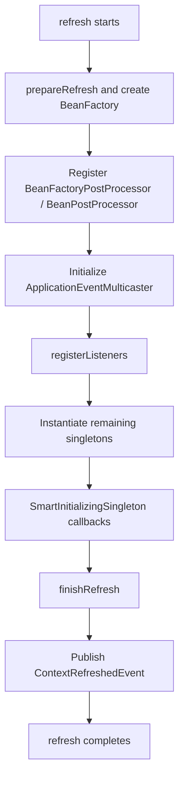

# When Are Listeners Discovered?

Spring does not wait until the first `publishEvent` call to find listeners. ApplicationContext prepares and registers listeners during `refresh()`, but each listener style is processed at a different stage. `ApplicationListener` beans are registered early during `registerListeners()`, whereas `@EventListener` methods are turned into listener adapters at the end of singleton initialization. Consequently, when an event is published during application startup can determine which listeners are already ready to receive it.

## 1. A quick look at the refresh lifecycle

With `AbstractApplicationContext`, the main refresh flow can be summarized as follows:



In this sequence, `registerListeners()` occurs before Spring instantiates all remaining singletons. `finishRefresh()` occurs after the singleton initialization phase and publishes `ContextRefreshedEvent` at the final step. This is a key milestone for understanding why a listener already receives the refresh event, while an event published very early may arrive before some adapter listeners are registered.

## 2. Two listener detection mechanisms have different timing

### `ApplicationListener<E>`: registered during `registerListeners()`

For listeners implementing the `ApplicationListener` interface, `AbstractApplicationContext.registerListeners()` performs two main tasks:

- Registers listeners added directly to the context, such as via `addApplicationListener(...)`.
- Finds bean names of type `ApplicationListener` and registers those bean names with `ApplicationEventMulticaster`.

Registering bean names lets Spring avoid instantiating every listener immediately at this step. The multicaster can retrieve the bean when an event needs to be dispatched. Later, `ApplicationListenerDetector` — a `BeanPostProcessor` installed early by the context — also detects `ApplicationListener` instances after bean initialization, including cases that cannot be fully discovered by querying bean names alone.

Example:

```java
@Component
public class StartupListener
        implements ApplicationListener<ContextRefreshedEvent> {

    @Override
    public void onApplicationEvent(ContextRefreshedEvent event) {
        System.out.println("ApplicationListener: context refreshed");
    }
}
```

A bean implementing the interface is recognized in the context's listener registration flow. The generic type `ApplicationListener<ContextRefreshedEvent>` also helps Spring filter matching events during dispatch.

### `@EventListener`: adapter registered after singletons are instantiated

An `@EventListener` method is not added directly to the multicaster merely by reading the annotation on the bean definition. Spring uses `EventListenerMethodProcessor` to find annotated methods and create corresponding `ApplicationListener` adapters.

`EventListenerMethodProcessor` is a `BeanFactoryPostProcessor` and `SmartInitializingSingleton`. Annotation processing takes place in the `afterSingletonsInstantiated()` callback, which runs at the end of the regular singleton initialization phase. This callback runs before `finishRefresh()` and before the context emits `ContextRefreshedEvent`.

Example:

```java
@Component
public class OrderEventListener {

    @EventListener
    public void onOrderPlaced(OrderPlacedEvent event) {
        System.out.println("Order received: " + event.orderId());
    }
}
```

Spring registers an adapter for the `onOrderPlaced` method when `EventListenerMethodProcessor` processes the bean. From the moment the adapter is added to the context onward, matching events are dispatched to that method.

### Timing comparison table

| Mechanism | Detecting component | Primary registration timing |
|---|---|---|
| `ApplicationListener<E>` as a bean | `AbstractApplicationContext.registerListeners()` registers bean names; `ApplicationListenerDetector` complements by detecting instances after initialization | During `registerListeners()` and during bean instantiation |
| `ApplicationListener<?>` added directly | `ConfigurableApplicationContext.addApplicationListener(...)` | Before refresh: applied during refresh; after refresh: added directly to the running multicaster |
| `@EventListener` method | `EventListenerMethodProcessor` creates a listener adapter | `afterSingletonsInstantiated()`, at the end of the singleton instantiation phase |

This describes the implementation flow of Spring Framework 6.2. Internal class names and detailed ordering may change between versions; public contracts should rely on the `ApplicationContext`, `ApplicationListener`, and `@EventListener` APIs.

## 3. Where is `EventListenerMethodProcessor` registered from?

With Java configuration, `AnnotationConfigApplicationContext` and the annotation config infrastructure register the processors needed to handle annotations. Therefore, `@EventListener` works in standard Java-configured applications without manually creating `EventListenerMethodProcessor`.

With XML, annotation processing must be enabled via `<context:annotation-config/>` or `<context:component-scan/>`. Component scan both searches packages for beans and enables the corresponding annotation config infrastructure.

Minimal Java configuration example:

```java
@Configuration
public class AppConfig {
    @Bean
    OrderEventListener orderEventListener() {
        return new OrderEventListener();
    }
}
```

Beans declared with `@Bean` are still inspected by `EventListenerMethodProcessor`. There is no need to add `@Component` if the bean is already registered by configuration.

## 4. Why can events published too early be missed?

The listener registration timing creates a gap between the two mechanisms:

- `ApplicationListener` bean names are registered in `registerListeners()`.
- Adapters for `@EventListener` are registered after regular singletons have been instantiated, in `afterSingletonsInstantiated()`.

Therefore, an event published during early initialization — for example from a constructor, `@PostConstruct`, a `BeanFactoryPostProcessor`, or `onRefresh()` logic — can occur before the `@EventListener` adapter is added to the multicaster. Do not assume annotation listeners are already ready as soon as the bean factory begins creating beans.

`AbstractApplicationContext` has a mechanism to buffer events published very early before the event multicaster is ready, and then replay them during `registerListeners()`. However, buffering early events does not mean every future listener will receive the event: `@EventListener` adapters may still not be registered at the moment early events are dispatched.

For business events, the safe approach is usually to publish after the context has refreshed and application components are ready. If a component genuinely needs to receive very early bootstrap events, choose an appropriate early registration mechanism and verify initialization ordering explicitly.

## 5. When is `ContextRefreshedEvent` emitted?

`ContextRefreshedEvent` is emitted in `finishRefresh()`, after Spring finishes instantiating the remaining singletons. Because `EventListenerMethodProcessor.afterSingletonsInstantiated()` has already run before that, regular `@EventListener` methods are already registered before `ContextRefreshedEvent` is emitted.

This is why a listener can use `ContextRefreshedEvent` to run tasks after the context has refreshed:

```java
@Component
public class StartupTasks {

    @EventListener
    public void onContextRefreshed(ContextRefreshedEvent event) {
        System.out.println("Application context is ready");
    }
}
```

Do not confuse `ContextRefreshedEvent` with the point when every system task has completed. It signals that the ApplicationContext has finished refreshing. Background tasks, remote connections, or application-specific readiness procedures may still be continuing.

## 6. Registering listeners before and after `refresh()`

With `ConfigurableApplicationContext`, you can add listeners directly using `addApplicationListener(...)`.

**Before refresh:** the listener is kept in the context's static listener list and passed to the multicaster during `registerListeners()`.

```java
var context = new AnnotationConfigApplicationContext();
context.addApplicationListener(
        (ContextRefreshedEvent event) ->
                System.out.println("Registered before refresh"));
context.register(AppConfig.class);
context.refresh();
context.close();
```

**After refresh:** if the context is already active, the listener is added directly to the current multicaster and can receive events published after registration. It does not retroactively receive events published earlier.

```java
var context = new AnnotationConfigApplicationContext(AppConfig.class);
context.addApplicationListener(
        (OrderPlacedEvent event) ->
                System.out.println("Late listener: " + event.orderId()));
context.publishEvent(new OrderPlacedEvent("ORD-7101"));
context.close();
```

The `removeApplicationListener(...)` API can remove a directly registered listener. Adding or removing listeners after refresh does not replay historical events.

## 7. How do lazy beans and scopes affect discovery?

Do not equate when a bean is discovered with when the bean is instantiated. For `ApplicationListener` beans, the context can register bean names in `registerListeners()` before creating instances; instances are retrieved when needed for dispatch. `ApplicationListenerDetector` additionally handles listener instances discovered after initialization.

For `@EventListener`, the processor must find methods on the bean and create adapters referencing that bean. Adapter creation belongs to the `afterSingletonsInstantiated()` phase. Beans with special scopes, scoped proxies, or lazy configuration should be checked according to their registration model and scope lifecycle; do not assume every bean scope behaves like a regular singleton.

In web applications, a request-scoped listener is usually not a good choice for global application events. A singleton listener that receives the event and calls a suitably scoped service is generally easier to manage in terms of lifecycle. If a listener must live in a special scope, verify the proxy, target bean, and when the scope is active.

## 8. Listener ordering and registration timing

`@Order` orders invocation among listeners that are already registered and match the event. It does not make a listener get discovered earlier during refresh.

```java
@Component
public class OrderedListeners {
    @EventListener
    @Order(1)
    public void first(OrderPlacedEvent event) {
        System.out.println("First");
    }

    @EventListener
    @Order(2)
    public void second(OrderPlacedEvent event) {
        System.out.println("Second");
    }
}
```

For asynchronous listeners, `@Order` does not guarantee work completion order across different threads. If a later step depends on the result of an earlier step, coordinate with a service or explicit workflow.

## 9. Complete example: observing listeners before and after refresh

The example uses Java 17 and Spring Framework 6.2.0. `OrderEventListener` has one method listening for `ContextRefreshedEvent` and one method listening for a business event. The example demonstrates that the annotation listener is already registered before the `AnnotationConfigApplicationContext` constructor returns.

### Directory structure

```text
listener-discovery-time/
├── pom.xml
└── src/
    └── main/
        └── java/
            └── demo/
                └── ListenerDiscoveryTimeDemo.java
```

### pom.xml

```xml
<project xmlns="http://maven.apache.org/POM/4.0.0"
         xmlns:xsi="http://www.w3.org/2001/XMLSchema-instance"
         xsi:schemaLocation="http://maven.apache.org/POM/4.0.0 https://maven.apache.org/xsd/maven-4.0.0.xsd">
    <modelVersion>4.0.0</modelVersion>
    <groupId>demo</groupId>
    <artifactId>listener-discovery-time</artifactId>
    <version>1.0.0</version>
    <properties>
        <maven.compiler.release>17</maven.compiler.release>
        <project.build.sourceEncoding>UTF-8</project.build.sourceEncoding>
    </properties>
    <dependencies>
        <dependency>
            <groupId>org.springframework</groupId>
            <artifactId>spring-context</artifactId>
            <version>6.2.0</version>
        </dependency>
    </dependencies>
    <build>
        <plugins>
            <plugin>
                <groupId>org.apache.maven.plugins</groupId>
                <artifactId>maven-compiler-plugin</artifactId>
                <version>3.13.0</version>
            </plugin>
            <plugin>
                <groupId>org.codehaus.mojo</groupId>
                <artifactId>exec-maven-plugin</artifactId>
                <version>3.3.0</version>
            </plugin>
        </plugins>
    </build>
</project>
```

### src/main/java/demo/ListenerDiscoveryTimeDemo.java

```java
package demo;

import org.springframework.context.ApplicationEventPublisher;
import org.springframework.context.event.ContextRefreshedEvent;
import org.springframework.context.annotation.AnnotationConfigApplicationContext;
import org.springframework.context.annotation.Bean;
import org.springframework.context.annotation.Configuration;
import org.springframework.context.event.EventListener;

public class ListenerDiscoveryTimeDemo {

    public record OrderPlacedEvent(String orderId) {
    }

    public static class OrderEventListener {
        @EventListener
        public void onContextRefreshed(ContextRefreshedEvent event) {
            System.out.println("Listener: ContextRefreshedEvent received");
        }

        @EventListener
        public void onOrderPlaced(OrderPlacedEvent event) {
            System.out.println(
                    "Listener: OrderPlacedEvent received: " + event.orderId());
        }
    }

    public static class OrderPublisher {
        private final ApplicationEventPublisher publisher;

        public OrderPublisher(ApplicationEventPublisher publisher) {
            this.publisher = publisher;
        }

        public void publish(String orderId) {
            publisher.publishEvent(new OrderPlacedEvent(orderId));
        }
    }

    @Configuration(proxyBeanMethods = false)
    public static class AppConfig {
        @Bean
        OrderEventListener orderEventListener() {
            return new OrderEventListener();
        }

        @Bean
        OrderPublisher orderPublisher(ApplicationEventPublisher publisher) {
            return new OrderPublisher(publisher);
        }
    }

    public static void main(String[] args) {
        try (var context =
                     new AnnotationConfigApplicationContext(AppConfig.class)) {
            System.out.println("Main: context refresh returned");
            context.getBean(OrderPublisher.class).publish("ORD-7101");
        }
    }
}
```

### Running the program

In the `listener-discovery-time/` directory, run:

```bash
mvn -q compile exec:java -Dexec.mainClass=demo.ListenerDiscoveryTimeDemo
```

Expected stdout:

```text
Listener: ContextRefreshedEvent received
Main: context refresh returned
Listener: OrderPlacedEvent received: ORD-7101
```

### Reading the result

1. Spring creates the ApplicationContext and runs `refresh()`.
2. During singleton initialization, `EventListenerMethodProcessor.afterSingletonsInstantiated()` registers adapters for the two `@EventListener` methods.
3. `finishRefresh()` emits `ContextRefreshedEvent`; since the listener is already registered, it receives this event.
4. The context constructor returns and the program prints `Main: context refresh returned`.
5. The publisher emits `OrderPlacedEvent`; the business listener receives the event after the context is ready.

The example avoids publishing business events from a constructor or `@PostConstruct`, because that timing can occur before `@EventListener` adapters are registered.

## 10. Common mistakes when checking discovery timing

| Symptom | Possible cause | How to address |
|---|---|---|
| `@EventListener` does not receive an event emitted during startup | Event was published before `afterSingletonsInstantiated()` | Move publishing until after refresh or choose an appropriate early registration mechanism |
| `ApplicationListener` receives the early event but `@EventListener` does not | The two mechanisms register listeners in different phases | Check when `registerListeners()` and `EventListenerMethodProcessor` execute |
| `ContextRefreshedEvent` is not received | Annotation processing is not enabled, bean is not registered, or listener belongs to a different context | Check Java config/XML annotation config and bean registration |
| Listener added after refresh does not receive past events | Listener was only added for future events | If replay is needed, build a separate storage and replay mechanism |
| Listener is invoked multiple times | Same listener registered multiple times or bean exists in multiple contexts | Check component scan, configuration, and context hierarchy |
| Event is emitted before listeners are ready | Published inside a constructor, `@PostConstruct`, or early initialization callback | Avoid emitting business events during early bootstrap |

## 11. Lifecycle debugging checklist

- [ ] Determine whether the listener uses `ApplicationListener<E>` or `@EventListener`.
- [ ] Determine whether the listener is a bean, a directly registered listener, or an annotation adapter.
- [ ] Identify when the context runs `refresh()` and when the event is published.
- [ ] For `ApplicationListener`, check `registerListeners()` and bean name registration.
- [ ] For `@EventListener`, check `EventListenerMethodProcessor` and the `afterSingletonsInstantiated()` callback.
- [ ] Confirm that `ContextRefreshedEvent` is only emitted after the singleton initialization phase.
- [ ] Check that component scan or annotation config has enabled the processor.
- [ ] Check lazy initialization, scoped proxies, and parent–child contexts if the application uses those configurations.
- [ ] Do not rely on `@Order` to solve a problem where a listener is not registered yet.

## 12. Key takeaways

`ApplicationListener` is registered early by the context in `registerListeners()`; `@EventListener` methods are converted into adapters by `EventListenerMethodProcessor` at the end of the singleton initialization phase. Afterward, `finishRefresh()` emits `ContextRefreshedEvent`. Therefore, events published too early during bootstrap may arrive before annotation listeners are ready. When you need to run work after application startup, `ContextRefreshedEvent` is an appropriate milestone; for regular business logic, publish after the context has refreshed.

## References

- [AbstractApplicationContext — Spring Framework 6.2](https://docs.spring.io/spring-framework/docs/6.2.8/javadoc-api/org/springframework/context/support/AbstractApplicationContext.html)
- [EventListenerMethodProcessor — Spring Framework 6.2](https://docs.spring.io/spring-framework/docs/6.2.8/javadoc-api/org/springframework/context/event/EventListenerMethodProcessor.html)
- [SmartInitializingSingleton — Spring Framework 6.2](https://docs.spring.io/spring-framework/docs/6.2.7/javadoc-api/org/springframework/beans/factory/SmartInitializingSingleton.html)
- [ApplicationListener — Spring Framework 6.2](https://docs.spring.io/spring-framework/docs/6.2.0/javadoc-api/org/springframework/context/ApplicationListener.html)
- [ConfigurableApplicationContext — Spring Framework 6.2](https://docs.spring.io/spring-framework/docs/6.2.18/javadoc-api/org/springframework/context/ConfigurableApplicationContext.html)
