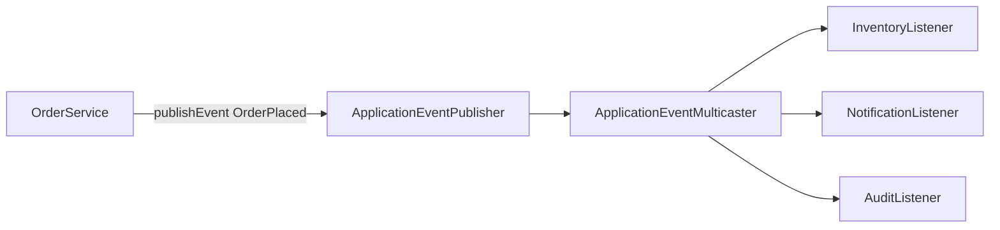

# Event-driven trong phạm vi một ứng dụng Spring

## 1. Mục tiêu và phạm vi

Spring Application Events cho phép các Spring bean trao đổi thông tin bằng cách **phát một sự kiện và để các bean quan tâm tự đăng ký xử lý**. Bean phát sự kiện không cần biết có bao nhiêu listener, listener nằm ở lớp nào hoặc listener sẽ thực hiện công việc gì.

Trong bài này, event-driven được hiểu là giao tiếp **bên trong cùng một ứng dụng Spring và cùng tiến trình JVM**. Cơ chế này giúp giảm phụ thuộc trực tiếp giữa các bean, nhưng bản thân nó không phải message broker, không tự lưu sự kiện vào hàng đợi bền vững và không truyền sự kiện sang ứng dụng khác.

Sau bài học, bạn có thể:

- Giải thích vai trò của event, publisher, listener và event multicaster.
- Phát sự kiện bằng `ApplicationEventPublisher` và nhận sự kiện bằng `@EventListener`.
- Hiểu hành vi mặc định đồng bộ, thứ tự listener và cách xử lý listener bất đồng bộ.
- Chọn đúng `@TransactionalEventListener` khi việc xử lý phụ thuộc kết quả commit hoặc rollback.
- Nhận biết khi nào nên dùng Application Events và khi nào cần gọi service trực tiếp hoặc dùng hệ thống messaging.

## 2. Bài toán: giảm phụ thuộc giữa các thành phần

Giả sử một ứng dụng bán hàng có chức năng tạo đơn hàng. Sau khi đơn hàng được ghi nhận, ứng dụng cần cập nhật tồn kho, gửi email xác nhận và ghi nhận hoạt động.

Nếu `OrderService` gọi trực tiếp tất cả service này, nó phải biết từng thành phần phụ trợ. Khi thêm một tác vụ mới, chẳng hạn cập nhật chỉ mục tìm kiếm, bạn lại phải sửa `OrderService`. Các phụ thuộc và trách nhiệm của service phát sinh ngày càng nhiều.

Với Application Events, `OrderService` chỉ công bố sự kiện `OrderPlaced`. Các listener độc lập đăng ký nhận sự kiện đó:



Publisher chỉ biểu đạt một sự thật: đơn hàng đã được tạo. Listener tự quyết định cách phản ứng với sự thật đó. Khi thêm `AuditListener`, bạn không cần sửa logic phát sự kiện trong `OrderService`.

Cách tổ chức này phù hợp với các tác vụ phụ trợ có thể tách rời. Nếu một bước là điều kiện bắt buộc để nghiệp vụ chính thành công, ví dụ phải xác nhận hạn mức trước khi tạo đơn, hãy gọi service đó trực tiếp và xử lý kết quả rõ ràng. Đừng giấu một bước nghiệp vụ bắt buộc sau một event mà publisher không thể kiểm soát kết quả.

## 3. Các thành phần chính

### Event

Event là dữ liệu mô tả một điều đã xảy ra. Nên đặt tên ở thì quá khứ để thể hiện sự kiện là một sự thật, ví dụ `OrderPlaced`, `UserRegistered`, `PaymentCaptured`.

Event thường chứa dữ liệu tối thiểu mà listener cần để xử lý: mã định danh, thời điểm xảy ra, loại thay đổi hoặc thông tin tham chiếu. Ưu tiên dữ liệu bất biến, chẳng hạn Java `record`, để listener không vô tình thay đổi dữ liệu mà listener khác đang sử dụng.

Từ Spring Framework 4.2, bạn có thể phát một object Java thông thường làm event. Không bắt buộc phải kế thừa `ApplicationEvent`. Kế thừa lớp này vẫn hữu ích khi cần tương thích với listener kiểu cũ hoặc cần mô hình event có `source` và timestamp do lớp nền cung cấp.

Spring cũng phát các event vòng đời ApplicationContext như `ContextRefreshedEvent`, `ContextStartedEvent`, `ContextStoppedEvent` và `ContextClosedEvent`. Có thể dùng listener để phản ứng với các mốc khởi tạo, bắt đầu, dừng hoặc đóng context.

### Publisher

`ApplicationEventPublisher` là API dùng để phát event:

```java
publisher.publishEvent(new OrderPlaced("ORD-1001"));
```

`ApplicationContext` triển khai `ApplicationEventPublisher`, vì vậy Spring có thể inject interface này vào bean qua constructor. Nên phụ thuộc vào `ApplicationEventPublisher` thay vì inject toàn bộ `ApplicationContext` chỉ để gọi `publishEvent()`.

### Listener

Listener là Spring bean đăng ký xử lý event. Cách khai báo phổ biến là đặt `@EventListener` trên một method có tham số là kiểu event cần nhận:

```java
@EventListener
public void onOrderPlaced(OrderPlaced event) {
    // xử lý event
}
```

Spring cũng hỗ trợ cách cài đặt interface `ApplicationListener<E>`. Cách này hữu ích khi muốn thể hiện listener bằng một class chuyên biệt hoặc cần dùng API listener truyền thống:

```java
public class InventoryListener
        implements ApplicationListener<OrderPlaced> {

    @Override
    public void onApplicationEvent(OrderPlaced event) {
        // xử lý event
    }
}
```

Dù dùng cách nào, listener phải được đăng ký như một bean trong ApplicationContext thì Spring mới quản lý và gọi nó. Với method `@EventListener`, tránh đánh dấu bean listener là lazy: ApplicationContext có thể chưa khởi tạo bean đó và do vậy không đăng ký method làm listener.

### ApplicationEventMulticaster

ApplicationEventMulticaster là thành phần phân phối event đến các listener phù hợp trong ApplicationContext. Mặc định Spring dùng `SimpleApplicationEventMulticaster`. Bạn thường không cần tạo multicaster thủ công; chỉ cấu hình riêng khi cần thay đổi cách thực thi hoặc xử lý lỗi trên toàn ứng dụng.

## 4. Ví dụ chạy được với Java 17+ và Spring Framework

Ví dụ sau dùng Spring Context trực tiếp, không phụ thuộc Spring Boot. Một `OrderService` phát `OrderPlaced`; hai listener lần lượt xử lý tồn kho và thông báo.

### Cấu hình Maven

Tạo project Maven, đặt mã nguồn tại `src/main/java/demo/ApplicationEventsDemo.java`, và thêm các phần cấu hình sau bên trong phần tử gốc `<project>` của `pom.xml`. Ví dụ dùng Spring Framework 6.2.19 và Java 17:

```xml
<properties>
    <maven.compiler.release>17</maven.compiler.release>
    <project.build.sourceEncoding>UTF-8</project.build.sourceEncoding>
    <spring-framework.version>6.2.19</spring-framework.version>
</properties>

<dependencies>
    <dependency>
        <groupId>org.springframework</groupId>
        <artifactId>spring-context</artifactId>
        <version>${spring-framework.version}</version>
    </dependency>
</dependencies>

<build>
    <plugins>
        <plugin>
            <groupId>org.apache.maven.plugins</groupId>
            <artifactId>maven-compiler-plugin</artifactId>
            <version>3.14.0</version>
        </plugin>
        <plugin>
            <groupId>org.codehaus.mojo</groupId>
            <artifactId>exec-maven-plugin</artifactId>
            <version>3.5.0</version>
        </plugin>
    </plugins>
</build>
```

### Mã nguồn

```java
package demo;

import org.springframework.context.ApplicationEventPublisher;
import org.springframework.context.annotation.AnnotationConfigApplicationContext;
import org.springframework.context.annotation.Bean;
import org.springframework.context.annotation.Configuration;
import org.springframework.context.event.EventListener;
import org.springframework.core.annotation.Order;

@Configuration
public class ApplicationEventsDemo {

    @Bean
    OrderService orderService(ApplicationEventPublisher publisher) {
        return new OrderService(publisher);
    }

    @Bean
    InventoryListener inventoryListener() {
        return new InventoryListener();
    }

    @Bean
    NotificationListener notificationListener() {
        return new NotificationListener();
    }

    public static void main(String[] args) {
        try (var context =
                     new AnnotationConfigApplicationContext(
                             ApplicationEventsDemo.class)) {
            context.getBean(OrderService.class).place("ORD-1001");
        }
    }

    record OrderPlaced(String orderId) {
    }

    static class OrderService {
        private final ApplicationEventPublisher publisher;

        OrderService(ApplicationEventPublisher publisher) {
            this.publisher = publisher;
        }

        void place(String orderId) {
            System.out.println("OrderService: save order " + orderId);
            publisher.publishEvent(new OrderPlaced(orderId));
            System.out.println("OrderService: publishEvent() returned");
        }
    }

    static class InventoryListener {
        @EventListener
        @Order(10)
        public void reserveInventory(OrderPlaced event) {
            System.out.println(
                    "InventoryListener: reserve stock for "
                            + event.orderId());
        }
    }

    static class NotificationListener {
        @EventListener
        @Order(20)
        public void sendConfirmation(OrderPlaced event) {
            System.out.println(
                    "NotificationListener: send confirmation for "
                            + event.orderId());
        }
    }
}
```

Các bean được đăng ký bằng những method `@Bean` trong cấu hình. Spring phát hiện các method `@EventListener` trên những bean đó khi khởi tạo ApplicationContext. `@Order(10)` và `@Order(20)` đặt thứ tự xử lý giữa hai listener cùng nhận event; giá trị nhỏ hơn được ưu tiên trước.

### Biên dịch và chạy

Từ thư mục chứa `pom.xml`, chạy:

```bash
mvn -q compile exec:java -Dexec.mainClass=demo.ApplicationEventsDemo
```

Kết quả stdout:

```text
OrderService: save order ORD-1001
InventoryListener: reserve stock for ORD-1001
NotificationListener: send confirmation for ORD-1001
OrderService: publishEvent() returned
```

Hai listener chạy trước dòng `publishEvent() returned` vì event được xử lý đồng bộ theo cấu hình mặc định. Kết quả cũng cho thấy publisher không cần gọi trực tiếp từng listener.

## 5. Luồng xử lý của một event

Một lần phát event thông thường diễn ra theo trình tự:

1. Spring inject `ApplicationEventPublisher` vào bean phát event.
2. Bean tạo object event với dữ liệu mô tả sự việc vừa xảy ra.
3. Bean gọi `publishEvent(event)`.
4. Event multicaster tìm các listener đã đăng ký và phù hợp với kiểu event.
5. Các listener được gọi theo thứ tự đã cấu hình, nếu có.
6. Khi các listener đồng bộ hoàn tất, lời gọi `publishEvent()` mới trả về.

Event có thể được gửi đến listener phù hợp trong ApplicationContext. Với hệ thống dùng context phân cấp, event phát từ context con còn có thể được chuyển tiếp đến context cha. Vì vậy, một listener ở context cha có thể nhận event từ context con; hãy tính đến điều này nếu ứng dụng có nhiều ApplicationContext.

## 6. Hành vi mặc định: đồng bộ và cùng thread

Mặc định, listener được gọi đồng bộ trên thread đang phát event. Điều này có ba hệ quả quan trọng:

- `publishEvent()` chờ các listener đồng bộ xử lý xong rồi mới trả về.
- Công việc chậm trong một listener làm chậm luồng nghiệp vụ phát event.
- Listener chạy trong cùng thread nên có thể thấy transaction context hiện tại nếu publisher đang ở trong một transaction.

Đồng bộ giúp luồng chạy dễ hiểu và dễ kiểm thử. Nó cũng có nghĩa là exception từ listener có thể truyền ngược về publisher. Với cấu hình multicaster mặc định không có ErrorHandler riêng, exception có thể làm ngắt quá trình phân phối trước khi các listener sau được gọi. Vì vậy, hãy xác định rõ lỗi listener có được phép làm thất bại thao tác gọi hay không, rồi thiết kế xử lý lỗi phù hợp.

Không nên đặt tác vụ kéo dài như gửi email qua mạng, gọi API bên ngoài hoặc xử lý ảnh lớn vào listener đồng bộ nếu publisher không cần chờ kết quả đó. Hãy cân nhắc executor hoặc một hệ thống messaging phù hợp.

## 7. Tùy chỉnh listener

### Lọc theo loại event

Tham số của method xác định loại event listener nhận. Listener nhận `OrderPlaced` sẽ không tự động nhận event có kiểu không liên quan. Bạn có thể có nhiều listener cho cùng một kiểu event; tất cả listener phù hợp đều có cơ hội được gọi.

### Đặt thứ tự

Dùng `@Order` trên method listener hoặc dùng `Ordered` để quy định thứ tự tương đối. Số thứ tự nhỏ hơn được xử lý trước. Chỉ dựa vào thứ tự này khi các bước thực sự cần một trình tự xác định; nếu các listener độc lập, tránh tạo phụ thuộc ngầm giữa chúng.

### Điều kiện xử lý

`@EventListener` hỗ trợ thuộc tính `condition` với biểu thức Spring Expression Language (SpEL). Điều này cho phép listener chỉ xử lý một phần event thỏa điều kiện, ví dụ chỉ gửi thông báo cho đơn hàng VIP. Có thể tham chiếu tham số method trong biểu thức, chẳng hạn `#orderPlaced.orderId == 'ORD-VIP-01'` khi tham số được đặt tên là `orderPlaced`. Giữ điều kiện đơn giản và dễ đọc; nếu quy tắc nghiệp vụ phức tạp, chuyển quy tắc đó vào một service chuyên trách.

### Phát event tiếp theo

Một method `@EventListener` đồng bộ có thể trả về một object khác; Spring sẽ phát object trả về như một event mới. Tính năng này có thể hữu ích trong chuỗi xử lý nhỏ, nhưng dễ làm luồng sự kiện khó theo dõi nếu lạm dụng. Listener bất đồng bộ không hỗ trợ phát event tiếp theo bằng giá trị trả về; khi cần, hãy inject `ApplicationEventPublisher` và gọi `publishEvent()` tường minh.

## 8. Chạy listener bất đồng bộ

Khi listener không cần hoàn thành trước khi publisher tiếp tục, có thể dùng `@Async` kết hợp `@EnableAsync`:

```java
@Configuration
@EnableAsync
class AsyncConfiguration {
}

@Component
class SearchIndexListener {

    @Async
    @EventListener
    public void updateSearchIndex(
            ApplicationEventsDemo.OrderPlaced event) {
        // cập nhật chỉ mục tìm kiếm ở background
    }
}
```

Cần import `org.springframework.scheduling.annotation.EnableAsync`, `org.springframework.scheduling.annotation.Async` và `org.springframework.stereotype.Component`. Cấu hình này cần nằm trong ApplicationContext đang quản lý listener.

Khi method listener được chạy qua executor:

- Publisher có thể tiếp tục trước khi công việc listener hoàn tất.
- Không nên giả định thứ tự hoàn thành giữa nhiều listener bất đồng bộ.
- Exception trong listener không được ném ngược về thread phát event. Với method trả về `void`, cần cấu hình hoặc giám sát xử lý exception bất đồng bộ; mặc định lỗi thường chỉ được ghi log.
- Transaction context và các ThreadLocal của publisher không tự động đi theo sang thread khác.
- Cần chọn executor có giới hạn thread, hàng đợi và chính sách từ chối phù hợp với tải thực tế.

`@Async` chỉ có tác dụng khi Spring kích hoạt async processing và lời gọi đi qua proxy do Spring quản lý. Một lời gọi nội bộ từ method này sang method khác trong cùng object không đi qua proxy theo chế độ mặc định, nên không kích hoạt `@Async`.

Bất đồng bộ trong cùng ứng dụng vẫn không tạo ra bảo đảm lưu trữ hoặc retry bền vững. Nếu ứng dụng dừng trước khi task được xử lý, công việc có thể bị mất.

## 9. Gắn listener với transaction

Một tình huống phổ biến là chỉ gửi email hoặc cập nhật hệ thống phụ sau khi transaction tạo đơn hàng đã commit thành công. Nếu dùng `@EventListener` thông thường, listener đồng bộ có thể chạy ngay trong transaction, trước khi commit. Nếu transaction rollback sau đó, listener có thể đã thực hiện một side effect không thể hoàn tác.

Dùng `@TransactionalEventListener` để gắn thời điểm xử lý với vòng đời transaction:

```java
import org.springframework.stereotype.Component;
import org.springframework.transaction.event.TransactionPhase;
import org.springframework.transaction.event.TransactionalEventListener;

@Component
class OrderReceiptListener {

    @TransactionalEventListener(
            phase = TransactionPhase.AFTER_COMMIT)
    public void sendReceipt(ApplicationEventsDemo.OrderPlaced event) {
        // gửi biên nhận sau khi transaction commit
    }
}
```

Đoạn này giả định `OrderPlaced` được khai báo như trong ví dụ chính và listener nằm cùng package `demo`. Để dùng transaction-bound listener, project cần dependency `org.springframework:spring-tx` cùng phiên bản Spring, một transaction manager phù hợp và cấu hình transaction management (chẳng hạn `@EnableTransactionManagement` trong cấu hình Spring thuần). Với Spring Boot, transaction manager thường được auto-configure khi có starter dữ liệu tương ứng.

Các phase được hỗ trợ:

| Phase | Thời điểm listener chạy |
|---|---|
| `BEFORE_COMMIT` | Trước khi transaction commit |
| `AFTER_COMMIT` | Sau khi commit thành công; đây là mặc định |
| `AFTER_ROLLBACK` | Sau khi transaction rollback |
| `AFTER_COMPLETION` | Sau khi transaction kết thúc, bất kể commit hay rollback |

Nếu không có transaction đang hoạt động tại thời điểm phát event, `@TransactionalEventListener` mặc định không chạy. Chỉ đặt `fallbackExecution = true` khi bạn thực sự muốn listener vẫn chạy trong trường hợp không có transaction:

```java
@TransactionalEventListener(
        phase = TransactionPhase.AFTER_COMMIT,
        fallbackExecution = true)
public void handle(ApplicationEventsDemo.OrderPlaced event) {
    // chạy sau commit, hoặc chạy ngay theo fallback khi không có transaction
}
```

Lưu ý:

- Event phải được phát trong phạm vi transaction mà listener cần theo dõi. Phương thức publisher cần được gọi qua cơ chế transaction của Spring để transaction thực sự có hiệu lực.
- `AFTER_COMMIT` bảo đảm listener chỉ chạy sau commit thành công, nhưng không biến event thành dữ liệu bền vững. Nếu tiến trình dừng sau commit nhưng trước khi listener hoàn tất, side effect vẫn có thể chưa được thực hiện.
- Khi listener cần ghi dữ liệu bằng transaction mới sau commit, hãy cân nhắc ranh giới transaction riêng, chẳng hạn một service được gọi với propagation phù hợp. Không giả định transaction cũ vẫn có thể commit thêm thay đổi sau khi đã hoàn tất.

## 10. Application Events và message broker khác nhau thế nào?

| Tiêu chí | Spring Application Events | Message broker (ví dụ Kafka hoặc RabbitMQ) |
|---|---|---|
| Phạm vi | Các bean trong một ứng dụng Spring | Có thể kết nối nhiều tiến trình và dịch vụ |
| Cơ chế | Gọi listener thông qua ApplicationContext | Gửi/nhận message qua broker |
| Lưu trữ | Không tự lưu event bền vững | Có thể lưu message theo cấu hình broker |
| Retry và replay | Không tự cung cấp cơ chế bền vững | Có thể hỗ trợ retry, consumer group, replay tùy hệ thống |
| Độ trễ | Thấp, không cần mạng khi chạy trong cùng tiến trình | Có thêm chi phí giao tiếp và vận hành |
| Phù hợp | Tách các bean và side effect trong một ứng dụng | Giao tiếp liên dịch vụ, xử lý phân tán hoặc cần hàng đợi bền vững |

Application Events không thay thế Kafka, RabbitMQ hay Spring Integration. Nếu yêu cầu có giao nhận đáng tin cậy giữa các dịch vụ, cần retry sau sự cố, lưu lịch sử hoặc phát lại event, hãy dùng hạ tầng messaging phù hợp. Với yêu cầu đồng bộ trạng thái database và message broker, tìm hiểu Transactional Outbox thay vì chỉ dựa vào listener sau commit.

## 11. Khi nào nên dùng và những lỗi thường gặp

### Nên dùng khi

- Một hành động đã xảy ra và nhiều bean độc lập cần phản ứng với nó.
- Muốn thêm tác vụ phụ trợ mà không sửa publisher mỗi lần thêm listener.
- Tác vụ có thể xử lý riêng, chẳng hạn audit, cache invalidation hoặc thông báo.
- Cần chạy side effect sau commit bằng `@TransactionalEventListener`.

### Cần cân nhắc cách khác khi

- Publisher phải nhận kết quả xử lý ngay để quyết định thành công hay thất bại.
- Các bước nghiệp vụ bắt buộc có thứ tự và cần điều phối rõ ràng.
- Cần giao nhận bền vững, retry, replay hoặc giao tiếp giữa nhiều ứng dụng.
- Event chỉ tạo thêm lớp gián tiếp mà không giảm phụ thuộc thực sự.

### Lỗi thiết kế thường gặp

1. **Dùng event thay cho lời gọi service bắt buộc:** publisher không có hợp đồng kết quả rõ ràng từ listener. Hãy gọi service trực tiếp khi kết quả là một phần của nghiệp vụ chính.
2. **Đưa object mutable vào event:** listener trước có thể thay đổi dữ liệu listener sau nhận được. Hãy dùng record hoặc object bất biến.
3. **Đưa entity lớn hoặc lazy relationship vào event:** listener có thể truy cập dữ liệu ngoài transaction hoặc kích hoạt truy vấn ngoài ý muốn. Thường chỉ cần truyền ID và dữ liệu snapshot nhỏ.
4. **Cho rằng event tự động chạy bất đồng bộ:** mặc định listener chạy đồng bộ. Muốn async phải cấu hình rõ ràng.
5. **Cho rằng `@TransactionalEventListener` chạy kể cả khi không có transaction:** mặc định listener bị bỏ qua nếu không có transaction, trừ khi bật `fallbackExecution`.
6. **Cho rằng event đã phát là chắc chắn được xử lý:** Application Events không có durable queue, retry hoặc replay tự động.
7. **Tạo chuỗi event vòng lặp:** listener A phát event B, listener B lại phát event A. Hãy mô tả luồng nghiệp vụ rõ ràng và kiểm soát điều kiện dừng.
8. **Để listener đồng bộ làm quá nhiều việc:** publisher bị giữ lại trong thời gian listener chạy. Chuyển tác vụ phù hợp sang executor hoặc messaging.
9. **Ẩn lỗi listener:** log, metric và xử lý exception cần phản ánh được listener nào thất bại và event liên quan.

## 12. Kiểm thử và gỡ lỗi

Nên kiểm tra cả hai phần: publisher có phát đúng event và listener có phản ứng đúng với dữ liệu nhận được.

- Unit test listener bằng cách gọi method với một event cụ thể, rồi kiểm tra tương tác với dependency được mock.
- Test publisher và cấu hình Spring bằng ApplicationContext để xác nhận event thực sự được phân phối đến listener đã đăng ký.
- Với integration test dùng Spring Test, có thể dùng `@RecordApplicationEvents` và `ApplicationEvents` để ghi nhận rồi kiểm tra event được phát.
- Với listener đồng bộ, kiểm tra kết quả sau khi `publishEvent()` trả về.
- Với listener async, chờ điều kiện hoàn tất bằng cơ chế đồng bộ trong test; không dùng `Thread.sleep()` cố định vì dễ gây test chập chờn.
- Khi gỡ lỗi, ghi log tên event, mã định danh nghiệp vụ và listener xử lý. Tránh log toàn bộ payload nếu payload có dữ liệu nhạy cảm.

## 13. Checklist trước khi đưa vào ứng dụng

- [ ] Event mô tả một sự việc đã xảy ra và có tên rõ nghĩa.
- [ ] Payload nhỏ, bất biến và chỉ chứa dữ liệu listener cần.
- [ ] Publisher phụ thuộc vào `ApplicationEventPublisher`, không phụ thuộc vào listener cụ thể.
- [ ] Listener được đăng ký như Spring bean và nhận đúng kiểu event.
- [ ] Đã quyết định rõ listener cần đồng bộ hay bất đồng bộ.
- [ ] Đã xác định hành vi khi listener ném exception.
- [ ] Dùng `@TransactionalEventListener` nếu side effect phải đợi transaction commit/rollback.
- [ ] Không dựa vào Application Events cho yêu cầu durable delivery, retry hoặc giao tiếp liên dịch vụ.

## 14. Tài liệu tham khảo

- [Spring Framework Reference — Additional Capabilities of the ApplicationContext](https://docs.spring.io/spring/reference/6.2/core/beans/context-introduction.html)
- [Spring Framework Reference — Transaction-bound Events](https://docs.spring.io/spring-framework/reference/data-access/transaction/event.html)
- [Spring Framework Reference — Task Execution and Scheduling](https://docs.spring.io/spring-framework/reference/integration/scheduling.html)

