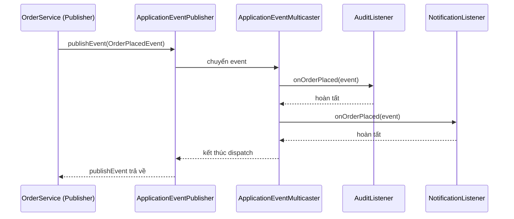

# Publisher, Event và Listener trong một luồng xử lý

Trong Spring Framework, Publisher phát thông báo rằng một việc nghiệp vụ đã xảy ra, Event mang dữ liệu mô tả việc đó, còn Listener nhận thông báo để thực hiện phần việc liên quan. Cơ chế này giúp dịch vụ phát sinh sự kiện không cần gọi trực tiếp từng dịch vụ phụ thuộc như ghi audit log, gửi thông báo hoặc cập nhật một read model.

Ví dụ xuyên suốt bài: `OrderService` xử lý một đơn hàng, phát `OrderPlacedEvent`, sau đó `AuditListener` ghi nhận lịch sử và `NotificationListener` tạo thông báo.

## 1. Ba thành phần cốt lõi

### Publisher

Publisher là thành phần phát sự kiện. Trong Spring, mã nghiệp vụ thường nhận `ApplicationEventPublisher` qua constructor injection và gọi `publishEvent(event)` khi đạt đến một mốc nghiệp vụ đã xác định.

- Publisher quyết định **khi nào** sự kiện được phát và dữ liệu nào được đưa vào event.
- Publisher chỉ phụ thuộc vào interface `ApplicationEventPublisher`; nó không cần biết listener nào đang đăng ký.
- `ApplicationContext` cũng triển khai `ApplicationEventPublisher`, vì vậy Spring có thể inject interface này trực tiếp vào bean.

Ví dụ:

```java
public class OrderService {
    private final ApplicationEventPublisher eventPublisher;

    public OrderService(ApplicationEventPublisher eventPublisher) {
        this.eventPublisher = eventPublisher;
    }

    public void placeOrder(String orderId) {
        // Xử lý nghiệp vụ của đơn hàng...
        eventPublisher.publishEvent(new OrderPlacedEvent(orderId));
    }
}
```

Đây là ví dụ minh họa cách gọi publisher; phần event đầy đủ và chương trình có thể chạy được nằm ở mục 4.

### Event

Event là đối tượng mô tả một điều đã xảy ra. Tên event thường dùng thì quá khứ, chẳng hạn `OrderPlacedEvent`, `PaymentCapturedEvent` hoặc `CustomerRegisteredEvent`. Cách đặt tên này phân biệt một sự kiện đã xảy ra với một yêu cầu cần thực hiện như `PlaceOrderCommand`.

Trong Spring Framework 4.2 trở lên, `publishEvent(Object event)` cho phép phát một đối tượng Java thông thường, bao gồm POJO hoặc `record`; event không bắt buộc phải kế thừa `ApplicationEvent`. Với Java hiện đại, một `record` bất biến thường là lựa chọn gọn và rõ ràng.

```java
public record OrderPlacedEvent(String orderId, BigDecimal total) {
}
```

Event nên:

- Chứa dữ liệu tối thiểu mà listener cần để xử lý, ví dụ mã đơn hàng và tổng tiền.
- Ưu tiên bất biến để listener không vô tình sửa dữ liệu mà listener khác đang đọc.
- Đại diện cho một sự kiện nghiệp vụ có ý nghĩa, không biến mọi lời gọi phương thức nội bộ thành event.
- Tránh mang theo cả object graph lớn hoặc entity mutable nếu listener chỉ cần một vài trường dữ liệu.

Trước Spring Framework 4.2, event thường được tạo bằng cách kế thừa `ApplicationEvent` và truyền `source` vào constructor. Cách này vẫn được hỗ trợ khi cần kiểu event truyền thống hoặc cần dùng `ApplicationListener<E>`. Với event POJO/record, `@EventListener` là cách đăng ký listener thuận tiện hơn.

### Listener

Listener là bean do Spring quản lý, nhận event phù hợp và thực hiện hành động tiếp theo. Có hai cách thường gặp:

1. Dùng `@EventListener` trên một phương thức. Tham số phương thức xác định kiểu event mà phương thức nhận. Cách này dùng được với POJO/record.
2. Implement `ApplicationListener<E>` khi `E` là lớp con của `ApplicationEvent`. Cách này biểu diễn listener bằng một kiểu Java tường minh.

Ví dụ listener dùng annotation:

```java
@EventListener
public void onOrderPlaced(OrderPlacedEvent event) {
    System.out.println("Đã nhận đơn " + event.orderId());
}
```

Listener phải được đăng ký trong ApplicationContext, ví dụ bằng `@Component` trong vùng component scan hoặc bằng một phương thức `@Bean`. Một class được tạo bằng `new` bên ngoài Spring sẽ không tự động trở thành listener được quản lý.

## 2. Spring chuyển event đến listener như thế nào?

Trong ApplicationContext, `ApplicationEventMulticaster` là thành phần điều phối việc phát event đến các listener đã đăng ký. Nếu ứng dụng không cung cấp bean multicaster riêng, Spring sử dụng `SimpleApplicationEventMulticaster` mặc định.

Luồng xử lý cơ bản:

1. Một bean nghiệp vụ, chẳng hạn `OrderService`, hoàn tất bước nghiệp vụ mà event đại diện.
2. Publisher tạo event với dữ liệu cần thiết và gọi `ApplicationEventPublisher.publishEvent(event)`.
3. ApplicationContext chuyển event đến `ApplicationEventMulticaster`.
4. Multicaster tìm các listener có kiểu nhận tương thích với kiểu event, rồi gọi các listener đó.
5. Listener thực hiện công việc của mình. Một event có thể được nhiều listener cùng nhận.
6. Sau khi các listener đồng bộ hoàn tất, lời gọi `publishEvent` trả quyền điều khiển về publisher và luồng nghiệp vụ tiếp tục.



### Đồng bộ là mặc định

Với `SimpleApplicationEventMulticaster` mặc định, không cấu hình executor, listener được gọi đồng bộ trên thread đang phát event. Vì vậy:

- `publishEvent` chỉ trả về sau khi các listener đồng bộ đã xử lý xong.
- Listener chạy chậm sẽ kéo dài thời gian xử lý của publisher.
- Exception từ listener đồng bộ có thể truyền ngược ra lời gọi `publishEvent`; với cấu hình mặc định không có `ErrorHandler`, lỗi có thể làm gián đoạn lượt dispatch.
- Listener đồng bộ có thể nhìn thấy cùng transaction/thread context của luồng gọi, nhưng thời điểm commit vẫn phụ thuộc ranh giới transaction của ứng dụng.

Đây là cơ chế phát event trong cùng ứng dụng. Nó không tự tạo message queue, không lưu event bền vững, không tự retry và không bảo đảm event sẽ được xử lý nếu tiến trình dừng đột ngột.

### Thứ tự listener

Không nên dựa vào thứ tự đăng ký bean để suy luận thứ tự xử lý. Nếu các listener cần thứ tự rõ ràng, đặt `@Order` trên phương thức `@EventListener` hoặc triển khai `Ordered`/`@Order` phù hợp với kiểu listener. Giá trị order nhỏ hơn được ưu tiên trước; trong ví dụ bên dưới audit chạy trước notification.

## 3. Khi nào dùng đồng bộ, bất đồng bộ và theo transaction?

### Listener đồng bộ

Đây là lựa chọn mặc định và phù hợp khi công việc nhẹ, cần hoàn tất ngay trong luồng hiện tại hoặc cần lỗi của listener được phản ánh về nơi phát event. Ví dụ: cập nhật một cấu trúc dữ liệu trong bộ nhớ hoặc ghi nhận một bước xử lý nhỏ.

Không nên đặt tác vụ mạng chậm, gửi email mất nhiều thời gian hoặc xử lý nặng vào listener đồng bộ nếu thời gian phản hồi của nghiệp vụ là quan trọng.

### Listener bất đồng bộ

Có thể kết hợp `@EnableAsync` ở cấu hình và `@Async` trên phương thức `@EventListener` để xử lý trên executor do Spring quản lý:

```java
@Configuration
@EnableAsync
public class AsyncConfig {
}

@Component
public class NotificationListener {
    @Async
    @EventListener
    public void onOrderPlaced(OrderPlacedEvent event) {
        // Công việc có thể mất thời gian
    }
}
```

Khi dùng bất đồng bộ, publisher không đợi phần xử lý trong listener hoàn tất. Cần cấu hình executor phù hợp, theo dõi lỗi ở luồng nền và không giả định transaction, security context hoặc thứ tự thực thi tự động được truyền sang thread khác. Với phương thức `void` chạy qua `@Async`, exception không thể được ném ngược về caller; cần cơ chế xử lý lỗi bất đồng bộ phù hợp.

`@Async` vẫn là xử lý trong tiến trình ứng dụng. Nó không thay thế một message broker nếu cần lưu trữ bền vững, retry sau khi khởi động lại hoặc giao tiếp giữa nhiều dịch vụ.

### Listener gắn với transaction

`@EventListener` thông thường được gọi ngay tại thời điểm event được phát. Nếu event được phát bên trong transaction, listener có thể chạy trước khi transaction commit; transaction rollback sau đó không tự hoàn tác tác động bên ngoài mà listener đã thực hiện.

Nếu chỉ muốn chạy listener sau khi transaction commit, dùng `@TransactionalEventListener` với phase phù hợp, thường là `TransactionPhase.AFTER_COMMIT`:

```java
@TransactionalEventListener(phase = TransactionPhase.AFTER_COMMIT)
public void onOrderPlaced(OrderPlacedEvent event) {
    // Chỉ xử lý sau khi transaction chứa event commit thành công
}
```

Kiểu listener này cần một transaction đang hoạt động tại thời điểm phát event. Mặc định, nếu không có transaction thì listener không chạy; chỉ bật `fallbackExecution` khi hành vi đó thực sự phù hợp. `AFTER_COMMIT` giúp tránh gửi thông báo cho giao dịch đã rollback, nhưng bản thân nó vẫn không phải cơ chế lưu event bền vững. Với yêu cầu không được mất thông báo giữa lúc commit và lúc gửi, cần thiết kế như transactional outbox kết hợp message broker.

## 4. Ví dụ hoàn chỉnh có thể chạy

Ví dụ dùng Java 17 và Spring Framework 6.2.0. Chương trình tạo ApplicationContext, đăng ký publisher và hai listener, sau đó phát một event đơn hàng.

### Cấu trúc thư mục

```text
spring-events-demo/
├── pom.xml
└── src/
    └── main/
        └── java/
            └── demo/
                └── ApplicationEventsDemo.java
```

### pom.xml

```xml
<project xmlns="http://maven.apache.org/POM/4.0.0"
         xmlns:xsi="http://www.w3.org/2001/XMLSchema-instance"
         xsi:schemaLocation="http://maven.apache.org/POM/4.0.0 https://maven.apache.org/xsd/maven-4.0.0.xsd">
    <modelVersion>4.0.0</modelVersion>
    <groupId>demo</groupId>
    <artifactId>spring-events-demo</artifactId>
    <version>1.0.0</version>

    <properties>
        <maven.compiler.release>17</maven.compiler.release>
        <project.build.sourceEncoding>UTF-8</project.build.sourceEncoding>
    </properties>

    <dependencies>
        <dependency>
            <groupId>org.springframework</groupId>
            <artifactId>spring-context</artifactId>
            <version>6.2.0</version>
        </dependency>
    </dependencies>

    <build>
        <plugins>
            <plugin>
                <groupId>org.apache.maven.plugins</groupId>
                <artifactId>maven-compiler-plugin</artifactId>
                <version>3.13.0</version>
            </plugin>
            <plugin>
                <groupId>org.codehaus.mojo</groupId>
                <artifactId>exec-maven-plugin</artifactId>
                <version>3.3.0</version>
            </plugin>
        </plugins>
    </build>
</project>
```

### src/main/java/demo/ApplicationEventsDemo.java

```java
package demo;

import java.math.BigDecimal;

import org.springframework.context.ApplicationEventPublisher;
import org.springframework.context.annotation.AnnotationConfigApplicationContext;
import org.springframework.context.annotation.Bean;
import org.springframework.context.annotation.Configuration;
import org.springframework.context.event.EventListener;
import org.springframework.core.annotation.Order;

public class ApplicationEventsDemo {

    public record OrderPlacedEvent(String orderId, BigDecimal total) {
        public OrderPlacedEvent {
            if (orderId == null || orderId.isBlank()) {
                throw new IllegalArgumentException("orderId must not be blank");
            }
            if (total == null || total.signum() < 0) {
                throw new IllegalArgumentException("total must be non-negative");
            }
        }
    }

    public static class OrderService {
        private final ApplicationEventPublisher eventPublisher;

        public OrderService(ApplicationEventPublisher eventPublisher) {
            this.eventPublisher = eventPublisher;
        }

        public void placeOrder(String orderId, BigDecimal total) {
            System.out.println("1. Service: bắt đầu xử lý " + orderId);

            // Demo không dùng database; tại đây giả định bước nghiệp vụ đã hoàn tất.
            eventPublisher.publishEvent(new OrderPlacedEvent(orderId, total));

            System.out.println("4. Service: publishEvent đã trả về");
        }
    }

    public static class AuditListener {
        @EventListener
        @Order(1)
        public void onOrderPlaced(OrderPlacedEvent event) {
            System.out.println("2. AuditListener: ghi nhận " + event.orderId());
        }
    }

    public static class NotificationListener {
        @EventListener
        @Order(2)
        public void onOrderPlaced(OrderPlacedEvent event) {
            System.out.println("3. NotificationListener: tạo thông báo cho " + event.orderId());
        }
    }

    @Configuration(proxyBeanMethods = false)
    public static class AppConfig {
        @Bean
        public OrderService orderService(ApplicationEventPublisher publisher) {
            return new OrderService(publisher);
        }

        @Bean
        public AuditListener auditListener() {
            return new AuditListener();
        }

        @Bean
        public NotificationListener notificationListener() {
            return new NotificationListener();
        }
    }

    public static void main(String[] args) {
        try (var context = new AnnotationConfigApplicationContext(AppConfig.class)) {
            OrderService orderService = context.getBean(OrderService.class);
            orderService.placeOrder("ORD-1001", new BigDecimal("125000"));
        }
    }
}
```

### Chạy chương trình

Đứng tại thư mục `spring-events-demo/` và chạy:

```bash
mvn -q compile exec:java -Dexec.mainClass=demo.ApplicationEventsDemo
```

Kết quả stdout:

```text
1. Service: bắt đầu xử lý ORD-1001
2. AuditListener: ghi nhận ORD-1001
3. NotificationListener: tạo thông báo cho ORD-1001
4. Service: publishEvent đã trả về
```

### Đọc kết quả

- `OrderService` chỉ biết `ApplicationEventPublisher`; nó không gọi trực tiếp `AuditListener` hoặc `NotificationListener`.
- `OrderPlacedEvent` là record nên dữ liệu sự kiện bất biến sau khi tạo.
- Cả hai listener đều nhận cùng event vì kiểu tham số là `OrderPlacedEvent`.
- `@Order(1)` và `@Order(2)` làm rõ thứ tự audit trước notification.
- Hai listener chạy đồng bộ trong ví dụ. Vì vậy, dòng số 4 chỉ xuất hiện sau khi hai listener hoàn tất.

## 5. Các lỗi thường gặp và cách xử lý

| Hiện tượng | Nguyên nhân thường gặp | Cách kiểm tra hoặc khắc phục |
|---|---|---|
| Không có listener nào chạy | Listener chưa được đăng ký thành bean hoặc không nằm trong component scan | Đăng ký bằng `@Component`, `@Bean` hoặc cấu hình scan đúng package |
| Listener không nhận event | Kiểu tham số không tương thích với kiểu event được phát | Kiểm tra lớp event, kiểu tham số và event thực tế truyền vào `publishEvent` |
| Inject `ApplicationEventPublisher` thất bại | Bean đang được tạo thủ công ngoài ApplicationContext hoặc cấu hình context chưa đúng | Để Spring tạo bean và dùng constructor injection |
| Publisher chờ quá lâu | Listener đồng bộ thực hiện I/O hoặc công việc nặng | Rút gọn listener, chuyển phần phù hợp sang xử lý bất đồng bộ hoặc hàng đợi |
| Lỗi listener làm hỏng luồng phát event | Exception phát sinh trong listener đồng bộ | Xử lý lỗi có chủ đích, ghi log/metrics và cấu hình `ErrorHandler` nếu cần chính sách khác |
| Gửi thông báo dù transaction rollback | Dùng `@EventListener` thông thường trong transaction | Dùng `@TransactionalEventListener` với phase phù hợp, thường là `AFTER_COMMIT` |
| Listener chạy nhiều lần ngoài dự kiến | Một event có nhiều listener phù hợp hoặc một listener lại phát event khác | Kiểm tra toàn bộ listener đã đăng ký và tránh vòng lặp phát event |

## 6. Nguyên tắc thiết kế nên áp dụng

1. **Phát event tại một mốc nghiệp vụ rõ ràng.** Xác định event có nghĩa là yêu cầu đã được tiếp nhận, đơn đã được lưu hay transaction đã commit. Tên và thời điểm phát phải diễn đạt cùng một sự thật.
2. **Giữ event nhỏ và bất biến.** Chỉ đưa dữ liệu listener cần; ưu tiên ID và snapshot dữ liệu ổn định thay vì chia sẻ object mutable.
3. **Giữ publisher ít phụ thuộc.** Publisher chỉ phát event qua `ApplicationEventPublisher`; tránh inject trực tiếp tất cả listener vào dịch vụ nghiệp vụ nếu mục tiêu là tách phụ thuộc.
4. **Giữ listener tập trung.** Mỗi listener nên có một trách nhiệm dễ hiểu, ví dụ audit hoặc notification. Không gom nhiều tác vụ không liên quan vào một phương thức.
5. **Quy định thứ tự khi thật sự cần.** Nếu listener độc lập, không phụ thuộc thứ tự. Nếu có phụ thuộc, dùng `@Order` và ghi rõ lý do.
6. **Chọn đúng ranh giới đồng bộ và transaction.** Dùng listener đồng bộ cho công việc ngắn cần hoàn tất ngay; dùng `@Async` cho tác vụ nền phù hợp; dùng `@TransactionalEventListener` khi hành động phụ thuộc kết quả commit.
7. **Không xem event trong ApplicationContext là hàng đợi bền vững.** Khi cần giao tiếp giữa tiến trình, retry, lưu trữ hoặc bảo đảm không mất thông điệp, dùng message broker và cân nhắc transactional outbox.

## 7. Checklist khi debug

- [ ] Publisher thực sự gọi `publishEvent` với đúng object event.
- [ ] Listener đã được Spring đăng ký trong ApplicationContext.
- [ ] Kiểu event và kiểu tham số listener tương thích.
- [ ] Không có exception bị bỏ qua hoặc làm dừng lượt dispatch.
- [ ] Nếu dùng `@Async`, executor và xử lý lỗi nền đã được cấu hình.
- [ ] Nếu dùng transaction, listener đang dùng đúng loại annotation và phase.
- [ ] Nếu cần thứ tự, listener đã khai báo `@Order` hoặc `Ordered` rõ ràng.

## 8. Ghi nhớ

`Publisher` phát thông báo, `Event` mô tả điều đã xảy ra, `Listener` phản ứng với thông báo đó. Spring dùng `ApplicationEventPublisher` và `ApplicationEventMulticaster` để kết nối các thành phần này. Mặc định, listener chạy đồng bộ trong cùng tiến trình; muốn chạy nền hoặc gắn với transaction thì phải cấu hình rõ. Cơ chế này giúp tách các thành phần trong một ứng dụng Spring, còn nhu cầu truyền tin bền vững giữa các tiến trình cần một giải pháp messaging chuyên biệt.
