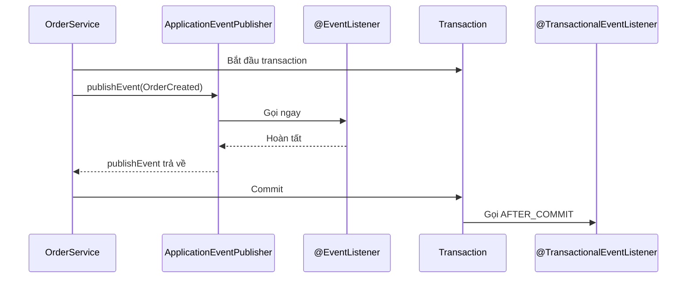

# Khác biệt giữa @EventListener và @TransactionalEventListener

## 1. Mục tiêu và phạm vi

Bài học thuộc nhóm **Event theo transaction** trong Spring Application Events. `@EventListener` và `@TransactionalEventListener` đều dùng để xử lý application event bằng một method trong bean. Khác biệt cốt lõi nằm ở **thời điểm listener được gọi và mối quan hệ của lần gọi đó với transaction**.

- `@EventListener` xử lý event khi multicaster phân phối event. Mặc định, listener chạy đồng bộ ngay trong thread phát event, không chờ transaction commit.
- `@TransactionalEventListener` đăng ký xử lý event theo một phase của transaction. Mặc định, listener chỉ chạy sau khi transaction commit thành công.

Nếu side effect chỉ hợp lệ khi dữ liệu đã commit, chẳng hạn gửi thông báo “đơn hàng đã tạo”, cập nhật cache dựa trên dữ liệu đã lưu hoặc phát tín hiệu cho bước tiếp theo, `@TransactionalEventListener` thường phù hợp hơn.

Bài học dùng Java 17+ và Spring Framework 6.2.x. Sau bài học, bạn có thể:

- Phân biệt thời điểm xử lý của hai annotation.
- Chọn transaction phase phù hợp.
- Hiểu hành vi khi không có transaction hoặc transaction rollback.
- Kết hợp event listener với async execution đúng cách.
- Nhận biết khác biệt giữa transaction imperative và reactive.
- Kiểm thử được cả nhánh commit và rollback.

## 2. @EventListener hoạt động như thế nào?

`@EventListener` đánh dấu một method nhận application event. Spring đăng ký method thông qua `EventListenerMethodProcessor` và adapter tương ứng.

Ví dụ:

```java
@Component
class OrderEventListener {

    @EventListener
    public void onOrderCreated(OrderCreated event) {
        System.out.println("Received order " + event.orderId());
    }
}
```

Khi một component gọi:

```java
publisher.publishEvent(new OrderCreated("ORD-127"));
```

Spring tìm các listener phù hợp và gọi chúng. Với cấu hình mặc định:

- Event được phân phối đồng bộ.
- Listener chạy trên thread phát event.
- `publishEvent()` chờ các listener đồng bộ hoàn tất.
- Nếu listener ném `RuntimeException`, exception có thể truyền về publisher và ảnh hưởng đến luồng gọi.
- Listener không tự chờ transaction commit hoặc rollback.

Nếu event được phát bên trong một transaction, listener đồng bộ thường chạy ngay trong transaction context hiện tại. Vì thế, listener có thể nhìn thấy dữ liệu chưa commit và có thể thực hiện side effect trước khi transaction kết thúc.

Đây là điểm cần cân nhắc. Ví dụ, nếu listener gửi email ngay khi nhận `OrderCreated`, email có thể được gửi dù transaction sau đó rollback. Database không thể tự thu hồi email đã gửi.

### Điều kiện lọc và thứ tự

`@EventListener` hỗ trợ lọc theo kiểu event và điều kiện SpEL:

```java
@EventListener(condition = "#root.args[0].orderId().startsWith('ORD-')")
public void handle(OrderCreated event) {
    // chỉ xử lý order có mã bắt đầu bằng ORD-
}
```

Có thể dùng `@Order` để sắp xếp thứ tự gọi các listener phù hợp với cùng event:

```java
@EventListener
@Order(10)
public void updateLocalState(OrderCreated event) {
    // được gọi trước listener có order lớn hơn
}
```

Số `@Order` nhỏ hơn được ưu tiên trước. Thứ tự gọi không đồng nghĩa với thứ tự hoàn thành nếu listener được thực thi bất đồng bộ.

### Giá trị trả về

Một method `@EventListener` có thể trả về một object. Spring xem giá trị đó là event tiếp theo và phát tiếp. Nếu trả về array hoặc `Collection`, từng phần tử được phát thành event riêng.

```java
@EventListener
public OrderValidated validate(OrderCreated event) {
    return new OrderValidated(event.orderId());
}
```

Cơ chế này phù hợp với chuỗi xử lý đồng bộ. Listener async không thể dùng return value để phát event tiếp theo; khi đó hãy inject `ApplicationEventPublisher` và gọi `publishEvent()` tường minh.

## 3. @TransactionalEventListener hoạt động như thế nào?

`@TransactionalEventListener` là annotation dành cho listener cần gắn với một transaction phase. Annotation này được thiết kế dựa trên cơ chế event listener của Spring và bổ sung thuộc tính `phase`.

Ví dụ:

```java
@Component
class OrderCommittedListener {

    @TransactionalEventListener
    public void onOrderCreated(OrderCreated event) {
        System.out.println("Order committed " + event.orderId());
    }
}
```

Mặc định, `phase = TransactionPhase.AFTER_COMMIT`. Listener chỉ được gọi sau khi transaction phát event commit thành công.

Khi event được phát trong một transaction đang hoạt động, Spring đăng ký listener với transaction synchronization. Listener được gọi khi transaction đi đến phase đã chọn.

Điều này có nghĩa:

- Listener không chạy ngay tại thời điểm gọi `publishEvent()`.
- Nếu transaction commit, listener `AFTER_COMMIT` chạy.
- Nếu transaction rollback, listener `AFTER_COMMIT` không chạy.
- Nếu không có transaction, listener bị bỏ qua theo mặc định.
- `fallbackExecution = true` cho phép listener chạy ngay cả khi không có transaction.

### Bốn transaction phase

| Phase | Thời điểm | Trường hợp sử dụng |
|---|---|---|
| `BEFORE_COMMIT` | Trước khi commit | Kiểm tra hoặc chuẩn bị công việc cần hoàn tất trước commit |
| `AFTER_COMMIT` | Sau khi commit thành công; mặc định | Gửi thông báo, làm mới cache hoặc kích hoạt side effect sau khi dữ liệu đã lưu |
| `AFTER_ROLLBACK` | Sau khi rollback | Ghi nhận thất bại hoặc giải phóng tài nguyên phụ trợ |
| `AFTER_COMPLETION` | Sau khi transaction kết thúc, bất kể commit hay rollback | Cleanup hoặc ghi nhận kết quả cuối cùng |

Ví dụ khai báo phase rõ ràng:

```java
@TransactionalEventListener(
        phase = TransactionPhase.AFTER_COMMIT)
public void sendConfirmation(OrderCreated event) {
    // chỉ chạy sau commit thành công
}

@TransactionalEventListener(
        phase = TransactionPhase.AFTER_ROLLBACK)
public void recordFailure(OrderCreated event) {
    // chỉ chạy sau rollback
}
```

`AFTER_COMMIT` là lựa chọn thường gặp khi event mô tả một thay đổi đã được lưu thành công. `BEFORE_COMMIT` phù hợp với công việc phải tham gia quyết định transaction có được commit hay không. `AFTER_COMPLETION` không cho biết kết quả commit hay rollback chỉ qua phase; nếu cần phân biệt, dùng phase cụ thể hoặc kiểm tra trạng thái phù hợp trong callback chuyên biệt.

## 4. So sánh trực tiếp

| Tiêu chí | `@EventListener` | `@TransactionalEventListener` |
|---|---|---|
| Thời điểm mặc định | Khi event được phân phối | Sau khi transaction commit |
| Cần transaction | Không | Có, trừ khi bật fallback |
| Khi transaction rollback | Listener đã có thể chạy từ trước | Phase AFTER_COMMIT không chạy; AFTER_ROLLBACK có thể chạy |
| Quan hệ với transaction | Không ràng buộc phase | Gắn với transaction synchronization |
| Thread mặc định | Thread phát event | Callback transaction chạy theo thread gốc của transaction |
| Dùng ngoài transaction | Chạy bình thường | Bị bỏ qua nếu fallbackExecution=false |
| Chọn phase | Không | BEFORE_COMMIT, AFTER_COMMIT, AFTER_ROLLBACK, AFTER_COMPLETION |
| Lọc event và condition | Có | Có, thông qua các thuộc tính tương ứng của EventListener |
| Mục tiêu tiêu biểu | Phản ứng ngay với event | Phản ứng theo kết quả transaction |

Hai annotation không thay thế lẫn nhau trong mọi tình huống. Hãy chọn theo ý nghĩa nghiệp vụ của event:

- Nếu listener phải chạy ngay khi event được phát, dùng `@EventListener`.
- Nếu listener chỉ nên chạy khi transaction đã đạt một kết quả cụ thể, dùng `@TransactionalEventListener`.

## 5. Ví dụ dễ thấy: commit và rollback

Giả sử service tạo một đơn hàng rồi phát `OrderCreated`. Hai listener cùng nhận event:

1. Listener thường dùng `@EventListener`.
2. Listener transaction-bound dùng `@TransactionalEventListener(AFTER_COMMIT)`.

Khi transaction commit, listener thường chạy trước khi transaction kết thúc, còn listener transaction-bound chạy sau commit. Khi rollback, listener thường đã chạy nhưng listener AFTER_COMMIT không chạy.



Nếu transaction rollback, callback `AFTER_COMMIT` không được gọi. Có thể đăng ký listener phase `AFTER_ROLLBACK` để xử lý riêng nhánh này.

## 6. Ví dụ hoàn chỉnh với Java 17 và Spring Framework 6.2

Ví dụ dùng Spring Context, Spring JDBC, transaction manager JDBC và H2 in-memory. Nó chạy hai trường hợp: một transaction commit và một transaction rollback. Cấu hình bật `@EnableTransactionManagement` để Spring đăng ký factory xử lý `@TransactionalEventListener` trong ApplicationContext thuần.

Kết quả thể hiện:

- `@EventListener` chạy ngay trong cả hai trường hợp.
- `BEFORE_COMMIT` chỉ chạy ở trường hợp commit.
- `AFTER_COMMIT` chỉ chạy sau commit thành công.
- `AFTER_ROLLBACK` chỉ chạy sau rollback.
- Dữ liệu chỉ tồn tại trong database sau transaction commit.

### Cấu trúc project

```text
src/
└── main/
    └── java/
        └── demo/
            └── EventListenerComparisonDemo.java
pom.xml
```

### pom.xml

```xml
<project xmlns="http://maven.apache.org/POM/4.0.0"
         xmlns:xsi="http://www.w3.org/2001/XMLSchema-instance"
         xsi:schemaLocation="http://maven.apache.org/POM/4.0.0 https://maven.apache.org/xsd/maven-4.0.0.xsd">
    <modelVersion>4.0.0</modelVersion>

    <groupId>demo</groupId>
    <artifactId>event-listener-comparison</artifactId>
    <version>1.0.0</version>

    <properties>
        <maven.compiler.release>17</maven.compiler.release>
        <project.build.sourceEncoding>UTF-8</project.build.sourceEncoding>
    </properties>

    <dependencies>
        <dependency>
            <groupId>org.springframework</groupId>
            <artifactId>spring-context</artifactId>
            <version>6.2.18</version>
        </dependency>
        <dependency>
            <groupId>org.springframework</groupId>
            <artifactId>spring-jdbc</artifactId>
            <version>6.2.18</version>
        </dependency>
        <dependency>
            <groupId>org.springframework</groupId>
            <artifactId>spring-tx</artifactId>
            <version>6.2.18</version>
        </dependency>
        <dependency>
            <groupId>com.h2database</groupId>
            <artifactId>h2</artifactId>
            <version>2.3.232</version>
            <scope>runtime</scope>
        </dependency>
    </dependencies>

    <build>
        <plugins>
            <plugin>
                <groupId>org.apache.maven.plugins</groupId>
                <artifactId>maven-compiler-plugin</artifactId>
                <version>3.14.0</version>
            </plugin>
            <plugin>
                <groupId>org.codehaus.mojo</groupId>
                <artifactId>exec-maven-plugin</artifactId>
                <version>3.5.0</version>
            </plugin>
        </plugins>
    </build>
</project>
```

### Mã nguồn

Tạo file `src/main/java/demo/EventListenerComparisonDemo.java`:

```java
package demo;

import javax.sql.DataSource;

import org.springframework.context.ApplicationEventPublisher;
import org.springframework.context.annotation.AnnotationConfigApplicationContext;
import org.springframework.context.annotation.Bean;
import org.springframework.context.annotation.Configuration;
import org.springframework.context.event.EventListener;
import org.springframework.jdbc.core.JdbcTemplate;
import org.springframework.jdbc.datasource.DataSourceTransactionManager;
import org.springframework.jdbc.datasource.DriverManagerDataSource;
import org.springframework.transaction.PlatformTransactionManager;
import org.springframework.transaction.TransactionDefinition;
import org.springframework.transaction.annotation.EnableTransactionManagement;
import org.springframework.transaction.event.TransactionPhase;
import org.springframework.transaction.event.TransactionalEventListener;
import org.springframework.transaction.support.TransactionTemplate;

public class EventListenerComparisonDemo {

    public static void main(String[] args) {
        try (var context =
                     new AnnotationConfigApplicationContext(Config.class)) {

            JdbcTemplate jdbc = context.getBean(JdbcTemplate.class);
            jdbc.execute(
                    "CREATE TABLE orders (id VARCHAR(64) PRIMARY KEY)");

            OrderService service = context.getBean(OrderService.class);

            System.out.println("--- COMMIT ---");
            service.createAndCommit("ORD-127-C");
            System.out.println(
                    "Main: committed rows="
                            + jdbc.queryForObject(
                                    "SELECT COUNT(*) FROM orders",
                                    Integer.class));

            System.out.println("--- ROLLBACK ---");
            service.createAndRollback("ORD-127-R");
            System.out.println(
                    "Main: rollback rows="
                            + jdbc.queryForObject(
                                    "SELECT COUNT(*) FROM orders WHERE id = ?",
                                    Integer.class,
                                    "ORD-127-R"));
        }
    }

    record OrderCreated(String orderId) {
    }

    @Configuration
    @EnableTransactionManagement
    static class Config {

        @Bean
        DataSource dataSource() {
            DriverManagerDataSource dataSource =
                    new DriverManagerDataSource();
            dataSource.setDriverClassName("org.h2.Driver");
            dataSource.setUrl("jdbc:h2:mem:eventdemo;DB_CLOSE_DELAY=-1");
            dataSource.setUsername("sa");
            dataSource.setPassword("");
            return dataSource;
        }

        @Bean
        JdbcTemplate jdbcTemplate(DataSource dataSource) {
            return new JdbcTemplate(dataSource);
        }

        @Bean
        PlatformTransactionManager transactionManager(
                DataSource dataSource) {
            return new DataSourceTransactionManager(dataSource);
        }

        @Bean
        TransactionTemplate transactionTemplate(
                PlatformTransactionManager transactionManager) {
            TransactionTemplate template =
                    new TransactionTemplate(transactionManager);
            template.setPropagationBehavior(
                    TransactionDefinition.PROPAGATION_REQUIRED);
            return template;
        }

        @Bean
        OrderService orderService(
                JdbcTemplate jdbc,
                TransactionTemplate transactionTemplate,
                ApplicationEventPublisher publisher) {
            return new OrderService(jdbc, transactionTemplate, publisher);
        }

        @Bean
        OrderEventListeners orderEventListeners() {
            return new OrderEventListeners();
        }
    }

    static class OrderService {
        private final JdbcTemplate jdbc;
        private final TransactionTemplate transactionTemplate;
        private final ApplicationEventPublisher publisher;

        OrderService(
                JdbcTemplate jdbc,
                TransactionTemplate transactionTemplate,
                ApplicationEventPublisher publisher) {
            this.jdbc = jdbc;
            this.transactionTemplate = transactionTemplate;
            this.publisher = publisher;
        }

        void createAndCommit(String orderId) {
            transactionTemplate.executeWithoutResult(status -> {
                jdbc.update(
                        "INSERT INTO orders (id) VALUES (?)",
                        orderId);

                System.out.println(
                        "Service: publishing " + orderId);
                publisher.publishEvent(new OrderCreated(orderId));

                System.out.println(
                        "Service: transaction work finished " + orderId);
            });
        }

        void createAndRollback(String orderId) {
            transactionTemplate.executeWithoutResult(status -> {
                jdbc.update(
                        "INSERT INTO orders (id) VALUES (?)",
                        orderId);

                System.out.println(
                        "Service: publishing " + orderId);
                publisher.publishEvent(new OrderCreated(orderId));

                System.out.println(
                        "Service: mark rollback " + orderId);
                status.setRollbackOnly();
            });
        }
    }

    static class OrderEventListeners {

        @EventListener
        public void onPublished(OrderCreated event) {
            System.out.println(
                    "EventListener: received " + event.orderId());
        }

        @TransactionalEventListener(
                phase = TransactionPhase.BEFORE_COMMIT)
        public void beforeCommit(OrderCreated event) {
            System.out.println(
                    "TransactionalEventListener BEFORE_COMMIT: "
                            + event.orderId());
        }

        @TransactionalEventListener(
                phase = TransactionPhase.AFTER_COMMIT)
        public void afterCommit(OrderCreated event) {
            System.out.println(
                    "TransactionalEventListener AFTER_COMMIT: "
                            + event.orderId());
        }

        @TransactionalEventListener(
                phase = TransactionPhase.AFTER_ROLLBACK)
        public void afterRollback(OrderCreated event) {
            System.out.println(
                    "TransactionalEventListener AFTER_ROLLBACK: "
                            + event.orderId());
        }
    }
}
```

### Biên dịch và chạy

Từ thư mục chứa `pom.xml`, chạy:

```bash
mvn -q compile exec:java -Dexec.mainClass=demo.EventListenerComparisonDemo
```

Stdout dự kiến:

```text
--- COMMIT ---
Service: publishing ORD-127-C
EventListener: received ORD-127-C
Service: transaction work finished ORD-127-C
TransactionalEventListener BEFORE_COMMIT: ORD-127-C
TransactionalEventListener AFTER_COMMIT: ORD-127-C
Main: committed rows=1
--- ROLLBACK ---
Service: publishing ORD-127-R
EventListener: received ORD-127-R
Service: mark rollback ORD-127-R
TransactionalEventListener AFTER_ROLLBACK: ORD-127-R
Main: rollback rows=0
```

Giải thích:

1. Service bắt đầu transaction bằng `TransactionTemplate` và insert dữ liệu.
2. `publishEvent()` gọi listener thường ngay lập tức. Vì vậy, dòng `EventListener: received ...` xuất hiện trước khi transaction hoàn tất.
3. Với transaction commit, listener `BEFORE_COMMIT` chạy trước khi database commit, sau đó listener `AFTER_COMMIT` chạy khi commit thành công.
4. Với transaction rollback, listener `AFTER_COMMIT` không chạy. Listener `AFTER_ROLLBACK` được gọi sau rollback.
5. Truy vấn cuối xác nhận đơn hàng commit còn trong database; đơn hàng rollback không tồn tại.

Ví dụ dùng `TransactionTemplate` để nhìn rõ ranh giới transaction. Trong ứng dụng thực tế, service có thể dùng `@Transactional` nếu method và transaction manager đã được cấu hình đúng.

## 7. Không có transaction: fallbackExecution

Mặc định, `@TransactionalEventListener` yêu cầu một transaction đang hoạt động tại thời điểm event được phát. Nếu publisher phát event bên ngoài transaction, listener sẽ không chạy.

```java
@TransactionalEventListener
public void afterCommit(OrderCreated event) {
    // mặc định bị bỏ qua nếu không có transaction
}
```

Nếu nghiệp vụ chấp nhận xử lý ngay cả khi không có transaction, có thể bật `fallbackExecution`:

```java
@TransactionalEventListener(fallbackExecution = true)
public void handle(OrderCreated event) {
    // chạy theo fallback nếu event được phát ngoài transaction
}
```

Khi fallback được dùng, không có commit hoặc rollback phase để chờ. Listener được thực thi theo fallback ngay khi nhận event. Chỉ bật tùy chọn này khi hành vi ngoài transaction thực sự có ý nghĩa nghiệp vụ; nếu cần bảo đảm dữ liệu đã commit, fallback có thể làm mất ý nghĩa đó.

## 8. Async listener và transaction listener

Hai khái niệm cần tách biệt:

- **Transaction phase** quyết định listener được gọi ở thời điểm nào trong vòng đời transaction.
- **Async execution** quyết định method thực tế chạy trên thread nào.

Có thể kết hợp `@Async` với một transactional listener cho tác vụ sau commit:

```java
@Async
@TransactionalEventListener(
        phase = TransactionPhase.AFTER_COMMIT)
public void sendConfirmation(OrderCreated event) {
    notificationService.send(event.orderId());
}
```

Cần bật async processing bằng `@EnableAsync` và cấu hình executor phù hợp. Trong Spring Framework 6.2, transactional listener được gọi trên thread gốc của transaction bất kể multicaster được cấu hình executor; `@Async` trên method là cách tách phần xử lý sang executor.

Khi method async chạy, transaction ban đầu đã hoàn tất. Nếu listener cần ghi dữ liệu, hãy mở transaction mới ở service được gọi, ví dụ dùng `@Transactional(propagation = Propagation.REQUIRES_NEW)`. Không dựa vào transaction cũ hoặc ThreadLocal của publisher trong worker thread.

Với async listener, exception trong worker không truyền ngược về nơi gọi `publishEvent()`. Cần cấu hình xử lý lỗi async, logging và giám sát phù hợp. Với method async trả về `void`, có thể dùng `AsyncUncaughtExceptionHandler`.

## 9. Reactive transaction từ Spring 6.1

Từ Spring Framework 6.1, `@TransactionalEventListener` hỗ trợ cả:

- Transaction imperative do `PlatformTransactionManager` quản lý.
- Reactive transaction do `ReactiveTransactionManager` quản lý.

Với imperative transaction, listener có thể nhận diện transaction gắn với thread hiện tại. Với reactive transaction, transaction context nằm trong Reactor Context, không nằm trong ThreadLocal. Vì vậy, event được phát trong reactive transaction cần chứa transaction context làm event source.

Dùng `TransactionalEventPublisher` để phát event trong reactive pipeline:

```java
TransactionalEventPublisher eventPublisher =
        new TransactionalEventPublisher(applicationEventPublisher);

return repository.save(order)
        .then(eventPublisher.publishEvent(
                new OrderCreated(order.id())));
```

`publishEvent()` trả về `Mono<Void>`, vì vậy cần compose Mono đó vào pipeline. Không gọi `subscribe()` tách rời bên trong service. Phần này áp dụng cho reactive transaction; ví dụ JDBC ở mục 6 là transaction imperative.

## 10. Lưu ý sau commit

Khi listener chạy ở `AFTER_COMMIT`, transaction đã commit. Tài nguyên transaction có thể vẫn còn được gắn trong callback, nhưng các thao tác ghi thêm vào tài nguyên đó không được commit bởi transaction đã hoàn tất.

Nếu listener cần cập nhật database sau commit:

- Gọi một service mở transaction mới, thường bằng `REQUIRES_NEW`.
- Giữ listener ngắn và chỉ chuyển dữ liệu cần thiết sang service.
- Nếu side effect cần giao nhận bền vững qua lần restart hoặc cần retry, cân nhắc Transactional Outbox hoặc message broker.

Transactional event listener cung cấp đồng bộ theo transaction trong cùng ứng dụng. Nó không tự lưu event bền vững, không retry, không replay và không bảo đảm giao nhận sau khi process dừng.

## 11. Lỗi thường gặp

1. **Dùng `@EventListener` cho side effect chỉ hợp lệ sau commit:** listener có thể chạy trước commit và side effect vẫn xảy ra nếu transaction rollback.
2. **Cho rằng `@TransactionalEventListener` luôn chạy:** nếu không có transaction và `fallbackExecution=false`, event bị bỏ qua.
3. **Chọn sai phase:** `AFTER_COMMIT` không chạy khi rollback; dùng `AFTER_ROLLBACK` nếu cần xử lý nhánh thất bại.
4. **Dùng `BEFORE_COMMIT` để gửi email hoặc gọi API ngoài:** transaction có thể rollback sau đó, khiến hệ thống ngoài nhận thông báo về dữ liệu chưa commit.
5. **Ghi database trong AFTER_COMMIT mà không mở transaction mới:** các thay đổi có thể không được commit.
6. **Cho rằng multicaster executor tự làm transactional listener async:** Spring 6.2 giữ transactional listener trên thread gốc; cấu hình async riêng nếu thực sự cần.
7. **Giả định exception async truyền về publisher:** worker thread xử lý exception riêng; cần logging và error handler.
8. **Nhầm transaction imperative và reactive:** reactive transaction dùng Reactor Context; từ Spring 6.1 cần đưa context vào event source.
9. **Bật fallbackExecution tùy tiện:** listener có thể chạy mà không có transaction phase.
10. **Coi event trong bộ nhớ là hàng đợi bền vững:** cần outbox hoặc broker nếu nghiệp vụ yêu cầu retry và durable delivery.

## 12. Kiểm thử

Nên kiểm tra hành vi ở cả hai phía của transaction:

- Với `@EventListener`, xác nhận listener được gọi ngay khi publisher phát event.
- Với `BEFORE_COMMIT`, xác nhận listener chạy khi transaction chuẩn bị commit.
- Với `AFTER_COMMIT`, xác nhận listener chỉ chạy khi transaction commit thành công.
- Với `AFTER_ROLLBACK`, xác nhận listener chạy khi transaction rollback.
- Khi không có transaction, xác nhận listener bị bỏ qua theo mặc định.
- Khi bật `fallbackExecution=true`, xác nhận listener chạy theo fallback.
- Với listener async, chờ bằng `CountDownLatch`, `CompletableFuture` hoặc Awaitility có timeout; không dùng `Thread.sleep()`.
- Xác minh side effect database bằng truy vấn sau khi transaction kết thúc.

Trong integration test, nên dùng transaction manager và database test thực tế để xác nhận transaction synchronization. Chỉ mock `ApplicationEventPublisher` sẽ không kiểm tra được phase commit/rollback.

## 13. Checklist chọn annotation

- [ ] Listener phải chạy ngay khi nhận event? Dùng `@EventListener`.
- [ ] Listener chỉ được chạy sau khi commit thành công? Dùng `@TransactionalEventListener(AFTER_COMMIT)`.
- [ ] Cần chuẩn bị trước commit? Cân nhắc `BEFORE_COMMIT`.
- [ ] Cần xử lý nhánh rollback? Dùng `AFTER_ROLLBACK`.
- [ ] Cần cleanup sau mọi kết quả? Dùng `AFTER_COMPLETION`.
- [ ] Event có thể được phát ngoài transaction? Xem xét `fallbackExecution`.
- [ ] Listener cần chạy async? Cấu hình `@Async` và executor; kiểm tra transaction đã hoàn tất ở phase được chọn.
- [ ] Reactive transaction? Dùng `TransactionalEventPublisher` để đưa transaction context vào event source.
- [ ] Side effect cần retry hoặc durable delivery? Thiết kế outbox hoặc broker.

## 14. Tài liệu tham khảo

- [Spring Framework 6.2 Reference — Additional Capabilities of the ApplicationContext](https://docs.spring.io/spring/reference/6.2/core/beans/context-introduction.html)
- [Spring Framework 6.2 Reference — Transaction-bound Events](https://docs.spring.io/spring-framework/reference/6.2/data-access/transaction/event.html)
- [Spring Framework 6.2 API — EventListener](https://docs.spring.io/spring-framework/docs/6.2.18/javadoc-api/org/springframework/context/event/EventListener.html)
- [Spring Framework 6.2 API — TransactionalEventListener](https://docs.spring.io/spring-framework/docs/6.2.18/javadoc-api/org/springframework/transaction/event/TransactionalEventListener.html)
- [Spring Framework 6.2 API — TransactionPhase](https://docs.spring.io/spring-framework/docs/6.2.18/javadoc-api/org/springframework/transaction/event/TransactionPhase.html)
- [Spring Framework 6.2 Release Notes — Transactional listeners and async multicaster](https://github.com/spring-projects/spring-framework/wiki/What's-New-in-Spring-Framework-6.x)

