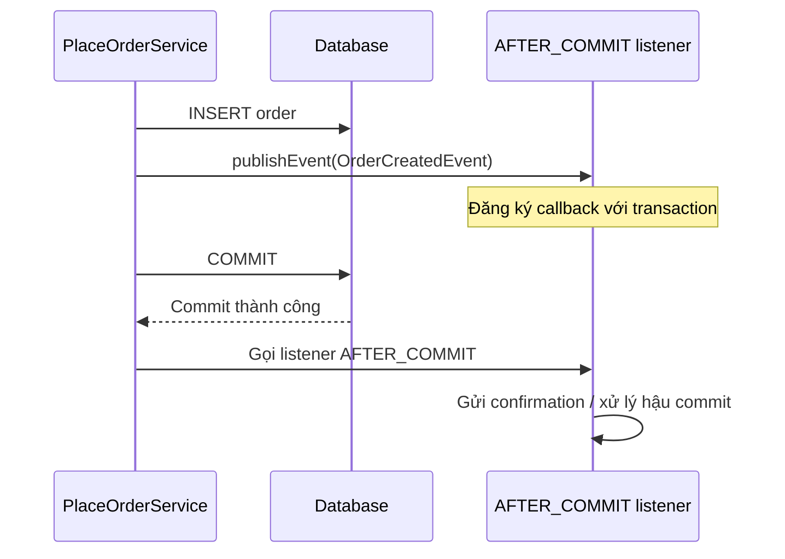

# Transaction phase AFTER_COMMIT

`TransactionPhase.AFTER_COMMIT` là phase của `@TransactionalEventListener` dùng để xử lý event sau khi transaction đã commit thành công. Đây là giá trị mặc định của annotation. Spring chỉ gọi listener nếu event được publish trong một transaction đang hoạt động và transaction đó kết thúc bằng commit; nếu transaction rollback, listener `AFTER_COMMIT` không chạy.

Điểm quan trọng: `AFTER_COMMIT` được triển khai trong chuỗi `afterCompletion`, không phải callback `TransactionSynchronization.afterCommit()`. Khi listener chạy, transaction gốc đã hoàn tất nhưng resource như JDBC connection hoặc JPA `EntityManager` có thể vẫn còn được bind. Các thao tác ghi thêm bằng resource đó không được commit lần nữa. Nếu listener cần ghi database, hãy mở transaction mới bằng `Propagation.REQUIRES_NEW`.

## 1. Vì sao cần AFTER_COMMIT?

Một use case thường lưu dữ liệu rồi phát event để thành phần khác gửi email, cập nhật search index hoặc gọi dịch vụ bên ngoài. Nếu dùng `@EventListener` thông thường, listener chạy ngay lúc publish, trong khi transaction có thể chưa commit. Nếu transaction sau đó rollback, side effect bên ngoài đã xảy ra cho một thay đổi không tồn tại.

`@TransactionalEventListener(AFTER_COMMIT)` gắn listener với kết quả transaction: chỉ xử lý sau khi commit thành công.



Nếu transaction rollback, listener này không được gọi. Đây là cách phù hợp khi hành động chỉ có ý nghĩa sau khi thay đổi nghiệp vụ đã được xác nhận trong database.

## 2. Khai báo listener

```java
@Component
public class OrderNotificationListener {
    private final NotificationService notificationService;

    public OrderNotificationListener(NotificationService notificationService) {
        this.notificationService = notificationService;
    }

    @TransactionalEventListener(phase = TransactionPhase.AFTER_COMMIT)
    public void onOrderCreated(OrderCreatedEvent event) {
        notificationService.sendConfirmation(event.orderId());
    }
}
```

`AFTER_COMMIT` là mặc định nên có thể viết `@TransactionalEventListener` không truyền `phase`. Khai báo tường minh hữu ích trong code review vì thể hiện rõ listener phụ thuộc commit thành công.

Publisher thường phát event bên trong một phương thức `@Transactional`:

```java
@Service
public class PlaceOrderService {
    private final OrderRepository repository;
    private final ApplicationEventPublisher publisher;

    public PlaceOrderService(OrderRepository repository,
                             ApplicationEventPublisher publisher) {
        this.repository = repository;
        this.publisher = publisher;
    }

    @Transactional
    public void placeOrder(String orderId) {
        repository.insert(orderId);
        publisher.publishEvent(new OrderCreatedEvent(orderId));
    }
}
```

Event được publish khi transaction còn hoạt động. Spring đăng ký listener như một transaction synchronization; việc gọi phương thức listener được hoãn đến phase đã chọn.

## 3. Vị trí trong transaction lifecycle

`@TransactionalEventListener` hỗ trợ bốn phase:

| Phase | Thời điểm | Điều kiện |
|---|---|---|
| `BEFORE_COMMIT` | Trước khi commit | Transaction đi đến bước commit; lỗi có thể làm rollback |
| `AFTER_COMMIT` | Sau commit thành công | Completion status là committed |
| `AFTER_ROLLBACK` | Sau rollback | Completion status là rolled back |
| `AFTER_COMPLETION` | Sau khi transaction kết thúc | Commit hoặc rollback đều gọi |

`AFTER_COMMIT` là specialization của `AFTER_COMPLETION`: nó chạy trong cùng chuỗi `afterCompletion` và chỉ xử lý khi status là `STATUS_COMMITTED`.

```text
Transaction bắt đầu
    |
    +-- publishEvent(event): đăng ký listener
    +-- thực hiện database work
    |
    +-- COMMIT thành công -> AFTER_COMMIT
    |
    +-- ROLLBACK         -> AFTER_ROLLBACK
```

Không nhầm `TransactionPhase.AFTER_COMMIT` với `TransactionSynchronization.afterCommit()`. Hai callback có hợp đồng exception khác nhau: `afterCommit()` có thể propagate exception về caller; `AFTER_COMMIT` của transactional event listener chạy qua `afterCompletion`.

## 4. So sánh với @EventListener thông thường

| Tiêu chí | `@EventListener` | `@TransactionalEventListener(AFTER_COMMIT)` |
|---|---|---|
| Thời điểm gọi | Ngay khi publish | Sau khi transaction commit thành công |
| Cần transaction | Không | Có, theo mặc định |
| Transaction rollback | Listener có thể đã chạy | Listener không chạy |
| Publish ngoài transaction | Vẫn xử lý | Bỏ qua, trừ khi bật fallback |
| Dùng cho notification sau commit | Có nguy cơ chạy quá sớm | Đúng mục đích hơn |

Dùng `@EventListener` cho phản ứng không phụ thuộc kết quả transaction. Dùng `AFTER_COMMIT` khi side effect chỉ được phép xảy ra sau commit.

## 5. Khi nào listener không được gọi?

### Transaction rollback

Nếu publisher phát event nhưng transaction kết thúc bằng rollback, `AFTER_COMMIT` không chạy. Muốn xử lý riêng trường hợp rollback, đăng ký `AFTER_ROLLBACK`:

```java
@TransactionalEventListener(phase = TransactionPhase.AFTER_ROLLBACK)
public void onOrderRollback(OrderCreatedEvent event) {
    auditService.recordRollback(event.orderId());
}
```

### Không có transaction đang hoạt động

Mặc định, nếu event được publish ngoài transaction, Spring không gọi transactional listener vì không có phase để chờ. Có thể bật `fallbackExecution = true`:

```java
@TransactionalEventListener(
        phase = TransactionPhase.AFTER_COMMIT,
        fallbackExecution = true)
public void onOrderCreated(OrderCreatedEvent event) {
    notificationService.sendConfirmation(event.orderId());
}
```

Khi bật fallback, nếu không có transaction thì listener chạy ngay theo cơ chế fallback; không có commit nào xảy ra để chờ. Vì vậy không được hiểu mọi lần callback chạy là đã có transaction commit thành công. Chỉ bật khi nghiệp vụ chấp nhận publish ngoài transaction.

Event phải được publish khi transaction đang hoạt động. Publish sau khi transaction đã hoàn tất không thể đăng ký callback ngược về transaction cũ.

## 6. Resource vẫn có thể được bind sau commit

Với transaction manager imperative tiêu chuẩn, khi `AFTER_COMMIT` chạy, database đã commit transaction gốc nhưng resource như JDBC connection hoặc JPA `EntityManager` có thể vẫn còn được bind trong quá trình completion.

Code truy cập database trong callback có thể vẫn dùng resource của transaction cũ. Các thay đổi đó không được commit lần nữa vì transaction đã hoàn tất. Ví dụ sau có thể khiến người đọc tưởng audit đã được lưu bền vững:

```java
@TransactionalEventListener(phase = TransactionPhase.AFTER_COMMIT)
public void afterCommit(OrderCreatedEvent event) {
    auditRepository.insert(event.orderId());
}
```

Spring cảnh báo rằng mọi data access tại phase này vẫn có thể tham gia resource gốc, nhưng không còn commit tiếp theo.

## 7. Dùng REQUIRES_NEW để ghi database

Nếu callback cần ghi database, gọi một bean riêng có transaction `REQUIRES_NEW`:

```java
@Service
public class AuditWriter {
    private final AuditRepository repository;

    public AuditWriter(AuditRepository repository) {
        this.repository = repository;
    }

    @Transactional(propagation = Propagation.REQUIRES_NEW)
    public void recordOrderCreated(String orderId) {
        repository.insert(orderId);
    }
}

@Component
public class OrderAuditListener {
    private final AuditWriter auditWriter;

    public OrderAuditListener(AuditWriter auditWriter) {
        this.auditWriter = auditWriter;
    }

    @TransactionalEventListener(phase = TransactionPhase.AFTER_COMMIT)
    public void afterCommit(OrderCreatedEvent event) {
        auditWriter.recordOrderCreated(event.orderId());
    }
}
```

`REQUIRES_NEW` tạm ngưng resource/synchronization đang bind và mở transaction độc lập cho audit. Transaction mới commit riêng; nó không biến audit thành một phần atomic của transaction đặt hàng đã commit.

Đặt `AuditWriter` thành bean riêng để lời gọi đi qua Spring transaction proxy. Nếu gọi `this.recordOrderCreated(...)` trong cùng object, self-invocation thường không đi qua proxy và annotation có thể không được áp dụng.

Nếu transaction mới thất bại, transaction đặt hàng gốc vẫn đã commit. Chỉ dùng `REQUIRES_NEW` khi chấp nhận hai kết quả độc lập; dữ liệu cần atomic với order phải được ghi trong transaction gốc.

## 8. Exception trong AFTER_COMMIT

`AFTER_COMMIT` chạy trong chuỗi `afterCompletion`, vì vậy exception của nó khác exception trong `BEFORE_COMMIT` hoặc `TransactionSynchronization.afterCommit()`.

Với transaction manager imperative chuẩn của Spring:

- Exception từ `BEFORE_COMMIT` có thể truyền về commit caller và làm transaction rollback.
- Exception từ `TransactionSynchronization.afterCommit()` có thể propagate về caller, dù transaction đã commit.
- Exception runtime từ `@TransactionalEventListener(AFTER_COMMIT)` được xử lý trong `afterCompletion`; theo hợp đồng `TransactionSynchronization.afterCompletion(int)`, lỗi được log và không propagate về caller.

Vì vậy, caller không nên dựa vào exception để biết email hoặc audit có thất bại hay không. Hãy ghi nhận lỗi tại listener, phát metrics và thiết kế retry rõ ràng:

```java
@TransactionalEventListener(phase = TransactionPhase.AFTER_COMMIT)
public void sendConfirmation(OrderCreatedEvent event) {
    try {
        notificationService.sendConfirmation(event.orderId());
    } catch (RuntimeException ex) {
        log.error("Cannot send confirmation for {}", event.orderId(), ex);
        retryRecorder.recordFailure(event.orderId(), ex.getMessage());
    }
}
```

Nếu retry record phải tồn tại bền vững, ghi nó bằng transaction riêng hoặc dùng outbox. Logging đơn thuần không tạo retry tự động.

## 9. AFTER_COMMIT và xử lý bất đồng bộ

Listener `AFTER_COMMIT` mặc định chạy đồng bộ trong luồng hoàn tất transaction. Nếu callback gửi email hoặc gọi HTTP chậm, thời gian hoàn tất lời gọi transactional có thể tăng.

Có thể kết hợp `@Async` để chuyển method body sang executor:

```java
@Async
@TransactionalEventListener(phase = TransactionPhase.AFTER_COMMIT)
public void sendConfirmation(OrderCreatedEvent event) {
    notificationService.sendConfirmation(event.orderId());
}
```

Thời điểm kích hoạt vẫn là sau commit; worker thread không kế thừa transaction của publisher. Exception từ async method không được ném ngược về caller. Với method trả `void`, cấu hình `AsyncUncaughtExceptionHandler` hoặc cơ chế ghi nhận lỗi phù hợp.

`@Async` không tự cung cấp retry hay lưu trữ bền vững. Executor có thể từ chối task và process có thể dừng sau commit. Giới hạn queue, cấu hình rejection policy, timeout, metrics và retry theo yêu cầu.

## 10. AFTER_COMMIT không phải durable message queue

`@TransactionalEventListener` đăng ký callback trong bộ nhớ của tiến trình. Nếu database commit thành công nhưng process dừng trước khi callback hoàn tất, callback cũ không tự được khôi phục sau restart.

Với thông điệp quan trọng không được mất, dùng transactional outbox:

```text
Trong một database transaction:
    INSERT INTO orders (...)
    INSERT INTO outbox (event_id, type, payload, status)
    COMMIT

Outbox worker:
    đọc event đang pending
    publish sang broker hoặc gọi dịch vụ đích
    đánh dấu đã xử lý
    retry khi lỗi theo chính sách
```

Order và outbox record commit cùng nhau. Nếu transaction rollback, cả hai cùng rollback. Nếu commit thành công, worker có thể tìm lại outbox record sau khi process restart.

Outbox thường cung cấp at-least-once delivery. Consumer cần event ID hoặc idempotency key để tránh side effect trùng khi worker retry.

| Nhu cầu | Cách phù hợp |
|---|---|
| Callback nhẹ sau commit, chấp nhận chạy trong process | `@TransactionalEventListener(AFTER_COMMIT)` |
| Gửi tác vụ nền sau commit | `AFTER_COMMIT` + executor và error handling |
| Không được mất event khi process dừng | Transactional outbox + worker/broker |
| Retry an toàn khi gửi trùng | Event ID, idempotency key và consumer idempotent |

## 11. Thứ tự giữa nhiều listener AFTER_COMMIT

Nhiều listener có thể cùng nhận event và cùng đăng ký phase `AFTER_COMMIT`. Dùng `@Order` để sắp xếp listener:

```java
@TransactionalEventListener(phase = TransactionPhase.AFTER_COMMIT)
@Order(10)
public void updateSearchIndex(OrderCreatedEvent event) {
    // Listener có order ưu tiên hơn
}

@TransactionalEventListener(phase = TransactionPhase.AFTER_COMMIT)
@Order(20)
public void sendNotification(OrderCreatedEvent event) {
    // Được xử lý sau listener order 10
}
```

Giá trị order nhỏ hơn được ưu tiên trước. Nếu listener được chuyển sang async executor, thứ tự submit không bảo đảm thứ tự hoàn tất. Nếu bước sau cần kết quả bước trước, hãy dùng service/workflow điều phối rõ ràng.

## 12. Reactive transaction

Từ Spring Framework 6.1, `@TransactionalEventListener` hỗ trợ transaction imperative và reactive. Với reactive transaction, transaction context nằm trong Reactor Context thay vì `ThreadLocal`.

Khi publish event trong reactive transaction, event cần mang transaction context trong `source`. `TransactionalEventPublisher` giúp tạo event đúng ngữ cảnh; publisher của nó phải được compose trong reactive pipeline do `ReactiveTransactionManager` quản lý. Gọi `ApplicationEventPublisher.publishEvent(payload)` thông thường có thể không cung cấp source cần thiết cho reactive transactional listener.

```java
Mono<Void> publishAfterCommit(OrderCreatedEvent event) {
    return transactionalEventPublisher.publishEvent(event);
}
```

Không gọi `subscribe()` để tạo subscription tách rời. Chi tiết Reactor Context và event source thuộc chủ đề reactive transaction.

## 13. Ví dụ hoàn chỉnh: chỉ ghi audit sau commit

Ví dụ dùng Java 17, Spring Framework 6.2.0, Spring JDBC và H2. Use case lưu order rồi publish event. Listener `AFTER_COMMIT` gọi `AuditWriter` với `REQUIRES_NEW`. Một lần đặt hàng khác cố tình rollback để chứng minh listener `AFTER_COMMIT` không chạy cho transaction đó.

### Cấu trúc thư mục

```text
after-commit-demo/
├── pom.xml
└── src/
    └── main/
        └── java/
            └── demo/
                └── AfterCommitDemo.java
```

### pom.xml

```xml
<project xmlns="http://maven.apache.org/POM/4.0.0"
         xmlns:xsi="http://www.w3.org/2001/XMLSchema-instance"
         xsi:schemaLocation="http://maven.apache.org/POM/4.0.0 https://maven.apache.org/xsd/maven-4.0.0.xsd">
    <modelVersion>4.0.0</modelVersion>
    <groupId>demo</groupId>
    <artifactId>after-commit-demo</artifactId>
    <version>1.0.0</version>
    <properties>
        <maven.compiler.release>17</maven.compiler.release>
        <project.build.sourceEncoding>UTF-8</project.build.sourceEncoding>
    </properties>
    <dependencies>
        <dependency>
            <groupId>org.springframework</groupId>
            <artifactId>spring-context</artifactId>
            <version>6.2.0</version>
        </dependency>
        <dependency>
            <groupId>org.springframework</groupId>
            <artifactId>spring-jdbc</artifactId>
            <version>6.2.0</version>
        </dependency>
        <dependency>
            <groupId>com.h2database</groupId>
            <artifactId>h2</artifactId>
            <version>2.2.224</version>
            <scope>runtime</scope>
        </dependency>
    </dependencies>
    <build>
        <plugins>
            <plugin>
                <groupId>org.apache.maven.plugins</groupId>
                <artifactId>maven-compiler-plugin</artifactId>
                <version>3.13.0</version>
            </plugin>
            <plugin>
                <groupId>org.codehaus.mojo</groupId>
                <artifactId>exec-maven-plugin</artifactId>
                <version>3.3.0</version>
            </plugin>
        </plugins>
    </build>
</project>
```

### src/main/java/demo/AfterCommitDemo.java

```java
package demo;

import javax.sql.DataSource;

import org.springframework.context.ApplicationEventPublisher;
import org.springframework.context.annotation.AnnotationConfigApplicationContext;
import org.springframework.context.annotation.Bean;
import org.springframework.context.annotation.Configuration;
import org.springframework.jdbc.core.JdbcTemplate;
import org.springframework.jdbc.datasource.DataSourceTransactionManager;
import org.springframework.jdbc.datasource.DriverManagerDataSource;
import org.springframework.transaction.PlatformTransactionManager;
import org.springframework.transaction.annotation.EnableTransactionManagement;
import org.springframework.transaction.annotation.Propagation;
import org.springframework.transaction.annotation.Transactional;
import org.springframework.transaction.event.TransactionPhase;
import org.springframework.transaction.event.TransactionalEventListener;

public class AfterCommitDemo {

    public record OrderCreatedEvent(String orderId) {
    }

    public static class OrderRepository {
        private final JdbcTemplate jdbc;

        public OrderRepository(JdbcTemplate jdbc) {
            this.jdbc = jdbc;
        }

        public void createSchema() {
            jdbc.execute("CREATE TABLE orders (id VARCHAR(64) PRIMARY KEY)");
            jdbc.execute("CREATE TABLE audits (order_id VARCHAR(64) NOT NULL)");
        }

        public void insertOrder(String orderId) {
            jdbc.update("INSERT INTO orders(id) VALUES (?)", orderId);
        }

        public void insertAudit(String orderId) {
            jdbc.update("INSERT INTO audits(order_id) VALUES (?)", orderId);
        }

        public int countOrders() {
            return jdbc.queryForObject("SELECT COUNT(*) FROM orders", Integer.class);
        }

        public int countAudits() {
            return jdbc.queryForObject("SELECT COUNT(*) FROM audits", Integer.class);
        }
    }

    public static class AuditWriter {
        private final OrderRepository repository;

        public AuditWriter(OrderRepository repository) {
            this.repository = repository;
        }

        @Transactional(propagation = Propagation.REQUIRES_NEW)
        public void record(String orderId) {
            repository.insertAudit(orderId);
            System.out.println("AuditWriter: saved " + orderId);
        }
    }

    public static class OrderListener {
        private final AuditWriter auditWriter;

        public OrderListener(AuditWriter auditWriter) {
            this.auditWriter = auditWriter;
        }

        @TransactionalEventListener(phase = TransactionPhase.AFTER_COMMIT)
        public void afterCommit(OrderCreatedEvent event) {
            System.out.println("AFTER_COMMIT: " + event.orderId());
            auditWriter.record(event.orderId());
        }

        @TransactionalEventListener(phase = TransactionPhase.AFTER_ROLLBACK)
        public void afterRollback(OrderCreatedEvent event) {
            System.out.println("AFTER_ROLLBACK: " + event.orderId());
        }
    }

    public static class OrderService {
        private final OrderRepository repository;
        private final ApplicationEventPublisher publisher;

        public OrderService(OrderRepository repository,
                            ApplicationEventPublisher publisher) {
            this.repository = repository;
            this.publisher = publisher;
        }

        @Transactional
        public void createOrder(String orderId) {
            repository.insertOrder(orderId);
            System.out.println("OrderService: inserted " + orderId);
            publisher.publishEvent(new OrderCreatedEvent(orderId));
        }

        @Transactional
        public void createOrderAndFail(String orderId) {
            repository.insertOrder(orderId);
            System.out.println("OrderService: inserted " + orderId);
            publisher.publishEvent(new OrderCreatedEvent(orderId));
            throw new IllegalStateException("forced rollback");
        }
    }

    @Configuration(proxyBeanMethods = false)
    @EnableTransactionManagement
    public static class AppConfig {

        @Bean
        DataSource dataSource() {
            var dataSource = new DriverManagerDataSource();
            dataSource.setDriverClassName("org.h2.Driver");
            dataSource.setUrl("jdbc:h2:mem:after_commit_demo;DB_CLOSE_DELAY=-1");
            dataSource.setUsername("sa");
            dataSource.setPassword("");
            return dataSource;
        }

        @Bean
        JdbcTemplate jdbcTemplate(DataSource dataSource) {
            return new JdbcTemplate(dataSource);
        }

        @Bean
        PlatformTransactionManager transactionManager(DataSource dataSource) {
            return new DataSourceTransactionManager(dataSource);
        }

        @Bean
        OrderRepository orderRepository(JdbcTemplate jdbc) {
            return new OrderRepository(jdbc);
        }

        @Bean
        AuditWriter auditWriter(OrderRepository repository) {
            return new AuditWriter(repository);
        }

        @Bean
        OrderListener orderListener(AuditWriter auditWriter) {
            return new OrderListener(auditWriter);
        }

        @Bean
        OrderService orderService(OrderRepository repository,
                                  ApplicationEventPublisher publisher) {
            return new OrderService(repository, publisher);
        }
    }

    public static void main(String[] args) {
        try (var context =
                     new AnnotationConfigApplicationContext(AppConfig.class)) {
            OrderRepository repository = context.getBean(OrderRepository.class);
            OrderService service = context.getBean(OrderService.class);

            repository.createSchema();
            service.createOrder("ORD-1281");

            try {
                service.createOrderAndFail("ORD-ROLLBACK");
            } catch (IllegalStateException ex) {
                System.out.println("Main: caught " + ex.getMessage());
            }

            System.out.println("Committed orders: " + repository.countOrders());
            System.out.println("Committed audits: " + repository.countAudits());
        }
    }
}
```

### Chạy chương trình

Tại thư mục `after-commit-demo/`, chạy:

```bash
mvn -q compile exec:java -Dexec.mainClass=demo.AfterCommitDemo
```

Stdout mong đợi:

```text
OrderService: inserted ORD-1281
AFTER_COMMIT: ORD-1281
AuditWriter: saved ORD-1281
OrderService: inserted ORD-ROLLBACK
AFTER_ROLLBACK: ORD-ROLLBACK
Main: caught forced rollback
Committed orders: 1
Committed audits: 1
```

### Phân tích

1. `@EnableTransactionManagement` bật transaction proxy; lời gọi `service.createOrder(...)` từ `main` đi qua proxy.
2. Use case insert order rồi publish event trong transaction đang hoạt động.
3. Khi use case kết thúc bình thường, Spring commit order trước rồi gọi listener `AFTER_COMMIT`.
4. Listener gọi bean `AuditWriter`; proxy áp dụng `REQUIRES_NEW` và commit audit trong transaction riêng.
5. Với `ORD-ROLLBACK`, use case ném unchecked exception trước commit. Order rollback và listener `AFTER_ROLLBACK` chạy; listener `AFTER_COMMIT` không chạy.
6. Database còn một order và một audit của lần thành công.

Ví dụ dùng database H2 trong bộ nhớ để minh họa transaction. Trong ứng dụng thật, hãy dùng database và transaction manager tương ứng với hệ thống.

## 14. Kiểm thử AFTER_COMMIT

Integration test nên kiểm tra hành vi thực với transaction manager và database phù hợp:

- **Commit thành công:** listener `AFTER_COMMIT` được gọi và side effect dự kiến xuất hiện.
- **Rollback:** listener `AFTER_COMMIT` không được gọi; listener `AFTER_ROLLBACK` có thể được gọi.
- **Không có transaction:** listener mặc định không chạy; nếu bật fallback, xác nhận nó chạy ngay ngoài transaction.
- **Ghi database sau commit:** kiểm tra collaborator `REQUIRES_NEW` commit độc lập.
- **Lỗi callback:** kiểm tra log/metrics/retry state; không giả định exception được ném về caller.
- **Process restart:** nếu cần độ bền, kiểm tra outbox worker khôi phục và retry event pending.

Tránh bọc toàn bộ test bằng một transaction test tự rollback rồi mong callback `AFTER_COMMIT` chạy. Nếu test framework giữ transaction mở và rollback ở cuối test, phase commit không xảy ra. Có thể commit transaction rõ ràng trong test hoặc chạy use case qua transaction boundary độc lập.

## 15. Lỗi thường gặp

| Triệu chứng | Nguyên nhân | Cách xử lý |
|---|---|---|
| Listener không chạy | Event được publish ngoài transaction | Publish bên trong transaction hoặc cân nhắc `fallbackExecution` |
| Listener chạy dù không có commit | `fallbackExecution=true` | Hiểu fallback là chạy ngay ngoài transaction |
| Listener chạy cả khi use case rollback | Đang dùng `@EventListener` thường | Dùng `@TransactionalEventListener(AFTER_COMMIT)` |
| Ghi audit nhưng không thấy dữ liệu | Ghi bằng resource của transaction đã hoàn tất | Gọi service `REQUIRES_NEW` |
| `REQUIRES_NEW` không có tác dụng | Self-invocation không đi qua proxy | Tách writer thành Spring bean riêng |
| Caller không nhận exception của listener | `AFTER_COMMIT` chạy trong `afterCompletion`; lỗi được log | Theo dõi lỗi tại listener, metrics và retry |
| Email gửi trùng sau retry | Side effect không idempotent | Dùng event ID/idempotency key |
| Event bị mất sau process crash | Callback chỉ lưu trong bộ nhớ | Dùng transactional outbox |
| Request hoàn tất chậm | Listener xử lý đồng bộ và thực hiện I/O lâu | Dùng executor có quản lý hoặc outbox worker |

## 16. Checklist thiết kế

- [ ] Event được publish khi transaction đang hoạt động.
- [ ] Listener cần commit thành công mới được chạy.
- [ ] Dùng `@TransactionalEventListener(phase = TransactionPhase.AFTER_COMMIT)`.
- [ ] Không nhầm `AFTER_COMMIT` với `TransactionSynchronization.afterCommit()`.
- [ ] Không dựa vào callback để rollback transaction đã commit.
- [ ] Nếu listener ghi database, gọi service `REQUIRES_NEW` qua Spring proxy.
- [ ] Không dùng `REQUIRES_NEW` cho dữ liệu cần atomic với transaction gốc.
- [ ] Ghi nhận exception trong callback; không mong caller nhận lỗi từ `afterCompletion`.
- [ ] Giới hạn tác vụ đồng bộ và quản lý executor nếu dùng `@Async`.
- [ ] Dùng outbox nếu event quan trọng không được phép mất.
- [ ] Thiết kế idempotency cho retry.
- [ ] Kiểm thử riêng commit, rollback, no-transaction và callback failure.

## 17. Ghi nhớ

`AFTER_COMMIT` chỉ xử lý event khi transaction đã commit thành công; đây là phase mặc định của `@TransactionalEventListener`. Spring thực thi nó trong chuỗi `afterCompletion`, không phải `TransactionSynchronization.afterCommit()`. Resource có thể vẫn còn được bind nhưng không còn commit nào tiếp theo, nên mọi thao tác ghi database cần transaction `REQUIRES_NEW`. Exception trong callback được log thay vì truyền về caller theo hợp đồng `afterCompletion`. Với công việc không được mất khi process dừng, hãy ghi outbox cùng transaction chính và xử lý bằng worker có retry.

## Tài liệu tham khảo

- [Spring Framework 6.2 Reference — Transaction-bound Events](https://docs.spring.io/spring-framework/reference/6.2/data-access/transaction/event.html)
- [TransactionPhase — Spring Framework 6.2 API](https://docs.spring.io/spring-framework/docs/6.2.0/javadoc-api/org/springframework/transaction/event/TransactionPhase.html)
- [TransactionalEventListener — Spring Framework 6.2 API](https://docs.spring.io/spring-framework/docs/6.2.0/javadoc-api/org/springframework/transaction/event/TransactionalEventListener.html)
- [TransactionSynchronization — Spring Framework 6.2 API](https://docs.spring.io/spring-framework/docs/6.2.0/javadoc-api/org/springframework/transaction/support/TransactionSynchronization.html)
- [Propagation — Spring Framework 6.2 API](https://docs.spring.io/spring-framework/docs/6.2.0/javadoc-api/org/springframework/transaction/annotation/Propagation.html)
- [Transactional outbox pattern — microservices.io](https://microservices.io/patterns/data/transactional-outbox.html)
