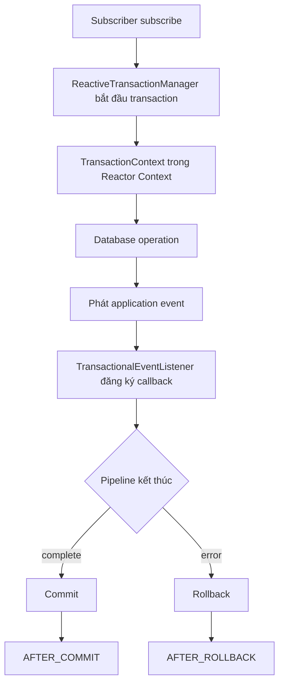

# Phát event trong reactive pipeline với Spring Framework

Spring Framework hỗ trợ gắn application event với transaction trong cả mô hình imperative và reactive. Tuy nhiên, reactive transaction không được lưu trong ThreadLocal như transaction đồng bộ. Trạng thái transaction nằm trong **Reactor Context** và đi theo subscription của reactive pipeline.

Từ Spring Framework 6.1, **@TransactionalEventListener** có thể tham gia transaction do **ReactiveTransactionManager** quản lý. Để listener tìm được đúng transaction, event phải mang **TransactionContext** làm source. API **TransactionalEventPublisher** hỗ trợ việc này và trả về một **Mono<Void>** để ghép trực tiếp vào pipeline.

Điểm quan trọng nhất khi phát event trong reactive pipeline là: tạo event trong đúng subscription, đưa bước publish vào cùng chuỗi reactive với thao tác database và không tự subscribe một nhánh riêng. Nếu bỏ transaction context hoặc tách pipeline, listener có thể không liên kết được event với transaction cần theo dõi.

## 1. Reactive transaction khác transaction đồng bộ ở đâu?

Với transaction imperative, Spring thường gắn trạng thái transaction với thread hiện tại thông qua ThreadLocal. Các thao tác trong cùng thread có thể tìm được transaction đang hoạt động.

Reactive pipeline không bảo đảm mọi operator chạy trên cùng một thread. Reactor có thể chuyển việc thực thi giữa các thread bằng publishOn, subscribeOn hoặc do các thành phần khác trong pipeline. Vì vậy, dựa vào ThreadLocal sẽ không thể biểu diễn chính xác transaction của một subscription.

Spring sử dụng **Reactor Context** để giữ transaction context cho reactive pipeline:

- Transaction được khởi tạo khi reactive publisher được subscribe.
- Transaction manager đặt trạng thái và tài nguyên transaction vào Reactor Context.
- Các thao tác database tham gia transaction nếu tiếp tục trong cùng context.
- Khi pipeline hoàn tất hoặc lỗi, transaction manager commit hoặc rollback rồi chạy các synchronization callback.



Reactor Context gắn với subscription, không gắn với một thread cụ thể. Việc pipeline chuyển thread không tự làm mất transaction context nếu các operator vẫn nằm trong cùng reactive chain.

## 2. Vì sao event cần mang TransactionContext?

Trong mô hình imperative, transaction listener có thể tìm transaction hiện tại qua thread-bound transaction synchronization. Với reactive transaction, không có một thread cố định để tra cứu trạng thái đó.

Spring giải quyết bằng cách đưa **TransactionContext** vào source của event. Khi nhận event, cơ chế transactional listener kiểm tra source này và đăng ký callback với transaction synchronization tương ứng.

Từ Spring Framework 6.1, reactive transactional event phải được phát với transaction context làm event source. Nếu chỉ gọi ApplicationEventPublisher thông thường với một object payload, Spring vẫn có thể bọc payload trong PayloadApplicationEvent, nhưng source mặc định không tự trở thành reactive TransactionContext.

Đây là lý do nên dùng **TransactionalEventPublisher** thay cho lời gọi publishEvent trực tiếp khi muốn một event được gắn với reactive transaction.

## 3. TransactionalEventPublisher

**org.springframework.transaction.reactive.TransactionalEventPublisher** là delegate được Spring cung cấp từ phiên bản 6.1 để phát transactional event trong reactive setup.

Nó có hai phương thức chính:

```java
Mono<Void> publishEvent(Object payload);

Mono<Void> publishEvent(
        Function<TransactionContext, ApplicationEvent> eventCreationFunction
);
```

- **publishEvent(Object):** nhận POJO hoặc record làm payload. Delegate tạo PayloadApplicationEvent với TransactionContext làm source.
- **publishEvent(Function):** nhận hàm tạo ApplicationEvent. Spring truyền TransactionContext vào hàm để event tùy chỉnh dùng context làm source.

Cả hai phương thức trả về Mono<Void>. Bước phát event là một phần của pipeline và chỉ thực thi khi pipeline được subscribe.

### Phát POJO hoặc record payload

```java
return transactionalEventPublisher.publishEvent(
        new OrderCreatedPayload(orderId)
);
```

Spring tự tạo PayloadApplicationEvent có source là TransactionContext và payload là OrderCreatedPayload. Listener vẫn có thể khai báo tham số là OrderCreatedPayload.

### Phát custom ApplicationEvent

Nếu event cần kế thừa ApplicationEvent, dùng overload nhận Function:

```java
return transactionalEventPublisher.publishEvent(
        transactionContext ->
                new OrderCreatedEvent(transactionContext, orderId)
);
```

Trong constructor, transactionContext trở thành source của event. Không truyền ApplicationEvent vào overload Object; overload đó dành cho payload và không nhận custom ApplicationEvent.

## 4. Đưa bước publish vào cùng reactive pipeline

Một reactive transaction thường được tạo bằng **TransactionalOperator** hoặc bằng phương thức @Transactional trả về Mono/Flux.

Ví dụ với TransactionalOperator:

```java
Mono<Void> work =
        databaseClient.sql("INSERT INTO orders(id) VALUES (:id)")
                .bind("id", orderId)
                .fetch()
                .rowsUpdated()
                .then()
                .then(transactionalEventPublisher.publishEvent(
                        new OrderCreatedPayload(orderId)
                ));

return transactionalOperator.transactional(work);
```

Thao tác insert và publish event cùng nằm trong publisher được bọc bởi TransactionalOperator. Khi subscribe, transaction bắt đầu; database operation và TransactionalEventPublisher cùng nhìn thấy Reactor Context của transaction.

Không gọi subscribe riêng cho event:

```java
// Không nên: tạo subscription độc lập ngoài chuỗi transaction.
transactionalEventPublisher.publishEvent(
        new OrderCreatedPayload(orderId)
).subscribe();
```

Một subscription độc lập không tự kế thừa Reactor Context của pipeline transaction ban đầu. Nó có thể không tìm được transaction context cần thiết và làm mất mối liên hệ giữa event với transaction.

Cũng không gọi block bên trong pipeline. Hãy trả về Mono/Flux cho caller và để một nơi ở ranh giới ứng dụng thực hiện subscribe hoặc block khi cần.

## 5. @TransactionalEventListener trong reactive transaction

Listener vẫn dùng annotation **@TransactionalEventListener** như với transaction imperative:

```java
@Component
public class OrderEventListener {

    @TransactionalEventListener(
            phase = TransactionPhase.AFTER_COMMIT
    )
    public void onOrderCreated(OrderCreatedPayload event) {
        System.out.println("Committed: " + event.orderId());
    }
}
```

Spring hỗ trợ các phase:

| Phase | Thời điểm |
|---|---|
| BEFORE_COMMIT | Trước khi transaction commit |
| AFTER_COMMIT | Sau commit; đây là mặc định |
| AFTER_ROLLBACK | Sau rollback |
| AFTER_COMPLETION | Sau khi transaction kết thúc, dù commit hay rollback |

Với reactive transaction, listener được đăng ký với transaction synchronization dựa trên TransactionContext trong source của event.

Nếu event không được phát trong transaction phù hợp, listener mặc định không chạy. Có thể bật **fallbackExecution = true** nếu nghiệp vụ chấp nhận listener chạy cả khi không có transaction, nhưng fallback không tạo ra transaction mới và không khôi phục transaction context đã mất.

```java
@TransactionalEventListener(
        phase = TransactionPhase.AFTER_COMMIT,
        fallbackExecution = true
)
public void notifyOrder(OrderCreatedPayload event) {
    // Chạy theo fallback nếu event không gắn với transaction.
}
```

Chỉ bật fallback khi việc xử lý ngoài transaction là hành vi được mong muốn. Nếu event bắt buộc phải gắn với commit/rollback, hãy giữ fallbackExecution=false.

## 6. Ví dụ hoàn chỉnh với Java 17, Reactor và R2DBC

Ví dụ dùng Spring Framework 6.2, R2DBC và H2 in-memory. Một service thực hiện insert và phát event trong cùng reactive transaction.

Chương trình chạy hai trường hợp:

- ORD-1001: transaction commit, listener AFTER_COMMIT được gọi.
- ORD-1002: pipeline phát event rồi phát sinh lỗi, transaction rollback và listener AFTER_ROLLBACK được gọi.

Ví dụ dùng TransactionalOperator để thấy rõ toàn bộ reactive pipeline. Cơ sở dữ liệu H2 chạy trong bộ nhớ, không cần cài server database riêng.

### 6.1. Cấu trúc dự án

```text
spring-reactive-transaction-event/
├── pom.xml
└── src/
    └── main/
        └── java/
            └── dev/
                └── example/
                    └── reactiveevent/
                        └── Application.java
```

### 6.2. Dependency Maven

```xml
<project xmlns="http://maven.apache.org/POM/4.0.0"
         xmlns:xsi="http://www.w3.org/2001/XMLSchema-instance"
         xsi:schemaLocation="http://maven.apache.org/POM/4.0.0 https://maven.apache.org/xsd/maven-4.0.0.xsd">
    <modelVersion>4.0.0</modelVersion>

    <groupId>dev.example</groupId>
    <artifactId>spring-reactive-transaction-event</artifactId>
    <version>1.0.0</version>

    <properties>
        <maven.compiler.release>17</maven.compiler.release>
        <project.build.sourceEncoding>UTF-8</project.build.sourceEncoding>
    </properties>

    <dependencies>
        <dependency>
            <groupId>org.springframework</groupId>
            <artifactId>spring-context</artifactId>
            <version>6.2.6</version>
        </dependency>
        <dependency>
            <groupId>org.springframework</groupId>
            <artifactId>spring-tx</artifactId>
            <version>6.2.6</version>
        </dependency>
        <dependency>
            <groupId>org.springframework</groupId>
            <artifactId>spring-r2dbc</artifactId>
            <version>6.2.6</version>
        </dependency>
        <dependency>
            <groupId>io.r2dbc</groupId>
            <artifactId>r2dbc-h2</artifactId>
            <version>1.0.0.RELEASE</version>
        </dependency>
    </dependencies>

    <build>
        <plugins>
            <plugin>
                <groupId>org.apache.maven.plugins</groupId>
                <artifactId>maven-compiler-plugin</artifactId>
                <version>3.13.0</version>
                <configuration>
                    <release>17</release>
                </configuration>
            </plugin>
            <plugin>
                <groupId>org.codehaus.mojo</groupId>
                <artifactId>exec-maven-plugin</artifactId>
                <version>3.5.0</version>
                <configuration>
                    <mainClass>dev.example.reactiveevent.Application</mainClass>
                </configuration>
            </plugin>
        </plugins>
    </build>
</project>
```

### 6.3. Mã nguồn

Tạo file src/main/java/dev/example/reactiveevent/Application.java:

```java
package dev.example.reactiveevent;

import io.r2dbc.spi.ConnectionFactories;
import io.r2dbc.spi.ConnectionFactory;
import reactor.core.publisher.Mono;

import org.springframework.context.ApplicationEventPublisher;
import org.springframework.context.annotation.AnnotationConfigApplicationContext;
import org.springframework.context.annotation.Bean;
import org.springframework.context.annotation.Configuration;
import org.springframework.r2dbc.connection.R2dbcTransactionManager;
import org.springframework.r2dbc.core.DatabaseClient;
import org.springframework.transaction.ReactiveTransactionManager;
import org.springframework.transaction.event.TransactionPhase;
import org.springframework.transaction.event.TransactionalEventListener;
import org.springframework.transaction.reactive.TransactionalEventPublisher;
import org.springframework.transaction.reactive.TransactionalOperator;

public class Application {

    public static void main(String[] args) {
        try (var context =
                     new AnnotationConfigApplicationContext(AppConfig.class)) {

            DatabaseClient databaseClient =
                    context.getBean(DatabaseClient.class);

            databaseClient.sql(
                    "CREATE TABLE orders (id VARCHAR(64) PRIMARY KEY)"
            ).fetch().rowsUpdated().block();

            OrderService service = context.getBean(OrderService.class);

            System.out.println("=== COMMIT ===");
            service.createOrder("ORD-1001", false).block();

            System.out.println("=== ROLLBACK ===");
            try {
                service.createOrder("ORD-1002", true).block();
            } catch (RuntimeException ex) {
                System.out.println(
                        "Publisher observed rollback: " + ex.getMessage()
                );
            }
        }
    }

    @Configuration(proxyBeanMethods = false)
    public static class AppConfig {

        @Bean
        public ConnectionFactory connectionFactory() {
            return ConnectionFactories.get(
                    "r2dbc:h2:mem:///reactiveevents"
                            + "?options=DB_CLOSE_DELAY=-1;DB_CLOSE_ON_EXIT=FALSE"
            );
        }

        @Bean
        public DatabaseClient databaseClient(ConnectionFactory factory) {
            return DatabaseClient.create(factory);
        }

        @Bean
        public ReactiveTransactionManager transactionManager(
                ConnectionFactory factory
        ) {
            return new R2dbcTransactionManager(factory);
        }

        @Bean
        public TransactionalOperator transactionalOperator(
                ReactiveTransactionManager transactionManager
        ) {
            return TransactionalOperator.create(transactionManager);
        }

        @Bean
        public TransactionalEventPublisher transactionalEventPublisher(
                ApplicationEventPublisher publisher
        ) {
            return new TransactionalEventPublisher(publisher);
        }

        @Bean
        public OrderService orderService(
                DatabaseClient databaseClient,
                TransactionalOperator transactionalOperator,
                TransactionalEventPublisher eventPublisher
        ) {
            return new OrderService(
                    databaseClient,
                    transactionalOperator,
                    eventPublisher
            );
        }

        @Bean
        public OrderEventListener orderEventListener() {
            return new OrderEventListener();
        }
    }

    public record OrderCreatedPayload(String orderId) {}

    public static class OrderService {
        private final DatabaseClient databaseClient;
        private final TransactionalOperator transactionalOperator;
        private final TransactionalEventPublisher eventPublisher;

        public OrderService(
                DatabaseClient databaseClient,
                TransactionalOperator transactionalOperator,
                TransactionalEventPublisher eventPublisher
        ) {
            this.databaseClient = databaseClient;
            this.transactionalOperator = transactionalOperator;
            this.eventPublisher = eventPublisher;
        }

        public Mono<Void> createOrder(
                String orderId,
                boolean forceRollback
        ) {
            Mono<Void> insertOrder = databaseClient
                    .sql("INSERT INTO orders(id) VALUES (:id)")
                    .bind("id", orderId)
                    .fetch()
                    .rowsUpdated()
                    .then();

            Mono<Void> publishEvent = eventPublisher.publishEvent(
                    new OrderCreatedPayload(orderId)
            );

            Mono<Void> work = insertOrder
                    .then(publishEvent)
                    .then(Mono.fromRunnable(() -> {
                        if (forceRollback) {
                            throw new IllegalStateException(
                                    "simulated rollback"
                            );
                        }
                    }));

            return transactionalOperator.transactional(work);
        }
    }

    public static class OrderEventListener {

        @TransactionalEventListener(
                phase = TransactionPhase.AFTER_COMMIT
        )
        public void afterCommit(OrderCreatedPayload event) {
            System.out.println(
                    "AFTER_COMMIT: " + event.orderId()
            );
        }

        @TransactionalEventListener(
                phase = TransactionPhase.AFTER_ROLLBACK
        )
        public void afterRollback(OrderCreatedPayload event) {
            System.out.println(
                    "AFTER_ROLLBACK: " + event.orderId()
            );
        }
    }
}
```

### 6.4. Chạy chương trình

Mở terminal tại thư mục chứa pom.xml, sau đó chạy:

```bash
mvn -q compile exec:java
```

Stdout mong đợi:

```text
=== COMMIT ===
AFTER_COMMIT: ORD-1001
=== ROLLBACK ===
AFTER_ROLLBACK: ORD-1002
Publisher observed rollback: simulated rollback
```

Giải thích luồng ORD-1001:

1. Main gọi createOrder và block ở ranh giới ứng dụng để chờ kết quả.
2. TransactionalOperator bắt đầu reactive transaction khi pipeline được subscribe.
3. DatabaseClient thực hiện INSERT trong transaction.
4. TransactionalEventPublisher lấy TransactionContext từ Reactor Context và phát OrderCreatedPayload với context làm source.
5. Listener AFTER_COMMIT đăng ký callback với transaction; nó chưa chạy ngay tại thời điểm publish.
6. Pipeline hoàn tất bình thường, transaction commit và listener AFTER_COMMIT được gọi.

Với ORD-1002, bước insert và publish event vẫn xảy ra. Sau đó Mono.fromRunnable phát sinh lỗi. TransactionalOperator rollback transaction và listener AFTER_ROLLBACK được gọi. Event đã được đăng ký với transaction nên callback phù hợp với kết quả rollback được thực hiện.

Ví dụ dùng database thật qua R2DBC để minh họa transaction manager. H2 in-memory phù hợp cho học tập và thử nghiệm; môi trường production cần driver, connection pool và cấu hình transaction tương ứng với database đang sử dụng.

## 7. Dùng custom ApplicationEvent thay cho payload record

Nếu cần một event class kế thừa ApplicationEvent, hãy dùng overload nhận Function<TransactionContext, ApplicationEvent>:

```java
public class OrderCreatedEvent extends ApplicationEvent {
    private final String orderId;

    public OrderCreatedEvent(Object source, String orderId) {
        super(source);
        this.orderId = orderId;
    }

    public String getOrderId() {
        return orderId;
    }
}
```

Phát event trong pipeline:

```java
Mono<Void> publish = transactionalEventPublisher.publishEvent(
        transactionContext ->
                new OrderCreatedEvent(transactionContext, orderId)
);
```

Listener nhận event:

```java
@TransactionalEventListener(phase = TransactionPhase.AFTER_COMMIT)
public void afterCommit(OrderCreatedEvent event) {
    System.out.println(event.getOrderId());
}
```

Function nhận TransactionContext từ TransactionalEventPublisher. Việc dùng context làm source giúp Spring liên kết custom ApplicationEvent với reactive transaction.

Không gọi publishEvent(Object) với một object đã kế thừa ApplicationEvent. Overload Object dành cho payload; với custom ApplicationEvent, hãy dùng overload Function để chỉ rõ source.

## 8. Cách khác: lấy TransactionContextManager trực tiếp

TransactionalEventPublisher là API tiện lợi, nhưng có thể tự lấy transaction context và tạo event:

```java
TransactionContextManager.currentContext()
        .map(source ->
                new PayloadApplicationEvent<>(
                        source,
                        new OrderCreatedPayload(orderId)
                )
        )
        .doOnSuccess(applicationEventPublisher::publishEvent)
        .then();
```

Cách này thể hiện rõ cơ chế: TransactionContextManager.currentContext() lấy context hiện tại từ Reactor Context, rồi source đó được gắn vào PayloadApplicationEvent trước khi phát.

Trong ứng dụng thông thường, ưu tiên TransactionalEventPublisher vì API ngắn hơn và ít thao tác thủ công. Chỉ dùng cách trực tiếp khi cần kiểm soát rõ việc tạo event hoặc tích hợp với một publisher tùy chỉnh.

## 9. Khi nào dùng ApplicationEventPublisher trực tiếp?

Không phải mọi event phát trong reactive pipeline đều cần gắn với transaction.

Nếu chỉ muốn thông báo một sự kiện nội bộ và không cần chờ commit/rollback, có thể dùng ApplicationEventPublisher trong pipeline:

```java
Mono<Void> publishOrdinaryEvent =
        Mono.fromRunnable(() ->
                applicationEventPublisher.publishEvent(
                        new CacheRefreshRequested(orderId)
                )
        );
```

Đây là một hand-off thông thường. Nó không tự bảo đảm listener chỉ chạy sau commit, cũng không đưa reactive TransactionContext vào source của event.

Nếu listener dùng @TransactionalEventListener và cần gắn với reactive transaction, hãy dùng TransactionalEventPublisher hoặc tự tạo event có TransactionContext làm source.

| Nhu cầu | API phù hợp |
|---|---|
| Event nội bộ thông thường trong reactive chain | ApplicationEventPublisher bên trong Mono.fromRunnable |
| POJO/record cần gắn với reactive transaction | TransactionalEventPublisher.publishEvent(Object) |
| Custom ApplicationEvent cần gắn với reactive transaction | TransactionalEventPublisher.publishEvent(Function) |
| Event chỉ được xử lý sau commit/rollback | Kết hợp TransactionalEventPublisher với @TransactionalEventListener |

## 10. Dùng @Transactional trên reactive method

Ngoài TransactionalOperator, Spring có thể quản lý reactive transaction bằng annotation **@Transactional** nếu phương thức trả về reactive type như Mono hoặc Flux và transaction manager được cấu hình là ReactiveTransactionManager.

Ví dụ:

```java
@Transactional
public Mono<Void> createOrder(String orderId) {
    return databaseClient
            .sql("INSERT INTO orders(id) VALUES (:id)")
            .bind("id", orderId)
            .fetch()
            .rowsUpdated()
            .then(transactionalEventPublisher.publishEvent(
                    new OrderCreatedPayload(orderId)
            ));
}
```

Spring xác định transaction model dựa trên loại transaction manager và kiểu trả về phương thức. Với reactive transaction, hãy trả về Mono/Flux để transaction được gắn với subscription.

Không viết một phương thức @Transactional reactive trả về void rồi kỳ vọng Spring duy trì reactive transaction. Phương thức void thuộc mô hình imperative transaction thông thường.

TransactionalOperator hữu ích khi muốn bao một đoạn pipeline cụ thể, còn @Transactional thuận tiện khi transaction gắn với ranh giới phương thức service.

## 11. Các lỗi thường gặp khi phát event trong reactive pipeline

| Hiện tượng | Nguyên nhân | Cách xử lý |
|---|---|---|
| @TransactionalEventListener không được gọi | Event không mang TransactionContext làm source | Dùng TransactionalEventPublisher |
| Listener chạy ngay hoặc không đợi commit | Dùng ApplicationEventPublisher thông thường thay vì transactional publisher | Gắn event với reactive transaction context |
| TransactionalEventPublisher báo không có context | Publish event ngoài reactive transaction hoặc pipeline đã tách subscription | Đặt publish trong cùng pipeline được TransactionalOperator quản lý |
| Event bị mất khi gọi subscribe riêng | Tạo subscription độc lập, không có Reactor Context của transaction | Compose Mono<Void> bằng then/flatMap và trả về pipeline |
| Dùng ThreadLocal để đọc transaction nhưng nhận null | Reactive transaction dùng Reactor Context | Dùng reactive transaction APIs và giữ cùng subscriber context |
| Event đã phát nhưng transaction rollback | Event được publish trong transaction, nhưng phase listener được chọn không phù hợp | Dùng AFTER_COMMIT cho side effect chỉ hợp lệ sau commit |
| Listener nhận payload sai kiểu | Dùng custom ApplicationEvent với overload Object hoặc khai báo sai tham số | Dùng overload Function cho ApplicationEvent; dùng Object cho POJO payload |
| Dữ liệu ngoài database không rollback | Listener đã gọi hệ thống bên ngoài trước commit hoặc dùng listener thường | Dùng @TransactionalEventListener với phase phù hợp |
| Gọi block hoặc subscribe bên trong service | Tách pipeline và làm mất tính composition | Trả về Mono/Flux cho caller, chỉ block ở ranh giới ứng dụng |

## 12. Các giới hạn cần hiểu rõ

### Event listener không phải message broker

TransactionalEventPublisher chỉ liên kết event với transaction trong ứng dụng hiện tại. Nó không lưu event vào hàng đợi bền vững và không bảo đảm event được phát lại sau khi process restart.

Nếu cần giao tiếp giữa nhiều service, retry sau khi ứng dụng dừng hoặc dead-letter queue, hãy dùng message broker và cân nhắc transactional outbox.

### Transactional listener không tự tạo transaction mới

AFTER_COMMIT hoặc AFTER_ROLLBACK chạy sau kết quả transaction nguồn. Nếu listener cần ghi dữ liệu mới và muốn commit thay đổi đó, cần thiết kế transaction độc lập phù hợp, thay vì giả định nó tiếp tục ghi vào transaction đã kết thúc.

### Không phát event trước khi pipeline được subscribe

Reactive publisher là lazy. Việc tạo Mono chưa thực hiện insert hoặc phát event. Chỉ khi có subscription, transaction mới bắt đầu và các operator mới được thực thi.

Vì vậy, hãy trả về Mono chứa cả thao tác database và publish event. Đừng gọi một phương thức publish riêng rồi bỏ qua publisher được trả về.

### Không chia sẻ transaction context như business payload

TransactionContext là metadata nội bộ để Spring liên kết event với transaction synchronization. Không serialize nó, lưu vào database như dữ liệu nghiệp vụ hoặc gửi nó qua message broker. Payload event nên chứa dữ liệu nghiệp vụ bất biến như orderId, customerId hoặc eventId.

## 13. Checklist khi phát event trong reactive pipeline

- Đã dùng ReactiveTransactionManager, chẳng hạn R2dbcTransactionManager.
- Các thao tác database và publish event nằm trong cùng reactive pipeline.
- Đã dùng TransactionalOperator hoặc @Transactional trên phương thức trả về Mono/Flux.
- Đã dùng TransactionalEventPublisher cho event cần gắn với reactive transaction.
- Nếu dùng POJO/record, gọi publishEvent(Object).
- Nếu dùng custom ApplicationEvent, gọi publishEvent(Function) để đặt TransactionContext làm source.
- Không dùng ThreadLocal để tìm reactive transaction context.
- Không subscribe hoặc block một nhánh riêng bên trong service.
- Đã chọn đúng phase: BEFORE_COMMIT, AFTER_COMMIT, AFTER_ROLLBACK hoặc AFTER_COMPLETION.
- Đã xác định hành vi khi không có transaction và giá trị fallbackExecution.
- Listener chỉ thực hiện side effect ở phase phù hợp với kết quả transaction.
- Có transaction riêng nếu listener cần ghi dữ liệu mới sau completion.
- Không coi event trong bộ nhớ là message bền vững hoặc cơ chế retry.

## 14. Tài liệu tham khảo

- [Spring Framework 6.2 — Transaction-bound Events](https://docs.spring.io/spring/reference/6.2/data-access/transaction/event.html)
- [TransactionalEventPublisher Javadoc 6.2](https://docs.spring.io/spring-framework/docs/6.2.x/javadoc-api/org/springframework/transaction/reactive/TransactionalEventPublisher.html)
- [ApplicationEventPublisher Javadoc 6.2](https://docs.spring.io/spring-framework/docs/6.2.x/javadoc-api/org/springframework/context/ApplicationEventPublisher.html)
- [Spring Framework 6.2 — Data Access with R2DBC](https://docs.spring.io/spring-framework/reference/6.2/data-access/r2dbc.html)

Phát event trong reactive pipeline đòi hỏi giữ đúng transaction context của subscription. Với Spring Framework 6.1 trở lên, **TransactionalEventPublisher** giúp đưa TransactionContext vào source của event để **@TransactionalEventListener** đăng ký đúng callback. Hãy ghép Mono<Void> của thao tác publish vào cùng pipeline với database work, chọn phase theo kết quả transaction và tránh tạo subscription độc lập làm mất Reactor Context.
