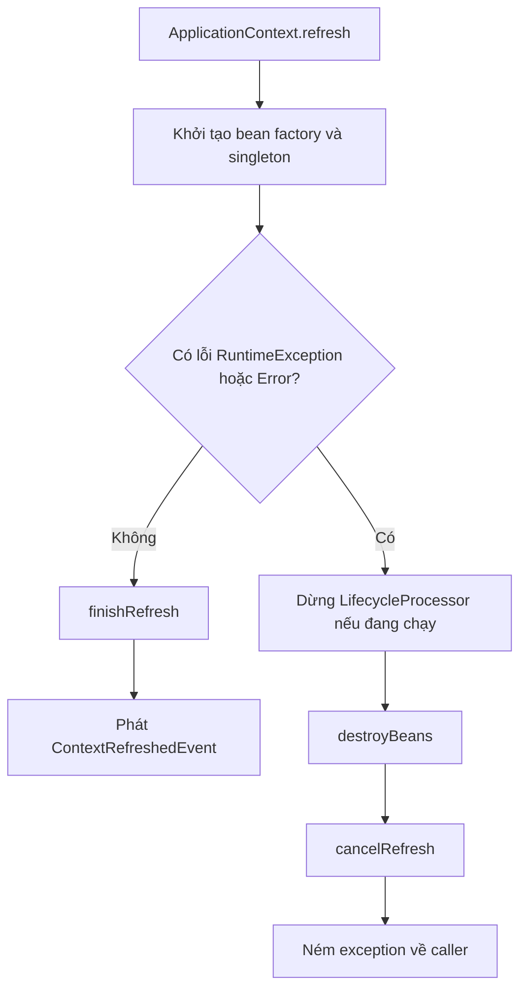

# ContextFailedEvent

## 1. Mục tiêu và phạm vi

Trong chủ đề **Vòng đời ApplicationContext**, khi một context không thể khởi tạo hoặc refresh thành công, ứng dụng cần ghi nhận nguyên nhân, dọn dẹp tài nguyên đã khởi tạo và thông báo cho hệ thống giám sát nếu cần. Tên `ContextFailedEvent` thường được dùng để mô tả một thông báo như vậy.

Cần phân biệt chính xác nguồn gốc của tên này:

- **Spring Framework 6.2 không cung cấp built-in event tên `ContextFailedEvent`.** Danh sách lifecycle events chuẩn của `ApplicationContext` có `ContextRefreshedEvent`, `ContextStartedEvent`, `ContextStoppedEvent` và `ContextClosedEvent`.
- Khi `ApplicationContext.refresh()` thất bại, Spring dừng các `Lifecycle` bean đã chạy, hủy các singleton đã tạo, đặt trạng thái refresh về không hoạt động rồi ném exception trở lại caller. Framework không tự phát một `ContextFailedEvent`.
- **Spring Boot có `ApplicationFailedEvent`**, được `SpringApplication` phát khi quá trình startup thất bại. Đây là event chuẩn nên ưu tiên dùng trong ứng dụng Spring Boot.
- Nếu chỉ dùng Spring Framework và cần một thông báo mang tên `ContextFailedEvent`, ứng dụng có thể tự định nghĩa event đó và phát qua một publisher hoặc event dispatcher độc lập.

Sau bài học, bạn có thể:

- Phân biệt lỗi refresh của Spring Framework với startup failure event của Spring Boot.
- Hiểu các bước cleanup khi `refresh()` ném exception.
- Nhận biết vì sao listener nằm trong context đang lỗi không phải nơi đáng tin cậy để xử lý thông báo thất bại.
- Tự định nghĩa và phát một `ContextFailedEvent` khi ứng dụng có nhu cầu.
- Đăng ký listener nhận `ApplicationFailedEvent` đúng thời điểm trong Spring Boot.
- Bảo toàn exception gốc và tránh để lỗi của listener che mất nguyên nhân startup failure.

## 2. ContextFailedEvent có phải event chuẩn của Spring Framework không?

Không. Trong Spring Framework 6.2, `ContextFailedEvent` không nằm trong nhóm event lifecycle tích hợp sẵn của `ApplicationContext`.

Các event chuẩn liên quan trực tiếp đến vòng đời context:

| Event | Ý nghĩa |
|---|---|
| `ContextRefreshedEvent` | Context đã khởi tạo hoặc refresh thành công và hoàn tất bước refresh |
| `ContextStartedEvent` | Context nhận lệnh `start()`; các bean triển khai `Lifecycle` nhận tín hiệu bắt đầu |
| `ContextStoppedEvent` | Context nhận lệnh `stop()`; các bean `Lifecycle` nhận tín hiệu dừng |
| `ContextClosedEvent` | Context đang được đóng qua `close()` hoặc JVM shutdown hook |
| `ContextFailedEvent` | Không phải built-in event của Spring Framework 6.2; chỉ tồn tại nếu ứng dụng hoặc thư viện tự định nghĩa |

Đừng nhầm event với exception:

- `ApplicationContextException` là một exception của Spring, dùng để biểu đạt một số lỗi ở cấp ApplicationContext.
- `ContextFailedEvent` nếu được ứng dụng tự định nghĩa là một event object, dùng để thông báo cho listener về một lần thất bại.
- `ApplicationFailedEvent` là event của Spring Boot, biểu đạt việc `SpringApplication` không khởi động thành công.

Một exception có thể được ném mà không có event tương ứng. Tương tự, một event có thể mang exception làm dữ liệu nhưng bản thân event không thay thế exception và không làm cho startup tiếp tục.

## 3. Spring xử lý lỗi trong refresh() như thế nào?

`AbstractApplicationContext.refresh()` là quy trình chính để tạo hoặc làm mới trạng thái hoạt động của context. Trong quá trình này, Spring chuẩn bị environment, tạo bean factory, đăng ký post-processor, khởi tạo các thành phần đặc biệt, đăng ký listener và tạo các singleton không lazy.

Khi refresh hoàn tất, Spring gọi `finishRefresh()`. Bước này hoàn tất lifecycle processing và phát `ContextRefreshedEvent`.

Nếu một bước trong quá trình refresh ném `RuntimeException` hoặc `Error`, Spring thực hiện cleanup:

1. Ghi nhận rằng lần khởi tạo context thất bại.
2. Nếu `LifecycleProcessor` đang chạy, yêu cầu các lifecycle component đã khởi động dừng lại.
3. Gọi `destroyBeans()` để hủy các singleton đã được tạo, tránh để lại tài nguyên dang dở.
4. Gọi `cancelRefresh(ex)` để đặt trạng thái active về không hoạt động.
5. Ném exception gốc trở lại caller.

Luồng khái quát:



Hệ quả cần nhớ:

- `ContextRefreshedEvent` chỉ được phát khi refresh đi đến bước hoàn tất.
- Spring Framework không tự phát `ContextFailedEvent` trong nhánh cleanup này.
- Caller của `refresh()` vẫn nhận được exception để quyết định ghi log, thông báo, thoát tiến trình hoặc thử một chiến lược khởi tạo khác.
- Context sau lần refresh lỗi không nên được coi là một context đang hoạt động bình thường.

Không nên tự gọi `context.publishEvent(...)` sau khi refresh thất bại rồi kỳ vọng listener bean trong chính context đó luôn hoạt động. Bean factory vừa trải qua cleanup và các listener có thể chưa được tạo hoặc đã bị hủy. Dùng một listener được đăng ký trước hoặc một event dispatcher độc lập nếu cần thông báo lỗi.

## 4. Phân biệt ContextRefreshedEvent, ContextClosedEvent và lỗi refresh

Ba tình huống sau mô tả các thời điểm khác nhau:

### ContextRefreshedEvent

Được phát khi context đã hoàn tất refresh. Đây là thời điểm phù hợp để listener thực hiện công việc cần một context đã sẵn sàng, ví dụ kiểm tra trạng thái cấu hình hoặc khởi tạo một cache phụ thuộc vào các bean đã được tạo.

Không dùng event này để phát hiện startup failure, vì refresh thất bại sẽ không đi đến bước phát event hoàn tất.

### ContextClosedEvent

Được phát khi context được đóng thông qua `close()` hoặc shutdown hook. Đây là tín hiệu cho quá trình shutdown bình thường, không phải tín hiệu thay thế cho refresh failure.

Ví dụ, một listener có thể giải phóng tài nguyên phụ trợ:

```java
@Component
class ContextShutdownListener {

    @EventListener
    public void onClosed(ContextClosedEvent event) {
        System.out.println(
                "Closing context: "
                        + event.getApplicationContext().getDisplayName());
    }
}
```

### Refresh failure

Khi `refresh()` thất bại, caller nhận exception. Framework dừng lifecycle component đã chạy và hủy singleton đã tạo. Không có built-in `ContextFailedEvent` được phát tự động trong Spring Framework 6.2.

Nếu muốn phát một event nghiệp vụ cho hệ thống quan sát, hãy tạo event riêng ở tầng bootstrap sau khi bắt được exception. Event đó phải được gửi qua một dispatcher vẫn còn hoạt động độc lập với context vừa thất bại.

## 5. Spring Boot dùng ApplicationFailedEvent

Nếu ứng dụng được khởi chạy bằng `SpringApplication`, Spring Boot cung cấp event chuẩn:

`org.springframework.boot.context.event.ApplicationFailedEvent`

Event này được phát khi `SpringApplication` thất bại trong quá trình startup. Nó chứa:

- `getException()`: exception gây ra startup failure.
- `getApplicationContext()`: context đang được tạo hoặc đã được tạo trước khi thất bại; giá trị có thể là `null` nếu context chưa sẵn sàng.

Đây là event của Spring Boot, không phải event thuộc package `org.springframework.context.event` của Spring Framework.

### Đăng ký listener trước khi chạy SpringApplication

Một số startup events được phát trước khi ApplicationContext tồn tại. Do đó, không thể dựa vào một listener bean được tạo bên trong context để nhận mọi startup failure.

Hãy đăng ký listener sớm bằng `SpringApplication.addListeners(...)`:

```java
import org.springframework.boot.SpringApplication;
import org.springframework.boot.context.event.ApplicationFailedEvent;
import org.springframework.context.ApplicationListener;
import org.springframework.context.ConfigurableApplicationContext;

public class StartupFailureListener
        implements ApplicationListener<ApplicationFailedEvent> {

    @Override
    public void onApplicationEvent(ApplicationFailedEvent event) {
        Throwable failure = event.getException();

        ConfigurableApplicationContext failedContext =
                event.getApplicationContext();

        String contextName = failedContext == null
                ? "<context not created>"
                : failedContext.getDisplayName();

        System.err.printf(
                "Application startup failed: context=%s, cause=%s%n",
                contextName,
                failure.getClass().getSimpleName());
    }
}
```

Đăng ký listener trong main:

```java
@SpringBootApplication
public class DemoApplication {

    public static void main(String[] args) {
        SpringApplication application =
                new SpringApplication(DemoApplication.class);

        application.addListeners(new StartupFailureListener());

        application.run(args);
    }
}
```

Đây là đoạn tích hợp Spring Boot; project cần dependency Spring Boot tương ứng. Listener được thêm trước `run()`, vì vậy nó có thể nhận event ngay cả khi quá trình tạo context thất bại trước khi các bean listener được khởi tạo.

Ví dụ log có thể có dạng:

```text
Application startup failed: context=application, cause=BeanCreationException
```

Tên context và loại exception phụ thuộc vào vị trí lỗi. Nếu context chưa được tạo, listener phải xử lý trường hợp `getApplicationContext()` trả về `null`.

### ApplicationFailedEvent không phải runtime failure event

`ApplicationFailedEvent` nói về lỗi khi Spring Boot startup. Nó không tự động được phát mỗi khi một request lỗi, một service ném exception hoặc một scheduled task thất bại sau khi ứng dụng đã chạy.

Đối với lỗi runtime, hãy dùng cơ chế phù hợp với phạm vi lỗi: exception handling của ứng dụng, logging, metrics, observability hoặc một custom event nghiệp vụ. Đừng dùng startup failure event để đại diện cho mọi lỗi trong vòng đời ứng dụng.

## 6. Tự định nghĩa ContextFailedEvent trong Spring Framework

Nếu ứng dụng chỉ dùng Spring Framework hoặc cần một event có cấu trúc riêng, có thể tự định nghĩa `ContextFailedEvent` kế thừa `ApplicationEvent`.

Ví dụ:

```java
public final class ContextFailedEvent extends ApplicationEvent {

    private final ConfigurableApplicationContext failedContext;
    private final Throwable failure;

    public ContextFailedEvent(
            ConfigurableApplicationContext failedContext,
            Throwable failure) {
        super(failedContext);
        this.failedContext = failedContext;
        this.failure = failure;
    }

    public ConfigurableApplicationContext getFailedContext() {
        return failedContext;
    }

    public Throwable getFailure() {
        return failure;
    }
}
```

Thiết kế này lưu hai thông tin:

- Context đã thất bại, để listener biết context nào gặp sự cố.
- Exception gốc, để listener có thể ghi log hoặc phân loại nguyên nhân.

Không nên chỉ lưu một chuỗi message của exception. Giữ lại đối tượng `Throwable` giúp hệ thống quan sát có thể lấy class, cause và stack trace khi cần.

### Dùng dispatcher độc lập

Khi context vừa refresh thất bại, một dispatcher nằm bên ngoài context đó đáng tin cậy hơn listener bean bên trong context lỗi. `SimpleApplicationEventMulticaster` có thể được dùng làm dispatcher độc lập cho ví dụ này.

```java
SimpleApplicationEventMulticaster failureBus =
        new SimpleApplicationEventMulticaster();

failureBus.addApplicationListener(
        (ApplicationListener<ContextFailedEvent>) event -> {
            System.err.println(
                    "Failed context: "
                            + event.getFailedContext().getDisplayName());

            System.err.println(
                    "Failure type: "
                            + event.getFailure().getClass().getSimpleName());
        });
```

Sau khi bắt được exception từ `refresh()`, bootstrap code tạo và gửi event:

```java
try {
    context.refresh();
} catch (RuntimeException ex) {
    failureBus.multicastEvent(
            new ContextFailedEvent(context, ex));

    throw ex;
}
```

Đoạn code này minh họa ranh giới quan trọng: exception được bắt ở nơi gọi `refresh()`, custom event được gửi qua dispatcher độc lập, sau đó exception gốc vẫn được ném lại. Listener chỉ nhận thông báo và thực hiện side effect quan sát; nó không biến một context khởi tạo thất bại thành context hoạt động.

## 7. Ví dụ hoàn chỉnh chạy bằng Spring Context

Ví dụ dưới đây cố ý đăng ký một bean ném exception khi được tạo. Việc refresh context sẽ thất bại. Bootstrap code bắt exception, phát custom `ContextFailedEvent` qua một `SimpleApplicationEventMulticaster` độc lập và giữ nguyên loại exception cho caller.

### Cấu hình Maven

Tạo project với cấu trúc:

```text
src/
└── main/
    └── java/
        └── demo/
            └── ContextFailureEventDemo.java
pom.xml
```

Nội dung `pom.xml`:

```xml
<project xmlns="http://maven.apache.org/POM/4.0.0"
         xmlns:xsi="http://www.w3.org/2001/XMLSchema-instance"
         xsi:schemaLocation="http://maven.apache.org/POM/4.0.0 https://maven.apache.org/xsd/maven-4.0.0.xsd">
    <modelVersion>4.0.0</modelVersion>

    <groupId>demo</groupId>
    <artifactId>context-failure-event</artifactId>
    <version>1.0.0</version>

    <properties>
        <maven.compiler.release>17</maven.compiler.release>
        <project.build.sourceEncoding>UTF-8</project.build.sourceEncoding>
        <spring-framework.version>6.2.18</spring-framework.version>
    </properties>

    <dependencies>
        <dependency>
            <groupId>org.springframework</groupId>
            <artifactId>spring-context</artifactId>
            <version>${spring-framework.version}</version>
        </dependency>
    </dependencies>

    <build>
        <plugins>
            <plugin>
                <groupId>org.apache.maven.plugins</groupId>
                <artifactId>maven-compiler-plugin</artifactId>
                <version>3.14.0</version>
            </plugin>
            <plugin>
                <groupId>org.codehaus.mojo</groupId>
                <artifactId>exec-maven-plugin</artifactId>
                <version>3.5.0</version>
            </plugin>
        </plugins>
    </build>
</project>
```

### Mã nguồn Java

Tạo file `src/main/java/demo/ContextFailureEventDemo.java`:

```java
package demo;

import org.springframework.context.ApplicationEvent;
import org.springframework.context.ApplicationListener;
import org.springframework.context.annotation.AnnotationConfigApplicationContext;
import org.springframework.context.event.SimpleApplicationEventMulticaster;

public class ContextFailureEventDemo {

    public static void main(String[] args) {
        SimpleApplicationEventMulticaster failureBus =
                new SimpleApplicationEventMulticaster();

        failureBus.addApplicationListener(
                (ApplicationListener<ContextFailedEvent>) event -> {
                    System.out.println(
                            "FailureListener: context="
                                    + event.getFailedContext().getDisplayName());

                    System.out.println(
                            "FailureListener: exception="
                                    + event.getFailure().getClass()
                                            .getSimpleName());
                });

        try (var context = new AnnotationConfigApplicationContext()) {
            context.setId("demo-failed-context");
            context.setDisplayName("demo-failed-context");

            context.registerBean(
                    "brokenBean",
                    Object.class,
                    () -> {
                        throw new IllegalStateException(
                                "missing external configuration");
                    });

            try {
                try {
                    context.refresh();
                } catch (RuntimeException ex) {
                    try {
                        failureBus.multicastEvent(
                                new ContextFailedEvent(context, ex));
                    } catch (RuntimeException reportingFailure) {
                        ex.addSuppressed(reportingFailure);
                    }

                    throw ex;
                }
            } catch (RuntimeException ex) {
                System.out.println(
                        "Bootstrap: refresh failure observed "
                                + ex.getClass().getSimpleName());
            }
        }
    }

    static final class ContextFailedEvent extends ApplicationEvent {

        private final AnnotationConfigApplicationContext failedContext;
        private final Throwable failure;

        ContextFailedEvent(
                AnnotationConfigApplicationContext failedContext,
                Throwable failure) {
            super(failedContext);
            this.failedContext = failedContext;
            this.failure = failure;
        }

        AnnotationConfigApplicationContext getFailedContext() {
            return failedContext;
        }

        Throwable getFailure() {
            return failure;
        }
    }
}
```

### Biên dịch và chạy

Từ thư mục chứa `pom.xml`, chạy:

```bash
mvn -q compile exec:java -Dexec.mainClass=demo.ContextFailureEventDemo
```

Stdout dự kiến:

```text
FailureListener: context=demo-failed-context
FailureListener: exception=BeanCreationException
Bootstrap: refresh failure observed BeanCreationException
```

Giải thích:

1. `failureBus` được tạo độc lập với ApplicationContext sẽ được refresh.
2. Listener được đăng ký trực tiếp vào dispatcher độc lập.
3. `brokenBean` cố ý ném `IllegalStateException` trong lúc Spring tạo singleton.
4. Spring bọc lỗi tạo bean thành `BeanCreationException`, thực hiện cleanup của lần refresh và ném exception về caller.
5. Bootstrap code tạo custom `ContextFailedEvent` chứa context lỗi và exception gốc.
6. Dispatcher gửi event đến listener để ghi nhận tên context và loại exception.
7. Nếu listener thông báo cũng ném `RuntimeException`, bootstrap code thêm lỗi đó vào danh sách suppressed của exception gốc. Nguyên nhân refresh failure vẫn được giữ lại.

Đây là một custom event của project demo, không phải class được Spring Framework tự cung cấp. Dispatcher độc lập chỉ minh họa cách phát thông báo sau khi refresh thất bại; trong ứng dụng thật, có thể thay bằng logger, metrics, alert client hoặc một event publisher bên ngoài.

## 8. Thiết kế listener xử lý thất bại an toàn

Listener nhận failure event thường làm các công việc quan sát hoặc thông báo:

- Ghi log kèm tên context và exception gốc.
- Gửi metric hoặc cảnh báo đến hệ thống giám sát.
- Ghi lại cấu hình hoặc profile đang dùng nếu thông tin đó còn sẵn có.
- Thông báo cho bootstrap supervisor hoặc tiến trình quản lý bên ngoài.

Một số nguyên tắc:

1. **Giữ exception gốc:** không thay exception startup bằng exception do logging hoặc alert listener ném ra.
2. **Không phụ thuộc bean của context lỗi:** các singleton có thể đã bị hủy và listener bean có thể chưa từng được tạo.
3. **Giữ listener ngắn:** tránh chạy công việc dài trong thread khởi tạo. Nếu cần gửi alert từ xa, dùng một thành phần quan sát độc lập và có timeout.
4. **Không tự động thử refresh vô hạn:** một lỗi cấu hình hoặc dependency thường không tự hết. Retry cần giới hạn và có backoff nếu nguyên nhân có khả năng tạm thời.
5. **Không xem event là cơ chế phục hồi:** phát failure event không sửa cấu hình, không tạo lại bean và không tự khởi động lại context.
6. **Bảo vệ dữ liệu nhạy cảm:** log exception có thể chứa URL, username hoặc cấu hình. Chỉ xuất thông tin phù hợp với chính sách logging của ứng dụng.

Nếu ứng dụng cần khởi động lại sau lỗi, hãy để một supervisor hoặc cơ chế orchestration quản lý vòng đời tiến trình. Không gọi `refresh()` lặp lại từ chính listener của context vừa thất bại nếu chưa xác định loại context đó có hỗ trợ refresh lại hay không.

## 9. Chọn event hoặc cơ chế phù hợp

| Nhu cầu | Cơ chế nên dùng |
|---|---|
| Biết context đã refresh thành công | `ContextRefreshedEvent` |
| Biết context được yêu cầu start hoặc stop | `ContextStartedEvent`, `ContextStoppedEvent` |
| Biết context đang đóng | `ContextClosedEvent` |
| Theo dõi Spring Boot startup failure | `ApplicationFailedEvent` |
| Theo dõi lỗi refresh trong Spring Framework thuần | Bắt exception tại bootstrap boundary |
| Muốn có thông báo tên `ContextFailedEvent` trong ứng dụng thuần Spring | Tự định nghĩa event và phát qua dispatcher độc lập |
| Phân tích lỗi startup của Spring Boot cho người vận hành | `FailureAnalyzer` và startup failure report |
| Theo dõi lỗi xảy ra sau khi ứng dụng đã chạy | Exception handling, logging, metrics hoặc custom runtime event |

Không dùng `ContextClosedEvent` để giả lập failure. Đóng context và refresh thất bại là hai tình huống khác nhau, có trình tự cleanup và ý nghĩa vận hành khác nhau.

## 10. Những lỗi thường gặp

1. **Tưởng ContextFailedEvent là built-in event:** Spring Framework 6.2 không cung cấp class này. Hãy dùng `ApplicationFailedEvent` trong Spring Boot hoặc tự định nghĩa event riêng.
2. **Đăng ký failure listener như một bean của context đang lỗi:** bean có thể chưa được tạo hoặc đã bị hủy. Đăng ký listener sớm hoặc dùng dispatcher bên ngoài.
3. **Chờ ContextRefreshedEvent khi refresh thất bại:** bước `finishRefresh()` không hoàn tất nên event này không được phát.
4. **Nhầm ApplicationContextException với ContextFailedEvent:** một bên là exception, một bên là event object.
5. **Nhầm ApplicationFailedEvent với event của Spring Framework:** `ApplicationFailedEvent` thuộc Spring Boot và được phát bởi `SpringApplication`.
6. **Không xử lý context null trong Spring Boot:** `ApplicationFailedEvent.getApplicationContext()` có thể trả về null nếu context chưa được tạo.
7. **Nuốt exception gốc khi gửi cảnh báo:** lỗi của listener thông báo không được che mất nguyên nhân refresh failure.
8. **Tự động retry vô hạn:** lỗi cấu hình hoặc bean definition không được khắc phục bằng cách refresh liên tục.
9. **Dùng failure event cho lỗi runtime:** startup failure và lỗi sau khi ứng dụng đã sẵn sàng là hai vòng đời khác nhau.
10. **Cho rằng event làm context hoạt động trở lại:** event chỉ thông báo; quá trình phục hồi cần một cơ chế riêng.

## 11. Kiểm thử

Nên kiểm thử cả nhánh refresh thành công, refresh thất bại và lỗi trong listener thông báo.

### Kiểm thử custom ContextFailedEvent

- Đăng ký một bean supplier cố ý ném exception.
- Gọi `refresh()` và xác nhận exception được ném về caller.
- Xác nhận dispatcher độc lập nhận đúng một `ContextFailedEvent`.
- Xác nhận event giữ đúng context và exception gốc.
- Xác nhận lỗi của listener được thêm vào suppressed exception nếu chính sách bootstrap chọn cách giữ lỗi gốc.

### Kiểm thử Spring Boot ApplicationFailedEvent

- Đăng ký listener qua `SpringApplication.addListeners(...)` trước khi gọi `run()`.
- Tạo một cấu hình test làm startup thất bại.
- Xác nhận `getException()` chứa nguyên nhân startup failure.
- Kiểm tra listener xử lý được cả trường hợp `getApplicationContext()` là null.

### Kiểm thử event lifecycle thành công

- Khi context refresh thành công, xác nhận `ContextRefreshedEvent` được phát.
- Khi gọi `close()`, xác nhận `ContextClosedEvent` được phát.
- Không dùng hai event này làm bằng chứng cho nhánh refresh failure.

Trong unit test, có thể dùng một listener ghi event nhận được vào list hoặc `AtomicReference`. Với integration test, khởi tạo ApplicationContext thật để kiểm tra vòng đời bean và cleanup thực tế.

## 12. Checklist triển khai

- [ ] Phân biệt rõ Spring Framework và Spring Boot event.
- [ ] Không giả định Spring Framework có built-in `ContextFailedEvent`.
- [ ] Dùng `ApplicationFailedEvent` nếu cần theo dõi Spring Boot startup failure.
- [ ] Đăng ký Boot failure listener trước `SpringApplication.run()`.
- [ ] Xử lý trường hợp ApplicationContext trong `ApplicationFailedEvent` là null.
- [ ] Với Spring Framework thuần, bắt exception tại nơi gọi `refresh()`.
- [ ] Nếu tự định nghĩa `ContextFailedEvent`, lưu context và exception gốc.
- [ ] Dùng dispatcher độc lập với context đang thất bại.
- [ ] Giữ exception gốc khi listener thông báo gặp lỗi.
- [ ] Phân biệt refresh failure với close event và runtime failure.
- [ ] Có kiểm thử cleanup, thông báo, null context và lỗi listener.

## 13. Tài liệu tham khảo

- [Spring Framework 6.2 Reference — Standard and Custom Application Events](https://docs.spring.io/spring/reference/6.2/core/beans/context-introduction.html)
- [Spring Framework 6.2 API — AbstractApplicationContext](https://docs.spring.io/spring-framework/docs/6.2.18/javadoc-api/org/springframework/context/support/AbstractApplicationContext.html)
- [Spring Framework 6.2 API — ContextRefreshedEvent](https://docs.spring.io/spring-framework/docs/6.2.18/javadoc-api/org/springframework/context/event/ContextRefreshedEvent.html)
- [Spring Boot 4.0 API — ApplicationFailedEvent](https://docs.spring.io/spring-boot/4.0/api/java/org/springframework/boot/context/event/ApplicationFailedEvent.html)
- [Spring Boot 4.0 Reference — SpringApplication Events and Startup Failure](https://docs.spring.io/spring-boot/reference/features/spring-application.html)


