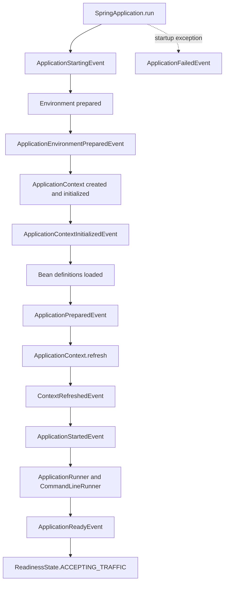

# SpringApplication và event lifecycle

## 1. SpringApplication phát event trong quá trình nào?

`SpringApplication` là entry point phổ biến để khởi động ứng dụng Spring Boot. Trong lúc chạy, Boot phát một chuỗi application event để thông báo các mốc quan trọng: bắt đầu startup, Environment đã sẵn sàng, ApplicationContext được chuẩn bị, context đã refresh, các runner hoàn tất và ứng dụng sẵn sàng nhận traffic.

Những event này giúp thành phần khác phản ứng theo đúng giai đoạn khởi động mà không phải sửa trực tiếp code bên trong `SpringApplication`.

Các nhu cầu thường gặp:

- Đọc hoặc ghi nhận cấu hình sau khi Environment được chuẩn bị.
- Quan sát context sau khi bean definitions được nạp.
- Khởi tạo cache hoặc kiểm tra thành phần sau khi context refresh.
- Chạy tác vụ cuối cùng trước khi đánh dấu ứng dụng ready.
- Ghi nhận lỗi nếu quá trình startup thất bại.
- Theo dõi liveness và readiness để phối hợp với hệ thống triển khai.

Event lifecycle của Spring Boot là event cấp ứng dụng. Một số event được phát rất sớm, trước khi bean trong ApplicationContext tồn tại; một số event chỉ được phát sau khi context refresh và các runner hoàn tất. Thời điểm đăng ký listener vì vậy rất quan trọng.

## 2. Thứ tự các event startup chính

Trong luồng khởi động thông thường, Spring Boot phát các event chính theo thứ tự sau:

| Thứ tự | Event | Thời điểm |
|---:|---|---|
| 1 | `ApplicationStartingEvent` | Bắt đầu chạy SpringApplication, trước khi Environment và ApplicationContext được chuẩn bị. |
| 2 | `ApplicationEnvironmentPreparedEvent` | Environment đã được chuẩn bị, nhưng ApplicationContext chưa được tạo. |
| 3 | `ApplicationContextInitializedEvent` | ApplicationContext đã được tạo và các ApplicationContextInitializer đã chạy, trước khi bean definitions được nạp. |
| 4 | `ApplicationPreparedEvent` | Bean definitions đã được nạp vào context, nhưng context chưa refresh. |
| 5 | `ContextRefreshedEvent` | ApplicationContext hoàn tất bước refresh trong Spring Framework. |
| 6 | `ApplicationStartedEvent` | Context đã refresh xong, trước khi ApplicationRunner và CommandLineRunner chạy. |
| 7 | `AvailabilityChangeEvent` với `LivenessState.CORRECT` | Boot chuyển trạng thái liveness sau mốc started. |
| 8 | `ApplicationReadyEvent` | Tất cả ApplicationRunner và CommandLineRunner đã hoàn tất; ứng dụng được xem là sẵn sàng. |
| 9 | `AvailabilityChangeEvent` với `ReadinessState.ACCEPTING_TRAFFIC` | Boot thông báo trạng thái readiness chấp nhận traffic. |

Ngoài chuỗi startup thành công, `ApplicationFailedEvent` được phát khi có exception làm quá trình khởi động thất bại. Event này không phải bước tiếp theo của startup thành công; nó là tín hiệu nhánh lỗi.

Sơ đồ rút gọn:



Bảng và sơ đồ thể hiện thứ tự logic phổ biến. Các event phụ thuộc web server hoặc context cụ thể, chẳng hạn `ServletWebServerInitializedEvent`, có thể xuất hiện trong quá trình refresh và không thay thế `ApplicationReadyEvent`.

## 3. Ý nghĩa từng giai đoạn

### ApplicationStartingEvent

Đây là event rất sớm, được phát ngay khi SpringApplication bắt đầu chạy. Tại thời điểm này, Environment chưa được chuẩn bị và ApplicationContext chưa được tạo.

Listener thường chỉ nên làm công việc nhẹ, độc lập với bean của ứng dụng như ghi nhận mốc bắt đầu hoặc thiết lập một cơ chế quan sát đơn giản. Không nên cố inject service hoặc repository vì context chưa sẵn sàng.

### ApplicationEnvironmentPreparedEvent

Event này được phát khi Environment đã được chuẩn bị, bao gồm các property source và profile mà Boot đã nạp ở giai đoạn đó. ApplicationContext chưa được tạo.

Có thể dùng để quan sát profile đang hoạt động hoặc cấu hình startup. Nếu cần thay đổi Environment, hãy hiểu rõ thứ tự property source và các bước cấu hình tiếp theo; tránh ghi đè cấu hình của ứng dụng một cách tùy tiện.

### ApplicationContextInitializedEvent

ApplicationContext đã được tạo và các `ApplicationContextInitializer` đã chạy, nhưng bean definitions của ứng dụng chưa được nạp đầy đủ. Event này phù hợp để quan sát context ở giai đoạn rất sớm hoặc phối hợp với hạ tầng cần được chuẩn bị trước khi đọc bean definitions.

### ApplicationPreparedEvent

Các bean definitions đã được nạp vào ApplicationContext, nhưng context chưa refresh. Các singleton thông thường chưa hoàn tất khởi tạo. Không nên hiểu event này là tất cả bean đã sẵn sàng để sử dụng.

### ContextRefreshedEvent

Đây là event của Spring Framework, được phát khi ApplicationContext hoàn tất refresh. Các non-lazy singleton đã được tạo trong quá trình refresh. Tuy nhiên, lazy bean có thể chưa được khởi tạo và các tác vụ runner của Spring Boot vẫn chưa chạy.

### ApplicationStartedEvent

Event được phát sau khi context refresh thành công và trước khi Boot gọi các `ApplicationRunner` và `CommandLineRunner`. Đây là mốc thích hợp để biết container đã khởi tạo xong, nhưng ứng dụng chưa được đánh dấu ready.

### ApplicationReadyEvent

Event được phát sau khi mọi `ApplicationRunner` và `CommandLineRunner` hoàn tất. Đây là mốc phù hợp cho hành động chỉ nên thực hiện khi startup sequence của Boot đã hoàn tất.

### ApplicationFailedEvent

Event được phát khi startup thất bại. Tùy thời điểm lỗi, ApplicationContext có thể chưa được tạo hoặc chưa hoàn tất refresh. Listener nên xử lý trường hợp context không có sẵn và tránh giả định mọi bean đã được khởi tạo.

## 4. Đăng ký listener sớm và listener dạng bean

Không phải mọi listener đều có thể nhận mọi event lifecycle.

Các event như `ApplicationStartingEvent` và `ApplicationEnvironmentPreparedEvent` được phát trước khi bean của ứng dụng được khởi tạo. Một class đánh dấu `@Component` không thể nhận những event đã phát trước khi bean đó tồn tại.

Để nhận event sớm, đăng ký listener trực tiếp với `SpringApplication` trước khi gọi `run`:

```java
SpringApplication application = new SpringApplication(DemoApplication.class);
application.addListeners(new BootLifecycleListener());
application.run(args);
```

Listener được thêm bằng `addListeners` có mặt từ đầu startup sequence. Đây là lựa chọn phù hợp cho event trước khi ApplicationContext refresh.

Với event muộn, có thể dùng bean `@Component` kết hợp `@EventListener`:

```java
@Component
public class ReadyObserver {

    @EventListener
    public void onReady(ApplicationReadyEvent event) {
        System.out.println("Application is ready");
    }
}
```

Bean listener được tạo trong quá trình refresh nên nhận được event phát sau đó, chẳng hạn `ApplicationStartedEvent` hoặc `ApplicationReadyEvent`. Nó không thể nhận lại các event đã phát trước khi bean được đăng ký.

Một lựa chọn khác là triển khai `ApplicationListener<E>` và đăng ký listener qua cơ chế phù hợp. Dù dùng annotation hay interface, nguyên tắc vẫn là listener phải được đăng ký trước khi event được phát.

## 5. Phân biệt ApplicationRunner, CommandLineRunner và ApplicationReadyEvent

`ApplicationRunner` và `CommandLineRunner` là callback để chạy công việc sau khi ApplicationContext refresh, nhưng trước khi ứng dụng phát `ApplicationReadyEvent`.

| Thành phần | Vai trò |
|---|---|
| `ApplicationRunner` | Nhận `ApplicationArguments`, thuận tiện khi cần truy cập option và non-option arguments đã được parse. |
| `CommandLineRunner` | Nhận trực tiếp mảng `String[]` arguments của dòng lệnh. |
| `ApplicationStartedEvent` | Thông báo context đã refresh, trước khi runner chạy. |
| `ApplicationReadyEvent` | Thông báo toàn bộ runner đã hoàn tất và startup sequence đã đến mốc ready. |

Ví dụ runner:

```java
@Component
public class InitialDataLoader implements ApplicationRunner {

    @Override
    public void run(ApplicationArguments args) {
        System.out.println("Load initial data");
    }
}
```

Nếu một listener `ApplicationReadyEvent` phụ thuộc vào dữ liệu do runner nạp, thứ tự này bảo đảm runner đã hoàn tất trước khi ready event được phát.

Có thể dùng `@Order` hoặc `Ordered` để sắp xếp nhiều runner. Không nên dựa vào thứ tự bean được khai báo hoặc thứ tự scan class để điều phối các tác vụ phụ thuộc nhau.

## 6. Liveness và readiness

Spring Boot sử dụng application availability state để biểu diễn hai khía cạnh khác nhau:

- **Liveness:** tiến trình có còn hoạt động theo cách có thể tiếp tục chạy hay không.
- **Readiness:** ứng dụng đã sẵn sàng nhận traffic hay chưa.

Sau `ApplicationStartedEvent`, Boot phát `AvailabilityChangeEvent` với `LivenessState.CORRECT`. Sau `ApplicationReadyEvent`, Boot phát readiness state `ACCEPTING_TRAFFIC`.

Điều này hữu ích khi ứng dụng chạy trong môi trường có health check hoặc orchestrator. Một tiến trình có thể đang sống nhưng chưa sẵn sàng nhận request vì runner vẫn đang nạp dữ liệu hoặc khởi tạo tài nguyên.

Không nên dùng liveness để biểu diễn mọi lỗi dependency tạm thời. Nếu liveness liên tục thất bại do một dịch vụ ngoài chập chờn, orchestrator có thể restart ứng dụng không cần thiết. Hãy chọn readiness/liveness theo ý nghĩa vận hành của từng tín hiệu.

## 7. Lọc event và thứ tự listener

Một listener có thể chỉ nhận một loại event cụ thể bằng generic type:

```java
@Component
public class ReadyListener
        implements ApplicationListener<ApplicationReadyEvent> {

    @Override
    public void onApplicationEvent(ApplicationReadyEvent event) {
        System.out.println("Ready for traffic");
    }
}
```

Với `@EventListener`, tham số phương thức xác định event type:

```java
@EventListener
public void onReady(ApplicationReadyEvent event) {
    // Xử lý khi Boot phát ready event.
}
```

Có thể dùng `@Order` nếu nhiều listener cùng nhận một event và cần thứ tự gọi đồng bộ. Giá trị order nhỏ hơn có độ ưu tiên cao hơn. Nếu listener chạy bất đồng bộ, thứ tự bắt đầu task không bảo đảm thứ tự hoàn tất.

Không dùng event listener để tạo một workflow nhiều bước có phụ thuộc kết quả chặt chẽ. Khi bước sau chỉ được chạy nếu bước trước thành công, hãy dùng service hoặc workflow điều phối rõ ràng.

## 8. Context hierarchy và event

Ứng dụng có thể có nhiều ApplicationContext, đặc biệt trong ứng dụng web có root context và servlet child context. Event được phát trong context có thể được chuyển tiếp lên parent context theo cơ chế của Spring.

Với event lifecycle của Spring Boot, cần chú ý context nào phát event và listener nào được đăng ký. Một listener có thể nhận event liên quan đến context con. Nếu chỉ muốn xử lý context gốc hoặc một context cụ thể, hãy kiểm tra context trong event thay vì chỉ kiểm tra class event.

Ví dụ với event có accessor ApplicationContext:

```java
@EventListener
public void onContextRefreshed(ContextRefreshedEvent event) {
    ApplicationContext sourceContext = event.getApplicationContext();
    // Lọc theo context ID hoặc quan hệ parent-child nếu cần.
}
```

Không nên giả định mọi event Spring Boot đều có cùng accessor hoặc cùng quy tắc context. Hãy dùng API của đúng event class. Với `ApplicationFailedEvent`, context có thể chưa tồn tại tùy giai đoạn lỗi.

## 9. Ví dụ Java 17 + Spring Boot có thể chạy

Ví dụ dùng Java 17 và Spring Boot 3.4.0. Listener được đăng ký trước khi gọi `SpringApplication.run`, vì vậy nó quan sát được cả các event startup rất sớm. Một `ApplicationRunner` in ra thông báo giữa `ApplicationStartedEvent` và `ApplicationReadyEvent`.

Cấu trúc project:

```text
springapplication-lifecycle-demo/
├── pom.xml
└── src/main/
    ├── java/com/example/lifecycle/
    │   ├── DemoApplication.java
    │   ├── BootLifecycleListener.java
    │   └── StartupTask.java
    └── resources/
        └── application.properties
```

**pom.xml**

```xml
<project xmlns="http://maven.apache.org/POM/4.0.0"
         xmlns:xsi="http://www.w3.org/2001/XMLSchema-instance"
         xsi:schemaLocation="http://maven.apache.org/POM/4.0.0 https://maven.apache.org/xsd/maven-4.0.0.xsd">
    <modelVersion>4.0.0</modelVersion>

    <groupId>com.example</groupId>
    <artifactId>springapplication-lifecycle-demo</artifactId>
    <version>1.0.0</version>

    <parent>
        <groupId>org.springframework.boot</groupId>
        <artifactId>spring-boot-starter-parent</artifactId>
        <version>3.4.0</version>
        <relativePath/>
    </parent>

    <properties>
        <java.version>17</java.version>
    </properties>

    <dependencies>
        <dependency>
            <groupId>org.springframework.boot</groupId>
            <artifactId>spring-boot-starter</artifactId>
        </dependency>
    </dependencies>

    <build>
        <plugins>
            <plugin>
                <groupId>org.springframework.boot</groupId>
                <artifactId>spring-boot-maven-plugin</artifactId>
            </plugin>
        </plugins>
    </build>
</project>
```

**application.properties**

```properties
spring.main.banner-mode=off
logging.level.root=OFF
```

**DemoApplication.java**

```java
package com.example.lifecycle;

import org.springframework.boot.Banner;
import org.springframework.boot.SpringApplication;
import org.springframework.boot.autoconfigure.SpringBootApplication;

@SpringBootApplication
public class DemoApplication {

    public static void main(String[] args) {
        SpringApplication application =
                new SpringApplication(DemoApplication.class);

        application.setBannerMode(Banner.Mode.OFF);
        application.addListeners(new BootLifecycleListener());
        application.run(args);
    }
}
```

**BootLifecycleListener.java**

```java
package com.example.lifecycle;

import org.springframework.boot.context.event.ApplicationContextInitializedEvent;
import org.springframework.boot.context.event.ApplicationEnvironmentPreparedEvent;
import org.springframework.boot.context.event.ApplicationFailedEvent;
import org.springframework.boot.context.event.ApplicationPreparedEvent;
import org.springframework.boot.context.event.ApplicationReadyEvent;
import org.springframework.boot.context.event.ApplicationStartedEvent;
import org.springframework.boot.context.event.ApplicationStartingEvent;
import org.springframework.context.ApplicationEvent;
import org.springframework.context.ApplicationListener;

public class BootLifecycleListener
        implements ApplicationListener<ApplicationEvent> {

    @Override
    public void onApplicationEvent(ApplicationEvent event) {
        if (event instanceof ApplicationStartingEvent) {
            System.out.println("boot: starting");
        } else if (event instanceof ApplicationEnvironmentPreparedEvent) {
            System.out.println("boot: environment prepared");
        } else if (event instanceof ApplicationContextInitializedEvent) {
            System.out.println("boot: context initialized");
        } else if (event instanceof ApplicationPreparedEvent) {
            System.out.println("boot: context prepared");
        } else if (event instanceof ApplicationStartedEvent) {
            System.out.println("boot: started");
        } else if (event instanceof ApplicationReadyEvent) {
            System.out.println("boot: ready");
        } else if (event instanceof ApplicationFailedEvent) {
            System.out.println("boot: failed");
        }
    }
}
```

**StartupTask.java**

```java
package com.example.lifecycle;

import org.springframework.boot.ApplicationArguments;
import org.springframework.boot.ApplicationRunner;
import org.springframework.stereotype.Component;

@Component
public class StartupTask implements ApplicationRunner {

    @Override
    public void run(ApplicationArguments args) {
        System.out.println("runner: application runner");
    }
}
```

Build và chạy bằng Java 17, Maven:

```bash
mvn -q package
java -jar target/springapplication-lifecycle-demo-1.0.0.jar
```

Stdout:

```text
boot: starting
boot: environment prepared
boot: context initialized
boot: context prepared
boot: started
runner: application runner
boot: ready
```

Giải thích:

- `BootLifecycleListener` được thêm trước `run`, nên nhận được event từ giai đoạn `ApplicationStartingEvent`.
- `ApplicationContextInitializedEvent` và `ApplicationPreparedEvent` phản ánh các mốc chuẩn bị context trước refresh.
- Sau khi context refresh, Boot phát `ApplicationStartedEvent`.
- `StartupTask` chạy sau started event.
- Khi runner hoàn tất, Boot phát `ApplicationReadyEvent`.

Ví dụ tắt banner và log root để output minh họa chỉ còn các dòng do chương trình in. Trong ứng dụng thật, không nên tắt log toàn cục chỉ để làm output gọn; hãy cấu hình logging phù hợp môi trường.

## 10. Listener bean cho event muộn

Nếu chỉ quan tâm đến `ApplicationReadyEvent`, có thể đăng ký listener dưới dạng bean. Cách này cho phép inject service khác từ Spring:

```java
package com.example.lifecycle;

import org.springframework.boot.context.event.ApplicationReadyEvent;
import org.springframework.context.event.EventListener;
import org.springframework.stereotype.Component;

@Component
public class ReadyNotification {

    private final StartupMetrics metrics;

    public ReadyNotification(StartupMetrics metrics) {
        this.metrics = metrics;
    }

    @EventListener
    public void onReady(ApplicationReadyEvent event) {
        metrics.markApplicationReady();
    }
}
```

Ví dụ giả định `StartupMetrics` là bean do ứng dụng cung cấp. Listener bean không nhận được `ApplicationStartingEvent` vì bean chỉ được tạo trong quá trình refresh, sau khi event rất sớm đã phát.

Nếu listener cần nhận event sớm nhưng vẫn cần dependency, hãy thiết kế dependency nhẹ có thể được cung cấp trước context hoặc dùng một listener sớm chỉ ghi nhận tín hiệu rồi chuyển dữ liệu cho bean sau khi context sẵn sàng. Không cố truy cập bean chưa được khởi tạo từ event sớm.

## 11. Event khi startup thất bại

`ApplicationFailedEvent` được phát khi SpringApplication không thể hoàn tất startup. Listener đăng ký sớm bằng `SpringApplication.addListeners` có thể quan sát nhánh lỗi ngay cả khi context chưa hoàn tất.

Một số lưu ý:

- Không giả định ApplicationContext luôn tồn tại trong event lỗi.
- Không gọi service/repository của context khi context chưa refresh hoặc đang đóng.
- Giữ handler lỗi ngắn và ít dependency.
- Ghi lại exception gốc và giai đoạn startup nếu có thể.
- Tránh ném thêm exception từ listener lỗi khiến việc chẩn đoán khó hơn.

Có thể dùng event này để gửi telemetry hoặc ghi lại startup failure. Nếu cần lưu thông tin lỗi bền vững, hãy dùng logging/monitoring có khả năng tồn tại độc lập với ApplicationContext đang thất bại.

## 12. Những lỗi thường gặp

| Triệu chứng | Nguyên nhân thường gặp | Cách xử lý |
|---|---|---|
| Không nhận được ApplicationStartingEvent | Listener được đăng ký bằng bean sau khi context bắt đầu refresh | Thêm listener bằng `SpringApplication.addListeners` trước `run`. |
| Listener không thấy Environment đã chuẩn bị | Đang quan sát event quá sớm hoặc đọc sai event | Dùng `ApplicationEnvironmentPreparedEvent` cho mốc Environment. |
| Dùng ApplicationPreparedEvent nhưng bean chưa sẵn sàng | Event xảy ra trước context refresh | Chuyển logic cần bean sang event muộn hoặc runner. |
| Công việc chạy trước runner | Đặt logic ở ApplicationStartedEvent | Dùng ApplicationReadyEvent nếu phải đợi runner hoàn tất. |
| Ready listener không chạy | Bean listener không được đăng ký hoặc context startup thất bại trước ready | Kiểm tra component scan và ApplicationFailedEvent. |
| Tác vụ startup chạy nhiều lần | Có nhiều listener/context hoặc logic không idempotent | Lọc context và thiết kế thao tác an toàn khi chạy lại. |
| Ứng dụng báo ready quá sớm | Công việc quan trọng chạy async và không được chờ | Đưa công việc bắt buộc vào runner hoặc readiness workflow có kiểm soát. |
| Không thấy ApplicationFailedEvent | Listener đăng ký muộn hoặc lỗi xảy ra trước khi listener được thêm | Đăng ký listener trước run và kiểm tra log gốc. |

## 13. Checklist chọn event phù hợp

1. Cần quan sát startup trước khi có Environment? Dùng `ApplicationStartingEvent`.
2. Cần đọc Environment đã chuẩn bị? Dùng `ApplicationEnvironmentPreparedEvent`.
3. Cần can thiệp context trước khi bean definitions được nạp? Xem xét `ApplicationContextInitializer` và `ApplicationContextInitializedEvent`.
4. Cần biết bean definitions đã được nạp nhưng context chưa refresh? Dùng `ApplicationPreparedEvent`.
5. Cần biết container đã refresh? Dùng `ContextRefreshedEvent`.
6. Cần biết context đã refresh nhưng runner chưa chạy? Dùng `ApplicationStartedEvent`.
7. Cần chạy tác vụ khởi tạo có tham số command line? Dùng `ApplicationRunner` hoặc `CommandLineRunner`.
8. Cần chờ runner hoàn tất trước khi đánh dấu ready? Dùng `ApplicationReadyEvent`.
9. Cần quan sát startup thất bại? Đăng ký sớm listener cho `ApplicationFailedEvent`.
10. Cần điều khiển start/stop lâu dài của bean? Xem xét `Lifecycle` hoặc `SmartLifecycle`, không biến event startup thành nơi quản lý mọi vòng đời.

`SpringApplication` phát các event theo những mốc cụ thể của startup sequence. Chọn đúng event và đăng ký listener đúng thời điểm giúp tránh phụ thuộc vào bean chưa tồn tại, tránh báo ready trước khi runner hoàn tất và làm cho quá trình khởi động dễ quan sát, kiểm thử và vận hành hơn.
