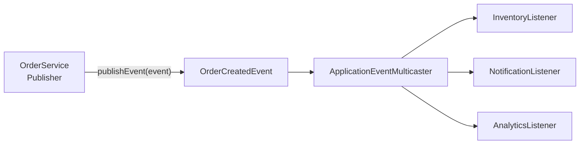

# Một publisher với nhiều listener trong Spring Framework

Trong Spring Framework, một **publisher** phát đi một sự kiện để thông báo rằng một việc đã xảy ra. Nhiều **listener** có thể cùng đăng ký nhận sự kiện đó. Publisher chỉ cần biết **ApplicationEventPublisher**; Spring tìm các listener phù hợp và chuyển event đến từng listener đã đăng ký trong **ApplicationContext**.

Ví dụ, khi đơn hàng được tạo, cùng một event **OrderCreatedEvent** có thể được xử lý bởi listener giữ hàng trong kho, listener gửi xác nhận cho khách hàng và listener ghi nhận số liệu. Khi thêm một listener mới, service phát event không cần biết listener đó tồn tại.

Sau bài này, bạn có thể giải thích luồng publisher–event–listener, viết nhiều listener cho cùng một kiểu event, điều khiển thứ tự xử lý và nhận biết khi nào cần xử lý bất đồng bộ hoặc gắn với transaction.

## 1. Mô hình một publisher, nhiều listener

Các thành phần có vai trò riêng:

- **Publisher:** thành phần phát event bằng **ApplicationEventPublisher.publishEvent(...)**.
- **Event:** đối tượng bất biến mang dữ liệu mô tả việc vừa xảy ra, chẳng hạn mã đơn hàng và số lượng sản phẩm.
- **Event multicaster:** cơ chế trong **ApplicationContext** tìm và gọi các listener phù hợp.
- **Listener:** bean Spring có phương thức **@EventListener**, hoặc một listener triển khai API tương ứng, để xử lý event.

Luồng xử lý tổng quát:



Một lần gọi **publishEvent(event)** có thể kích hoạt nhiều listener. Mỗi listener nhận dữ liệu của cùng event và tự thực hiện trách nhiệm của mình. Publisher không cần gọi trực tiếp từng listener, vì vậy các thành phần ít phụ thuộc vào nhau hơn.

Trong cấu hình mặc định, Spring sử dụng **SimpleApplicationEventMulticaster**. Listener phải được đăng ký thành bean trong **ApplicationContext**; một class chỉ có annotation **@EventListener** nhưng không được Spring quản lý sẽ không tự động nhận event.

## 2. Spring tìm listener phù hợp như thế nào?

Spring xác định listener dựa trên kiểu event mà listener khai báo. Với **@EventListener**, kiểu tham số của phương thức chính là kiểu event mà phương thức muốn nhận:

```java
@EventListener
public void onOrderCreated(OrderCreatedEvent event) {
    System.out.println("Nhận đơn hàng: " + event.orderId());
}
```

Khi publisher phát một **OrderCreatedEvent**, Spring gọi các listener có kiểu nhận tương thích với event đó. Một listener khác nhận **PaymentCompletedEvent** sẽ không được gọi chỉ vì nó cũng dùng **@EventListener**.

Spring Framework hỗ trợ phát một đối tượng Java thông thường làm event. Vì vậy, với ví dụ dùng Java record bên dưới, **OrderCreatedEvent** không cần kế thừa **ApplicationEvent**. Cách này giúp định nghĩa event ngắn gọn và dễ giữ bất biến.

Các listener có thể nằm trong những bean khác nhau. Một bean cũng có thể có nhiều phương thức **@EventListener**. Chỉ cần các phương thức đó nhận đúng kiểu event và bean được Spring đăng ký.

## 3. Ví dụ hoàn chỉnh với Java 17 và Spring Framework

Ví dụ sau dùng Spring Context thuần để làm rõ cơ chế event. Một **OrderService** phát đúng một **OrderCreatedEvent**; ba listener độc lập lần lượt giữ hàng, gửi xác nhận và ghi nhận thống kê.

### 3.1. Cấu trúc dự án

```text
spring-events-many-listeners/
├── pom.xml
└── src/
    └── main/
        └── java/
            └── dev/
                └── example/
                    └── events/
                        └── Application.java
```

### 3.2. Khai báo dependency trong pom.xml

```xml
<project xmlns="http://maven.apache.org/POM/4.0.0"
         xmlns:xsi="http://www.w3.org/2001/XMLSchema-instance"
         xsi:schemaLocation="http://maven.apache.org/POM/4.0.0 https://maven.apache.org/xsd/maven-4.0.0.xsd">
    <modelVersion>4.0.0</modelVersion>

    <groupId>dev.example</groupId>
    <artifactId>spring-events-many-listeners</artifactId>
    <version>1.0.0</version>

    <properties>
        <maven.compiler.release>17</maven.compiler.release>
        <project.build.sourceEncoding>UTF-8</project.build.sourceEncoding>
    </properties>

    <dependencies>
        <dependency>
            <groupId>org.springframework</groupId>
            <artifactId>spring-context</artifactId>
            <version>6.2.6</version>
        </dependency>
    </dependencies>

    <build>
        <plugins>
            <plugin>
                <groupId>org.apache.maven.plugins</groupId>
                <artifactId>maven-compiler-plugin</artifactId>
                <version>3.13.0</version>
                <configuration>
                    <release>17</release>
                </configuration>
            </plugin>
            <plugin>
                <groupId>org.codehaus.mojo</groupId>
                <artifactId>exec-maven-plugin</artifactId>
                <version>3.5.0</version>
                <configuration>
                    <mainClass>dev.example.events.Application</mainClass>
                </configuration>
            </plugin>
        </plugins>
    </build>
</project>
```

### 3.3. Tạo event, publisher và ba listener

Tạo file **src/main/java/dev/example/events/Application.java**:

```java
package dev.example.events;

import org.springframework.context.ApplicationEventPublisher;
import org.springframework.context.annotation.AnnotationConfigApplicationContext;
import org.springframework.context.annotation.Bean;
import org.springframework.context.annotation.Configuration;
import org.springframework.context.event.EventListener;
import org.springframework.core.annotation.Order;

public class Application {

    public static void main(String[] args) {
        try (var context =
                     new AnnotationConfigApplicationContext(AppConfig.class)) {
            OrderService orderService = context.getBean(OrderService.class);
            orderService.createOrder("ORD-1001", "Laptop", 2);
        }
    }

    @Configuration(proxyBeanMethods = false)
    public static class AppConfig {

        @Bean
        public OrderService orderService(ApplicationEventPublisher publisher) {
            return new OrderService(publisher);
        }

        @Bean
        public InventoryListener inventoryListener() {
            return new InventoryListener();
        }

        @Bean
        public CustomerNotificationListener customerNotificationListener() {
            return new CustomerNotificationListener();
        }

        @Bean
        public AnalyticsListener analyticsListener() {
            return new AnalyticsListener();
        }
    }

    // Event bất biến: mọi listener chỉ đọc dữ liệu đơn hàng.
    public record OrderCreatedEvent(
            String orderId,
            String product,
            int quantity
    ) {}

    public static class OrderService {
        private final ApplicationEventPublisher eventPublisher;

        public OrderService(ApplicationEventPublisher eventPublisher) {
            this.eventPublisher = eventPublisher;
        }

        public void createOrder(String orderId, String product, int quantity) {
            System.out.println("Đã tạo đơn hàng " + orderId);

            OrderCreatedEvent event =
                    new OrderCreatedEvent(orderId, product, quantity);

            // Chỉ phát event một lần; Spring phân phối đến các listener.
            eventPublisher.publishEvent(event);
        }
    }

    public static class InventoryListener {

        @EventListener
        @Order(1)
        public void reserveInventory(OrderCreatedEvent event) {
            System.out.printf(
                    "1. Kho: giữ %d sản phẩm %s cho đơn %s%n",
                    event.quantity(),
                    event.product(),
                    event.orderId()
            );
        }
    }

    public static class CustomerNotificationListener {

        @EventListener
        @Order(2)
        public void sendConfirmation(OrderCreatedEvent event) {
            System.out.printf(
                    "2. Thông báo: gửi xác nhận đơn %s tới khách hàng%n",
                    event.orderId()
            );
        }
    }

    public static class AnalyticsListener {

        @EventListener
        @Order(3)
        public void recordOrder(OrderCreatedEvent event) {
            System.out.printf(
                    "3. Thống kê: ghi nhận %d sản phẩm %s trong đơn %s%n",
                    event.quantity(),
                    event.product(),
                    event.orderId()
            );
        }
    }
}
```

### 3.4. Chạy chương trình

Mở terminal tại thư mục chứa **pom.xml**, sau đó chạy:

```bash
mvn -q compile exec:java
```

Kết quả mong đợi:

```text
Đã tạo đơn hàng ORD-1001
1. Kho: giữ 2 sản phẩm Laptop cho đơn ORD-1001
2. Thông báo: gửi xác nhận đơn ORD-1001 tới khách hàng
3. Thống kê: ghi nhận 2 sản phẩm Laptop trong đơn ORD-1001
```

Kết quả cho thấy **OrderService** chỉ gọi **publishEvent** một lần. Cả ba listener đều nhận **OrderCreatedEvent** và đọc được cùng mã đơn hàng, sản phẩm, số lượng. **@Order(1)**, **@Order(2)** và **@Order(3)** xác định thứ tự gọi listener trong ví dụ đồng bộ này; số nhỏ hơn được gọi trước.

## 4. Phân tích các điểm quan trọng

### Publisher chỉ phụ thuộc vào API phát event

**OrderService** nhận **ApplicationEventPublisher** qua constructor. Service không tạo **InventoryListener**, không gọi **sendConfirmation()** và cũng không cần biết có bao nhiêu listener đang hoạt động.

Khi cần thêm listener, ta đăng ký bean mới với phương thức **@EventListener** nhận **OrderCreatedEvent**. Không cần sửa **OrderService** hoặc thêm một lời gọi phát event. Đây là lợi ích chính của mô hình một publisher với nhiều listener: bên phát và bên nhận có thể thay đổi độc lập hơn.

### Event nên mang dữ liệu rõ ràng và bất biến

Event nên mô tả một sự việc đã xảy ra, ví dụ **OrderCreatedEvent**, thay vì mang tên một hành động mơ hồ như **DoSomethingEvent**. Các trường dữ liệu nên đủ để listener thực hiện trách nhiệm của mình mà không phải phụ thuộc vào trạng thái nội bộ của publisher.

Ví dụ dùng **record**, nên các thành phần dữ liệu không thể được gán lại sau khi tạo event. Điều này hữu ích vì nhiều listener cùng nhận một event trong quá trình dispatch. Tránh để listener sửa một đối tượng event dùng chung; nếu cần dữ liệu mới, hãy tạo một event khác mô tả sự kiện tiếp theo.

### @Order điều khiển thứ tự gọi

Spring có thể sắp xếp listener bằng **@Order** hoặc cơ chế **Ordered**. Trong ví dụ, listener giữ hàng được gọi trước listener gửi thông báo, sau đó mới đến listener thống kê.

Thứ tự này chỉ nên dùng khi thứ tự gọi thực sự có ý nghĩa. Nếu các listener độc lập, không nên tạo phụ thuộc nghiệp vụ giữa chúng chỉ vì có thể đánh số thứ tự. Với xử lý bất đồng bộ, thứ tự bắt đầu thực thi không đảm bảo thứ tự hoàn thành.

### Mặc định là đồng bộ

Nếu không cấu hình executor, event listener được gọi đồng bộ trong luồng đang gọi **publishEvent**. Lời gọi **publishEvent** chỉ hoàn tất sau khi các listener đồng bộ được gọi xong. Vì vậy, một listener chạy lâu có thể làm chậm publisher.

Trong cấu hình mặc định, ngoại lệ không được listener xử lý có thể truyền ngược về luồng gọi **publishEvent** và làm gián đoạn quá trình dispatch. Nếu listener thực hiện công việc có thể thất bại độc lập, hãy thiết kế cách xử lý lỗi và retry phù hợp; đừng giả định mỗi listener luôn hoàn thành thành công.

### Khi cần chạy bất đồng bộ

Có thể dùng **@Async** cùng **@EnableAsync** để xử lý một listener trên executor riêng:

```java
@Configuration
@EnableAsync
public class AsyncConfiguration {
}
```

```java
@Async
@EventListener
public void sendConfirmation(OrderCreatedEvent event) {
    // Thực hiện công việc gửi thông báo.
}
```

Cần import **org.springframework.scheduling.annotation.EnableAsync** và **org.springframework.scheduling.annotation.Async**. Bean listener phải do Spring quản lý để cơ chế async hoạt động. Trong ứng dụng thực tế, nên cấu hình **TaskExecutor** có giới hạn luồng và hàng đợi phù hợp với tải hệ thống.

Khi listener chạy bất đồng bộ, publisher không chờ công việc của listener hoàn tất. Lỗi xảy ra trong tác vụ async cũng không tự động được trả về nơi gọi **publishEvent**; cần thiết kế logging, xử lý lỗi và retry riêng. Không dựa vào **@Order** để đảm bảo thứ tự hoàn thành của các tác vụ async.

## 5. Khi listener cần gắn với transaction

Một số listener chỉ nên chạy sau khi transaction ghi dữ liệu thành công. Ví dụ, chỉ gửi thông báo đơn hàng sau khi transaction tạo đơn đã commit.

Với trường hợp đó, có thể dùng **@TransactionalEventListener**:

```java
@TransactionalEventListener(phase = TransactionPhase.AFTER_COMMIT)
public void sendConfirmation(OrderCreatedEvent event) {
    // Chỉ chạy sau khi transaction commit thành công.
}
```

Cần import **org.springframework.transaction.event.TransactionalEventListener** và **org.springframework.transaction.event.TransactionPhase**. Cơ chế này cần có transaction đang hoạt động tại thời điểm event được phát. Nếu không có transaction, listener mặc định không được gọi; chỉ bật **fallbackExecution = true** khi đã xác định rõ hành vi mong muốn.

**@TransactionalEventListener** phù hợp khi listener cần phản ứng theo vòng đời transaction. Nó không biến event trong bộ nhớ thành thông điệp bền vững. Nếu yêu cầu nghiệp vụ cần bảo đảm thông điệp không bị mất khi tiến trình dừng, hãy cân nhắc transactional outbox hoặc message broker phù hợp.

## 6. @EventListener và ApplicationListener

Ví dụ chính dùng **@EventListener** vì event là Java record thông thường và cách khai báo ngắn gọn. Spring cũng có API listener dạng interface **ApplicationListener<E extends ApplicationEvent>**. Với cách này, kiểu event phải kế thừa **ApplicationEvent**:

```java
public class OrderCreatedApplicationEvent extends ApplicationEvent {
    private final String orderId;

    public OrderCreatedApplicationEvent(Object source, String orderId) {
        super(source);
        this.orderId = orderId;
    }

    public String getOrderId() {
        return orderId;
    }
}
```

```java
public class InventoryApplicationListener
        implements ApplicationListener<OrderCreatedApplicationEvent> {

    @Override
    public void onApplicationEvent(OrderCreatedApplicationEvent event) {
        System.out.println("Giữ hàng cho đơn " + event.getOrderId());
    }
}
```

Đăng ký **InventoryApplicationListener** thành bean Spring để nó nhận event. Khi publisher gọi **publishEvent(new OrderCreatedApplicationEvent(this, "ORD-1001"))**, listener trên có thể nhận event đó.

Hai cách đều hợp lệ. **@EventListener** thuận tiện cho nhiều phương thức xử lý và event là object thông thường. **ApplicationListener** thể hiện rõ hợp đồng listener qua interface và phù hợp khi cần kế thừa mô hình **ApplicationEvent** truyền thống.

## 7. Lỗi thường gặp và cách xử lý

| Hiện tượng | Nguyên nhân thường gặp | Cách kiểm tra |
|---|---|---|
| Không listener nào được gọi | Listener chưa được đăng ký thành bean hoặc context chưa quản lý bean đó | Kiểm tra **@Component**, **@Bean** và cấu hình component scan |
| Một listener không nhận event | Kiểu tham số không tương thích với kiểu event được phát | Đối chiếu kiểu trong **publishEvent** với tham số **@EventListener** |
| Publisher bị chậm | Listener đồng bộ thực hiện I/O hoặc xử lý lâu | Đo thời gian từng listener; cân nhắc async hoặc message broker |
| Listener sau không chạy khi listener trước lỗi | Ngoại lệ trong dispatch đồng bộ chưa được xử lý | Xử lý ngoại lệ tại listener hoặc cấu hình **ErrorHandler** cho multicaster |
| Thông báo được gửi dù transaction rollback | Listener thông thường chạy ngay khi event được phát | Dùng **@TransactionalEventListener** với phase phù hợp |
| Thứ tự hoàn thành khác thứ tự @Order | Listener đang chạy bất đồng bộ | Chỉ dựa vào **@Order** cho thứ tự gọi đồng bộ; thiết kế điều phối riêng nếu cần thứ tự hoàn thành |

## 8. Giới hạn của application event

Application event của Spring là cơ chế giao tiếp trong phạm vi **ApplicationContext** và tiến trình ứng dụng. Nó phù hợp để tách các thành phần trong cùng ứng dụng, nhưng bản thân nó không phải hàng đợi thông điệp bền vững.

Không nên mặc định rằng event sẽ được lưu lại khi ứng dụng tắt, tự retry sau khi listener lỗi, hoặc được xử lý đúng một lần. Nếu cần giao tiếp giữa nhiều service, lưu thông điệp để xử lý sau khi khởi động lại, hoặc có cơ chế retry và xác nhận tiêu thụ, hãy đánh giá message broker và transactional outbox.

## 9. Checklist khi triển khai

- Đặt tên event theo sự việc đã xảy ra và mang đủ dữ liệu cần thiết.
- Dùng **ApplicationEventPublisher** qua dependency injection để publisher không phụ thuộc listener cụ thể.
- Đăng ký mỗi listener thành bean Spring và khai báo đúng kiểu event.
- Giữ event bất biến khi nhiều listener cùng đọc dữ liệu.
- Dùng **@Order** chỉ khi thứ tự gọi có ý nghĩa nghiệp vụ.
- Nhớ rằng listener đồng bộ là mặc định; xử lý lâu sẽ giữ luồng gọi **publishEvent**.
- Chọn **@Async** khi chấp nhận xử lý tách luồng và đã có cách theo dõi lỗi.
- Dùng **@TransactionalEventListener** khi xử lý phải gắn với thời điểm commit hoặc rollback.
- Dùng message broker hoặc outbox khi cần độ bền và giao nhận thông điệp giữa tiến trình.

Khi hiểu rõ các điểm này, bạn có thể để một publisher phát một event duy nhất và mở rộng số listener theo nhu cầu mà không phải sửa logic phát event mỗi khi thêm một chức năng xử lý mới.
