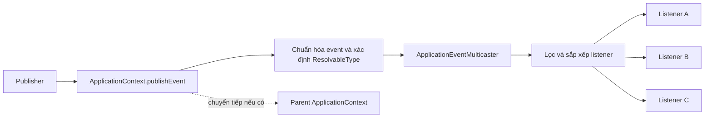

# ApplicationEventMulticaster trong mô hình tổng thể

## 1. Vị trí và trách nhiệm

Spring Application Events là cơ chế phát sự kiện trong cùng một Spring ApplicationContext. Thành phần phát sự kiện chỉ cần biết rằng có một sự kiện đã xảy ra; nó không cần gọi trực tiếp từng thành phần quan tâm. Spring tìm các listener phù hợp và chuyển sự kiện đến chúng.

`ApplicationEventMulticaster` là bộ điều phối trung tâm của cơ chế này. Nó nhận một event cùng kiểu dữ liệu của event, tìm các listener đã đăng ký có thể xử lý event đó, rồi gọi từng listener theo chính sách thực thi được cấu hình.

Các thành phần chính:

- **Publisher**: thành phần phát sự kiện, thường dùng `ApplicationEventPublisher` hoặc `ApplicationContext`.
- **Event**: đối tượng mô tả điều đã xảy ra. Có thể là lớp kế thừa `ApplicationEvent`, hoặc một object bất kỳ như record/POJO.
- **ApplicationEventMulticaster**: hạ tầng nhận event, chọn listener phù hợp và phân phối event.
- **Listener**: thành phần xử lý event, thường triển khai `ApplicationListener<E>` với event class phù hợp hoặc khai báo phương thức với `@EventListener`.
- **ApplicationContext**: quản lý vòng đời của multicaster, đăng ký listener và cung cấp điểm phát event.

Sơ đồ tổng quát:



Publisher không cần giữ tham chiếu đến từng listener. Multicaster là lớp trung gian tách nơi phát event khỏi nơi xử lý event.

## 2. Event đi qua hệ thống như thế nào?

Khi gọi `ApplicationEventPublisher.publishEvent(event)`, luồng xử lý thông thường diễn ra như sau:

1. **Publisher phát event.** Ví dụ, một service phát `OrderPlaced` sau khi tạo đơn hàng.
2. **ApplicationContext chuẩn hóa event.** Nếu object truyền vào đã là `ApplicationEvent`, context sử dụng trực tiếp. Nếu là object thông thường, Spring bọc nó trong `PayloadApplicationEvent`.
3. **Spring xác định kiểu event.** Context dùng `ResolvableType` để giữ thông tin kiểu, bao gồm thông tin generic khi có thể xác định.
4. **Context gọi multicaster.** `AbstractApplicationContext.publishEvent(...)` chuyển event và kiểu event đến `ApplicationEventMulticaster.multicastEvent(...)`.
5. **Multicaster tìm listener phù hợp.** Nó xét kiểu event, kiểu nguồn phát (source) và điều kiện hỗ trợ event mà listener khai báo.
6. **Multicaster gọi listener.** Việc gọi diễn ra trong thread phát event theo mặc định, hoặc thông qua executor nếu được cấu hình và listener cho phép thực thi bất đồng bộ.
7. **Context cha có thể nhận event.** Trong mô hình context phân cấp, event được chuyển tiếp lên parent context nếu có.

Việc publish event chỉ xác nhận rằng event đã được đưa vào cơ chế xử lý trong ứng dụng. Nó không tự tạo ra một thông điệp bền vững, không bảo đảm lưu trữ, retry sau khi tiến trình dừng hoặc giao nhận giữa nhiều process.

## 3. ApplicationEventMulticaster được tạo ở đâu?

Trong quá trình `ApplicationContext.refresh()`, `AbstractApplicationContext` khởi tạo hạ tầng event tại bước `initApplicationEventMulticaster()`. Thứ tự liên quan trong quá trình refresh có thể tóm tắt như sau:

1. Chuẩn bị context và tạo BeanFactory.
2. Đăng ký, thực thi các BeanFactoryPostProcessor và BeanPostProcessor.
3. Khởi tạo `MessageSource`.
4. Khởi tạo `ApplicationEventMulticaster`.
5. Thực hiện hook `onRefresh()` của context.
6. Đăng ký các listener.
7. Khởi tạo các singleton còn lại và hoàn tất refresh.

Spring tìm bean có tên chính xác là `applicationEventMulticaster` trong BeanFactory:

- Nếu bean này đã được khai báo, Spring sử dụng bean đó.
- Nếu chưa có, Spring tạo một `SimpleApplicationEventMulticaster` mặc định và đăng ký nó làm singleton trong context.

Tên bean mặc định được cung cấp bởi hằng `AbstractApplicationContext.APPLICATION_EVENT_MULTICASTER_BEAN_NAME`.

Trong bước đăng ký listener, context đưa các listener được thêm bằng API và các bean triển khai `ApplicationListener` vào multicaster. Listener bean có thể được đăng ký theo tên bean để Spring chỉ lấy instance khi cần, tránh khởi tạo sớm không cần thiết.

Các event phát ra trước khi multicaster sẵn sàng trong giai đoạn refresh được giữ trong danh sách event sớm của context. Sau khi listener được đăng ký, context phát lại các event này qua multicaster rồi giải phóng danh sách. Cơ chế này hỗ trợ các event phát sinh sớm trong quá trình khởi tạo context.

## 4. SimpleApplicationEventMulticaster và việc chọn listener

`ApplicationEventMulticaster` là interface mô tả hợp đồng phân phối event. `SimpleApplicationEventMulticaster` là implementation mặc định của Spring.

Multicaster quản lý các listener được đăng ký trực tiếp và các listener bean. Khi một event đến, nó tìm các listener có thể xử lý event đó. Việc lựa chọn không chỉ dựa trên tên lớp:

- **Kiểu event**: listener phải hỗ trợ kiểu event được phát.
- **Kiểu generic**: listener có thể chỉ nhận một kiểu payload hoặc event generic cụ thể. Spring sử dụng `ResolvableType` để hỗ trợ việc đối chiếu kiểu.
- **Kiểu source**: các listener nâng cao có thể giới hạn loại đối tượng phát event.
- **Điều kiện hỗ trợ**: `GenericApplicationListener` cho phép triển khai logic kiểm tra kiểu event và source.
- **Thứ tự**: listener có thể khai báo thứ tự bằng `Ordered` hoặc `@Order`. Thứ tự hữu ích khi các listener đồng bộ có quan hệ phụ thuộc, nhưng không nên dùng nó để tạo một chuỗi nghiệp vụ phức tạp.

Với event class kế thừa `ApplicationEvent`, listener thông thường có thể triển khai `ApplicationListener<MyEvent>`. Với payload object như record, có thể khai báo phương thức `@EventListener` nhận trực tiếp kiểu payload; adapter của Spring xử lý lớp bọc `PayloadApplicationEvent`.

## 5. Ví dụ đường đi từ publisher đến listener

Event có thể là một record Java thông thường. Không bắt buộc phải tạo lớp kế thừa `ApplicationEvent`.

**Event — OrderPlaced.java**

```java
public record OrderPlaced(String orderId) {
}
```

**Publisher — OrderService.java**

```java
import org.springframework.context.ApplicationEventPublisher;
import org.springframework.stereotype.Service;

@Service
public class OrderService {
    private final ApplicationEventPublisher eventPublisher;

    public OrderService(ApplicationEventPublisher eventPublisher) {
        this.eventPublisher = eventPublisher;
    }

    public void placeOrder(String orderId) {
        // Thực hiện nghiệp vụ tạo đơn hàng trước khi phát event.
        eventPublisher.publishEvent(new OrderPlaced(orderId));
    }
}
```

**Listener — OrderAuditListener.java**

```java
import org.springframework.context.event.EventListener;
import org.springframework.stereotype.Component;

@Component
public class OrderAuditListener {
    @EventListener
    public void onOrderPlaced(OrderPlaced event) {
        System.out.println("Audit order: " + event.orderId());
    }
}
```

Khi `placeOrder("ORD-100")` gọi `publishEvent`, context chuyển event đến multicaster. Multicaster tìm adapter của phương thức `onOrderPlaced` và gọi phương thức đó. Publisher không cần biết listener được đặt ở class nào.

Các đoạn mã trên là những lớp riêng trong một ứng dụng Spring có component scanning và Spring context phù hợp; chúng minh họa đường đi của event, không phải một chương trình Java độc lập chỉ có thể chạy bằng lệnh `java`.

## 6. Đồng bộ là mặc định

Nếu không cấu hình executor, `SimpleApplicationEventMulticaster` gọi listener ngay trong thread đang phát event. Vì vậy, lệnh `publishEvent` thường chỉ trả về sau khi các listener đồng bộ hoàn tất.

Hệ quả thực tế:

- Listener chạy lâu sẽ làm chậm publisher và request đang gọi publisher.
- Exception từ listener đồng bộ có thể truyền ngược về nơi gọi `publishEvent`. Nếu không cấu hình `ErrorHandler`, lỗi có thể làm gián đoạn quá trình phát event cho các listener tiếp theo.
- Các listener đồng bộ dùng chung thread và ngữ cảnh thực thi của publisher. Điều này có thể quan trọng với transaction, security context hoặc dữ liệu gắn với thread.
- Nếu listener chỉ thực hiện công việc phụ, thời gian xử lý của nó vẫn nằm trong thời gian hoàn tất lời gọi publish event.

Đồng bộ phù hợp khi listener cần chạy ngay, khi thứ tự xử lý quan trọng, hoặc khi công việc của listener thuộc cùng luồng transaction với publisher. Đây cũng là hành vi mặc định dễ dự đoán nhất khi debug.

## 7. Cấu hình thực thi bất đồng bộ

Có thể cấu hình `SimpleApplicationEventMulticaster` với một `TaskExecutor`. Khi đó, multicaster gửi tác vụ gọi listener đến executor thay vì trực tiếp gọi listener trong thread phát event.

Ví dụ cấu hình bằng Java:

```java
import org.springframework.context.ApplicationEventMulticaster;
import org.springframework.context.event.SimpleApplicationEventMulticaster;
import org.springframework.context.support.AbstractApplicationContext;
import org.springframework.context.annotation.Bean;
import org.springframework.context.annotation.Configuration;
import org.springframework.scheduling.concurrent.ThreadPoolTaskExecutor;

@Configuration
public class EventMulticasterConfiguration {

    @Bean
    public ThreadPoolTaskExecutor applicationEventExecutor() {
        ThreadPoolTaskExecutor executor = new ThreadPoolTaskExecutor();
        executor.setCorePoolSize(2);
        executor.setMaxPoolSize(8);
        executor.setQueueCapacity(200);
        executor.setThreadNamePrefix("application-event-");
        executor.setWaitForTasksToCompleteOnShutdown(true);
        executor.setAwaitTerminationSeconds(10);
        return executor;
    }

    @Bean(name = AbstractApplicationContext.APPLICATION_EVENT_MULTICASTER_BEAN_NAME)
    public ApplicationEventMulticaster applicationEventMulticaster(
            ThreadPoolTaskExecutor applicationEventExecutor) {
        SimpleApplicationEventMulticaster multicaster =
                new SimpleApplicationEventMulticaster();
        multicaster.setTaskExecutor(applicationEventExecutor);
        return multicaster;
    }
}
```

Spring nhận diện bean có tên `applicationEventMulticaster` và sử dụng nó thay cho implementation mặc định. `ThreadPoolTaskExecutor` được Spring khởi tạo và quản lý vòng đời khi nó được khai báo thành bean.

Cần phân biệt hai cơ chế:

- **Executor của multicaster**: quyết định cách multicaster gọi các listener trong hạ tầng event.
- **`@Async`**: dùng cơ chế proxy của Spring để chạy bất đồng bộ một phương thức được đánh dấu. Cơ chế này cần bật async processing, thường bằng `@EnableAsync`.

Không cần `@EnableAsync` chỉ để cấu hình `SimpleApplicationEventMulticaster#setTaskExecutor`. Hai cơ chế có thể cùng tồn tại, nhưng cần thiết kế rõ để tránh tạo nhiều tầng thread không cần thiết.

Bất đồng bộ làm thay đổi các đặc tính quan trọng:

- Publisher có thể trả về trước khi listener hoàn tất.
- Exception trong tác vụ bất đồng bộ không tự động truyền ngược về thread publisher; cần chính sách xử lý lỗi phù hợp.
- Thứ tự gửi tác vụ không đồng nghĩa với thứ tự hoàn tất listener.
- Cần giới hạn số thread và kích thước queue, theo dõi tác vụ bị từ chối, thời gian chờ và hành vi khi ứng dụng shutdown.
- Không nên giả định transaction hoặc thread-local context của publisher tự động xuất hiện trong thread xử lý listener.

Trong Spring Framework 6.1 trở lên, `ApplicationListener` có thể khai báo khả năng thực thi bất đồng bộ thông qua `supportsAsyncExecution()`. Listener không hỗ trợ async sẽ được gọi trong thread hiện tại dù multicaster có executor. Cơ chế này cho phép những listener cần giữ ngữ cảnh thread, chẳng hạn transactional listener, bảo toàn ngữ nghĩa thực thi phù hợp.

## 8. Xử lý lỗi và ranh giới transaction

`SimpleApplicationEventMulticaster` cho phép cấu hình `ErrorHandler` để quyết định cách xử lý exception phát sinh khi gọi listener. Nếu không đặt handler, exception từ listener đồng bộ được truyền ra ngoài. Nếu có handler, handler nhận exception và quyết định ghi log, bỏ qua hay ném lại lỗi.

Chọn chính sách lỗi theo yêu cầu nghiệp vụ:

- Nếu listener là phần bắt buộc để hoàn thành nghiệp vụ, không nên âm thầm bỏ qua lỗi.
- Nếu listener chỉ ghi log hoặc cập nhật dữ liệu phụ, có thể dùng chính sách ghi nhận lỗi và tiếp tục, miễn là việc bỏ qua đã được chấp nhận.
- Với listener bất đồng bộ, cần theo dõi lỗi tại executor hoặc ErrorHandler; publisher không thể dựa vào exception để biết listener đã thất bại.

Event được phát trong một transaction không tự động có nghĩa listener sẽ chạy sau khi transaction commit. Listener thông thường được gọi theo cơ chế multicaster tại thời điểm publish. Nếu cần ràng buộc listener với một giai đoạn transaction, dùng `@TransactionalEventListener` và chọn phase phù hợp, chẳng hạn `AFTER_COMMIT`. Mặc định listener loại này chỉ được xử lý khi có transaction đang hoạt động; có thể bật `fallbackExecution` nếu nghiệp vụ cho phép xử lý khi không có transaction.

Từ Spring Framework 6.1, transactional application listener không hỗ trợ async execution qua executor của multicaster, vì việc thực thi cần giữ ngữ cảnh transaction thích hợp. Nếu cần chạy công việc nền sau commit, hãy thiết kế rõ điểm chuyển giao sang executor hoặc hàng đợi sau khi transaction đã hoàn tất.

## 9. Quan hệ với @EventListener và context phân cấp

`@EventListener` là cách khai báo listener ở tầng ứng dụng; nó không thay thế multicaster. Spring phát hiện các phương thức được đánh dấu annotation, tạo adapter cho chúng và đăng ký adapter vào hạ tầng event. Khi event được phát, multicaster vẫn là thành phần phân phối đến adapter.

`@TransactionalEventListener` bổ sung ràng buộc theo transaction phase. Nó sử dụng cơ chế đồng bộ transaction để quyết định khi nào gọi phương thức listener, trong khi event vẫn được phát qua ApplicationContext.

Trong hệ thống có parent-child ApplicationContext, event phát từ context con có thể được chuyển tiếp lên context cha. Vì vậy, listener ở context cha có thể nhận event được phát từ context con. Khi tổ chức nhiều context, cần chú ý việc đăng ký cùng listener ở nhiều cấp để tránh xử lý lặp.

## 10. Khi nào nên tùy biến multicaster?

Giữ implementation mặc định khi event chỉ dùng để tách các thành phần trong cùng ứng dụng và việc xử lý đồng bộ đáp ứng yêu cầu. Chỉ tùy biến khi có nhu cầu hạ tầng cụ thể:

- Dùng executor riêng để tách thời gian xử lý listener khỏi thread request.
- Đặt ErrorHandler để thống nhất cách ghi nhận lỗi listener.
- Điều chỉnh pool và queue theo lưu lượng event, giới hạn tài nguyên và thời gian shutdown.
- Dùng listener có điều kiện hoặc thứ tự khi thực sự cần quy tắc phân phối.

Không nên dùng ApplicationEventMulticaster như một message broker. Nó là cơ chế event trong bộ nhớ của Spring context, gắn với vòng đời ứng dụng và không cung cấp lưu trữ bền vững, xác nhận giao nhận, retry bền vững hay truyền event giữa các process. Với yêu cầu giao nhận tin cậy giữa service, cân nhắc message broker và transactional outbox.

## 11. Những nhầm lẫn thường gặp

| Nhầm lẫn | Cách hiểu đúng |
|---|---|
| `ApplicationEventPublisher` và `ApplicationEventMulticaster` là một | Publisher là API phát event; multicaster là hạ tầng phân phối đến listener. |
| Mọi event phải kế thừa `ApplicationEvent` | Spring hỗ trợ publish object thông thường và bọc chúng trong `PayloadApplicationEvent`. |
| Event listener mặc định chạy ở background | Mặc định listener chạy đồng bộ trong thread phát event. |
| Thêm `@Async` đồng nghĩa đã cấu hình multicaster bất đồng bộ | `@Async` và executor của multicaster là hai cơ chế khác nhau. |
| Publish event đồng nghĩa transaction đã commit | Event thông thường được phân phối tại thời điểm publish; dùng `@TransactionalEventListener` nếu cần gắn với transaction phase. |
| Event trong Spring có thể thay message queue | Application events là cơ chế trong process, không có bảo đảm lưu trữ và giao nhận bền vững. |

## 12. Cách lần theo khi debug

Khi một listener không được gọi hoặc được gọi sai thời điểm, kiểm tra theo thứ tự:

1. Xác nhận publisher gọi đúng `ApplicationContext` và event thực sự được phát.
2. Xác nhận event là đúng object/kiểu payload và không bị nhầm giữa event wrapper với payload.
3. Xác nhận listener đã được Spring phát hiện và đăng ký trong đúng context.
4. Kiểm tra kiểu generic, điều kiện hỗ trợ event và source của listener.
5. Kiểm tra thứ tự listener, executor và khả năng async của listener.
6. Kiểm tra exception, ErrorHandler, log của executor và queue có bị từ chối tác vụ hay không.
7. Nếu dùng transactional listener, kiểm tra transaction có hoạt động và phase đã chọn có thực sự xảy ra hay không.
8. Nếu có parent-child context, kiểm tra listener đang nằm ở context nào và event có được chuyển tiếp đến cấp đó không.

Hiểu đúng vai trò của `ApplicationEventMulticaster` giúp xác định chính xác điểm phân phối event, giải thích vì sao listener chạy đồng bộ hay bất đồng bộ, và chọn đúng nơi cấu hình khi cần thay đổi hành vi xử lý.
