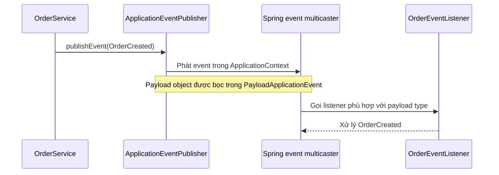

# Phát một đối tượng bất kỳ làm event

## 1. Ý tưởng

Spring Application Events cho phép một thành phần thông báo rằng một việc gì đó đã xảy ra để những thành phần khác xử lý. Thành phần phát event chỉ cần biết `ApplicationEventPublisher`; nó không cần gọi trực tiếp từng listener. Nhờ vậy, một nghiệp vụ có thể phát thông báo cho nhiều handler mà không phụ thuộc vào cách các handler được triển khai.

Từ Spring Framework 4.2, đối tượng được phát không bắt buộc phải kế thừa `ApplicationEvent`. Bạn có thể truyền trực tiếp một object bất kỳ vào `ApplicationEventPublisher.publishEvent(Object event)`, chẳng hạn một Java record, DTO hoặc POJO.

Khi object không phải là `ApplicationEvent`, Spring tự bọc nó trong `PayloadApplicationEvent<T>`. Listener khai báo kiểu payload sẽ nhận trực tiếp object gốc qua tham số của phương thức. Bạn không cần tự tạo `PayloadApplicationEvent` hoặc viết lớp event kế thừa `ApplicationEvent` cho trường hợp thông thường.

Ví dụ: sau khi tạo đơn hàng, service phát `new OrderCreated(...)`. Một listener nhận `OrderCreated` và gửi thông báo. Service không cần biết listener nào đang lắng nghe.

## 2. Luồng xử lý



1. Service tạo object chứa dữ liệu của sự kiện.
2. Service gọi `publishEvent(object)` thông qua `ApplicationEventPublisher`.
3. Spring chuyển event tới cơ chế multicaster của `ApplicationContext`. Nếu object không phải `ApplicationEvent`, Spring tạo `PayloadApplicationEvent` để chứa object đó.
4. Spring tìm các listener phù hợp với kiểu event/payload và gọi các listener đã đăng ký.
5. Phương thức `@EventListener` có tham số đúng kiểu payload nhận object ban đầu.

Event mô tả một sự kiện đã xảy ra, ví dụ `OrderCreated`, `PaymentReceived` hoặc `UserRegistered`. Nên đặt tên theo sự kiện và dùng dữ liệu đủ để listener hiểu điều đã xảy ra.

## 3. Ví dụ chạy được với Java 17

Ví dụ dưới đây dùng Spring Context thuần, không cần Spring Boot. `OrderService` nhận `ApplicationEventPublisher` qua constructor và phát một record. `OrderEventListener` là Spring bean có phương thức `@EventListener` nhận trực tiếp record đó.

### Cấu trúc thư mục

```text
arbitrary-event/
├── pom.xml
└── src/
    └── main/
        └── java/
            └── demo/
                └── App.java
```

### pom.xml

```xml
<project xmlns="http://maven.apache.org/POM/4.0.0"
         xmlns:xsi="http://www.w3.org/2001/XMLSchema-instance"
         xsi:schemaLocation="http://maven.apache.org/POM/4.0.0 https://maven.apache.org/xsd/maven-4.0.0.xsd">
    <modelVersion>4.0.0</modelVersion>
    <groupId>demo</groupId>
    <artifactId>arbitrary-event</artifactId>
    <version>1.0.0</version>

    <properties>
        <maven.compiler.release>17</maven.compiler.release>
        <project.build.sourceEncoding>UTF-8</project.build.sourceEncoding>
        <spring-framework.version>6.2.0</spring-framework.version>
    </properties>

    <dependencies>
        <dependency>
            <groupId>org.springframework</groupId>
            <artifactId>spring-context</artifactId>
            <version>${spring-framework.version}</version>
        </dependency>
    </dependencies>

    <build>
        <plugins>
            <plugin>
                <groupId>org.apache.maven.plugins</groupId>
                <artifactId>maven-compiler-plugin</artifactId>
                <version>3.13.0</version>
            </plugin>
            <plugin>
                <groupId>org.codehaus.mojo</groupId>
                <artifactId>exec-maven-plugin</artifactId>
                <version>3.5.0</version>
                <configuration>
                    <mainClass>demo.App</mainClass>
                </configuration>
            </plugin>
        </plugins>
    </build>
</project>
```

### src/main/java/demo/App.java

```java
package demo;

import java.math.BigDecimal;
import java.util.Objects;

import org.springframework.context.ApplicationEventPublisher;
import org.springframework.context.annotation.AnnotationConfigApplicationContext;
import org.springframework.context.annotation.Bean;
import org.springframework.context.annotation.Configuration;
import org.springframework.context.event.EventListener;

public class App {

    public static void main(String[] args) {
        try (var context = new AnnotationConfigApplicationContext(AppConfig.class)) {
            context.getBean(OrderService.class).createOrder();
        }
    }

    @Configuration
    static class AppConfig {

        @Bean
        OrderService orderService(ApplicationEventPublisher publisher) {
            return new OrderService(publisher);
        }

        @Bean
        OrderEventListener orderEventListener() {
            return new OrderEventListener();
        }
    }

    static class OrderService {
        private final ApplicationEventPublisher publisher;

        OrderService(ApplicationEventPublisher publisher) {
            this.publisher = publisher;
        }

        void createOrder() {
            var event = new OrderCreated(
                "ORD-2026-001",
                new BigDecimal("1250000")
            );

            publisher.publishEvent(event);
        }
    }

    static class OrderEventListener {

        @EventListener
        public void onOrderCreated(OrderCreated event) {
            System.out.println(
                "Handled order " + event.orderId()
                    + " total=" + event.total().toPlainString()
            );
        }
    }

    public record OrderCreated(String orderId, BigDecimal total) {
        public OrderCreated {
            if (orderId == null || orderId.isBlank()) {
                throw new IllegalArgumentException("orderId must not be blank");
            }
            Objects.requireNonNull(total, "total");
        }
    }
}
```

### Chạy chương trình

Đứng tại thư mục chứa `pom.xml` và chạy:

```bash
mvn -q compile exec:java
```

Output do listener in ra:

```text
Handled order ORD-2026-001 total=1250000
```

Trong ví dụ này:

- `ApplicationEventPublisher` được Spring inject vào `OrderService`.
- `OrderCreated` là Java record bình thường, không kế thừa `ApplicationEvent`.
- `publishEvent(event)` phát record đó. Spring tạo `PayloadApplicationEvent<OrderCreated>` làm lớp bao nội bộ.
- `@EventListener` khai báo tham số `OrderCreated`, vì vậy listener làm việc trực tiếp với payload.
- `OrderEventListener` được đăng ký như một Spring bean. Một phương thức chỉ có `@EventListener` nhưng nằm trong object không do Spring quản lý sẽ không tự được phát hiện.

## 4. Nhận payload trong listener

Với object thông thường, cách khai báo rõ ràng nhất là đặt kiểu payload làm tham số:

```java
@EventListener
public void handle(OrderCreated event) {
    System.out.println(event.orderId());
}
```

Không cần khai báo `ApplicationEvent` trong chữ ký phương thức. Spring dùng kiểu tham số để xác định listener phù hợp. Vì vậy, nên dùng kiểu cụ thể thay vì `Object` để giới hạn loại thông điệp mà listener nhận.

Nếu object được phát vốn đã là một lớp kế thừa `ApplicationEvent`, Spring xử lý nó như application event đó và không cần bọc nó như payload thông thường. Cách kế thừa `ApplicationEvent` vẫn hợp lệ, thường gặp trong code cũ hoặc khi ứng dụng cần mô hình event theo kiểu đó; với event payload mới, một record/POJO thường đơn giản hơn.

## 5. Một event có thể có nhiều listener

Nhiều Spring bean có thể lắng nghe cùng một kiểu payload. Ví dụ, sau khi `OrderCreated` được phát, một listener có thể ghi audit log, listener khác cập nhật chỉ số, và listener thứ ba gửi thông báo. `OrderService` không cần biết danh sách đó.

```java
@Component
class OrderAuditListener {
    @EventListener
    public void record(OrderCreated event) {
        // Ghi nhận đơn hàng vừa được tạo.
    }
}

@Component
class OrderMetricsListener {
    @EventListener
    public void count(OrderCreated event) {
        // Cập nhật số liệu đơn hàng.
    }
}
```

Đây là ví dụ minh họa cho các bean listener; trong ứng dụng thực tế, hãy bảo đảm các class được component scan hoặc được khai báo bằng `@Bean`. Nếu cần thứ tự xử lý giữa nhiều listener, có thể dùng `@Order` hoặc `Ordered`. Thứ tự chỉ điều khiển thứ tự gọi listener trong cơ chế event của Spring; nó không tạo ra cơ chế giao dịch hay bảo đảm lưu trữ.

## 6. Đồng bộ, bất đồng bộ và phạm vi của event

**Mặc định là đồng bộ.** Với cấu hình event multicaster mặc định, listener được gọi trên luồng đang phát event. Lệnh `publishEvent` chỉ hoàn tất sau khi các listener đồng bộ phù hợp đã chạy xong. Vì vậy, lỗi phát sinh trong listener có thể truyền ngược về nơi gọi publisher nếu không cấu hình `ErrorHandler` khác.

Có thể chạy listener bất đồng bộ bằng `@Async` và bật async processing bằng `@EnableAsync`: 

```java
@Configuration
@EnableAsync
class AsyncConfig {
}

@Component
class NotificationListener {
    @Async
    @EventListener
    public void send(OrderCreated event) {
        // Gửi thông báo ở executor được cấu hình.
    }
}
```

Khi dùng `@Async`, publisher không chờ listener hoàn tất. Cần cấu hình executor phù hợp, xử lý lỗi bất đồng bộ và tránh giả định rằng listener đã chạy xong ngay sau `publishEvent`. Payload nên bất biến vì nhiều listener có thể đọc cùng một object; nếu object mutable, một listener thay đổi nó có thể ảnh hưởng listener khác.

Application Event là cơ chế giao tiếp trong phạm vi Spring `ApplicationContext` của một ứng dụng. Nó không tự gửi event sang JVM khác, service khác, message broker hoặc lưu event bền vững qua lần restart. Nếu cần giao tiếp giữa các tiến trình, retry bền vững, replay hoặc bảo đảm giao nhận, hãy dùng giải pháp messaging phù hợp như Kafka hoặc RabbitMQ.

## 7. Lỗi thường gặp

| Lỗi | Nguyên nhân và cách xử lý |
|---|---|
| Listener không được gọi | Listener object chưa được Spring quản lý, thiếu `@EventListener`, hoặc kiểu tham số không khớp payload đã phát. |
| Listener nhận `PayloadApplicationEvent` ngoài dự kiến | Phương thức được khai báo để nhận lớp bao. Với nhu cầu thông thường, đổi tham số thành kiểu payload cụ thể như `OrderCreated`. |
| Tưởng object phải kế thừa `ApplicationEvent` | Từ Spring 4.2 có thể phát trực tiếp object bất kỳ bằng `publishEvent(Object)`. |
| Gọi `publishEvent` nhưng không thấy log | Kiểm tra listener có nằm trong cùng `ApplicationContext` hoặc phạm vi context phù hợp, bean có được đăng ký, và luồng xử lý có chạy tới lệnh publish không. |
| Listener làm chậm nghiệp vụ gọi | Listener mặc định chạy đồng bộ. Chỉ chuyển sang `@Async` khi chấp nhận xử lý bất đồng bộ và đã cấu hình executor/lỗi phù hợp. |
| Dùng application event như message queue | Application Event không cung cấp lưu trữ bền vững, phân phối liên tiến trình hay retry broker. Dùng nền tảng messaging nếu cần các bảo đảm đó. |

## 8. Khi nào nên dùng

Dùng event payload object khi một nghiệp vụ cần thông báo cho một hoặc nhiều thành phần trong cùng ứng dụng, và thành phần phát không cần biết ai sẽ xử lý. Các payload như `OrderCreated`, `PaymentReceived` hay `CustomerAddressChanged` giúp biểu đạt rõ sự kiện và dữ liệu liên quan.

Nếu một thành phần cần gọi thành phần khác để lấy kết quả ngay, lời gọi method/service trực tiếp thường rõ ràng hơn. Event phù hợp với thông báo một chiều; nó không phải API request/response thay thế cho lời gọi nghiệp vụ.

## 9. Ghi nhớ

- Có thể gọi `ApplicationEventPublisher.publishEvent(anyObject)` với object bất kỳ.
- Object không phải `ApplicationEvent` được Spring bọc trong `PayloadApplicationEvent`.
- `@EventListener` có thể nhận trực tiếp kiểu payload, ví dụ `OrderCreated`.
- Listener phải là bean do Spring quản lý.
- Event mặc định được xử lý đồng bộ trong ứng dụng; `@Async` thay đổi cách thực thi.
- Application Event không thay thế message broker khi cần giao tiếp liên tiến trình hoặc giao nhận bền vững.