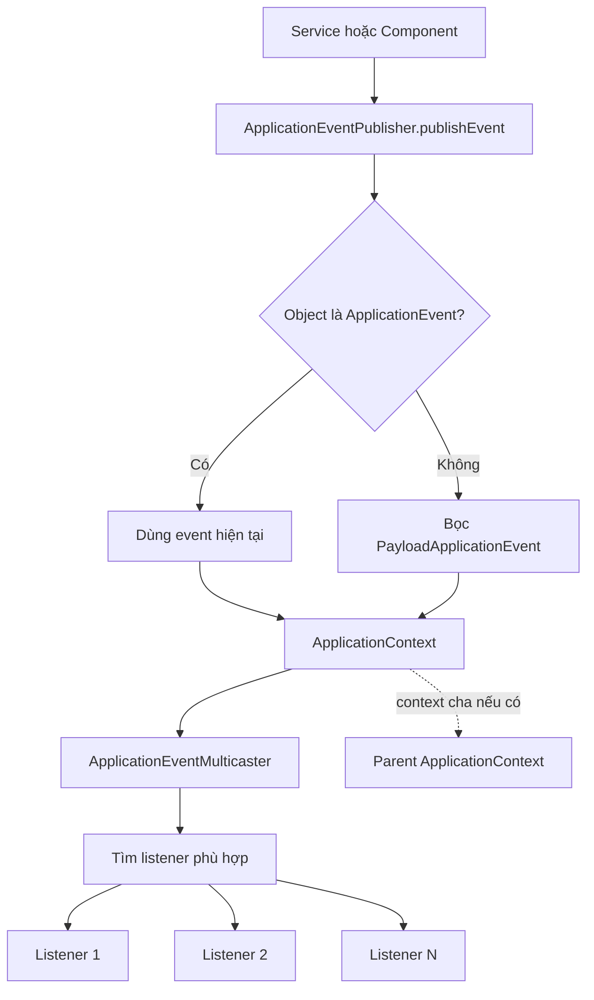

# ApplicationEventPublisher và publishEvent

## 1. Vai trò của ApplicationEventPublisher

`ApplicationEventPublisher` là interface Spring cung cấp để một thành phần phát application event đến các listener trong ApplicationContext. Nó tạo ra một ranh giới rõ ràng giữa nơi phát sự kiện và nơi xử lý sự kiện.

Ví dụ, sau khi service tạo đơn hàng, các thành phần khác có thể cần ghi audit, gửi thông báo hoặc cập nhật một read model. Nếu service gọi trực tiếp từng thành phần, nó phải biết các class và API của chúng. Khi thêm một hành động mới, service lại phải sửa. Với application event, service chỉ phát `OrderPlaced`; các listener đăng ký độc lập để phản ứng với event đó.

Các vai trò liên quan:

- **Publisher:** thành phần quyết định phát event khi một sự kiện có ý nghĩa đã xảy ra.
- **ApplicationEventPublisher:** API mà publisher sử dụng để chuyển event vào Spring.
- **Event:** object mô tả điều đã xảy ra và mang dữ liệu listener cần.
- **ApplicationEventMulticaster:** hạ tầng của context tìm listener phù hợp và phân phối event.
- **Listener:** phương thức hoặc bean nhận event và thực hiện phản ứng tương ứng.

`ApplicationContext` cũng triển khai `ApplicationEventPublisher`, vì vậy có thể gọi `context.publishEvent(...)`. Tuy nhiên, service thường chỉ cần API phát event; constructor injection của `ApplicationEventPublisher` thể hiện dependency hẹp và rõ hơn so với inject toàn bộ `ApplicationContext`.

## 2. Hai overload của publishEvent

Trong Spring Framework 6.x, `ApplicationEventPublisher` cung cấp hai cách phát event:

```java
void publishEvent(ApplicationEvent event);

default void publishEvent(Object event);
```

Ý nghĩa của hai overload:

- **`publishEvent(ApplicationEvent)`:** dùng khi object là một instance của lớp kế thừa `ApplicationEvent`.
- **`publishEvent(Object)`:** cho phép phát payload object thông thường, ví dụ record, POJO hoặc một object nghiệp vụ. Spring chuyển payload này thành `PayloadApplicationEvent` để đưa vào hạ tầng event.

Vì vậy, không bắt buộc phải tạo một lớp event kế thừa `ApplicationEvent`. Với ứng dụng mới, record hoặc POJO bất biến thường là lựa chọn gọn và dễ kiểm thử.

Ví dụ event kế thừa `ApplicationEvent`:

```java
import org.springframework.context.ApplicationEvent;

public class OrderPlacedEvent extends ApplicationEvent {
    private final String orderId;

    public OrderPlacedEvent(Object source, String orderId) {
        super(source);
        this.orderId = orderId;
    }

    public String getOrderId() {
        return orderId;
    }
}
```

Phát event này:

```java
eventPublisher.publishEvent(
        new OrderPlacedEvent(this, "ORD-100")
);
```

Ví dụ payload object thông thường:

```java
public record OrderPlaced(String orderId) {
}
```

Phát payload:

```java
eventPublisher.publishEvent(new OrderPlaced("ORD-100"));
```

Với payload thông thường, listener có thể nhận trực tiếp `OrderPlaced`. Adapter event của Spring xử lý lớp bọc `PayloadApplicationEvent`; code ứng dụng không cần tự tạo wrapper.

## 3. publishEvent thực sự làm gì?

Một lời gọi `publishEvent(event)` chuyển event đến ApplicationContext để phân phối. Với luồng thông thường của `AbstractApplicationContext`, các bước chính là:

1. Nhận object được publish.
2. Nếu cần, bọc payload object trong `PayloadApplicationEvent`.
3. Xác định `ResolvableType` của event để hỗ trợ chọn listener theo kiểu.
4. Gọi `ApplicationEventMulticaster.multicastEvent(...)`.
5. Multicaster tìm các listener phù hợp và gọi chúng theo chính sách thực thi.
6. Trong context phân cấp, event có thể được chuyển tiếp đến parent context.

Sơ đồ:



Publisher không nhận danh sách listener, không nhận kết quả trả về từ các listener và không có API xác nhận rằng mọi side effect nghiệp vụ đã hoàn tất. `publishEvent` có kiểu trả về `void`; nó không phải một lời gọi RPC hoặc một cơ chế request-response.

Javadoc của `ApplicationEventPublisher` mô tả việc phát event là một thao tác bàn giao cho event multicaster. Hợp đồng của publisher không tự quy định listener phải chạy đồng bộ, bất đồng bộ hay ngay lập tức. Hành vi cụ thể phụ thuộc implementation và cấu hình của context.

## 4. Inject publisher vào service

Cách phổ biến nhất là constructor injection:

```java
import org.springframework.context.ApplicationEventPublisher;
import org.springframework.stereotype.Service;

@Service
public class OrderService {
    private final ApplicationEventPublisher eventPublisher;

    public OrderService(ApplicationEventPublisher eventPublisher) {
        this.eventPublisher = eventPublisher;
    }

    public void placeOrder(String orderId) {
        // Thực hiện và xác nhận nghiệp vụ tạo đơn hàng.
        eventPublisher.publishEvent(new OrderPlaced(orderId));
    }
}
```

Spring cung cấp publisher tương ứng với ApplicationContext quản lý bean. Không cần tự khởi tạo multicaster hoặc tìm bean bằng `getBean()`.

Constructor injection có các lợi ích:

- Dependency được khai báo rõ trong constructor.
- Field có thể là `final`, tránh thay đổi publisher sau khi khởi tạo.
- Unit test có thể truyền mock hoặc fake publisher.
- Class chỉ phụ thuộc vào API phát event, không cần biết implementation phân phối event.

Một service thường phát event sau khi trạng thái nghiệp vụ đã được xác nhận. Ví dụ, chỉ phát `OrderPlaced` sau khi đơn hàng đã được tạo thành công. Nếu phát quá sớm rồi thao tác chính thất bại, listener có thể thực hiện side effect dựa trên một sự kiện chưa thực sự xảy ra.

## 5. Phát event từ component

`ApplicationEventPublisher` không dành riêng cho `@Service`. Bất kỳ bean Spring-managed nào cũng có thể inject publisher, bao gồm component điều phối, adapter hoặc thành phần kỹ thuật:

```java
import org.springframework.context.ApplicationEventPublisher;
import org.springframework.stereotype.Component;

@Component
public class ImportCoordinator {
    private final ApplicationEventPublisher eventPublisher;

    public ImportCoordinator(ApplicationEventPublisher eventPublisher) {
        this.eventPublisher = eventPublisher;
    }

    public void complete(String batchId, int rowCount) {
        eventPublisher.publishEvent(
                new ImportCompleted(batchId, rowCount)
        );
    }
}
```

Payload event:

```java
public record ImportCompleted(String batchId, int rowCount) {
}
```

Điểm khác biệt giữa service và component nằm ở trách nhiệm của class. Cả hai đều dùng cùng API publisher và cùng hạ tầng event. Một class được tạo bằng `new` bên ngoài Spring container sẽ không tự được inject dependency; nếu class đó cần publisher, hãy để Spring quản lý bean hoặc truyền publisher qua constructor một cách tường minh.

## 6. Thiết kế payload được publish

Event nên biểu diễn một sự kiện đã xảy ra, thường đặt tên ở thì quá khứ như `OrderPlaced`, `PaymentCaptured`, `UserRegistered` hoặc `ImportCompleted`.

Payload nên:

- Bất biến nếu có thể, ví dụ dùng Java record.
- Chứa ID và dữ liệu listener thực sự cần.
- Có timestamp hoặc correlation ID khi cần truy vết.
- Tránh mang theo service, ApplicationContext, repository hoặc object có vòng đời gắn với thread.
- Tránh truyền JPA entity mutable nếu listener có thể chạy sau khi persistence context đóng.

Ví dụ:

```java
import java.math.BigDecimal;
import java.time.Instant;

public record PaymentCaptured(
        String paymentId,
        BigDecimal amount,
        Instant occurredAt
) {
}
```

Listener có thể dùng `paymentId` để lấy dữ liệu mới nhất từ repository trong transaction của chính nó. Cách này giảm phụ thuộc vào trạng thái entity cũ hoặc lazy relationship.

Nếu event dùng generic type và listener cần giữ thông tin generic ở runtime, có thể cần cung cấp kiểu tường minh thông qua `ResolvableTypeProvider`. Java type erasure có thể khiến thông tin tham số generic không còn đầy đủ khi chỉ dựa vào class runtime.

## 7. Ví dụ Java 17 + Spring Context có thể chạy

Ví dụ dùng Java 17 và Spring Context 6.2.0. Service phát một payload record; listener nhận event và ghi một dòng ra console.

Cấu trúc project:

```text
publish-event-demo/
├── pom.xml
└── src/main/java/com/example/events/
    ├── Application.java
    ├── PaymentCaptured.java
    ├── PaymentService.java
    └── PaymentAuditListener.java
```

**pom.xml**

```xml
<project xmlns="http://maven.apache.org/POM/4.0.0"
         xmlns:xsi="http://www.w3.org/2001/XMLSchema-instance"
         xsi:schemaLocation="http://maven.apache.org/POM/4.0.0 https://maven.apache.org/xsd/maven-4.0.0.xsd">
    <modelVersion>4.0.0</modelVersion>

    <groupId>com.example</groupId>
    <artifactId>publish-event-demo</artifactId>
    <version>1.0.0</version>

    <properties>
        <maven.compiler.release>17</maven.compiler.release>
        <project.build.sourceEncoding>UTF-8</project.build.sourceEncoding>
        <spring.version>6.2.0</spring.version>
    </properties>

    <dependencies>
        <dependency>
            <groupId>org.springframework</groupId>
            <artifactId>spring-context</artifactId>
            <version>${spring.version}</version>
        </dependency>
    </dependencies>

    <build>
        <plugins>
            <plugin>
                <groupId>org.apache.maven.plugins</groupId>
                <artifactId>maven-compiler-plugin</artifactId>
                <version>3.13.0</version>
            </plugin>
            <plugin>
                <groupId>org.codehaus.mojo</groupId>
                <artifactId>exec-maven-plugin</artifactId>
                <version>3.5.0</version>
                <configuration>
                    <mainClass>com.example.events.Application</mainClass>
                </configuration>
            </plugin>
        </plugins>
    </build>
</project>
```

**PaymentCaptured.java**

```java
package com.example.events;

import java.math.BigDecimal;

public record PaymentCaptured(String paymentId, BigDecimal amount) {
}
```

**PaymentService.java**

```java
package com.example.events;

import java.math.BigDecimal;
import org.springframework.context.ApplicationEventPublisher;
import org.springframework.stereotype.Service;

@Service
public class PaymentService {
    private final ApplicationEventPublisher eventPublisher;

    public PaymentService(ApplicationEventPublisher eventPublisher) {
        this.eventPublisher = eventPublisher;
    }

    public void capture(String paymentId, BigDecimal amount) {
        // Trong ứng dụng thực tế, xác nhận kết quả capture trước khi publish.
        eventPublisher.publishEvent(
                new PaymentCaptured(paymentId, amount)
        );
    }
}
```

**PaymentAuditListener.java**

```java
package com.example.events;

import org.springframework.context.event.EventListener;
import org.springframework.stereotype.Component;

@Component
public class PaymentAuditListener {

    @EventListener
    public void record(PaymentCaptured event) {
        System.out.println(
                "Payment captured: " + event.paymentId()
                        + ", amount=" + event.amount().toPlainString()
        );
    }
}
```

**Application.java**

```java
package com.example.events;

import java.math.BigDecimal;
import org.springframework.context.annotation.AnnotationConfigApplicationContext;

public class Application {
    public static void main(String[] args) {
        try (var context = new AnnotationConfigApplicationContext(
                PaymentService.class,
                PaymentAuditListener.class
        )) {
            context.getBean(PaymentService.class)
                    .capture("pay-42", new BigDecimal("125.00"));
        }
    }
}
```

Chạy project bằng Java 17 và Maven:

```bash
mvn -q compile exec:java
```

Stdout:

```text
Payment captured: pay-42, amount=125.00
```

Trong ví dụ, `AnnotationConfigApplicationContext` đăng ký service và listener làm bean. Spring tạo event infrastructure, inject publisher vào service và phát event khi gọi `capture`. Listener đồng bộ được gọi trước khi lời gọi publish hoàn tất.

## 8. Đồng bộ, bất đồng bộ và thời điểm trả về

API `ApplicationEventPublisher` không hứa rằng listener chạy đồng bộ hay bất đồng bộ. Với implementation mặc định `SimpleApplicationEventMulticaster` khi không cấu hình executor, listener được gọi trong thread đang phát event. Vì vậy, `publishEvent` thường chỉ trả về sau khi các listener đồng bộ hoàn tất.

Có thể cấu hình `TaskExecutor` cho multicaster hoặc dùng `@Async` trên phương thức listener cùng với `@EnableAsync`. Hai cách này là hai cơ chế khác nhau:

- Executor của multicaster tác động đến cách multicaster gửi lời gọi listener.
- `@Async` dùng async method execution của Spring để thực thi phương thức qua executor.
- Khi bất đồng bộ, publisher có thể tiếp tục trước khi listener hoàn tất.
- Exception trong tác vụ async không tự động truyền ngược về thread publisher.
- Thứ tự gửi tác vụ không bảo đảm thứ tự hoàn tất.
- Thread-local state, security context và transaction context không tự động được truyền qua thread.

Không nên mặc định rằng thêm event đồng nghĩa với đưa công việc ra background. Hãy chọn sync hoặc async dựa trên yêu cầu độ trễ, thứ tự, transaction và khả năng quan sát lỗi.

## 9. Exception và kết quả xử lý

`publishEvent` trả về `void`, vì vậy publisher không nhận được kết quả nghiệp vụ của listener. Nếu cần kết quả trực tiếp, hãy dùng một service method có return type rõ ràng thay vì biến event thành request-response.

Với listener đồng bộ, exception có thể thoát khỏi listener và truyền về publisher, tùy cấu hình `ErrorHandler` của multicaster. Một listener lỗi cũng có thể làm gián đoạn việc phân phối đến listener tiếp theo. Với listener bất đồng bộ, publisher thường không nhìn thấy exception; cần giám sát executor, error handler và log của tác vụ.

Nên quyết định rõ:

- Listener có phải phần bắt buộc để hoàn tất nghiệp vụ không?
- Lỗi listener có được phép bỏ qua không?
- Có cần retry hoặc lưu trạng thái xử lý không?
- Có cần correlation ID để truy vết event không?

Không bắt rồi bỏ qua mọi exception một cách âm thầm. Nếu listener chỉ làm công việc phụ, hãy ghi nhận lỗi và áp dụng chính sách đã thống nhất.

## 10. Phát event trong transaction

Nếu một service có `@Transactional` gọi `publishEvent`, listener `@EventListener` thông thường có thể chạy trước khi transaction commit. Nếu transaction rollback, side effect của listener đã thực hiện không tự động được hoàn tác.

Khi listener chỉ được chạy sau khi commit thành công, dùng `@TransactionalEventListener`:

```java
import org.springframework.stereotype.Component;
import org.springframework.transaction.event.TransactionPhase;
import org.springframework.transaction.event.TransactionalEventListener;

@Component
public class ReceiptListener {

    @TransactionalEventListener(phase = TransactionPhase.AFTER_COMMIT)
    public void sendReceipt(PaymentCaptured event) {
        // Gửi hoặc xếp lịch gửi biên nhận sau khi commit.
    }
}
```

Các phase có thể chọn:

- `BEFORE_COMMIT`: trước khi transaction commit.
- `AFTER_COMMIT`: sau khi commit thành công; đây là mặc định.
- `AFTER_ROLLBACK`: sau khi rollback.
- `AFTER_COMPLETION`: sau khi transaction hoàn tất dù commit hay rollback.

Mặc định transactional listener không chạy nếu không có transaction đang hoạt động. `fallbackExecution = true` cho phép xử lý cả khi không có transaction, nhưng chỉ nên bật nếu nghiệp vụ chấp nhận hành vi đó.

Transactional event listener giúp chọn đúng thời điểm thực thi, nhưng không tạo ra lưu trữ bền vững. Nếu ứng dụng cần bảo đảm event được gửi đến hệ thống ngoài sau khi database commit ngay cả khi process dừng đột ngột, hãy cân nhắc transactional outbox hoặc message broker.

## 11. Kiểm thử publishEvent

Có thể kiểm tra publisher ở hai mức:

**Unit test cho service:** mock `ApplicationEventPublisher`, gọi phương thức service và xác minh event cùng payload được phát. Test này tập trung vào quyết định phát event của service, không kiểm tra Spring có đăng ký listener hay không.

Ví dụ ý tưởng với Mockito:

```java
@ExtendWith(MockitoExtension.class)
class PaymentServiceTest {
    @Mock
    ApplicationEventPublisher eventPublisher;

    @Test
    void publishesPaymentCaptured() {
        PaymentService service = new PaymentService(eventPublisher);

        service.capture("pay-42", new BigDecimal("125.00"));

        verify(eventPublisher).publishEvent(
                new PaymentCaptured("pay-42", new BigDecimal("125.00"))
        );
    }
}
```

Test này cần import JUnit Jupiter, Mockito và các static matcher tương ứng; nó giả định các import của `PaymentService`, `PaymentCaptured` và `BigDecimal` có mặt trong file test.

**Integration test:** khởi tạo ApplicationContext thật, lấy service từ context, gọi phương thức phát event và xác minh side effect của listener. Đây là cách kiểm tra toàn bộ chuỗi publisher → context → multicaster → listener.

Với listener async, dùng `CountDownLatch`, Future hoặc cơ chế đồng bộ hóa rõ ràng để đợi kết quả. Tránh `Thread.sleep` cố định vì test dễ chập chờn. Với transactional listener, kiểm tra sau commit/rollback theo phase thay vì chỉ gọi phương thức trực tiếp.

## 12. Các nhầm lẫn thường gặp

| Nhầm lẫn | Cách hiểu đúng |
|---|---|
| Phải kế thừa `ApplicationEvent` mới publish được | Có thể publish record/POJO; Spring bọc payload trong `PayloadApplicationEvent`. |
| `ApplicationEventPublisher` chính là multicaster | Publisher là API phát; multicaster là hạ tầng phân phối. |
| `publishEvent` trả về kết quả của listener | Phương thức trả về `void`; không phải request-response. |
| Gọi `publishEvent` luôn chạy listener đồng bộ | API không bảo đảm execution mode; mặc định multicaster thường đồng bộ nếu không cấu hình executor. |
| Event đồng nghĩa message queue | Application events là cơ chế trong process, không có bảo đảm lưu trữ bền vững hoặc giao nhận liên process. |
| Listener chạy sau commit chỉ vì publisher có `@Transactional` | Listener thông thường có thể chạy trước commit; dùng `@TransactionalEventListener` nếu cần phase cụ thể. |
| Inject ApplicationContext là cách duy nhất để publish | Inject trực tiếp `ApplicationEventPublisher` là đủ và thể hiện dependency hẹp hơn. |

## 13. Checklist khi sử dụng ApplicationEventPublisher

1. Xác định sự kiện nghiệp vụ nào đã thực sự xảy ra.
2. Đặt tên event ở thì quá khứ và thiết kế payload bất biến.
3. Inject `ApplicationEventPublisher` qua constructor vào bean Spring-managed.
4. Dùng overload phù hợp: `ApplicationEvent` hoặc payload object.
5. Phát event sau khi thao tác nghiệp vụ đạt điều kiện thành công.
6. Không mong đợi `publishEvent` trả về kết quả xử lý.
7. Quyết định rõ listener đồng bộ, bất đồng bộ hoặc theo transaction phase.
8. Thiết kế chính sách exception, quan sát và retry.
9. Kiểm thử lời gọi publish và side effect trong ApplicationContext.
10. Dùng outbox/message broker khi cần giao nhận bền vững qua process hoặc service.

`ApplicationEventPublisher` giúp service và component phát một thông báo mà không phụ thuộc trực tiếp vào listener. Hiểu đúng overload của `publishEvent`, cách Spring bọc payload và những giới hạn về execution, exception, transaction sẽ giúp bạn dùng application event đúng mục đích và tránh kỳ vọng sai về bảo đảm giao nhận.
