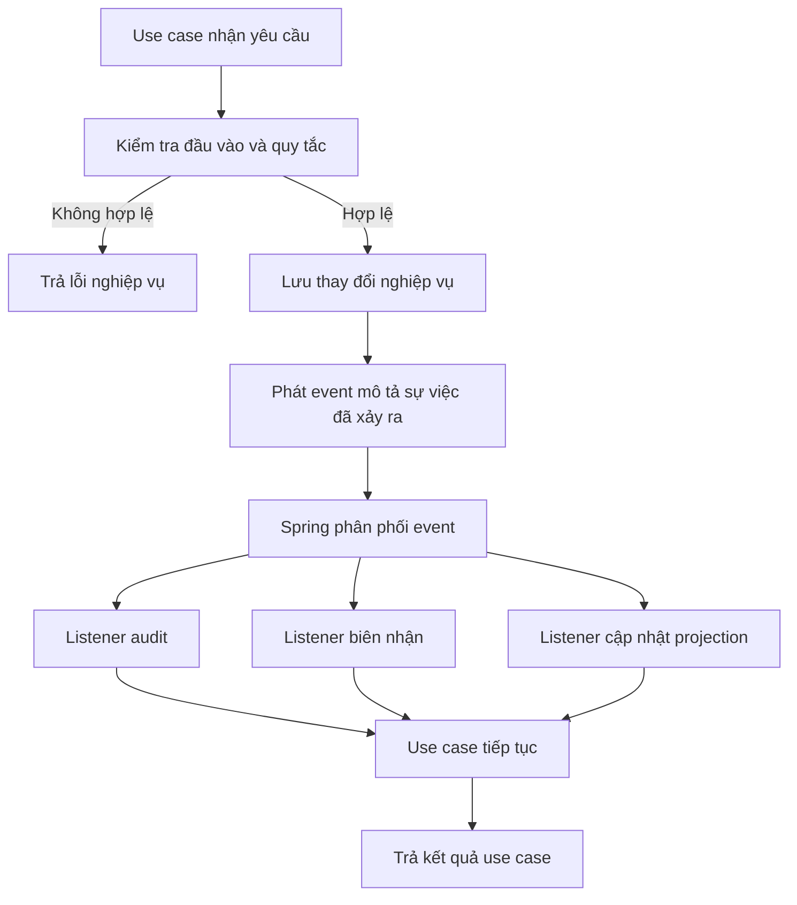

# Phát event trong cùng một use case

## 1. Mục tiêu và phạm vi

Trong một ứng dụng Spring, một use case thường thực hiện nhiều bước để hoàn thành một yêu cầu nghiệp vụ: kiểm tra dữ liệu đầu vào, áp dụng quy tắc, lưu thay đổi và thông báo cho các thành phần liên quan. Spring Application Events cho phép use case **phát ra một sự kiện khi một sự việc nghiệp vụ đã xảy ra**, để các Spring bean khác phản ứng mà use case không cần gọi trực tiếp từng bean đó.

Ví dụ, use case đặt hàng có thể lưu đơn hàng rồi phát `OrderPlaced`. Listener nhận event để ghi audit, chuẩn bị biên nhận hoặc cập nhật một projection phục vụ tìm kiếm. Tất cả các thành phần này vẫn chạy trong cùng ứng dụng Spring và cùng tiến trình JVM.

Sau bài học, bạn có thể:

- Chọn vị trí phù hợp để phát event trong một use case.
- Inject và sử dụng `ApplicationEventPublisher` trong application service.
- Phân biệt event mô tả sự thật đã xảy ra với command yêu cầu một hành động.
- Hiểu thứ tự thực thi khi listener đồng bộ, bất đồng bộ và gắn với transaction.
- Quyết định khi nào nên phát event và khi nào nên gọi service trực tiếp.

## 2. Event được phát ở đâu trong use case?

Một use case là nơi điều phối một luồng nghiệp vụ cụ thể. Trong kiến trúc ứng dụng, nó thường được thể hiện bằng application service, command handler hoặc một lớp có method như `placeOrder()`, `registerUser()`, `approveRequest()`.

Một luồng đặt hàng đơn giản có thể gồm:

1. Nhận yêu cầu đặt hàng và kiểm tra dữ liệu.
2. Áp dụng quy tắc nghiệp vụ để xác định đơn hàng hợp lệ.
3. Tạo và lưu đơn hàng.
4. Khi đơn hàng đã được tạo thành công, phát event `OrderPlaced`.
5. Các listener xử lý những tác vụ phụ trợ phù hợp.

Vị trí phát event phải phản ánh đúng thời điểm sự việc được xác lập. Nếu phát `OrderPlaced` trước khi kiểm tra hoặc lưu đơn hàng, listener có thể nhận một sự kiện nói rằng đơn hàng đã được đặt trong khi thao tác thực tế vẫn thất bại.

Sơ đồ sau mô tả luồng listener đồng bộ mặc định:



Với listener đồng bộ mặc định, các listener hoàn tất trước khi lời gọi `publishEvent()` trả về, sau đó use case mới chạy tiếp. Với listener bất đồng bộ, use case có thể tiếp tục trong khi listener vẫn đang xử lý.

## 3. Phân biệt event và command

Tên event nên mô tả một sự thật đã xảy ra, thường dùng thì quá khứ:

- `OrderPlaced`: đơn hàng đã được đặt.
- `UserRegistered`: người dùng đã đăng ký.
- `RequestApproved`: yêu cầu đã được phê duyệt.
- `PaymentCaptured`: khoản thanh toán đã được thu.

Command biểu đạt ý định hoặc yêu cầu một hành động:

- `PlaceOrder`: yêu cầu đặt hàng.
- `RegisterUser`: yêu cầu đăng ký người dùng.
- `ApproveRequest`: yêu cầu phê duyệt.
- `CapturePayment`: yêu cầu thu tiền.

Một command thường được gửi đến một nơi chịu trách nhiệm xử lý và trả kết quả. Một event có thể được nhiều listener quan tâm và không yêu cầu publisher biết từng listener.

Không đặt tên event như thể một hành động đã thành công nếu nó mới chỉ được yêu cầu. Ví dụ, `PaymentCaptured` chỉ nên được phát sau khi hệ thống xác nhận thanh toán đã thu thành công. Nếu chỉ mới gửi yêu cầu đến cổng thanh toán, tên phù hợp có thể là `PaymentRequested` hoặc một command riêng tùy mô hình nghiệp vụ.

## 4. Phát event bằng ApplicationEventPublisher

Spring cung cấp interface `ApplicationEventPublisher` để bean công bố event. `ApplicationContext` triển khai interface này, nên Spring có thể inject nó vào application service qua constructor.

Một event có thể là Java object thông thường. Từ Spring Framework 4.2, không bắt buộc phải kế thừa `ApplicationEvent`. Với Java 17+, record là lựa chọn thuận tiện để tạo payload bất biến:

```java
public record OrderPlaced(
        String orderId,
        String customerId,
        int itemCount) {
}
```

Application service có thể phát event như sau:

```java
public class PlaceOrderUseCase {
    private final ApplicationEventPublisher publisher;

    public PlaceOrderUseCase(ApplicationEventPublisher publisher) {
        this.publisher = publisher;
    }

    public void publishOrderPlaced(String orderId) {
        publisher.publishEvent(
                new OrderPlaced(orderId, "CUS-100", 2));
    }
}
```

Trong ứng dụng thực tế, method phát event thường nằm ngay trong method thực hiện use case. Đặt publisher thành dependency qua constructor giúp thể hiện rõ use case cần khả năng công bố event và thuận tiện thay thế hoặc mock trong unit test.

Nên giữ event payload nhỏ và chứa dữ liệu mà listener thực sự cần. Thường chỉ cần mã đơn hàng, mã người dùng, số lượng hoặc một snapshot nhỏ. Tránh truyền toàn bộ entity có quan hệ lazy hoặc object mutable dùng chung giữa nhiều listener. Listener có thể truy vấn repository theo ID khi cần thêm dữ liệu.

## 5. Ví dụ hoàn chỉnh: đặt hàng và phát event trong cùng use case

Ví dụ dưới đây dùng Spring Context trực tiếp, không cần Spring Boot. Use case kiểm tra số lượng, lưu đơn hàng vào repository minh họa, sau đó phát `OrderPlaced`. Hai listener độc lập nhận cùng event để chuẩn bị biên nhận và ghi audit.

### Cấu hình Maven

Tạo project Maven với cấu trúc:

```text
src/
└── main/
    └── java/
        └── demo/
            └── PublishEventInUseCaseDemo.java
pom.xml
```

Nội dung `pom.xml`:

```xml
<project xmlns="http://maven.apache.org/POM/4.0.0"
         xmlns:xsi="http://www.w3.org/2001/XMLSchema-instance"
         xsi:schemaLocation="http://maven.apache.org/POM/4.0.0 https://maven.apache.org/xsd/maven-4.0.0.xsd">
    <modelVersion>4.0.0</modelVersion>

    <groupId>demo</groupId>
    <artifactId>publish-event-in-use-case</artifactId>
    <version>1.0.0</version>

    <properties>
        <maven.compiler.release>17</maven.compiler.release>
        <project.build.sourceEncoding>UTF-8</project.build.sourceEncoding>
        <spring-framework.version>6.2.19</spring-framework.version>
    </properties>

    <dependencies>
        <dependency>
            <groupId>org.springframework</groupId>
            <artifactId>spring-context</artifactId>
            <version>6.2.19</version>
        </dependency>
        <dependency>
            <groupId>org.springframework</groupId>
            <artifactId>spring-tx</artifactId>
            <version>6.2.19</version>
        </dependency>
    </dependencies>

    <build>
        <plugins>
            <plugin>
                <groupId>org.apache.maven.plugins</groupId>
                <artifactId>maven-compiler-plugin</artifactId>
                <version>3.14.0</version>
            </plugin>
            <plugin>
                <groupId>org.codehaus.mojo</groupId>
                <artifactId>exec-maven-plugin</artifactId>
                <version>3.5.0</version>
            </plugin>
        </plugins>
    </build>
</project>
```

### Mã nguồn Java

Tạo file `src/main/java/demo/PublishEventInUseCaseDemo.java`:

```java
package demo;

import org.springframework.context.ApplicationEventPublisher;
import org.springframework.context.annotation.AnnotationConfigApplicationContext;
import org.springframework.context.annotation.Bean;
import org.springframework.context.annotation.Configuration;
import org.springframework.context.event.EventListener;
import org.springframework.core.annotation.Order;

@Configuration
public class PublishEventInUseCaseDemo {

    @Bean
    OrderRepository orderRepository() {
        return new InMemoryOrderRepository();
    }

    @Bean
    PlaceOrderUseCase placeOrderUseCase(
            OrderRepository repository,
            ApplicationEventPublisher publisher) {
        return new PlaceOrderUseCase(repository, publisher);
    }

    @Bean
    ReceiptListener receiptListener() {
        return new ReceiptListener();
    }

    @Bean
    AuditListener auditListener() {
        return new AuditListener();
    }

    public static void main(String[] args) {
        try (var context =
                     new AnnotationConfigApplicationContext(
                             PublishEventInUseCaseDemo.class)) {
            context.getBean(PlaceOrderUseCase.class)
                    .execute("ORD-2001", "CUS-100", 2);
        }
    }

    record Order(
            String id,
            String customerId,
            int itemCount) {
    }

    record OrderPlaced(
            String orderId,
            String customerId,
            int itemCount) {
    }

    interface OrderRepository {
        void save(Order order);
    }

    static class InMemoryOrderRepository implements OrderRepository {
        @Override
        public void save(Order order) {
            System.out.println(
                    "Repository: saved " + order.id());
        }
    }

    static class PlaceOrderUseCase {
        private final OrderRepository repository;
        private final ApplicationEventPublisher publisher;

        PlaceOrderUseCase(
                OrderRepository repository,
                ApplicationEventPublisher publisher) {
            this.repository = repository;
            this.publisher = publisher;
        }

        void execute(
                String orderId,
                String customerId,
                int itemCount) {
            if (itemCount <= 0) {
                throw new IllegalArgumentException(
                        "itemCount must be greater than zero");
            }

            Order order = new Order(
                    orderId, customerId, itemCount);

            repository.save(order);

            publisher.publishEvent(new OrderPlaced(
                    order.id(),
                    order.customerId(),
                    order.itemCount()));

            System.out.println(
                    "PlaceOrderUseCase: event dispatch returned");
        }
    }

    static class ReceiptListener {
        @EventListener
        @Order(10)
        public void prepareReceipt(OrderPlaced event) {
            System.out.println(
                    "ReceiptListener: prepare receipt for "
                            + event.orderId());
        }
    }

    static class AuditListener {
        @EventListener
        @Order(20)
        public void recordOrderPlaced(OrderPlaced event) {
            System.out.println(
                    "AuditListener: recorded ORDER_PLACED for "
                            + event.orderId());
        }
    }
}
```

### Biên dịch và chạy

Từ thư mục chứa `pom.xml`, chạy:

```bash
mvn -q compile exec:java -Dexec.mainClass=demo.PublishEventInUseCaseDemo
```

Stdout dự kiến:

```text
Repository: saved ORD-2001
ReceiptListener: prepare receipt for ORD-2001
AuditListener: recorded ORDER_PLACED for ORD-2001
PlaceOrderUseCase: event dispatch returned
```

Kết quả thể hiện rõ vị trí phát event trong use case:

- Repository lưu đơn hàng trước.
- Use case gọi `publishEvent()`.
- Spring gọi listener đồng bộ theo thứ tự `@Order`.
- Khi hai listener hoàn tất, `publishEvent()` trả về và use case tiếp tục.

Repository trong ví dụ chỉ in ra thông báo để minh họa ranh giới lưu dữ liệu. Trong ứng dụng thật, nó thường thao tác database thông qua JPA, JDBC hoặc một cơ chế persistence khác.

Nếu `itemCount` không hợp lệ, use case ném exception trước khi lưu và trước khi phát event. Vì vậy không có listener nào nhận `OrderPlaced` cho yêu cầu không hợp lệ.

## 6. Một use case có thể phát nhiều event không?

Có. Một use case có thể làm thay đổi nhiều phần của trạng thái nghiệp vụ và phát nhiều event tương ứng. Ví dụ một use case hoàn tất đăng ký có thể phát `UserRegistered` và `WelcomeMessageRequested` nếu cả hai sự việc đó thực sự đã xảy ra theo mô hình của ứng dụng.

Tuy nhiên, mỗi event nên biểu đạt một fact rõ ràng. Không nên phát một chuỗi event chỉ để thay thế việc gọi các method nội bộ của use case. Nếu một bước cần kết quả của bước trước để quyết định tiếp tục hay dừng, hãy gọi service tương ứng trực tiếp.

Khi phát nhiều event đồng bộ, từng lời gọi `publishEvent()` phân phối event trước khi use case chạy đến lời gọi tiếp theo. Khi listener chạy bất đồng bộ, thứ tự hoàn thành giữa các listener hoặc giữa các event không được bảo đảm. Nếu nghiệp vụ phụ thuộc vào thứ tự, hãy điều phối bằng code tường minh hoặc dùng cơ chế workflow phù hợp.

Ví dụ minh họa hai fact độc lập sau khi hoàn tất thao tác:

```java
record OrderReceiptRequested(String orderId) {
}

publisher.publishEvent(new OrderPlaced(orderId, customerId, itemCount));
publisher.publishEvent(new OrderReceiptRequested(orderId));
```

Đây là đoạn minh họa; các record và biến phải được khai báo trong phạm vi use case tương ứng. Chỉ phát `OrderReceiptRequested` nếu use case thực sự đã quyết định và ghi nhận yêu cầu tạo biên nhận. Đừng dùng event để yêu cầu một hành động rồi đặt tên như thể hành động đó đã hoàn tất.

## 7. Thời điểm phát event và transaction

Trong ứng dụng dùng database transaction, vị trí phát event có ảnh hưởng đến tính nhất quán.

### `@EventListener` mặc định

`@EventListener` thông thường chạy ngay khi event được phát. Nếu use case đang ở trong transaction, listener đồng bộ được gọi trước khi transaction commit. Điều này có thể phù hợp nếu listener là một phần của cùng đơn vị công việc và lỗi listener cần làm use case thất bại.

Đoạn trích sau minh họa vị trí phát event bên trong method transactional; các dependency và kiểu dữ liệu được khai báo ở lớp use case của ứng dụng:

```java
import org.springframework.transaction.annotation.Transactional;

@Transactional
public void execute(PlaceOrderCommand command) {
    Order order = orderRepository.save(createOrder(command));
    publisher.publishEvent(toOrderPlaced(order));
}
```

Khi listener đồng bộ ném runtime exception và exception truyền ra khỏi method transactional, transaction có thể rollback theo quy tắc rollback của Spring. Hãy kiểm tra chính sách rollback của transaction và loại exception thực tế; không phải mọi exception đều mặc định khiến transaction rollback.

### `@TransactionalEventListener`

Nếu listener chỉ nên chạy sau khi dữ liệu đã commit, dùng `@TransactionalEventListener`:

```java
import demo.PublishEventInUseCaseDemo.OrderPlaced;
import org.springframework.stereotype.Component;
import org.springframework.transaction.event.TransactionPhase;
import org.springframework.transaction.event.TransactionalEventListener;

@Component
class ReceiptAfterCommitListener {

    @TransactionalEventListener(
            phase = TransactionPhase.AFTER_COMMIT)
    public void prepareReceipt(OrderPlaced event) {
        // xử lý sau khi transaction commit thành công
    }
}
```

Đoạn listener này nằm trong package `demo`, cùng package với ví dụ chính. Project cần dependency `org.springframework:spring-tx`, một transaction manager phù hợp và cấu hình transaction management (chẳng hạn `@EnableTransactionManagement` trong cấu hình Spring thuần). Với Spring Boot, transaction manager thường được auto-configure khi có starter dữ liệu tương ứng.

Các phase chính:

| Phase | Thời điểm |
|---|---|
| `BEFORE_COMMIT` | Trước khi transaction commit |
| `AFTER_COMMIT` | Sau khi commit thành công; mặc định |
| `AFTER_ROLLBACK` | Sau khi transaction rollback |
| `AFTER_COMPLETION` | Sau khi transaction hoàn tất, dù commit hay rollback |

Để listener hoạt động đúng, event phải được phát trong một transaction được Spring quản lý. Nếu không có transaction đang hoạt động, listener mặc định không chạy. Có thể bật `fallbackExecution = true` khi thật sự muốn xử lý cả trường hợp không có transaction:

```java
@TransactionalEventListener(
        phase = TransactionPhase.AFTER_COMMIT,
        fallbackExecution = true)
public void handle(PublishEventInUseCaseDemo.OrderPlaced event) {
    // chạy sau commit, hoặc theo fallback nếu không có transaction
}
```

Có hai điểm cần nhớ:

- Listener `AFTER_COMMIT` chạy sau khi transaction database đã commit. Nếu listener lỗi, transaction đã hoàn tất và không thể rollback dữ liệu đã commit.
- Event trong bộ nhớ không phải hàng đợi bền vững. Nếu tiến trình dừng sau commit nhưng trước khi listener hoàn tất, tác vụ phụ trợ có thể chưa được thực hiện.

Nếu listener cần ghi dữ liệu bằng transaction mới sau commit, hãy gọi một service có ranh giới transaction mới phù hợp. Nếu cần bảo đảm việc gửi message ra ngoài không bị mất khi ứng dụng dừng, hãy tìm hiểu Transactional Outbox: ghi bản ghi outbox cùng transaction nghiệp vụ, sau đó một tiến trình riêng chuyển bản ghi đó sang broker và quản lý retry.

## 8. Đồng bộ hay bất đồng bộ?

### Listener đồng bộ

Đây là hành vi mặc định của Spring Application Events:

- Listener chạy trong thread phát event.
- `publishEvent()` chờ listener đồng bộ hoàn tất.
- Exception có thể truyền ngược về use case.
- Listener có thể tham gia cùng transaction context hiện tại.

Dùng cách này khi công việc nhanh, có thể xử lý ngay và use case cần biết rằng quá trình phân phối listener đã hoàn tất.

### Listener bất đồng bộ

Có thể dùng `@Async` cùng `@EnableAsync` để chuyển listener sang executor:

```java
import demo.PublishEventInUseCaseDemo.OrderPlaced;
import org.springframework.context.annotation.Bean;
import org.springframework.context.annotation.Configuration;
import org.springframework.context.event.EventListener;
import org.springframework.scheduling.annotation.Async;
import org.springframework.scheduling.annotation.EnableAsync;

@Configuration
@EnableAsync
class AsyncEventConfiguration {

    @Bean
    SearchProjectionListener searchProjectionListener() {
        return new SearchProjectionListener();
    }
}

class SearchProjectionListener {

    @Async
    @EventListener
    public void updateSearchProjection(OrderPlaced event) {
        // cập nhật projection ở background
    }
}
```

Đăng ký cấu hình và listener trong ApplicationContext quản lý use case. Ví dụ này là phần cấu hình bổ sung; nó không được bật trong chương trình chạy đồng bộ ở mục 5.

Khi chạy async:

- Use case không chờ listener hoàn tất.
- Thứ tự bắt đầu gọi listener có thể được cấu hình, nhưng thứ tự hoàn tất giữa các task không được bảo đảm.
- Exception trong task không truyền ngược về thread phát event. Với method trả về `void`, cần cấu hình và giám sát xử lý lỗi bất đồng bộ.
- Transaction context và ThreadLocal của thread phát event không tự động được truyền sang executor.
- Cần cấu hình executor, giới hạn hàng đợi, số thread và chính sách từ chối task để tránh quá tải.

`@Async` hoạt động thông qua proxy của Spring theo chế độ mặc định. Một method gọi trực tiếp method `@Async` khác trên cùng object không đi qua proxy, nên không được chạy bất đồng bộ như mong đợi.

## 9. Khi nào nên phát event và khi nào nên gọi service trực tiếp?

| Tình huống trong use case | Cách phù hợp |
|---|---|
| Cần xác thực hạn mức trước khi tạo đơn | Gọi service trực tiếp và xử lý kết quả |
| Cần tính giá để quyết định đơn hàng có hợp lệ | Gọi service trực tiếp |
| Đơn hàng đã tạo và cần ghi audit | Phát `OrderPlaced`, để audit listener xử lý |
| Đơn hàng đã commit và cần gửi thông báo | Dùng `@TransactionalEventListener(AFTER_COMMIT)` hoặc outbox tùy yêu cầu độ tin cậy |
| Nhiều bean độc lập cần phản ứng với cùng một fact | Phát một event chung |
| Cần giao tiếp với dịch vụ khác qua mạng và retry bền vững | Dùng broker hoặc cơ chế messaging phù hợp |

Một quy tắc thực tế: use case giữ quyền điều phối các bước bắt buộc; event thông báo các fact để các thành phần khác phản ứng. Nếu use case cần biết kết quả một listener để quyết định tiếp tục, listener đó có thể không phù hợp với mô hình event.

## 10. Những lỗi thường gặp

1. **Phát event quá sớm:** listener nhận fact trước khi điều kiện nghiệp vụ được xác nhận. Chỉ phát sau khi sự kiện tương ứng thực sự xảy ra.
2. **Dùng event thay cho command:** event không phải lời gọi yêu cầu listener thực hiện một hành động bắt buộc và trả kết quả.
3. **Đặt quá nhiều logic vào publisher:** use case trở thành nơi xử lý cả các tác vụ phụ trợ. Hãy chuyển phản ứng độc lập vào listener.
4. **Dùng listener cho bước bắt buộc:** publisher không kiểm soát kết quả xử lý của listener như một lời gọi service thông thường.
5. **Giả định event tự động bất đồng bộ:** mặc định listener chạy đồng bộ. Muốn async phải cấu hình rõ ràng.
6. **Nhầm thời điểm phát với thời điểm commit:** `publishEvent()` không có nghĩa transaction đã commit. Dùng transaction-bound listener khi cần.
7. **Cho rằng AFTER_COMMIT là bền vững:** listener chạy sau commit nhưng không có durable queue hoặc retry tự động.
8. **Gửi payload mutable hoặc entity lớn:** listener có thể nhìn thấy dữ liệu đã bị thay đổi hoặc gặp vấn đề lazy loading. Ưu tiên record bất biến và ID.
9. **Tạo event chain khó theo dõi:** nhiều listener liên tục phát event mới có thể tạo vòng lặp và luồng nghiệp vụ khó gỡ lỗi.
10. **Không quan sát lỗi listener:** ghi log với event type, mã nghiệp vụ và listener; bổ sung metric cho các tác vụ quan trọng.

## 11. Kiểm thử use case và listener

Nên kiểm thử riêng quyết định nghiệp vụ của use case và phản ứng của listener.

### Kiểm thử use case

Mock `OrderRepository` và `ApplicationEventPublisher`, sau đó kiểm tra:

- Đầu vào hợp lệ khiến repository được gọi lưu đơn hàng.
- Use case phát đúng kiểu event với đúng mã đơn hàng, khách hàng và số lượng.
- Đầu vào không hợp lệ khiến repository và publisher không được gọi.
- Event chỉ được phát sau bước lưu thành công theo thứ tự mong muốn.

Ví dụ với Mockito (đoạn trích, giả định các mock và import đã được khai báo):

```java
import demo.PublishEventInUseCaseDemo.Order;
import demo.PublishEventInUseCaseDemo.OrderPlaced;

verify(repository).save(any(Order.class));
verify(publisher).publishEvent(
        new OrderPlaced("ORD-2001", "CUS-100", 2));
```

Nếu kiểm tra thứ tự giữa hai dependency, có thể dùng `InOrder` của Mockito để xác nhận thao tác lưu diễn ra trước khi phát event.

### Kiểm thử listener

Gọi method listener trực tiếp với một event cụ thể và kiểm tra dependency mà listener sử dụng. Với integration test, khởi tạo ApplicationContext để xác nhận listener được đăng ký và nhận event qua `publishEvent()`.

Với listener async, không dùng `Thread.sleep()` cố định. Dùng latch, future hoặc điều kiện chờ có timeout để test xác định và tránh phụ thuộc vào tốc độ máy.

Với transaction-bound listener, cần kiểm thử cả trường hợp commit, rollback và không có transaction để xác nhận phase cùng `fallbackExecution` hoạt động như dự kiến.

## 12. Checklist thiết kế

- [ ] Event mô tả một fact đã xảy ra trong use case.
- [ ] Event chỉ được phát sau khi điều kiện nghiệp vụ tương ứng được xác nhận.
- [ ] Use case inject `ApplicationEventPublisher` qua constructor.
- [ ] Payload nhỏ, bất biến và không mang theo entity hoặc object mutable không cần thiết.
- [ ] Các bước bắt buộc vẫn được gọi trực tiếp và có kết quả rõ ràng.
- [ ] Đã quyết định listener chạy đồng bộ hay bất đồng bộ.
- [ ] Đã chọn đúng thời điểm listener so với transaction commit/rollback.
- [ ] Có chiến lược xử lý lỗi và quan sát listener.
- [ ] Không dựa vào Application Events cho yêu cầu lưu trữ, retry hoặc replay bền vững.

## 13. Tài liệu tham khảo

- [Spring Framework Reference — Application Events](https://docs.spring.io/spring/reference/6.2/core/beans/context-introduction.html)
- [Spring Framework Reference — Transaction-bound Events](https://docs.spring.io/spring-framework/reference/data-access/transaction/event.html)
- [Spring Framework Reference — Task Execution and Scheduling](https://docs.spring.io/spring-framework/reference/integration/scheduling.html)

