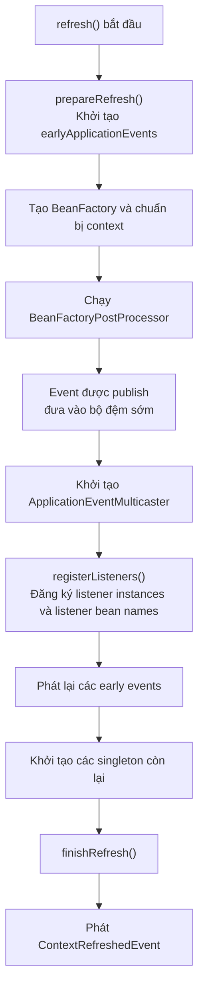

# Xử lý event được phát sớm trong quá trình khởi động Spring Framework

Trong quá trình khởi động một Spring ApplicationContext, có thể một thành phần cần phát event trước khi event multicaster và toàn bộ listener của context đã sẵn sàng. Ví dụ, một BeanFactoryPostProcessor phát thông báo về một bước chuẩn bị cấu hình, hoặc một thành phần khởi tạo cần báo cho listener rằng một tài nguyên đã được phát hiện.

Spring Framework có cơ chế giữ tạm các application event được phát trong giai đoạn đầu của refresh. Khi đến bước đăng ký listener, context phân phối lại các event đã giữ cho những ApplicationListener phù hợp. Cơ chế này thường được gọi là **early application events**.

Cần phân biệt rõ event được phát trong lúc refresh với event được phát trước khi gọi refresh. Bộ đệm sớm được khởi tạo bên trong quá trình refresh; vì vậy, không nên gọi publishEvent trên một context chưa refresh rồi kỳ vọng event sẽ được phát lại sau đó.

## 1. Vì sao cần xử lý event sớm?

Một context không khởi tạo tất cả thành phần cùng một thời điểm. Trong quá trình refresh, Spring lần lượt chuẩn bị Environment, tạo BeanFactory, chạy các BeanFactoryPostProcessor, đăng ký BeanPostProcessor, khởi tạo event multicaster, đăng ký listener, tạo các singleton còn lại và cuối cùng phát ContextRefreshedEvent.

Một số bước mở rộng có thể phát event trước khi multicaster được thiết lập hoặc trước khi listener được đăng ký. Nếu Spring bỏ event đó, các listener chỉ được đăng ký ở bước sau sẽ không biết sự việc đã xảy ra.

Ví dụ:

- Một BeanFactoryPostProcessor phát thông báo sau khi đọc hoặc điều chỉnh bean definitions.
- Một thành phần mở rộng phát tín hiệu khi phát hiện cấu hình hoặc plugin.
- Một bước chuẩn bị context phát thông tin để listener đã đăng ký nhận và xử lý sau đó.

Early event buffer giải quyết khoảng thời gian này trong một lần refresh. Nó giúp giữ event cho đến khi context đăng ký listener, sau đó dispatch các event đang chờ.

## 2. Vòng đời refresh và vị trí của early event buffer

Cơ chế nằm trong quá trình refresh của AbstractApplicationContext. Có thể nhìn luồng chính theo thứ tự sau:



Các mốc quan trọng:

1. **prepareRefresh():** Spring chuẩn bị context cho lần refresh và khởi tạo tập hợp lưu các event được phát sớm.
2. **invokeBeanFactoryPostProcessors():** các BeanFactoryPostProcessor được gọi trước khi các singleton ứng dụng thông thường được khởi tạo. Một processor có thể phát event trong giai đoạn này.
3. **initApplicationEventMulticaster():** Spring tạo hoặc lấy ApplicationEventMulticaster dùng để phân phối event.
4. **registerListeners():** Spring thêm các ApplicationListener được đăng ký trực tiếp và phát hiện các bean triển khai ApplicationListener.
5. **Replay early events:** sau khi listener được đăng ký, Spring lấy các event đã đệm và đưa chúng qua multicaster.
6. **finishBeanFactoryInitialization():** Spring khởi tạo các singleton còn lại.
7. **finishRefresh():** Spring hoàn tất refresh và phát ContextRefreshedEvent.

Trong giai đoạn trước registerListeners(), publishEvent giữ event vào bộ đệm sớm. Khi registerListeners() hoàn tất việc đăng ký listener, Spring đặt bộ đệm về trạng thái không còn thu thập và phát lại các event đã lưu.

Vì vậy, event phát từ BeanFactoryPostProcessor có thể được listener nhận dù listener bean chưa được tạo tại thời điểm event phát. Spring đăng ký tên bean listener trước, rồi multicaster lấy instance khi cần dispatch.

## 3. Event phát sớm khác event phát trước refresh

Hai trường hợp này rất dễ nhầm:

### Event phát trong quá trình refresh

Khi refresh đã bắt đầu, prepareRefresh() đã tạo early event buffer. Nếu event được phát trước khi bước registerListeners() hoàn tất, Spring giữ event lại rồi phát cho listener sau khi đăng ký.

Ví dụ, BeanFactoryPostProcessor chạy trong refresh và gọi publishEvent. Đây là trường hợp early event buffer được thiết kế để xử lý.

### Event phát trước khi refresh bắt đầu

Nếu tạo context rồi gọi publishEvent trước refresh(), context chưa khởi tạo early event buffer và event multicaster. Event đó không được context giữ lại để tự phát sau khi refresh.

```java
var context = new AnnotationConfigApplicationContext();

// Không nên kỳ vọng event này được giữ lại cho listener sau refresh.
context.publishEvent(new StartupMarkerEvent(context, "too-early"));

context.register(AppConfig.class);
context.refresh();
```

Nếu cần listener nhận event trong quá trình khởi động, hãy phát event từ một callback thực sự nằm trong refresh, hoặc đăng ký listener trước refresh và chọn một điểm phát event phù hợp. Không dùng publishEvent trước refresh như một hàng đợi khởi động.

## 4. Ai nhận được early event?

Early event được phát lại qua ApplicationEventMulticaster sau khi Spring đăng ký các listener mà context biết tại bước registerListeners().

Có hai nhóm chính:

- **Listener instance được đăng ký trực tiếp:** ví dụ context.addApplicationListener(listener) được gọi trước refresh.
- **Listener bean triển khai ApplicationListener:** Spring phát hiện bean type trong context và đăng ký bean name vào multicaster.

Một listener triển khai ApplicationListener có thể nhận event sớm ngay cả khi instance của listener chưa được tạo tại thời điểm publisher phát event. Khi replay, multicaster có thể lấy bean từ BeanFactory và gọi listener.

### Lưu ý về @EventListener

Các phương thức có annotation @EventListener được chuyển thành listener adapter bởi EventListenerMethodProcessor. Processor này thực hiện đăng ký method listener trong callback afterSingletonsInstantiated(), tức cuối giai đoạn khởi tạo singleton.

Early events được replay ở registerListeners(), trước khi Spring hoàn tất khởi tạo các singleton thông thường. Vì vậy, không nên dựa vào method @EventListener để nhận event phát rất sớm trong quá trình refresh. Nếu cần xử lý loại event này, hãy dùng ApplicationListener được đăng ký trước hoặc một bean triển khai ApplicationListener mà context phát hiện ở registerListeners().

## 5. Ví dụ hoàn chỉnh: BeanFactoryPostProcessor phát event sớm

Ví dụ dưới đây dùng Java 17 và Spring Framework 6.2. Một BeanFactoryPostProcessor phát một StartupMarkerEvent trong quá trình refresh. Một bean triển khai ApplicationListener nhận event khi Spring replay bộ đệm sớm.

Ví dụ dùng Spring Context thuần, không cần Spring Boot.

### 5.1. Cấu trúc dự án

```text
spring-early-application-event/
├── pom.xml
└── src/
    └── main/
        └── java/
            └── dev/
                └── example/
                    └── earlyevent/
                        └── Application.java
```

### 5.2. Dependency Maven

```xml
<project xmlns="http://maven.apache.org/POM/4.0.0"
         xmlns:xsi="http://www.w3.org/2001/XMLSchema-instance"
         xsi:schemaLocation="http://maven.apache.org/POM/4.0.0 https://maven.apache.org/xsd/maven-4.0.0.xsd">
    <modelVersion>4.0.0</modelVersion>

    <groupId>dev.example</groupId>
    <artifactId>spring-early-application-event</artifactId>
    <version>1.0.0</version>

    <properties>
        <maven.compiler.release>17</maven.compiler.release>
        <project.build.sourceEncoding>UTF-8</project.build.sourceEncoding>
    </properties>

    <dependencies>
        <dependency>
            <groupId>org.springframework</groupId>
            <artifactId>spring-context</artifactId>
            <version>6.2.6</version>
        </dependency>
    </dependencies>

    <build>
        <plugins>
            <plugin>
                <groupId>org.apache.maven.plugins</groupId>
                <artifactId>maven-compiler-plugin</artifactId>
                <version>3.13.0</version>
                <configuration>
                    <release>17</release>
                </configuration>
            </plugin>
            <plugin>
                <groupId>org.codehaus.mojo</groupId>
                <artifactId>exec-maven-plugin</artifactId>
                <version>3.5.0</version>
                <configuration>
                    <mainClass>dev.example.earlyevent.Application</mainClass>
                </configuration>
            </plugin>
        </plugins>
    </build>
</project>
```

### 5.3. Mã nguồn

Tạo file src/main/java/dev/example/earlyevent/Application.java:

```java
package dev.example.earlyevent;

import org.springframework.beans.factory.config.BeanFactoryPostProcessor;
import org.springframework.beans.factory.config.ConfigurableListableBeanFactory;
import org.springframework.context.ApplicationEvent;
import org.springframework.context.ApplicationEventPublisher;
import org.springframework.context.ApplicationEventPublisherAware;
import org.springframework.context.ApplicationListener;
import org.springframework.context.annotation.AnnotationConfigApplicationContext;
import org.springframework.context.annotation.Bean;
import org.springframework.context.annotation.Configuration;

public class Application {

    public static void main(String[] args) {
        try (var context = new AnnotationConfigApplicationContext()) {
            context.register(AppConfig.class);

            // EarlyEventPublisher phát event bên trong refresh().
            context.refresh();
        }
    }

    @Configuration(proxyBeanMethods = false)
    public static class AppConfig {

        // BeanFactoryPostProcessor nên được khai báo bằng @Bean static.
        @Bean
        public static EarlyEventPublisher earlyEventPublisher() {
            return new EarlyEventPublisher();
        }

        // Spring phát hiện bean triển khai ApplicationListener
        // trong bước registerListeners().
        @Bean
        public StartupListener startupListener() {
            return new StartupListener();
        }
    }

    public static class StartupMarkerEvent extends ApplicationEvent {
        private final String marker;

        public StartupMarkerEvent(Object source, String marker) {
            super(source);
            this.marker = marker;
        }

        public String getMarker() {
            return marker;
        }
    }

    public static class EarlyEventPublisher
            implements BeanFactoryPostProcessor,
                       ApplicationEventPublisherAware {

        private ApplicationEventPublisher eventPublisher;

        @Override
        public void setApplicationEventPublisher(
                ApplicationEventPublisher eventPublisher
        ) {
            this.eventPublisher = eventPublisher;
        }

        @Override
        public void postProcessBeanFactory(
                ConfigurableListableBeanFactory beanFactory
        ) {
            System.out.println(
                    "BeanFactoryPostProcessor: phát event trong refresh"
            );

            eventPublisher.publishEvent(
                    new StartupMarkerEvent(this, "catalog-index-ready")
            );
        }
    }

    public static class StartupListener
            implements ApplicationListener<StartupMarkerEvent> {

        @Override
        public void onApplicationEvent(StartupMarkerEvent event) {
            System.out.println(
                    "StartupListener nhận event sớm: "
                            + event.getMarker()
            );
        }
    }
}
```

### 5.4. Vì sao ví dụ này nhận được event?

Khi context gọi refresh(), Spring khởi tạo early event buffer trong prepareRefresh(). Sau đó Spring tạo BeanFactory và gọi EarlyEventPublisher.postProcessBeanFactory(...).

EarlyEventPublisher nhận ApplicationEventPublisher thông qua ApplicationEventPublisherAware. Khi gọi publishEvent(), event được đưa vào bộ đệm vì bước registerListeners() chưa diễn ra.

Sau đó Spring khởi tạo event multicaster, tìm bean triển khai ApplicationListener và đăng ký StartupListener. Trong registerListeners(), Spring phát lại event đã lưu. StartupListener nhận event và in marker ra console.

Phương thức @Bean của EarlyEventPublisher được khai báo static để tránh khởi tạo sớm instance của lớp cấu hình chỉ nhằm tạo BeanFactoryPostProcessor. Đây là cách khai báo phù hợp cho bean loại BeanFactoryPostProcessor.

### 5.5. Chạy chương trình

Mở terminal tại thư mục chứa pom.xml và chạy:

```bash
mvn -q compile exec:java
```

Stdout mong đợi:

```text
BeanFactoryPostProcessor: phát event trong refresh
StartupListener nhận event sớm: catalog-index-ready
```

Dòng đầu xuất hiện khi BeanFactoryPostProcessor phát event. Dòng thứ hai xuất hiện khi Spring replay event sau khi đăng ký StartupListener. Listener không cần được tạo trước thời điểm publish; context chỉ cần biết bean listener để đăng ký nó trong bước registerListeners().

## 6. Early event và ContextRefreshedEvent

Không nên dùng early event để thay thế ContextRefreshedEvent.

**Early application event** là event nghiệp vụ hoặc event tùy chỉnh được phát trong giai đoạn đầu của refresh. Spring tạm giữ event rồi phát lại trong registerListeners().

**ContextRefreshedEvent** là event vòng đời chuẩn của Spring, được phát ở bước finishRefresh() sau khi các singleton không lazy đã được khởi tạo. Nó biểu thị context đã hoàn tất quá trình refresh.

| Đặc điểm | Early application event | ContextRefreshedEvent |
|---|---|---|
| Nguồn phát | Thành phần ứng dụng hoặc framework trong lúc refresh | Spring context |
| Thời điểm | Trước hoặc trong registerListeners(), khi buffer còn hoạt động | Cuối refresh |
| Mục đích | Giữ thông tin phát ra trước khi listener sẵn sàng | Thông báo context đã refresh xong |
| Singleton thông thường | Chưa chắc đã được khởi tạo đầy đủ | Đã hoàn tất khởi tạo singleton không lazy |
| Có thể replay tự động? | Có, trong cùng lần refresh | Không phải event log; được phát khi refresh hoàn tất |

Nếu listener cần chạy sau khi các singleton thông thường đã khởi tạo, hãy cân nhắc lắng nghe ContextRefreshedEvent. Nếu cần chạy ngay cuối quá trình khởi tạo singleton, có thể cân nhắc SmartInitializingSingleton. Chọn callback theo mốc vòng đời thực sự cần thiết.

Trong ứng dụng Spring Boot, ApplicationStartedEvent và ApplicationReadyEvent thuộc hệ event của Spring Boot, không phải các event vòng đời cốt lõi của Spring Framework. Chỉ dùng chúng khi ứng dụng thực sự chạy trên Spring Boot và yêu cầu phù hợp với các mốc startup của Boot.

## 7. Những giới hạn và rủi ro khi xử lý event sớm

### Listener có thể chạy trước khi toàn bộ ứng dụng sẵn sàng

Early events được replay trong registerListeners(), trước bước finishBeanFactoryInitialization(). Vì vậy, dù listener nhận event thành công, không nên giả định mọi singleton khác đã được khởi tạo.

Listener có dependency vào service khác có thể khiến service đó được tạo sớm khi multicaster lấy listener bean. Tránh gọi các thành phần phụ thuộc vào trạng thái startup chưa hoàn tất hoặc thực hiện công việc nặng trong callback này.

Nếu công việc chỉ hợp lệ sau khi toàn bộ singleton sẵn sàng, dùng ContextRefreshedEvent hoặc callback lifecycle phù hợp hơn.

### Listener đồng bộ có thể ảnh hưởng quá trình refresh

Multicaster mặc định xử lý listener đồng bộ. Khi early event được replay, listener được gọi ngay trong luồng refresh. Nếu listener chạy lâu, toàn bộ quá trình khởi động bị chậm.

Nếu listener ném exception không được xử lý, lỗi có thể truyền ra khỏi quá trình dispatch và làm refresh thất bại. Cần giữ xử lý early event ngắn, xác định rõ cách xử lý lỗi và tránh phụ thuộc vào dịch vụ bên ngoài chưa sẵn sàng.

### Không phải hàng đợi bền vững

Early event buffer chỉ là bộ đệm trong bộ nhớ của một context và một lần refresh. Nó không lưu event xuống database, không retry sau khi tiến trình dừng và không cung cấp replay lịch sử cho context khởi động lại.

Nếu cần độ bền, retry hoặc giao nhận giữa nhiều process, hãy dùng message broker hoặc transactional outbox. Không dùng early event buffer như một cơ chế messaging thay thế.

### Không phát event trước refresh rồi mong replay

Trước khi refresh bắt đầu, early buffer chưa được khởi tạo. Nếu cần thông báo cho listener trong lúc khởi động, hãy đặt lời gọi publishEvent trong một giai đoạn refresh thích hợp hoặc dùng callback lifecycle chính thức.

### Không dựa vào @EventListener cho cửa sổ early replay

Các method adapter của @EventListener được EventListenerMethodProcessor đăng ký ở cuối singleton pre-instantiation. Trong khi đó, early events đã được replay ở registerListeners() trước đó. Dùng ApplicationListener nếu phải nhận event phát từ BeanFactoryPostProcessor hoặc các giai đoạn rất sớm tương tự.

## 8. Lỗi thường gặp

| Hiện tượng | Nguyên nhân thường gặp | Cách xử lý |
|---|---|---|
| Listener không nhận event phát trước refresh | Event được phát khi buffer chưa được khởi tạo và multicaster chưa sẵn sàng | Phát event trong một callback thuộc refresh |
| Listener không nhận early event | Listener không được đăng ký trước thời điểm replay | Đăng ký ApplicationListener trực tiếp trước refresh hoặc khai báo bean triển khai ApplicationListener |
| Method @EventListener bỏ lỡ early event | Adapter được đăng ký sau khi singleton khởi tạo | Dùng ApplicationListener cho event rất sớm |
| Listener truy cập service chưa sẵn sàng | Early replay xảy ra trước finishBeanFactoryInitialization | Chỉ dùng dependency an toàn ở giai đoạn này hoặc chuyển xử lý sang ContextRefreshedEvent |
| Refresh thất bại khi replay event | Listener đồng bộ ném exception không được xử lý | Xử lý exception và giữ callback khởi động ngắn |
| Event bị xử lý hai lần | Cùng listener được đăng ký bằng nhiều cơ chế hoặc logic publish lặp | Kiểm tra nguồn đăng ký và bảo đảm thao tác idempotent khi cần |
| Mong event được phát lại sau khi process restart | Nhầm bộ đệm sớm với message broker | Dùng cơ chế lưu trữ event bền vững |

## 9. Checklist khi phát event trong startup

- Xác định event được phát trong refresh hay trước khi refresh bắt đầu.
- Nếu cần early replay, phát event sau khi prepareRefresh() đã khởi tạo bộ đệm và trước khi registerListeners() hoàn tất.
- Đăng ký listener bằng ApplicationListener trước refresh hoặc khai báo bean triển khai ApplicationListener.
- Không phụ thuộc vào method @EventListener cho các event phát rất sớm.
- Giữ callback listener ngắn và không giả định toàn bộ singleton đã sẵn sàng.
- Xử lý exception để tránh làm hỏng quá trình refresh.
- Dùng ContextRefreshedEvent nếu cần mốc context đã refresh xong.
- Dùng SmartInitializingSingleton nếu công việc cần chạy sau khi các singleton thông thường được tạo.
- Dùng message broker hoặc transactional outbox nếu cần lưu trữ, retry hoặc replay bền vững.

Early application events giúp Spring không làm mất những event phát ra trong giai đoạn đầu của refresh chỉ vì event multicaster và listener chưa sẵn sàng. Hãy hiểu đúng cửa sổ buffering, đăng ký listener bằng ApplicationListener khi cần nhận event sớm, và chọn ContextRefreshedEvent cho công việc chỉ được thực hiện sau khi context đã hoàn tất refresh.
