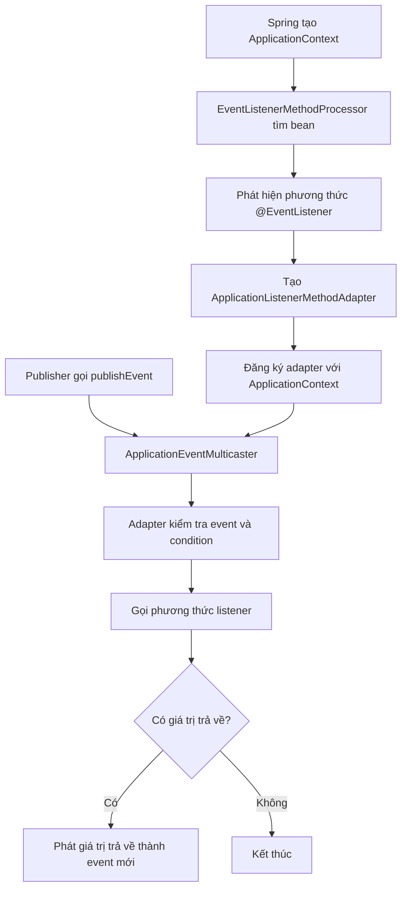

# Chú thích @EventListener

## 1. @EventListener dùng để làm gì?

`@EventListener` là annotation của Spring dùng để đánh dấu một phương thức sẽ nhận và xử lý application event. Khi Spring tạo ApplicationContext, hạ tầng annotation event phát hiện các phương thức được đánh dấu, tạo adapter tương ứng và đăng ký adapter vào cơ chế phân phối event của context.

Service hoặc component phát event bằng `ApplicationEventPublisher.publishEvent(...)`. ApplicationEventMulticaster phân phối event đến các listener phù hợp; adapter tạo từ `@EventListener` gọi phương thức được đánh dấu.

Nhờ đó, publisher chỉ cần biết kiểu event và dữ liệu cần phát. Publisher không cần tìm bean listener, gọi trực tiếp phương thức listener hoặc quản lý danh sách các thành phần quan tâm.

Ví dụ tối giản:

```java
@Component
public class OrderListener {

    @EventListener
    public void onOrderPlaced(OrderPlaced event) {
        System.out.println("Received: " + event.orderId());
    }
}
```

Khi có nơi gọi `publishEvent(new OrderPlaced("ORD-100"))`, Spring sẽ gọi `onOrderPlaced` nếu listener đã được đăng ký trong context và kiểu event phù hợp.

`@EventListener` thuộc tầng khai báo listener. Nó không phải publisher, không phải event bus độc lập và cũng không tự làm phương thức chạy bất đồng bộ.

## 2. Spring phát hiện và đăng ký phương thức listener như thế nào?

Trong quá trình khởi tạo ApplicationContext, Spring đăng ký các thành phần hạ tầng xử lý annotation. `EventListenerMethodProcessor` tìm các bean có phương thức mang `@EventListener`. Với mỗi phương thức hợp lệ, Spring tạo một `ApplicationListenerMethodAdapter` và đăng ký adapter đó làm application listener.

Luồng khái quát:



Bạn không cần tự tạo adapter hoặc gọi `addApplicationListener` cho các phương thức thông thường được đánh dấu annotation. Hãy để Spring quản lý bean và annotation infrastructure.

Điều kiện để listener hoạt động:

- Class chứa phương thức phải là bean do Spring quản lý, ví dụ có `@Component`, `@Service`, hoặc được khai báo bằng `@Bean`.
- ApplicationContext phải có annotation event infrastructure. Các context cấu hình annotation như `AnnotationConfigApplicationContext` tự đăng ký hạ tầng này.
- Event được phát trong context có listener đã đăng ký, hoặc được chuyển tiếp qua quan hệ context phù hợp.
- Kiểu event và điều kiện của listener phải khớp với event được phát.

Đặt `@EventListener` trên một class không làm toàn bộ class trở thành listener. Annotation phải nằm trên phương thức xử lý event.

## 3. Tham số của phương thức listener

Cách dùng phổ biến là khai báo một tham số có kiểu event cần nhận:

```java
@EventListener
public void handle(OrderPlaced event) {
    // Xử lý event.
}
```

Kiểu tham số quyết định loại event mà phương thức muốn nhận. Ví dụ, listener nhận `OrderPlaced` không tự động nhận mọi loại event khác.

Spring hỗ trợ cả hai dạng event:

- **ApplicationEvent subclass:** event class kế thừa `ApplicationEvent`; phương thức nhận đúng event class đó hoặc một kiểu cha phù hợp.
- **Payload object:** record, POJO hoặc object thông thường được publish trực tiếp. Spring bọc object trong `PayloadApplicationEvent`, còn listener annotation có thể nhận trực tiếp kiểu payload.

Ví dụ payload:

```java
public record OrderPlaced(String orderId, BigDecimal total) {
}
```

```java
@EventListener
public void handle(OrderPlaced event) {
    System.out.println(event.orderId());
}
```

Không cần tham số kiểu `ApplicationEvent` nếu bạn đang phát một record payload. Hãy khai báo kiểu dữ liệu thực tế mà listener cần xử lý.

Một phương thức thông thường nhận một tham số event. Annotation cũng có thuộc tính `classes` (bí danh của `value`) để chỉ định một hoặc nhiều event class tường minh; khi dùng thuộc tính này, phương thức được kỳ vọng không khai báo tham số. Đây là cách hữu ích khi cùng một phương thức chỉ cần thực hiện một hành động chung cho nhiều event class mà không cần đọc payload của chúng.

## 4. Lọc event bằng thuộc tính condition

Thuộc tính `condition` nhận một biểu thức Spring Expression Language (SpEL). Spring chỉ gọi phương thức khi biểu thức trả về `true`.

Ví dụ event:

```java
public record OrderPlaced(String orderId, BigDecimal total) {
    public boolean isHighValue() {
        return total.compareTo(new BigDecimal("100")) >= 0;
    }
}
```

Listener chỉ ghi audit cho đơn hàng có giá trị từ 100 trở lên:

```java
@Component
public class HighValueOrderListener {

    @EventListener(condition = "#root.args[0].isHighValue()")
    public void audit(OrderPlaced event) {
        System.out.println("High-value order: " + event.orderId());
    }
}
```

Trong biểu thức:

- `#root.event` tham chiếu event đang được xử lý.
- `#root.args` chứa các đối số truyền vào phương thức listener.
- `#a0` hoặc `#p0` có thể tham chiếu tham số đầu tiên.
- Có thể dùng tên tham số như `#event` khi tên tham số được giữ trong metadata biên dịch.

Dùng `#root.args[0]` giúp ví dụ không phụ thuộc vào việc compiler có giữ tên tham số hay không. Biểu thức có thể gọi method, đọc property và sử dụng các toán tử SpEL.

Condition phù hợp cho điều kiện ngắn, dễ hiểu như trạng thái, loại event hoặc ngưỡng giá trị. Nếu điều kiện chứa nhiều truy vấn, nhiều nhánh hoặc logic nghiệp vụ phức tạp, nên chuyển quyết định đó sang một service hoặc component có tên rõ ràng. Condition được đánh giá trong lúc listener được xét; không nên đặt side effect vào biểu thức.

## 5. Thứ tự xử lý với @Order

Một event có thể được nhiều phương thức `@EventListener` nhận. Nếu cần quy định thứ tự gọi, có thể dùng `@Order` trên phương thức hoặc class listener:

```java
@Component
public class InventoryListener {

    @EventListener
    @Order(1)
    public void reserve(OrderPlaced event) {
        System.out.println("Reserve inventory");
    }
}

@Component
public class AuditListener {

    @EventListener
    @Order(2)
    public void record(OrderPlaced event) {
        System.out.println("Record audit");
    }
}
```

Giá trị order nhỏ hơn có độ ưu tiên cao hơn. Thứ tự này hữu ích khi các listener đồng bộ cần được gọi theo một trình tự xác định.

Không nên xem `@Order` là cơ chế điều phối workflow. Khi listener chạy bất đồng bộ, thứ tự submit task không bảo đảm thứ tự hoàn tất. Nếu bước B chỉ được chạy sau khi bước A thành công, hãy biểu diễn quan hệ đó trong một service/workflow rõ ràng.

## 6. Phương thức listener có thể trả về event mới

Một phương thức `@EventListener` có thể trả về một object. Spring sẽ phát giá trị trả về như một application event mới. Nếu trả về một collection hoặc array, các phần tử được phát thành các event riêng.

Ví dụ:

```java
@Component
public class OrderAcknowledgementListener {

    @EventListener
    public OrderAcknowledged acknowledge(OrderPlaced event) {
        return new OrderAcknowledged(event.orderId());
    }
}
```

Event được phát tiếp:

```java
public record OrderAcknowledged(String orderId) {
}
```

Một listener khác có thể nhận `OrderAcknowledged`:

```java
@Component
public class AcknowledgementLogListener {

    @EventListener
    public void log(OrderAcknowledged event) {
        System.out.println("Acknowledged: " + event.orderId());
    }
}
```

Cách này tạo một chuỗi event nhỏ mà không cần gọi trực tiếp listener kế tiếp. Tuy nhiên, cần tránh vòng lặp event: listener A phát event B, listener B lại phát event A mà không có điều kiện dừng.

Phương thức trả về `void` khi không cần phát event mới. Nếu listener được đánh dấu `@Async`, giá trị trả về không được dùng để phát event mới theo cơ chế return-value của `@EventListener`; hãy publish event một cách tường minh khi cần phối hợp với xử lý bất đồng bộ.

## 7. Ví dụ Java 17 + Spring Context có thể chạy

Ví dụ dưới đây dùng Java 17, Spring Context 6.2.0 và Maven. Một service phát `OrderPlaced`; hai listener xử lý event, listener thứ hai chỉ nhận đơn hàng có giá trị cao. Listener đầu tiên trả về `OrderAcknowledged`, sau đó listener thứ ba nhận event mới này.

Cấu trúc thư mục:

```text
event-listener-demo/
├── pom.xml
└── src/main/java/com/example/events/
    ├── Application.java
    ├── OrderPlaced.java
    ├── OrderAcknowledged.java
    ├── OrderService.java
    ├── InventoryListener.java
    ├── HighValueOrderListener.java
    └── AcknowledgementLogListener.java
```

**pom.xml**

```xml
<project xmlns="http://maven.apache.org/POM/4.0.0"
         xmlns:xsi="http://www.w3.org/2001/XMLSchema-instance"
         xsi:schemaLocation="http://maven.apache.org/POM/4.0.0 https://maven.apache.org/xsd/maven-4.0.0.xsd">
    <modelVersion>4.0.0</modelVersion>

    <groupId>com.example</groupId>
    <artifactId>event-listener-demo</artifactId>
    <version>1.0.0</version>

    <properties>
        <maven.compiler.release>17</maven.compiler.release>
        <project.build.sourceEncoding>UTF-8</project.build.sourceEncoding>
        <spring.version>6.2.0</spring.version>
    </properties>

    <dependencies>
        <dependency>
            <groupId>org.springframework</groupId>
            <artifactId>spring-context</artifactId>
            <version>${spring.version}</version>
        </dependency>
    </dependencies>

    <build>
        <plugins>
            <plugin>
                <groupId>org.apache.maven.plugins</groupId>
                <artifactId>maven-compiler-plugin</artifactId>
                <version>3.13.0</version>
            </plugin>
            <plugin>
                <groupId>org.codehaus.mojo</groupId>
                <artifactId>exec-maven-plugin</artifactId>
                <version>3.5.0</version>
                <configuration>
                    <mainClass>com.example.events.Application</mainClass>
                </configuration>
            </plugin>
        </plugins>
    </build>
</project>
```

**OrderPlaced.java**

```java
package com.example.events;

import java.math.BigDecimal;

public record OrderPlaced(String orderId, BigDecimal total) {
    public boolean isHighValue() {
        return total.compareTo(new BigDecimal("100")) >= 0;
    }
}
```

**OrderAcknowledged.java**

```java
package com.example.events;

public record OrderAcknowledged(String orderId) {
}
```

**OrderService.java**

```java
package com.example.events;

import java.math.BigDecimal;
import org.springframework.context.ApplicationEventPublisher;
import org.springframework.stereotype.Service;

@Service
public class OrderService {
    private final ApplicationEventPublisher eventPublisher;

    public OrderService(ApplicationEventPublisher eventPublisher) {
        this.eventPublisher = eventPublisher;
    }

    public void placeOrder(String orderId, BigDecimal total) {
        eventPublisher.publishEvent(new OrderPlaced(orderId, total));
    }
}
```

**InventoryListener.java**

```java
package com.example.events;

import org.springframework.context.event.EventListener;
import org.springframework.core.annotation.Order;
import org.springframework.stereotype.Component;

@Component
public class InventoryListener {

    @EventListener
    @Order(1)
    public OrderAcknowledged reserve(OrderPlaced event) {
        System.out.println("Inventory reserved: " + event.orderId());
        return new OrderAcknowledged(event.orderId());
    }
}
```

**HighValueOrderListener.java**

```java
package com.example.events;

import org.springframework.context.event.EventListener;
import org.springframework.core.annotation.Order;
import org.springframework.stereotype.Component;

@Component
public class HighValueOrderListener {

    @EventListener(condition = "#root.args[0].isHighValue()")
    @Order(2)
    public void audit(OrderPlaced event) {
        System.out.println("High-value audit: " + event.orderId());
    }
}
```

**AcknowledgementLogListener.java**

```java
package com.example.events;

import org.springframework.context.event.EventListener;
import org.springframework.stereotype.Component;

@Component
public class AcknowledgementLogListener {

    @EventListener
    public void log(OrderAcknowledged event) {
        System.out.println("Acknowledged: " + event.orderId());
    }
}
```

**Application.java**

```java
package com.example.events;

import java.math.BigDecimal;
import org.springframework.context.annotation.AnnotationConfigApplicationContext;

public class Application {
    public static void main(String[] args) {
        try (var context = new AnnotationConfigApplicationContext(
                OrderService.class,
                InventoryListener.class,
                HighValueOrderListener.class,
                AcknowledgementLogListener.class
        )) {
            context.getBean(OrderService.class)
                    .placeOrder("ORD-100", new BigDecimal("150.00"));
        }
    }
}
```

Chạy từ thư mục project bằng Java 17 và Maven:

```bash
mvn -q compile exec:java
```

Stdout:

```text
Inventory reserved: ORD-100
Acknowledged: ORD-100
High-value audit: ORD-100
```

Trong ví dụ, `InventoryListener.reserve` được gọi trước theo `@Order(1)`. Phương thức trả về `OrderAcknowledged`, Spring phát object đó thành event mới và `AcknowledgementLogListener` nhận nó. Sau đó listener còn lại của event gốc được gọi theo thứ tự đã khai báo. Toàn bộ ví dụ chạy đồng bộ trong cùng thread.

## 8. Đồng bộ và bất đồng bộ với @Async

Mặc định, phương thức `@EventListener` chạy đồng bộ trong thread phát event. Publisher chỉ tiếp tục sau khi các listener đồng bộ hoàn tất. Listener chạy lâu làm tăng thời gian xử lý của request hoặc tác vụ phát event; exception đồng bộ có thể truyền về publisher.

Có thể kết hợp `@Async` với `@EventListener` để chạy phương thức trên executor do Spring quản lý:

```java
import org.springframework.context.annotation.Configuration;
import org.springframework.scheduling.annotation.EnableAsync;

@Configuration
@EnableAsync
public class AsyncConfiguration {
}
```

```java
import org.springframework.scheduling.annotation.Async;
import org.springframework.stereotype.Component;
import org.springframework.context.event.EventListener;

@Component
public class EmailListener {

    @Async
    @EventListener
    public void sendEmail(OrderPlaced event) {
        // Gửi email trong thread do async executor quản lý.
    }
}
```

Cần nhớ:

- `@EnableAsync` bật cơ chế xử lý async annotation; nếu không có cấu hình này, `@Async` không tự chuyển phương thức sang executor.
- Exception trong listener async không truyền ngược về thread publisher. Với phương thức trả về `void`, cấu hình `AsyncUncaughtExceptionHandler` để xử lý lỗi không được trả qua Future.
- Phải giới hạn pool và queue, quan sát tác vụ bị từ chối và có chính sách shutdown phù hợp.
- Không giả định thứ tự hoàn tất giữa các listener async.
- Transaction, security context và thread-local state không tự động được truyền sang thread khác.
- Giá trị trả về của phương thức `@EventListener` có gắn `@Async` không được dùng để phát event tiếp theo; nếu cần, hãy gọi publisher một cách tường minh trong luồng xử lý phù hợp.

Ngoài `@Async`, có thể cấu hình `TaskExecutor` trực tiếp cho `SimpleApplicationEventMulticaster`. Đây là cơ chế ở tầng phân phối, khác với proxy async của phương thức. Cần chọn một cách rõ ràng để tránh vô tình tạo nhiều tầng executor.

## 9. Quan hệ với transaction

`@EventListener` thông thường chạy ngay khi event được multicaster phân phối. Nếu service phát event bên trong phương thức `@Transactional`, listener có thể chạy trước khi transaction commit. Nếu transaction rollback, side effect đã thực hiện trong listener không tự được hoàn tác.

Khi cần xử lý theo transaction phase, dùng `@TransactionalEventListener`, vốn là biến thể listener có ràng buộc với transaction synchronization:

```java
import org.springframework.stereotype.Component;
import org.springframework.transaction.event.TransactionPhase;
import org.springframework.transaction.event.TransactionalEventListener;

@Component
public class SearchIndexListener {

    @TransactionalEventListener(phase = TransactionPhase.AFTER_COMMIT)
    public void updateIndex(OrderPlaced event) {
        // Chỉ cập nhật chỉ mục sau khi transaction commit.
    }
}
```

Các phase thường dùng:

- `BEFORE_COMMIT`: trước khi transaction commit.
- `AFTER_COMMIT`: sau khi commit thành công; đây là mặc định.
- `AFTER_ROLLBACK`: sau khi rollback.
- `AFTER_COMPLETION`: sau khi transaction hoàn tất dù commit hay rollback.

Mặc định transactional listener không chạy nếu không có transaction đang hoạt động. `fallbackExecution = true` cho phép fallback khi không có transaction, nhưng chỉ nên bật nếu nghiệp vụ chấp nhận việc listener chạy ngay trong trường hợp đó.

Transactional listener không biến event thành thông điệp bền vững. Nếu cần bảo đảm giao nhận ra hệ thống khác khi process dừng hoặc mạng lỗi, hãy cân nhắc transactional outbox hoặc message broker.

## 10. Exception, điều kiện và những lưu ý thiết kế

Với listener đồng bộ, exception từ phương thức có thể thoát khỏi lời gọi publish event và làm gián đoạn việc phân phối tiếp, tùy ErrorHandler của multicaster. Vì vậy, cần phân biệt lỗi nghiệp vụ bắt buộc với lỗi của listener phụ trợ. Không nên bắt rồi bỏ qua mọi exception mà không ghi nhận.

Một số nguyên tắc thực tế:

- Giữ phương thức listener ngắn, thể hiện rõ một phản ứng với event.
- Không dùng condition để thực hiện side effect hoặc truy vấn phức tạp.
- Không phát lại chính event đầu vào một cách vô hạn.
- Tránh tạo chuỗi phụ thuộc giữa listener bằng `@Order`; dùng workflow/service nếu cần thứ tự nghiệp vụ.
- Payload nên bất biến và chứa ID/dữ liệu cần thiết thay vì giữ entity mutable hoặc dependency của ứng dụng.
- Dùng correlation ID hoặc business ID trong log để theo dõi một event qua nhiều listener.
- Nếu listener xử lý công việc có thể retry hoặc phải giao nhận tin cậy, cần cơ chế lưu trạng thái và retry phù hợp; event trong bộ nhớ không cung cấp các bảo đảm đó.

## 11. Kiểm thử listener

Kiểm thử nên bao phủ cả việc phương thức được gọi đúng và điều kiện lọc hoạt động đúng:

- **Unit test cho listener:** gọi trực tiếp phương thức với event mẫu để kiểm tra logic xử lý. Đây là kiểm thử logic method, không kiểm tra việc Spring phát hiện annotation.
- **Integration test:** khởi tạo Spring context, publish event qua `ApplicationEventPublisher`, rồi xác minh side effect để kiểm tra cả annotation infrastructure và multicaster.
- **Condition test:** phát event thỏa điều kiện và event không thỏa điều kiện, xác minh chỉ event phù hợp được xử lý.
- **Return-value test:** xác minh event trả về từ listener được phát và listener của event mới được gọi.
- **Async test:** dùng `CountDownLatch`, future hoặc cơ chế đồng bộ hóa tường minh; tránh `Thread.sleep` vì có thể khiến test chập chờn.
- **Transactional test:** kiểm tra listener ở đúng phase sau commit hoặc rollback, thay vì chỉ gọi phương thức listener trực tiếp.

Ví dụ kiểm tra condition ở mức integration test cần tạo context với `HighValueOrderListener`, publish hai `OrderPlaced` có tổng tiền khác nhau và xác minh side effect audit chỉ xuất hiện với đơn hàng có giá trị từ 100 trở lên.

## 12. Các lỗi thường gặp

| Triệu chứng | Nguyên nhân thường gặp | Cách kiểm tra |
|---|---|---|
| Phương thức không được gọi | Class không phải Spring bean hoặc annotation infrastructure không hoạt động | Kiểm tra component scan và cách tạo ApplicationContext. |
| Listener không nhận event | Kiểu tham số không tương thích với event payload | Kiểm tra object được publish và kiểu tham số listener. |
| Listener chỉ nhận một số event | SpEL condition trả về false | Kiểm tra biểu thức và đối số event. |
| Event trả về không kích hoạt listener khác | Phương thức trả về void, hoặc listener async làm return value không được publish | Kiểm tra kiểu trả về và cách thực thi. |
| Publisher bị chậm | Listener đang chạy đồng bộ và xử lý lâu | Đo thời gian listener; cân nhắc async có kiểm soát. |
| Listener chạy trước commit | Dùng `@EventListener` thông thường | Dùng `@TransactionalEventListener` với phase phù hợp. |
| Listener chạy sai thứ tự mong muốn | Chưa khai báo order hoặc đang xử lý async | Kiểm tra `@Order`; không dựa vào thứ tự hoàn tất của async task. |
| Listener lỗi nhưng publisher không nhận exception | Listener chạy async hoặc ErrorHandler đã xử lý lỗi | Kiểm tra executor, ErrorHandler và log. |

## 13. Checklist khi sử dụng @EventListener

1. Đặt phương thức listener trong bean Spring-managed.
2. Chọn đúng kiểu event hoặc payload làm tham số.
3. Dùng `condition` cho bộ lọc SpEL ngắn, dễ hiểu.
4. Dùng `@Order` chỉ khi cần thứ tự gọi listener đồng bộ.
5. Chỉ trả về object khi chủ đích phát một event tiếp theo.
6. Quyết định rõ listener chạy đồng bộ, async hay theo transaction phase.
7. Thiết kế cách ghi nhận exception và theo dõi tác vụ.
8. Kiểm thử qua ApplicationContext khi cần xác minh annotation infrastructure.
9. Tránh dùng application event trong bộ nhớ làm giải pháp giao nhận bền vững liên service.

`@EventListener` giúp khai báo phản ứng với application event ngay trên phương thức xử lý. Khi hiểu cách Spring phát hiện adapter, chọn event theo kiểu và condition, cũng như cách return value, async và transaction ảnh hưởng đến thời điểm thực thi, bạn có thể viết listener ngắn gọn mà vẫn kiểm soát được hành vi của toàn bộ luồng sự kiện.
