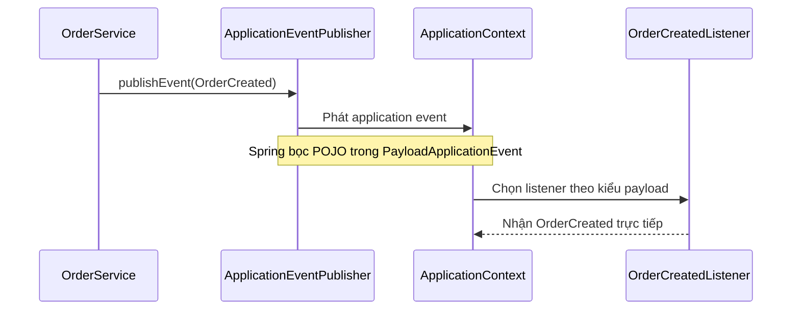

# Listener nhận payload trực tiếp

## 1. Ý nghĩa của payload listener

Spring Application Events cho phép một bean phát thông báo về một sự kiện để các bean khác xử lý. Bean phát event sử dụng `ApplicationEventPublisher`; nó không cần gọi trực tiếp từng listener hoặc biết listener nào đang tồn tại.

Từ Spring Framework 4.2, object được phát không bắt buộc phải kế thừa `ApplicationEvent`. Bạn có thể truyền một Java record, DTO hoặc POJO trực tiếp vào `publishEvent(Object event)`. Khi đó, listener có thể khai báo chính kiểu object ấy làm tham số:

```java
@EventListener
public void onOrderCreated(OrderCreated event) {
    System.out.println(event.orderId());
}
```

Đây là cách nhận payload trực tiếp. Phương thức không cần nhận `ApplicationEvent`, không cần ép kiểu và không cần tự mở lớp bao của Spring. Kiểu tham số thể hiện rõ listener quan tâm tới dữ liệu nghiệp vụ nào.

## 2. Luồng phát và nhận payload



Quá trình diễn ra như sau:

1. Service tạo object chứa dữ liệu sự kiện, ví dụ `new OrderCreated("ORD-59")`.
2. Service gọi `publisher.publishEvent(event)`.
3. Nếu object không phải `ApplicationEvent`, Spring tạo `PayloadApplicationEvent<T>` để mang object đó trong hệ thống event.
4. Spring tìm các listener đã đăng ký có kiểu tham số tương thích với payload.
5. Adapter của `@EventListener` lấy payload từ lớp bao và gọi phương thức với object gốc.

`PayloadApplicationEvent` là chi tiết tích hợp của Spring. Với listener thông thường, hãy khai báo kiểu payload cụ thể để code dễ đọc và dễ kiểm tra.

## 3. Spring ghép kiểu payload với listener

Kiểu tham số của phương thức `@EventListener` được dùng để xác định loại event mà phương thức muốn nhận. Ví dụ:

| Tham số listener | Payload có thể nhận |
|---|---|
| `OrderCreated` | Object thuộc kiểu `OrderCreated`. |
| `DomainEvent` | Object triển khai `DomainEvent`, ví dụ `OrderCreated` nếu record triển khai interface đó. |
| `Object` | Phạm vi rất rộng, có thể nhận nhiều loại payload. |

Ví dụ dùng interface chung:

```java
public interface DomainEvent {
}

public record OrderCreated(String orderId) implements DomainEvent {
}

public record PaymentReceived(String paymentId) implements DomainEvent {
}

@EventListener
public void audit(DomainEvent event) {
    // Nhận các payload triển khai DomainEvent.
}
```

Listener `audit` có thể nhận cả `OrderCreated` và `PaymentReceived` vì hai kiểu này cùng triển khai `DomainEvent`. Nếu listener chỉ phục vụ một loại event, dùng kiểu cụ thể để tránh nhận dữ liệu ngoài ý muốn.

Không nên khai báo `Object` rồi gom mọi nghiệp vụ vào một phương thức với nhiều nhánh `instanceof`. Cách đó làm mất lợi ích định kiểu và khiến listener phải biết quá nhiều loại sự kiện.

## 4. Ví dụ hoàn chỉnh chạy với Java 17

Ví dụ dùng Spring Context thuần, không cần Spring Boot. `OrderService` phát một record `OrderCreated`; `OrderCreatedListener` nhận record trực tiếp và in mã đơn hàng.

### Cấu trúc thư mục

```text
direct-payload-event/
├── pom.xml
└── src/
    └── main/
        └── java/
            └── demo/
                └── App.java
```

### pom.xml

```xml
<project xmlns="http://maven.apache.org/POM/4.0.0"
         xmlns:xsi="http://www.w3.org/2001/XMLSchema-instance"
         xsi:schemaLocation="http://maven.apache.org/POM/4.0.0 https://maven.apache.org/xsd/maven-4.0.0.xsd">
    <modelVersion>4.0.0</modelVersion>
    <groupId>demo</groupId>
    <artifactId>direct-payload-event</artifactId>
    <version>1.0.0</version>

    <properties>
        <maven.compiler.release>17</maven.compiler.release>
        <project.build.sourceEncoding>UTF-8</project.build.sourceEncoding>
        <spring-framework.version>6.2.0</spring-framework.version>
    </properties>

    <dependencies>
        <dependency>
            <groupId>org.springframework</groupId>
            <artifactId>spring-context</artifactId>
            <version>${spring-framework.version}</version>
        </dependency>
    </dependencies>

    <build>
        <plugins>
            <plugin>
                <groupId>org.apache.maven.plugins</groupId>
                <artifactId>maven-compiler-plugin</artifactId>
                <version>3.13.0</version>
            </plugin>
            <plugin>
                <groupId>org.codehaus.mojo</groupId>
                <artifactId>exec-maven-plugin</artifactId>
                <version>3.5.0</version>
                <configuration>
                    <mainClass>demo.App</mainClass>
                </configuration>
            </plugin>
        </plugins>
    </build>
</project>
```

### src/main/java/demo/App.java

```java
package demo;

import org.springframework.context.ApplicationEventPublisher;
import org.springframework.context.annotation.AnnotationConfigApplicationContext;
import org.springframework.context.annotation.Bean;
import org.springframework.context.annotation.Configuration;
import org.springframework.context.event.EventListener;

public class App {

    public static void main(String[] args) {
        try (var context = new AnnotationConfigApplicationContext(AppConfig.class)) {
            context.getBean(OrderService.class).createOrder();
        }
    }

    @Configuration
    static class AppConfig {

        @Bean
        OrderService orderService(ApplicationEventPublisher publisher) {
            return new OrderService(publisher);
        }

        @Bean
        OrderCreatedListener orderCreatedListener() {
            return new OrderCreatedListener();
        }
    }

    static class OrderService {
        private final ApplicationEventPublisher publisher;

        OrderService(ApplicationEventPublisher publisher) {
            this.publisher = publisher;
        }

        void createOrder() {
            publisher.publishEvent(new OrderCreated("ORD-2026-059", 3));
        }
    }

    static class OrderCreatedListener {

        @EventListener
        public void handle(OrderCreated event) {
            System.out.println(
                "Received order=" + event.orderId()
                    + ", itemCount=" + event.itemCount()
            );
        }
    }

    public record OrderCreated(String orderId, int itemCount) {
    }
}
```

### Chạy chương trình

Đứng tại thư mục chứa `pom.xml` và chạy:

```bash
mvn -q compile exec:java
```

Output:

```text
Received order=ORD-2026-059, itemCount=3
```

Trong ví dụ này:

- `ApplicationEventPublisher` được Spring inject vào `OrderService`.
- `OrderCreated` là record Java thông thường, không kế thừa `ApplicationEvent`.
- `publishEvent` nhận record đó; Spring tự bọc payload trong `PayloadApplicationEvent`.
- `@EventListener` khai báo tham số `OrderCreated`, vì vậy listener nhận object gốc.
- `OrderCreatedListener` được đăng ký bằng `@Bean`, nên Spring quản lý và phát hiện phương thức listener.

## 5. Listener phải là bean Spring

Chỉ thêm `@EventListener` vào một object được tạo bằng `new` bên ngoài container không làm cho Spring tự phát hiện phương thức đó. Listener phải thuộc một bean trong `ApplicationContext` đang tham gia xử lý event.

Có thể đăng ký bằng `@Bean` như ví dụ, hoặc dùng component scanning:

```java
@Component
class InventoryListener {

    @EventListener
    public void updateInventory(OrderCreated event) {
        // Cập nhật tồn kho.
    }
}
```

Nếu listener không chạy, hãy kiểm tra class có được scan hoặc khai báo bean không, bean có nằm trong context phù hợp không và kiểu tham số có tương thích với payload được phát không.

## 6. Một payload có thể có nhiều listener

Nhiều bean có thể lắng nghe cùng kiểu `OrderCreated`. Mỗi listener nhận cùng payload và thực hiện một trách nhiệm riêng:

```java
@Component
class OrderAuditListener {
    @EventListener
    public void record(OrderCreated event) {
        // Ghi audit log.
    }
}

@Component
class OrderNotificationListener {
    @EventListener
    public void notifyCustomer(OrderCreated event) {
        // Gửi thông báo.
    }
}
```

Đảm bảo các listener được component scan hoặc khai báo thành bean. Nếu cần thứ tự gọi, có thể dùng `@Order` hoặc `Ordered`. Thứ tự này chỉ điều khiển thứ tự listener được gọi; nó không tạo bảo đảm transaction hay lưu trữ event.

Payload nên bất biến, chẳng hạn Java record. Nếu nhiều listener cùng nhận một object mutable và một listener thay đổi object đó, listener khác có thể nhìn thấy dữ liệu đã bị thay đổi.

## 7. Lưu ý về kiểu generic

Java sử dụng type erasure nên thông tin kiểu phần tử của collection thường không còn đầy đủ ở runtime. Nếu phát trực tiếp một `List<Order>`, listener khó dựa vào object collection để phân biệt chắc chắn đó là danh sách Order hay một loại phần tử khác.

Khi kiểu generic mang ý nghĩa nghiệp vụ, hãy tạo một payload có tên:

```java
public record OrdersImported(List<Order> orders) {
}

@EventListener
public void onOrdersImported(OrdersImported event) {
    System.out.println("Imported orders=" + event.orders().size());
}
```

Ví dụ cần import `java.util.List` và định nghĩa kiểu `Order` của ứng dụng. Record `OrdersImported` giúp listener có một kiểu event rõ ràng, đồng thời làm dữ liệu payload dễ mở rộng.

## 8. Đồng bộ và bất đồng bộ

Với cấu hình mặc định, listener được gọi đồng bộ trên luồng phát event. Khi `publishEvent` trả về, các listener đồng bộ phù hợp đã được gọi xong. Một listener xử lý lâu có thể kéo dài thời gian của request hoặc nghiệp vụ phát event.

Có thể chuyển listener sang executor bằng `@Async` và bật `@EnableAsync`:

```java
@Configuration
@EnableAsync
class AsyncConfiguration {
}

@Component
class ReportListener {
    @Async
    @EventListener
    public void createReport(OrderCreated event) {
        // Tạo báo cáo trên executor.
    }
}
```

Khi dùng `@Async`, publisher không chờ listener hoàn tất. Hãy cấu hình executor, theo dõi lỗi và không giả định listener đã xử lý xong ngay sau `publishEvent`. Lời gọi async phải đi qua proxy Spring; self-invocation trong cùng object không kích hoạt proxy.

Application Event vẫn là cơ chế trong phạm vi ứng dụng/context. Nó không tự cung cấp queue bền vững, retry sau khi process dừng hoặc truyền event sang JVM khác. Khi cần giao nhận bền vững, hãy dùng message broker hoặc Transactional Outbox phù hợp.

## 9. Lỗi thường gặp

| Hiện tượng | Nguyên nhân và cách xử lý |
|---|---|
| Listener không được gọi | Bean chưa được đăng ký trong `ApplicationContext`, thiếu `@EventListener` hoặc kiểu tham số không tương thích. |
| Listener nhận `PayloadApplicationEvent` ngoài dự kiến | Phương thức khai báo nhận lớp bao. Với object payload thông thường, khai báo trực tiếp kiểu payload như `OrderCreated`. |
| Phải tự ép kiểu payload | Tham số quá tổng quát. Dùng kiểu payload cụ thể hoặc interface nghiệp vụ. |
| Listener nhận nhiều loại event không mong muốn | Dùng `Object` hoặc interface quá rộng. Thu hẹp kiểu hoặc tách listener theo trách nhiệm. |
| Không phân biệt được generic collection | Type erasure làm mất thông tin kiểu phần tử ở runtime. Bọc collection trong record payload có tên. |
| Listener không chạy dù có annotation | Object không phải bean Spring hoặc bean nằm ngoài context nhận event. Kiểm tra component scan và cấu hình bean. |
| Request chậm khi phát event | Listener mặc định chạy đồng bộ. Chỉ dùng `@Async` khi đã cấu hình executor và xử lý lỗi phù hợp. |

## 10. Ghi nhớ

- `publishEvent(Object)` cho phép phát trực tiếp record, DTO hoặc POJO.
- Spring bọc object không kế thừa `ApplicationEvent` trong `PayloadApplicationEvent`.
- Phương thức `@EventListener` có thể nhận trực tiếp kiểu payload gốc.
- Kiểu tham số giúp Spring chọn listener tương thích; interface/lớp cha có thể nhận nhóm payload liên quan.
- Listener phải là bean do Spring quản lý trong context phù hợp.
- Dùng kiểu payload có tên khi generic collection cần định tuyến rõ ràng.
- Event mặc định chạy đồng bộ; `@Async` thay đổi cách thực thi nhưng không tạo durable messaging.