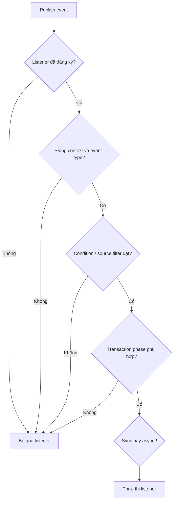

# Điều kiện để listener được gọi

Spring Application Events không gọi mọi listener mỗi khi có bất kỳ event nào được publish. Spring chỉ dispatch đến những listener đã đăng ký và phù hợp với kiểu event; các bộ lọc bổ sung như SpEL condition, transaction phase hoặc source type tiếp tục quyết định listener có thực sự chạy hay không. Hiểu từng lớp điều kiện giúp xác định chính xác vì sao một listener nhận được event, bị bỏ qua hoặc chỉ chạy trong một số tình huống.

## 1. Bản đồ điều kiện dispatch

Một listener thường được gọi khi tất cả điều kiện áp dụng cho nó đều thỏa mãn:

1. **Đã đăng ký:** listener là bean trong ApplicationContext hoặc được đăng ký trực tiếp với context.
2. **Đúng phạm vi context:** event được publish trong context có thể truyền đến context chứa listener.
3. **Khớp kiểu event:** kiểu event thực tế tương thích với kiểu listener khai báo.
4. **Đạt bộ lọc:** `@EventListener(classes = ...)`, SpEL `condition` hoặc bộ lọc tùy biến chấp nhận event.
5. **Đúng thời điểm transaction:** nếu dùng `@TransactionalEventListener`, transaction phase được chọn phải xảy ra.
6. **Thực thi được:** listener đồng bộ được gọi trong lượt dispatch; listener bất đồng bộ cần executor tiếp nhận task.

`@Order` chỉ sắp xếp các listener đã đủ điều kiện. Nó không đăng ký listener, không làm kiểu event khớp và không biến một condition sai thành đúng.



## 2. Listener phải được Spring đăng ký

Với phương thức `@EventListener`, đối tượng chứa phương thức phải là bean do Spring quản lý. Spring xử lý annotation trong quá trình khởi tạo context thông qua `EventListenerMethodProcessor`, sau đó đăng ký adapter tương ứng với application event multicaster.

Đăng ký bằng component scanning:

```java
@Component
public class OrderListener {
    @EventListener
    public void onOrderPlaced(OrderPlacedEvent event) {
        System.out.println("Received " + event.orderId());
    }
}
```

Hoặc khai báo bean rõ ràng:

```java
@Configuration
public class EventConfiguration {
    @Bean
    OrderListener orderListener() {
        return new OrderListener();
    }
}
```

Nếu tự tạo object bằng `new OrderListener()` rồi giữ object đó ngoài ApplicationContext, Spring không tự phát hiện `@EventListener` trên object này. Khi đó phương thức không được đăng ký làm listener. Với listener triển khai `ApplicationListener`, bean cũng phải thuộc context hoặc phải được đăng ký trực tiếp bằng API của context.

Ví dụ listener triển khai interface:

```java
@Component
public class OrderApplicationListener
        implements ApplicationListener<OrderPlacedApplicationEvent> {
    @Override
    public void onApplicationEvent(OrderPlacedApplicationEvent event) {
        System.out.println("Received " + event.orderId());
    }
}
```

`ApplicationListener<E>` nhận các event kế thừa `ApplicationEvent`. Với POJO hoặc record được publish trực tiếp, `@EventListener` thường thuận tiện hơn vì tham số phương thức có thể là kiểu payload.

## 3. Event phải nằm trong phạm vi ApplicationContext

Mỗi ApplicationContext có event multicaster và tập listener của nó. Trong cấu trúc parent–child context, event được publish ở context con được chuyển tiếp lên context cha. Event được publish ở context cha không tự truyền xuống context con hoặc sang context anh em.

Điều này có nghĩa listener ở context cha có thể nhận event do context con phát; listener chỉ được đăng ký trong context con không tự nhận event phát ở context cha. Khi debug, cần xác định context nào publish và context nào đăng ký listener.

```text
Parent ApplicationContext
  ├── ParentListener
  └── Child ApplicationContext
        └── ChildListener

Event published by Child:
  Child multicaster -> ChildListener
                   -> Parent context -> ParentListener

Event published by Parent:
  Parent multicaster -> ParentListener
                      (không tự đi xuống ChildListener)
```

Không nên đăng ký cùng một listener ở nhiều context nếu không chủ ý xử lý trùng. Với ứng dụng Spring Boot thông thường chỉ có một context chính, vấn đề này ít xuất hiện; nó quan trọng hơn trong ứng dụng web có nhiều context hoặc hệ thống plugin.

## 4. Kiểu event phải tương thích với listener

Spring chọn listener dựa trên kiểu event. Listener nhận kiểu cụ thể có thể nhận event cùng kiểu hoặc kiểu con tương thích. Listener nhận lớp cha hoặc interface có thể xử lý nhiều event con.

```java
public interface DomainEvent {
}

public record OrderPlacedEvent(String orderId) implements DomainEvent {
}

@Component
public class DomainEventListener {
    @EventListener
    public void onDomainEvent(DomainEvent event) {
        System.out.println("Domain event received: " + event);
    }
}
```

Với event `OrderPlacedEvent`, cả listener nhận `OrderPlacedEvent` và listener nhận `DomainEvent` đều có thể phù hợp. Spring không chọn một listener duy nhất; tất cả listener đã đăng ký và thỏa mãn điều kiện đều được dispatch.

### POJO và record payload

Từ Spring Framework 4.2, có thể publish một object bất kỳ qua `ApplicationEventPublisher.publishEvent(Object)`. Spring biểu diễn payload đó bằng `PayloadApplicationEvent`. Adapter của `@EventListener` giải bọc payload để truyền đúng kiểu vào tham số:

```java
public record OrderPlacedEvent(String orderId, long totalInCents) {
}

@EventListener
public void onOrderPlaced(OrderPlacedEvent event) {
    System.out.println(event.orderId());
}
```

Listener có thể nhận trực tiếp `OrderPlacedEvent`. Nếu cần làm việc với envelope, có thể khai báo tham số `PayloadApplicationEvent<OrderPlacedEvent>` và đọc `getPayload()` hoặc `getSource()`.

### Generic event và type erasure

Spring dùng `ResolvableType` để so khớp generic type khi metadata kiểu đầy đủ có thể được xác định. Java type erasure có thể làm mất tham số generic trên instance; vì vậy không phải mọi payload generic đều có thể tự phân biệt chỉ từ kiểu runtime.

Nếu cần phân biệt `EntityCreatedEvent<Order>` và `EntityCreatedEvent<Customer>`, event có thể triển khai `ResolvableTypeProvider` để cung cấp `ResolvableType` chính xác. Một lựa chọn khác là dùng các lớp event riêng khi hai loại sự kiện có ý nghĩa nghiệp vụ khác nhau. Không nên dựa vào giả định rằng generic của collection hoặc object lồng nhau luôn còn nguyên ở runtime.

## 5. Lọc event bằng `classes`

`@EventListener` có thuộc tính `classes` (alias của `value`) để chỉ rõ các lớp event mà phương thức quan tâm. Cách này phù hợp khi phương thức không cần nhận dữ liệu event:

```java
@EventListener(classes = {
        OrderPlacedEvent.class,
        OrderCancelledEvent.class
})
public void onOrderLifecycleChanged() {
    System.out.println("Order lifecycle event received");
}
```

Khi dùng `classes`, phương thức listener không được khai báo tham số. Nếu cần truy cập payload, hãy khai báo tham số với kiểu event mong muốn và để Spring suy ra kiểu từ tham số đó; không kết hợp `classes` với tham số phương thức.

`classes` lọc theo kiểu event, không lọc theo thuộc tính bên trong payload. Để kiểm tra dữ liệu như tổng tiền, trạng thái hoặc kênh bán hàng, dùng SpEL `condition`.

## 6. Lọc theo payload bằng SpEL `condition`

Thuộc tính `condition` của `@EventListener` nhận một biểu thức Spring Expression Language (SpEL). Listener chỉ được gọi khi kiểu event khớp và biểu thức trả về `true`.

Ví dụ chỉ xử lý đơn hàng có tổng tiền từ 100.000 cent:

```java
@EventListener(condition = "#a0.totalInCents() >= 100000")
public void onHighValueOrder(OrderPlacedEvent event) {
    System.out.println("High-value order: " + event.orderId());
}
```

Trong ngữ cảnh SpEL của event listener:

- `#root.event` là event đang được xử lý.
- `#root.args` là các đối số truyền vào phương thức listener.
- `#a0` và `#p0` là alias cho tham số đầu tiên; `#a1`/`#p1` là tham số thứ hai.
- Tên tham số như `#event` chỉ dùng được nếu tên tham số có thể được khám phá từ metadata biên dịch tương ứng.

Ví dụ lọc theo kênh:

```java
@EventListener(condition = "#a0.channel() == 'WEB'")
public void onWebOrder(OrderPlacedEvent event) {
    System.out.println("Web order: " + event.orderId());
}
```

### Kết hợp nhiều điều kiện

SpEL cho phép kết hợp điều kiện bằng `and`, `or`, `not` và các phép so sánh:

```java
@EventListener(
    condition = "#a0.totalInCents() >= 100000 and #a0.channel() == 'WEB'"
)
public void onHighValueWebOrder(OrderPlacedEvent event) {
    System.out.println("High-value web order: " + event.orderId());
}
```

Condition nên ngắn và chỉ dựa trên dữ liệu event có sẵn. Nếu cần gọi repository, kiểm tra nhiều quy tắc nghiệp vụ hoặc thực hiện logic có side effect, hãy chuyển phần đó vào service chuyên trách. Lỗi khi đánh giá biểu thức có thể làm gián đoạn dispatch đồng bộ.

## 7. Lọc theo event type và source type bằng `GenericApplicationListener`

Khi cần logic chọn listener phức tạp hơn annotation, `GenericApplicationListener` cung cấp hai điểm lọc: `supportsEventType(ResolvableType)` và `supportsSourceType(Class<?>)`.

Ví dụ listener chỉ nhận `OrderPlacedApplicationEvent` được phát từ `WebCheckout`:

```java
public class WebCheckoutListener implements GenericApplicationListener {
    @Override
    public boolean supportsEventType(ResolvableType eventType) {
        return ResolvableType.forClass(OrderPlacedApplicationEvent.class)
                .isAssignableFrom(eventType);
    }

    @Override
    public boolean supportsSourceType(Class<?> sourceType) {
        return WebCheckout.class.isAssignableFrom(sourceType);
    }

    @Override
    public void onApplicationEvent(ApplicationEvent event) {
        OrderPlacedApplicationEvent orderEvent =
                (OrderPlacedApplicationEvent) event;
        System.out.println("Web checkout order: " + orderEvent.orderId());
    }
}
```

Bean triển khai `GenericApplicationListener` phải được đăng ký trong context. `supportsEventType` kiểm tra kiểu event; `supportsSourceType` kiểm tra kiểu source của `ApplicationEvent`. Đây là API mức thấp và thường không cần thiết nếu `@EventListener` cùng SpEL đã diễn đạt đủ yêu cầu.

Source không đồng nghĩa payload. Khi publish POJO, Spring bọc object trong `PayloadApplicationEvent`; source thường là publisher/context đã phát event. Nếu cần lọc theo nguồn nghiệp vụ, hãy xác định chính xác source thực tế hoặc đưa thông tin nguồn vào payload.

## 8. Transaction phase là một điều kiện riêng

`@TransactionalEventListener` chỉ gọi listener ở phase transaction đã chọn. Phase mặc định là `AFTER_COMMIT`:

```java
@TransactionalEventListener(phase = TransactionPhase.AFTER_COMMIT)
public void onOrderPlaced(OrderPlacedEvent event) {
    // Chỉ xử lý sau khi transaction commit thành công
}
```

Các phase chính:

| Phase | Thời điểm listener chạy |
|---|---|
| `BEFORE_COMMIT` | Trước khi transaction commit |
| `AFTER_COMMIT` | Sau khi commit thành công; đây là mặc định |
| `AFTER_ROLLBACK` | Sau khi transaction rollback |
| `AFTER_COMPLETION` | Sau khi transaction hoàn tất, dù commit hay rollback |

Listener cần transaction đang hoạt động tại thời điểm publish. Nếu không có transaction, listener mặc định không chạy. Có thể đặt `fallbackExecution = true` để cho phép listener chạy khi không có transaction, nhưng chỉ nên làm vậy khi nghiệp vụ chấp nhận cả hai tình huống.

`@EventListener` thông thường không chờ transaction commit. Nếu publish trong transaction, listener đồng bộ có thể chạy trước commit; tác động bên ngoài như gửi HTTP request hoặc email không tự được hoàn tác khi transaction rollback.

## 9. Đồng bộ, bất đồng bộ và thứ tự thực thi

### Listener đồng bộ

Với `SimpleApplicationEventMulticaster` mặc định không cấu hình executor, listener chạy trên thread gọi `publishEvent`. Publisher đợi listener hoàn tất. Exception từ listener có thể truyền ngược về publisher nếu không có `ErrorHandler` xử lý.

### Listener bất đồng bộ

Có thể kết hợp `@EnableAsync` và `@Async` để chuyển listener sang executor:

```java
@Configuration
@EnableAsync
public class AsyncConfiguration {
}

@Component
public class AsyncOrderListener {
    @Async
    @EventListener
    public void onOrderPlaced(OrderPlacedEvent event) {
        // Công việc nền
    }
}
```

Publisher không chờ phần xử lý nền hoàn tất. Cần cấu hình executor, queue capacity, rejection policy và cách ghi nhận exception bất đồng bộ. Không giả định các listener async hoàn tất theo thứ tự `@Order`. Async listener cũng không phải hàng đợi bền vững và không tự retry khi tiến trình dừng.

### `@Order`

Đặt `@Order` trên phương thức listener hoặc bean để quy định thứ tự ưu tiên giữa các listener đồng bộ cùng nhận event. Giá trị nhỏ hơn có độ ưu tiên cao hơn. `@Order` không bảo đảm thứ tự hoàn tất của công việc async và không ảnh hưởng đến việc listener có khớp event hay không.

## 10. Ví dụ hoàn chỉnh: nhiều listener và nhiều điều kiện

Ví dụ dùng Java 17 và Spring Framework 6.2.0. Publisher phát một record; bốn listener cùng được đăng ký, nhưng chỉ listener có kiểu phù hợp và condition đúng mới chạy.

### Cấu trúc thư mục

```text
listener-conditions/
├── pom.xml
└── src/
    └── main/
        └── java/
            └── demo/
                └── ListenerConditionsDemo.java
```

### pom.xml

```xml
<project xmlns="http://maven.apache.org/POM/4.0.0"
         xmlns:xsi="http://www.w3.org/2001/XMLSchema-instance"
         xsi:schemaLocation="http://maven.apache.org/POM/4.0.0 https://maven.apache.org/xsd/maven-4.0.0.xsd">
    <modelVersion>4.0.0</modelVersion>
    <groupId>demo</groupId>
    <artifactId>listener-conditions</artifactId>
    <version>1.0.0</version>
    <properties>
        <maven.compiler.release>17</maven.compiler.release>
        <project.build.sourceEncoding>UTF-8</project.build.sourceEncoding>
    </properties>
    <dependencies>
        <dependency>
            <groupId>org.springframework</groupId>
            <artifactId>spring-context</artifactId>
            <version>6.2.0</version>
        </dependency>
    </dependencies>
    <build>
        <plugins>
            <plugin>
                <groupId>org.apache.maven.plugins</groupId>
                <artifactId>maven-compiler-plugin</artifactId>
                <version>3.13.0</version>
            </plugin>
            <plugin>
                <groupId>org.codehaus.mojo</groupId>
                <artifactId>exec-maven-plugin</artifactId>
                <version>3.3.0</version>
            </plugin>
        </plugins>
    </build>
</project>
```

### src/main/java/demo/ListenerConditionsDemo.java

```java
package demo;

import org.springframework.context.ApplicationEventPublisher;
import org.springframework.context.annotation.AnnotationConfigApplicationContext;
import org.springframework.context.annotation.Bean;
import org.springframework.context.annotation.Configuration;
import org.springframework.context.event.EventListener;
import org.springframework.core.annotation.Order;

public class ListenerConditionsDemo {

    public record OrderPlacedEvent(
            String orderId,
            long totalInCents,
            String channel) {
    }

    public static class OrderPublisher {
        private final ApplicationEventPublisher publisher;

        public OrderPublisher(ApplicationEventPublisher publisher) {
            this.publisher = publisher;
        }

        public void publish() {
            OrderPlacedEvent event =
                    new OrderPlacedEvent("ORD-3001", 125000, "WEB");
            System.out.println("Publisher: publishing " + event.orderId());
            publisher.publishEvent(event);
            System.out.println("Publisher: dispatch returned");
        }
    }

    public static class OrderListeners {
        @EventListener
        @Order(1)
        public void onEveryOrder(OrderPlacedEvent event) {
            System.out.println("1. General listener: " + event.orderId());
        }

        @EventListener(condition = "#a0.totalInCents() >= 100000")
        @Order(2)
        public void onHighValueOrder(OrderPlacedEvent event) {
            System.out.println("2. High-value listener: " + event.orderId());
        }

        @EventListener(condition = "#a0.channel() == 'WEB'")
        @Order(3)
        public void onWebOrder(OrderPlacedEvent event) {
            System.out.println("3. Web listener: " + event.orderId());
        }

        @EventListener(classes = OrderPlacedEvent.class)
        @Order(4)
        public void onOrderType() {
            System.out.println("4. Class-filter listener: OrderPlacedEvent");
        }
    }

    @Configuration(proxyBeanMethods = false)
    public static class AppConfig {
        @Bean
        OrderPublisher orderPublisher(ApplicationEventPublisher publisher) {
            return new OrderPublisher(publisher);
        }

        @Bean
        OrderListeners orderListeners() {
            return new OrderListeners();
        }
    }

    public static void main(String[] args) {
        try (var context = new AnnotationConfigApplicationContext(AppConfig.class)) {
            context.getBean(OrderPublisher.class).publish();
        }
    }
}
```

### Chạy chương trình

Tại thư mục `listener-conditions/`, chạy:

```bash
mvn -q compile exec:java -Dexec.mainClass=demo.ListenerConditionsDemo
```

Stdout mong đợi:

```text
Publisher: publishing ORD-3001
1. General listener: ORD-3001
2. High-value listener: ORD-3001
3. Web listener: ORD-3001
4. Class-filter listener: OrderPlacedEvent
Publisher: dispatch returned
```

### Thử thay đổi payload

- Nếu `totalInCents` là `50000`, listener high-value bị bỏ qua; ba listener còn lại vẫn chạy.
- Nếu `channel` là `STORE`, listener kênh WEB bị bỏ qua; ba listener còn lại vẫn chạy.
- Nếu tổng tiền là `50000` và channel là `STORE`, chỉ listener tổng quát và listener lọc lớp chạy.

Event vẫn được publish trong cả ba tình huống. Condition sai chỉ khiến listener tương ứng bị bỏ qua; nó không hủy event hoặc ngăn listener khác xử lý.

## 11. Những nguyên nhân phổ biến khiến listener không chạy

| Dấu hiệu | Nguyên nhân | Cách kiểm tra hoặc sửa |
|---|---|---|
| Không listener nào chạy | Bean chưa được đăng ký hoặc publish từ context khác | Kiểm tra component scan, `@Bean` và context thực tế |
| Chỉ listener nhận lớp con chạy | Kiểu khai báo không tương thích với event thực tế | Kiểm tra inheritance, interface và generic `ResolvableType` |
| Listener POJO không được gọi | Nhầm payload với `PayloadApplicationEvent` envelope | Nhận trực tiếp payload bằng `@EventListener` hoặc khai báo envelope rõ ràng |
| Listener đúng kiểu vẫn bị bỏ qua | SpEL condition trả về false | Kiểm tra `#a0`, payload và biểu thức |
| Transactional listener không chạy | Không có transaction hoặc phase chưa xảy ra | Kiểm tra transaction tại thời điểm publish và phase đã chọn |
| Listener chạy ngoài thứ tự mong đợi | Chưa đặt `@Order` hoặc listener async | Đặt `@Order` cho listener đồng bộ; không giả định thứ tự async |
| Listener async không xử lý | Executor từ chối task hoặc đã shutdown | Kiểm tra executor, queue, rejection policy và exception handler |
| Có listener chạy rồi publisher báo lỗi | Listener đồng bộ ném exception | Tìm listener phát sinh lỗi và xác định error policy |

## 12. Quy trình debug có thứ tự

1. **Xác nhận event được publish:** đặt log hoặc breakpoint ngay trước `publishEvent`; kiểm tra object và kiểu runtime.
2. **Xác nhận đăng ký:** kiểm tra bean listener thuộc ApplicationContext nhận event.
3. **Xác nhận context:** kiểm tra quan hệ parent–child và chiều event được truyền.
4. **Xác nhận type match:** kiểm tra kiểu tham số, lớp cha/interface, payload wrapper và generic metadata.
5. **Kiểm tra filter:** đánh giá lại `classes`, SpEL `condition` hoặc `supportsEventType`/`supportsSourceType`.
6. **Kiểm tra transaction:** xác nhận transaction tồn tại và phase được chọn thực sự xảy ra.
7. **Kiểm tra execution:** xác định sync/async, exception, executor và thứ tự.

Không đổi sang async hoặc thêm listener mới chỉ để thử vận may. Hãy cô lập điều kiện đầu tiên không thỏa mãn rồi sửa đúng điểm đó.

## 13. Ghi nhớ

Spring gọi listener khi bean đã đăng ký, context có thể nhận event, kiểu event tương thích và mọi bộ lọc áp dụng đều đạt. `@EventListener` hỗ trợ chọn kiểu và SpEL condition; `GenericApplicationListener` cho phép lọc theo event type và source type; `@TransactionalEventListener` bổ sung điều kiện về transaction phase. Async thay đổi thread và thời điểm hoàn tất, còn `@Order` sắp xếp listener đồng bộ. Khi listener không chạy, kiểm tra lần lượt đăng ký, context, kiểu event, filter, transaction và executor.
