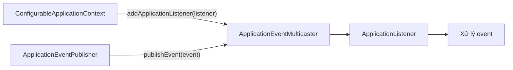

# Đăng ký listener trực tiếp với ApplicationContext trong Spring Framework

Spring cho phép đăng ký một đối tượng xử lý event trực tiếp vào application context bằng API **addApplicationListener(...)**. Cách này hữu ích khi listener được tạo theo điều kiện lúc chạy, đến từ một module mở rộng, hoặc cần được thêm vào context bằng code thay vì khai báo như bean.

Có một chi tiết API quan trọng: **ApplicationContext** là interface dùng để truy cập bean, phát event và đọc tài nguyên; nó không khai báo phương thức **addApplicationListener**. Phương thức đăng ký nằm trên **ConfigurableApplicationContext**. Vì vậy, khi cần đăng ký listener theo cách này, hãy làm việc với context có kiểu **ConfigurableApplicationContext**.

Bài viết giải thích cách đăng ký listener trước và sau refresh, cách Spring phân phối event, khác biệt giữa listener được đăng ký trực tiếp và listener do Spring quản lý, cùng một ví dụ Java 17 chạy được.

## 1. ApplicationContext và ConfigurableApplicationContext

**ApplicationContext** là container trung tâm của Spring. Nó cung cấp khả năng tra cứu bean, quản lý quan hệ giữa các bean, truy cập message/resource và phát application event thông qua **ApplicationEventPublisher**.

**ConfigurableApplicationContext** mở rộng các khả năng quản trị vòng đời của context, bao gồm:

- Cấu hình environment và parent context.
- Thêm **BeanFactoryPostProcessor**.
- Đăng ký **ApplicationListener** bằng **addApplicationListener(...)**.
- Gọi **refresh()** để khởi tạo hoặc làm mới context.
- Đóng context bằng **close()**.

Vì thế, đoạn code sau không biên dịch nếu biến chỉ được khai báo theo interface **ApplicationContext**:

```java
ApplicationContext context = ...;

// ApplicationContext không khai báo addApplicationListener:
context.addApplicationListener(new AuditListener());
```

Hãy khai báo bằng interface có phương thức đó:

```java
ConfigurableApplicationContext context = ...;
context.addApplicationListener(new AuditListener());
```

Không phải mọi đối tượng có kiểu ApplicationContext đều cung cấp API cấu hình. Trong các ứng dụng Spring thông thường, implementation như **AnnotationConfigApplicationContext**, **GenericApplicationContext** hoặc **ClassPathXmlApplicationContext** đều là configurable context.

Nếu một thành phần chỉ cần tra cứu bean và phát event, nên phụ thuộc vào **ApplicationContext** hoặc **ApplicationEventPublisher**. Chỉ phụ thuộc vào **ConfigurableApplicationContext** khi thành phần thật sự cần điều khiển vòng đời hoặc đăng ký listener động.

## 2. addApplicationListener(...) làm gì?

Phương thức **ConfigurableApplicationContext.addApplicationListener(ApplicationListener<?>)** nhận một instance triển khai **ApplicationListener** và đăng ký instance đó để context chuyển các event phù hợp đến listener.

Luồng khái quát:



Trong quá trình refresh, Spring chuẩn bị event multicaster và đưa các listener đã đăng ký vào cơ chế dispatch. Khi publisher gọi **publishEvent(event)**, multicaster tìm listener phù hợp với kiểu event rồi gọi phương thức xử lý.

Listener đăng ký trực tiếp vẫn tham gia cơ chế phân phối event của Spring. Bạn không cần tự gọi phương thức listener và không cần giữ danh sách listener để duyệt thủ công.

Ví dụ API:

```java
ConfigurableApplicationContext context =
        new AnnotationConfigApplicationContext();

context.addApplicationListener(new AuditListener());
context.refresh();

context.publishEvent(new OrderCreatedEvent(
        context,
        "ORD-1001"
));
```

Trong ví dụ này, listener được đăng ký trước khi context refresh. Sau khi refresh hoàn tất, publisher phát event và listener có thể nhận event tương ứng.

## 3. ApplicationListener và kiểu event

Cách đăng ký trực tiếp thường dùng interface **ApplicationListener<E extends ApplicationEvent>**. Kiểu generic xác định loại event listener quan tâm.

Ví dụ event:

```java
public class OrderCreatedEvent extends ApplicationEvent {
    private final String orderId;

    public OrderCreatedEvent(Object source, String orderId) {
        super(source);
        this.orderId = orderId;
    }

    public String getOrderId() {
        return orderId;
    }
}
```

Listener:

```java
public class AuditListener
        implements ApplicationListener<OrderCreatedEvent> {

    @Override
    public void onApplicationEvent(OrderCreatedEvent event) {
        System.out.println(
                "Ghi nhận đơn hàng " + event.getOrderId()
        );
    }
}
```

Khi context nhận một **OrderCreatedEvent**, listener này được gọi. Một listener khai báo kiểu event khác sẽ không nhận event đó chỉ vì nó cũng được đăng ký trong cùng context.

Với **ApplicationListener**, kiểu event phải là một lớp kế thừa **ApplicationEvent**. Spring cũng hỗ trợ phát một object payload thông thường qua **publishEvent(Object)**; trong trường hợp đó Spring bọc payload bằng **PayloadApplicationEvent**. Nếu muốn xử lý trực tiếp POJO/record mà không tạo lớp kế thừa ApplicationEvent, phương thức **@EventListener** thường là lựa chọn thuận tiện hơn. Không khai báo **ApplicationListener<MyRecord>** cho một record không kế thừa ApplicationEvent vì generic bound của interface không cho phép kiểu đó.

## 4. Đăng ký trước hay sau refresh?

Thời điểm đăng ký ảnh hưởng đến những event mà listener có cơ hội nhận.

### Đăng ký trước refresh

```java
ConfigurableApplicationContext context =
        new AnnotationConfigApplicationContext();

context.addApplicationListener(new StartupListener());

context.refresh();
```

Đây là cách phù hợp khi listener cần quan sát các event trong quá trình khởi động context, ví dụ **ContextRefreshedEvent**. Listener đã được đăng ký trước khi Spring phát các event vòng đời tương ứng.

Nếu listener chỉ cần nhận custom event sau khi ứng dụng sẵn sàng, đăng ký trước refresh vẫn là một lựa chọn đơn giản và rõ ràng.

### Đăng ký sau refresh

```java
ConfigurableApplicationContext context =
        new AnnotationConfigApplicationContext(AppConfig.class);

// Context đã refresh trong constructor nhận cấu hình.
context.addApplicationListener(new RuntimeAuditListener());

context.publishEvent(new OrderCreatedEvent(
        context,
        "ORD-1002"
));
```

Đăng ký sau refresh cũng hợp lệ. Spring thêm listener vào event multicaster đang hoạt động, và listener sẽ nhận các event phù hợp được phát sau thời điểm đăng ký.

Listener không nhận lại các event đã phát trước khi nó được đăng ký. Application event là thông báo trong bộ nhớ, không phải lịch sử event để listener mới tự replay.

### Chọn thời điểm nào?

| Nhu cầu | Thời điểm phù hợp |
|---|---|
| Quan sát event khởi động hoặc refresh | Trước khi gọi refresh |
| Thêm listener theo feature flag hoặc plugin lúc chạy | Khi điều kiện được xác định; có thể sau refresh |
| Listener chỉ xử lý event nghiệp vụ sau khi ứng dụng sẵn sàng | Trước hoặc sau refresh, miễn là trước khi phát event cần nhận |
| Muốn xử lý lại event cũ | Cần cơ chế lưu trữ/replay riêng; addApplicationListener không làm việc này |

## 5. Ví dụ hoàn chỉnh với Java 17 và Spring Framework

Ví dụ tạo một context rỗng, đăng ký hai listener trực tiếp, refresh context rồi phát một event. Cả hai listener nhận cùng event nhưng thực hiện hai trách nhiệm khác nhau.

### 5.1. Cấu trúc dự án

```text
spring-context-programmatic-listener/
├── pom.xml
└── src/
    └── main/
        └── java/
            └── dev/
                └── example/
                    └── listener/
                        └── Application.java
```

### 5.2. Dependency Maven

```xml
<project xmlns="http://maven.apache.org/POM/4.0.0"
         xmlns:xsi="http://www.w3.org/2001/XMLSchema-instance"
         xsi:schemaLocation="http://maven.apache.org/POM/4.0.0 https://maven.apache.org/xsd/maven-4.0.0.xsd">
    <modelVersion>4.0.0</modelVersion>

    <groupId>dev.example</groupId>
    <artifactId>spring-context-programmatic-listener</artifactId>
    <version>1.0.0</version>

    <properties>
        <maven.compiler.release>17</maven.compiler.release>
        <project.build.sourceEncoding>UTF-8</project.build.sourceEncoding>
    </properties>

    <dependencies>
        <dependency>
            <groupId>org.springframework</groupId>
            <artifactId>spring-context</artifactId>
            <version>6.2.6</version>
        </dependency>
    </dependencies>

    <build>
        <plugins>
            <plugin>
                <groupId>org.apache.maven.plugins</groupId>
                <artifactId>maven-compiler-plugin</artifactId>
                <version>3.13.0</version>
                <configuration>
                    <release>17</release>
                </configuration>
            </plugin>
            <plugin>
                <groupId>org.codehaus.mojo</groupId>
                <artifactId>exec-maven-plugin</artifactId>
                <version>3.5.0</version>
                <configuration>
                    <mainClass>dev.example.listener.Application</mainClass>
                </configuration>
            </plugin>
        </plugins>
    </build>
</project>
```

### 5.3. Mã nguồn

Tạo file **src/main/java/dev/example/listener/Application.java**:

```java
package dev.example.listener;

import org.springframework.context.ApplicationEvent;
import org.springframework.context.ApplicationListener;
import org.springframework.context.ConfigurableApplicationContext;
import org.springframework.context.annotation.AnnotationConfigApplicationContext;

public class Application {

    public static void main(String[] args) {
        try (ConfigurableApplicationContext context =
                     new AnnotationConfigApplicationContext()) {

            // Đăng ký các listener trực tiếp với context.
            context.addApplicationListener(new AuditListener());
            context.addApplicationListener(new NotificationListener());

            // Hoàn tất khởi tạo context sau khi listener đã được đăng ký.
            context.refresh();

            // Phát một event; cả hai listener đều nhận được event này.
            context.publishEvent(
                    new OrderCreatedEvent(context, "ORD-1001", "C-200")
            );
        }
    }

    public static class OrderCreatedEvent extends ApplicationEvent {
        private final String orderId;
        private final String customerId;

        public OrderCreatedEvent(
                Object source,
                String orderId,
                String customerId
        ) {
            super(source);
            this.orderId = orderId;
            this.customerId = customerId;
        }

        public String getOrderId() {
            return orderId;
        }

        public String getCustomerId() {
            return customerId;
        }
    }

    public static class AuditListener
            implements ApplicationListener<OrderCreatedEvent> {

        @Override
        public void onApplicationEvent(OrderCreatedEvent event) {
            System.out.printf(
                    "Audit: ghi nhận đơn %s của khách %s%n",
                    event.getOrderId(),
                    event.getCustomerId()
            );
        }
    }

    public static class NotificationListener
            implements ApplicationListener<OrderCreatedEvent> {

        @Override
        public void onApplicationEvent(OrderCreatedEvent event) {
            System.out.printf(
                    "Notification: chuẩn bị xác nhận đơn %s%n",
                    event.getOrderId()
            );
        }
    }
}
```

### 5.4. Chạy chương trình

Mở terminal tại thư mục chứa **pom.xml** và chạy:

```bash
mvn -q compile exec:java
```

Stdout mong đợi:

```text
Audit: ghi nhận đơn ORD-1001 của khách C-200
Notification: chuẩn bị xác nhận đơn ORD-1001
```

Kết quả cho thấy publisher chỉ gọi **publishEvent** một lần. Spring chuyển cùng **OrderCreatedEvent** đến cả **AuditListener** và **NotificationListener**. Mỗi listener nhận cùng mã đơn hàng và mã khách hàng, sau đó thực hiện trách nhiệm riêng.

Hai listener trong ví dụ được đăng ký theo thứ tự cụ thể. Nếu thứ tự xử lý là yêu cầu nghiệp vụ, hãy khai báo thứ tự bằng **@Order** hoặc triển khai **Ordered** và kiểm tra cấu hình dispatch. Không nên dựa vào thứ tự đăng ký tình cờ như một hợp đồng nghiệp vụ lâu dài.

## 6. Listener đăng ký trực tiếp có được Spring quản lý không?

Đây là điểm cần phân biệt rõ.

Khi viết:

```java
context.addApplicationListener(new AuditListener());
```

bạn tự tạo đối tượng bằng **new**. Context nhận instance đó và sử dụng nó để dispatch event, nhưng instance này không tự động trở thành một bean được tạo và quản lý đầy đủ bởi bean factory.

Vì vậy, listener được đăng ký trực tiếp theo cách trên không tự động có:

- Dependency injection trên các field hoặc constructor mà Spring không gọi.
- AOP proxy cho các annotation như **@Transactional** hoặc **@Async** đặt trên listener.
- Các callback vòng đời bean như **@PostConstruct** và **@PreDestroy** do bean factory quản lý.
- Scope và lifecycle theo quy tắc bean của Spring.

Nếu listener cần dependency, có thể truyền dependency qua constructor khi tự tạo instance:

```java
AuditListener listener = new AuditListener(
        context.getBean(AuditService.class)
);
context.addApplicationListener(listener);
```

Cách này cho phép dùng một service do Spring quản lý, nhưng bản thân listener vẫn là đối tượng được tạo thủ công. Các cơ chế áp dụng lên chính listener như AOP hoặc lifecycle callback vẫn cần được cân nhắc riêng.

Nếu listener cần được Spring quản lý đầy đủ, thường nên khai báo nó thành bean. Một bean triển khai **ApplicationListener** có thể được ApplicationContext tự phát hiện và đăng ký trong quá trình refresh:

```java
@Component
public class AuditListener
        implements ApplicationListener<OrderCreatedEvent> {

    private final AuditService auditService;

    public AuditListener(AuditService auditService) {
        this.auditService = auditService;
    }

    @Override
    public void onApplicationEvent(OrderCreatedEvent event) {
        auditService.record(event.getOrderId());
    }
}
```

Trong trường hợp này, cần có component scan bao phủ package của listener hoặc khai báo bean bằng **@Bean**. Không nên vừa để Spring tự phát hiện một listener bean, vừa đăng ký thêm một instance khác cho cùng mục đích; nếu cả hai cùng nhận event, nghiệp vụ có thể bị thực hiện hai lần.

## 7. Khi nào nên đăng ký listener trực tiếp?

Đăng ký trực tiếp phù hợp khi cấu hình listener mang tính động hoặc phụ thuộc vào điều kiện lúc chạy.

### Plugin hoặc extension

Một ứng dụng có thể tải module mở rộng tùy theo cấu hình. Khi module được bật, ứng dụng tạo listener tương ứng và thêm vào context. Module không cần khai báo một bean cố định trong component scan của ứng dụng chính.

### Feature flag

Một listener có thể chỉ hoạt động khi tính năng được bật. Ứng dụng kiểm tra cấu hình rồi đăng ký listener:

```java
if (featureFlags.isAuditEnabled()) {
    context.addApplicationListener(new AuditListener());
}
```

Trong ví dụ thực tế, biến context phải là **ConfigurableApplicationContext**, và việc đăng ký cần diễn ra trước khi event cần xử lý được phát.

### Listener do thư viện bên ngoài cung cấp

Một thư viện có thể tạo một đối tượng triển khai **ApplicationListener** và yêu cầu ứng dụng đăng ký nó. API programmatic cho phép tích hợp mà không phải sửa class listener hoặc tạo annotation riêng.

### Cấu hình theo môi trường

Ứng dụng có thể đăng ký listener khác nhau tùy môi trường, tenant hoặc cấu hình khởi tạo. Cần giới hạn phạm vi context và vòng đời listener để tránh đăng ký trùng hoặc giữ lại listener không còn được sử dụng.

## 8. Khi nào nên dùng bean thay vì đăng ký trực tiếp?

Nếu listener là một phần cố định của ứng dụng và cần dependency injection, transaction, async hoặc các cơ chế bean lifecycle, khai báo listener thành bean thường rõ ràng hơn.

| Yêu cầu | Cách phù hợp |
|---|---|
| Listener cố định trong ứng dụng | Bean với **@Component** hoặc **@Bean** |
| Listener cần constructor injection từ Spring | Bean Spring |
| Listener cần AOP, **@Transactional**, **@Async** | Bean được Spring quản lý và proxy phù hợp |
| Listener được tạo theo plugin hoặc feature flag | Đăng ký programmatic với **ConfigurableApplicationContext** |
| Listener là instance do thư viện ngoài cung cấp | Đăng ký programmatic |
| Chỉ cần xử lý POJO event bằng method | Bean có **@EventListener** |

Không nên dùng API đăng ký trực tiếp chỉ vì nó ngắn hơn. Hãy chọn theo cách tạo instance và vòng đời mà ứng dụng cần.

## 9. Event multicaster và khả năng tùy biến

**ApplicationEventMulticaster** là thành phần thực hiện việc phân phối event tới listener. Mặc định, Spring dùng **SimpleApplicationEventMulticaster** trong application context.

Khi gọi **ConfigurableApplicationContext.addApplicationListener(...)**, context quản lý listener và chuyển nó tới multicaster trong quá trình refresh hoặc khi multicaster đã sẵn sàng.

Trong một ứng dụng cần tùy biến sâu hơn, có thể khai báo bean tên **applicationEventMulticaster** để thay đổi cơ chế dispatch, chẳng hạn cấu hình **TaskExecutor** hoặc **ErrorHandler**. Đây là cấu hình ở cấp context, nên cần đánh giá tác động đến tất cả listener sử dụng multicaster đó.

Đăng ký listener trực tiếp không tự làm event bất đồng bộ. Với multicaster mặc định, listener được gọi đồng bộ trong luồng phát event. Nếu dùng executor, cần hiểu rằng publisher có thể không chờ listener hoàn tất và lỗi trong tác vụ async không nhất thiết được trả về nơi gọi **publishEvent**.

Không nên tạo một event multicaster riêng cho mỗi listener nếu không có yêu cầu cách ly rõ ràng. Việc tùy biến multicaster ảnh hưởng đến thứ tự, thread, xử lý ngoại lệ và hành vi của toàn bộ event trong context.

## 10. Lỗi thường gặp

| Hiện tượng | Nguyên nhân | Cách xử lý |
|---|---|---|
| Không biên dịch khi gọi addApplicationListener | Biến được khai báo kiểu **ApplicationContext** | Dùng **ConfigurableApplicationContext** |
| Listener không nhận event | Listener chưa được đăng ký hoặc kiểu event không tương thích | Kiểm tra lời gọi addApplicationListener và generic type |
| Listener bỏ lỡ event khởi động | Listener được đăng ký sau khi event đã phát | Đăng ký trước refresh nếu cần nhận startup event |
| Listener không nhận lại event cũ | Application event không phải event log có replay | Dùng cơ chế lưu trữ và phát lại riêng |
| Dependency trong listener bị null | Instance được tạo bằng **new**, không qua bean factory | Truyền dependency qua constructor hoặc dùng bean Spring |
| **@Transactional** trên listener không có tác dụng như mong đợi | Listener instance không được Spring proxy | Đăng ký listener như bean và kiểm tra transaction proxy |
| Một nghiệp vụ chạy hai lần | Listener vừa tự động được phát hiện như bean, vừa được đăng ký thêm instance | Chọn một cách đăng ký và tránh trùng instance/chức năng |
| Listener chạy chậm làm publisher chậm | Multicaster mặc định gọi đồng bộ | Đánh giá executor hoặc chuyển xử lý nặng sang cơ chế messaging |

## 11. Checklist khi đăng ký listener trực tiếp

- Biến context có kiểu **ConfigurableApplicationContext**.
- Listener triển khai **ApplicationListener** với kiểu event phù hợp.
- Event tùy chỉnh kế thừa **ApplicationEvent** khi dùng ApplicationListener.
- Listener được đăng ký trước khi event cần nhận được phát.
- Nếu cần nhận event trong quá trình refresh, listener được thêm trước khi gọi **refresh()**.
- Nếu listener được tạo bằng **new**, dependency và vòng đời của nó được quản lý có chủ đích.
- Không đăng ký trùng một listener đã được Spring tự động phát hiện.
- Không giả định đăng ký listener sẽ tự bật async, transaction hoặc replay.
- Chọn bean Spring khi listener cần đầy đủ dependency injection, AOP và lifecycle.

Đăng ký listener trực tiếp là một API hữu ích để mở rộng event handling theo điều kiện lúc chạy. Hãy nhớ rằng phương thức nằm trên **ConfigurableApplicationContext**, listener cần được đăng ký trước khi event phát sinh, và instance tạo thủ công không tự trở thành bean được Spring quản lý. Khi nắm rõ ba điểm này, bạn có thể chọn đúng giữa đăng ký programmatic và khai báo listener thành bean.
