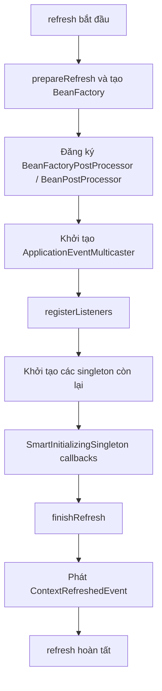

# Listener được phát hiện ở thời điểm nào

Spring không chờ đến lần đầu `publishEvent` mới tìm listener. ApplicationContext chuẩn bị và đăng ký listener trong quá trình `refresh()`, nhưng mỗi kiểu listener được xử lý ở một giai đoạn khác nhau. `ApplicationListener` được đăng ký sớm trong bước `registerListeners()`, còn các phương thức `@EventListener` được chuyển thành listener adapter ở cuối giai đoạn khởi tạo singleton. Vì vậy, thời điểm phát event trong lúc ứng dụng khởi động có thể quyết định listener nào đã sẵn sàng nhận event.

## 1. Nhìn nhanh vòng đời refresh

Với `AbstractApplicationContext`, luồng refresh chính có thể tóm tắt như sau:



Trong trình tự này, `registerListeners()` xảy ra trước khi Spring khởi tạo tất cả singleton còn lại. `finishRefresh()` xảy ra sau giai đoạn khởi tạo singleton và phát `ContextRefreshedEvent` ở bước cuối. Đây là mốc quan trọng để hiểu vì sao một listener đã nhận được sự kiện refresh, trong khi một event được phát rất sớm có thể đến trước lúc một số adapter listener được đăng ký.

## 2. Hai cơ chế phát hiện listener có thời điểm khác nhau

### `ApplicationListener<E>`: đăng ký trong `registerListeners()`

Với listener triển khai interface `ApplicationListener`, `AbstractApplicationContext.registerListeners()` thực hiện hai việc chính:

- Đăng ký các listener được thêm trực tiếp vào context, ví dụ qua `addApplicationListener(...)`.
- Tìm các bean name có kiểu `ApplicationListener` và đăng ký bean name đó với `ApplicationEventMulticaster`.

Đăng ký bean name giúp Spring chưa cần khởi tạo mọi listener ngay tại bước này. Multicaster có thể lấy bean khi cần dispatch event. Sau đó, `ApplicationListenerDetector` — một `BeanPostProcessor` được context cài đặt sớm — còn phát hiện các instance `ApplicationListener` sau khi bean khởi tạo, bao gồm những trường hợp không thể phát hiện đầy đủ chỉ bằng việc tra bean name.

Ví dụ:

```java
@Component
public class StartupListener
        implements ApplicationListener<ContextRefreshedEvent> {

    @Override
    public void onApplicationEvent(ContextRefreshedEvent event) {
        System.out.println("ApplicationListener: context refreshed");
    }
}
```

Bean triển khai interface được nhận diện trong quy trình đăng ký listener của context. Kiểu generic `ApplicationListener<ContextRefreshedEvent>` cũng giúp Spring lọc event phù hợp khi dispatch.

### `@EventListener`: đăng ký adapter sau khi singleton được khởi tạo

Phương thức `@EventListener` không được thêm trực tiếp vào multicaster chỉ bằng việc đọc annotation trên bean definition. Spring dùng `EventListenerMethodProcessor` để tìm các phương thức có annotation và tạo `ApplicationListener` adapter tương ứng.

`EventListenerMethodProcessor` là một `BeanFactoryPostProcessor` và `SmartInitializingSingleton`. Phần xử lý annotation được thực hiện trong callback `afterSingletonsInstantiated()`, tức ở cuối giai đoạn khởi tạo các singleton thông thường. Callback này chạy trước `finishRefresh()` và trước khi context phát `ContextRefreshedEvent`.

Ví dụ:

```java
@Component
public class OrderEventListener {

    @EventListener
    public void onOrderPlaced(OrderPlacedEvent event) {
        System.out.println("Order received: " + event.orderId());
    }
}
```

Spring đăng ký adapter cho phương thức `onOrderPlaced` khi `EventListenerMethodProcessor` xử lý bean. Từ thời điểm adapter được thêm vào context, event phù hợp mới được dispatch đến phương thức đó.

### Bảng so sánh thời điểm

| Cơ chế | Thành phần phát hiện | Thời điểm đăng ký chính |
|---|---|---|
| `ApplicationListener<E>` là bean | `AbstractApplicationContext.registerListeners()` đăng ký bean name; `ApplicationListenerDetector` bổ sung phát hiện instance sau khởi tạo | Trong bước `registerListeners()` và trong quá trình bean được khởi tạo |
| `ApplicationListener<?>` thêm trực tiếp | `ConfigurableApplicationContext.addApplicationListener(...)` | Trước refresh: được đưa vào khi refresh; sau refresh: thêm trực tiếp vào multicaster đang hoạt động |
| Phương thức `@EventListener` | `EventListenerMethodProcessor` tạo listener adapter | `afterSingletonsInstantiated()`, ở cuối giai đoạn khởi tạo singleton |

Đây là mô tả quy trình triển khai của Spring Framework 6.2. Tên lớp nội bộ và thứ tự chi tiết có thể thay đổi giữa các phiên bản; hợp đồng công khai cần dựa vào API `ApplicationContext`, `ApplicationListener` và `@EventListener`.

## 3. `EventListenerMethodProcessor` được đăng ký từ đâu?

Với cấu hình Java, `AnnotationConfigApplicationContext` và hạ tầng annotation config đăng ký các processor cần thiết để xử lý annotation. Vì vậy `@EventListener` hoạt động trong ứng dụng cấu hình Java tiêu chuẩn mà không cần tự tạo `EventListenerMethodProcessor`.

Với XML, cần bật annotation processing bằng `<context:annotation-config/>` hoặc `<context:component-scan/>`. Component scan vừa tìm bean theo package, vừa bật hạ tầng annotation config tương ứng.

Ví dụ cấu hình Java tối giản:

```java
@Configuration
public class AppConfig {
    @Bean
    OrderEventListener orderEventListener() {
        return new OrderEventListener();
    }
}
```

Bean được khai báo bằng `@Bean` vẫn được `EventListenerMethodProcessor` kiểm tra. Không cần đặt `@Component` nếu bean đã được đăng ký bằng cấu hình.

## 4. Vì sao event phát quá sớm có thể bị bỏ lỡ?

Thời điểm listener được đăng ký tạo ra một khoảng khác biệt giữa hai cơ chế:

- `ApplicationListener` bean name được đăng ký trong `registerListeners()`.
- Adapter cho `@EventListener` được đăng ký sau khi các singleton thông thường đã được khởi tạo, trong `afterSingletonsInstantiated()`.

Do đó, event phát trong giai đoạn khởi tạo sớm — ví dụ từ constructor, `@PostConstruct`, một `BeanFactoryPostProcessor` hoặc logic `onRefresh()` — có thể xảy ra trước khi adapter `@EventListener` được thêm vào multicaster. Không nên giả định listener annotation đã sẵn sàng ngay khi bean factory vừa bắt đầu tạo bean.

`AbstractApplicationContext` có cơ chế giữ các event được publish rất sớm trước khi event multicaster sẵn sàng, rồi phát lại chúng trong quá trình `registerListeners()`. Tuy nhiên, việc giữ event sớm không đồng nghĩa mọi listener tương lai sẽ nhận được event: adapter `@EventListener` có thể vẫn chưa được đăng ký tại thời điểm các early event được dispatch.

Đối với event nghiệp vụ, cách an toàn thường là publish sau khi context đã refresh và các thành phần ứng dụng đã sẵn sàng. Nếu một thành phần thật sự cần nhận sự kiện bootstrap rất sớm, hãy chọn cơ chế đăng ký sớm phù hợp và kiểm tra rõ thứ tự khởi tạo.

## 5. `ContextRefreshedEvent` được phát khi nào?

`ContextRefreshedEvent` được phát trong `finishRefresh()`, sau khi Spring hoàn tất việc khởi tạo các singleton còn lại. Vì `EventListenerMethodProcessor.afterSingletonsInstantiated()` đã chạy trước đó, các phương thức `@EventListener` thông thường đã được đăng ký trước khi `ContextRefreshedEvent` được phát.

Đây là lý do listener có thể dùng `ContextRefreshedEvent` để chạy công việc sau khi context đã refresh:

```java
@Component
public class StartupTasks {

    @EventListener
    public void onContextRefreshed(ContextRefreshedEvent event) {
        System.out.println("Application context is ready");
    }
}
```

Không nên nhầm `ContextRefreshedEvent` với thời điểm mọi tác vụ của hệ thống đã hoàn tất. Nó báo rằng ApplicationContext đã hoàn thành refresh. Các tác vụ chạy nền, kết nối từ xa hoặc quy trình readiness riêng của ứng dụng có thể vẫn còn đang tiếp tục.

## 6. Đăng ký listener trước và sau `refresh()`

Với `ConfigurableApplicationContext`, có thể thêm listener trực tiếp bằng `addApplicationListener(...)`.

**Trước refresh:** listener được giữ trong danh sách listener tĩnh của context và được đưa vào multicaster trong `registerListeners()`.

```java
var context = new AnnotationConfigApplicationContext();
context.addApplicationListener(
        (ContextRefreshedEvent event) ->
                System.out.println("Registered before refresh"));
context.register(AppConfig.class);
context.refresh();
context.close();
```

**Sau refresh:** nếu context đã active, listener được thêm trực tiếp vào multicaster hiện tại và có thể nhận các event phát sau thời điểm đăng ký. Nó không nhận lại các event đã phát trước đó.

```java
var context = new AnnotationConfigApplicationContext(AppConfig.class);
context.addApplicationListener(
        (OrderPlacedEvent event) ->
                System.out.println("Late listener: " + event.orderId()));
context.publishEvent(new OrderPlacedEvent("ORD-7101"));
context.close();
```

API `removeApplicationListener(...)` có thể gỡ listener đã đăng ký trực tiếp. Việc thêm hoặc gỡ listener sau refresh không phải thao tác replay event lịch sử.

## 7. Bean lazy và scope ảnh hưởng ra sao?

Không nên đánh đồng thời điểm phát hiện bean với thời điểm bean được khởi tạo. Với `ApplicationListener` bean, context có thể đăng ký bean name trong `registerListeners()` trước khi tạo instance; instance được lấy khi cần dispatch. `ApplicationListenerDetector` xử lý thêm các instance listener được phát hiện sau khởi tạo.

Với `@EventListener`, processor phải tìm phương thức trên bean và tạo adapter tham chiếu đến bean đó. Việc tạo adapter thuộc giai đoạn `afterSingletonsInstantiated()`. Bean có scope đặc biệt, scoped proxy hoặc cấu hình lazy cần được kiểm tra theo đúng cách đăng ký và lifecycle của scope; không giả định mọi bean scope hoạt động như singleton thông thường.

Trong ứng dụng web, request-scoped listener thường không phải lựa chọn phù hợp cho event ứng dụng toàn cục. Listener singleton nhận event rồi gọi service có scope phù hợp thường dễ kiểm soát vòng đời hơn. Nếu cần listener sống theo một scope đặc biệt, hãy xác minh rõ proxy, target bean và thời điểm scope đang hoạt động.

## 8. Thứ tự listener và thời điểm đăng ký

`@Order` sắp xếp thứ tự gọi giữa các listener đã được đăng ký và cùng phù hợp với event. Nó không làm listener được phát hiện sớm hơn trong quá trình refresh.

```java
@Component
public class OrderedListeners {
    @EventListener
    @Order(1)
    public void first(OrderPlacedEvent event) {
        System.out.println("First");
    }

    @EventListener
    @Order(2)
    public void second(OrderPlacedEvent event) {
        System.out.println("Second");
    }
}
```

Đối với listener bất đồng bộ, `@Order` không đảm bảo thứ tự hoàn tất công việc trên các thread khác nhau. Nếu bước sau phụ thuộc kết quả bước trước, hãy điều phối bằng service hoặc workflow rõ ràng.

## 9. Ví dụ hoàn chỉnh: quan sát listener trước và sau refresh

Ví dụ dùng Java 17 và Spring Framework 6.2.0. `OrderEventListener` có một phương thức nghe `ContextRefreshedEvent` và một phương thức nghe event nghiệp vụ. Ví dụ cho thấy listener annotation đã được đăng ký trước khi constructor `AnnotationConfigApplicationContext` trả về.

### Cấu trúc thư mục

```text
listener-discovery-time/
├── pom.xml
└── src/
    └── main/
        └── java/
            └── demo/
                └── ListenerDiscoveryTimeDemo.java
```

### pom.xml

```xml
<project xmlns="http://maven.apache.org/POM/4.0.0"
         xmlns:xsi="http://www.w3.org/2001/XMLSchema-instance"
         xsi:schemaLocation="http://maven.apache.org/POM/4.0.0 https://maven.apache.org/xsd/maven-4.0.0.xsd">
    <modelVersion>4.0.0</modelVersion>
    <groupId>demo</groupId>
    <artifactId>listener-discovery-time</artifactId>
    <version>1.0.0</version>
    <properties>
        <maven.compiler.release>17</maven.compiler.release>
        <project.build.sourceEncoding>UTF-8</project.build.sourceEncoding>
    </properties>
    <dependencies>
        <dependency>
            <groupId>org.springframework</groupId>
            <artifactId>spring-context</artifactId>
            <version>6.2.0</version>
        </dependency>
    </dependencies>
    <build>
        <plugins>
            <plugin>
                <groupId>org.apache.maven.plugins</groupId>
                <artifactId>maven-compiler-plugin</artifactId>
                <version>3.13.0</version>
            </plugin>
            <plugin>
                <groupId>org.codehaus.mojo</groupId>
                <artifactId>exec-maven-plugin</artifactId>
                <version>3.3.0</version>
            </plugin>
        </plugins>
    </build>
</project>
```

### src/main/java/demo/ListenerDiscoveryTimeDemo.java

```java
package demo;

import org.springframework.context.ApplicationEventPublisher;
import org.springframework.context.event.ContextRefreshedEvent;
import org.springframework.context.annotation.AnnotationConfigApplicationContext;
import org.springframework.context.annotation.Bean;
import org.springframework.context.annotation.Configuration;
import org.springframework.context.event.EventListener;

public class ListenerDiscoveryTimeDemo {

    public record OrderPlacedEvent(String orderId) {
    }

    public static class OrderEventListener {
        @EventListener
        public void onContextRefreshed(ContextRefreshedEvent event) {
            System.out.println("Listener: ContextRefreshedEvent received");
        }

        @EventListener
        public void onOrderPlaced(OrderPlacedEvent event) {
            System.out.println(
                    "Listener: OrderPlacedEvent received: " + event.orderId());
        }
    }

    public static class OrderPublisher {
        private final ApplicationEventPublisher publisher;

        public OrderPublisher(ApplicationEventPublisher publisher) {
            this.publisher = publisher;
        }

        public void publish(String orderId) {
            publisher.publishEvent(new OrderPlacedEvent(orderId));
        }
    }

    @Configuration(proxyBeanMethods = false)
    public static class AppConfig {
        @Bean
        OrderEventListener orderEventListener() {
            return new OrderEventListener();
        }

        @Bean
        OrderPublisher orderPublisher(ApplicationEventPublisher publisher) {
            return new OrderPublisher(publisher);
        }
    }

    public static void main(String[] args) {
        try (var context =
                     new AnnotationConfigApplicationContext(AppConfig.class)) {
            System.out.println("Main: context refresh returned");
            context.getBean(OrderPublisher.class).publish("ORD-7101");
        }
    }
}
```

### Chạy chương trình

Tại thư mục `listener-discovery-time/`, chạy:

```bash
mvn -q compile exec:java -Dexec.mainClass=demo.ListenerDiscoveryTimeDemo
```

Stdout mong đợi:

```text
Listener: ContextRefreshedEvent received
Main: context refresh returned
Listener: OrderPlacedEvent received: ORD-7101
```

### Đọc kết quả

1. Spring tạo ApplicationContext và chạy `refresh()`.
2. Trong giai đoạn khởi tạo singleton, `EventListenerMethodProcessor.afterSingletonsInstantiated()` đăng ký adapter cho hai phương thức `@EventListener`.
3. `finishRefresh()` phát `ContextRefreshedEvent`; listener đã đăng ký nên nhận event này.
4. Constructor context trả về và chương trình in `Main: context refresh returned`.
5. Publisher phát `OrderPlacedEvent`; listener nghiệp vụ nhận event sau khi context đã sẵn sàng.

Ví dụ không cố phát event nghiệp vụ từ constructor hoặc `@PostConstruct`, vì đó là thời điểm có thể xảy ra trước khi adapter `@EventListener` được đăng ký.

## 10. Những lỗi thường gặp khi kiểm tra thời điểm phát hiện

| Triệu chứng | Nguyên nhân có thể | Hướng xử lý |
|---|---|---|
| `@EventListener` không nhận event phát trong lúc khởi động | Event được publish trước `afterSingletonsInstantiated()` | Chuyển publish đến sau refresh hoặc chọn cơ chế đăng ký sớm phù hợp |
| `ApplicationListener` nhận event sớm nhưng `@EventListener` không nhận | Hai cơ chế đăng ký listener ở hai giai đoạn khác nhau | Kiểm tra thời điểm `registerListeners()` và `EventListenerMethodProcessor` chạy |
| Không nhận `ContextRefreshedEvent` | Annotation processing chưa bật, bean chưa được đăng ký hoặc listener không thuộc context đó | Kiểm tra Java config/XML annotation config và bean registration |
| Listener mới thêm sau refresh không nhận event cũ | Listener chỉ được thêm cho các event tương lai | Nếu cần replay, xây dựng cơ chế lưu và phát lại riêng |
| Listener bị gọi nhiều lần | Cùng listener được đăng ký nhiều lần hoặc bean xuất hiện trong nhiều context | Kiểm tra component scan, cấu hình và context hierarchy |
| Event bị phát trước khi listener sẵn sàng | Publish trong constructor, `@PostConstruct` hoặc callback khởi tạo sớm | Tránh phát business event trong giai đoạn bootstrap sớm |

## 11. Checklist debug theo lifecycle

- [ ] Xác định listener dùng `ApplicationListener<E>` hay `@EventListener`.
- [ ] Xác định listener là bean, listener đăng ký trực tiếp hay adapter của annotation.
- [ ] Xác định context đang thực hiện `refresh()` và thời điểm event được publish.
- [ ] Với `ApplicationListener`, kiểm tra `registerListeners()` và việc đăng ký bean name.
- [ ] Với `@EventListener`, kiểm tra `EventListenerMethodProcessor` và callback `afterSingletonsInstantiated()`.
- [ ] Xác nhận `ContextRefreshedEvent` chỉ được phát sau giai đoạn khởi tạo singleton.
- [ ] Kiểm tra component scan hoặc annotation config đã bật processor.
- [ ] Kiểm tra lazy initialization, scoped proxy và parent–child context khi ứng dụng dùng các cấu hình này.
- [ ] Không dựa vào `@Order` để giải quyết vấn đề listener chưa được đăng ký.

## 12. Ghi nhớ

`ApplicationListener` được context đăng ký sớm trong `registerListeners()`; các phương thức `@EventListener` được `EventListenerMethodProcessor` chuyển thành adapter ở cuối giai đoạn khởi tạo singleton. Sau đó `finishRefresh()` phát `ContextRefreshedEvent`. Vì vậy, event phát quá sớm trong quá trình bootstrap có thể đến trước khi listener annotation sẵn sàng. Khi cần xử lý sau khi ứng dụng khởi động, `ContextRefreshedEvent` là một mốc phù hợp; với nghiệp vụ thông thường, hãy publish sau khi context đã refresh.

## Tài liệu tham khảo

- [AbstractApplicationContext — Spring Framework 6.2](https://docs.spring.io/spring-framework/docs/6.2.8/javadoc-api/org/springframework/context/support/AbstractApplicationContext.html)
- [EventListenerMethodProcessor — Spring Framework 6.2](https://docs.spring.io/spring-framework/docs/6.2.8/javadoc-api/org/springframework/context/event/EventListenerMethodProcessor.html)
- [SmartInitializingSingleton — Spring Framework 6.2](https://docs.spring.io/spring-framework/docs/6.2.7/javadoc-api/org/springframework/beans/factory/SmartInitializingSingleton.html)
- [ApplicationListener — Spring Framework 6.2](https://docs.spring.io/spring-framework/docs/6.2.0/javadoc-api/org/springframework/context/ApplicationListener.html)
- [ConfigurableApplicationContext — Spring Framework 6.2](https://docs.spring.io/spring-framework/docs/6.2.18/javadoc-api/org/springframework/context/ConfigurableApplicationContext.html)
