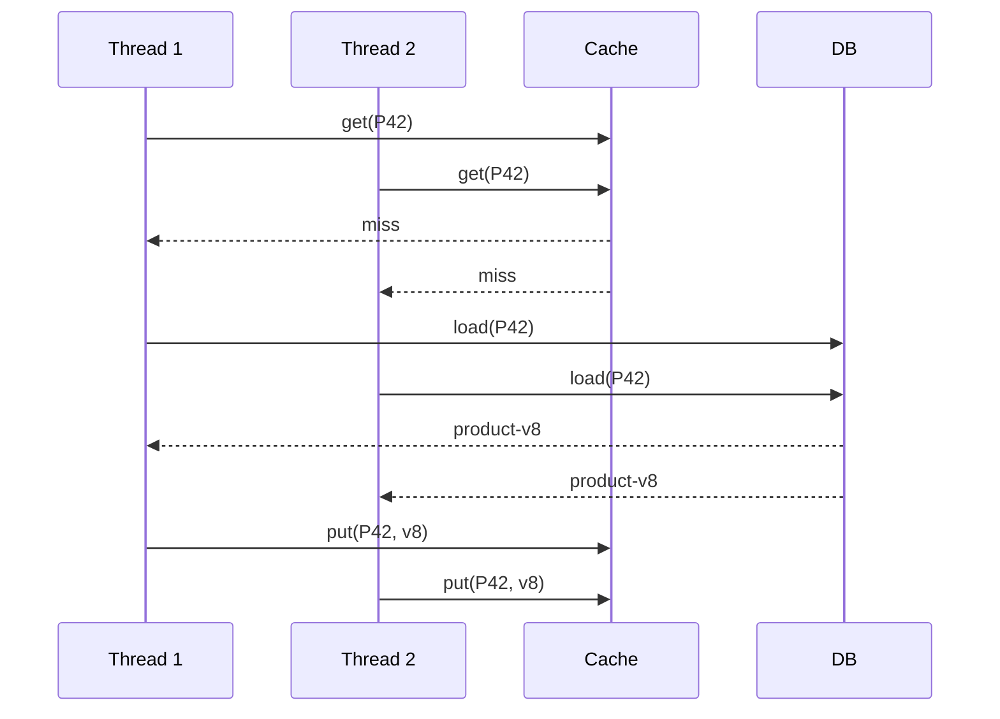
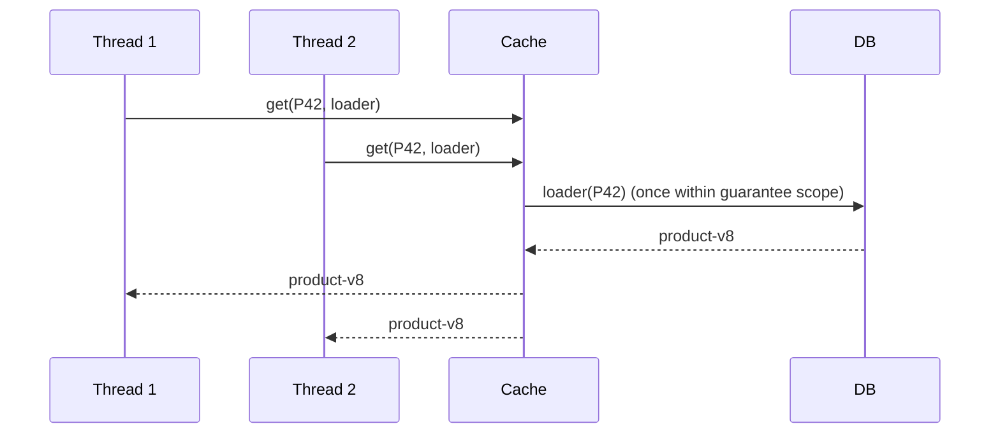

# Cache Load Spike When a Popular Key Expires (Cache Stampede) in Spring Cache

> **Topic:** Spring Framework – Cache · **Group:** Concurrency.  
> This lesson focuses on the phenomenon where **many concurrent requests reload a hot key that has just expired**, how `@Cacheable(sync = true)` handles it within the cache provider's support scope, the risks when running multiple instances, and techniques to reduce origin load without sacrificing correctness.

## 1. Real-world problem: a hot key expires and a crowd of requests miss together

A cache key is called a **hot key** when its traffic is far higher than that of other keys. For instance, product page `P42` receives hundreds of requests per second, while other products are rarely accessed. Caching the product page reduces database queries, yet when entry `P42` reaches its TTL, requests arriving at almost the same time can all receive a **cache miss**.

With standard loading, every missing request may execute the expensive method and write the result back to the cache. This is a **cache stampede** (also called *thundering herd* or *cache breakdown* when emphasizing a single hot key): many workers do the same work simultaneously, causing sudden load spikes on the database, downstream APIs, or CPU.

Scenario:

```text
Before TTL:
Client 1 ─┐
Client 2 ─┼──> cache["P42"] = product-v7 ──> return immediately (hit)
Client N ─┘

Right after TTL:
Client 1 ──> miss ──> query DB ─┐
Client 2 ──> miss ──> query DB ─┼──> load P42 together
Client 3 ──> miss ──> query DB ─┤
Client N ──> miss ──> query DB ─┘
```

**Main risk:** multiple concurrent requests reading the same record add no value to the result, yet they increase latency, exhaust connection pools, trigger timeouts, and induce retry waves that prolong the incident.

### Distinguishing similar phenomena

| Phenomenon | Characteristics | Preferred remediation |
|---|---|---|
| **Hot-key stampede** | Many requests miss **one key** together after expiry/eviction | Single-flight or per-key loader sync, early refresh, stale-while-revalidate |
| **Mass expiry / avalanche** | Many **different keys** expire close together | TTL jitter, staggered warmup schedules, origin load limits |
| **Cache penetration** | Repeated requests for nonexistent or uncacheable keys | Appropriate negative caching, validation, blocking invalid inputs |
| **Cold start / deployment** | Cache is not warmed on startup or node replacement | Hot-key warmup, gradual rollout, concurrency limits |
| **Backend outage** | Cache server disconnects, sending many requests down to the DB | Circuit breaker, bulkhead, load shedding, controlled fallback |

A system can suffer multiple phenomena at once. For example, a Redis failure causes all keys to miss; among them, a few hot keys amplify the stampede even harder.

## 2. Why do cache misses happen concurrently?

Consider a Spring service:

```java
@Cacheable(cacheNames = "products", key = "#p0")
public Product findProduct(String id) {
    return repository.findById(id).orElseThrow();
}
```

This is an **illustrative method** inside a Spring-managed service that already has `Product` and `repository`.

By default, the Spring Cache abstraction **does not lock every call**. A miss consists of three logical actions: read cache -> invoke real method -> write cache. If multiple threads check before the entry has been populated, all of them can proceed to the real method.



**Longer load duration increases the risk.** If a hot key has an arrival rate of `R` requests/second and the loader takes `L` seconds, the number of overlapping requests during the initial miss window is roughly `R × L` (this is merely an intuitive approximation for fairly steady arrivals, not a guarantee or production measurement formula). For instance, 600 requests/second and a 0.2-second load time can produce around 120 requests hitting the miss window before a single request finishes loading.

Do not look only at the average hit rate: a cache can hit 99.9% of the time and still trigger a brief spike that overwhelms the DB the moment a hot key expires.

## 3. Spring's direct solution: `@Cacheable(sync = true)`

Spring Framework supports the `sync` attribute on `@Cacheable`:

```java
@Cacheable(cacheNames = "products", key = "#p0", sync = true)
public Product findProduct(String id) {
    return repository.findById(id).orElseThrow();
}
```

On the cacheable branch, Spring uses cache retrieval with a value loader, corresponding to the API:

```java
<T> T Cache.get(Object key, Callable<T> valueLoader)
```

The idea: when multiple calls for the same key miss, **the provider is asked to coordinate so the value loader runs only once**, while remaining threads wait or share the result once produced. With a provider supporting atomic per-key loading, duplicate calls drop sharply.



### What `sync=true` does and does not do

**Can do, when supported by the provider:**

- Reduce actual method executions for **the same key** during a concurrent cache miss burst.
- Preserve standard `@Cacheable` behavior once a cache hit is available.
- Allow independent keys to still load in parallel depending on provider characteristics.

**Does not do automatically:**

- Does not alter TTL or prevent entries from expiring.
- Does not extend lifetime or proactively refresh before expiry.
- Does not guarantee every request gets a fast response: threads waiting on the loader can experience **latency equal to the load duration**.
- Is not Java `synchronized` across the whole method, and is not automatically a distributed lock across multiple JVMs/pods.
- Does not replace circuit breakers, connection-pool limits, retry policies, or cache backend failure handling.
- Does not help requests where `condition=false`, because those calls bypass caching.
- Does not turn multiple cache names/managers into a multi-level cache.

**Important:** Spring describes `sync=true` as a **hint** to the cache provider. The `Cache.get(key, Callable)` documentation states implementations *should* ensure the loader is called once **if possible**. Inspect the provider and test in your real runtime environment.

## 4. Synchronization scope: one key, one instance, or multiple nodes?

### 4.1. Local cache inside a single JVM

With Spring's `ConcurrentMapCacheManager`, `ConcurrentMapCache` can coordinate loads within the cache instance's concurrent map structure. With Caffeine, `Cache.get(key, mappingFunction)` and loading caches provide atomic computation on the cache instance.

Within a single process where threads share the same cache instance, `sync=true` can stop 20 threads from executing the loader concurrently for key `P42`. However, if the app scales to **3 pods**, each holding a **separate local cache**, there can still be **3 loads** for `P42` (once per cache instance). Do not treat a successful local-map experiment as proof of cluster-wide synchronization.

### 4.2. Shared caches like Redis

Redis shares data across nodes, yet **shared storage does not automatically mean cross-node single-flight**. If all three pods observe a miss before the first pod writes the result, each pod can still query the database.

Spring Data Redis offers non-locking/locking `RedisCacheWriter` modes with distinct semantics. Current documentation indicates the non-locking writer is the default; the locking writer uses a **cache-level** lock rather than a per-entry key lock. That can create broader contention than one hot key and does not substitute for a full distributed single-flight design. Verify actual `Cache.get(key, Callable)` behavior, your Spring Data Redis version, lock TTLs, wait times, and error paths.

If strictly **one origin query for a hot key cluster-wide** is mandatory, consider a distributed coordinator layer with leases/timeouts and double-checking the cache after acquiring ownership. For write-bearing operations, consider fencing tokens or versions to stop a lease-expired owner from overwriting newer data. Do not slap distributed locks onto every read by habit; round-trip overhead and dead owners can make things worse.

### 4.3. Multi-level caching

If L1 is per-JVM Caffeine and L2 is shared Redis:

```text
Pod A ──> L1-A ──> L2 Redis ──> DB
Pod B ──> L1-B ──> L2 Redis ──> DB
Pod C ──> L1-C ──> L2 Redis ──> DB
```

A hot key expiring across multiple pods' L1 caches can shift a spike onto L2. If L2 has also expired, the spike can hit the DB directly. Clearly define where single-flight lives, where stale data may be kept, and how invalidation flows between tiers.

Do not configure `@Cacheable(cacheNames={"L1","L2"}, sync=true)` to solve multi-level caching: Spring synchronized caching restricts the operation to a single cache.

## 5. Runnable Java 17+ example: unsynced vs. sync

This standalone example uses **Java 17+**, **Maven**, and **Spring Framework 6.2.12**, without Spring Boot or Redis. Two local cache regions, `unsynced` and `synced`, are created fresh. To simulate *a hot key just expired*, the program explicitly puts and evicts an entry right before firing a burst of same-key requests. This **simulates expiration**, rather than configuring a real TTL.

In the unsynced branch, a `CyclicBarrier` inside the loader ensures all 8 threads enter the loader before any thread finishes; this exposes duplicate loading regardless of machine speed. In the `sync=true` branch, the loader includes a small delay and Spring Cache asks to synchronize key loading.

### 5.1. Structure

```text
spring-hot-key-stampede/
├── pom.xml
└── src/main/java/dev/example/stampede/StampedeDemo.java
```

**`pom.xml`**

```xml
<?xml version="1.0" encoding="UTF-8"?>
<project xmlns="http://maven.apache.org/POM/4.0.0"
         xmlns:xsi="http://www.w3.org/2001/XMLSchema-instance"
         xsi:schemaLocation="http://maven.apache.org/POM/4.0.0 https://maven.apache.org/xsd/maven-4.0.0.xsd">
    <modelVersion>4.0.0</modelVersion>
    <groupId>dev.example</groupId>
    <artifactId>spring-hot-key-stampede</artifactId>
    <version>1.0.0</version>
    <properties>
        <maven.compiler.release>17</maven.compiler.release>
        <project.build.sourceEncoding>UTF-8</project.build.sourceEncoding>
    </properties>
    <dependencies>
        <dependency>
            <groupId>org.springframework</groupId>
            <artifactId>spring-context</artifactId>
            <version>6.2.12</version>
        </dependency>
    </dependencies>
    <build>
        <plugins>
            <plugin>
                <groupId>org.apache.maven.plugins</groupId>
                <artifactId>maven-compiler-plugin</artifactId>
                <version>3.13.0</version>
            </plugin>
            <plugin>
                <groupId>org.codehaus.mojo</groupId>
                <artifactId>exec-maven-plugin</artifactId>
                <version>3.3.0</version>
                <configuration>
                    <mainClass>dev.example.stampede.StampedeDemo</mainClass>
                </configuration>
            </plugin>
        </plugins>
    </build>
</project>
```

**`src/main/java/dev/example/stampede/StampedeDemo.java`**

```java
package dev.example.stampede;

import java.util.ArrayList;
import java.util.HashSet;
import java.util.List;
import java.util.Objects;
import java.util.Set;
import java.util.concurrent.CountDownLatch;
import java.util.concurrent.CyclicBarrier;
import java.util.concurrent.ExecutorService;
import java.util.concurrent.Executors;
import java.util.concurrent.Future;
import java.util.concurrent.TimeUnit;
import java.util.concurrent.atomic.AtomicInteger;
import java.util.function.Function;

import org.springframework.cache.Cache;
import org.springframework.cache.CacheManager;
import org.springframework.cache.annotation.Cacheable;
import org.springframework.cache.annotation.EnableCaching;
import org.springframework.cache.concurrent.ConcurrentMapCacheManager;
import org.springframework.context.annotation.AnnotationConfigApplicationContext;
import org.springframework.context.annotation.Bean;
import org.springframework.context.annotation.Configuration;

public class StampedeDemo {
    private static final int WORKERS = 8;

    public static void main(String[] args) throws Exception {
        try (AnnotationConfigApplicationContext context =
                new AnnotationConfigApplicationContext(AppConfig.class)) {
            HotService service = context.getBean(HotService.class);
            CacheManager manager = context.getBean(CacheManager.class);

            Cache plainCache =
                    Objects.requireNonNull(manager.getCache("unsynced"));
            Cache syncCache =
                    Objects.requireNonNull(manager.getCache("synced"));

            // Seed entry then evict: simulates the moment the hot key just expired.
            plainCache.put("HOT", "warm");
            plainCache.evict("HOT");

            syncCache.put("HOT", "warm");
            syncCache.evict("HOT");

            int plainDistinct = runBurst(service::loadPlain);
            System.out.println("plainDistinct=" + plainDistinct);
            System.out.println("plainLoads=" + service.plainLoadCount());

            int syncDistinct = runBurst(service::loadSynchronized);
            System.out.println("syncDistinct=" + syncDistinct);
            System.out.println("syncLoads=" + service.syncLoadCount());

            System.out.println("plainCached=" +
                    (plainCache.get("HOT") != null));
            System.out.println("syncCached=" +
                    (syncCache.get("HOT") != null));

            System.out.println("repeatSync=" +
                    service.loadSynchronized("HOT"));
            System.out.println("syncLoadsAfterHit=" +
                    service.syncLoadCount());

            System.out.println("otherKey=" +
                    service.loadSynchronized("COLD"));
            System.out.println("syncLoadsAfterOtherKey=" +
                    service.syncLoadCount());
        }
    }

    private static int runBurst(Function<String, String> action)
            throws Exception {
        ExecutorService pool = Executors.newFixedThreadPool(WORKERS);
        CountDownLatch ready = new CountDownLatch(WORKERS);
        CountDownLatch start = new CountDownLatch(1);
        List<Future<String>> futures = new ArrayList<>();

        try {
            for (int i = 0; i < WORKERS; i++) {
                futures.add(pool.submit(() -> {
                    ready.countDown();
                    start.await();
                    return action.apply("HOT");
                }));
            }
            if (!ready.await(10, TimeUnit.SECONDS)) {
                throw new IllegalStateException("Workers not ready");
            }

            start.countDown();
            Set<String> results = new HashSet<>();
            for (Future<String> future : futures) {
                results.add(future.get(15, TimeUnit.SECONDS));
            }
            return results.size();
        } finally {
            start.countDown();
            pool.shutdownNow();
        }
    }

    @Configuration(proxyBeanMethods = false)
    @EnableCaching
    public static class AppConfig {
        @Bean
        public CacheManager cacheManager() {
            return new ConcurrentMapCacheManager("unsynced", "synced");
        }

        @Bean
        public HotService hotService() {
            return new HotService(WORKERS);
        }
    }

    public static class HotService {
        private final AtomicInteger plainLoads = new AtomicInteger();
        private final AtomicInteger syncLoads = new AtomicInteger();
        private final CyclicBarrier allPlainLoaders;

        public HotService(int parallelism) {
            this.allPlainLoaders = new CyclicBarrier(parallelism);
        }

        @Cacheable(cacheNames = "unsynced", key = "#p0")
        public String loadPlain(String key) {
            int count = plainLoads.incrementAndGet();
            try {
                // Ensure all 8 loaders have started before returning.
                allPlainLoaders.await(10, TimeUnit.SECONDS);
            } catch (Exception e) {
                throw new IllegalStateException("Plain load failed", e);
            }
            return "plain-" + key + "#" + count;
        }

        @Cacheable(cacheNames = "synced", key = "#p0", sync = true)
        public String loadSynchronized(String key) {
            int count = syncLoads.incrementAndGet();
            try {
                Thread.sleep(150);
            } catch (InterruptedException e) {
                Thread.currentThread().interrupt();
                throw new IllegalStateException("Interrupted", e);
            }
            return "synced-" + key + "#" + count;
        }

        public int plainLoadCount() {
            return plainLoads.get();
        }

        public int syncLoadCount() {
            return syncLoads.get();
        }
    }
}
```

**Run in the directory containing `pom.xml`:**

```bash
mvn -q compile exec:java
```

**Program stdout** with a freshly initialized context/cache (excluding auxiliary Maven logs):

```text
plainDistinct=8
plainLoads=8
syncDistinct=1
syncLoads=1
plainCached=true
syncCached=true
repeatSync=synced-HOT#1
syncLoadsAfterHit=1
otherKey=synced-COLD#2
syncLoadsAfterOtherKey=2
```

### 5.2. Interpreting the results

- Both caches were seeded and evicted before the burst, so the first 8 requests hit an **empty hot key**.
- On `unsynced`, all 8 threads enter the `loadPlain` body before any thread returns (via `CyclicBarrier`). Thus both the loader invocation count and distinct result count equal 8.
- On `synced`, Spring sends a coordinated load request to `ConcurrentMapCache`. One thread executes `loadSynchronized("HOT")`, and the remaining 7 threads receive the same result upon completion: `syncDistinct=1` and `syncLoads=1`.
- After the burst, both caches hold an entry, yet **having the cache populated afterward does not prove it was loaded only once**: you must observe loader invocation counts or downstream DB queries.
- Repeating `"HOT"` hits the cache, so `syncLoadsAfterHit` stays at 1.
- Key `"COLD"` differs from `"HOT"`, triggering a fresh load and setting `syncLoadsAfterOtherKey=2`.
- Results are reproducible assuming all workers start and do not hit the 10–15 second timeouts. Those timeouts are **demo safety bounds**, not production tuning numbers.

**Important note about the example:** `CyclicBarrier` is used solely to build a *controlled comparison*. Never copy this barrier into a production loader—it forces unnecessary waiting and can deadlock if fewer threads call concurrently. In real tests, count repository calls with metrics or mocks/spies in integration tests.

## 6. Prerequisites and constraints of `sync=true`

### 6.1. Valid configuration

```java
@Cacheable(
    cacheNames = "products",
    key = "#p0",
    condition = "#p0 != null && #p0.length() <= 32",
    sync = true)
public Product get(String id) {
    return repository.load(id);
}
```

This is a snippet from a service with a real repository. `condition` evaluates before the cache lookup and can be combined with `sync=true`. When `condition=false`, the method still executes but **skips the cache**, so caching provides no stampede protection for that call.

### 6.2. Three constraints of synchronized caching

Per `@Cacheable` Javadoc, with `sync=true`:

1. **`unless` is not supported** — you cannot veto caching based on `#result` after the loader runs.
2. **Only one cache is allowed** — do not declare multiple cache names for the operation or use a resolver returning multiple caches.
3. **No combining other cache operations on the same method** — do not combine `@CachePut`, `@CacheEvict`, or another `@Cacheable` into the synchronized operation.

Invalid:

```java
@Cacheable(cacheNames = "products",
           sync = true,
           unless = "#result == null")
public Product load(String id) {
    return repository.load(id);
}
```

Invalid:

```java
@Cacheable(cacheNames = {"productsL1", "productsL2"}, sync = true)
public Product load(String id) {
    return repository.load(id);
}
```

These two snippets are only for recognizing configuration errors; do not put them into the runnable demo. If you must skip caching null results, use `unless` **without `sync=true`**, or build a custom loader/single-flight mechanism with an explicit null policy.

### 6.3. Cases where the annotation does not activate

`@EnableCaching` must be active and the method must be called through a **Spring-managed proxy** in default proxy mode. Self-invocation like `this.load("HOT")` and objects created via `new` outside the Spring context normally bypass the cache interceptor, leaving both `@Cacheable` and `sync` inactive.

Many issues blamed on "sync didn't work" are actually caused by changing keys, separate per-JVM local caches, bypassed annotations, `condition=false`, or a backend not supporting atomic loading as expected.

## 7. Strategies to mitigate cache stampedes beyond sync

No single trick fits every workload. Choose mitigations based on latency SLAs, staleness tolerance, and origin consistency needs.

### 7.1. Early refresh / stale-while-revalidate

Idea: if data has passed a **soft TTL** without exceeding a **hard TTL**, return the still-acceptable stale cache entry while refreshing the data **once in the background**. Remaining requests avoid waiting on the DB.

```text
Fresh value (age < soft TTL) -> return immediately
Soft-expired, hard-valid     -> return bounded stale; trigger 1 refresh
Hard-expired / never loaded  -> wait for load/fallback per policy
```

Advantage: flattens latency spikes on hot keys when the origin is temporarily slow. Trade-off: the service **can return stale data** within an allowed window, making it unsuitable for data highly sensitive to balances, permissions, or transaction state.

**Caffeine** provides `refreshAfterWrite` on `LoadingCache`/`AsyncLoadingCache`. Per Caffeine documentation, after a duration an entry becomes eligible for refresh; the next access triggers an asynchronous refresh and normally still returns the old value while waiting. `expireAfterWrite` instead makes the entry unservable after expiry; the two policies have different goals.

This is a **pure Caffeine example, not a Spring Cache annotation**:

```java
LoadingCache<String, Product> cache = Caffeine.newBuilder()
    .maximumSize(10_000)
    .refreshAfterWrite(Duration.ofMinutes(1))
    .expireAfterWrite(Duration.ofMinutes(5))
    .build(key -> fetchFromDatabase(key));
```

You need imports for `com.github.benmanes.caffeine.cache.Caffeine`, `LoadingCache`, `java.time.Duration`, and definitions for `Product`/`fetchFromDatabase`. Caffeine requires a proper loader to refresh; **you cannot assume simply adding a `refreshAfterWrite` property to any `CacheManager` automatically provides stale-while-revalidate**.

Do not equate Caffeine's refresh with multi-node SWR: Caffeine's local cache refreshes within each cache instance; across multiple pods, duplicate DB refreshes can still occur.

### 7.2. TTL jitter / randomized expiry

If thousands of keys are created together with a fixed 10-minute TTL, they can expire simultaneously. Adding jitter (e.g., giving each entry a TTL around 9–11 minutes) spreads **mass expiry** over time.

**Key limitation:** jitter **does not completely solve hot-key stampedes**. Even if `P42`'s TTL is randomized to 9 minutes 47 seconds, when that exact key expires, hundreds of requests can still miss together. Therefore, jitter is usually paired with per-key load coordination or stale serving.

Jitter must be configured **in the provider**, because `@Cacheable` has no universal TTL attribute. Spring Data Redis supports `RedisCacheWriter.TtlFunction` for per-key/value TTLs; Caffeine offers `Expiry` for variable expiration. Do not assume `spring.cache.redis.time-to-live` adds jitter automatically; that typically sets a fixed TTL.

### 7.3. Proactive warmup and pre-expiration refresh

For predictable hot keys (homepage, exchange rate summary, popular catalog), a scheduled job or update event can reload entries before they expire. Clarify:

- Does the job run once cluster-wide or once per node?
- Can valid stale entries continue serving during refresh?
- If the job fails, does the system fall back to stale data, retry, or fail fast?
- When the database changes, is the cache invalidated or versioned promptly?
- Will warming hot keys overwhelm the origin during startup?

Do not warm millions of keys blindly out of fear of one hot key: that itself can trigger a reverse cache avalanche onto the DB.

### 7.4. Rate limits, bulkheads, and load shedding

Single-flight cuts duplicate loads for the same key, yet **waiting** requests can still pile up when a loader takes several seconds. Add bounds:

- Maximum requests allowed to wait on the same key and total waiting requests.
- Sensible timeouts and fallbacks when a loader is too slow.
- Maximum concurrent queries to the DB or downstream APIs.
- Rate limits per endpoint/hot tenant to keep untrusted traffic from forming unbounded queues.
- Circuit breakers when the backend degrades; prevent every request from retrying together.

For example, if 1,000 requests wait on a 10-second loader, the DB may see only 1 query while the HTTP server still exhausts threads, connections, and memory. **Lower DB load does not mean the system is healthy.**

### 7.5. Negative caching and error handling

Nonexistent keys (`404`), invalid inputs, or keys whose data only appears after an event can continuously cause misses. Negative-caching a "not found" state with a short TTL sometimes cuts load, provided:

- You do not cache transient failures (DB timeouts, 503s) as "not found" unless business rules permit it.
- You do not collide a sentinel with a valid value.
- If the method returns `null` or `Optional.empty()`, null-caching policy depends on the provider; `sync=true` cannot be paired with `unless`.
- Keys include tenant/permission scope when query results depend on authorization, avoiding leaking "not found" status improperly.

Stampede prevention must never trade away correctness or leak data.

## 8. Why distributed locking is not always simple

A commonly proposed idea:

```text
Miss cache["P42"]
  ├── lock("P42") acquired -> read DB -> write cache -> release lock
  └── lock not acquired -> wait -> re-read cache
```

The high-level idea makes sense, but the implementation must solve:

1. **Lock timeouts and leases:** if the owner dies mid-flight, the lock must not stay held forever.
2. **Double-check after acquiring the lock:** another request may have finished loading while we waited; re-read the cache to avoid an unnecessary DB query.
3. **Lock renewal:** a loader may outlast the lease; faulty renewal can yield two simultaneous owners.
4. **Owner-safe release:** never delete another client's lock after your old lease expired.
5. **Fencing/versioning:** an expired owner can finish late and overwrite newer data. When updating shared state, use versions or fencing if consistency demands it.
6. **Round-trip cost:** adding lock requests and polling to every cache miss can be expensive.
7. **Backoff and jitter while waiting:** do not let 1,000 waiters hammer Redis in a tight millisecond loop.
8. **Key granularity:** lock `P42` rather than the entire `products` cache if unrelated keys must proceed independently.
9. **Authorization and key namespaces:** locks and cache entries must share tenant/region scope to avoid mis-locking or cross-sharing.
10. **Failure policy:** when wait times out, return stale data, fail cleanly, or permit a fallback loader?

**Do not drop this pseudocode into production as a complete distributed locking algorithm.** Use a tested library/coordinator, monitor lock contention, and test node crashes, network partitions, GC pauses, retries, and late writes.

## 9. Configuring Spring Boot/Caffeine/Redis per requirement

### 9.1. Spring Boot with local Caffeine and `sync=true`

Example if a Boot project already has `spring-boot-starter-cache` and Caffeine on the classpath:

```properties
spring.cache.type=caffeine
spring.cache.cache-names=products
spring.cache.caffeine.spec=maximumSize=10000,expireAfterWrite=5m
```

The service still uses Spring Framework's API:

```java
@Cacheable(cacheNames = "products", key = "#p0", sync = true)
public Product getProduct(String id) {
    return repository.loadProduct(id);
}
```

This is a snippet from a Boot app with `Product/repository`, not a standalone program. `@EnableCaching` must be enabled in configuration. These properties apply to the Boot auto-configured Caffeine manager; if the app declares its own `CacheManager` bean, those properties may not configure that custom manager.

**Caffeine with `expireAfterWrite` performs hard expiry only:** the instant an entry expires, the first caller still waits on loading; `sync=true` coordinates loads within the cache instance but does not guarantee low latency. If refresh-ahead is needed, configure loading cache/refresh semantics explicitly and test integration with the Spring Cache manager.

### 9.2. Spring Boot Redis with TTL

Example Boot config with `spring-boot-starter-data-redis`, a reachable Redis server, and proper serializer/key prefix configuration:

```properties
spring.cache.type=redis
spring.data.redis.host=localhost
spring.data.redis.port=6379
spring.cache.cache-names=products
spring.cache.redis.time-to-live=5m
spring.cache.redis.cache-null-values=false
```

Redis shares entries across nodes, yet you must not assume `@Cacheable(sync=true)` always results in **one DB query cluster-wide**. Test concurrency across pods, Spring Data Redis versions, `RedisCacheWriter`, and callback/locking behavior.

**Never attach `sync=true` to an operation with multiple cache names or `unless`.** Those are Spring Cache annotation constraints, independent of the backend.

### 9.3. Solution selection matrix

| Context | Primary measure | Supporting measures |
|---|---|---|
| Single JVM, local Caffeine/ConcurrentMap | `@Cacheable(sync=true)` or native atomic get/load | Timeouts, waiter metrics, loader bounds |
| Multiple pods, each with local cache | Per-instance single-flight | Warmup/jitter, limiting simultaneous pod misses |
| Multiple pods, shared Redis | Verify adapter atomic/load semantics; coordinator if SLA requires | Stale policy, backoff, cross-node metrics |
| Many keys expiring together | Per-key TTL jitter, staggered warmup | Per-key sync for the hottest keys |
| Hot key needs low P99 latency, brief staleness OK | Soft TTL + background refresh/SWR | Hard TTL, staleness cap, refresh failure handling |
| Value must be strictly fresh (e.g., permissions/balances) | Source-of-truth or strict version/consistency control | Never use stale fallback casually |
| DB nearing overload | Bulkhead, load shedding, circuit breaker | Single-flight, caching, jittered retries |

## 10. Notes on eviction, transactions, and mutating data

Stampedes are not caused solely by TTL. A `@CacheEvict` on a hot key creates a similar void, especially when many requests read right after an update.

Example:

```java
@Cacheable(cacheNames = "products", key = "#p0", sync = true)
public Product read(String id) {
    return repository.find(id);
}

@CacheEvict(cacheNames = "products", key = "#p0")
public void update(String id, ProductPatch patch) {
    repository.update(id, patch);
}
```

These are illustrative methods in a managed service, not a standalone class. `@CacheEvict` normally deletes after the method succeeds; verify **DB transaction commit** timing rather than assuming the annotation creates atomicity with the database.

In particular, with `@CacheEvict(beforeInvocation=true)`, the entry is evicted before the database-updating method runs. Another reader can miss, read the **old DB value**, and re-cache it before commit, leaving the cache stale even when the update succeeds. `sync=true` does not prevent this: it only coordinates loaders on the same cache per provider semantics, without ensuring the loader's output matches the newest DB version.

To control consistency:

- Align eviction timing with transaction commit.
- When after-commit invalidation is needed, use a transaction-aware cache or appropriate event/outbox; compare `evict` vs. `evictIfPresent` semantics.
- If versioning, include the data version in the key or verify versions before putting to prevent late-loader overwrites.
- Do not set excessively long TTLs on highly mutable data without an invalidation mechanism.
- If serving stale data, cap staleness per business rules and monitor refresh lag.
- Test read/write races with multiple threads and multiple nodes, not only single-local-cache unit tests.

## 11. Observability with metrics and proper load testing

### 11.1. Metrics to measure

| Category | Metric/observation | Meaning |
|---|---|---|
| Cache | hit, miss, eviction, expiration, cache size | Detect hot keys that just expired or mass expiry |
| Loader | repository/API calls per key/key group | Verify actual reduction in duplicate work |
| Concurrency | concurrent loaders, waiter count, wait time | Detect thundering herds turned into wait queues |
| Downstream | DB QPS, connection pool utilization, P95/P99 latency, timeout rate | Measure real impact on the origin |
| Application | active threads, queued requests, CPU, memory, 5xx, retry rate | Detect overload even when DB load dropped |
| Distributed | how many times the same hot key loads across pods | Distinguish local vs. cluster-level single-flight |
| Refresh | refresh successes/failures, maximum stale age | Ensure stale serving stays within SLA |

Do not log raw cache keys if they contain user IDs, tokens, emails, or sensitive data. Use key classes, salted/rotated hashes, or approved key groups to prevent data leaks and excessive metric cardinality.

### 11.2. Minimum test scenarios

1. **Warm hit:** entry already cached; send hundreds of requests and verify zero loader calls.
2. **Same-key cold miss, single node:** all workers start together; measure loader counts with `sync=false` vs. `sync=true`.
3. **Different-key cold misses:** confirm the system does not accidentally lock the entire cache across independent keys.
4. **Exact hot-key expiry:** use short TTL or simulated eviction; synchronize 20–100 requests right after expiry.
5. **Mass expiry:** many keys created together; test with and without TTL jitter.
6. **Two or more pods:** same key, same time; measure total cluster-wide loader count, not just per pod.
7. **Slow loader:** raise query duration from 50ms to 5s; measure waiters/timeouts, not just DB calls.
8. **Loader exception:** when the query fails, inspect errors received by same-key callers and retry behavior; prevent retry storms.
9. **Cache backend down:** pause Redis briefly; verify circuit breakers, fallbacks, and DB protection.
10. **Refresh failure:** when stale serving is enabled, verify hard TTL enforcement so overly stale data is never served.
11. **Eviction racing with updates:** test a reader loading old DB data just before commit while a writer updates after commit.
12. **Negative keys:** many requests for a nonexistent key; verify null/404 policy and ensure transient errors are not cached.
13. **Scale-out during a burst:** adding pods creates empty local caches; observe reload waves.
14. **New release deployment:** changing cache serialization/key prefix/TTL can inadvertently turn all hits into misses.

### 11.3. How to interpret test results

A test checking only `cache.get("HOT") != null` after a burst is **insufficient**: both unsynced and synced paths can end up populating the cache. You must count how many times the expensive logic actually executed.

Nor should you declare a stampede solved if `sync=true` lowers DB QPS while HTTP timeouts spike: waiting threads still consume resources. A sound design balances **freshness, duplicate load, wait time, throughput, and failure behavior**.

## 12. Common pitfalls and fixes

| Symptom | Likely cause | Remediation |
|---|---|---|
| DB QPS spikes vertically whenever TTL expires | Concurrent hot-key misses | Check `sync=true`/native atomic load; early refresh; measure loader count |
| `sync=true` is set, yet multiple pods still query DB | Each pod has a local cache or provider lacks distributed single-flight | Verify backend, test cross-node, and add a coordinator if needed |
| DB load dropped, yet P99 stays high | Many requests wait on a slow loader | Bounded SWR, timeouts, bulkheads, rate limits |
| TTL jitter fails to reduce a single hot key's spike | Jitter spreads expiry across keys, not concurrent requests on one key | Combine with per-key coordination or soft TTL |
| `@Cacheable` has no effect | Missing `@EnableCaching`, self-invocation, non-Spring object | Verify bean/proxy and annotations |
| `sync=true` with `unless` errors out | Invalid configuration | Drop one of the two; build custom loader if both are required |
| `sync=true` with two cache names errors out | Synchronized mode allows only one Cache | Use one cache adapter or a separate multi-tier architecture |
| Load still spikes despite `condition` | `condition=false` skips caching on major traffic | Audit condition logic and traffic distribution |
| Same-key cache hit returns wrong tenant | Key omits tenant/permission | Design keys/namespaces around authorization |
| New keys constantly miss due to 404 | Missing negative caching/validation | Cache appropriate negative results with a short TTL |
| Caffeine refresh behaves unexpectedly | Manual cache using `refreshAfterWrite` without a matching loader | Configure `LoadingCache`/`AsyncLoadingCache` and test refresh |
| Redis locking writer causes broad contention | Lock is cache-wide, not per entry | Review writer semantics and suitable per-key strategies |
| Stale data persists after updates | Reader repopulates before DB commit, or invalidation misses tiers | After-commit invalidation, versioning, key correctness |
| DB outage triggers a retry storm | All waiters retry immediately when the loader fails | Backoff + jitter, circuit breaker, retry caps, and bounded stale fallback |

## 13. Production rollout checklist

1. **Know your hot keys:** measure request rates and loader latencies by key group; determine whether one key or many keys expire together.
2. **Understand cache topology:** in-JVM, shared Redis, or multi-level? How many cache instances participate?
3. **Define correctness:** can stale data be served, and for how long? Which data must never be stale?
4. **Enable `sync=true` deliberately:** one cache, no `unless`, no combined cache operations; test the real provider.
5. **Check node boundaries:** local single-flight differs from distributed single-flight; do not extrapolate from in-memory demos.
6. **Prevent mass expiry:** use per-key jitter when many keys share the same TTL, without mistaking it for a single hot-key fix.
7. **Design refresh:** soft/hard TTL or `refreshAfterWrite` if supported by backend/app; limit concurrent refreshes.
8. **Protect the origin:** bounded waiters, timeouts, bulkheads, circuit breakers, backoff retries; avoid domino failures.
9. **Control invalidation:** on DB updates, choose after-commit timing or versioning when consistency demands it.
10. **Test realistically:** burst right after expiry on the same key across 1 and multiple pods; measure DB calls, waiter counts, and tail latency.
11. **Monitor continuously:** dashboards for cache misses, load deduplication ratio, refresh failures, backend QPS, and timeouts.
12. **Document failure modes:** loader errors, cache outages, node deaths, lock lease expiry, overdue refreshes, and fallback paths.

### Conclusion

**A cache stampede occurs when many requests miss a hot key together** after the entry expires or is evicted. `@Cacheable(sync=true)` is a good first step to ask the cache provider to coordinate loads for the same key, yet **it does not extend TTLs, create a distributed lock, or guarantee low latency for waiting requests**. In multi-node or high-traffic systems, combine the right measures: *per-key single-flight*, early refresh/SWR when staleness is acceptable, jitter for mass expiry, downstream protection, and concurrency testing on the real provider.

### References

- Spring Framework — Declarative annotation-based caching, `@Cacheable(sync=true)`: https://docs.spring.io/spring-framework/reference/integration/cache/annotations.html
- Spring Framework 6.2 — `Cacheable` Javadoc, `sync` constraints: https://docs.spring.io/spring-framework/docs/6.2.16/javadoc-api/org/springframework/cache/annotation/Cacheable.html
- Spring Framework 6.2 — `Cache.get(key, Callable)` and loader semantics: https://docs.spring.io/spring-framework/docs/6.2.14/javadoc-api/org/springframework/cache/Cache.html
- Spring Data Redis — `RedisCacheManager`, `RedisCacheWriter`, TTL, locking vs non-locking: https://docs.spring.io/spring-data/redis/reference/redis/redis-cache.html
- Caffeine Wiki — Atomic population: https://github.com/ben-manes/caffeine/wiki/Population
- Caffeine Wiki — `refreshAfterWrite` and expiry: https://github.com/ben-manes/caffeine/wiki/Refresh
