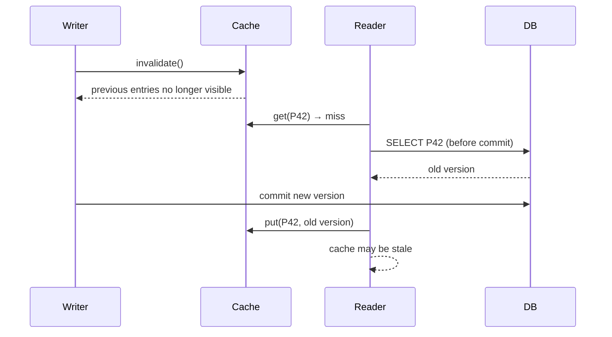

# Spring Cache API: Distinguishing `clear()` and `invalidate()`

> **Topic:** Spring Framework – Cache · **Group:** Programmatic API.  
> Both methods of the `org.springframework.cache.Cache` interface deal with **removing all mappings in a cache region**, but they differ in their contracts regarding *when the effect becomes visible* and *the return value*. Understanding this distinction is crucial when an application uses transactions, asynchronous cache operations, or concurrent multi-threaded access.

## 1. One Cache region, two ways to request clearing everything

In the Spring Cache abstraction, `CacheManager` manages `Cache` regions. For example, an application has a `CacheManager` and two regions, `products` and `exchangeRates`:

```java
CacheManager manager = ...;
Cache products = manager.getCache("products");
Cache rates = manager.getCache("exchangeRates");
```

The lines above are a snippet; `manager` must be configured, and `CacheManager` and `Cache` are imported from `org.springframework.cache`.

Each `Cache` holds `key → value` mappings. Both of the following APIs target **all mappings of a single `Cache`**:

```java
void clear();

boolean invalidate();
```

Both differ from `evict(key)` or `evictIfPresent(key)`, which remove **one specific key**. Clearing `products` **does not automatically** clear `exchangeRates`; to clear multiple regions, you must explicitly select/iterate over each `Cache` object or design a corresponding administrative operation.

**Key takeaways:**

- `clear()` requests emptying the cache, but the API contract **allows the removal effect to be performed lazily, asynchronously, or deferred**. During that window, subsequent lookups *may* still see old entries.
- `invalidate()` requires making **all existing mappings immediately invisible to subsequent lookups**. That is a stricter contract for situations requiring immediate eviction visibility.
- `clear()` returns `void`.
- `invalidate()` returns a `boolean` indicating whether the cache was **known to have mappings prior to the operation**. `false` does not automatically mean removal failed: the region may already have been empty or the implementation could not determine the prior state.

This contract is described in the `Cache` Javadoc (Spring Framework 6.2). It does not mean any remote backend provides a global transaction locking every reader/writer across nodes.

## 2. Comparison table: `clear()` vs. `invalidate()`

| Criterion | `Cache.clear()` | `Cache.invalidate()` |
|---|---|---|
| Target affected | All entries in **one Cache region** | All entries in **one Cache region** |
| Signature | `void clear()` | `boolean invalidate()` |
| Timing contract | May be executed **deferred or asynchronous** | Expects removal effect **immediately for subsequent lookups** |
| Return value | None | `true` if known to have had mappings beforehand; `false` when empty or unknown |
| On local `ConcurrentMapCache` | Typically clears the map immediately | Clears the map immediately and can determine prior state |
| With `TransactionAwareCacheDecorator` in an active transaction | Can **register clearing for after-commit** | **Does not defer** like `clear()`; requests immediate clearing |
| Used in `@CacheEvict(allEntries=true)` | Corresponds to routine clearing (usually after invocation) | Corresponds to **immediate** clearing, such as `beforeInvocation=true` |
| Guarantees no one writes back after clearing? | **No** | **No** |
| Guarantees database/cache synchronization? | **No** | **No** |
| Choose when | Normal clearing semantics are acceptable, possibly deferred until after-commit | Stale entries must become invisible immediately after the call per provider contract |

A short mnemonic: **`clear` = "request to empty"**, **`invalidate` = "immediately invalidate visibility"**.

However, do not infer that `invalidate()` is "stronger in every aspect". Immediate clearing *before* database commit can increase cache misses, create races leading to stale-data refills, or break post-commit invalidation strategies. Choose based on business requirements and when source data becomes valid.

## 3. API signatures, return types, and boolean meaning

### 3.1. `clear()` returns `void`

```java
Cache cache = Objects.requireNonNull(manager.getCache("products"));
cache.clear();
```

This call instructs the cache to remove all mappings, but **does not return the number of removed entries** and does not report whether the cache was previously empty. Depending on the provider/decorator, the operation may be deferred or processed asynchronously.

The Spring Framework Javadoc notes that `clear()` may not cause lookups to immediately stop seeing entries, especially with transaction-aware cache decorators. Therefore, do not treat a `clear()` call as proof that subsequent reads immediately return `null` on every backend.

### 3.2. `invalidate()` returns `boolean`

```java
Cache cache = Objects.requireNonNull(manager.getCache("products"));
boolean hadEntries = cache.invalidate();
System.out.println("Previously known populated: " + hadEntries);
```

Meaning of the return value:

- `true`: the cache was **known** to hold at least one mapping prior to invalidation.
- `false`: the cache had **no mappings** or it **could not be determined** whether mappings existed before the operation.
- It does NOT mean `true = removal succeeded` and `false = removal failed`.
- It is NOT the count of entries or keys removed.
- It is NOT proof that the database updated, nor that all pods are synchronized.

In particular, an implementation that supports invoking the clear operation but **cannot determine prior state** may return `false` even though the invalidation request was executed. Business code should not write:

```java
if (!cache.invalidate()) {
    throw new IllegalStateException("Cache clearing failed");
}
```

This is an **anti-pattern**: an already-empty cache region can make `invalidate()` return `false`, and a provider may be unable to determine prior data presence. When a backend truly fails, handle exceptions, `CacheErrorHandler`, or operation/backend status per the implementation contract—do not infer failure from this boolean.

### 3.3. Why is `invalidate()` not a system-wide lock?

The immediate-visibility contract means invalidated mappings are no longer visible in subsequent lookups; it **does not prevent another request from writing new entries** after the moment of removal.

Example:

```text
T1: cache.invalidate()         -> drops old entries
T2: load from database           -> gets old data (DB not yet committed)
T2: cache.put("P42", old)       -> creates new entry after invalidation
T3: cache.get("P42")            -> may see "old"
```

`invalidate()` does not lock future `put` calls, does not combine a cache and a database into one transaction, and does not automatically provide a consistency barrier across multiple services. This is an important limitation when choosing immediate clearing before an update.

## 4. Distinguishing whole-cache clearing from single-key eviction

The `Cache` interface provides two pairs of APIs following the same philosophy:

| Scope | Normal removal | Immediate-visibility removal |
|---|---|---|
| Single key | `void evict(Object key)` | `boolean evictIfPresent(Object key)` |
| Entire region | `void clear()` | `boolean invalidate()` |

Corresponding usage:

```java
Cache cache = Objects.requireNonNull(manager.getCache("products"));

// Evict exactly one entry.
cache.evict("P42");

// Evict one entry requiring it to become immediately invisible.
boolean existed = cache.evictIfPresent("P42");

// Clear all entries in the products region.
cache.clear();

// Invalidate all entries in the products region immediately.
boolean hadMappings = cache.invalidate();
```

These are illustrative Java statements in a scope containing `manager` and `Objects`. Never call `clear()` or `invalidate()` when only one product changed: emptying the whole region causes cache misses for every key, increases queries to the source, and can trigger a **cache stampede**.

Also do not confuse `Cache.invalidate()` with `CacheManager`. `CacheManager` is only a gateway to select `Cache` instances and **has no standard `cacheManager.invalidate()` or `cacheManager.clear()` API** in the Spring Framework interface. To affect multiple cache names, you must explicitly iterate over each allowed region:

```java
for (String name : manager.getCacheNames()) {
    Cache cache = manager.getCache(name);
    if (cache != null) {
        cache.invalidate();
    }
}
```

Iterating like this is an **administrative snippet scoped across the manager's cache regions**, not an atomic command across caches. In production, restrict the list of cache names, enforce permissions, and use logging/metrics to prevent unintended mass clearing.

## 5. An API contract does not mean every provider behaves identically

### 5.1. `ConcurrentMapCache`

`ConcurrentMapCache` is the local implementation provided by Spring Framework. It is backed by a `ConcurrentMap`, so `clear` usually takes effect immediately within the same cache instance; `invalidate` also clears the map and returns a boolean based on known prior state.

Thus, if you test:

```java
cache.put("A", "value-A");
cache.clear();
System.out.println(cache.get("A") == null); // true
```

on a local `ConcurrentMapCache`, the result will be `true`. **That does not erase the difference in the API contract.** Testing on a local map is insufficient to conclude that a transaction-aware decorator or remote cache behaves identically.

### 5.2. `TransactionAwareCacheDecorator`

`org.springframework.cache.transaction.TransactionAwareCacheDecorator` wraps another `Cache` and integrates with Spring's transaction synchronization mechanism. When a Spring-managed transaction and synchronization are active, routine **`put`, `evict`, and `clear`** operations can be deferred until **after-commit**.

For `invalidate()`, Spring does not defer it via that mechanism because it expresses an immediate-effect requirement. This creates an observable difference:

```text
Active transaction
    cache.clear()
       └── registers removal after commit
           └── right now, old entry can still be read

Active transaction
    cache.invalidate()
       └── removes entries immediately
           └── subsequent reads no longer see deleted mappings
```

If the transaction rolls back, a `clear()` registered for **after-commit** will typically **not execute the removal**. An immediate `invalidate()` is not automatically undone just because the database transaction rolled back.

However, if **no transaction synchronization is active**, the decorator's `clear()` forwards directly to the underlying cache immediately. Distinguish having the `@Transactional` annotation from whether a **transaction is actually active at the moment the API is called**, as well as AOP advice ordering.

### 5.3. Remote / distributed providers

Redis, JCache, or external providers have their own native semantics:

- Some providers implement region-wide clearing by scanning/deleting multiple keys, rotating namespaces/versions, or using non-atomic mechanisms.
- With an asynchronous remote backend, when the command completes and when data becomes visible across clients can depend on the adapter.
- With a transaction-aware cache, a `clear` operation at the decorator layer can be deferred even though an underlying local map supports immediate clearing.
- `invalidate()` is an immediate requirement under the Spring contract; **verify that the specific provider/adapter meets that requirement** via integration tests, especially when multiple nodes share a remote store.

Do not promise "invalidate is a distributed transaction" or "clear is always asynchronous". The accurate phrasing is **`clear` allows deferral**, whereas **`invalidate` requires immediate visibility** within the scope of the `Cache` contract.

## 6. Runnable Java 17+ example: `clear`, `invalidate`, and transaction-aware decorator

This exercise uses **Java 17+**, **Maven**, and **Spring Framework 6.2.12**, with `ConcurrentMapCacheManager`. No Spring Boot, Redis, or database is required. The example shows two independent cache names, the return value of `invalidate`, and the difference between deferred `clear` and immediate `invalidate` when going through a transaction-aware decorator.

To run the example without a database transaction manager, the final section **explicitly simulates only the transaction synchronization lifecycle** using the `TransactionSynchronizationManager` API. This is a **callback simulation**, not a real database transaction, and manual synchronization control should not be copied into production business logic.

### 6.1. Directory tree

```text
spring-cache-clear-invalidate/
├── pom.xml
└── src/main/java/dev/example/clearinvalidate/ClearInvalidateDemo.java
```

### 6.2. Maven configuration: `pom.xml`

```xml
<?xml version="1.0" encoding="UTF-8"?>
<project xmlns="http://maven.apache.org/POM/4.0.0"
         xmlns:xsi="http://www.w3.org/2001/XMLSchema-instance"
         xsi:schemaLocation="http://maven.apache.org/POM/4.0.0 https://maven.apache.org/xsd/maven-4.0.0.xsd">
    <modelVersion>4.0.0</modelVersion>
    <groupId>dev.example</groupId>
    <artifactId>spring-cache-clear-invalidate</artifactId>
    <version>1.0.0</version>

    <properties>
        <maven.compiler.release>17</maven.compiler.release>
        <project.build.sourceEncoding>UTF-8</project.build.sourceEncoding>
    </properties>

    <dependencies>
        <dependency>
            <groupId>org.springframework</groupId>
            <artifactId>spring-context</artifactId>
            <version>6.2.12</version>
        </dependency>
    </dependencies>

    <build>
        <plugins>
            <plugin>
                <groupId>org.apache.maven.plugins</groupId>
                <artifactId>maven-compiler-plugin</artifactId>
                <version>3.13.0</version>
            </plugin>
            <plugin>
                <groupId>org.codehaus.mojo</groupId>
                <artifactId>exec-maven-plugin</artifactId>
                <version>3.3.0</version>
                <configuration>
                    <mainClass>dev.example.clearinvalidate.ClearInvalidateDemo</mainClass>
                </configuration>
            </plugin>
        </plugins>
    </build>
</project>
```

`spring-context` brings in the Spring dependencies required for the example, including `spring-tx` used by `TransactionSynchronizationManager` within the consistent Spring version set resolved by Maven.

### 6.3. Complete Java source

**`src/main/java/dev/example/clearinvalidate/ClearInvalidateDemo.java`**

```java
package dev.example.clearinvalidate;

import java.util.List;
import java.util.Objects;

import org.springframework.cache.Cache;
import org.springframework.cache.CacheManager;
import org.springframework.cache.concurrent.ConcurrentMapCacheManager;
import org.springframework.cache.transaction.TransactionAwareCacheDecorator;
import org.springframework.transaction.support.TransactionSynchronization;
import org.springframework.transaction.support.TransactionSynchronizationManager;

public class ClearInvalidateDemo {

    private static boolean has(Cache cache, String key) {
        return cache.get(key) != null;
    }

    private static void simulateAfterCommitCallbacks() {
        List<TransactionSynchronization> callbacks =
                TransactionSynchronizationManager.getSynchronizations();
        for (TransactionSynchronization callback : callbacks) {
            callback.afterCommit();
        }
    }

    public static void main(String[] args) {
        CacheManager manager =
                new ConcurrentMapCacheManager("products", "rates");

        Cache products =
                Objects.requireNonNull(manager.getCache("products"));
        Cache rates =
                Objects.requireNonNull(manager.getCache("rates"));

        // A. Two different cache names: clearing products does not clear rates.
        products.put("A", "product-old");
        products.put("B", "product-two");
        rates.put("USD", "exchange-rate");

        System.out.println("initialA=" + has(products, "A"));
        System.out.println("initialB=" + has(products, "B"));
        System.out.println("initialRate=" + has(rates, "USD"));

        products.clear();
        System.out.println("afterClearA=" + has(products, "A"));
        System.out.println("afterClearB=" + has(products, "B"));
        System.out.println("afterClearRate=" + has(rates, "USD"));

        // B. invalidate() returns a boolean indicating known prior presence.
        products.put("A", "product-new");
        boolean hadMapping = products.invalidate();
        System.out.println("invalidateKnownPopulated=" + hadMapping);
        System.out.println("afterInvalidateA=" + has(products, "A"));

        boolean hadMappingAgain = products.invalidate();
        System.out.println("invalidateEmpty=" + hadMappingAgain);

        // C. Wrap the region with a transaction-aware decorator.
        Cache transactional =
                new TransactionAwareCacheDecorator(products);

        // Simulates transaction synchronization, NOT a DB transaction.
        products.put("A", "value-before-commit");
        TransactionSynchronizationManager.initSynchronization();
        try {
            transactional.clear();
            System.out.println("clearDeferredA=" + has(products, "A"));

            simulateAfterCommitCallbacks();
            System.out.println("clearAfterCommitA=" + has(products, "A"));
        } finally {
            TransactionSynchronizationManager.clearSynchronization();
        }

        // D. Inside synchronization, invalidate() must still clear immediately.
        products.put("A", "value-in-transaction");
        TransactionSynchronizationManager.initSynchronization();
        try {
            boolean wasPopulated = transactional.invalidate();
            System.out.println("invalidateImmediateKnown=" + wasPopulated);
            System.out.println("invalidateImmediateA=" + has(products, "A"));
        } finally {
            TransactionSynchronizationManager.clearSynchronization();
        }

        System.out.println("rateStillPresent=" + has(rates, "USD"));
    }
}
```

Notes:

- `TransactionSynchronizationManager.initSynchronization()` only activates the callback list bound to the current thread. It does **not** open a DB transaction, create a commit, or control isolation or rollback.
- `simulateAfterCommitCallbacks()` invokes `afterCommit()` callbacks to **illustrate the exact moment the decorator executes a deferred clear**. In production Spring code, the transaction manager drives callbacks.
- `clearSynchronization()` is always placed in `finally` so the example does not leak thread-local state.
- With a local cache, `get(key) != null` indicates whether a mapping exists, even when Spring wraps a value to represent null. This is why `get(key, String.class) != null` is not used if business logic allows caching null.

### 6.4. Running the project and checking stdout

In the directory containing `pom.xml`:

```bash
mvn -q compile exec:java
```

Lines printed by the program when run with a fresh manager/cache (excluding Maven logs):

```text
initialA=true
initialB=true
initialRate=true
afterClearA=false
afterClearB=false
afterClearRate=true
invalidateKnownPopulated=true
afterInvalidateA=false
invalidateEmpty=false
clearDeferredA=true
clearAfterCommitA=false
invalidateImmediateKnown=true
invalidateImmediateA=false
rateStillPresent=true
```

**Interpretation:**

1. `initialA`, `initialB`, and `initialRate` are all `true` because `put` was called beforehand.
2. `products.clear()` immediately deletes both mappings in the local `ConcurrentMapCache`; `rates` is a separate Cache so it retains `USD`.
3. After `put("A","product-new")`, the local implementation's `invalidate()` knows the region previously held entries and returns `true`; after clearing, A is gone.
4. Calling `invalidate()` again on the empty region returns `false`: **not an error**.
5. Inside simulated synchronization, `TransactionAwareCacheDecorator.clear()` only registers after-commit work; thus `clearDeferredA=true`.
6. Calling the `afterCommit()` callback executes the removal, so `clearAfterCommitA=false`.
7. `transactional.invalidate()` is an immediate operation and does not defer until after-commit; it removes A and returns `true` since an entry existed beforehand.
8. Nothing in the entire sequence touches the `rates` region, so `rateStillPresent=true`.

The result illustrates local + decorator semantics. **Do not conclude that a distributed Redis cache necessarily returns the same boolean or has the same clear mechanism**. Integration tests are required for other providers, especially when an implementation cannot determine whether the cache previously held mappings.

## 7. `clear` and `invalidate` in `@CacheEvict(allEntries=true)`

`@CacheEvict` provides a declarative way to evict cache entries via annotations instead of calling the `Cache` API directly. With `allEntries=true`, Spring requests removing **all entries of one or more specified cache regions**.

### 7.1. Evicting after invocation (default)

```java
@CacheEvict(cacheNames = "products", allEntries = true)
public void rebuildProducts() {
    repository.rebuild();
}
```

This is a snippet inside a service with a repository, not a runnable class. With the default `beforeInvocation = false`, the removal is triggered **after the method succeeds**. In Spring Framework 6.2, the routine region-wide eviction path corresponds to `Cache.clear()` and can interact with a decorator's deferred semantics.

If the method throws an exception instead of completing successfully, the post-invocation removal does not occur under standard annotation logic.

### 7.2. Evicting before invocation

```java
@CacheEvict(cacheNames = "products",
            allEntries = true,
            beforeInvocation = true)
public void startRebuild() {
    repository.rebuild();
}
```

When `beforeInvocation=true`, Spring requests clearing the whole region **before** invoking the method, regardless of whether the method later succeeds or throws an exception. The immediate region-wide removal path corresponds to `Cache.invalidate()`. Thus, with a transaction-aware decorator, it is **not equivalent** by default to a `clear()` deferred until after-commit.

**Do not assume pre-invocation clearing is always safe while the DB is updating.** Other readers can reload old data before the transaction commits and write it back into the cache before the rebuild completes.

### 7.3. `allEntries=true` cannot be combined with `key`

This configuration is invalid:

```java
@CacheEvict(cacheNames = "products",
            allEntries = true, key = "#p0")
public void invalidateEverything(String id) {
    repository.rebuild();
}
```

Spring forbids specifying both `allEntries=true` and a `key` expression on `@CacheEvict`, because one requests clearing the entire region while the other selects a key. If you only want to evict a single entry, omit `allEntries` and keep `key`.

### 7.4. Do not equate method annotations with the API return value

`@CacheEvict` does not expose the `boolean` return value from `Cache.invalidate()` to the method's return value. The business method's return value is not the cache's `hadMappings` flag. If the application needs to know the state prior to clearing, call the `Cache` API directly or instrument the provider as needed, remembering that `false` can mean "unknown".

## 8. Transaction awareness, rollback, and commit timing

### 8.1. A scenario to watch carefully

Suppose a cache holds `products` data and a method updates the database:

```java
@Transactional
public void changePrice(String id, long newPrice) {
    repository.updatePrice(id, newPrice);
    cache.clear();
}
```

This is an illustrative snippet; `@Transactional` only takes effect when the application configures transaction management and calls go through a suitable proxy.

If `cache` is a `TransactionAwareCacheDecorator`, `clear()` can be **deferred until after a successful commit**. This is often beneficial when you do not want to clear the cache needlessly if the DB rolls back. However, verify several points:

- Is a real transaction already open at the moment `clear()` is called?
- Is the cache bean actually wrapped in a transaction-aware decorator?
- Is the system calling `clear()` or `invalidate()`, `evict()` or `evictIfPresent()`?
- Can data be re-read in the interval between commit and clear execution? Deferred-after-commit does not automatically combine database and cache into an atomic transaction.
- If the process crashes after DB commit before invalidation finishes, is there a retry/outbox mechanism?

### 8.2. Immediate clearing inside a transaction can carry a cost

```java
@Transactional
public void changePrice(String id, long newPrice) {
    cache.invalidate();
    repository.updatePrice(id, newPrice);
}
```

If the cache is invalidated immediately before DB commit, another request can hit a cache miss, read the **old committed** price, and put that old price back into the cache. After the method commits, the repopulated entry can remain stale.

This can also happen with `@CacheEvict(beforeInvocation=true, allEntries=true)`. Hence, **immediate invalidation** is a requirement on *cache visibility*, not a guarantee of *freshness* or transactional synchronization with the data source.

For data requiring post-commit consistency, consider `TransactionAwareCacheManagerProxy`, after-commit events, outbox, or versioned cache keys, and verify the entire read/write path in the real system.

### 8.3. `invalidate()` can still fail

Even though the contract requires immediate visibility, a remote cache can suffer network failures, timeouts, or lack support for the expected semantics. Sound engineering means:

- Verifying the adapter/provider version.
- Designing a `CacheErrorHandler` or exception policy aligned with the severity of stale data.
- If invalidation is mandatory to preserve access control, considering fail-closed or a versioned cache scheme rather than "just ignoring cache errors".
- Not using the boolean `false` as the sole error-detection signal.
- Monitoring metrics and testing failure modes.

## 9. Concurrency: one `invalidate()` call does not create atomic consistency

### 9.1. Another request can write right after clearing

A race example:



The diagram illustrates an interleaving and does not claim a fixed ordering occurs on every provider. It shows that even when `invalidate()` fulfills its contract, **a `put` operation occurring after invalidation** can still create a new entry with an old value.

### 9.2. Cache stampede scenario

Region-wide `clear()` or `invalidate()` can also turn hundreds or thousands of keys into misses at once. If too many requests hit the DB right when cleared, the system can suffer overload. Solutions to consider:

- Evict only a single key when business logic permits.
- Avoid calling region-wide invalidation after every minor update.
- Refresh the cache per key or use `@Cacheable(sync=true)` for providers supporting single-flight.
- TTL jitter, warmup, and refresh-ahead in systems where many keys expire simultaneously.
- Rate limits, bulkheads, timeouts, and monitoring concurrent loader counts.
- When region-wide invalidation is unavoidable, coordinate across nodes and ensure source data readiness.

### 9.3. Do not treat `invalidate` as a distributed lock

`invalidate()` does not block other writers from writing to the cache, does not stop cache-miss requests from calling the DB, and does not order two load-then-put operations. If a strong consistency barrier across multiple nodes is required, use a tested versioning/coordination mechanism rather than merely swapping `clear()` for `invalidate()`.

## 10. Choosing the API by business requirement

| Requirement | Suitable API / approach | Reason |
|---|---|---|
| Remove one updated product entry | `evict(id)` or `evictIfPresent(id)` | Does not empty the entire region |
| Clear entire region, deferred semantics acceptable | `clear()` | Contract allows deferral/asynchrony |
| Clear entire region and old entries must vanish immediately | `invalidate()` | Immediate visibility contract |
| Clear only after a successful commit | Transaction-aware `clear()` or after-commit event | Avoids clearing while DB has not committed |
| Clear before method even if method fails | `@CacheEvict(allEntries=true,beforeInvocation=true)` | Immediate operation before invocation |
| Clear after method succeeds | `@CacheEvict(allEntries=true)` | Standard trigger after invocation |
| Clear multiple regions in a manager | Iterate over allowed cache names | `CacheManager` has no standard `clearAll()` |
| Need to know if cache previously held mappings | `invalidate()`, interpreting flag properly | `false` can mean empty or unknown |
| Prevent stale refills before DB commit | After-commit, versioned keys, coordination | Immediate clear does not solve this race |
| Verify multi-node remote cache | Integration test on the real provider | Local map does not substitute for backend contract |

**Practical recommendation:** delete at the **smallest scope** first; when clearing an entire region is truly necessary, decide whether immediate visibility is needed, whether transactions/rollbacks are involved, and whether a miss storm could overload the source.

## 11. Common errors and how to diagnose them

| Symptom | Common cause | How to handle |
|---|---|---|
| Called `clear()` yet old entries are still read | Provider/decorator defers or runs asynchronously | Confirm implementation and transaction; if immediate is needed, use `invalidate()` |
| `invalidate()` returns `false` without cache failure | Region was empty or provider could not determine prior entries | Do not treat `false` as failure |
| `clear()` works immediately locally, not on transaction-aware wrapper | Contract allows deferral | Test both wrapper and backend layers |
| Called `invalidate()` in transaction then rolled back, cache stays empty | Immediate invalidation does not roll back with DB | If after-commit is needed, use transaction-aware `clear()` or events |
| After `invalidate()`, cache still has the key | Another request rewrote it after invalidation | Inspect concurrent load/put sequences and versioning |
| Cleared `products` but `prices` still has data | Each `Cache` is an independent region | Specify the right cache name and manager |
| Wanted to delete one product but entire cache misses | Mistakenly used region-wide `clear/invalidate` | Use per-key `evict/evictIfPresent` |
| `CacheManager.clear()` does not compile | Standard `CacheManager` API has no such method | `getCache(name).clear()` or `invalidate()` on the `Cache` |
| Using `@CacheEvict(allEntries=true, key=...)` fails | Conflicting config between all-entries and single-key | Use only `allEntries` or `key` |
| Set `beforeInvocation=true` and saw overly early removal | Annotation chooses immediate operation | Re-examine business needs and commit timing |
| Cleared from local cache but Redis still holds entries | Multiple independent managers/regions | Identify active backend and multi-tier invalidation |
| Clearing cache spikes DB QPS | All keys miss together, cache stampede | Narrow scope, warmup, single-flight, and load limiting |
| Cache adapter throws exception | Remote timeout, serializer/connection error, permissions | Monitor backend errors, exception policy, do not rely on boolean |

## 12. Testing the API and clearing effects

A test suite should cover:

1. **No entries:** `invalidate()` on an empty region must not be treated as an error just for returning `false`.
2. **With entries:** on a state-aware provider, call `invalidate()` to record the flag and verify lookups no longer see old entries.
3. **Two regions:** clearing `products` does not affect `rates`.
4. **Single key:** `evictIfPresent("A")` does not remove key B and can return the presence flag for A.
5. **Transaction-aware clear:** inside a transaction, verify entries may remain before commit and vanish after commit.
6. **Rollback:** deferred clear operations must not execute after rollback; contrast with immediate invalidate not rolling back.
7. **Cache wrapper:** check whether `getCache("x")` returns a decorated cache or the raw cache to avoid testing the wrong layer.
8. **Multi-node:** after invalidation reports completion, check lookups across each node with the real adapter.
9. **Concurrent repopulation:** have a reader miss and put data right after invalidate to confirm the app defends against stale refills if required.
10. **Expiry and stampede:** measure DB QPS, cache miss rate, and loader count on region-wide clearing.
11. **Annotation path:** test `@CacheEvict(allEntries=true)` with default and `beforeInvocation=true`, including when the method throws.
12. **Provider error:** simulate Redis outage, lost connection, or timeout; verify errors are reported/handled per policy.
13. **Manager/cache names:** avoid confusing multiple `CacheManager`s both naming a `products` region while backed by different stores.
14. **Staleness tolerance:** test against SLAs, not just booleans and mapping counts.

### Suggested unit test

With a plain `ConcurrentMapCache`:

```java
Cache cache = new ConcurrentMapCache("test");
cache.put("A", 100);
cache.put("B", 200);

cache.clear();
assert cache.get("A") == null;
assert cache.get("B") == null;

cache.put("C", 300);
boolean known = cache.invalidate();
assert known;
assert cache.get("C") == null;
```

This is a snippet only to suggest assertions and requires importing `ConcurrentMapCache` and `Cache`; Java `assert` requires enabling `-ea`, or use JUnit 5 `assertNull/assertTrue` in a test project. The standalone demo in section 6 uses `System.out.println` so it does not depend on `-ea`.

To prove deferred behavior, test `TransactionAwareCacheDecorator` directly or use an integration test with a real transaction manager; it cannot be inferred from `ConcurrentMapCache.clear()`, which deletes immediately.

## 13. Selection checklist and summary

Before using `clear()` or `invalidate()`, answer:

1. Do you truly need to clear the **entire region**, or is `evict(key)` enough?
2. Is the cache retrieved from the right `CacheManager`, `cacheName`, and tenant namespace?
3. Must old entries become **immediately invisible** after the call? If yes, choose `invalidate` semantics.
4. Does the real provider implement immediate invalidation per the contract? Is any wrapper deferring `clear`?
5. Is the `boolean` return of `invalidate()` interpreted as **prior-known mappings**, not success/failure?
6. Is a DB transaction active? Should clearing happen after commit rather than immediately?
7. If the transaction rolls back, should the cache stay intact, be invalidated, or be reloaded?
8. If another request writes data back after invalidate, does the system protect version/freshness?
9. Will clearing the entire region cause a cache stampede and overload the database?
10. Are there dedicated tests for local, remote, multi-node, backend failure, and concurrency cases?

**Conclusion:** Both `Cache.clear()` and `Cache.invalidate()` target **all mappings in a `Cache`**, but `clear()` permits deferred/asynchronous removal and returns `void`; `invalidate()` requires old mappings to become invisible immediately and returns a `boolean` indicating **known prior presence**. The clearest difference appears with a transaction-aware decorator: `clear()` can wait until after-commit, whereas `invalidate()` is an immediate operation. Neither automatically prevents stale data from being reloaded after removal nor guarantees consistency between the DB and multiple nodes.

### Official documentation

- Spring Framework 6.2 — `Cache` interface, `clear()` / `invalidate()` / `evictIfPresent()`: https://docs.spring.io/spring-framework/docs/6.2.14/javadoc-api/org/springframework/cache/Cache.html
- Spring Framework 6.2 — `TransactionAwareCacheDecorator`: https://docs.spring.io/spring-framework/docs/6.2.14/javadoc-api/org/springframework/cache/transaction/TransactionAwareCacheDecorator.html
- Spring Framework 6.2 — `ConcurrentMapCache` Javadoc: https://docs.spring.io/spring-framework/docs/6.2.14/javadoc-api/org/springframework/cache/concurrent/ConcurrentMapCache.html
- Spring Framework — Cache Abstraction: https://docs.spring.io/spring-framework/reference/integration/cache.html
- Spring Framework — Declarative caching / `@CacheEvict`: https://docs.spring.io/spring-framework/reference/integration/cache/annotations.html
