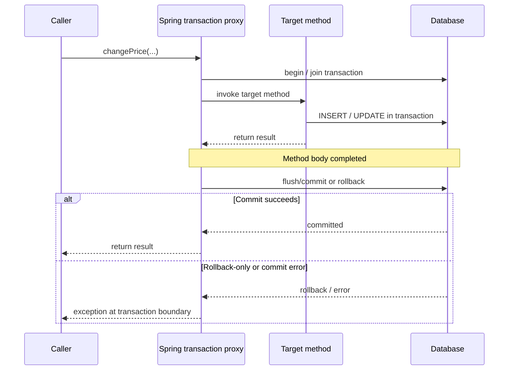
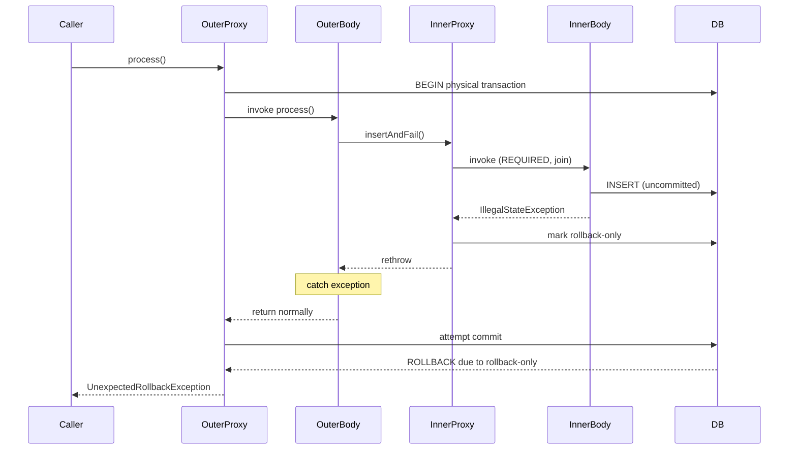

# Why Method Completion Does Not Mean a Successful Commit in Spring Cache

> **Topic:** Spring Framework – Cache · **Group:** Transactions.  
> **Core question:** Why can a method annotated with `@Transactional` or `@CachePut`/`@CacheEvict` finish executing its body—and even compute a return value—yet the **database transaction still rolls back or fails to commit**? In that situation, how can the cache diverge from the data source, and what design ties cache updates to a **successful commit**?

## 1. Three Timestamps That Are Easily Confused

In a Spring application, at least three distinct events must be distinguished:

1. **Method body completed:** The lines inside the method have finished executing, and the method is about to return a result to the AOP interceptor or throw an exception.
2. **Transaction boundary completed:** `TransactionInterceptor` and `PlatformTransactionManager` have decided to commit/rollback, possibly flushed data to the DB, invoked callbacks, and returned control. This is the point handled **outside the method body** when using Spring AOP declarative transactions.
3. **Changes have actually committed and become observable under the appropriate isolation level:** The database confirms a successful commit; only then do cache operations or post-commit events have a basis for publishing that result.

**A method reaching its `return` statement does not mean a successful commit.** When a method participates in a proxy-managed transaction, the method body typically completes **before** the Spring transaction interceptor calls commit. If the method merely joins a transaction opened by a caller, the commit may happen even **later**, at the outermost transaction boundary.

Example:

```java
@Transactional
public Product changePrice(String id, long newPrice) {
    repository.updatePrice(id, newPrice);
    System.out.println("Reached end of method body");
    return repository.find(id);
}
```

This is an **illustrative snippet in a Spring-managed service**; a real `Product`, repository, and transaction manager are required. The log line and `return` are not a commit confirmation receipt. After the method returns its result to the Spring proxy, the transaction manager can still encounter an error at commit time, or discover that the transaction has been marked rollback-only.

### Basic Timeline



The diagram depicts a transaction **opened by the current interceptor**. If the call merely **joins an existing transaction**, that method's interceptor does not necessarily commit immediately; the actual transaction ends at the scope that owns it.

## 2. Spring AOP Is Why Method Body and Commit Are Two Separate Steps

### 2.1. `@Transactional` Does Not Transform the Method Body

In the default proxy mode, `@Transactional` is handled by Spring via an interceptor around the method invocation. Simplified:

```text
Caller
  -> Spring proxy
      -> TransactionInterceptor
          -> begin / join transaction
          -> invoke target method
          -> if method returns: commit according to transaction status
          -> if method throws error: evaluate rollback rules
          -> return result or throw exception to caller
```

An illustrative pseudocode snippet, **not Spring source code**:

```java
TransactionStatus status = txManager.getTransaction(definition);
try {
    Object result = invokeTarget();   // Method body may have already returned.
    txManager.commit(status);          // This step can still fail.
    return result;
} catch (Throwable failure) {
    // In practice, Spring distinguishes errors from body, commit errors, and rollback rules.
    handleFailure(failure, status);
    throw failure;
}
```

What matters in the pseudocode is the **ordering**, not the exact way Spring handles exceptions internally. Do not copy this pseudocode to implement transactions yourself: `TransactionInterceptor` and `PlatformTransactionManager` contain more complex logic, especially for joined transactions, rollback-only state, and transaction synchronizations.

### 2.2. Logs Inside a Method Do Not Prove a Commit

```java
@Transactional
public void saveOrder(Order order) {
    repository.save(order);
    log.info("saveOrder completed");
}
```

The `saveOrder completed` line only proves execution reached the log statement; it does not guarantee:

- Whether SQL has been sent to the database.
- Whether Hibernate/JPA has flushed successfully.
- Whether constraint, deadlock, optimistic-lock, or serialization checks at commit will succeed.
- That the transaction was not marked rollback-only by an inner call.
- That the database has durably confirmed the commit.
- That a cache in another manager/backend has been consistently updated.

For business auditing, do not record "committed" merely because code ran past the end of the method. Rely on the **actual transaction outcome**, an appropriate `afterCommit` callback, or an outbox/event mechanism with the required durability.

### 2.3. Self-Invocation and Transaction Scope

`@Transactional` also depends on the call passing through the Spring proxy in proxy mode. If a method calls `this.otherTransactionalMethod()` on the same instance, the annotation on the internally invoked method may **not create a new transaction** as intended.

Example:

```java
public void run() {
    this.changePrice("P42", 120);
}

@Transactional
public void changePrice(String id, long newPrice) {
    repository.updatePrice(id, newPrice);
}
```

This is a snippet inside a service; if `run()` is called through the proxy without a transaction and internally invokes `this.changePrice(...)`, the caching/transaction advice of `changePrice` is not applied under normal proxy mode. When analyzing "the method returned, why did the commit behave unexpectedly?", the first step is to check **whether a transaction was actually opened**.

## 3. Practical Causes of Commit Failure After the Method Body Completes

| Cause | What happens | Clues to investigate |
|---|---|---|
| Transaction marked **rollback-only** | Target method returns but the transaction cannot commit; may throw `UnexpectedRollbackException` | An inner `@Transactional(REQUIRED)` method threw an exception that was caught |
| JPA/Hibernate defers SQL until flush | Entity operations finish; constraint/SQL errors only appear during flush at commit | EntityManager flush mode, SQL logs, DB constraints |
| Unique/foreign-key/check constraint | Database rejects the write when the statement/flush/commit executes | Constraint violation, SQLSTATE |
| Optimistic locking | Version conflict is only detected at flush/update time | `OptimisticLockException` or Spring-translated exception |
| Serialization failure/deadlock | DB decides to abort a transaction during conflict detection | Specific SQLSTATE, deadlock diagnostics |
| Transaction timeout | Transaction is marked rollback-only or commit is rejected | Transaction manager logs and timeout configuration |
| Resource commit failure | Network/driver/storage fails right at commit | Exception from transaction manager/driver; outcome may be uncertain |
| Multiple resources/2PC/Saga | One step succeeds while another fails or outcome is uncertain | Coordination mechanism, recovery, reconciliation |
| Outer transaction not yet finished | Inner method returns but only joins a shared transaction; outer caller can still roll back | Propagation chain and transaction ownership |
| Post-commit synchronization callback fails | DB may already have committed, yet caller still sees an exception from a post-commit callback | Distinguish `afterCommit` failure from DB commit failure |

**Important exception in the reverse direction:** **Receiving an exception at the caller does not always mean the DB rolled back.** If an exception arises from a callback **after the DB commit has already completed**, the data may already be committed. You must identify **when the error occurred**, rather than relying solely on whether the method threw an exception.

### 3.1. Flush Is Not Commit

In JPA, `repository.save(entity)` may only update the persistence context. SQL may be executed during `flush()` or right before the transaction commits. Even when `flush()` succeeds, that is **still not equivalent to a commit**: the transaction can still roll back later.

How much SQL is deferred depends on the ORM, ID strategy, statement type, and flush mode. Do not assume every `save` call waits until commit; observe the actual SQL and transaction boundaries.

### 3.2. Catching an Exception Does Not "Clear" the Rollback-Only Flag

Nested service example:

```java
@Service
public class InnerService {
    @Transactional(propagation = Propagation.REQUIRED)
    public void insertAndFail() {
        repository.insertSomething();
        throw new IllegalStateException("inner failure");
    }
}

@Service
public class OuterService {
    private final InnerService inner;

    public OuterService(InnerService inner) {
        this.inner = inner;
    }

    @Transactional
    public void process() {
        try {
            inner.insertAndFail();
        } catch (IllegalStateException e) {
            // Business caught the error, but the shared transaction may still be rollback-only.
        }
        System.out.println("Outer method reached end");
    }
}
```

This is an **illustrative structure**; full repositories, configuration, and imports are required. `Propagation.REQUIRED` lets the inner method join **the same physical transaction** as the outer one. When the exception from inner crosses inner's transaction interceptor, Spring can mark that transaction rollback-only according to rollback rules (defaulting to `RuntimeException`). Outer catches the exception and returns normally, yet when the outer interceptor attempts to commit, it can receive `UnexpectedRollbackException`.

Catching an exception to continue a business flow **does not automatically reset the rollback-only state**. If recovery is needed, design the propagation or separate transaction unit according to business semantics rather than using `catch` as a way to force a commit.

## 4. `PROPAGATION_REQUIRED` and `UnexpectedRollbackException`

Spring distinguishes the **logical transaction scope** of each `@Transactional` invocation from the shared **physical transaction** of the resource.

### 4.1. REQUIRED Joins a Shared Transaction

With `PROPAGATION_REQUIRED`:

- If no transaction exists, the call creates a new transaction.
- If a suitable transaction already exists, the call joins that transaction.
- Inner and outer may have two logical scopes yet **one physical transaction**.
- When the inner scope marks rollback-only on the shared transaction, the outer scope may not know immediately.
- At the outermost commit boundary, Spring throws `UnexpectedRollbackException` to inform the caller that **a rollback occurred rather than a commit**.

Official Spring documentation describes this as intentional behavior: the caller must not be misled into thinking a commit succeeded when the transaction actually rolled back.



### 4.2. `REQUIRES_NEW` Is Not a Cure-All for Rollbacks

`PROPAGATION_REQUIRES_NEW` creates a separate physical transaction that can commit or roll back independently. It fits when the business **genuinely wants to persist a piece of work independently**, such as recording an audit entry under a separate policy. However, if the inner `REQUIRES_NEW` commits successfully and the outer transaction later rolls back, the inner result **remains persisted**. This may be intentional, or it may break business atomicity.

### 4.3. `NESTED` Requires Savepoint Support

`PROPAGATION_NESTED` can create a savepoint within a single physical transaction (when supported by the transaction manager and resource). An inner rollback to the savepoint does not necessarily mark the entire outer transaction rollback-only. However, it is not an equivalent option for every JPA/JTA application; you must verify the specific manager/provider.

**In summary:** choosing propagation is a transaction-semantics decision, not something to swap arbitrarily just to avoid `UnexpectedRollbackException`.

## 5. Why Spring Cache Is Vulnerable to This Timing Window

Spring Cache provides the annotations:

- `@Cacheable`: on a cache miss, the method runs and its result may be placed in the cache.
- `@CachePut`: the method runs and its result is written into the cache.
- `@CacheEvict`: the entry is evicted after the method succeeds, or before the method when `beforeInvocation=true`.

These annotations **do not automatically turn the cache and database into an atomic transaction**. A cache operation can be requested while DB data is **uncommitted**, or after the method body but **before commit**, depending on the advice chain and cache manager.

Risky example:

```java
@Transactional
@CachePut(cacheNames = "products", key = "#p0")
public Product updateProduct(String id, ProductPatch patch) {
    Product updated = repository.update(id, patch);
    return updated;
}
```

This is an illustrative method with a real repository, `ProductPatch`, and `Product`. It expresses the intent "update then put into cache", **not a guarantee** that the put always happens strictly after the DB commits in every configuration.

A dangerous possibility is that the cache sees the new version while the database transaction subsequently rolls back, causing the cache to "run ahead" of the database. Under another advice configuration, the cache operation might not occur when the commit fails. **Do not rely on a fixed ordering without verifying it.**

### 5.1. Two Interceptors Can Wrap Each Other Differently

In Spring proxy AOP, both `@EnableCaching` and `@EnableTransactionManagement` have an `order` attribute; when unset, they typically default to `Ordered.LOWEST_PRECEDENCE`. When multiple advices share the same order, you should not infer ordering merely from annotation placement in source code.

Two different wrapping arrangements:

**Cache advice outside – transaction advice inside:**

```text
CacheInterceptor
  -> TransactionInterceptor
      -> target method body
      -> COMMIT or ROLLBACK
  <- cache sees result/exception after transaction boundary
```

In this case, the post-invocation cache handling path can observe the **outcome after passing through the transaction interceptor**.

**Transaction advice outside – cache advice inside:**

```text
TransactionInterceptor
  -> CacheInterceptor
      -> target method body
      <- cache put/evict after method body
  -> COMMIT or ROLLBACK
```

In this case, the cache put/evict can be requested **before** the physical transaction commits, because the transaction advice still wraps the outside.

**Both diagrams are merely possible structures**, not assertions of ordering across all Spring versions/configurations. You must inspect `@Order`/`@EnableCaching(order=...)`/`@EnableTransactionManagement(order=...)`, the proxy chain, bean configuration, and transaction propagation in the actual application.

### 5.2. A Cache Hit Can Prevent the Method From Running

A method bearing both `@Cacheable` and `@Transactional` does not mean every request enters a transaction and hits the DB. If the cache advice intercepts first and hits, the target method is skipped; transaction behavior can differ from a cache miss. Do not use logs inside the method to deduce overall traffic or transaction boundaries when caching is enabled.

### 5.3. Distinguish Eviction Time From Commit Time

`@CacheEvict(beforeInvocation=false)` means evicting when the **method invocation succeeds according to cache logic**, not an annotation declaring "the database has committed". `beforeInvocation=true` even requests eviction **before the method**, even if the method later throws an exception, and may use immediate `evictIfPresent` or `invalidate` depending on the operation.

This distinction is critical if another user hits a cache miss and reloads the old value from the database while the update is still uncommitted.

## 6. Consistency Failure Timeline: Cache Updated Before DB Rollback

Suppose the database holds `price=100`, and the cache also holds `100`. An administrator changes the price to `120`:

| Time | Update transaction | Cache | Another reader |
|---|---|---|---|
| t0 | DB committed `100` | Cache `100` | Reads `100` |
| t1 | Transaction begins | `100` | — |
| t2 | SQL UPDATE `120`, **uncommitted** | `100` | — |
| t3 | Target method **returns `120`** | Put cache `120` (if occurring before commit) | May see `120` |
| t4 | Transaction rolls back due to constraint/rollback-only | `120` remains in cache | DB is actually still `100` |
| t5 | New request arrives | Hits `120` | **Stale/wrong data relative to DB** |

This is a **possible interleaving**, not a guaranteed default order for every Spring proxy. The decisive point is that the cache put completed before the DB commit was confirmed.

A symmetric problem occurs when **evicting too early**:

```text
t1: cache.evict("P42") before DB commit
t2: another reader misses cache, SELECT sees committed-old=100
t3: reader puts 100 into cache
t4: writer commits new price=120
t5: cache now holds 100 again (stale)
```

In that situation, even a "successful" early eviction does not guarantee a fresh cache after commit. You need an **after-commit invalidation** strategy, versioning, or coordination depending on the consistency level required.

## 7. `TransactionAwareCacheManagerProxy`: Deferring Cache Put/Evict/Clear Until After Commit

Spring Framework provides `org.springframework.cache.transaction.TransactionAwareCacheManagerProxy`, which wraps a source `CacheManager` and returns caches capable of coordinating with **Spring-managed transaction synchronization**.

```java
@Bean("rawCacheManager")
CacheManager rawCacheManager() {
    return new ConcurrentMapCacheManager("products");
}

@Bean("cacheManager")
@Primary
CacheManager cacheManager(
        @Qualifier("rawCacheManager") CacheManager raw) {
    return new TransactionAwareCacheManagerProxy(raw);
}
```

This is a snippet belonging to a `@Configuration` class with appropriate Spring imports; a runnable demo is in Section 8.

### 7.1. What Is Deferred?

When transaction synchronization is active, `TransactionAwareCacheDecorator` defers the following **standard** operations until **`afterCommit` of a successful transaction**:

| API | Deferred until after-commit? | Notes |
|---|---|---|
| `Cache.put(key,value)` | **Yes**, when transaction sync is active | New value may not be visible before commit |
| `Cache.evict(key)` | **Yes** | Suitable when eviction should only happen after commit |
| `Cache.clear()` | **Yes** | Clears the region after commit; can cause a miss storm |
| `Cache.putIfAbsent(key,value)` | **No** | Requires immediate semantics |
| `Cache.evictIfPresent(key)` | **No** | Requires the key to stop being visible immediately |
| `Cache.invalidate()` | **No** | Requires all mappings to become invisible immediately |
| `Cache.get(key,Callable)` | **Not guaranteed deferred put like standard put()** | Callback/load semantics depend on provider; must inspect sync path |

If no transaction synchronization is active, `put/evict/clear` are still delegated immediately as usual. Therefore, merely adding the proxy **does not mean every cache write across the application always waits for some commit**.

### 7.2. What Does Rollback Do to Pending Cache Operations?

If a transactional method rolls back, the `afterCommit` callbacks registered for `put/evict/clear` will **not execute** on the target cache. This is an important benefit: a value computed in a failed transaction is not automatically placed into the cache through this deferred path.

Notes:

- Deferring writes **does not create an atomic transaction between cache and DB**; the cache update can still fail after the DB commits.
- Concurrent requests can still encounter the time window between commit and the after-commit callback, or a load/put race before commit from elsewhere.
- An application might mistakenly call the underlying cache manager (`rawCacheManager`), bypassing the decorator and writing immediately.
- Immediate operations (`putIfAbsent`, `evictIfPresent`, `invalidate`) are not deferred.
- With `@Cacheable(sync=true)`, the provider may use `Cache.get(key,Callable)` and populate the entry according to its own semantics; **do not assume all cache population is deferred**.

### 7.3. Does a Transaction-Aware Cache Replace Distributed Coordination?

No. The proxy only hooks cache operations into the transaction lifecycle **inside the Spring process handling the transaction**. It is not a distributed lock, does not guarantee DB/Redis synchronization like 2-phase commit, and does not make multiple JVMs automatically join the same transaction. When strong correctness is required, consider outbox/versioning/reconciliation and cross-node testing.

## 8. Java 17+ Example With a Real Database: Method Body Returns While Commit Rolls Back

This example uses **Java 17+**, **Maven**, **Spring Framework 6.2.12**, **H2 2.3.232**, and `DataSourceTransactionManager`. Unlike examples that simulate transactions with manual callbacks, here there is a real **JDBC database transaction**. The code intentionally makes an inner `REQUIRED` method throw an exception; the outer method catches it and runs to the end of its body, yet the physical transaction is already rollback-only.

The example simultaneously demonstrates:

- Writing directly to `ConcurrentMapCache` does not automatically roll back with the DB.
- A cache wrapped by `TransactionAwareCacheManagerProxy` defers `put` until after a successful commit.
- In a failed transaction, the pending put on the transaction-aware cache does not happen.
- In a successful transaction, the put is applied after-commit and the caller sees the new value.

### 8.1. Structure

```text
spring-commit-vs-method-return/
├── pom.xml
└── src/main/java/dev/example/commit/CommitBoundaryDemo.java
```

### 8.2. `pom.xml`

```xml
<?xml version="1.0" encoding="UTF-8"?>
<project xmlns="http://maven.apache.org/POM/4.0.0"
         xmlns:xsi="http://www.w3.org/2001/XMLSchema-instance"
         xsi:schemaLocation="http://maven.apache.org/POM/4.0.0 https://maven.apache.org/xsd/maven-4.0.0.xsd">
    <modelVersion>4.0.0</modelVersion>

    <groupId>dev.example</groupId>
    <artifactId>spring-commit-vs-method-return</artifactId>
    <version>1.0.0</version>

    <properties>
        <maven.compiler.release>17</maven.compiler.release>
        <project.build.sourceEncoding>UTF-8</project.build.sourceEncoding>
    </properties>

    <dependencies>
        <dependency>
            <groupId>org.springframework</groupId>
            <artifactId>spring-context-support</artifactId>
            <version>6.2.12</version>
        </dependency>
        <dependency>
            <groupId>org.springframework</groupId>
            <artifactId>spring-jdbc</artifactId>
            <version>6.2.12</version>
        </dependency>
        <dependency>
            <groupId>com.h2database</groupId>
            <artifactId>h2</artifactId>
            <version>2.3.232</version>
        </dependency>
    </dependencies>

    <build>
        <plugins>
            <plugin>
                <groupId>org.apache.maven.plugins</groupId>
                <artifactId>maven-compiler-plugin</artifactId>
                <version>3.13.0</version>
            </plugin>
            <plugin>
                <groupId>org.codehaus.mojo</groupId>
                <artifactId>exec-maven-plugin</artifactId>
                <version>3.3.0</version>
                <configuration>
                    <mainClass>dev.example.commit.CommitBoundaryDemo</mainClass>
                </configuration>
            </plugin>
        </plugins>
    </build>
</project>
```

`spring-jdbc` provides `JdbcTemplate` and `DataSourceTransactionManager`. `spring-context-support` contains `TransactionAwareCacheManagerProxy`; Spring context and the corresponding `spring-tx` components are pulled in by Maven. H2 runs in-memory with no external server required.

### 8.3. `src/main/java/dev/example/commit/CommitBoundaryDemo.java`

```java
package dev.example.commit;

import java.util.Objects;
import javax.sql.DataSource;

import org.springframework.beans.factory.annotation.Qualifier;
import org.springframework.cache.Cache;
import org.springframework.cache.CacheManager;
import org.springframework.cache.annotation.EnableCaching;
import org.springframework.cache.concurrent.ConcurrentMapCacheManager;
import org.springframework.cache.transaction.TransactionAwareCacheManagerProxy;
import org.springframework.context.annotation.AnnotationConfigApplicationContext;
import org.springframework.context.annotation.Bean;
import org.springframework.context.annotation.Configuration;
import org.springframework.context.annotation.Primary;
import org.springframework.jdbc.core.JdbcTemplate;
import org.springframework.jdbc.datasource.DataSourceTransactionManager;
import org.springframework.jdbc.datasource.DriverManagerDataSource;
import org.springframework.transaction.PlatformTransactionManager;
import org.springframework.transaction.UnexpectedRollbackException;
import org.springframework.transaction.annotation.EnableTransactionManagement;
import org.springframework.transaction.annotation.Propagation;
import org.springframework.transaction.annotation.Transactional;

public class CommitBoundaryDemo {

    private static Cache required(CacheManager manager, String name) {
        return Objects.requireNonNull(manager.getCache(name), name);
    }

    public static void main(String[] args) {
        try (AnnotationConfigApplicationContext context =
                new AnnotationConfigApplicationContext(AppConfig.class)) {

            JdbcTemplate jdbc = context.getBean(JdbcTemplate.class);
            jdbc.execute(
                "CREATE TABLE audit_log (" +
                "id INTEGER PRIMARY KEY, note VARCHAR(80) NOT NULL)");

            OuterService outer = context.getBean(OuterService.class);
            CacheManager raw = context.getBean(
                    "rawCacheManager", CacheManager.class);
            CacheManager aware = context.getBean(
                    "cacheManager", CacheManager.class);

            // Case 1: outer body completes, but transaction commit is rolled back.
            try {
                outer.returnsThenRollsBack();
                System.out.println("caller=unexpected-success");
            } catch (UnexpectedRollbackException e) {
                System.out.println("caller=UnexpectedRollbackException");
            }

            Integer countAfterRollback = jdbc.queryForObject(
                    "SELECT COUNT(*) FROM audit_log", Integer.class);
            System.out.println("dbAfterRollback=" + countAfterRollback);
            System.out.println("rawAfterRollback=" +
                    required(raw, "raw").get("K", String.class));
            System.out.println("awareAfterRollback=" +
                    required(aware, "aware").get("K", String.class));

            // Case 2: commit succeeds, deferred put is applied at after-commit.
            outer.returnsAndCommits();

            Integer countAfterCommit = jdbc.queryForObject(
                    "SELECT COUNT(*) FROM audit_log", Integer.class);
            System.out.println("dbAfterCommit=" + countAfterCommit);
            System.out.println("awareAfterCommit=" +
                    required(aware, "aware").get("K", String.class));
        }
    }

    @Configuration(proxyBeanMethods = false)
    @EnableTransactionManagement
    @EnableCaching
    public static class AppConfig {
        @Bean
        public DataSource dataSource() {
            DriverManagerDataSource ds = new DriverManagerDataSource();
            ds.setDriverClassName("org.h2.Driver");
            ds.setUrl("jdbc:h2:mem:commit_demo;DB_CLOSE_DELAY=-1");
            ds.setUsername("sa");
            ds.setPassword("");
            return ds;
        }

        @Bean
        public JdbcTemplate jdbcTemplate(DataSource ds) {
            return new JdbcTemplate(ds);
        }

        @Bean
        public PlatformTransactionManager transactionManager(DataSource ds) {
            return new DataSourceTransactionManager(ds);
        }

        @Bean("rawCacheManager")
        public CacheManager rawCacheManager() {
            return new ConcurrentMapCacheManager("raw", "aware");
        }

        @Bean("cacheManager")
        @Primary
        public CacheManager cacheManager(
                @Qualifier("rawCacheManager") CacheManager raw) {
            return new TransactionAwareCacheManagerProxy(raw);
        }

        @Bean
        public InnerService innerService(JdbcTemplate jdbc) {
            return new InnerService(jdbc);
        }

        @Bean
        public OuterService outerService(
                InnerService inner,
                JdbcTemplate jdbc,
                @Qualifier("rawCacheManager") CacheManager raw,
                @Qualifier("cacheManager") CacheManager aware) {
            return new OuterService(inner, jdbc, raw, aware);
        }
    }

    public static class InnerService {
        private final JdbcTemplate jdbc;

        public InnerService(JdbcTemplate jdbc) {
            this.jdbc = jdbc;
        }

        @Transactional(propagation = Propagation.REQUIRED)
        public void insertAndFail() {
            jdbc.update(
                    "INSERT INTO audit_log(id,note) VALUES (?,?)",
                    1, "rollback-me");
            throw new IllegalStateException("inner-failure");
        }
    }

    public static class OuterService {
        private final InnerService inner;
        private final JdbcTemplate jdbc;
        private final CacheManager raw;
        private final CacheManager aware;

        public OuterService(InnerService inner,
                            JdbcTemplate jdbc,
                            CacheManager raw,
                            CacheManager aware) {
            this.inner = inner;
            this.jdbc = jdbc;
            this.raw = raw;
            this.aware = aware;
        }

        @Transactional
        public void returnsThenRollsBack() {
            // Direct put outside transaction-aware cache: written immediately.
            required(raw, "raw").put("K", "dirty");

            // Put through decorator: registers afterCommit.
            required(aware, "aware").put("K", "pending");

            try {
                inner.insertAndFail();
            } catch (IllegalStateException e) {
                System.out.println("innerErrorCaught=" + e.getMessage());
            }

            // Method body reaches the end, but transaction is already rollback-only.
            System.out.println("methodBodyReachedReturn=true");
        }

        @Transactional
        public void returnsAndCommits() {
            jdbc.update(
                    "INSERT INTO audit_log(id,note) VALUES (?,?)",
                    2, "committed");

            Cache cache = required(aware, "aware");
            cache.put("K", "committed");

            // New value has not been put before after-commit.
            System.out.println("deferredVisibleInside=" +
                    (cache.get("K", String.class) != null));
            System.out.println("successBodyReachedReturn=true");
        }
    }
}
```

Notes:

- `OuterService` and `InnerService` are **two separate Spring beans**. The `inner.insertAndFail()` call goes through inner's proxy, so `@Transactional(REQUIRED)` is applied and can mark the shared transaction rollback-only. Writing `this.insertAndFail()` in the same bean can bypass the proxy and produce a different result.
- `cacheManager` here **wraps** `rawCacheManager`. Both `raw` and `aware` regions live in the same native manager, yet only the region obtained through the `aware` wrapper is deferred.
- The example intentionally invokes the **Cache API directly inside the transactional method** to remove ambiguity about cache advisor ordering when `@CachePut` and `@Transactional` appear on the same method. `@EnableCaching` is enabled to show standard integration, though the demo does not depend on the cache annotation advisor.
- Initially there is no `"K"` entry in the `aware` region. Thus deferring `put("K","committed")` causes `get("K")` inside the same transaction to still return null. This is the decorator's behavior, not a "read your own pending cache writes" mechanism.
- `rawCacheManager` is not an option you should use for writing sensitive data in production; it is used solely to **contrast the failure**.

### 8.4. Running the Example

In the `spring-commit-vs-method-return` directory containing `pom.xml`:

```bash
mvn -q compile exec:java
```

Lines printed by the program itself with a fresh H2/cache, **excluding secondary Maven/Spring logs**:

```text
innerErrorCaught=inner-failure
methodBodyReachedReturn=true
caller=UnexpectedRollbackException
dbAfterRollback=0
rawAfterRollback=dirty
awareAfterRollback=null
deferredVisibleInside=false
successBodyReachedReturn=true
dbAfterCommit=1
awareAfterCommit=committed
```

### 8.5. Reading the Output Accurately

**First transaction:**

1. Outer is called through the Spring proxy; the JDBC transaction begins.
2. `raw.put` immediately writes `"dirty"` into the `raw` region.
3. `aware.put` registers the `"pending"` update for **after-commit**.
4. Inner `REQUIRED` joins this transaction, performs an uncommitted INSERT, then throws `IllegalStateException`.
5. Inner's Spring interceptor marks the shared transaction rollback-only, then rethrows the exception; outer catches it and continues.
6. Outer prints `methodBodyReachedReturn=true` and returns control to outer's transaction interceptor.
7. At commit, Spring sees rollback-only, rolls back the DB, and throws `UnexpectedRollbackException` to the caller.
8. `dbAfterRollback=0`: the INSERT rolled back.
9. `rawAfterRollback=dirty`: the raw cache did not participate in the DB transaction and still retains the value written from the failed transaction.
10. `awareAfterRollback=null`: the pending `put` did not run because there was no successful after-commit.

**Second transaction:**

1. Outer creates a new transaction, INSERTs id=2, and registers `aware.put("K","committed")`.
2. Inside the method body, `deferredVisibleInside=false` because the pending put has not been applied yet.
3. Body returns; the transaction manager commits JDBC successfully, then triggers after-commit synchronization.
4. When the caller regains control, `dbAfterCommit=1` and `awareAfterCommit=committed`.

**Takeaway:** the demo does not need to guess advisor ordering between `@CachePut` and `@Transactional`. It directly proves **method body return time differs from transaction commit time**, along with the effect of Spring's transaction-aware cache in a real transaction.

## 9. How to Tie Cache Invalidation to a Successful Post-Commit

### 9.1. Use a Transaction-Aware Manager for Suitable Operations

When cache operations should only occur after commit, wrap the manager:

```java
@Bean
@Primary
CacheManager cacheManager(
        @Qualifier("nativeCacheManager") CacheManager delegate) {
    return new TransactionAwareCacheManagerProxy(delegate);
}
```

Then inject/use only the **wrapper bean** wherever caches must be synchronized with transactions. However, check advice order: if a cache operation is called when no synchronization is active, the decorator executes immediately.

### 9.2. Use `@TransactionalEventListener(phase = AFTER_COMMIT)`

Another option is to publish an event inside the transaction and handle invalidation **only after the DB commits successfully**:

```java
public record ProductChanged(String id) { }

@Service
class ProductWriter {
    private final ProductRepository repository;
    private final ApplicationEventPublisher events;

    ProductWriter(ProductRepository repository,
                  ApplicationEventPublisher events) {
        this.repository = repository;
        this.events = events;
    }

    @Transactional
    public void update(String id, ProductPatch patch) {
        repository.update(id, patch);
        events.publishEvent(new ProductChanged(id));
    }
}

@Component
class ProductCacheInvalidator {
    private final CacheManager manager;

    ProductCacheInvalidator(CacheManager manager) {
        this.manager = manager;
    }

    @TransactionalEventListener(phase = TransactionPhase.AFTER_COMMIT)
    public void afterCommit(ProductChanged event) {
        Cache cache = manager.getCache("products");
        if (cache != null) {
            cache.evict(event.id());
        }
    }
}
```

This is an **architectural snippet**, not a standalone Java file: `ProductRepository`, `ProductPatch`, dependencies, and appropriate Spring imports must be defined. When no transaction is active, a `@TransactionalEventListener` by default **does not execute the event** unless an appropriate fallback behavior is configured. Verify that real production code always publishes inside the right transaction.

**Specifically:** Spring documentation notes that at `AFTER_COMMIT`, transactional resources can sometimes still be bound/accessible even though the commit has completed. If the listener needs to perform **new database writes**, open a separate transaction (`REQUIRES_NEW`) rather than expecting those writes to commit within the already-completed transaction.

### 9.3. Post-Commit Events Are Not Durable Enough for Every System

An in-process listener does not inherently guarantee the event will be processed if the process dies right after DB commit. If invalidation is critical, especially across multiple nodes, consider:

- **Transactional outbox:** write the DB change and the outbox record in the same transaction; a durable worker dispatches the message after commit.
- **Idempotent cache invalidation:** replaying an event does not corrupt data; pair with appropriate keys/versions.
- **Retry and dead-letter:** handle cache backend outages, queue unavailability, and network failures.
- **Versioned keys or generation numbers:** prevent a late write from re-recording stale data after invalidation.
- **Reconciliation:** periodic checks between the source and cache for data requiring high consistency.

Do not claim an after-commit event is atomic between the database and Redis. It only clearly defines the **trigger condition** after commit; reliability still requires dedicated design.

## 10. Additional Cases to Distinguish

### 10.1. Inner Transactional Method Returns, Outer Transaction Still Running

An inner `@Transactional(REQUIRED)` method can return successfully while the outer transaction has not yet committed. If the outer caller later hits an exception, the inner changes can roll back as well. Thus even **a normal return from the inner proxy call** does not guarantee DB commit if inner merely joined an existing physical transaction.

### 10.2. `@Transactional(REQUIRES_NEW)` and Independence

An inner `REQUIRES_NEW` method opens its own transaction, whose commit may complete before the inner proxy returns. Yet the outer transaction can still roll back; the inner's committed changes do not automatically roll back with the outer one. Design according to business requirements rather than assuming methods on the same call stack share the same physical transaction.

### 10.3. Checked Exceptions, Rollback Rules, and `rollbackFor`

Spring declarative transactions roll back by default on `RuntimeException` and `Error`. For checked exceptions, the default may commit unless other rollback rules (`rollbackFor`/`noRollbackFor`) are configured, or the system uses a special transaction policy. Therefore, **a method throwing an exception** is not sufficient proof that "the transaction definitely rolled back".

### 10.4. Transaction Timeouts and Lazy Flushes

The ORM may accumulate SQL until flush; transaction timeouts and DB lock contention can cause commit to fail even when business code showed almost no sign beforehand. When debugging, read the exception chain, SQLSTATE, transaction status, and DB logs—not just the `return` line.

### 10.5. Uncertain Commit When Connections Drop

In certain network failures right at commit time, the application may not know for sure whether the database committed or not. Do not automatically retry a non-idempotent operation just because an exception was received. Use a business idempotency key, reconciliation, or source verification before replaying.

### 10.6. Commit Succeeds but After-Commit Handler Fails

The DB may have finished committing, and then an `afterCommit` listener or cache operation throws an error. The caller may see an error, yet **you must not automatically conclude the DB rolled back**. Distinguish "transaction commit failure" from "post-commit side-effect failure" to avoid unsafely retrying a data write.

### 10.7. `beforeInvocation=true` Is Immediate Behavior, Not After-Commit

`@CacheEvict(beforeInvocation=true)` requires eviction before the method, including when the method throws an exception. It typically follows immediate APIs such as `Cache.evictIfPresent`/`invalidate` and is **not deferred like standard `evict`/`clear`** by the transaction-aware decorator. Do not use it as a way to "ensure post-commit invalidation".

### 10.8. Caching Null and `@Cacheable(sync=true)`

`@Cacheable(sync=true)` uses the combined loading path `Cache.get(key,Callable)` with semantics supported by the provider. Do not assume every update from the loader goes through a transaction-aware `put` to be deferred; check the specific adapter. Moreover, `sync=true` has limitations: `unless` cannot be used, only one cache is allowed, and cache operations cannot be combined on the same method.

## 11. Comparing Design Options by Consistency Requirements

| Business requirement | Preferred direction | What must be verified |
|---|---|---|
| Normal cache reads, just reducing DB calls | `@Cacheable` with the right key | Does a cache hit bypass the method/transaction? TTL/invalidation? |
| Evict entry only after successful UPDATE | `@CacheEvict` after invocation **and** transaction boundary control | Advice ordering, physical commit, manager |
| Write cache only when DB commit succeeds | Transaction-aware `put` or after-commit event | Is transaction sync active at put time? |
| Leave cache unchanged on rollback | Transaction-aware `evict/clear` | Do not use immediate APIs for this flow |
| Evict immediately because security state must be revoked | `evictIfPresent`/`invalidate` with an appropriate fail-closed policy | Immediate visibility, latency, backend errors |
| Multi-node consistency required | After-commit invalidation + event/outbox/versioning | Delivery/retry/idempotency, cross-node races |
| Inner REQUIRED failed yet outer wants to continue | Revisit transaction boundaries, propagation/savepoints | Do not simply catch and force commit |
| Audit needed even if outer rolls back | `REQUIRES_NEW` in a separate bean if business-appropriate | Independent audit commit, avoid contradictory data |
| Need to know transaction finished successfully | Check transaction proxy return, after-commit phase, data source | Post-commit errors can appear after DB commit |
| Protect against stale refills | Versioned keys, after-commit invalidate, concurrency tests | Cannot be guaranteed by early eviction alone |

## 12. Testing "Method Completed" vs. "Commit Completed" Properly

A solid integration test suite must inspect **both the database and the cache**, not just the service's return value.

### 12.1. Minimum Scenarios

1. **Method returns normally, commit succeeds:** verify data is present in the DB from another transaction/connection and the cache updates properly after commit.
2. **Inner REQUIRED marks rollback-only:** outer catches and returns; caller receives `UnexpectedRollbackException`; DB rolls back and the transaction-aware cache does not apply the pending put.
3. **Writing raw cache inside a rolling-back transaction:** confirm the raw cache can retain a value no longer matching the DB.
4. **Writing through a transaction-aware cache:** confirm the pending put only appears after commit; rollback does not apply it.
5. **Evict before commit:** competing reader misses and refills with the old DB value; verify version/key/after-commit strategy.
6. **JPA constraint at flush/commit:** simulate late-detected errors, not only errors thrown immediately at `save`.
7. **Rollback on checked exceptions:** test default and `rollbackFor` depending on configuration.
8. **REQUIRES_NEW:** inner commits independently then outer rolls back; verify the expected outcome.
9. **Self-invocation:** transactional method called via `this` to confirm proxy-bypass risk rather than confusing it with commit failure.
10. **After-commit side effect fails:** DB still commits while cache invalidation fails; verify recovery instead of blind business retries.
11. **Cache backend outage:** Redis loses connection; transaction still commits or fails according to a clearly defined policy.
12. **Multiple pods:** events/invalidations reach all required cache regions; late writers do not recreate stale entries.
13. **Read-after-write:** after the caller receives a successful result, do readers observe the new data within SLA?
14. **Transaction nesting:** identify where the physical commit boundary sits; an inner return does not default to a commit.

### 12.2. Do Not Write Tests Based on a Single Log Line

Insufficient test:

```java
assertTrue(logs.contains("method completed"));
```

Such a log does not verify transaction commit. A better test verifies DB state after the transaction boundary:

```java
assertEquals(0, jdbc.queryForObject(
        "SELECT COUNT(*) FROM audit_log WHERE id = 1",
        Integer.class));
assertNull(transactionAwareCache.get("K", String.class));
```

This is a **JUnit-style snippet** requiring `assertEquals`, `assertNull` imports, a `jdbc` variable, and a configured cache; it is not a standalone program. The demo in Section 8 uses `System.out.println` with corresponding values to run without JUnit.

### 12.3. What to Observe in Production

- Start/completion timestamps of the **target method body**, and transaction completion/commit timestamps from appropriate tracing.
- Transaction IDs/correlation IDs, propagation, rollback-only state, exception chains.
- SQL statements and ORM/database flush/commit diagnostics.
- Cache name, key class (do not log raw sensitive keys), hit/miss, put/evict/error.
- Timing of invalidation relative to DB commit on the same business entity.
- Pending after-commit callbacks, event-processing outcomes, retry/outbox lag.
- Caller retry counts after errors, avoiding double processing when the transaction outcome is uncertain.

A "method latency" metric measuring only the method body can miss commit and callback costs; inspect tracing span placement before interpreting performance.

## 13. Common Errors and How to Diagnose Them

| Symptom | Likely cause | Fix |
|---|---|---|
| Logs show method finished, yet caller gets `UnexpectedRollbackException` | Inner REQUIRED marked shared transaction rollback-only | Check propagation, inner exception, and transaction logs |
| Called `save` yet DB has no record | ORM did not flush / transaction rolled back / commit failed | Check transaction boundary, SQL/flush, and exceptions |
| Cache has new value yet DB rolled back | Cache write before commit or non-transaction-aware raw manager | Use transaction-aware put or after-commit invalidation |
| Cache unchanged even though method ran | Put/evict was deferred and then transaction rolled back | This may be correct behavior; inspect rollback reason |
| `@CacheEvict` deletes right before DB commit | `beforeInvocation=true` or advice order causing early eviction | Verify requirements and design after-commit |
| Caught inner exception yet outer still rolled back | Rollback-only marker is not reset by catch | Revisit PROPAGATION_REQUIRED, NESTED/REQUIRES_NEW if suitable |
| `TransactionAwareCacheManagerProxy` configured yet put runs immediately | Called raw manager, no active sync, immediate API, or advice outside transaction | Check bean, call stack, sync state, and actual API used |
| `AFTER_COMMIT` listener does not run | Event outside transaction, listener not registered, rollback | Inspect event publishing scope and `fallbackExecution` |
| `AFTER_COMMIT` runs yet new DB writes do not persist | Transaction resource already committed, no subsequent commit | Use a `REQUIRES_NEW` transaction for DB writes from callbacks |
| Cache evicted yet still stale | Late reader loaded old DB and re-cached, or missing multi-level invalidation | Versioning, concurrency tests, after-commit strategy |
| Caller gets error after commit yet DB has record | Error occurred in after-commit callback or response path | Classify outcome; do not perform non-idempotent retries |
| Test fails to reproduce issue | Test invoked method via `new`/self-invocation or skipped real commit | Integration test through Spring proxy and real transaction manager |

## 14. Review Checklist for Cache-Backed Write Methods

1. **Who is the transaction owner?** Does the method create a new physical transaction or only join the caller's?
2. **Does the call go through the proxy?** Is there self-invocation or a bean instantiated outside Spring?
3. **What is the propagation?** Do REQUIRED/REQUIRES_NEW/NESTED match the business scope?
4. **Which exception rules apply?** Checked/unchecked, `rollbackFor` and `noRollbackFor`?
5. **Could an inner scope have set rollback-only?** Catching an exception does not clear the marker.
6. **When does the cache update occur?** Before body, after body but before commit, or after-commit?
7. **Is the cache manager transaction-aware?** Right wrapper bean and right cache region?
8. **Are immediate APIs used?** `putIfAbsent`, `evictIfPresent`, `invalidate` differ from `put/evict/clear`.
9. **Are there after-commit events?** If a handler fails or the process dies, how do retry/outbox work?
10. **Can concurrent readers refill stale data?** Are there version checks/after-commit invalidation?
11. **Are there multiple cache layers/pods?** Does invalidation reach every necessary place?
12. **Have real transaction commit failures been tested?** Do not only test exceptions inside the body.
13. **Is DB committed distinguished from callback failure?** Do not blindly retry an operation that already committed.
14. **Do metrics/tracing distinguish body, commit, and cache update?** When debugging, you need to know the phase where the failure happened.

### Conclusion

**Completing a method body only means business code ran to the end; transaction commit belongs to a separate phase managed by Spring's transaction infrastructure.** A transaction can roll back because an inner `REQUIRED` scope marked it rollback-only, due to a flush/constraint/deadlock/timeout error, or because an outer owner has not yet committed. If cache put/evict happens too early, the cache can reflect a state that was never committed or be refilled with stale data.

To make cache changes happen only after a successful database commit, you can use `TransactionAwareCacheManagerProxy` for appropriate `put/evict/clear` calls, or after-commit events/outbox. Still, the cache and DB **do not automatically form an atomic transaction**, immediate APIs do not defer, and concurrency among readers/writers still requires testing.

### Official References

- Spring Framework 6.2 — Transaction propagation, `PROPAGATION_REQUIRED` and `UnexpectedRollbackException`: https://docs.spring.io/spring-framework/reference/6.2/data-access/transaction/declarative/tx-propagation.html
- Spring Framework 6.2 — Rolling Back a Declarative Transaction: https://docs.spring.io/spring-framework/reference/6.2/data-access/transaction/declarative/rolling-back.html
- Spring Framework 6.2 — TransactionAwareCacheDecorator Javadoc: https://docs.spring.io/spring-framework/docs/6.2.14/javadoc-api/org/springframework/cache/transaction/TransactionAwareCacheDecorator.html
- Spring Framework 6.2 — TransactionAwareCacheManagerProxy Javadoc: https://docs.spring.io/spring-framework/docs/6.2.18/javadoc-api/org/springframework/cache/transaction/TransactionAwareCacheManagerProxy.html
- Spring Framework — Annotation-based caching and cache advice: https://docs.spring.io/spring-framework/reference/integration/cache/annotations.html
- Spring Framework — Transaction-bound events: https://docs.spring.io/spring-framework/reference/data-access/transaction/event.html
- Spring Framework 6.2 — `TransactionSynchronization.afterCommit()`: https://docs.spring.io/spring-framework/docs/6.2.6/javadoc-api/org/springframework/transaction/support/TransactionSynchronization.html
