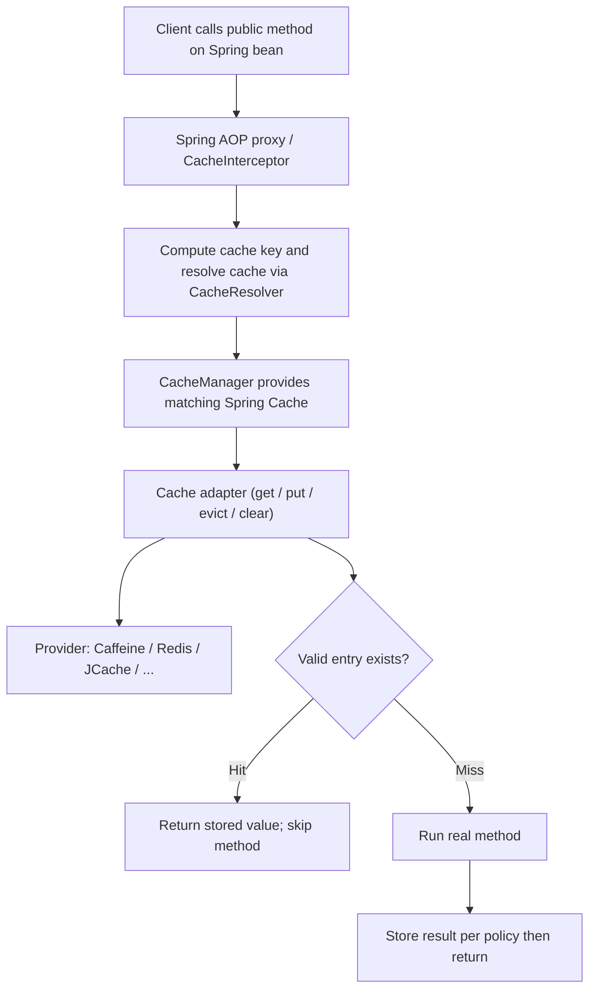

# Cache Providers and Adapters to Spring Cache

> **Context:** Spring Framework → Cache → Architecture. This lesson explains how the Spring Cache abstraction connects to storage providers, how to configure adapters, and criteria for choosing a solution based on operational requirements.

## 1. Separating Three Concepts: Spring Cache, Adapter, and Cache Provider

**Spring Cache** is an abstraction API for applications to use caching uniformly, primarily through `org.springframework.cache.Cache`, `CacheManager`, and annotations such as `@Cacheable`, `@CachePut`, and `@CacheEvict`. It **does not itself provide** all storage capabilities, TTLs, capacity limits, or cross-machine data synchronization.

- **Cache provider (backend):** where data actually resides and storage policies are enforced. Examples: JVM memory via `ConcurrentHashMap`, Caffeine, Redis, or a JCache-compatible engine such as Ehcache 3.
- **Adapter:** a class implementing Spring's `Cache` or `CacheManager` interface and translating `get`/`put`/`evict`/`clear` operations into provider commands. Examples: `CaffeineCacheManager` creates `CaffeineCache` instances; `RedisCacheManager` creates `RedisCache`; `JCacheCacheManager` wraps `javax.cache.CacheManager`.
- **Spring Cache abstraction:** the layer calling the adapter from declarative cache logic. Business services only need to know the cache name and key generation strategy; provider details live in configuration.

This layering lets you swap backends without typically modifying service annotations. However, **changing providers does not guarantee identical behavior**: `null` handling, TTL, serialization, atomicity, cross-node consistency, fault tolerance, and performance still differ.

### Flow of a `@Cacheable` Invocation



By default, `CacheResolver` typically uses `CacheManager` to look up caches by `cacheNames`. `CacheInterceptor` controls method execution, while the adapter performs I/O against the backend. With `@Cacheable(cacheNames = "products", key = "#p0")`, two calls with the same first argument usually access the same entry. On a cache hit, code inside the method does not execute.

`@CachePut` always runs the method and then stores the result; `@CacheEvict` deletes an entry or the entire cache according to policy. Both still depend on the configured adapter/provider.

## 2. Spring Cache Contracts That Adapters Must Implement

| Component | Responsibility | What to distinguish |
|---|---|---|
| `Cache` | Represents **one named cache region**; provides `get`, `put`, `evict`, `clear`, and variants. | Contains bridging logic to the provider; `getNativeCache()` can expose the backend object. |
| `CacheManager` | `getCache(name)` and `getCacheNames()`; creates, stores, or looks up caches by name. | Not necessarily the cache server itself; it can manage multiple adapters. |
| `CacheResolver` | Decides which caches to use for a given call, potentially based on method/args. | Useful for dynamic routing; defaults usually rely on `CacheManager`. |
| `KeyGenerator` | Turns method arguments into a key if `key` is not declared. | Key rules must be stable, collision-free, and tenant-aware. |
| `CacheErrorHandler` | Handles errors when accessing the provider through Spring Cache. | Error handling is a business decision; swallowing errors can increase load on the data backend. |

`SimpleKeyGenerator` defaults to `SimpleKey.EMPTY` for zero arguments, the argument itself for a single argument, and a composite `SimpleKey` for multiple arguments. Objects used as keys should have proper `equals()`/`hashCode()`. For distributed caches, you must also consider converting keys to strings/bytes and prefixing to prevent collisions.

Annotations **have no universal TTL attribute across all providers**. Lifetime, entry limits, eviction strategies, persistence, replication, and serializers are configured via the specific backend/adapter.

## 3. Common Providers and Adapters

| Provider / storage type | Spring-side adapter/manager | Characteristics and use cases |
|---|---|---|
| JDK `ConcurrentHashMap` (local) | `ConcurrentMapCache`, `ConcurrentMapCacheManager`; or `SimpleCacheManager` for a fixed list of caches | Very simple, fast, suited for demos/tests. No TTL, capacity eviction, or cross-JVM entry sharing by default. |
| **Caffeine** (local, in-JVM) | `CaffeineCache`, `CaffeineCacheManager` (`spring-context-support`) | Supports size limits, expiry, and efficient eviction policies; suited for hot data and single-instance apps or setups accepting independent per-node caches. |
| **Redis** (remote/shared) | `RedisCache`, `RedisCacheManager` from **Spring Data Redis** | Instances can share data; supports TTL, key prefix config, and serialization. Incurs network cost, Redis dependency, and requires data versioning. |
| **JCache / JSR-107** | `JCacheCacheManager`, `JCacheCache` (`spring-context-support`) | Bridges `javax.cache` API to Spring Cache; backend depends on provider, e.g., Ehcache 3. TTL/eviction configured via JCache/provider config. |
| **Hazelcast, Infinispan, Couchbase, Cache2k...** | Corresponding integration adapters or via JCache, depending on library/version | Can serve distributed caching, memory grids, or specific provider needs. Verify dependencies and version support. |
| **No-op / combining multiple managers** | `NoOpCacheManager`, `CompositeCacheManager` | No-op always misses, useful for testing/disabling cache. Composite looks up a manager with the cache in order; **it does not automatically become a two-tier L1/L2 cache**. |

**Distinguishing two commonly confused architectures:**

- Pod A's Caffeine and Pod B's Caffeine are **two separate caches**; the two pods warm up independently and may observe different values until entries expire/are evicted. Use Redis as a shared store if nodes must read the same keyspace.
- `CompositeCacheManager` only **selects one `Cache` by name across managers**. A true L1 Caffeine + L2 Redis mechanism requires a dedicated design/cache implementation: tiered read-through, cross-node update/invalidation, race handling, and per-tier hit-rate monitoring.

### Choosing a Provider Based on Real Requirements

| Architectural question | When to prioritize |
|---|---|
| Small, very hot data, network overhead must be low, per-instance caching acceptable? | Caffeine; configure `maximumSize`/expiry and monitor memory. |
| Multiple instances need to see the same cached data, share session-like data, or require centralized TTL? | Redis or equivalent distributed cache; watch latency and availability. |
| Already using an engine capable of on-heap/off-heap/disk via JCache? | JCache bridge; verify JSR-107 provider compatibility and lifecycle. |
| Only testing caching logic or very small app? | `ConcurrentMapCacheManager`; do not assume it is a long-term production choice. |
| Want to swap backends between environments? | Keep annotations provider-independent; declare `CacheManager`/`spring.cache.type` explicitly and test differences in keys/TTL/nulls/serialization. |

A fast cache is not automatically optimal: also evaluate miss frequency, entry size, P95/P99 latency, whether stale data is acceptable, invalidation cost, provider availability, and multi-instance deployment.

## 4. Configuring a Local Provider: Caffeine with Spring Boot

This standalone example runs on **Java 17+**, **Maven**, and **Spring Boot 3.5.7**. Spring Boot provides cache auto-configuration; the `spring-boot-starter-cache` dependency together with Caffeine selects `CaffeineCacheManager`. Versions in `pom.xml` are pinned for reproducibility, not as a prescription to keep those exact versions across all projects.

Directory structure:

```text
spring-cache-demo/
├── pom.xml
└── src/main/
    ├── java/dev/example/cache/CacheDemoApplication.java
    └── resources/application.properties
```

**`pom.xml`**

```xml
<?xml version="1.0" encoding="UTF-8"?>
<project xmlns="http://maven.apache.org/POM/4.0.0"
         xmlns:xsi="http://www.w3.org/2001/XMLSchema-instance"
         xsi:schemaLocation="http://maven.apache.org/POM/4.0.0 https://maven.apache.org/xsd/maven-4.0.0.xsd">
    <modelVersion>4.0.0</modelVersion>
    <parent>
        <groupId>org.springframework.boot</groupId>
        <artifactId>spring-boot-starter-parent</artifactId>
        <version>3.5.7</version>
        <relativePath/>
    </parent>
    <groupId>dev.example</groupId>
    <artifactId>spring-cache-demo</artifactId>
    <version>1.0.0</version>
    <properties>
        <java.version>17</java.version>
    </properties>
    <dependencies>
        <dependency>
            <groupId>org.springframework.boot</groupId>
            <artifactId>spring-boot-starter-cache</artifactId>
        </dependency>
        <dependency>
            <groupId>com.github.ben-manes.caffeine</groupId>
            <artifactId>caffeine</artifactId>
        </dependency>
    </dependencies>
    <build>
        <plugins>
            <plugin>
                <groupId>org.springframework.boot</groupId>
                <artifactId>spring-boot-maven-plugin</artifactId>
            </plugin>
        </plugins>
    </build>
</project>
```

**`src/main/resources/application.properties`**

```properties
spring.main.web-application-type=none
spring.main.banner-mode=off
logging.level.root=OFF

spring.cache.type=caffeine
spring.cache.cache-names=products
spring.cache.caffeine.spec=maximumSize=1000,expireAfterWrite=10m
```

`maximumSize` caps the approximate number of entries Caffeine retains; `expireAfterWrite=10m` expires entries 10 minutes after write/update, not 10 minutes after each read. The `products` cache lives in this JVM's memory.

**`src/main/java/dev/example/cache/CacheDemoApplication.java`**

```java
package dev.example.cache;

import java.util.concurrent.atomic.AtomicInteger;
import org.springframework.boot.CommandLineRunner;
import org.springframework.boot.SpringApplication;
import org.springframework.boot.autoconfigure.SpringBootApplication;
import org.springframework.cache.annotation.Cacheable;
import org.springframework.cache.annotation.EnableCaching;
import org.springframework.stereotype.Service;

@SpringBootApplication
@EnableCaching
public class CacheDemoApplication implements CommandLineRunner {
    private final ProductService products;

    public CacheDemoApplication(ProductService products) {
        this.products = products;
    }

    public static void main(String[] args) {
        SpringApplication.run(CacheDemoApplication.class, args);
    }

    @Override
    public void run(String... args) {
        System.out.println("first=" + products.getProduct("P42"));
        System.out.println("again=" + products.getProduct("P42"));
        System.out.println("other=" + products.getProduct("P99"));
        System.out.println("loadCount=" + products.loadCount());
    }
}

@Service
class ProductService {
    private final AtomicInteger counter = new AtomicInteger();

    @Cacheable(cacheNames = "products", key = "#p0")
    public String getProduct(String sku) {
        return "product-" + sku + "-load-" + counter.incrementAndGet();
    }

    public int loadCount() {
        return counter.get();
    }
}
```

From the directory containing `pom.xml`, run:

```bash
mvn -q spring-boot:run
```

Application stdout on a **single run with a fresh cache** (excluding Maven messages):

```text
first=product-P42-load-1
again=product-P42-load-1
other=product-P99-load-2
loadCount=2
```

Because the call goes from `CacheDemoApplication` to the `ProductService` bean through the proxy, `@Cacheable` takes effect. The second call with `P42` hits, so the counter does not increment. If you instantiate `ProductService` with `new` or call `this.getProduct(...)` directly from another method in the same bean, the standard proxy cannot intercept that call.

To configure via Java instead of properties, you can define a `CaffeineCacheManager` `@Bean CacheManager`, setting the cache names and Caffeine builder. When defining a custom manager, verify carefully because Boot's auto-configuration may no longer select a provider based on `spring.cache.type`.

## 5. Swapping Provider to Redis: Annotations Stay Unchanged

When multiple application instances need to share caches, you can add the following dependency to `pom.xml`:

```xml
<dependency>
    <groupId>org.springframework.boot</groupId>
    <artifactId>spring-boot-starter-data-redis</artifactId>
</dependency>
```

Then **replace** the Caffeine `spring.cache.*` section with Redis configuration; keep the Java service and `@Cacheable` unchanged:

```properties
spring.cache.type=redis
spring.data.redis.host=localhost
spring.data.redis.port=6379
spring.cache.redis.time-to-live=10m
spring.cache.redis.cache-null-values=false
spring.cache.redis.use-key-prefix=true
```

A reachable Redis server at `localhost:6379` is required. Boot configures `RedisCacheManager` via Spring Data Redis; cache names and keys are converted into Redis keys, typically prefixed by cache name (e.g., formatted like `products::P42` depending on key conversion settings). `time-to-live=10m` is the Redis cache expiry policy. Do not blindly apply a single TTL to all data: pricing, permissions, catalogs, and configurations have different change frequencies.

**Important considerations when moving from local to Redis:**

1. **Serialization.** Caffeine stores objects on the heap; Redis stores bytes. Choose a serializer intentionally, and verify object compatibility and schema versions; default configuration may use Java native serialization, which is often unsuitable for multi-language/multi-version data exchange.
2. **Stable keys.** For complex keys, do not rely on arbitrary `toString()`; define namespaces, tenants, versions, and deterministic string formats. Prefixes prevent name collisions across cache types.
3. **Redis health.** Local hits are very fast; Redis involves network latency, timeouts, and connection errors. Decide on fail-fast, fallback, or ignoring cache errors based on your application's correctness requirements.
4. **Stale data after deploy.** Shared caches can outlive process lifecycles; changing DTO structures or key computation requires corresponding versioning/invalidation.
5. **Atomicity.** Do not assume every multi-command operation in the Redis adapter automatically holds a global lock; read `RedisCacheWriter` documentation and test race conditions.

The `Caffeine` and `Redis` examples illustrate **two alternative manager choices**, not instructions to use both simultaneously for the same cache name. If switching across environments, specify the provider clearly in config and test against a real connection.

## 6. JCache Bridge (JSR-107) and When a Custom Adapter Is Needed

**JCache** standardizes how Java applications talk to cache engines via the `javax.cache` API. Spring provides `JCacheCacheManager` to bridge this API to `org.springframework.cache.CacheManager`. These are **two identically named types in different packages**.

Integration example **when the application already has a provider's `javax.cache.CacheManager`**:

```java
import org.springframework.cache.jcache.JCacheCacheManager;
import org.springframework.context.annotation.Bean;
import org.springframework.context.annotation.Configuration;

@Configuration
class CacheBridgeConfig {
    @Bean
    org.springframework.cache.CacheManager springCacheManager(
            javax.cache.CacheManager providerCacheManager) {
        return new JCacheCacheManager(providerCacheManager);
    }
}
```

This snippet is a **bridge configuration**, not a standalone program: you must add the JCache API, an implementation (such as Ehcache 3), provider configuration, and the corresponding `javax.cache.CacheManager` bean. JCache-side cache names may need to be pre-created. Spring Cache annotations and JCache annotations (such as `@CacheResult`) belong to two separate groups; they can be integrated, but do not mix syntaxes without understanding the processing rules.

If a cache engine **has no built-in adapter**, you must design a class implementing `org.springframework.cache.Cache` and a `CacheManager` returning those instances. Minimum mapping table:

| Spring interface | Work to bridge down to the backend |
|---|---|
| `Cache.get(key)` | Read entry; return `ValueWrapper` or `null` on miss, distinguishing if the provider supports caching null values. |
| `Cache.get(key, Callable)` | Load value on miss; check provider synchronization/atomicity requirements and handle `ValueRetrievalException`. |
| `Cache.put(key, value)` | Encode key/value with the appropriate codec and write to cache. |
| `Cache.evict(key)` / `clear()` | Delete one entry / the entire cache region; watch eviction scope and performance. |
| `Cache.getName()` / `getNativeCache()` | Expose the logical name and appropriate backend object. |
| `CacheManager.getCache(name)` | Look up/create the adapter by name or return `null` if no matching cache exists. |

Before writing a new adapter, verify whether the provider is already usable via Spring Data or JCache. A custom adapter must address null semantics, key conversion, thread safety, loaders, error handling, and observability; simply wrapping `get`/`set` and calling it compatible is not enough.

## 7. Differences That Can Break Programs When Switching Providers

### 7.1. TTL and Invalidation Are Two Different Things

TTL bounds how long data can stay stale; **it does not guarantee data is always fresh**. Reading data from the DB via `@Cacheable` and updating the DB from another thread can cause the cache to return stale results until expiration. For write paths controlled by the service itself, `@CacheEvict` can be used after the update to remove the entry. Illustrative example (assuming `repository` already exists):

```java
@Cacheable(cacheNames = "products", key = "#p0")
public Product find(String id) {
    return repository.findById(id).orElseThrow();
}

@CacheEvict(cacheNames = "products", key = "#p0")
public void update(String id, ProductUpdate change) {
    repository.update(id, change);
}
```

These are **two illustrative methods inside an already-configured service**, not a standalone Java file. Consider transaction commit timing, other external writers, and read/write races; if the cache is invalidated before the DB commits, another reader may load the old value back into the cache.

### 7.2. Nulls and Cache Stampede

Some providers allow caching `null`, others do not; adapters also have their own settings. Caching "not found" results can reduce load, but retaining them too long causes newly created entities to still appear missing. Align `unless = "#result == null"`, `allowNullValues`/`cache-null-values` settings, and business semantics.

When many requests miss the same key simultaneously, they may all query the DB at once (**cache stampede**). `@Cacheable(sync = true)` requests synchronized value loading when supported by the backend/adapter; **do not assume it acts as a distributed lock across all instances**. Spring restricts certain combinations when `sync = true` (e.g., only one cache and no `unless`). For hot data across multiple nodes, separately evaluate request coalescing, TTL jitter, and refresh strategies.

### 7.3. Transactions, Consistency, and Network Errors

Spring Cache does not automatically turn the DB and the cache provider into **one atomic transaction**. Some managers offer transaction-aware modes to defer cache operations until an appropriate point, but you still need to design update ordering, error recovery, and invalidation events. Redis/cache clusters can become slow or unreachable; the operational goal is to keep the application serving **correct** data when the cache is down while avoiding a cascading load surge on the DB.

### 7.4. Proxy Limitations

`@EnableCaching` activates the cache annotation infrastructure (Spring Boot does not infer every condition automatically). Default proxy mode only intercepts calls **passing through the Spring proxy**, typically external bean calls to public methods. Self-invocation, private methods, creating objects with `new`, or misconfigured proxies can make annotations appear ignored. Do not scatter provider-dependent code (`RedisTemplate`, Caffeine native cache) throughout services if backend independence is the goal.

## 8. Testing and Observability in Real Systems

Verifying an adapter and provider takes more than seeing "the method ran fast" once:

1. **Hit/miss:** calling key A twice invokes the loader only once before expiration; key B is independent. Measure hit rate per cache name and miss cost.
2. **Expiry/eviction:** use a controlled clock or wait duration to verify entries expire per policy; test capacity limits with Caffeine.
3. **Cross-instance:** on Redis, run two processes pointing to the same Redis and verify shared keyspace; on Caffeine, verify they are independent.
4. **Write/invalidate:** update the real source and verify `@CacheEvict` targets the right key and timing; test errors and transaction rollbacks.
5. **Serializers and upgrades:** test real DTOs, null policies, key formats, schema changes, stale cached data after deploy, and class loading.
6. **Failure & concurrency:** simulate Redis timeouts, concurrent misses, hot keys, and large cache clears; measure P95/P99 latency, error rate, and memory/eviction.
7. **Configuration audit:** logs/cache metrics must prove which `CacheManager` the app is actually using. Do not rely on a dependency's presence on the classpath to conclude which provider was selected.

With Spring Boot, auto-configuration detects providers on the classpath if no custom `CacheManager`/`CacheResolver` is declared. When multiple choices exist, **set `spring.cache.type` explicitly** and verify the actual manager. To use multiple backends for different cache names, you can define multiple managers and select via `cacheManager`/`cacheResolver` on annotations or appropriate configuration; avoid duplicate cache names and hard-to-observe routing.

## 9. Common Errors and How to Diagnose

| Symptom | Common causes | Diagnostic direction |
|---|---|---|
| `@Cacheable` does not reduce method invocations | Missing `@EnableCaching`; self-invocation; bean not Spring-managed | Check proxy path and call from another bean; verify cache infrastructure is enabled. |
| Cache name not found or no manager | Wrong `cacheNames`, unregistered cache name, auto-configuration picked unintended backend | Inspect `CacheManager` bean, `getCacheNames()`, and cache names in config. |
| Node A hits, node B misses | Local Caffeine/ConcurrentMap cache per JVM | Decide whether local caching is appropriate; consider a shared provider. |
| Key exists in Redis but reading fails | Incompatible serializer, different key prefix/format, DTO changed | Inspect codec, key naming, schema versions, and raw stored bytes. |
| Returned data is stale | TTL too long, missing invalidation, external writer outside the app | Design cache invalidation and test update race conditions. |
| Cache grows continuously | Map without eviction, or TTL/size settings not applied | Verify which provider and policy are actually running; monitor memory. |
| Sudden spike in DB load | Concurrent misses, unstable keys, cache backend errors | Measure hit/miss, timeouts, and stampede causes; configure proper fallback. |

## 10. Decision Process When Integrating a Backend

**Step 1 — Define semantics.** What is an entry, which attributes make up the key, what TTL is acceptable, what does null mean, who is responsible for invalidation, and are there multiple nodes or tenants?

**Step 2 — Choose provider.** Choose Caffeine for capacity-bounded local hot caches, Redis for shared caches and centralized TTLs, JCache when a standards-compatible engine is needed; evaluate latency, memory, consistency, operations, and failure modes.

**Step 3 — Choose bridge.** Prefer built-in adapters (`CaffeineCacheManager`, `RedisCacheManager`, `JCacheCacheManager`); write a custom `Cache`/`CacheManager` only when no supported integration path exists.

**Step 4 — Configure policies on the provider.** Specify cache names, TTLs, capacity, serialization, key prefixes, error behavior, and monitoring. Place `@Cacheable`/`@CacheEvict` at service boundaries and verify proxy behavior.

**Step 5 — Verify via real behavior.** Prove hit/miss, expiration, invalidation, cross-node differences, backend failures, and stale data after deploy; inspect the actual manager in the application context.

### Official References

- Spring Framework — Cache Abstraction: https://docs.spring.io/spring-framework/reference/integration/cache.html
- Spring Framework — Configuring the Cache Storage: https://docs.spring.io/spring-framework/reference/integration/cache/store-configuration.html
- Spring Framework — Declarative Annotation-based Caching: https://docs.spring.io/spring-framework/reference/integration/cache/annotations.html
- Spring Framework — Provider-specific TTL/eviction: https://docs.spring.io/spring-framework/reference/integration/cache/specific-config.html
- Spring Boot — Caching and supported providers: https://docs.spring.io/spring-boot/reference/io/caching.html
- Spring Data Redis — Redis Cache: https://docs.spring.io/spring-data/redis/reference/redis/redis-cache.html
