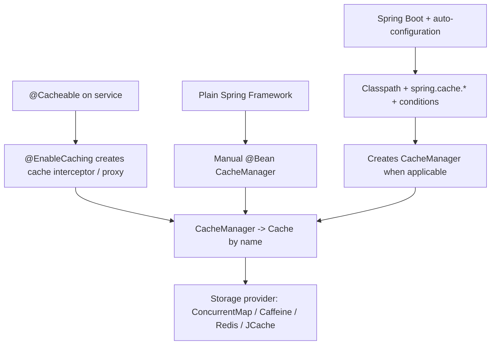

# Distinguishing Spring Framework Configuration from Spring Boot Auto-Configuration

> **Topic:** Spring Framework – Cache · **Group:** Setup.  
> Objectives: understand which parts belong to **Spring Framework Cache Abstraction** and which are provided by **Spring Boot Auto-configuration**; configure caching manually in a plain Spring application; use auto-configuration in Spring Boot; and know when Boot backs off in favor of developer-declared configuration.

## 1. Same Spring Cache API, Different Setup Paths

Spring Framework provides **the caching abstraction**: the annotations `@Cacheable`, `@CachePut`, `@CacheEvict`, and `@Caching`; the SPIs `org.springframework.cache.Cache` and `org.springframework.cache.CacheManager`; and the AOP/interceptor infrastructure to intercept method calls. The framework does not force an application to use a particular store. A suitable `CacheManager` is required to look up a `Cache` by name.

**Plain Spring Framework**: the application must declare the required infrastructure itself, typically `@EnableCaching` and a `CacheManager` bean. The provider is selected through dependencies and configuration code managed by the application itself.

**Spring Boot**: still uses all of the Spring Cache APIs above, while adding **auto-configuration**. Once annotation caching is enabled via `@EnableCaching`, Boot can automatically create a `CacheManager` from providers on the classpath and `spring.cache.*` properties, **provided no custom configuration causes auto-configuration to back off**.

Keep four independent facts in mind:

1. `@Cacheable` describes a method's **caching behavior**; merely writing this annotation does not activate caching.
2. `@EnableCaching` activates the annotation-processing infrastructure; both plain Spring and Boot require it when using annotation-based caching.
3. `CacheManager` is the object that looks up `Cache` regions; it can be declared manually by the application or created by Boot.
4. **The backend/provider** (ConcurrentMap, Caffeine, Redis, JCache, etc.) determines where data is stored and what operational limits apply. There is no universal Spring Cache annotation for setting TTL across all providers.



**Key takeaway:** Boot automates *wiring and default configuration*; it does not replace the Spring Cache API, nor does it turn `@Cacheable` into a cache provider on its own.

## 2. Responsibility Comparison Table

| Concern | Plain Spring Framework | Spring Boot |
|---|---|---|
| Cache abstraction, `@Cacheable`, `@CacheEvict` | Provided by Spring Framework | Still Spring Framework APIs |
| Enabling annotation-based caching | Add `@EnableCaching` to `@Configuration` | Still add `@EnableCaching`; `@SpringBootApplication` and the starter alone are not enough |
| Creating `CacheManager` | Declare `@Bean` or equivalent config | Boot can create it automatically when conditions are satisfied |
| Selecting provider | Choose dependencies + adapter + bean manually | Boot detects via classpath and provider order; `spring.cache.type` can be used |
| Cache names | Passed to manager or configuration code | Can use `spring.cache.cache-names` depending on provider |
| TTL, eviction, serialization | Configured in provider/manager | Boot properties for common providers or corresponding builders/customizers |
| `spring.cache.*` in `application.properties` | Has no built-in meaning in plain Spring | Read by Boot to auto-configure when the auto-config branch applies |
| Deep customization | Primarily `@Bean` code, XML, or custom adapters | Use properties, customizers, or declare `@Bean` to replace auto-config |
| Conditionally disabling cache | Swap manager for `NoOpCacheManager` or omit enabling caching | Can use `spring.cache.type=none` when Boot manages the manager |
| Testing & production | Organize profiles, configurations, and dependencies yourself | Profiles, properties, condition report, and actuator aid observability |

**Do not equate `@SpringBootApplication` with `@EnableCaching`.** `@SpringBootApplication` bundles Boot features such as component scanning and auto-configuration; `@EnableCaching` is a distinct signal to process cache annotations. Boot documentation also recommends placing `@EnableCaching` on a separate configuration class so tests can enable or disable the feature intentionally.

## 3. Inside a Cache Hit/Miss: Framework Responsibilities Remain Unchanged

Suppose a service has:

```java
@Cacheable(cacheNames = "books", key = "#p0")
public Book findBook(String isbn) {
    return repository.findByIsbn(isbn).orElseThrow();
}
```

This is an illustrative snippet inside a bean with a real repository, **not a standalone program**. When `@EnableCaching` and a properly configured `CacheManager` are present:

1. Caller invokes the method **through the Spring proxy**.
2. The cache interceptor determines the cache name and key. `#p0` is the first argument, independent of parameter names in bytecode.
3. `CacheManager.getCache("books")` returns a `Cache` object.
4. On a hit, the proxy returns the cached value; the method body does not run. On a miss, the method runs and the result is written to the cache according to policy.
5. Subsequent calls with the same key access the cache again, regardless of whether the manager was configured via plain Framework or Boot.

Proxy rules apply to both approaches: self-invocation (`this.findBook(...)`), objects created via `new`, or private methods do not go through the Spring proxy under the default mechanism, so caching annotations may not work. Similarly, `@CachePut` always calls the method and writes the result, while `@CacheEvict` removes entries/caches as configured.

## 4. Manual Setup with Plain Spring Framework — Runnable Example

The example below uses **Java 17+**, **Maven**, and **Spring Framework 6.2.12** pinned for reproducibility. There is no `spring-boot-*`, no `@SpringBootApplication`, and no Boot auto-configuration.

Project structure:

```text
framework-manual-cache/
├── pom.xml
└── src/main/java/dev/example/manual/ManualCacheApp.java
```

**`pom.xml`**

```xml
<?xml version="1.0" encoding="UTF-8"?>
<project xmlns="http://maven.apache.org/POM/4.0.0"
         xmlns:xsi="http://www.w3.org/2001/XMLSchema-instance"
         xsi:schemaLocation="http://maven.apache.org/POM/4.0.0 https://maven.apache.org/xsd/maven-4.0.0.xsd">
    <modelVersion>4.0.0</modelVersion>
    <groupId>dev.example</groupId>
    <artifactId>framework-manual-cache</artifactId>
    <version>1.0.0</version>

    <properties>
        <maven.compiler.release>17</maven.compiler.release>
        <project.build.sourceEncoding>UTF-8</project.build.sourceEncoding>
    </properties>

    <dependencies>
        <dependency>
            <groupId>org.springframework</groupId>
            <artifactId>spring-context</artifactId>
            <version>6.2.12</version>
        </dependency>
    </dependencies>

    <build>
        <plugins>
            <plugin>
                <groupId>org.apache.maven.plugins</groupId>
                <artifactId>maven-compiler-plugin</artifactId>
                <version>3.13.0</version>
            </plugin>
            <plugin>
                <groupId>org.codehaus.mojo</groupId>
                <artifactId>exec-maven-plugin</artifactId>
                <version>3.3.0</version>
                <configuration>
                    <mainClass>dev.example.manual.ManualCacheApp</mainClass>
                </configuration>
            </plugin>
        </plugins>
    </build>
</project>
```

**`src/main/java/dev/example/manual/ManualCacheApp.java`**

```java
package dev.example.manual;

import java.util.concurrent.atomic.AtomicInteger;
import org.springframework.cache.CacheManager;
import org.springframework.cache.annotation.Cacheable;
import org.springframework.cache.annotation.EnableCaching;
import org.springframework.cache.concurrent.ConcurrentMapCacheManager;
import org.springframework.context.annotation.AnnotationConfigApplicationContext;
import org.springframework.context.annotation.Bean;
import org.springframework.context.annotation.Configuration;

public class ManualCacheApp {
    public static void main(String[] args) {
        try (AnnotationConfigApplicationContext context =
                     new AnnotationConfigApplicationContext(CacheConfig.class)) {
            BookService books = context.getBean(BookService.class);
            CacheManager cacheManager = context.getBean(CacheManager.class);

            System.out.println("manager=" + cacheManager.getClass().getSimpleName());
            System.out.println("first=" + books.find("A"));
            System.out.println("again=" + books.find("A"));
            System.out.println("other=" + books.find("B"));
            System.out.println("loads=" + books.loadCount());
        }
    }

    @Configuration(proxyBeanMethods = false)
    @EnableCaching
    public static class CacheConfig {
        @Bean
        public CacheManager cacheManager() {
            return new ConcurrentMapCacheManager("books");
        }

        @Bean
        public BookService bookService() {
            return new BookService();
        }
    }

    public static class BookService {
        private final AtomicInteger loads = new AtomicInteger();

        @Cacheable(cacheNames = "books", key = "#p0")
        public String find(String isbn) {
            return "book-" + isbn + "#" + loads.incrementAndGet();
        }

        public int loadCount() {
            return loads.get();
        }
    }
}
```

Run inside `framework-manual-cache`:

```bash
mvn -q compile exec:java
```

Stdout printed by the program itself when starting with a fresh context/cache (excluding Maven logs if your environment prints extra lines):

```text
manager=ConcurrentMapCacheManager
first=book-A#1
again=book-A#1
other=book-B#2
loads=2
```

**Explanation:**

- `@EnableCaching` installs the interceptor infrastructure for annotations. If omitted, `find("A")` runs twice and `loads` increments further, even though `CacheManager` remains a valid bean.
- `@Bean CacheManager` explicitly specifies the adapter and cache name `books`. No Boot is needed and there is no provider auto-detection order.
- `ConcurrentMapCacheManager` keeps entries in the JVM; suitable for learning or testing. It does not natively provide TTL, size limits, cross-process sharing, or multi-node invalidation.
- The Spring proxy intercepts calls from `main` to the `BookService` bean and returns a hit on the second call for A.

To use Caffeine in plain Spring, you must add `spring-context-support` and the Caffeine dependency, replace the manager bean with `CaffeineCacheManager`, and configure `setCacheSpecification` or a builder. To use Redis, you must add Spring Data Redis, a Redis connection, and create/configure `RedisCacheManager`. Those beans govern this layer; **merely adding a library to the classpath does not auto-create provider configuration** as Boot does.

A Caffeine configuration form **replacing the `cacheManager()` method in the plain Spring example** (assuming `spring-context-support` and the Caffeine library have been added):

```java
@Bean
public CacheManager cacheManager() {
    CaffeineCacheManager manager = new CaffeineCacheManager("books");
    manager.setCacheSpecification("maximumSize=500,expireAfterWrite=10m");
    return manager;
}
```

The `CaffeineCacheManager` class is `org.springframework.cache.caffeine.CaffeineCacheManager`. The snippet above is a replacement method inside `@Configuration`, **not a standalone class**. Annotations on `BookService` do not need to change. TTL and capacity belong to Caffeine's policy.

## 5. Setup with Spring Boot — Runnable Example with Auto-Configuration

The following example uses **Java 17+** and **Spring Boot 3.5.7**, a specific version chosen to keep dependencies consistent in this lesson. Boot manages the versions of Spring Framework and Caffeine; do not pin transitive versions separately. This is **a separate project** from the example in Section 4.

Structure:

```text
boot-auto-cache/
├── pom.xml
└── src/main/
    ├── java/dev/example/bootcache/
    │   ├── BootCacheApplication.java
    │   ├── CachingConfiguration.java
    │   └── BookService.java
    └── resources/application.properties
```

**`pom.xml`**

```xml
<?xml version="1.0" encoding="UTF-8"?>
<project xmlns="http://maven.apache.org/POM/4.0.0"
         xmlns:xsi="http://www.w3.org/2001/XMLSchema-instance"
         xsi:schemaLocation="http://maven.apache.org/POM/4.0.0 https://maven.apache.org/xsd/maven-4.0.0.xsd">
    <modelVersion>4.0.0</modelVersion>
    <parent>
        <groupId>org.springframework.boot</groupId>
        <artifactId>spring-boot-starter-parent</artifactId>
        <version>3.5.7</version>
        <relativePath/>
    </parent>
    <groupId>dev.example</groupId>
    <artifactId>boot-auto-cache</artifactId>
    <version>1.0.0</version>
    <properties>
        <java.version>17</java.version>
    </properties>
    <dependencies>
        <dependency>
            <groupId>org.springframework.boot</groupId>
            <artifactId>spring-boot-starter-cache</artifactId>
        </dependency>
        <dependency>
            <groupId>com.github.ben-manes.caffeine</groupId>
            <artifactId>caffeine</artifactId>
        </dependency>
    </dependencies>
    <build>
        <plugins>
            <plugin>
                <groupId>org.springframework.boot</groupId>
                <artifactId>spring-boot-maven-plugin</artifactId>
            </plugin>
        </plugins>
    </build>
</project>
```

**`src/main/resources/application.properties`**

```properties
spring.main.web-application-type=none
spring.main.banner-mode=off
logging.level.root=OFF

spring.cache.type=caffeine
spring.cache.cache-names=books
spring.cache.caffeine.spec=maximumSize=500,expireAfterWrite=10m
```

The three `spring.cache.*` properties are read by Spring Boot via cache auto-configuration: selecting Caffeine, initializing the `books` cache, and configuring capacity/expiry. `spring.cache.type=caffeine` also prevents choosing the wrong provider when the classpath holds multiple cache libraries. This TTL belongs to Caffeine, **not to an attribute on `@Cacheable`**.

**`src/main/java/dev/example/bootcache/BootCacheApplication.java`**

```java
package dev.example.bootcache;

import org.springframework.boot.CommandLineRunner;
import org.springframework.boot.SpringApplication;
import org.springframework.boot.autoconfigure.SpringBootApplication;
import org.springframework.cache.CacheManager;

@SpringBootApplication
public class BootCacheApplication implements CommandLineRunner {
    private final BookService books;
    private final CacheManager cacheManager;

    public BootCacheApplication(BookService books, CacheManager cacheManager) {
        this.books = books;
        this.cacheManager = cacheManager;
    }

    public static void main(String[] args) {
        SpringApplication.run(BootCacheApplication.class, args);
    }

    @Override
    public void run(String... args) {
        System.out.println("manager=" + cacheManager.getClass().getSimpleName());
        System.out.println("first=" + books.find("A"));
        System.out.println("again=" + books.find("A"));
        System.out.println("other=" + books.find("B"));
        System.out.println("loads=" + books.loadCount());
    }
}
```

**`src/main/java/dev/example/bootcache/CachingConfiguration.java`**

```java
package dev.example.bootcache;

import org.springframework.cache.annotation.EnableCaching;
import org.springframework.context.annotation.Configuration;

@Configuration(proxyBeanMethods = false)
@EnableCaching
public class CachingConfiguration {
}
```

**`src/main/java/dev/example/bootcache/BookService.java`**

```java
package dev.example.bootcache;

import java.util.concurrent.atomic.AtomicInteger;
import org.springframework.cache.annotation.Cacheable;
import org.springframework.stereotype.Service;

@Service
public class BookService {
    private final AtomicInteger loads = new AtomicInteger();

    @Cacheable(cacheNames = "books", key = "#p0")
    public String find(String isbn) {
        return "book-" + isbn + "#" + loads.incrementAndGet();
    }

    public int loadCount() {
        return loads.get();
    }
}
```

Run:

```bash
mvn -q spring-boot:run
```

Program stdout (cache empty at startup):

```text
manager=CaffeineCacheManager
first=book-A#1
again=book-A#1
other=book-B#2
loads=2
```

Here **no `CacheManager` bean is declared by the application**: Boot creates `CaffeineCacheManager` because caching is enabled, Caffeine is on the classpath, and configuration selects `caffeine`. `@EnableCaching` still appears in `CachingConfiguration`. Proxy/call-interceptor creation remains a Spring Framework function, so hit/miss behavior matches the plain Spring example.

Note: Spring Boot can default to a `simple` `ConcurrentMapCacheManager` if no other provider is present and auto-configuration conditions are met. **Merely running does not prove production is using Caffeine/Redis**; always check the actual manager.

## 6. How Does Boot Decide Whether to Auto-Create `CacheManager`?

### 6.1. Key Conditions

`CacheAutoConfiguration` belongs to Spring Boot. To obtain a manager from the auto-configuration branch, you typically need:

- The application running with Boot auto-configuration, e.g., `@SpringBootApplication` or `@EnableAutoConfiguration`.
- Annotation caching infrastructure enabled via `@EnableCaching`.
- The required provider dependencies present.
- The application **has not declared its own `CacheManager`** or configured a `CacheResolver` in a way that causes auto-configuration to back off.
- The provider is detected via classpath/configuration conditions; `spring.cache.type` can force a specific type when Boot manages the manager.

Per Spring Boot 3.5 documentation, when no application-defined manager exists, Boot tries options in this order: **Generic → JCache → Hazelcast → Infinispan → Couchbase → Redis → Caffeine → Cache2k → Simple**. Order and conditions can vary across version lines; check the documentation matching your running version. `Generic` applies when the application already defines `Cache` beans for Boot to aggregate into a manager. A library offering both a native adapter and JCache support may be picked up via JCache first if eligible.

For example, adding both Redis and Caffeine dependencies while a valid Redis connection is configured may cause Boot to choose Redis instead of Caffeine if left to auto-detect. Setting `spring.cache.type=caffeine` (or `redis`) and checking the runtime bean confirms your intent.

### 6.2. Distinguishing Auto-Config, Properties, and Manual Beans

The following three styles **are not equivalent**:

**Style A — Let Boot pick a provider from the classpath:**

```properties
spring.cache.cache-names=books
```

This style is convenient for experimentation, yet the outcome can change when starters or libraries are added. `cache-names` initializes cache names when supported by the manager/provider; it does not guarantee which provider is selected.

**Style B — Let Boot create the manager, but select the provider explicitly:**

```properties
spring.cache.type=caffeine
spring.cache.cache-names=books
spring.cache.caffeine.spec=maximumSize=500,expireAfterWrite=10m
```

Requires the Caffeine dependency. Boot controls manager creation, so provider-specific properties apply under the Caffeine auto-config branch.

**Style C — Declare `CacheManager` manually in a Boot application:**

```java
import org.springframework.cache.CacheManager;
import org.springframework.cache.caffeine.CaffeineCacheManager;
import org.springframework.context.annotation.Bean;
import org.springframework.context.annotation.Configuration;

@Configuration(proxyBeanMethods = false)
class ManualManagerConfiguration {
    @Bean
    CacheManager cacheManager() {
        CaffeineCacheManager manager = new CaffeineCacheManager("books");
        manager.setCacheSpecification("maximumSize=1000,expireAfterWrite=30m");
        return manager;
    }
}
```

This is an **additional class in a Boot project that already has Caffeine and `@EnableCaching`**. When an application-supplied bean exists, Boot stops auto-creating the default manager. Properties like `spring.cache.caffeine.spec` do not automatically modify the manual manager in Style C; you must configure it directly on the bean or via your own customizer code. Nor can `spring.cache.type=none` **be expected to override** a user-declared manager.

### 6.3. How a Customizer Differs from Declaring a Manager Manually

To keep **the Boot-created manager** while tuning its behavior, use a provider-appropriate `CacheManagerCustomizer`:

```java
import org.springframework.boot.autoconfigure.cache.CacheManagerCustomizer;
import org.springframework.cache.caffeine.CaffeineCacheManager;
import org.springframework.context.annotation.Bean;
import org.springframework.context.annotation.Configuration;

@Configuration(proxyBeanMethods = false)
class CacheTuningConfiguration {
    @Bean
    CacheManagerCustomizer<CaffeineCacheManager> disableNullCaching() {
        return manager -> manager.setAllowNullValues(false);
    }
}
```

This is an add-on snippet for the Boot project in Section 5, **not a standalone program**. This customizer only helps when the manager is auto-configured by Boot and is of type `CaffeineCacheManager`; it is not invoked to customize a manager declared manually via `@Bean`. If the application selects Redis or Simple, a Caffeine-typed customizer does not apply.

For advanced needs you can use provider-specific builder customizers (such as `RedisCacheManagerBuilderCustomizer`), or supply a full manager bean in the context. Choose a single primary configuration owner to keep maintenance predictable.

## 7. Providers, Dependencies, and Properties: Environment-Switching Examples

Spring Boot **does not spawn a Redis storage engine** and does not turn a local Caffeine cache into a shared cache. Boot only sets up the adapter to a provider whose conditions are met. Practical rules:

| Goal | Plain Spring Framework | Spring Boot |
|---|---|---|
| Simple in-heap cache | `@Bean ConcurrentMapCacheManager("books")` | `spring.cache.type=simple` or simple fallback when applicable |
| Local cache with limits/TTL | Add Caffeine + `spring-context-support`; declare `CaffeineCacheManager` | Add `spring-boot-starter-cache` + Caffeine; `spring.cache.type=caffeine` and `spring.cache.caffeine.spec` |
| Cache shared across instances | Add Spring Data Redis, Redis connection, configure `RedisCacheManager` | Add `spring-boot-starter-data-redis` and Redis server; set `spring.cache.type=redis`, connection, and TTL |
| JCache backend | Create/obtain JSR-107 cache manager; bridge via `JCacheCacheManager` | Add JCache provider; can use `spring.cache.type=jcache` and `spring.cache.jcache.*` |
| Disable caching while keeping app running | Choose `NoOpCacheManager` or omit `@EnableCaching` intentionally | `spring.cache.type=none` **if Boot creates the manager** |

Redis via Spring Boot example (only a **replacement configuration snippet** for the Caffeine portion in a project that adds `spring-boot-starter-data-redis` and has an actual Redis server):

```properties
spring.cache.type=redis
spring.data.redis.host=localhost
spring.data.redis.port=6379
spring.cache.cache-names=books
spring.cache.redis.time-to-live=10m
spring.cache.redis.cache-null-values=false
spring.cache.redis.use-key-prefix=true
```

Moving to Redis, `@Cacheable` annotations on services usually stay intact, yet you must account for serialization, key namespaces, network latency, timeouts, TTL, consistency, and stale data across deploys. Adding `spring.cache.type=redis` **does not set up a Redis server** and will fail if the application cannot reach the server.

Conversely, putting `spring.cache.caffeine.spec=...` in `application.properties` of a Spring Framework application **not using Boot** will not take effect automatically. To read configuration files in plain Spring, you must wire properties into the `Environment` yourself and use them when initializing the manager.

## 8. How to Verify Which Configuration Your Application Is Actually Using

Inspect from **ApplicationContext/runtime** rather than guessing from `pom.xml` or variable names.

**Inspecting the manager directly in Boot or Framework:**

```java
@Autowired
CacheManager cacheManager;

@PostConstruct
void showCacheManager() {
    System.out.println(cacheManager.getClass().getName());
    System.out.println(cacheManager.getCacheNames());
}
```

This is an **illustrative snippet inside a Spring-managed bean**, requiring imports for `org.springframework.beans.factory.annotation.Autowired`, `org.springframework.cache.CacheManager`, and `jakarta.annotation.PostConstruct` (Spring Framework 6 / Boot 3 applications). You can also print directly from `CommandLineRunner` as in the runnable example in Section 5.

In Boot, running `java -jar app.jar --debug` (or enabling debug at startup) shows the **Condition Evaluation Report** explaining why `CacheAutoConfiguration` and provider branches were applied or excluded. Debug logs can be verbose, so filter for lines mentioning `CacheAutoConfiguration`, `CaffeineCacheConfiguration`, and `RedisCacheConfiguration`.

In systems with Actuator enabled, the `caches` endpoint and metrics aid observability. Whether the endpoint is exposed depends on configuration; do not infer a healthy cache merely from the endpoint existing.

### Diagnosing Situations by Symptom

| Symptom | What to check |
|---|---|
| Added `@Cacheable` yet loader always runs | Is `@EnableCaching` present? Does caller go through Spring proxy? Is the cache key changing? |
| Plain Spring Framework reports missing `CacheManager` | Is exactly one manager/`CacheResolver` declared, and are dependencies right? |
| Boot unexpectedly creates `ConcurrentMapCacheManager` | Is the provider dependency really present; is `spring.cache.type` set explicitly? |
| Boot still uses custom manager despite changing `spring.cache.type` | Is a `@Bean CacheManager` causing Boot to back off? |
| `spring.cache.caffeine.spec` does not change TTL | Are you sure it is an auto-configured `CaffeineCacheManager` and not a manual manager or Redis? |
| Cache not shared between two pods | `CaffeineCacheManager`/`ConcurrentMapCacheManager` are JVM-local, not shared providers |
| `CacheManagerCustomizer` does not execute | Was the manager created by Boot and of the customizer's exact generic type? |
| Cache not found by name | Does `spring.cache.cache-names` restrict the list? Does the manager create caches dynamically? |
| Enabled `spring.cache.type=none` yet caching still happens | Is there a user-declared manager bean or custom resolver configuration? |

If there are **multiple `CacheManager` beans**, designate the default clearly via `@Primary`, `CachingConfigurer`, or an explicit manager name on the annotation, e.g. `@Cacheable(cacheNames = "books", cacheManager = "bookCacheManager")`. Use `cacheResolver` when cache selection is dynamic; do not expect a single Boot property to replace all custom routing logic.

## 9. Common Misconceptions

**Misconception 1 — "Using Boot means `@EnableCaching` is not needed."** False for standard annotation caching. Boot helps configure providers, but `@EnableCaching` is what activates the `@Cacheable` infrastructure. Adding only the starter and annotations without enabling caching lets methods run normally without caching.

**Misconception 2 — "Having the Caffeine dependency guarantees Caffeine is chosen."** False when multiple providers or a manual manager exist. Boot evaluates conditions and ordering; set `spring.cache.type=caffeine` explicitly and verify the manager class.

**Misconception 3 — "`spring.cache.*` always overrides `@Bean CacheManager`."** No. Boot auto-configuration generally **backs off** when the application supplies a manager/resolver; properties specific to the auto-config branch may no longer have any effect.

**Misconception 4 — "Boot adds TTL to `@Cacheable`."** No. Caching annotations do not define a universal TTL; the provider/configuration controls expiration and eviction.

**Misconception 5 — "ConcurrentMap/Caffeine are equivalent to Redis."** Local caches live inside a single JVM, whereas Redis is a store shareable across instances. Choose based on topology, consistency, network failures, serialization, and invalidation.

**Misconception 6 — "The same `@Cacheable` behaves identically across all providers."** Hit/miss semantics at the abstraction level may look similar, yet null handling, serialization, key conversion, transaction awareness, atomic loaders, TTL, and eviction can differ significantly.

**Misconception 7 — "`@Cacheable` applies to all calls inside the same class."** With the default proxy, `this.method()` calls bypass the proxy. Restructure services across beans or use another AOP mechanism when genuinely needed.

**Misconception 8 — "`spring.cache.type=none` always disables every cache."** Rely on this property only when Boot manages the cache manager; custom beans, direct native cache access, or caching code outside the abstraction can still operate.

## 10. Implementation Checklist and Choosing Configuration Level

1. **Identify the runtime framework:** plain Spring Framework or Spring Boot, and the actual version. Do not copy a Boot property into a plain Framework app expecting auto-config.
2. **Enable annotation caching:** place `@EnableCaching` in a `@Configuration` class controllable in tests. Ensure services are Spring-managed beans and calls go through proxies.
3. **Decide who owns `CacheManager`:** declare it manually in plain Spring; prefer properties + auto-config in Boot for common needs. When creating a bean manually, the application owns all configuration of that bean.
4. **Select the backend by requirement:** ConcurrentMap for examples/tests; Caffeine for local caches with TTL/size limits; Redis for shared caches; JCache when bridging to a compatible engine. Verify dependencies and connectivity environment.
5. **Establish explicit semantics:** cache names, keys, namespaces/tenants, TTL, capacity, null handling, serializers, updates/invalidation, and backend errors. Do not assume every backend shares the same defaults.
6. **Test hits/misses and invalidation:** call twice with the same key, call separately with different keys, evict after updates, test expired entries, and test multi-instance setups if applicable.
7. **Observe at runtime:** verify the `CacheManager` class, cache names, metrics, and Boot's condition report when needed; avoid relying on "it looks enabled."
8. **Audit configuration changes across environments:** adding a starter can change the auto-detected provider; adding a new bean can cause Boot to back off from auto-config. Test dev, CI, and production topologies alike.

### Official Reference Documentation

- Spring Framework — Cache Abstraction: https://docs.spring.io/spring-framework/reference/integration/cache.html
- Spring Framework — Annotation-based Caching: https://docs.spring.io/spring-framework/reference/integration/cache/annotations.html
- Spring Framework — Configuring Cache Storage: https://docs.spring.io/spring-framework/reference/integration/cache/store-configuration.html
- Spring Boot — Caching, Auto-configuration, and Supported Cache Providers: https://docs.spring.io/spring-boot/3.5/reference/io/caching.html
- Spring Boot — Auto-configuration: https://docs.spring.io/spring-boot/3.5/reference/using/auto-configuration.html
- Spring Boot — `spring.cache.*` Application Properties: https://docs.spring.io/spring-boot/3.5/appendix/application-properties/index.html