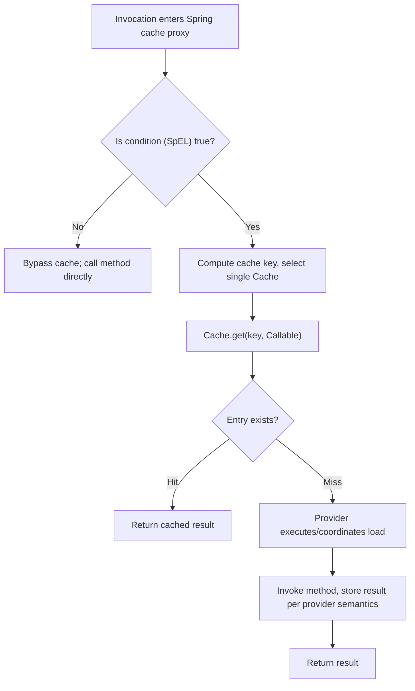

# Restrictions on Combining Conditions with `sync` Mode in Spring Cache

> **Topic:** Spring Framework – Cache · **Group:** Caching Conditions.  
> This lesson explains the exact relationship between `@Cacheable(condition = ...)`, `@Cacheable(unless = ...)`, and `@Cacheable(sync = true)`; the three mandatory restrictions of synchronized caching; how to choose the right design; and how to verify behavior on Java 17+.

## 1. Three Attributes Solve Three Different Problems

On a method using Spring Cache, these attributes often appear together in discussions, yet they **do not share the same evaluation timing**:

| Attribute | Timing and inputs | Effect |
|---|---|---|
| `condition` | **Before** executing the method, evaluates SpEL primarily from method arguments and invocation context | If `false`, skips the cache mechanism for that call; the method still executes |
| `unless` | **After** the method runs and produces a result; can read `#result` | If `true`, **does not write the newly computed result** to the cache |
| `sync = true` | Applies on the cache lookup/load branch when caching conditions permit | Requests the provider to synchronize loading of a missed key to limit concurrent threads computing the same value |

Declaring `condition` and `sync` together is **valid**:

```java
@Cacheable(
    cacheNames = "products",
    key = "#p0",
    condition = "#p0 != null && #p0.length() <= 16",
    sync = true
)
public Product find(String sku) {
    return repository.findBySku(sku).orElseThrow();
}
```

This is an **illustrative method inside a Spring-managed service** that already has `Product` and `repository`, not a standalone Java program.

- For a non-`null` SKU of at most 16 characters, Spring can use the cache; if multiple threads miss the same key simultaneously, `sync=true` requests coordinated loading according to provider semantics.
- For a `null` SKU or one longer than 16 characters, `condition` returns `false`: Spring bypasses the cache and calls the real method every time, **without receiving `sync=true` load synchronization**.
- `key="#p0"` can cause issues if a null key actually enters the cache. The `#p0 != null` condition prevents that **for the cached branch**.
- If the method throws an exception (e.g., SKU not found), Spring Cache does not cache exceptions as successful values by default. Error handling policy must be decided separately.

Do not infer from `sync=true` that *every method call* is locked. Synchronization only applies to the cache-access path that the condition actually permits.

## 2. Processing Flow with `condition` and `sync=true`



At the SPI level, the synchronized path relies on a combined **lookup + value loader** operation via `Cache.get(Object key, Callable<T> valueLoader)`. This differs from the standard path that separates `Cache.get(key)`, method invocation, and `Cache.put(key, value)`.

**`condition` is still supported with `sync=true`.** When `condition=false`, having `sync=true` does not alter method behavior; results are neither read from nor written to the cache through this annotation.

By contrast, `unless` requires inspecting the result **after method execution** to decide whether to write. Synchronized caching delegates both computation and storage to a cache callback, so Spring Cache **does not support `unless` on the same `@Cacheable(sync=true)`**.

## 3. Three Mandatory Restrictions of `@Cacheable(sync=true)`

The Spring Framework Javadoc defines the following three restrictions, which apply even if `condition` may evaluate to `false` on some invocations.

### Restriction 1 — `unless` Is Not Supported

**Invalid:**

```java
@Cacheable(
    cacheNames = "products",
    key = "#p0",
    sync = true,
    unless = "#result == null"
)
public Product find(String sku) {
    return repository.findBySku(sku).orElse(null);
}
```

Even though `unless` seems reasonable for excluding `null` results, Spring rejects this combination. Even `unless = "false"` is still a non-empty `unless` expression. Do not expect Spring to silently ignore `unless`.

**Valid when you need to skip caching null results:**

```java
@Cacheable(
    cacheNames = "products",
    key = "#p0",
    unless = "#result == null"
)
public Product find(String sku) {
    return repository.findBySku(sku).orElse(null);
}
```

This snippet **does not enable `sync`**; if multiple threads miss concurrently, the Spring Cache abstraction does not guarantee that only one thread executes the loader.

**Valid when you only want to filter by arguments and need `sync`:**

```java
@Cacheable(
    cacheNames = "products",
    key = "#p0",
    condition = "#p0 != null",
    sync = true
)
public Product find(String sku) {
    return repository.findBySku(sku).orElse(null);
}
```

Note, however, that the second snippet **cannot prevent caching `null` based on `#result`**. If the provider allows null values, null results may be cached. If it forbids them, the provider may throw an error when storing. The two snippets solve different requirements; do not replace `unless` with `condition` when the problem depends on **the post-invocation result**.

### Restriction 2 — Only a Single Cache May Be Used

**Invalid:**

```java
@Cacheable(
    cacheNames = {"productsLocal", "productsShared"},
    key = "#p0",
    sync = true
)
public Product find(String sku) {
    return repository.findBySku(sku).orElseThrow();
}
```

Synchronized mode requires **one single cache** to coordinate lookup and loading. Normally `@Cacheable` can target multiple caches, but with `sync=true` this is prohibited. Do not treat two cache names as an automatic L1 Caffeine + L2 Redis mechanism.

**Valid:**

```java
@Cacheable(cacheNames = "products", key = "#p0", sync = true)
public Product find(String sku) {
    return repository.findBySku(sku).orElseThrow();
}
```

Another detail to verify: if you use a custom `CacheResolver`, that resolver must also return **exactly one `Cache` instance** for a synchronized operation. Listing one cache name in the annotation while a resolver returns two `Cache` instances still violates the restriction.

### Restriction 3 — Do Not Combine Additional Cache Operations on the **Same Method**

**Invalid caching configuration:**

```java
@Caching(
    cacheable = @Cacheable(cacheNames = "products", sync = true),
    evict = @CacheEvict(cacheNames = "productSummary")
)
public Product loadAndInvalidate(String sku) {
    return repository.findBySku(sku).orElseThrow();
}
```

The example above illustrates a prohibited combination; imports for `@Caching`, `@Cacheable`, `@CacheEvict`, and business types must exist in a real application. Likewise, do not combine `@Cacheable(sync=true)` with `@CachePut` or another `@Cacheable` on the same method.

**Scope distinction:** `@CacheEvict` on a **different method** can still be used freely to evict entries created by a `@Cacheable(sync=true)` method. What is forbidden is *combining cache operations on the same method*, not having multiple annotation types in the application.

A typical service can separate them:

```java
@Cacheable(cacheNames = "products", key = "#p0", sync = true)
public Product read(String sku) {
    return repository.findBySku(sku).orElseThrow();
}

@CacheEvict(cacheNames = "products", key = "#p0")
public void update(String sku, UpdateCommand command) {
    repository.applyUpdate(sku, command);
}
```

Both methods above are illustrative inside a service that already has a repository. Key rules for read and evict must align. For transactional data, commit timing and concurrent read/write races must also be considered.

### Quick Configuration Decision Table

| Configuration | Valid with `sync=true`? | Why |
|---|---|---|
| `@Cacheable(cacheNames="x", sync=true)` | **Yes** | Single cache, no `unless`, no combined operations |
| `@Cacheable(cacheNames="x", condition="#p0 > 0", sync=true)` | **Yes** | `condition` runs before cache lookup |
| `@Cacheable(cacheNames="x", key="#p0", condition="#p0 != null", sync=true)` | **Yes** | Key and condition are supported as normal |
| `@Cacheable(cacheNames="x", unless="#result == null", sync=true)` | **No** | `unless` is prohibited when synchronized |
| `@Cacheable(cacheNames={"x","y"}, sync=true)` | **No** | Only a single cache is allowed |
| One cache name yet resolver returns multiple caches | **No** | Still resolves to multiple `Cache` instances at runtime |
| `@Cacheable(sync=true)` and `@CachePut` on the same method | **No** | Cannot combine cache operations |
| `@Cacheable(sync=true)` and `@CacheEvict` on two separate methods | **Yes** | Each method has an independent cache operation |
| `@Cacheable(cacheNames="x", condition="#result != null", sync=true)` | **Wrong idea** | `#result` is not available at the `condition` evaluation stage |
| `@Cacheable(cacheNames="x", sync=false, unless="#result == null")` | **Yes** | Allows post-invocation veto, at the cost of no sync loading hint |

## 4. Carefully Distinguishing `condition` and `unless` in Synchronized Mode

### 4.1. `condition` Checks the Call; `unless` Checks the Result

An input-based caching example:

```java
@Cacheable(
    cacheNames = "search",
    key = "#p0",
    condition = "#p0 != null && #p0.length() <= 40",
    sync = true
)
public String search(String query) {
    return slowBackend(query);
}
```

- Short queries are cached and can coalesce per key.
- Overly long queries are not cached; every request calls the backend.
- `null` queries are not cached, while also avoiding creating a `null` key from `#p0`.
- Evaluating `condition` has no access to the result of `slowBackend(query)` because it has not run yet.

An output-based caching example:

```java
@Cacheable(
    cacheNames = "search",
    key = "#p0",
    unless = "#result == null || #result.isBlank()"
)
public String search(String query) {
    return slowBackend(query);
}
```

- `unless` can inspect `#result` because the method has already run.
- When the result is null/blank, it is not written.
- Without `sync=true`, concurrent misses can trigger duplicate loads.

These are illustrative methods; a real service/repository and Spring configuration are needed to run them. The expression `#result == null || #result.isBlank()` uses short-circuiting to avoid calling `isBlank()` on null.

### 4.2. You Cannot Simulate a Post-Filter with a Pre-Filter If Data Is Unknown

Example requirement: "Only cache products with `status=ACTIVE`, where status is only known after querying the database." `condition` cannot know the status beforehand to decide whether to cache. Writing:

```java
@Cacheable(cacheNames = "products", sync = true,
           condition = "#result.status == 'ACTIVE'")
```

is **wrong timing**; `#result` is not defined as it is in `unless`. Valid options depending on requirements:

1. Drop `sync=true` and use `unless = "#result == null || #result.status != 'ACTIVE'"`.
2. Keep `sync=true`, accept caching whatever the loader returns per provider semantics, combined with a short TTL/invalidation if stale data must not linger.
3. If you **strictly require both** single-loader execution and post-output filtering, design load coordination at another layer (such as a single-flight/loader mechanism or dedicated backend API) alongside invalidation and error-handling rules. Do not declare an annotation combination unsupported by Spring.

Converting `null` to `Optional.empty()` **does not automatically solve** the post-filter requirement. Spring Cache typically unwraps `Optional` when storing; empty can map to a null value, and null caching policy still depends on the provider.

### 4.3. A `false` Condition Also Loses the Stampede Protection of `sync`

A requirement might sound like "enable sync to prevent duplicate calls," yet in practice:

```java
@Cacheable(
    cacheNames = "reports",
    condition = "#p0 != null && #p0.size() < 100",
    sync = true
)
public Report generate(List<String> ids) {
    return expensiveCalculation(ids);
}
```

Requests with 100 or more elements **all bypass the cache** and can compute concurrently, even with identical arguments. If that group of requests is the main source of high load, `sync=true` on the cacheable branch does not handle it. Evaluate the business condition, key hotness, and alternative load-limiting mechanisms.

In this example, `condition` reads an argument. If the list is mutable, the default key can be affected by content mutations; for real cached data, use immutable values/snapshots.

## 5. How Synchronized Is `sync` Mode Really?

### 5.1. It Is a Request Sent to the Cache Provider

Spring Framework defines the `Cache.get(key, Callable)` contract, yet the Javadoc specifies `sync=true` as a **hint**: the chosen provider may not guarantee synchronized handling in the exact way desired.

- With Spring Framework's `ConcurrentMapCache`, loading a key can rely on concurrent map primitives; this is suitable for demonstrating how to avoid duplicate loader calls within **one JVM**.
- With a local Caffeine cache, the backend provides compute/load synchronization scoped to the cache instance per provider API.
- With Redis or a clustered cache, behavior depends on the adapter, writer, and configuration. Some mechanisms perform get/put without a global lock; **do not assume `sync=true` automatically creates a distributed lock** across all pods/JVMs.
- With custom caches or wrappers, inspect the implementation of `Cache.get(Object, Callable)`. If it merely calls `get` and then computes `loader.call()` outside a single-load region, multiple computations can still happen.

**Do not equate `sync=true` with Java `synchronized`.** A Java `synchronized` method locks the object monitor per instance, whereas caching `sync` is per-*cache lookup/load and key* coordination implemented by the provider. Different keys can usually execute in parallel; there is no promise of an application-wide lock or a distributed lock.

### 5.2. Exceptions and Retries

If the loader throws an exception, the load operation may fail and waiting requests may also receive the error or retry depending on provider semantics. Do not assume Spring Cache automatically caches exceptions to block subsequent requests. `Cache.get(key, Callable)` may wrap failures in `ValueRetrievalException`; inspect the root exception and configure appropriate error handling.

With `sync=false`, the typical flow is get, invoke method, then put. With `sync=true`, lookup and loader are passed together into a provider callback. When configuring a custom `CacheErrorHandler`, error paths for the two modes can differ; do not treat `sync=true` as a purely performance-only toggle.

### 5.3. Null Results and Cache Backends

`sync=true` **does not prevent storing null values**. For example, the default `ConcurrentMapCacheManager` can store null via an internal placeholder instead of putting a raw Java null into the map. Another provider might not support null or might be configured with `allowNullValues=false`.

If the application must skip caching null results, the direct declarative option is `unless="#result == null"` **without `sync=true`**. If stampede protection is still needed, handle it at the loader/infrastructure layer using a tested API; avoid sentinel values that can collide with real data.

## 6. Runnable Example: One Spring Framework Project, Four Cases

This example uses **Java 17+**, **Maven**, **Spring Framework 6.2.12**, and `ConcurrentMapCacheManager`. Neither Spring Boot nor a database is required. It demonstrates: `condition + sync` working together; a `false` condition bypassing; `unless` working when sync is off; and when sync allows null, null results can be cached.

Structure:

```text
spring-sync-condition/
├── pom.xml
└── src/main/java/dev/example/synccondition/SyncConditionDemo.java
```

### 6.1. `pom.xml`

```xml
<?xml version="1.0" encoding="UTF-8"?>
<project xmlns="http://maven.apache.org/POM/4.0.0"
         xmlns:xsi="http://www.w3.org/2001/XMLSchema-instance"
         xsi:schemaLocation="http://maven.apache.org/POM/4.0.0 https://maven.apache.org/xsd/maven-4.0.0.xsd">
    <modelVersion>4.0.0</modelVersion>

    <groupId>dev.example</groupId>
    <artifactId>spring-sync-condition</artifactId>
    <version>1.0.0</version>

    <properties>
        <maven.compiler.release>17</maven.compiler.release>
        <project.build.sourceEncoding>UTF-8</project.build.sourceEncoding>
    </properties>

    <dependencies>
        <dependency>
            <groupId>org.springframework</groupId>
            <artifactId>spring-context</artifactId>
            <version>6.2.12</version>
        </dependency>
    </dependencies>

    <build>
        <plugins>
            <plugin>
                <groupId>org.apache.maven.plugins</groupId>
                <artifactId>maven-compiler-plugin</artifactId>
                <version>3.13.0</version>
            </plugin>
            <plugin>
                <groupId>org.codehaus.mojo</groupId>
                <artifactId>exec-maven-plugin</artifactId>
                <version>3.3.0</version>
                <configuration>
                    <mainClass>dev.example.synccondition.SyncConditionDemo</mainClass>
                </configuration>
            </plugin>
        </plugins>
    </build>
</project>
```

### 6.2. `src/main/java/dev/example/synccondition/SyncConditionDemo.java`

```java
package dev.example.synccondition;

import java.util.ArrayList;
import java.util.HashSet;
import java.util.List;
import java.util.Set;
import java.util.concurrent.CountDownLatch;
import java.util.concurrent.ExecutorService;
import java.util.concurrent.Executors;
import java.util.concurrent.Future;
import java.util.concurrent.atomic.AtomicInteger;

import org.springframework.cache.CacheManager;
import org.springframework.cache.annotation.Cacheable;
import org.springframework.cache.annotation.EnableCaching;
import org.springframework.cache.concurrent.ConcurrentMapCacheManager;
import org.springframework.context.annotation.AnnotationConfigApplicationContext;
import org.springframework.context.annotation.Bean;
import org.springframework.context.annotation.Configuration;

public class SyncConditionDemo {
    public static void main(String[] args) throws Exception {
        try (AnnotationConfigApplicationContext context =
                new AnnotationConfigApplicationContext(CacheConfig.class)) {

            ReportService service = context.getBean(ReportService.class);

            // condition=true: caching enabled with synchronized loading.
            System.out.println("short1=" + service.shortText("A"));
            System.out.println("short2=" + service.shortText("A"));

            // condition=false: bypasses cache; method runs every time.
            System.out.println("long1=" + service.shortText("LONG"));
            System.out.println("long2=" + service.shortText("LONG"));
            System.out.println("nullInput1=" + service.shortText(null));
            System.out.println("nullInput2=" + service.shortText(null));
            System.out.println("shortLoads=" + service.shortLoadCount());

            // sync=false + unless: null result is not stored.
            System.out.println("unless1=" + service.nullWithUnless("missing"));
            System.out.println("unless2=" + service.nullWithUnless("missing"));
            System.out.println("unlessLoads=" + service.unlessLoadCount());

            // sync=true: default local provider allows caching null results.
            System.out.println("syncNull1=" + service.nullWithSync("missing"));
            System.out.println("syncNull2=" + service.nullWithSync("missing"));
            System.out.println("syncNullLoads=" + service.syncNullLoadCount());

            // Multiple threads invoke the exact same key concurrently through the Spring proxy.
            ExecutorService pool = Executors.newFixedThreadPool(6);
            CountDownLatch go = new CountDownLatch(1);
            List<Future<String>> results = new ArrayList<>();

            try {
                for (int i = 0; i < 6; i++) {
                    results.add(pool.submit(() -> {
                        go.await();
                        return service.expensive("K");
                    }));
                }

                go.countDown();

                Set<String> uniqueResults = new HashSet<>();
                for (Future<String> future : results) {
                    uniqueResults.add(future.get());
                }

                System.out.println("parallelDistinct=" + uniqueResults.size());
                System.out.println("parallelLoads=" + service.expensiveLoadCount());
            } finally {
                pool.shutdownNow();
            }
        }
    }

    @Configuration(proxyBeanMethods = false)
    @EnableCaching
    public static class CacheConfig {
        @Bean
        public CacheManager cacheManager() {
            return new ConcurrentMapCacheManager(
                    "shortTexts", "nullDecisions", "syncNulls", "expensive");
        }

        @Bean
        public ReportService reportService() {
            return new ReportService();
        }
    }

    public static class ReportService {
        private final AtomicInteger shortLoads = new AtomicInteger();
        private final AtomicInteger unlessLoads = new AtomicInteger();
        private final AtomicInteger syncNullLoads = new AtomicInteger();
        private final AtomicInteger expensiveLoads = new AtomicInteger();

        @Cacheable(
                cacheNames = "shortTexts",
                key = "#p0",
                condition = "#p0 != null && #p0.length() <= 3",
                sync = true)
        public String shortText(String text) {
            return String.valueOf(text) + "#" + shortLoads.incrementAndGet();
        }

        @Cacheable(
                cacheNames = "nullDecisions",
                key = "#p0",
                unless = "#result == null")
        public String nullWithUnless(String key) {
            unlessLoads.incrementAndGet();
            return null;
        }

        @Cacheable(
                cacheNames = "syncNulls",
                key = "#p0",
                sync = true)
        public String nullWithSync(String key) {
            syncNullLoads.incrementAndGet();
            return null;
        }

        @Cacheable(
                cacheNames = "expensive",
                key = "#p0",
                sync = true)
        public String expensive(String key) {
            int attempt = expensiveLoads.incrementAndGet();
            try {
                Thread.sleep(150);
            } catch (InterruptedException e) {
                Thread.currentThread().interrupt();
                throw new IllegalStateException("Loader interrupted", e);
            }
            return "expensive-" + key + "#" + attempt;
        }

        public int shortLoadCount() {
            return shortLoads.get();
        }

        public int unlessLoadCount() {
            return unlessLoads.get();
        }

        public int syncNullLoadCount() {
            return syncNullLoads.get();
        }

        public int expensiveLoadCount() {
            return expensiveLoads.get();
        }
    }
}
```

Navigate to the directory containing `pom.xml` and run:

```bash
mvn -q compile exec:java
```

Lines printed directly by the program when creating a fresh context/cache (excluding auxiliary environment logs):

```text
short1=A#1
short2=A#1
long1=LONG#2
long2=LONG#3
nullInput1=null#4
nullInput2=null#5
shortLoads=5
unless1=null
unless2=null
unlessLoads=2
syncNull1=null
syncNull2=null
syncNullLoads=1
parallelDistinct=1
parallelLoads=1
```

**Why does this output happen?**

- `shortText("A")` has `condition=true` and cache key `"A"`. The second call hits, so `shortLoads` does not increment.
- `shortText("LONG")` has length 4, exceeding the threshold of 3, so both calls run the method. `shortText(null)` also bypasses; `key="#p0"` does not send null into lookup because the condition already excluded this call.
- `nullWithUnless("missing")` always returns null and `unless` prevents writing, so the counter increments to 2.
- `nullWithSync("missing")` has no `unless`. Default `ConcurrentMapCache` supports storing null via an internal placeholder, so the second call hits and the counter stays at 1.
- Six tasks concurrently access the `expensive` cache for key `"K"`. With `ConcurrentMapCacheManager` in this example, the loader executes once and all six futures see the same result. The latch starts the tasks close together; one successful run does not replace repeated load testing when evaluating another provider.

Here the service is retrieved from `AnnotationConfigApplicationContext` so calls pass through the Spring proxy. Instantiating the service directly with `new` or calling an annotated method via `this.method()` inside the same object skips caching annotations by default.

### 6.3. Why Not Put Invalid Configurations Into the Runnable Project?

The three cases **`sync + unless`**, **`sync + multiple caches`**, and **`sync + multiple cache operations on one method`** belong to the group presented as **invalid** examples. Placing them inside a bean actually invoked in the demo program can cause Spring to throw an error when processing the cache operation, breaking the valid demonstration flow. They are shown separately in section 3 and can be placed in dedicated integration tests to confirm the application flags invalid configuration, rather than logic deployed to production.

## 7. Which Design to Choose Under Multiple Requirements?

| Business requirement | Suitable declaration or architecture | Trade-off to accept |
|---|---|---|
| Cache only when arguments meet condition; limit duplicate loads per key | `@Cacheable(condition=..., sync=true)`, single cache | Calls with `condition=false` skip both cache and sync benefits |
| Cache only non-null or post-validated results | `@Cacheable(unless=...)`, `sync=false` | Concurrent misses may compute redundantly |
| Cache null as a negative result, limit repeated misses | `@Cacheable(sync=true)` with null-supporting provider | Requires sensible TTL and invalidation when data appears |
| One method must update/evict multiple caches simultaneously | Split responsibilities across methods, services, or invalidation events | Cannot combine cache operations with `sync=true` on one method |
| Want L1 and L2 caches | Design a tested custom multi-level adapter/cache | `@Cacheable(cacheNames={"L1","L2"},sync=true)` is forbidden |
| Need per-key single-flight **and** post-result filtering | Design a custom loader/coordinator, or adjust SLA trade-offs | Spring Cache annotations cannot combine `sync=true` with `unless` |
| Need stampede protection across multiple JVMs | Check backend locking/distributed coordination | Do not infer distributed locking from `sync=true` alone |
| Need to bypass cache by tenant/permission | Add partition/tenant to key; condition only decides whether to cache | Condition does not replace key-space isolation and access control |

### Design Checklist for a Single Method

Before adding `sync=true`, check:

1. Does the method have exactly **one** `@Cacheable` operation, with no additional `@CachePut`/`@CacheEvict`/another `@Cacheable` on the same method?
2. Does resolution lead to **a single** `Cache`?
3. Do you need to inspect `#result` to decide whether to retain the cache entry? If **yes**, `unless` is required and the design must change.
4. Does `condition` rely only on variables available before method invocation? Are there any `null` or field-access risks that could throw a SpEL exception?
5. What level of synchronization does the provider support for `Cache.get(key, Callable)`? Should tests run single-node or multi-node?
6. Does the key include all parameters that truly determine the output? Do semantically identical calls produce the same key?
7. When the loader returns null, throws an exception, times out, or data changes after commit, does behavior meet the SLA?

## 8. Diagnosing Configuration Errors and Confusing Behavior

| Symptom | Common cause | What to check |
|---|---|---|
| Error when method has `sync=true, unless=...` | Invalid cache operation configuration | Remove `unless` or remove `sync`; choose an approach matching requirements |
| Error when declaring two cache names | `sync=true` supports only one `Cache` | Use a single manager/cache or build a dedicated multi-level cache |
| Error when using `@Caching` to combine evict/put | Cannot combine cache operations on a method with sync | Move operations to another method, align keys |
| Method has `sync=true` yet runs repeatedly on invalid input | `condition=false` bypasses cache | Check SpEL condition and whether separate rate/load limiting is needed |
| `condition="#result != null"` does not work | Result is unavailable at the condition stage | Switch to `unless` and drop `sync` if output filtering is needed |
| Multiple pods still hit DB concurrently | Backend does not provide distributed single-flight | Check provider, writer/lock behavior, and run cross-node tests |
| Local sync works well yet Redis still loads redundantly | Redis adapter load/lock semantics differ from local | Measure concurrent misses per key; inspect `get(key, Callable)` implementation |
| Method called from the same class does not cache | Self-invocation bypasses default proxy mode | Call via a Spring-managed bean/proxy, separate responsibilities |
| Cache stores null unexpectedly | `sync=true` does not support `unless`, provider caches nulls | Define null policy, TTL, invalidation, or change design |
| Cached results cross tenants/users | Key lacks tenant/auth scope | Fix key partitioning; sync does not resolve key collisions |
| Behavior changes when switching providers | Providers differ in atomicity, TTL, and null/exception semantics | Run concurrency and integration tests on the real backend |

## 9. Targeted Testing for `sync + condition`

A solid test suite should separate **valid syntax**, **correct caching semantics**, and **provider synchronization guarantees**.

**Group A — Pre-cache conditions:**

- Same key `A` with `condition=true`: call multiple times, loader runs only once after the entry is present.
- Same key `B` with `condition=false`: call multiple times, loader runs every time; verify no entry was created by the annotation.
- Null parameter: condition must prevent creating a null key if using `key="#p0"`. Test SpEL null-safety.
- Mutable array/collection parameter: verify key stability if the object is mutated; consider creating snapshots.

**Group B — Prohibited combinations:**

- Separately test `sync=true` with a non-empty `unless`, expecting the application to detect invalid configuration.
- Test two cache names or a resolver returning two caches, expecting rejection in a synchronized operation.
- Test combined cache annotations via `@Caching` on the same method, expecting rejection.
- Test `@CacheEvict` on a **different method** still properly evicts keys written by `@Cacheable(sync=true)`.

**Group C — Real concurrency:**

- With 20–100 concurrent requests for the same key on one instance, measure loader entries, latency, and waiting threads.
- With many distinct keys, verify the system does not accidentally serialize all load due to an overly coarse lock.
- With two JVMs/pods, test the same key to learn whether the backend coordinates across nodes or only per process.
- Simulate timeouts, exceptions, and cache outages; ensure callbacks, fallbacks, transactions, and metrics behave properly.
- Test null results and exceptions: whether null is cached, how entries expire, and whether the loader is invoked again.
- Repeat tests on the exact provider, version, and configuration used in production; do not extrapolate from `ConcurrentMapCache` to Redis.

Do not judge `sync` solely by hit rate after cache warm-up: once an entry exists, `sync=false` can also serve hits without running the method. Measure *concurrent miss bursts* to see the difference.

## 10. Principles for Use in Production Systems

**Enable `sync=true` when:** a method has high loading cost, multiple requests can miss the same key simultaneously, cacheability depends on arguments, and the provider's storage policy is acceptable. Verify the real provider before expecting cluster-wide stampede protection.

**Use `condition` when:** you know beforehand from arguments or call context that certain requests do not belong in the cache (e.g., oversized queries, special modes, incomplete tenant info). Conditions decide **whether to use the cache**, not whether to veto after a result is computed.

**Use `unless` when:** only after running the method do you know whether the result may be stored, such as null, empty, or business-ineligible states. When using `unless`, accept that `sync=true` cannot be enabled on that same `@Cacheable`; use a separate concurrency solution if strictly required.

**Separate cache operations** when a business action must both load and evict/write multiple caches. Align keys and consider transactions/invalidation. Do not switch a multi-effect cache method to `sync=true` just to prevent duplicate misses.

**Observe and test:** record cache name, effective key, `CacheManager` type, real provider, hits/misses, loader invocation count, P95/P99 latency, exceptions, and cross-node consistency. Cache keys should avoid holding raw sensitive data whenever possible.

### Reference Materials

- Spring Framework — `@Cacheable` Javadoc, especially `sync` and `unless`: https://docs.spring.io/spring-framework/docs/6.2.16/javadoc-api/org/springframework/cache/annotation/Cacheable.html
- Spring Framework — Annotation-based Caching, Synchronized/Conditional Caching: https://docs.spring.io/spring-framework/reference/integration/cache/annotations.html
- Spring Framework — `Cache` interface and `get(Object, Callable)`: https://docs.spring.io/spring-framework/docs/6.2.16/javadoc-api/org/springframework/cache/Cache.html
- Spring Framework — Cache abstraction overview: https://docs.spring.io/spring-framework/reference/integration/cache.html
- Spring Boot — Cache provider configuration: https://docs.spring.io/spring-boot/reference/io/caching.html
