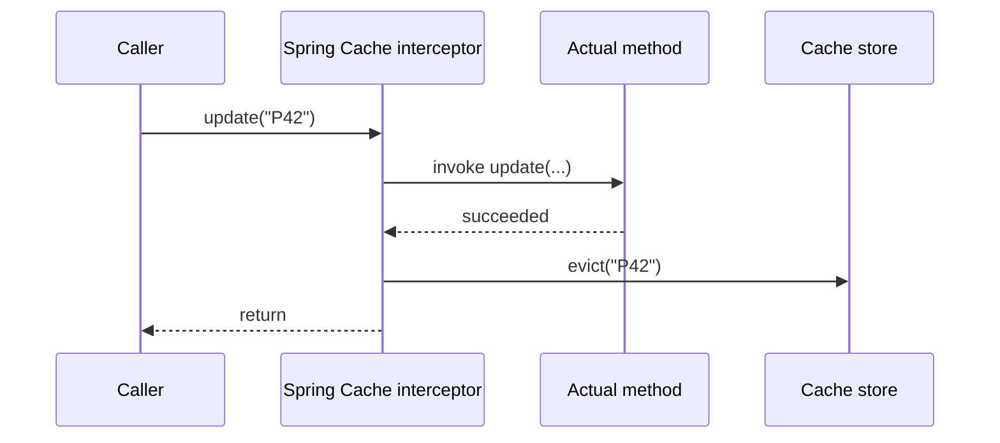
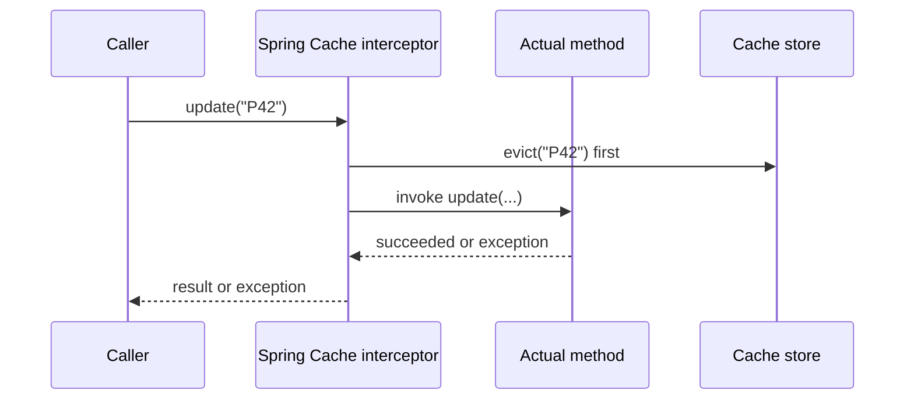

# @CacheEvict: beforeInvocation=true and evicting before the method runs

> **Topic:** Spring Framework – Cache · **Group:** `@CacheEvict`.  
> Objective: understand exactly when Spring evicts the cache when `beforeInvocation=true` is declared, how it differs from the default `false`, the impact of exceptions, `condition`, `allEntries`, transactions, and concurrent requests; and apply it correctly to real systems.

## 1. What does `@CacheEvict` do?

`@CacheEvict` is a Spring Cache annotation used to **remove entries** from one or more cache regions. It is typically placed on data modification/deletion operations so stale data in the cache is no longer returned on subsequent reads. The annotation acts on the *cache store* via `CacheManager`/`Cache`, and does not delete records from the database itself.

A typical example:

```java
@CacheEvict(cacheNames = "products", key = "#p0")
public void updateProduct(String productId, ProductUpdate input) {
    repository.update(productId, input);
}
```

This is an **illustrative snippet inside a Spring-managed service**, requiring `ProductUpdate` and a real repository. Spring removes the entry whose key equals the first parameter `productId` from the `products` cache **after the method completes successfully**, because `beforeInvocation=false` is the default.

When written as:

```java
@CacheEvict(
    cacheNames = "products",
    key = "#p0",
    beforeInvocation = true
)
public void updateProduct(String productId, ProductUpdate input) {
    repository.update(productId, input);
}
```

Spring executes the eviction request **before** calling the body of `updateProduct`. If the method body subsequently throws an exception, the eviction operation has already been dispatched; there is no default Spring Cache mechanism to "undo" that removal. This can suit certain business workflows, yet it can also open a stale-data window if the write operation is slow or uncommitted.

**Key distinction:** `@CacheEvict` does not decide whether the database is updated; `beforeInvocation` only changes **the timing and outcome-dependence of cache eviction**.

## 2. Comparing `beforeInvocation=false` and `true`

| Criterion | `beforeInvocation=false` (default) | `beforeInvocation=true` |
|---|---|---|
| Eviction timing | After the method executes successfully | Before the method is invoked |
| Method succeeds | Evicts the entry after the method | Entry was already evicted before the method |
| Method throws exception | Normally **does not evict** | Still evicted, provided the initial cache operation succeeded |
| Re-reading same cache key inside method body | Usually still sees old entry before eviction | Usually already missing at the moment the method body starts |
| Can be used on `void` methods | Yes | Yes |
| Can use `condition` | Yes | Yes, evaluated before invocation |
| Can use `allEntries=true` | Yes | Yes |
| Use `#result` in key/condition expressions | Possible for post-method operations, in contexts supported by Spring | **No**: result does not exist yet before invocation |
| Atomicity with database | Not guaranteed by default | Not guaranteed by default |

Two common forms:

```java
// Default: only evict after the method completes successfully.
@CacheEvict(cacheNames = "books", key = "#p0")
public void updateAfter(String isbn) {
    updateStorage(isbn);
}

// Before: evict first and then invoke the method, even if the method later fails.
@CacheEvict(cacheNames = "books", key = "#p0", beforeInvocation = true)
public void updateBefore(String isbn) {
    updateStorage(isbn);
}
```

The snippet above is illustrative; `updateStorage` must be implemented in a real application. When the cache backend fails right at eviction time, the method may be affected depending on `CacheErrorHandler`/provider; `beforeInvocation=true` does not promise that cache eviction *always succeeds* even if the backend is unreachable.

### Sequence of steps

**Default:**



If the method on the default path throws an exception, the post-success `evict` step does not happen.

**`beforeInvocation=true`:**



The diagrams describe logical ordering at the annotation layer. With distributed providers or transactional wrappers, when the entry actually disappears depends on the implementation; semantics and advice ordering must be verified in the specific system.

## 3. When the method fails: why does this difference matter?

Suppose the `products` cache currently holds an entry:

```text
cache["P42"] = "product-old"
```

And the application calls a data-updating method:

```java
@CacheEvict(cacheNames = "products", key = "#p0", beforeInvocation = true)
public void changePrice(String id, long price) {
    database.updatePrice(id, price);
    externalService.publishChange(id); // may throw an exception
}
```

This is illustrative code, not a standalone file.

### Case A — Evict after the method completes

With `beforeInvocation=false`, if `database.updatePrice` or `publishChange` throws an exception out of the method, post-invocation eviction will not run. The old entry may remain in the cache.

- If the database **has not changed**, keeping the old entry may be the desired behavior.
- If the database **did change but a later step threw an error**, the old entry may already be inaccurate. Default post-success eviction **does not automatically handle partial-update scenarios**.
- If `@Transactional` is present and rolls back, you must still consider whether data actually committed/rolled back, AOP advice ordering, and whether cache operations are bound to commit timing.

### Case B — Evict before the method runs

With `beforeInvocation=true`, the entry is removed from the cache before the first database command. If the method throws an error:

- The cache has already been evicted, causing the next read to miss and potentially query the data source again.
- If the database rolls back or did not change, the new read can reload the old value. That increases load but does not necessarily create lasting divergence.
- If the database partially changed, re-reading may observe data that has not reached the desired business state, depending on isolation and read paths.

**Do not interpret "evict before" as "the business operation is guaranteed to succeed"**. Cache eviction is an effect independent of whether the method succeeds or fails, and can raise the cache miss rate.

### Incident matrix

| Method outcome | `beforeInvocation=false` | `beforeInvocation=true` | Question to ask |
|---|---|---|---|
| Succeeded, new data is ready | Evicts after; next read misses | Evicts before; refill may occur while method runs | When is DB commit relative to the evict operation? |
| Error before modifying DB | Keeps old cache | Already evicted, next read must reload | Is hit-rate loss acceptable on error? |
| Error after modifying external data | May keep stale cache | Cache already evicted | Is there a transaction or consistency compensation mechanism? |
| Cache backend unable to evict | Depends on timing and error handler | Depends on timing and error handler, may block method before starting | When cache fails, is the write allowed to proceed? |
| Concurrent read/write requests | May see old value while method runs | May miss and load old DB value before commit | Is after-commit invalidation or versioning needed? |

## 4. How it works: proxy, interceptor, and Cache API

`@CacheEvict` only takes effect when Spring caching infrastructure is enabled (`@EnableCaching`) and the call goes through a Spring proxy or corresponding AOP mechanism. Typical process:

1. Caller invokes the method on a **Spring-managed bean**.
2. `CacheInterceptor` reads `@CacheEvict` metadata, locates caches via `CacheManager`/`CacheResolver`, evaluates conditions, and builds the key if evicting by key.
3. If `beforeInvocation=true`, the interceptor asks the cache to remove the entry **before** calling the method. In modern Spring Cache implementations, the pre-invocation eviction path uses an operation with immediate removal semantics (such as `Cache.evictIfPresent`/`invalidate`), depending on the backend.
4. Spring invokes the actual method; the result or exception returns to the caller.
5. With default `beforeInvocation=false`, the cache is evicted **after the method succeeds** instead of at step 3.

**Proxy mode limitation:** calling `this.anotherAnnotatedMethod(...)` from a method within the same instance usually **does not go through the proxy**; therefore, the internally called method's annotation does not trigger. Private methods or objects created with `new` outside the container are likewise not handled by the cache proxy in the usual way. Separate services into another bean or adjust invocation architecture if needed.

### Single-key eviction must stay consistent with the read key

Consider a read method:

```java
@Cacheable(cacheNames = "products", key = "#p0")
public Product get(String id) {
    return repository.find(id);
}
```

When updating, you must also evict the **exact same key**:

```java
@CacheEvict(
    cacheNames = "products",
    key = "#p0",
    beforeInvocation = true
)
public void change(String id, ProductPatch patch) {
    repository.change(id, patch);
}
```

Do not let the update rely on the default key if the method has two parameters: `change(id, patch)` by default can generate `SimpleKey(id, patch)` while reads only use `id`, resulting in evicting the wrong entry even if eviction timing is configured properly.

The cache name must also match the region holding the data. If multiple methods share `cacheNames="products"`, the `key` and encoding mechanism (especially with Redis) must be consistent. `beforeInvocation` cannot fix a key mismatch bug.

## 5. Runnable Java 17+ example: observing eviction inside the method body

This example uses Spring Framework **6.2.12**, Java 17+, and Maven. `ConcurrentMapCacheManager` stores the cache in the JVM, so eviction ordering can be observed clearly without needing Redis/a database. The program demonstrates success, exception, `condition`, and `allEntries=true` scenarios.

### 5.1. Project structure

```text
cache-evict-before/
├── pom.xml
└── src/main/java/dev/example/evict/EvictBeforeDemo.java
```

**`pom.xml`**

```xml
<?xml version="1.0" encoding="UTF-8"?>
<project xmlns="http://maven.apache.org/POM/4.0.0"
         xmlns:xsi="http://www.w3.org/2001/XMLSchema-instance"
         xsi:schemaLocation="http://maven.apache.org/POM/4.0.0 https://maven.apache.org/xsd/maven-4.0.0.xsd">
    <modelVersion>4.0.0</modelVersion>
    <groupId>dev.example</groupId>
    <artifactId>cache-evict-before</artifactId>
    <version>1.0.0</version>
    <properties>
        <maven.compiler.release>17</maven.compiler.release>
        <project.build.sourceEncoding>UTF-8</project.build.sourceEncoding>
    </properties>
    <dependencies>
        <dependency>
            <groupId>org.springframework</groupId>
            <artifactId>spring-context</artifactId>
            <version>6.2.12</version>
        </dependency>
    </dependencies>
    <build>
        <plugins>
            <plugin>
                <groupId>org.apache.maven.plugins</groupId>
                <artifactId>maven-compiler-plugin</artifactId>
                <version>3.13.0</version>
            </plugin>
            <plugin>
                <groupId>org.codehaus.mojo</groupId>
                <artifactId>exec-maven-plugin</artifactId>
                <version>3.3.0</version>
                <configuration>
                    <mainClass>dev.example.evict.EvictBeforeDemo</mainClass>
                </configuration>
            </plugin>
        </plugins>
    </build>
</project>
```

**`src/main/java/dev/example/evict/EvictBeforeDemo.java`**

```java
package dev.example.evict;

import java.util.Objects;
import org.springframework.cache.Cache;
import org.springframework.cache.CacheManager;
import org.springframework.cache.annotation.CacheEvict;
import org.springframework.cache.annotation.EnableCaching;
import org.springframework.cache.concurrent.ConcurrentMapCacheManager;
import org.springframework.context.annotation.AnnotationConfigApplicationContext;
import org.springframework.context.annotation.Bean;
import org.springframework.context.annotation.Configuration;

public class EvictBeforeDemo {
    private static boolean has(Cache cache, String key) {
        return cache.get(key) != null;
    }

    public static void main(String[] args) {
        try (AnnotationConfigApplicationContext context =
                new AnnotationConfigApplicationContext(CacheConfig.class)) {
            CacheManager manager = context.getBean(CacheManager.class);
            Cache cache = Objects.requireNonNull(manager.getCache("products"));
            ProductCommands commands = context.getBean(ProductCommands.class);

            cache.put("A", "old-A");
            commands.evictBefore("A", false);
            System.out.println("AExistsAfter=" + has(cache, "A"));

            cache.put("B", "old-B");
            commands.evictAfter("B", false);
            System.out.println("BExistsAfter=" + has(cache, "B"));

            cache.put("C", "old-C");
            try {
                commands.evictBefore("C", true);
            } catch (IllegalStateException e) {
                System.out.println("beforeError=" + e.getMessage());
            }
            System.out.println("CExistsAfterError=" + has(cache, "C"));

            cache.put("D", "old-D");
            try {
                commands.evictAfter("D", true);
            } catch (IllegalStateException e) {
                System.out.println("afterError=" + e.getMessage());
            }
            System.out.println("DExistsAfterError=" + has(cache, "D"));

            cache.put("X", "old-X");
            commands.conditional("X", false);
            System.out.println("XExistsWhenFalse=" + has(cache, "X"));
            commands.conditional("X", true);
            System.out.println("XExistsWhenTrue=" + has(cache, "X"));

            cache.put("E", "old-E");
            cache.put("Z", "old-Z");
            try {
                commands.clearAllBefore(true);
            } catch (IllegalStateException e) {
                System.out.println("clearError=" + e.getMessage());
            }
            System.out.println("EExistsAfterClear=" + has(cache, "E"));
            System.out.println("ZExistsAfterClear=" + has(cache, "Z"));
        }
    }

    @Configuration(proxyBeanMethods = false)
    @EnableCaching
    public static class CacheConfig {
        @Bean
        public CacheManager cacheManager() {
            return new ConcurrentMapCacheManager("products");
        }

        @Bean
        public ProductCommands productCommands(CacheManager manager) {
            return new ProductCommands(manager);
        }
    }

    public static class ProductCommands {
        private final Cache cache;

        public ProductCommands(CacheManager manager) {
            this.cache = Objects.requireNonNull(manager.getCache("products"));
        }

        @CacheEvict(cacheNames = "products", key = "#p0",
                    beforeInvocation = true)
        public void evictBefore(String id, boolean fail) {
            System.out.println("insideBefore[" + id + "]=" +
                    has(cache, id));
            if (fail) {
                throw new IllegalStateException("fail-" + id);
            }
        }

        @CacheEvict(cacheNames = "products", key = "#p0")
        public void evictAfter(String id, boolean fail) {
            System.out.println("insideAfter[" + id + "]=" +
                    has(cache, id));
            if (fail) {
                throw new IllegalStateException("fail-" + id);
            }
        }

        @CacheEvict(cacheNames = "products", key = "#p0",
                    condition = "#p1", beforeInvocation = true)
        public void conditional(String id, boolean shouldEvict) {
            System.out.println("insideConditional[" + id + "]=" +
                    has(cache, id));
        }

        @CacheEvict(cacheNames = "products", allEntries = true,
                    beforeInvocation = true)
        public void clearAllBefore(boolean fail) {
            System.out.println("insideClear[E]=" + has(cache, "E"));
            if (fail) {
                throw new IllegalStateException("fail-clear");
            }
        }
    }
}
```

In the project directory containing `pom.xml`, run:

```bash
mvn -q compile exec:java
```

Output from the program's `System.out.println` statements with a fresh context/cache (excluding auxiliary logs from Maven or the environment):

```text
insideBefore[A]=false
AExistsAfter=false
insideAfter[B]=true
BExistsAfter=false
insideBefore[C]=false
beforeError=fail-C
CExistsAfterError=false
insideAfter[D]=true
afterError=fail-D
DExistsAfterError=true
insideConditional[X]=true
XExistsWhenFalse=true
insideConditional[X]=false
XExistsWhenTrue=false
insideClear[E]=false
clearError=fail-clear
EExistsAfterClear=false
ZExistsAfterClear=false
```

### 5.2. Reading the experiment results

**A – Evict before, method succeeds:** Inside the body of `evictBefore("A", false)`, `has(cache,"A")` returns `false` because the cache entry was already gone before the method ran. After the method finishes, the entry is still absent.

**B – Evict after, method succeeds:** Inside the body of `evictAfter("B", false)`, the entry is still present (`true`); Spring only evicts after the method returns successfully, so the final check is `false`.

**C – Evict before, method throws exception:** `evictBefore("C", true)` removes the entry and then throws `IllegalStateException`. The caller catches the error, yet entry C is not restored.

**D – Evict after, method throws exception:** `evictAfter("D", true)` sees the entry still present inside the body and throws an error, so Spring does not perform post-success eviction; D remains.

**X – Conditional eviction:** `condition="#p1"` uses the boolean argument `shouldEvict`. When `false`, Spring does not evict; when `true`, it evicts before calling the body. The method still executes in both calls; the condition only controls the cache operation.

**E/Z – Clear all before method runs:** `allEntries=true` and `beforeInvocation=true` clear the entire `products` region before the `clearAllBefore` body. The method later throws an error, yet neither E nor Z remains.

### 5.3. Why does the example use a Spring bean instead of `new ProductCommands`?

`@EnableCaching` configures the interceptor on the proxy; calls in `main` fetch `ProductCommands` from the Spring container so the annotation takes effect. If the code used:

```java
new ProductCommands(manager).evictBefore("A", false);
```

then the call does not pass through the cache proxy and `@CacheEvict` is not processed. That is a common mistake when seeing eviction "not run". In applications with multiple Spring contexts, `@EnableCaching` configuration and annotated beans must also reside in the proper component scanning/context scope.

## 6. Combining `beforeInvocation` with `condition` and `allEntries`

### 6.1. `condition` still works

Example of evicting the cache only when the caller explicitly requests a refresh:

```java
@CacheEvict(
    cacheNames = "catalog",
    key = "#p0",
    condition = "#p1",
    beforeInvocation = true
)
public void refresh(String productId, boolean invalidateFirst) {
    performRefresh(productId);
}
```

This is an illustrative method requiring `performRefresh` provided by the application. When `invalidateFirst=false`, Spring **does not evict** yet the method still runs. When `true`, Spring evaluates the condition and evicts before running the method. Do not misunderstand `condition=false` as "preventing the method from running".

### 6.2. `#result` does not exist yet at the pre-invocation stage

Wrong idea:

```java
@CacheEvict(
    cacheNames = "catalog",
    key = "#result.id",
    beforeInvocation = true
)
public Product update(ProductPatch patch) {
    return repository.update(patch);
}
```

Because Spring needs to resolve the entry **before** the body runs, it cannot use `#result`. With `beforeInvocation=false`, Spring can support `#result` in `key`/`condition` expressions for post-method eviction, since the result already exists by then. When pre-eviction is needed, obtain the ID from **arguments** or from context available before the call.

Valid example:

```java
@CacheEvict(
    cacheNames = "catalog",
    key = "#p0.id()",
    beforeInvocation = true
)
public Product update(ProductPatch patch) {
    return repository.update(patch);
}
```

Here `ProductPatch` is assumed to be a Java record with an `id()` accessor, and the method receives a valid patch object. If the input is null, the expression can fail; consider validation or a null-safe `condition`.

### 6.3. `allEntries=true` clears the entire cache region

`allEntries` defaults to `false`: only evicting entries matching the key. When set to `true`, Spring processes every entry of the specified cache.

```java
@CacheEvict(
    cacheNames = "catalog",
    allEntries = true,
    beforeInvocation = true
)
public void rebuildCatalogIndex() {
    // ...
}
```

This command is useful when the entire cached dataset becomes invalid as soon as a job begins, such as starting an index rebuild process. It can also cause a **cache miss storm**: many concurrent requests must reload data after the cache becomes empty. Evaluate the cost and invalidation timing.

**Do not combine `allEntries=true` with `key="..."`.** When clearing the whole cache, an individual key has no meaning and the `@CacheEvict` Javadoc specifies that declaring both attributes together is invalid.

Parameters `cacheNames`, `cacheManager`, and `cacheResolver` select the appropriate cache/backend. Selecting **the right cache region** matters more than changing `beforeInvocation`. If a cache holds multi-tenant data, clearing the entire region can affect multiple tenants simultaneously.

### 6.4. Do not interpret `beforeInvocation=true` as unconditional "always"

Eviction still depends on:

- Whether the call goes through the **Spring cache interceptor**.
- Whether `condition` evaluates to `true`.
- Whether the cache name/key resolves successfully and the adapter supports the eviction operation.
- Whether the provider honors removal semantics and connection availability at that moment.
- Whether there is a custom cache error handler or differing proxy/advice ordering.

The property "evicts even if the method throws an exception" means that **once pre-method eviction has been performed**, it does not depend on the success or failure of the method body. That does not mean system failures have no impact on eviction.

## 7. The biggest risk: another request reloads stale data during the update

Evicting beforehand sounds like "keeping the cache fresher", but early eviction timing can create a **race condition**.

Suppose the database currently holds `price=100`, and the cache also holds `100`; T1 prepares to update it to `120`. With `beforeInvocation=true`:

| Time | Thread T1: update | Thread T2: read |
|---|---|---|
| t0 | Prepares to update | — |
| t1 | Evicts cache entry immediately | — |
| t2 | Processing update, DB not committed yet | Cache miss |
| t3 | — | Reads DB seeing old price `100`, puts `100` back into cache |
| t4 | Writes and commits new price `120` | — |
| t5 | Method ends; no post-invocation eviction from this annotation | Subsequent requests may hit old price `100` |

Core issue: **pre-eviction does not stop another reader from repopulating stale data** in the window between eviction and database commit. Even when database transactions isolate uncommitted data from readers, readers typically still see the **old committed value** and cache it again.

Solutions depending on consistency requirements:

1. **Evict after a successful update and commit**: prefer this when cached data must reflect the completed write result; use a deliberate post-commit path rather than relying solely on annotation placement.
2. **Transaction-aware cache**: when using Spring-managed transactions, configure `TransactionAwareCacheManagerProxy` or a transaction-aware manager to defer regular `evict/put/clear` until after-commit. Distinguish immediate removal operations when `beforeInvocation=true`.
3. **Versioned keys or version stamps**: cache keys include the data version, with read/write flows designed symmetrically around versions.
4. **Post-commit event-based invalidation**: publish an event or outbox after commit so nodes evict entries; requires retry/idempotency mechanisms since event delivery can fail.
5. **Controlling hot keys during updates**: when business logic mandates pre-eviction, consider read/write coordination at an appropriate layer, stale-while-revalidate/locks, or temporarily gating loaders by state; contention and failure modes must be measured.

**Merely changing `beforeInvocation=true` to `false` does not create an absolute transaction-safe guarantee.** The ordering of caching advice and transaction advice can affect eviction timing relative to commit; if read/write races are critical, test real interleaving scenarios and verify consistency policies.

## 8. Interaction with `@Transactional` and transaction-aware caches

### 8.1. What happens when the method rolls back?

Example:

```java
@Transactional
@CacheEvict(
    cacheNames = "balances",
    key = "#p0",
    beforeInvocation = true
)
public void transfer(String accountId, long amount) {
    repository.adjust(accountId, amount);
    verifyLimit(accountId); // may throw an exception and roll back
}
```

This is an illustrative snippet in a transaction-enabled service; not a standalone program.

If the cache entry is evicted **before** the method runs, a subsequent database rollback does not make the old cache entry "reappear". The next read will generally have to reload. This can be wasted performance, though sometimes it is an intentional choice so invalidation occurs regardless of outcome.

### 8.2. Does a transaction-aware manager automatically defer `beforeInvocation=true` until commit?

Do not assume so.

Spring's `TransactionAwareCacheDecorator` can defer regular operations such as `put`, `evict`, and `clear` until the **after-commit** phase when a Spring-managed transaction is active. However, operations requiring immediate effect such as `evictIfPresent` and `invalidate` **cannot be deferred** under the same mechanism. Spring Cache's pre-invocation eviction path uses immediate semantics, so configuring transaction awareness does not turn `beforeInvocation=true` into "evict after commit".

Key points to grasp:

- `@Transactional` manages resource transactions (e.g., DB); Spring Cache does not automatically join the database in an atomic transaction.
- When a transaction-aware manager/decorator is used and a transaction is active at the time of a regular evict, a post-invocation eviction can be deferred until after-commit.
- Eviction occurring **before** the method is an immediate removal request; if a rollback happens later, the eviction is not rolled back.
- If no transaction is active, a transaction-aware decorator may execute a regular `evict` immediately.
- The ordering between cache advice and transaction advice must also be checked; do not claim that any annotation order automatically guarantees after-commit.

### 8.3. When to use a post-commit event?

If the business requirement is "Only invalidate when the DB transaction commits successfully", you can separate event publishing inside the transaction and handle `@TransactionalEventListener(phase = TransactionPhase.AFTER_COMMIT)` to invoke cache eviction, provided you control transactional event publishing. This option must account for in-process events being lost if a node crashes, and requires an outbox or durable message queue if updates/invalidation are critical across multiple nodes.

**Structural illustrative example, not standalone:**

```java
@Transactional
public void updateProduct(String id, ProductUpdate update) {
    repository.update(id, update);
    events.publishEvent(new ProductChanged(id));
}

@TransactionalEventListener(phase = TransactionPhase.AFTER_COMMIT)
public void afterCommit(ProductChanged event) {
    Cache cache = cacheManager.getCache("products");
    if (cache != null) {
        cache.evict(event.id());
    }
}
```

This requires declaring a Spring-managed listener bean, `ProductChanged`, transaction manager, repository, and event publisher. This is **commit-based timing selection**, not part of `beforeInvocation`'s own functionality.

## 9. Putting `beforeInvocation=true` in the right use cases

### 9.1. Suitable scenarios

- **Invalidation must occur right when a task starts**, regardless of whether the task succeeds or fails. For example, a job kicking off a rebuild of cached data whose stale content must not be served during the rebuild.
- **Revoking an entry's servability upfront** when the system enters a controlled maintenance state. Must be paired with state/flags/a separate read path if you do not want readers to reload the old entry themselves.
- **Trigger operations that do not modify the DB via a normal transaction** and business requirements clearly state the cached data must be invalidated before subsequent side effects. For example, resetting an in-memory snapshot before a diagnostic task.

Do not treat this as the default choice for every DB `update/delete` method. If the update takes significant time, early eviction can cause the cache to be refilled with data that is still old.

### 9.2. Scenarios where post-eviction is usually preferred

- Methods updating a database in a transaction where the cache must reflect values **after commit**.
- Operation errors leave source data unchanged; keeping the old entry remains accurate and avoids cache misses.
- Data loading cost is high, and you do not want many concurrent requests missing while the update is still unfinished.
- Multi-node systems with a shared cache that must maintain consistency; a post-commit versioning/invalidation workflow is needed.

### 9.3. Choosing before or after by objective

| Primary objective | Initial option to consider | What must be verified |
|---|---|---|
| Cache becomes invalid **as soon as the task starts** | `beforeInvocation=true` | Can another reader refill it? |
| Evict cache only when business logic finishes successfully | Default `false` | Does method success mean the transaction committed? |
| Evict cache only if DB commit succeeds | Controlled after-commit invalidation | Advice ordering, transaction-aware manager, or event/outbox |
| Clear entire cache before a rebuild run | `allEntries=true, beforeInvocation=true` | Miss storm and data state during rebuild |
| Still want cache removed when operation fails | `beforeInvocation=true` | Can source values suffer partial updates? |
| Want to remove one exact record after update | `key` matching `@Cacheable` | Does the update method have extra parameters that change the default key? |

## 10. Common errors and diagnostics

| Symptom | Possible cause | How to check and fix |
|---|---|---|
| Method throws exception yet cache is evicted | `beforeInvocation=true` is set | This is expected semantics; switch to after-success if business logic requires |
| Method throws exception and cache is not evicted | Using default `false` | Verify whether eviction independent of outcome is needed |
| Inside method, entry is already missing | Pre-invocation eviction | Distinguish from after-invocation; check if any code relies on the old cache |
| After successful update, stale value is still read | Another request refilled old DB data between evict and commit | Verify concurrency timeline; adjust timing or versioning |
| `@CacheEvict` does not work | Missing `@EnableCaching`, non-Spring bean, or self-invocation | Verify proxy path; split bean or configure AOP properly |
| Evicts the wrong single entry | Cache name/key mismatch with reads | Use the same `cacheNames` and key expression |
| Has `condition` yet does not evict | `condition=false` or invalid SpEL expression | Verify arguments and expression |
| Using `#result` in pre-eviction fails | `#result` does not exist yet before invocation | Compute key/condition from args |
| Clears all cache data unexpectedly | `allEntries=true` or pointing to wrong cache | Use key-based eviction if appropriate scope |
| Cache evicted yet DB rolled back | Eviction not bound to DB transaction | Use after-commit invalidation if needed |
| Added `@Transactional` yet still evicts too early | Cache/transaction advice ordering, immediate operations | Check transaction-aware manager, advice order, and transaction state |
| Cleared Redis yet another node still serves data | Another local cache layer exists or invalidation did not reach all layers | Check full topology, TTL, invalidation, and versions |
| Cache backend error prevents update from running | Pre-eviction can throw exception before method call | Decide `CacheErrorHandler`/failure policy per business requirements |

### Distinguishing `evict` vs. "clear" operations

- `@CacheEvict(cacheNames="x", key="#p0")` requests removing **a single entry**.
- `@CacheEvict(cacheNames="x", allEntries=true)` requests removing **all entries in cache x**.
- `beforeInvocation=true` changes the **timing** of both forms.
- `allEntries` does not mean "clear all caches in the application"; scope is always determined by `cacheNames`/resolver.

## 11. Implementation and testing checklist

When reviewing a method with `@CacheEvict(beforeInvocation=true)`, confirm:

1. **Business intent:** must the entry be removed *before* the method starts, even if the method fails? If not, keep the default and control commit timing.
2. **Failure outcome:** if the method throws an exception, is the subsequent cache miss acceptable behavior? Are partial-update cases possible?
3. **Scope:** evicting one key or the entire cache? Is `cacheNames` accurate and is `allEntries=true` truly necessary?
4. **Key:** does the `key` expression match `@Cacheable`, including tenant, locale, version, and fields affecting the result? Do not use `#result` in the pre-method phase.
5. **Condition:** evicts only when the expression is true? Is the expression null-safe? Is there any case where `condition=false` yet the method still modifies data leaving the old cache stale?
6. **Proxy:** does the call pass through the Spring bean proxy? Are there self-invocations or unintercepted methods?
7. **Transaction:** does eviction happen before/during/after the transaction? Are after-commit events or a transaction-aware cache needed?
8. **Concurrent reads:** which requests could miss and reload stale data between invalidation and commit? Test interleaving with the real data source.
9. **Provider semantics:** does a local cache, Caffeine, Redis, or remote cache guarantee immediate entry removal on relevant nodes? What is the policy when the provider fails?
10. **Observability:** collect metrics for hits/misses, loader count, latency, cache eviction count, update errors, and trace by a single key. Do not put sensitive data in key logs.
11. **Independent testing:** populate an entry before calling, check state inside the method, after success, after an exception, with condition false/true, and with `allEntries=true`.
12. **Regression when switching providers:** do not assume `ConcurrentMapCache` results automatically prove the transaction/concurrency semantics of Redis or multi-level caches.

### Official Spring documentation

- `@CacheEvict` Javadoc (Spring 6.2.x): https://docs.spring.io/spring-framework/docs/6.2.18/javadoc-api/org/springframework/cache/annotation/CacheEvict.html
- Spring Framework — Annotation-based caching and Eviction: https://docs.spring.io/spring-framework/reference/integration/cache/annotations.html
- `TransactionAwareCacheDecorator` Javadoc: https://docs.spring.io/spring-framework/docs/6.2.18/javadoc-api/org/springframework/cache/transaction/TransactionAwareCacheDecorator.html
- `Cache` Javadoc, methods `evict`, `evictIfPresent`, `clear`, and `invalidate`: https://docs.spring.io/spring-framework/docs/6.2.18/javadoc-api/org/springframework/cache/Cache.html
- Spring Framework — Transaction-bound events: https://docs.spring.io/spring-framework/reference/data-access/transaction/event.html
