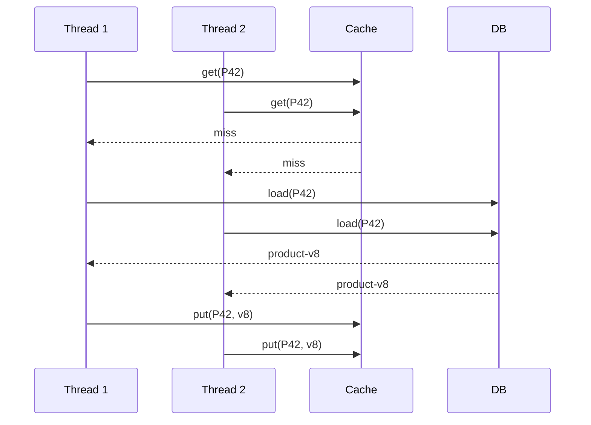
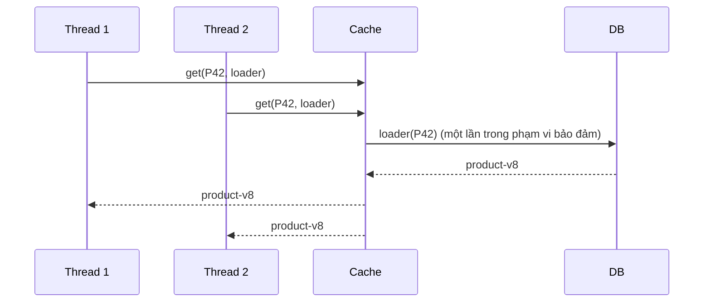

# Cache bị dồn tải khi khóa phổ biến hết hạn (Cache Stampede) trong Spring Cache

> **Chủ đề:** Spring Framework – Cache · **Nhóm:** Đồng thời.  
> Bài học tập trung vào hiện tượng **nhiều yêu cầu đồng thời cùng nạp lại một hot key vừa hết hạn**, cách `@Cacheable(sync = true)` xử lý trong phạm vi hỗ trợ của cache provider, các rủi ro khi chạy nhiều instance, và các kỹ thuật giảm tải nguồn dữ liệu mà không đánh đổi tính đúng đắn.

## 1. Vấn đề thực tế: hot key hết hạn và cả đám request cùng miss

Một khóa cache được gọi là **hot key** khi có lượng truy cập cao hơn hẳn các khóa còn lại. Ví dụ trang sản phẩm `P42` nhận hàng trăm request mỗi giây, trong khi những sản phẩm khác hiếm khi được truy cập. Cache giữ trang sản phẩm giúp giảm truy vấn database, nhưng khi entry `P42` hết TTL, các request đến gần như cùng lúc có thể đều nhận **cache miss**.

Với cách nạp thông thường, mỗi request miss đều có thể tự thực thi method đắt đỏ rồi ghi kết quả vào cache. Đây là **cache stampede** (còn gọi là *thundering herd* hoặc cache breakdown khi nhấn mạnh một hot key): nhiều worker cùng làm một việc khiến database, API phụ trợ hoặc CPU tăng tải đột ngột.

Tình huống:

```text
Trước TTL:
Client 1 ─┐
Client 2 ─┼──> cache["P42"] = product-v7 ──> trả ngay (hit)
Client N ─┘

Ngay sau TTL:
Client 1 ──> miss ──> query DB ─┐
Client 2 ──> miss ──> query DB ─┼──> cùng nạp P42
Client 3 ──> miss ──> query DB ─┤
Client N ──> miss ──> query DB ─┘
```

**Nguy cơ chính:** nhiều request đồng thời đọc cùng bản ghi không làm tăng giá trị kết quả, nhưng có thể tăng độ trễ, cạn connection pool, gây timeouts và làm hệ thống gặp thêm các đợt retry, kéo dài sự cố.

### Phân biệt các hiện tượng tương tự

| Hiện tượng | Tính chất | Giải pháp ưu tiên |
|---|---|---|
| **Hot-key stampede** | Nhiều request cùng miss **một key** sau expiry/eviction | Single-flight hoặc đồng bộ loader theo key, refresh sớm, stale-while-revalidate |
| **Mass expiry / avalanche** | Nhiều **key khác nhau** hết hạn gần nhau | Jitter TTL, phân tán lịch warmup, giới hạn tải nguồn |
| **Cache penetration** | Request lặp lại đến key không tồn tại hoặc không được cache | Negative caching phù hợp, validation, chặn dữ liệu đầu vào sai |
| **Cold start / deployment** | Cache chưa được làm nóng khi khởi động hoặc đổi node | Warmup theo hot keys, gradual rollout, giới hạn concurrency |
| **Backend outage** | Cache server mất kết nối khiến nhiều request rơi xuống DB | Circuit breaker, bulkhead, load shedding, fallback có kiểm soát |

Một hệ thống có thể mắc nhiều hiện tượng cùng lúc. Ví dụ Redis bị lỗi làm tất cả key miss; trong đó một số hot key lại gây stampede mạnh hơn.

## 2. Vì sao cache miss xảy ra đồng thời?

Xét Spring service:

```java
@Cacheable(cacheNames = "products", key = "#p0")
public Product findProduct(String id) {
    return repository.findById(id).orElseThrow();
}
```

Đây là **method minh họa** nằm trong Spring-managed service đã có `Product` và repository.

Mặc định, Spring Cache abstraction **không tự khóa mọi lời gọi**. Một lần miss có thể gồm ba hành động logic: đọc cache → gọi method thật → ghi cache. Nếu nhiều thread cùng kiểm tra vào lúc entry chưa được cập nhật thì tất cả có thể đi tới method thật.



**Thời gian nạp dài khiến rủi ro lớn hơn.** Nếu hot key có tốc độ tới `R` requests/giây và loader mất `L` giây, số request có khả năng chồng nhau trong khoảng miss ban đầu xấp xỉ `R × L` (đây chỉ là trực giác ước lượng khi arrival khá đều, không phải bảo đảm hoặc công thức đo production). Ví dụ 600 request/giây và 0,2 giây tải dữ liệu có thể tạo khoảng 120 yêu cầu cùng gặp một cửa sổ miss, trước khi một yêu cầu hoàn tất việc nạp.

Không nên chỉ xem hit rate trung bình: cache có thể hit 99,9% thời gian nhưng đúng lúc hot key hết hạn lại gây một spike ngắn làm DB quá tải.

## 3. Giải pháp trực tiếp của Spring: `@Cacheable(sync = true)`

Spring Framework hỗ trợ thuộc tính `sync` cho `@Cacheable`:

```java
@Cacheable(cacheNames = "products", key = "#p0", sync = true)
public Product findProduct(String id) {
    return repository.findById(id).orElseThrow();
}
```

Ở nhánh cacheable, Spring sử dụng cách lấy cache với value loader, tương ứng API:

```java
<T> T Cache.get(Object key, Callable<T> valueLoader)
```

Ý tưởng: khi nhiều lời gọi cùng key bị miss, **provider được yêu cầu phối hợp để value loader chỉ chạy một lần**, những thread còn lại đợi hoặc cùng nhận kết quả khi value được tạo. Với provider có hỗ trợ atomic load theo key, hiện tượng gọi trùng giảm mạnh.



### Những gì `sync=true` làm và không làm

**Có thể làm, khi provider hỗ trợ:**

- Giảm số lần thực thi method thật cho **cùng một key** trong đợt cache miss đồng thời.
- Giữ hành vi `@Cacheable` thông thường khi đã có cache hit.
- Cho phép những key độc lập vẫn được nạp song song theo đặc tính của provider.

**Không tự làm:**

- Không thay TTL, không ngăn entry hết hạn.
- Không tự gia hạn thời gian sống hay chủ động refresh trước expiry.
- Không đảm bảo mọi request ngay lập tức nhận kết quả: các thread đang chờ loader có thể chịu **độ trễ tương đương thời gian nạp**.
- Không phải Java `synchronized` áp dụng toàn bộ method, và không mặc nhiên là distributed lock giữa nhiều JVM/pod.
- Không thay circuit breaker, connection-pool limit, retry policy hoặc xử lý cache backend lỗi.
- Không giúp các request mà `condition=false` vì những lần gọi đó bypass caching.
- Không làm cache có nhiều tên/manager trở thành multi-level cache.

**Quan trọng:** Spring mô tả `sync=true` là một **hint** đến cache provider. Tài liệu `Cache.get(key, Callable)` nêu implementation *nên* bảo đảm loader được gọi một lần **nếu có thể**. Cần kiểm tra provider và test trên chính môi trường chạy thật.

## 4. Phạm vi đồng bộ: một key, một instance hay nhiều node?

### 4.1. Cache local trong một JVM

Với `ConcurrentMapCacheManager` của Spring, `ConcurrentMapCache` có thể phối hợp load trong phạm vi cấu trúc concurrent map của cache instance. Với Caffeine, API `Cache.get(key, mappingFunction)` và loading cache có cơ chế atomic computation trên cache instance.

Trong cùng một process với các thread cùng tham chiếu một cache instance, `sync=true` có thể ngăn 20 thread cùng thực thi một loader cho key `P42`. Tuy nhiên, nếu ứng dụng scale ra **3 pod**, mỗi pod giữ **cache local riêng**, có thể vẫn có **3 lần nạp** cho `P42` (một lần trên mỗi cache instance). Không được hiểu một thí nghiệm thành công với local map là bằng chứng về đồng bộ toàn cluster.

### 4.2. Shared cache như Redis

Redis chia sẻ dữ liệu giữa node nhưng **shared storage không tự đồng nghĩa single-flight across nodes**. Nếu cả ba pod cùng nhận miss trước khi pod đầu ghi kết quả, mỗi pod vẫn có thể gọi database.

Spring Data Redis có các chế độ `RedisCacheWriter` không khóa/khóa với semantics riêng. Tài liệu hiện hành cho biết writer không khóa là mặc định; locking writer dùng lock theo **cache**, không phải per-entry key. Điều đó có thể tạo độ tranh chấp rộng hơn một hot key và không tự thay thế thiết kế distributed single-flight hoàn chỉnh. Cần kiểm tra hành vi thực của `Cache.get(key, Callable)`, bản Spring Data Redis đang dùng, TTL lock, thời gian chờ và đường lỗi.

Nếu bắt buộc chỉ **một lần truy vấn cho hot key trên toàn cụm**, cân nhắc một tầng coordinator phân tán có lease/timeout và kiểm tra lại cache sau khi giành quyền (double-check). Với thao tác có tác dụng ghi, cần cân nhắc fencing token hoặc version để ngăn owner hết hạn lock rồi ghi đè dữ liệu mới. Không dùng khóa phân tán theo thói quen cho mọi read; chi phí round-trip và trường hợp owner chết có thể khiến giải pháp tệ hơn.

### 4.3. Cache đa tầng

Nếu L1 là Caffeine theo từng JVM và L2 là Redis dùng chung:

```text
Pod A ──> L1-A ──> L2 Redis ──> DB
Pod B ──> L1-B ──> L2 Redis ──> DB
Pod C ──> L1-C ──> L2 Redis ──> DB
```

Một hot key hết hạn ở L1 của nhiều pod có thể chuyển spike sang L2. Nếu L2 cũng đã hết hạn, spike có thể rơi thẳng vào DB. Cần định nghĩa rõ nơi nào có single-flight, nơi nào giữ stale data, và cách invalidate giữa các tầng.

Không cấu hình `@Cacheable(cacheNames={"L1","L2"}, sync=true)` để giải quyết multi-level: synchronized caching trong Spring có giới hạn chỉ một cache cho operation đó.

## 5. Ví dụ Java 17+ chạy được: không sync so với sync

Ví dụ độc lập dùng **Java 17+**, **Maven** và **Spring Framework 6.2.12**, không cần Spring Boot hay Redis. Hai vùng cache local `unsynced` và `synced` được tạo mới. Để mô phỏng việc *hot key vừa hết hạn*, chương trình chủ động đặt rồi xóa entry ngay trước khi phát một loạt request cùng key. Đây là **mô phỏng expiration**, không phải tự cấu hình TTL.

Với nhánh không sync, một `CyclicBarrier` trong loader đảm bảo 8 thread đều đã vào loader trước khi thread nào hoàn thành; nhờ vậy có thể thấy việc nạp trùng mà không lệ thuộc vào việc máy có nhanh/chậm. Với nhánh `sync=true`, loader có độ trễ nhỏ và Spring cache yêu cầu đồng bộ việc nạp key.

### 5.1. Cấu trúc

```text
spring-hot-key-stampede/
├── pom.xml
└── src/main/java/dev/example/stampede/StampedeDemo.java
```

**`pom.xml`**

```xml
<?xml version="1.0" encoding="UTF-8"?>
<project xmlns="http://maven.apache.org/POM/4.0.0"
         xmlns:xsi="http://www.w3.org/2001/XMLSchema-instance"
         xsi:schemaLocation="http://maven.apache.org/POM/4.0.0 https://maven.apache.org/xsd/maven-4.0.0.xsd">
    <modelVersion>4.0.0</modelVersion>
    <groupId>dev.example</groupId>
    <artifactId>spring-hot-key-stampede</artifactId>
    <version>1.0.0</version>
    <properties>
        <maven.compiler.release>17</maven.compiler.release>
        <project.build.sourceEncoding>UTF-8</project.build.sourceEncoding>
    </properties>
    <dependencies>
        <dependency>
            <groupId>org.springframework</groupId>
            <artifactId>spring-context</artifactId>
            <version>6.2.12</version>
        </dependency>
    </dependencies>
    <build>
        <plugins>
            <plugin>
                <groupId>org.apache.maven.plugins</groupId>
                <artifactId>maven-compiler-plugin</artifactId>
                <version>3.13.0</version>
            </plugin>
            <plugin>
                <groupId>org.codehaus.mojo</groupId>
                <artifactId>exec-maven-plugin</artifactId>
                <version>3.3.0</version>
                <configuration>
                    <mainClass>dev.example.stampede.StampedeDemo</mainClass>
                </configuration>
            </plugin>
        </plugins>
    </build>
</project>
```

**`src/main/java/dev/example/stampede/StampedeDemo.java`**

```java
package dev.example.stampede;

import java.util.ArrayList;
import java.util.HashSet;
import java.util.List;
import java.util.Objects;
import java.util.Set;
import java.util.concurrent.CountDownLatch;
import java.util.concurrent.CyclicBarrier;
import java.util.concurrent.ExecutorService;
import java.util.concurrent.Executors;
import java.util.concurrent.Future;
import java.util.concurrent.TimeUnit;
import java.util.concurrent.atomic.AtomicInteger;
import java.util.function.Function;

import org.springframework.cache.Cache;
import org.springframework.cache.CacheManager;
import org.springframework.cache.annotation.Cacheable;
import org.springframework.cache.annotation.EnableCaching;
import org.springframework.cache.concurrent.ConcurrentMapCacheManager;
import org.springframework.context.annotation.AnnotationConfigApplicationContext;
import org.springframework.context.annotation.Bean;
import org.springframework.context.annotation.Configuration;

public class StampedeDemo {
    private static final int WORKERS = 8;

    public static void main(String[] args) throws Exception {
        try (AnnotationConfigApplicationContext context =
                new AnnotationConfigApplicationContext(AppConfig.class)) {
            HotService service = context.getBean(HotService.class);
            CacheManager manager = context.getBean(CacheManager.class);

            Cache plainCache =
                    Objects.requireNonNull(manager.getCache("unsynced"));
            Cache syncCache =
                    Objects.requireNonNull(manager.getCache("synced"));

            // Đặt entry rồi xóa: mô phỏng thời điểm hot key vừa expired.
            plainCache.put("HOT", "warm");
            plainCache.evict("HOT");

            syncCache.put("HOT", "warm");
            syncCache.evict("HOT");

            int plainDistinct = runBurst(service::loadPlain);
            System.out.println("plainDistinct=" + plainDistinct);
            System.out.println("plainLoads=" + service.plainLoadCount());

            int syncDistinct = runBurst(service::loadSynchronized);
            System.out.println("syncDistinct=" + syncDistinct);
            System.out.println("syncLoads=" + service.syncLoadCount());

            System.out.println("plainCached=" +
                    (plainCache.get("HOT") != null));
            System.out.println("syncCached=" +
                    (syncCache.get("HOT") != null));

            System.out.println("repeatSync=" +
                    service.loadSynchronized("HOT"));
            System.out.println("syncLoadsAfterHit=" +
                    service.syncLoadCount());

            System.out.println("otherKey=" +
                    service.loadSynchronized("COLD"));
            System.out.println("syncLoadsAfterOtherKey=" +
                    service.syncLoadCount());
        }
    }

    private static int runBurst(Function<String, String> action)
            throws Exception {
        ExecutorService pool = Executors.newFixedThreadPool(WORKERS);
        CountDownLatch ready = new CountDownLatch(WORKERS);
        CountDownLatch start = new CountDownLatch(1);
        List<Future<String>> futures = new ArrayList<>();

        try {
            for (int i = 0; i < WORKERS; i++) {
                futures.add(pool.submit(() -> {
                    ready.countDown();
                    start.await();
                    return action.apply("HOT");
                }));
            }
            if (!ready.await(10, TimeUnit.SECONDS)) {
                throw new IllegalStateException("Workers not ready");
            }

            start.countDown();
            Set<String> results = new HashSet<>();
            for (Future<String> future : futures) {
                results.add(future.get(15, TimeUnit.SECONDS));
            }
            return results.size();
        } finally {
            start.countDown();
            pool.shutdownNow();
        }
    }

    @Configuration(proxyBeanMethods = false)
    @EnableCaching
    public static class AppConfig {
        @Bean
        public CacheManager cacheManager() {
            return new ConcurrentMapCacheManager("unsynced", "synced");
        }

        @Bean
        public HotService hotService() {
            return new HotService(WORKERS);
        }
    }

    public static class HotService {
        private final AtomicInteger plainLoads = new AtomicInteger();
        private final AtomicInteger syncLoads = new AtomicInteger();
        private final CyclicBarrier allPlainLoaders;

        public HotService(int parallelism) {
            this.allPlainLoaders = new CyclicBarrier(parallelism);
        }

        @Cacheable(cacheNames = "unsynced", key = "#p0")
        public String loadPlain(String key) {
            int count = plainLoads.incrementAndGet();
            try {
                // Bảo đảm toàn bộ 8 loader đã bắt đầu trước khi trả.
                allPlainLoaders.await(10, TimeUnit.SECONDS);
            } catch (Exception e) {
                throw new IllegalStateException("Plain load failed", e);
            }
            return "plain-" + key + "#" + count;
        }

        @Cacheable(cacheNames = "synced", key = "#p0", sync = true)
        public String loadSynchronized(String key) {
            int count = syncLoads.incrementAndGet();
            try {
                Thread.sleep(150);
            } catch (InterruptedException e) {
                Thread.currentThread().interrupt();
                throw new IllegalStateException("Interrupted", e);
            }
            return "synced-" + key + "#" + count;
        }

        public int plainLoadCount() {
            return plainLoads.get();
        }

        public int syncLoadCount() {
            return syncLoads.get();
        }
    }
}
```

**Chạy tại thư mục chứa `pom.xml`:**

```bash
mvn -q compile exec:java
```

**Stdout từ chương trình** khi context/cache mới được khởi tạo (không tính log Maven phụ):

```text
plainDistinct=8
plainLoads=8
syncDistinct=1
syncLoads=1
plainCached=true
syncCached=true
repeatSync=synced-HOT#1
syncLoadsAfterHit=1
otherKey=synced-COLD#2
syncLoadsAfterOtherKey=2
```

### 5.2. Diễn giải kết quả

- Cả hai cache đã được seed và evict trước khi burst, vì thế 8 request đầu cùng chạm **hot key đang trống**.
- Ở `unsynced`, tất cả 8 thread vào body `loadPlain` trước khi thread nào trả xong (do `CyclicBarrier`). Vì vậy số lần gọi loader và số kết quả khác nhau đều bằng 8.
- Ở `synced`, Spring gửi yêu cầu load phối hợp đến `ConcurrentMapCache`. Một thread thực thi `loadSynchronized("HOT")`, 7 thread còn lại nhận cùng kết quả khi load hoàn thành: `syncDistinct=1` và `syncLoads=1`.
- Sau burst, hai cache đều có entry, nhưng việc **đã có cache sau cùng không chứng minh chỉ nạp một lần**: cần quan sát loader invocation count hoặc downstream DB queries.
- Lần gọi lặp `"HOT"` hit nên `syncLoadsAfterHit` vẫn bằng 1.
- Key `"COLD"` khác `"HOT"` nên có một lần load mới, làm `syncLoadsAfterOtherKey=2`.
- Kết quả có tính tái lập trong giả định tất cả worker start được và không gặp timeout 10–15 giây. Các timeout là **giới hạn an toàn của demo**, không phải công thức tuning production.

**Quan trọng về ví dụ:** `CyclicBarrier` chỉ dùng để tạo *thí nghiệm đối chứng*. Không chép barrier này vào loader production. Nó sẽ gây chờ vô ích và có thể deadlock nếu không đủ thread cùng gọi. Thực tế, hãy đo số lần repository được gọi bằng metrics hoặc mock/spy trong integration test.

## 6. Điều kiện cần và giới hạn của `sync=true`

### 6.1. Cấu hình hợp lệ

```java
@Cacheable(
    cacheNames = "products",
    key = "#p0",
    condition = "#p0 != null && #p0.length() <= 32",
    sync = true)
public Product get(String id) {
    return repository.load(id);
}
```

Đây là snippet thuộc service có repository thật. `condition` đánh giá trước khi cache lookup, có thể kết hợp `sync=true`. Khi `condition=false`, method vẫn chạy nhưng **không dùng cache**, nên không có tác dụng chống stampede từ cache.

### 6.2. Ba ràng buộc của synchronized caching

Theo `@Cacheable` Javadoc, với `sync=true`:

1. **Không hỗ trợ `unless`** — không thể veto việc lưu dựa trên `#result` sau khi loader chạy.
2. **Chỉ một cache được dùng** — không khai báo nhiều cache names cho operation hoặc dùng resolver trả nhiều cache.
3. **Không kết hợp cache operation khác trên cùng method** — không gộp thêm `@CachePut`, `@CacheEvict` hoặc một `@Cacheable` khác vào operation synchronized.

Không hợp lệ:

```java
@Cacheable(cacheNames = "products",
           sync = true,
           unless = "#result == null")
public Product load(String id) {
    return repository.load(id);
}
```

Không hợp lệ:

```java
@Cacheable(cacheNames = {"productsL1", "productsL2"}, sync = true)
public Product load(String id) {
    return repository.load(id);
}
```

Hai snippet này chỉ để nhận diện lỗi cấu hình, không được đưa vào demo runnable. Nếu cần bỏ cache kết quả null, có thể dùng `unless` **khi bỏ `sync=true`**, hoặc thiết kế loader/single-flight tùy biến có chính sách null rõ ràng.

### 6.3. Những trường hợp annotation không kích hoạt

`@EnableCaching` phải được bật và method phải được gọi thông qua **Spring-managed proxy** trong proxy mode mặc định. Self-invocation kiểu `this.load("HOT")` và object tạo bằng `new` ngoài Spring context thường bỏ qua cache interceptor, khiến cả `@Cacheable` và `sync` không hoạt động.

Nhiều vấn đề tưởng là “sync không hiệu quả” thực ra do key thay đổi, nhiều JVM local cache riêng, annotation không được intercept, `condition=false` hoặc backend không hỗ trợ loader atomic như kỳ vọng.

## 7. Các chiến lược giảm cache stampede ngoài sync

Không có một mẹo chung cho mọi workload. Hãy chọn biện pháp dựa trên SLA độ trễ, mức chấp nhận dữ liệu cũ và mức nhất quán của nguồn.

### 7.1. Early refresh / stale-while-revalidate

Ý tưởng: nếu dữ liệu đã đến **soft TTL** nhưng chưa vượt **hard TTL**, cho phép trả bản cache cũ còn chấp nhận được và làm mới dữ liệu **ở nền một lần**. Những request còn lại không phải cùng chờ DB.

```text
Fresh value (age < soft TTL) -> trả ngay
Soft-expired, hard-valid     -> trả stale có giới hạn; kích hoạt 1 refresh
Hard-expired / never loaded  -> chờ load/fallback theo chính sách
```

Ưu điểm: giảm đỉnh latency ở hot key khi nguồn dữ liệu tạm thời chậm. Đổi lại, service **có thể trả dữ liệu cũ** trong một khoảng cho phép, nên không phù hợp với dữ liệu cực kỳ nhạy cảm về số dư, quyền truy cập hoặc trạng thái giao dịch.

**Caffeine** có `refreshAfterWrite` trên `LoadingCache`/`AsyncLoadingCache`. Theo tài liệu Caffeine, sau một khoảng thời gian entry trở nên đủ điều kiện refresh; lần truy cập tiếp theo sẽ kích hoạt refresh bất đồng bộ và thông thường vẫn nhận giá trị cũ trong lúc chờ. `expireAfterWrite` thì làm entry không còn được phục vụ sau hạn; hai chính sách có mục tiêu khác nhau.

Đây là **ví dụ Caffeine thuần, không phải Spring Cache annotation**:

```java
LoadingCache<String, Product> cache = Caffeine.newBuilder()
    .maximumSize(10_000)
    .refreshAfterWrite(Duration.ofMinutes(1))
    .expireAfterWrite(Duration.ofMinutes(5))
    .build(key -> fetchFromDatabase(key));
```

Cần import `com.github.benmanes.caffeine.cache.Caffeine`, `LoadingCache`, `java.time.Duration` và định nghĩa `Product/fetchFromDatabase`. Caffeine phải có loader phù hợp để refresh; **không thể coi chỉ thêm một property `refreshAfterWrite` vào mọi `CacheManager` là tự có stale-while-revalidate**.

Không tự đồng nhất refresh của Caffeine với kỹ thuật SWR đa node: Caffeine local cache làm mới trong phạm vi cache instance; với nhiều pod có thể còn nhiều lần refresh DB trùng nhau.

### 7.2. TTL jitter / randomized expiry

Nếu hàng ngàn key được tạo cùng lúc và có TTL cố định 10 phút, chúng có thể hết hạn đồng loạt. Thêm jitter (ví dụ mỗi entry có TTL quanh 9–11 phút) giúp phân tán **mass expiry** theo thời gian.

**Giới hạn quan trọng:** jitter **không giải quyết triệt để hot-key stampede**. Dù TTL của `P42` được random thành 9 phút 47 giây, khi đúng key này hết hạn vẫn có thể có hàng trăm request cùng miss. Vì thế, thường phải kết hợp jitter với per-key load coordination hoặc stale serving.

Jitter phải được cấu hình **trong provider**, vì `@Cacheable` không có thuộc tính TTL chung. Spring Data Redis từ nhánh hỗ trợ `RedisCacheWriter.TtlFunction` cho TTL phụ thuộc key/value; Caffeine có `Expiry` cho thời gian hết hạn biến thiên. Đừng giả định `spring.cache.redis.time-to-live` tự tạo jitter; đó thường là cấu hình một TTL cố định.

### 7.3. Chủ động warmup và refresh trước thời điểm hết hạn

Với một số hot key dự đoán được (homepage, exchange rate summary, catalog phổ biến), job định kỳ hoặc event cập nhật có thể nạp trước khi entry expired. Cần làm rõ:

- Job chạy một lần ở cấp cluster hay mỗi node chạy một lần?
- Có thể cache stale hợp lệ trong lúc refresh không?
- Nếu job lỗi, hệ thống fallback theo stale data, retry hay fail fast?
- Khi database thay đổi, cache có được invalidated hoặc versioned kịp thời không?
- Warmup các hot key có làm nghẽn nguồn lúc startup không?

Không warm toàn bộ hàng triệu key chỉ vì sợ một hot key: việc đó có thể tự gây cache avalanche ngược vào DB.

### 7.4. Rate limit, bulkhead và load shedding

Single-flight giảm số lần load cùng key, nhưng những request **đang chờ** vẫn có thể tích tụ khi loader mất nhiều giây. Do đó cần thêm giới hạn:

- Số request được phép chờ cùng key và tổng request đang chờ.
- Timeout hợp lý và fallback khi loader quá chậm.
- Số query đồng thời tối đa tới DB hoặc downstream API.
- Rate limit cho endpoint/hot tenant, tránh biến lưu lượng không tin cậy thành hàng đợi vô hạn.
- Circuit breaker khi backend yếu; không để mọi request tiếp tục retry cùng lúc.

Ví dụ, nếu 1.000 request đang chờ một loader mất 10 giây, DB có thể chỉ nhận 1 query nhưng HTTP server vẫn chịu áp lực thread, connection và memory. **Giảm DB load không đồng nghĩa hệ thống đã khỏe**.

### 7.5. Negative caching và xử lý lỗi

Các key không tồn tại (`404`), input không hợp lệ hoặc key có dữ liệu chỉ xuất hiện sau một sự kiện có thể liên tục gây miss. Negative caching một trạng thái “không tìm thấy” với TTL ngắn đôi khi giúp giảm tải, nhưng:

- Không cache lỗi tạm thời (DB timeout, 503) như “không tồn tại” nếu nghiệp vụ không cho phép.
- Không dùng cùng sentinel với một giá trị hợp lệ.
- Nếu phương thức trả `null` hoặc `Optional.empty()`, chính sách null caching phụ thuộc provider; `sync=true` không dùng cùng `unless`.
- Key phải bao gồm tenant/permission scope nếu kết quả truy vấn phụ thuộc quyền, tránh thông tin “không tồn tại” bị chia sẻ sai.

Chống stampede không được đổi tính đúng đắn hoặc làm lộ dữ liệu.

## 8. Vì sao giải pháp lock phân tán không phải lúc nào cũng đơn giản?

Một ý tưởng thường được đề xuất:

```text
Miss cache["P42"]
  ├── lấy lock("P42") được -> đọc DB -> ghi cache -> thả lock
  └── không lấy lock -> đợi -> đọc lại cache
```

Ý tưởng đúng ở mức tổng quát, nhưng implementation phải giải quyết:

1. **Timeout lock và lease:** nếu owner chết giữa chừng, lock không được giữ vĩnh viễn.
2. **Double-check sau khi lấy lock:** có thể request khác đã nạp xong khi ta giành được lock; đọc lại cache để tránh DB query không cần thiết.
3. **Gia hạn lock:** loader có thể lâu hơn lease; nếu gia hạn sai có thể có hai owner cùng lúc.
4. **Release đúng owner:** không được xóa lock của client khác sau khi lease cũ hết hạn.
5. **Fencing/version:** owner hết hạn có thể hoàn thành muộn và ghi đè dữ liệu mới. Khi update shared state, cần version hoặc fencing nếu tính nhất quán yêu cầu.
6. **Chi phí round-trip:** mỗi cache miss thêm lock request và polling có thể đắt.
7. **Backoff và jitter khi đợi:** không để 1.000 waiters cùng truy vấn Redis theo vòng lặp vài millisecond.
8. **Key granularity:** lock theo `P42` thay vì cả cache `products` nếu hệ thống cần các key khác xử lý độc lập.
9. **Phân quyền và key namespace:** lock và cache phải cùng tenant/region scope, tránh khóa/chia sẻ nhầm.
10. **Failure policy:** hết thời gian chờ thì trả stale, lỗi có kiểm soát hay cho phép một loader dự phòng?

**Không đưa đoạn pseudo-code này vào production như một thuật toán lock phân tán hoàn chỉnh.** Dùng thư viện/coordinator được kiểm thử, theo dõi lock contention và thử các tình huống node chết, network partition, GC pause, retry và write-late.

## 9. Thiết lập với Spring Boot/Caffeine/Redis theo từng yêu cầu

### 9.1. Spring Boot với Caffeine local và `sync=true`

Ví dụ nếu dự án Boot đã có `spring-boot-starter-cache` và Caffeine trên classpath:

```properties
spring.cache.type=caffeine
spring.cache.cache-names=products
spring.cache.caffeine.spec=maximumSize=10000,expireAfterWrite=5m
```

Service vẫn dùng API của Spring Framework:

```java
@Cacheable(cacheNames = "products", key = "#p0", sync = true)
public Product getProduct(String id) {
    return repository.loadProduct(id);
}
```

Đây là snippet từ ứng dụng Boot đã có `Product/repository`, không phải chương trình độc lập. Cần bật `@EnableCaching` trong configuration. Những property trên yêu cầu manager do Boot tạo theo nhánh Caffeine auto-config; nếu ứng dụng tự khai báo bean `CacheManager`, property có thể không sửa manager đó.

**Caffeine và `expireAfterWrite` chỉ tạo hard expiry:** vào đúng thời điểm entry hết hạn, caller đầu tiên vẫn phải chờ nạp; `sync=true` giúp phối hợp load trong cache instance nhưng không bảo đảm low latency. Nếu cần refresh-ahead, hãy thiết kế loading cache/refresh semantics cụ thể và test việc tích hợp với Spring Cache manager.

### 9.2. Spring Boot Redis có TTL

Ví dụ cấu hình Boot khi đã có `spring-boot-starter-data-redis`, một Redis server truy cập được và cấu hình serializer/key prefix phù hợp:

```properties
spring.cache.type=redis
spring.data.redis.host=localhost
spring.data.redis.port=6379
spring.cache.cache-names=products
spring.cache.redis.time-to-live=5m
spring.cache.redis.cache-null-values=false
```

Redis giúp chia sẻ entry giữa nhiều node, nhưng không được suy rằng `@Cacheable(sync=true)` luôn dẫn tới đúng **một DB query toàn cluster**. Cần test đồng thời giữa các pod, version Spring Data Redis, `RedisCacheWriter` và cách thao tác callback/locking.

**Không gắn `sync=true` vào operation có nhiều cache names hoặc `unless`.** Đó là các giới hạn ở lớp Spring Cache annotation, độc lập backend.

### 9.3. Bảng chọn biện pháp

| Ngữ cảnh | Biện pháp chính | Bổ trợ |
|---|---|---|
| Một JVM, Caffeine/ConcurrentMap local | `@Cacheable(sync=true)` hoặc native atomic get/load | Timeout, đo waiters, giới hạn loader |
| Nhiều pod, mỗi pod dùng local cache | Per-instance single-flight | Warmup/jitter, hạn chế số pod miss đồng thời |
| Nhiều pod, Redis shared | Xác minh semantics atomic/load của adapter; coordinator nếu SLA bắt buộc | Stale policy, backoff, metrics cross-node |
| Nhiều key hết hạn đồng loạt | TTL jitter theo key, phân tán warmup | Per-key sync cho những key nóng nhất |
| Hot key cần P99 latency thấp, dữ liệu có thể stale ngắn | Soft TTL + background refresh/SWR | Hard TTL, giới hạn stale, xử lý refresh failure |
| Giá trị phải tuyệt đối mới (ví dụ quyền/số dư) | Source-of-truth hoặc kiểm soát version/consistency nghiêm ngặt | Không dùng stale fallback tùy tiện |
| DB sắp quá tải | Bulkhead, load shedding, circuit breaker | Single-flight, caching, retry có jitter |

## 10. Lưu ý khi có eviction, transaction và dữ liệu thay đổi

Stampede không chỉ do TTL. Một thao tác `@CacheEvict` trên key nóng cũng tạo ra khoảng trống tương tự, nhất là khi nhiều request đọc ngay sau lúc cập nhật.

Ví dụ:

```java
@Cacheable(cacheNames = "products", key = "#p0", sync = true)
public Product read(String id) {
    return repository.find(id);
}

@CacheEvict(cacheNames = "products", key = "#p0")
public void update(String id, ProductPatch patch) {
    repository.update(id, patch);
}
```

Đây là các method minh họa trong service được quản lý, không phải class độc lập. `@CacheEvict` thường xóa sau khi method thành công; cần kiểm tra thời điểm **DB transaction commit** thay vì giả định annotation tự tạo atomicity với database.

Đặc biệt với `@CacheEvict(beforeInvocation=true)`, entry bị xóa trước khi method cập nhật database. Một reader khác có thể miss, đọc **giá trị DB cũ** rồi cache lại trước commit, khiến cache stale ngay cả khi update thành công. `sync=true` không tự ngăn hiện tượng đó: nó chỉ phối hợp các loader của cùng cache theo semantics provider, không bảo đảm kết quả loader trùng với phiên bản DB mới nhất.

Để kiểm soát tính nhất quán:

- Xác định thời điểm evict tương ứng với transaction commit.
- Khi cần after-commit invalidation, dùng transaction-aware cache hoặc event/outbox phù hợp; kiểm tra semantics `evict` so với `evictIfPresent`.
- Nếu versioning, đưa version dữ liệu vào key hoặc kiểm tra version trước khi put để tránh late-loader overwrites.
- Không đặt TTL quá dài cho dữ liệu có độ biến động cao mà không có cơ chế invalidation.
- Nếu serve stale, giới hạn độ stale theo nghiệp vụ và theo dõi lag của refresh.
- Thử race giữa đọc/ghi với nhiều thread và nhiều node, không chỉ unit test trên một local cache.

## 11. Quan sát bằng metric và kiểm thử tải đúng cách

### 11.1. Những chỉ số cần đo

| Nhóm | Metric/quan sát | Ý nghĩa |
|---|---|---|
| Cache | hit, miss, eviction, expiration, cache size | Phát hiện hot key vừa expired hoặc mass expiry |
| Loader | số lời gọi tới repository/API theo key/nhóm key | Xác minh thực sự giảm duplicate work |
| Concurrency | số loader đồng thời, số waiter và thời gian chờ | Phát hiện thundering herd bị chuyển thành wait queue |
| Downstream | DB QPS, connection pool utilization, latency P95/P99, timeout rate | Đo ảnh hưởng thực sự tới nguồn |
| Ứng dụng | active threads, requests queued, CPU, memory, 5xx, retry rate | Phát hiện overload dù DB load đã giảm |
| Phân tán | cùng hot key được nạp bao nhiêu lần trên các pod | Phân biệt local và cluster-level single-flight |
| Refresh | số lần refresh thành công/thất bại, độ tuổi stale tối đa | Đảm bảo chính sách stale phục vụ đúng SLA |

Không nên log raw cache key nếu có user ID, token, email hoặc dữ liệu nhạy cảm. Thay bằng key class, hash có salt/rotation phù hợp hoặc nhóm key được phép để tránh rò rỉ dữ liệu và cardinality metric quá cao.

### 11.2. Kịch bản test tối thiểu

1. **Warm-hit:** entry có sẵn; gửi hàng trăm request, xác nhận không gọi loader.
2. **Cold-miss cùng key, một node:** tất cả worker bắt đầu cùng lúc; đo loader count với `sync=false` và `sync=true`.
3. **Cold-miss khác key:** xác nhận hệ thống không vô tình khóa toàn bộ cache khi các key độc lập.
4. **Expiry đúng hot key:** sử dụng TTL ngắn hoặc evict mô phỏng; đồng bộ 20–100 request ngay sau expiry.
5. **Mass expiry:** nhiều key tạo cùng thời điểm; thử khi có và không có TTL jitter.
6. **Hai hoặc nhiều pod:** cùng một key, cùng thời điểm; đo tổng loader count trên toàn cụm chứ không chỉ mỗi pod.
7. **Slow-loader:** tăng thời gian query từ 50ms lên 5s; đo số waiter/timeout, không chỉ số DB calls.
8. **Loader exception:** khi query thất bại, quan sát request cùng key nhận lỗi và chính sách retry; tránh retry storm.
9. **Cache backend down:** Redis tạm ngừng, xem circuit breaker, fallback và mức bảo vệ DB.
10. **Refresh thất bại:** khi stale vẫn được phép, kiểm tra hard TTL và không phục vụ dữ liệu quá tuổi.
11. **Eviction cạnh tranh với update:** thử reader nạp DB cũ ngay trước commit và writer cập nhật sau commit.
12. **Negative key:** nhiều request cùng key không tồn tại; xác minh policy null/404 và không cache lỗi tạm thời.
13. **Scale-out trong lúc burst:** thêm pod khiến local cache mới trống; quan sát wave nạp lại.
14. **Release phiên bản mới:** thay cache serialization/key prefix/TTL có thể vô tình làm toàn bộ hit trở thành miss.

### 11.3. Cách đọc kết quả test

Một bài test chỉ đo `cache.get("HOT") != null` sau burst là **chưa đủ**: cả nhánh không sync lẫn sync đều có thể đã đặt value vào cache. Cần đếm số lần logic đắt đỏ thực sự chạy.

Cũng không nên tuyên bố đã giải quyết stampede nếu `sync=true` làm DB QPS giảm nhưng HTTP timeout tăng: những thread chờ vẫn sử dụng tài nguyên. Một thiết kế tốt phải cân bằng **freshness, duplicate load, wait time, throughput và failure behavior**.

## 12. Lỗi phổ biến và cách xử lý

| Triệu chứng | Nguyên nhân có thể | Hướng khắc phục |
|---|---|---|
| Hết TTL là DB QPS tăng dựng đứng | Hot key miss đồng thời | Kiểm tra `sync=true`/native atomic load; refresh sớm; test loader count |
| Có `sync=true` nhưng nhiều pod vẫn query DB | Mỗi pod giữ local cache riêng hoặc provider không có distributed single-flight | Xác minh backend, test cross-node và chọn coordinator khi cần |
| DB load giảm nhưng P99 vẫn cao | Nhiều request chờ một loader chậm | SWR có giới hạn, timeout, bulkhead, rate limit |
| Jitter TTL không giảm spike của một hot key | Jitter chỉ phân tán thời điểm expiry, không ngăn các request cùng key | Kết hợp per-key coordination hoặc soft TTL |
| `@Cacheable` không có tác dụng | Thiếu `@EnableCaching`, self-invocation, object ngoài Spring | Xác minh bean/proxy và annotation |
| `sync=true` kèm `unless` báo lỗi | Cấu hình không hợp lệ | Bỏ một trong hai; thiết kế loader riêng nếu cần cả hai yêu cầu |
| `sync=true` kèm hai cache names báo lỗi | Chế độ synchronized chỉ cho phép một Cache | Dùng một cache adapter hoặc kiến trúc nhiều tầng riêng |
| Có condition nhưng vẫn dồn tải | `condition=false` bỏ qua cache ở các request quan trọng | Rà logic condition và traffic distribution |
| Cache hit cùng key nhưng sai tenant | Key không chứa tenant/permission | Thiết kế key/namespace theo quyền |
| Các key mới luôn miss do 404 | Không có negative caching/validation | Chỉ cache negative result phù hợp với TTL ngắn |
| Caffeine refresh không như mong đợi | Dùng manual cache nhưng đặt `refreshAfterWrite` không có loader phù hợp | Cấu hình `LoadingCache`/`AsyncLoadingCache`, test refresh |
| Redis locking writer gây tranh chấp rộng | Lock ở cấp cache, không phải entry | Xem xét writer semantics và chiến lược per-key phù hợp |
| Sau update vẫn thấy dữ liệu cũ | Reader repopulate trong khoảng DB chưa commit, hoặc invalidation không phủ các tầng | After-commit, versioning, key correctness |
| Khi DB lỗi xảy ra retry storm | Tất cả waiters retry ngay khi loader thất bại | Backoff + jitter, circuit breaker, giới hạn retry và stale fallback có kiểm soát |

## 13. Checklist triển khai trong production

1. **Biết hot keys của mình:** đo request rate và loader latency theo nhóm key; xác định một key hay nhiều key hết hạn đồng loạt.
2. **Hiểu cache topology:** trong JVM, Redis shared hay multi-level? Có bao nhiêu cache instances cùng tham gia?
3. **Định nghĩa tính đúng:** có được serve stale không, trong bao lâu? Dữ liệu nào tuyệt đối không được stale?
4. **Bật `sync=true` có chủ đích:** một cache, không có `unless`, không kết hợp cache operations; test provider thật.
5. **Kiểm tra giới hạn node:** local single-flight khác distributed single-flight; không suy diễn từ demo in-memory.
6. **Giảm expiry đồng loạt:** dùng jitter per-key nếu nhiều key có TTL giống nhau, nhưng không xem nó là giải pháp cho một hot key.
7. **Thiết kế refresh:** soft/hard TTL hoặc `refreshAfterWrite` nếu backend/ứng dụng hỗ trợ; giới hạn số refresh song song.
8. **Bảo vệ nguồn dữ liệu:** bounded waiters, timeout, bulkhead, circuit breaker, retry có backoff; tránh domino failure.
9. **Kiểm soát invalidation:** khi update DB, chọn thời điểm sau commit hoặc versioning nếu tính nhất quán yêu cầu.
10. **Test thật:** burst vừa hết hạn với cùng key trên 1 và nhiều pod; đo DB calls, waiter count và latency tail.
11. **Quan sát liên tục:** dashboard cache misses, load deduplication ratio, refresh failure, backend QPS và timeout.
12. **Tài liệu hóa thất bại:** loader lỗi, cache lỗi, node chết, lock hết lease, refresh quá hạn và phương án fallback.

### Kết luận

**Cache stampede xảy ra khi nhiều request cùng nhận miss cho một hot key** sau khi entry hết hạn hoặc bị xóa. `@Cacheable(sync=true)` là bước đầu tốt để yêu cầu cache provider phối hợp nạp cùng key, nhưng **không tự gia hạn TTL, không tự tạo distributed lock và không đảm bảo latency thấp cho các request đang chờ**. Với hệ thống nhiều node hoặc tải lớn, cần kết hợp đúng mức: *per-key single-flight*, refresh sớm/SWR khi có thể chấp nhận stale, jitter cho mass expiry, bảo vệ downstream và kiểm thử concurrent trên provider thực tế.

### Tài liệu tham khảo

- Spring Framework — Declarative annotation-based caching, `@Cacheable(sync=true)`: https://docs.spring.io/spring-framework/reference/integration/cache/annotations.html
- Spring Framework 6.2 — `Cacheable` Javadoc, ràng buộc của `sync`: https://docs.spring.io/spring-framework/docs/6.2.16/javadoc-api/org/springframework/cache/annotation/Cacheable.html
- Spring Framework 6.2 — `Cache.get(key, Callable)` và semantics loader: https://docs.spring.io/spring-framework/docs/6.2.14/javadoc-api/org/springframework/cache/Cache.html
- Spring Data Redis — `RedisCacheManager`, `RedisCacheWriter`, TTL, locking vs non-locking: https://docs.spring.io/spring-data/redis/reference/redis/redis-cache.html
- Caffeine Wiki — Atomic population: https://github.com/ben-manes/caffeine/wiki/Population
- Caffeine Wiki — `refreshAfterWrite` và expiry: https://github.com/ben-manes/caffeine/wiki/Refresh
