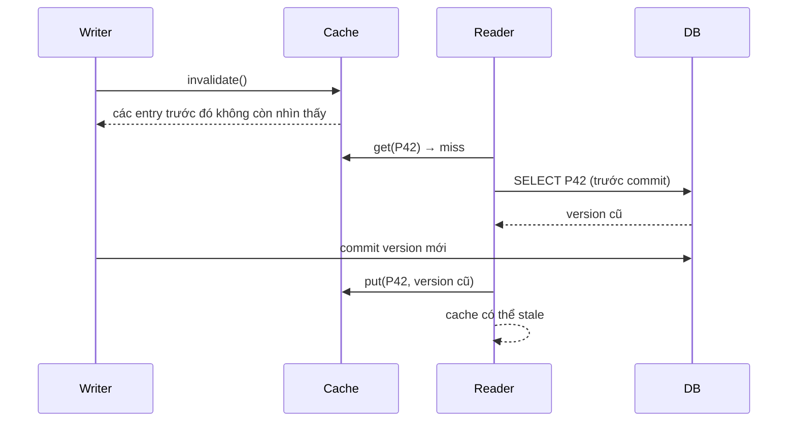

# Spring Cache API: phân biệt `clear()` và `invalidate()`

> **Chủ đề:** Spring Framework – Cache · **Nhóm:** API lập trình.  
> Hai phương thức của giao diện `org.springframework.cache.Cache` đều liên quan tới việc **xóa toàn bộ mapping trong một vùng cache**, nhưng có hợp đồng về *thời điểm nhìn thấy hiệu lực* và *giá trị trả về* khác nhau. Hiểu đúng điểm này rất quan trọng khi ứng dụng có transaction, các operation cache chạy bất đồng bộ hoặc nhiều luồng cùng truy cập.

## 1. Một vùng Cache, hai cách yêu cầu xóa toàn bộ

Trong Spring Cache abstraction, `CacheManager` quản lý các vùng `Cache`. Ví dụ ứng dụng có `CacheManager` và hai vùng `products`, `exchangeRates`:

```java
CacheManager manager = ...;
Cache products = manager.getCache("products");
Cache rates = manager.getCache("exchangeRates");
```

Các dòng trên là snippet; `manager` cần được cấu hình, các import `CacheManager` và `Cache` lấy từ `org.springframework.cache`.

Mỗi `Cache` chứa các mapping `key → value`. Hai API sau cùng nhắm vào **toàn bộ mapping của một `Cache`**:

```java
void clear();

boolean invalidate();
```

Cả hai khác với `evict(key)` hay `evictIfPresent(key)`, vốn xóa **một key cụ thể**. Xóa vùng `products` **không tự động** xóa `exchangeRates`; muốn xóa nhiều vùng, phải chọn/duyệt đúng từng đối tượng `Cache` hoặc thiết kế thao tác quản trị tương ứng.

**Điểm mấu chốt:**

- `clear()` yêu cầu làm trống cache, nhưng hợp đồng API **cho phép hiệu ứng xóa được thực hiện chậm, bất đồng bộ hoặc trì hoãn**. Trong khoảng đó, lookup tiếp theo *có thể* còn thấy entry cũ.
- `invalidate()` yêu cầu làm cho **mọi mapping hiện có lập tức không còn nhìn thấy qua các lookup tiếp theo**. Đó là hợp đồng chặt hơn dành cho tình huống cần hiệu lực xóa ngay.
- `clear()` trả `void`.
- `invalidate()` trả `boolean` cho biết cache **được biết là có mapping trước thao tác** hay không. `false` không mặc nhiên có nghĩa việc xóa thất bại: vùng có thể đã rỗng hoặc implementation không xác định được trạng thái trước đó.

Hợp đồng này được mô tả ở Javadoc của `Cache` (Spring Framework 6.2). Nó không có nghĩa bất kỳ backend từ xa nào cũng cung cấp một giao dịch toàn cục khóa mọi reader/writer giữa các node.

## 2. Bảng so sánh `clear()` và `invalidate()`

| Tiêu chí | `Cache.clear()` | `Cache.invalidate()` |
|---|---|---|
| Đối tượng tác động | Tất cả entry trong **một vùng Cache** | Tất cả entry trong **một vùng Cache** |
| Chữ ký | `void clear()` | `boolean invalidate()` |
| Hợp đồng thời gian | Có thể thực hiện **deferred hoặc asynchronous** | Kỳ vọng xóa hiệu lực **ngay với lookup tiếp theo** |
| Giá trị trả về | Không có | `true` nếu được biết là trước đó có mapping; `false` khi không có hoặc không xác định được |
| Trên local `ConcurrentMapCache` | Thường xóa map ngay | Xóa map ngay và có thể xác định trạng thái trước khi xóa |
| Với `TransactionAwareCacheDecorator` trong transaction đang hoạt động | Có thể **đăng ký xóa ở after-commit** | **Không trì hoãn** như `clear()`; yêu cầu xóa ngay |
| Dùng trong `@CacheEvict(allEntries=true)` | Ứng với thao tác xóa thông thường (thường sau invocation) | Ứng với thao tác xóa **immediate**, chẳng hạn `beforeInvocation=true` |
| Bảo đảm không ai ghi lại sau khi xóa? | **Không** | **Không** |
| Bảo đảm đồng bộ database/cache? | **Không** | **Không** |
| Nên chọn khi | Chấp nhận semantics xóa thông thường, có thể muốn defer đến after-commit | Phải không còn thấy entry cũ ngay sau lời gọi theo contract của provider |

Một cách ghi nhớ ngắn: **`clear` = “yêu cầu làm trống”**, **`invalidate` = “làm mất hiệu lực nhìn thấy ngay”**.

Nhưng đừng suy ra `invalidate()` là “mạnh hơn trên mọi phương diện”. Việc xóa tức thì *trước* khi database commit có thể làm tăng cache miss, tạo race dẫn đến refill dữ liệu cũ, hoặc phá vỡ chiến lược invalidation sau commit. Chọn dựa trên nghiệp vụ và thời điểm dữ liệu nguồn trở nên hợp lệ.

## 3. Chữ ký API, kiểu trả về và ý nghĩa boolean

### 3.1. `clear()` trả `void`

```java
Cache cache = Objects.requireNonNull(manager.getCache("products"));
cache.clear();
```

Lệnh này yêu cầu cache loại tất cả mapping, nhưng **không trả về số entry bị xóa** và cũng không cho biết trước đó cache có rỗng không. Tùy provider/decorator, thao tác có thể được hoãn hoặc xử lý bất đồng bộ.

Javadoc của Spring Framework lưu ý rằng `clear()` có thể không khiến lookup lập tức mất khả năng nhìn thấy entry, đặc biệt với cache decorator có nhận biết transaction. Vì vậy không nên lấy một lời gọi `clear()` làm bằng chứng có thể đọc ngay `null` trên mọi backend.

### 3.2. `invalidate()` trả `boolean`

```java
Cache cache = Objects.requireNonNull(manager.getCache("products"));
boolean hadEntries = cache.invalidate();
System.out.println("Previously known populated: " + hadEntries);
```

Ý nghĩa của return value:

- `true`: cache **được biết** là đã có ít nhất một mapping trước invalidation.
- `false`: cache **không có mapping** hoặc **không xác định được** có mapping trước thao tác.
- Không phải `true = xóa thành công` và `false = xóa thất bại`.
- Không phải số lượng entry hoặc số lượng key bị xóa.
- Không phải bằng chứng database đã cập nhật, hay đồng bộ tất cả pod.

Đặc biệt, một implementation chỉ hỗ trợ gọi thao tác clear nhưng **không xác định được trạng thái trước** có thể trả `false` mặc dù yêu cầu invalidation đã được thực hiện. Code nghiệp vụ không nên viết:

```java
if (!cache.invalidate()) {
    throw new IllegalStateException("Cache clearing failed");
}
```

Đây là **anti-pattern**: một vùng cache vốn đã rỗng có thể khiến `invalidate()` trả `false`, và một provider có thể không xác định được trước đó có dữ liệu. Khi backend thực sự lỗi, hãy xử lý exception, `CacheErrorHandler` hoặc trạng thái operation/backend theo contract của implementation, không suy luận từ boolean này.

### 3.3. Vì sao `invalidate()` không phải phép khóa toàn bộ hệ thống?

Hợp đồng immediate visibility nghĩa là những mapping bị invalidated không còn được nhìn thấy ở các lookup tiếp theo, **không có nghĩa ngăn request khác ghi entry mới** sau thời điểm xóa.

Ví dụ:

```text
T1: cache.invalidate()         -> loại entry cũ
T2: load từ database           -> lấy dữ liệu cũ (do DB chưa commit)
T2: cache.put("P42", old)       -> tạo entry mới sau invalidation
T3: cache.get("P42")            -> có thể thấy "old"
```

`invalidate()` không khóa các lệnh `put` tương lai, không làm một cache và một database thành cùng một transaction, và không tự cung cấp hàng rào nhất quán giữa nhiều services. Đây là giới hạn quan trọng khi lựa chọn xóa ngay trước cập nhật.

## 4. Phân biệt xóa toàn cache và xóa một key

Giao diện `Cache` có hai cặp API theo cùng triết lý:

| Phạm vi | Xóa thông thường | Xóa yêu cầu hiệu lực ngay |
|---|---|---|
| Một key | `void evict(Object key)` | `boolean evictIfPresent(Object key)` |
| Toàn bộ vùng | `void clear()` | `boolean invalidate()` |

Tương ứng:

```java
Cache cache = Objects.requireNonNull(manager.getCache("products"));

// Xóa đúng một entry.
cache.evict("P42");

// Xóa một entry với yêu cầu không còn nhìn thấy ngay.
boolean existed = cache.evictIfPresent("P42");

// Xóa mọi entry trong vùng products.
cache.clear();

// Invalidate mọi entry trong vùng products ngay.
boolean hadMappings = cache.invalidate();
```

Đây là các câu lệnh Java minh họa trong scope có `manager` và `Objects`. Đừng gọi `clear()` hay `invalidate()` nếu chỉ một product thay đổi: làm rỗng cả vùng sẽ gây cache miss cho tất cả key, tăng truy vấn tới nguồn và có thể gây **cache stampede**.

Cũng đừng nhầm `Cache.invalidate()` với `CacheManager`. `CacheManager` chỉ là gateway chọn các `Cache` và **không có API chuẩn `cacheManager.invalidate()` hay `cacheManager.clear()`** trong interface Spring Framework. Muốn tác động nhiều cache names, bạn phải chủ động duyệt từng vùng đã cho phép:

```java
for (String name : manager.getCacheNames()) {
    Cache cache = manager.getCache(name);
    if (cache != null) {
        cache.invalidate();
    }
}
```

Duyệt như trên là **snippet quản trị có phạm vi toàn bộ vùng cache của manager**, không phải một lệnh atomic across caches. Trong production nên giới hạn danh sách cache names, kiểm soát quyền và dùng logging/metrics để tránh xóa ngoài ý muốn.

## 5. API contract không đồng nghĩa mọi provider xử lý giống nhau

### 5.1. `ConcurrentMapCache`

`ConcurrentMapCache` là implementation local được cung cấp bởi Spring Framework. Nó dựa trên `ConcurrentMap` nên thao tác `clear` thường có hiệu lực ngay trong cùng cache instance; `invalidate` cũng xóa map và trả boolean dựa trên tình trạng được biết.

Vì thế, nếu thử:

```java
cache.put("A", "value-A");
cache.clear();
System.out.println(cache.get("A") == null); // true
```

trên `ConcurrentMapCache` local, kết quả sẽ là `true`. **Điều đó không xóa đi sự khác biệt ở hợp đồng API.** Một thử nghiệm trên map local không đủ để kết luận transaction-aware decorator hoặc remote cache cũng hoàn toàn giống vậy.

### 5.2. `TransactionAwareCacheDecorator`

`org.springframework.cache.transaction.TransactionAwareCacheDecorator` bọc một `Cache` khác và tích hợp với cơ chế transaction synchronization của Spring. Khi có Spring-managed transaction và synchronization đang hoạt động, các thao tác **`put`, `evict`, `clear` thông thường** có thể được hoãn tới **after-commit**.

Với `invalidate()`, Spring không trì hoãn theo cơ chế đó vì nó biểu thị yêu cầu hiệu lực ngay. Điều này tạo khác biệt có thể quan sát được:

```text
Transaction đang hoạt động
    cache.clear()
       └── đăng ký xóa sau commit
           └── ngay lúc này có thể đọc được entry cũ

Transaction đang hoạt động
    cache.invalidate()
       └── loại entry ngay
           └── đọc tiếp không còn thấy mapping đã bị xóa
```

Nếu transaction rollback, một `clear()` đã đăng ký cho **after-commit** thường sẽ **không thực hiện việc xóa**. Một `invalidate()` tức thì không được tự hoàn tác chỉ vì database transaction rollback.

Tuy nhiên, nếu **không có transaction synchronization hoạt động**, `clear()` của decorator sẽ được chuyển đến cache gốc ngay. Cần phân biệt việc có annotation `@Transactional` với việc **transaction thực sự đang active tại thời điểm API được gọi** và thứ tự AOP advice.

### 5.3. Các provider remote / phân tán

Redis, JCache hoặc các provider bên ngoài có semantics native riêng:

- Có provider thực hiện lệnh xóa toàn vùng bằng scan/delete nhiều key, bằng thay namespace/phiên bản hoặc bằng một cơ chế không atomic.
- Khi remote backend bất đồng bộ, thời điểm lệnh hoàn tất và khả năng nhìn thấy dữ liệu giữa các client có thể phụ thuộc adapter.
- Với cache transaction-aware, một thao tác `clear` ở lớp decorator có thể bị hoãn dù underlying local map vốn hỗ trợ xóa tức thời.
- `invalidate()` là yêu cầu immediate theo hợp đồng Spring; **cần xác minh provider/adapter cụ thể đáp ứng yêu cầu đó** bằng integration test, nhất là khi các node truy cập chung remote store.

Không cam kết “invalidate là distributed transaction” hoặc “clear là luôn asynchronous”. Cách diễn đạt đúng là **`clear` cho phép defer**, còn **`invalidate` đòi hỏi immediate visibility** trong phạm vi contract của `Cache`.

## 6. Ví dụ Java 17+ chạy được: `clear`, `invalidate` và transaction-aware decorator

Bài thực hành sử dụng **Java 17+**, **Maven**, **Spring Framework 6.2.12**, với `ConcurrentMapCacheManager`. Không cần Spring Boot, Redis hoặc database. Ví dụ cho thấy hai cache names độc lập, return value của `invalidate` và khác biệt giữa `clear` bị hoãn với `invalidate` tức thời khi đi qua transaction-aware decorator.

Để ví dụ chạy mà không cần database transaction manager, phần cuối **chủ động mô phỏng duy nhất lifecycle transaction synchronization** bằng API `TransactionSynchronizationManager`. Đây là **mô phỏng callback**, không phải một transaction database thật và không nên copy cách điều khiển synchronization thủ công vào nghiệp vụ production.

### 6.1. Cây thư mục

```text
spring-cache-clear-invalidate/
├── pom.xml
└── src/main/java/dev/example/clearinvalidate/ClearInvalidateDemo.java
```

### 6.2. Cấu hình Maven: `pom.xml`

```xml
<?xml version="1.0" encoding="UTF-8"?>
<project xmlns="http://maven.apache.org/POM/4.0.0"
         xmlns:xsi="http://www.w3.org/2001/XMLSchema-instance"
         xsi:schemaLocation="http://maven.apache.org/POM/4.0.0 https://maven.apache.org/xsd/maven-4.0.0.xsd">
    <modelVersion>4.0.0</modelVersion>
    <groupId>dev.example</groupId>
    <artifactId>spring-cache-clear-invalidate</artifactId>
    <version>1.0.0</version>

    <properties>
        <maven.compiler.release>17</maven.compiler.release>
        <project.build.sourceEncoding>UTF-8</project.build.sourceEncoding>
    </properties>

    <dependencies>
        <dependency>
            <groupId>org.springframework</groupId>
            <artifactId>spring-context</artifactId>
            <version>6.2.12</version>
        </dependency>
    </dependencies>

    <build>
        <plugins>
            <plugin>
                <groupId>org.apache.maven.plugins</groupId>
                <artifactId>maven-compiler-plugin</artifactId>
                <version>3.13.0</version>
            </plugin>
            <plugin>
                <groupId>org.codehaus.mojo</groupId>
                <artifactId>exec-maven-plugin</artifactId>
                <version>3.3.0</version>
                <configuration>
                    <mainClass>dev.example.clearinvalidate.ClearInvalidateDemo</mainClass>
                </configuration>
            </plugin>
        </plugins>
    </build>
</project>
```

`spring-context` kéo các dependency Spring cần thiết cho ví dụ, gồm `spring-tx` dùng bởi `TransactionSynchronizationManager` trong bộ phiên bản Spring nhất quán do Maven resolve.

### 6.3. Java source hoàn chỉnh

**`src/main/java/dev/example/clearinvalidate/ClearInvalidateDemo.java`**

```java
package dev.example.clearinvalidate;

import java.util.List;
import java.util.Objects;

import org.springframework.cache.Cache;
import org.springframework.cache.CacheManager;
import org.springframework.cache.concurrent.ConcurrentMapCacheManager;
import org.springframework.cache.transaction.TransactionAwareCacheDecorator;
import org.springframework.transaction.support.TransactionSynchronization;
import org.springframework.transaction.support.TransactionSynchronizationManager;

public class ClearInvalidateDemo {

    private static boolean has(Cache cache, String key) {
        return cache.get(key) != null;
    }

    private static void simulateAfterCommitCallbacks() {
        List<TransactionSynchronization> callbacks =
                TransactionSynchronizationManager.getSynchronizations();
        for (TransactionSynchronization callback : callbacks) {
            callback.afterCommit();
        }
    }

    public static void main(String[] args) {
        CacheManager manager =
                new ConcurrentMapCacheManager("products", "rates");

        Cache products =
                Objects.requireNonNull(manager.getCache("products"));
        Cache rates =
                Objects.requireNonNull(manager.getCache("rates"));

        // A. Hai cache names khác nhau: xóa products không xóa rates.
        products.put("A", "product-old");
        products.put("B", "product-two");
        rates.put("USD", "exchange-rate");

        System.out.println("initialA=" + has(products, "A"));
        System.out.println("initialB=" + has(products, "B"));
        System.out.println("initialRate=" + has(rates, "USD"));

        products.clear();
        System.out.println("afterClearA=" + has(products, "A"));
        System.out.println("afterClearB=" + has(products, "B"));
        System.out.println("afterClearRate=" + has(rates, "USD"));

        // B. invalidate() trả boolean về sự hiện diện đã biết.
        products.put("A", "product-new");
        boolean hadMapping = products.invalidate();
        System.out.println("invalidateKnownPopulated=" + hadMapping);
        System.out.println("afterInvalidateA=" + has(products, "A"));

        boolean hadMappingAgain = products.invalidate();
        System.out.println("invalidateEmpty=" + hadMappingAgain);

        // C. Bọc vùng bằng transaction-aware decorator.
        Cache transactional =
                new TransactionAwareCacheDecorator(products);

        // Mô phỏng transaction synchronization, KHÔNG phải DB transaction.
        products.put("A", "value-before-commit");
        TransactionSynchronizationManager.initSynchronization();
        try {
            transactional.clear();
            System.out.println("clearDeferredA=" + has(products, "A"));

            simulateAfterCommitCallbacks();
            System.out.println("clearAfterCommitA=" + has(products, "A"));
        } finally {
            TransactionSynchronizationManager.clearSynchronization();
        }

        // D. Trong synchronization, invalidate() vẫn phải xóa ngay.
        products.put("A", "value-in-transaction");
        TransactionSynchronizationManager.initSynchronization();
        try {
            boolean wasPopulated = transactional.invalidate();
            System.out.println("invalidateImmediateKnown=" + wasPopulated);
            System.out.println("invalidateImmediateA=" + has(products, "A"));
        } finally {
            TransactionSynchronizationManager.clearSynchronization();
        }

        System.out.println("rateStillPresent=" + has(rates, "USD"));
    }
}
```

Lưu ý:

- `TransactionSynchronizationManager.initSynchronization()` chỉ kích hoạt danh sách callback gắn với thread hiện tại. Nó **không** mở một DB transaction, không tạo commit, không điều khiển isolation hay rollback.
- `simulateAfterCommitCallbacks()` gọi các callback `afterCommit()` để **minh họa chính xác thời điểm decorator chạy clear đã hoãn**. Trong code Spring production, transaction manager mới là thành phần điều khiển callback.
- `clearSynchronization()` luôn được đặt trong `finally` để không rò rỉ trạng thái thread-local của ví dụ.
- Với cache local, `get(key) != null` thể hiện có mapping hay không, kể cả value được Spring bọc để biểu diễn null. Đây là lý do không dùng `get(key, String.class) != null` nếu nghiệp vụ cho phép cache null.

### 6.4. Chạy dự án và kiểm tra stdout

Tại thư mục chứa `pom.xml`:

```bash
mvn -q compile exec:java
```

Các dòng do chương trình tự in khi chạy với manager/cache mới (không tính log Maven):

```text
initialA=true
initialB=true
initialRate=true
afterClearA=false
afterClearB=false
afterClearRate=true
invalidateKnownPopulated=true
afterInvalidateA=false
invalidateEmpty=false
clearDeferredA=true
clearAfterCommitA=false
invalidateImmediateKnown=true
invalidateImmediateA=false
rateStillPresent=true
```

**Diễn giải:**

1. `initialA`, `initialB` và `initialRate` đều `true` vì trước đó đã `put`.
2. `products.clear()` xóa ngay hai mapping trong `ConcurrentMapCache` local; `rates` là một Cache khác nên vẫn giữ `USD`.
3. Sau khi `put("A","product-new")`, `invalidate()` của implementation local biết vùng trước đó có entry và trả `true`; sau xóa không còn A.
4. Gọi `invalidate()` tiếp lần nữa trên vùng trống trả `false`: **không phải lỗi**.
5. Bên trong synchronization mô phỏng, `TransactionAwareCacheDecorator.clear()` chỉ đăng ký công việc after-commit; vì vậy `clearDeferredA=true`.
6. Gọi callback `afterCommit()` làm việc xóa được thực hiện, nên `clearAfterCommitA=false`.
7. `transactional.invalidate()` là operation immediate, không đăng ký hoãn tới after-commit; nó loại A và trả `true` vì entry đang có trước đó.
8. Toàn bộ quá trình không can thiệp vùng `rates`, nên `rateStillPresent=true`.

Kết quả minh họa semantics local + decorator. **Không kết luận rằng một cache Redis phân tán chắc chắn trả cùng boolean hoặc có cùng cơ chế clear**. Với provider khác cần integration test, nhất là khi implementation không xác định được trước đó cache có mapping hay không.

## 7. `clear` và `invalidate` trong `@CacheEvict(allEntries=true)`

`@CacheEvict` cung cấp cách khai báo xóa cache qua annotation thay vì gọi `Cache` API trực tiếp. Với `allEntries=true`, Spring yêu cầu loại **toàn bộ entry của một hoặc nhiều vùng cache đã chỉ định**.

### 7.1. Xóa sau invocation (mặc định)

```java
@CacheEvict(cacheNames = "products", allEntries = true)
public void rebuildProducts() {
    repository.rebuild();
}
```

Đây là snippet trong service có repository, không phải class runnable. Khi `beforeInvocation` mặc định `false`, thao tác xóa được kích hoạt **sau khi method thành công**. Trong Spring Framework 6.2, đường gọi eviction toàn vùng thông thường tương ứng `Cache.clear()` và có thể tương tác với deferred semantics của decorator.

Nếu method ném exception thay vì hoàn thành thành công, thao tác xóa sau invocation không diễn ra theo logic annotation thông thường.

### 7.2. Xóa trước invocation

```java
@CacheEvict(cacheNames = "products",
            allEntries = true,
            beforeInvocation = true)
public void startRebuild() {
    repository.rebuild();
}
```

Khi `beforeInvocation=true`, Spring yêu cầu xóa toàn vùng **trước khi** gọi method, bất kể method sau đó thành công hay ném exception. Đường xóa toàn vùng ở chế độ immediate tương ứng `Cache.invalidate()`. Vì vậy, với decorator transaction-aware, nó **không tương đương** mặc định với `clear()` bị hoãn đến after-commit.

**Đừng hiểu việc xóa trước là luôn an toàn khi DB đang cập nhật.** Các reader khác có thể nạp lại dữ liệu cũ khi transaction chưa commit và ghi ngược vào cache trước khi rebuild hoàn tất.

### 7.3. `allEntries=true` không dùng cùng `key`

Đây là cấu hình sai:

```java
@CacheEvict(cacheNames = "products",
            allEntries = true, key = "#p0")
public void invalidateEverything(String id) {
    repository.rebuild();
}
```

Spring không cho phép đặt đồng thời `allEntries=true` và một biểu thức `key` trên `@CacheEvict`, vì một bên yêu cầu xóa toàn vùng, bên kia chọn key. Nếu chỉ muốn xóa đúng một entry, bỏ `allEntries` và giữ `key`.

### 7.4. Không đánh đồng method annotations với API return value

`@CacheEvict` không cung cấp cho method return value `boolean` mà `Cache.invalidate()` trả về. Giá trị trả về của method nghiệp vụ không phải là cờ `hadMappings` của cache. Nếu ứng dụng phải biết trạng thái trước khi xóa, hãy dùng `Cache` API trực tiếp hoặc instrument provider theo nhu cầu, đồng thời lưu ý `false` có thể nghĩa là “không xác định được”.

## 8. Transaction awareness, rollback và thời điểm commit

### 8.1. Một tình huống cần quan tâm

Giả sử cache chứa dữ liệu `products` và method cập nhật database:

```java
@Transactional
public void changePrice(String id, long newPrice) {
    repository.updatePrice(id, newPrice);
    cache.clear();
}
```

Đây là snippet minh họa, `@Transactional` chỉ có hiệu lực khi ứng dụng cấu hình transaction management và lời gọi đi qua proxy phù hợp.

Nếu `cache` là `TransactionAwareCacheDecorator`, `clear()` có thể được **hoãn đến sau commit thành công**. Điều này thường có lợi khi không muốn xóa cache một cách vô ích nếu DB rollback. Nhưng có vài điểm phải kiểm chứng:

- Transaction thật đã được mở chưa tại thời điểm gọi `clear()`?
- Cache bean có thực sự được bọc decorator transaction-aware?
- Hệ thống đang dùng `clear()` hay `invalidate()`, `evict()` hay `evictIfPresent()`?
- Việc đọc lại dữ liệu trong khoảng từ commit đến khi clear được thực hiện có xảy ra không? Deferred-after-commit không tự biến database và cache thành một transaction atomic.
- Nếu process chết sau DB commit trước khi invalidation hoàn thành, có cơ chế retry/outbox nào không?

### 8.2. Xóa ngay trong transaction có thể có giá phải trả

```java
@Transactional
public void changePrice(String id, long newPrice) {
    cache.invalidate();
    repository.updatePrice(id, newPrice);
}
```

Nếu cache được invalidated ngay trước khi DB commit, request khác có thể gặp cache miss, đọc giá **đã commit cũ**, rồi đặt giá cũ lại vào cache. Sau khi method commit, entry vừa được repopulate vẫn có thể stale.

Điều này cũng có thể xảy ra với `@CacheEvict(beforeInvocation=true, allEntries=true)`. Do đó, **immediate invalidation** là yêu cầu về *cache visibility*, không bảo đảm *freshness* hoặc đồng bộ transactional với nguồn dữ liệu.

Với dữ liệu cần nhất quán sau commit, cân nhắc `TransactionAwareCacheManagerProxy`, event after-commit, outbox hoặc versioned cache keys, đồng thời kiểm chứng toàn bộ đường đọc/ghi trong hệ thống thực tế.

### 8.3. `invalidate()` vẫn có thể bị lỗi

Mặc dù contract đòi hỏi immediate visibility, remote cache có thể bị lỗi mạng, timeout hoặc không hỗ trợ thao tác với semantics kỳ vọng. Kỹ thuật đúng là:

- Xác minh adapter/provider version.
- Thiết kế `CacheErrorHandler` hoặc exception policy phù hợp với độ nghiêm trọng của stale data.
- Nếu invalidation là bắt buộc để bảo toàn quyền truy cập, cân nhắc fail-closed hoặc versioned cache scheme thay vì “cứ bỏ qua lỗi cache”.
- Không dùng boolean `false` làm tiêu chí duy nhất phát hiện lỗi.
- Theo dõi metrics và kiểm thử failure modes.

## 9. Đồng thời: một lời gọi `invalidate()` không tạo atomic consistency

### 9.1. Request khác có thể ghi sau khi xóa

Một ví dụ race:



Sơ đồ minh họa interleaving, không tuyên bố một thứ tự cố định sẽ xảy ra ở mọi provider. Nó cho thấy: dù `invalidate()` đã đáp ứng contract, **một operation `put` xuất hiện sau invalidation** vẫn có thể tạo entry mới bằng giá trị cũ.

### 9.2. Kịch bản cache stampede

`clear()` hoặc `invalidate()` toàn vùng cũng có thể khiến hàng trăm/hàng ngàn key cùng trở thành miss. Nếu quá nhiều request tới DB ngay lúc xóa, hệ thống có thể bị dồn tải. Những giải pháp cần xem xét:

- Chỉ evict một key nếu nghiệp vụ cho phép.
- Không gọi invalidate toàn vùng sau mỗi update nhỏ.
- Làm mới cache theo key hoặc dùng `@Cacheable(sync=true)` cho provider hỗ trợ single-flight.
- TTL jitter, warmup và refresh-ahead trong các hệ thống nhiều key hết hạn cùng lúc.
- Rate limit, bulkhead, timeout và theo dõi số loader đồng thời.
- Khi buộc phải invalidate toàn vùng, lên kế hoạch điều phối giữa node và thời điểm dữ liệu nguồn sẵn sàng.

### 9.3. Không xem `invalidate` là distributed lock

`invalidate()` không chặn writer khác ghi vào cache, không chặn cache miss requests gọi DB và không quyết định thứ tự của hai thao tác load rồi put. Nếu yêu cầu có một hàng rào nhất quán mạnh qua nhiều node, cần cơ chế version/coordination được kiểm thử thay vì chỉ thay `clear()` bằng `invalidate()`.

## 10. Lựa chọn API theo yêu cầu nghiệp vụ

| Yêu cầu | API/cách tiếp cận phù hợp | Lý do |
|---|---|---|
| Xóa một entry của product đã cập nhật | `evict(id)` hoặc `evictIfPresent(id)` | Không làm trống toàn vùng |
| Xóa toàn vùng, chấp nhận deferred semantics | `clear()` | Contract cho phép hoãn/bất đồng bộ |
| Xóa toàn vùng và phải không nhìn thấy entry cũ ngay | `invalidate()` | Hợp đồng immediate visibility |
| Chỉ muốn clear sau commit thành công | Transaction-aware `clear()` hoặc after-commit event | Tránh xóa ngay khi DB vẫn chưa commit |
| Xóa trước method cho dù method lỗi | `@CacheEvict(allEntries=true,beforeInvocation=true)` | Operation immediate trước invocation |
| Xóa sau method thành công | `@CacheEvict(allEntries=true)` | Trigger thông thường sau invocation |
| Xóa nhiều vùng trong manager | Duyệt danh sách cache names được phép | `CacheManager` không có `clearAll()` chuẩn |
| Cần biết cache trước đó có mapping | `invalidate()`, nhưng diễn giải cờ đúng | `false` có thể là rỗng hoặc unknown |
| Chống refill stale trước DB commit | After-commit, versioned keys, coordination | Immediate clear không giải quyết race này |
| Kiểm tra cache remote multi-node | Integration test đúng provider | Local map không thay thế hợp đồng backend |

**Khuyến nghị thực hành:** xóa **đúng phạm vi nhỏ nhất** trước; khi thực sự cần xóa cả vùng, hãy quyết định có cần nhìn thấy hiệu lực ngay không, có transaction/rollback không, và có nguy cơ dồn tải sau miss không.

## 11. Lỗi phổ biến và cách chẩn đoán

| Triệu chứng | Nguyên nhân thường gặp | Cách xử lý |
|---|---|---|
| Gọi `clear()` rồi vẫn đọc được entry cũ | Provider/decorator hoãn hoặc xử lý bất đồng bộ | Xác nhận implementation và transaction; nếu cần immediate dùng `invalidate()` |
| `invalidate()` trả `false` nhưng cache không bị lỗi | Vùng đã rỗng hoặc provider không xác định được trước đó có entry | Đừng coi `false` là thất bại |
| `clear()` hoạt động tức thì trên local, không tức thì trên transaction-aware wrapper | Contract cho phép deferred | Test cả hai cấp wrapper/backend |
| Gọi `invalidate()` trong transaction rồi rollback, cache vẫn rỗng | Immediate invalidation không rollback theo DB | Nếu cần after-commit, dùng `clear()` transaction-aware hoặc event |
| Sau `invalidate()` cache vẫn có key | Request khác ghi lại sau khi invalidate | Quan sát sequence concurrent load/put và version |
| Xóa `products` nhưng vùng `prices` còn dữ liệu | Mỗi `Cache` là vùng độc lập | Xác định đúng cache name và manager |
| Muốn xóa một product nhưng cả cache bị miss | Nhầm dùng `clear/invalidate` toàn vùng | Dùng `evict/evictIfPresent` theo key |
| `CacheManager.clear()` không biên dịch | API `CacheManager` chuẩn không có method đó | `getCache(name).clear()` hoặc `invalidate()` trên đúng `Cache` |
| Dùng `@CacheEvict(allEntries=true, key=...)` bị lỗi | Cấu hình mâu thuẫn toàn vùng và một key | Chỉ dùng `allEntries` hoặc `key` |
| Đặt `beforeInvocation=true` nhưng thấy xóa quá sớm | Annotation chọn immediate operation | Xem lại yêu cầu nghiệp vụ và thời điểm commit |
| Xóa từ cache local nhưng Redis vẫn có entry | Nhiều manager/vùng độc lập | Xác định backend được chọn và invalidation đa tầng |
| Xóa cache gây tăng DB QPS | Tất cả key cùng miss, cache stampede | Giảm phạm vi, warmup, single-flight và giới hạn tải |
| Cache adapter ném lỗi | Remote timeout, serializer/connection, permission | Theo dõi lỗi backend, exception policy, không dựa vào boolean |

## 12. Kiểm thử API và hiệu ứng xóa

Một bộ test nên bao phủ:

1. **Không có entry:** `invalidate()` trên vùng rỗng không được hiểu thành lỗi chỉ vì return `false`.
2. **Có entry:** với provider có khả năng biết trạng thái, gọi `invalidate()` để ghi nhận cờ và kiểm tra lookup không còn thấy entry cũ.
3. **Hai vùng:** xóa `products` không tác động đến `rates`.
4. **Một key:** `evictIfPresent("A")` không xóa key B và có thể trả cờ về sự hiện diện của A.
5. **Transaction-aware clear:** trong transaction, quan sát có thể còn entry trước commit, mất entry sau commit.
6. **Rollback:** operation clear đã defer không được thực thi sau rollback; đối chiếu với invalidate immediate không rollback.
7. **Cache wrapper:** kiểm tra `getCache("x")` có trả cache đã được bọc decorator không hay cache gốc, tránh test sai lớp.
8. **Multi-node:** sau khi invalidation được báo hoàn tất, kiểm tra lookup qua từng node với adapter thật.
9. **Concurrent repopulation:** cho reader miss và put data ngay sau invalidate để xác nhận ứng dụng có cơ chế chống stale refill nếu nghiệp vụ cần.
10. **Expiry và stampede:** đo DB QPS, cache miss rate, loader count khi xóa toàn vùng.
11. **Annotation path:** test `@CacheEvict(allEntries=true)` với mặc định và `beforeInvocation=true`, kể cả method ném exception.
12. **Provider error:** giả lập mất Redis, mất kết nối hoặc timeout; kiểm tra lỗi được báo/giải quyết theo policy.
13. **Tên manager/cache:** tránh nhầm nhiều `CacheManager` cùng đặt vùng `products` mà actually khác backend.
14. **Mức độ chấp nhận stale:** test theo SLA, không chỉ theo boolean và số lượng mapping.

### Unit test gợi ý

Với `ConcurrentMapCache` thuần:

```java
Cache cache = new ConcurrentMapCache("test");
cache.put("A", 100);
cache.put("B", 200);

cache.clear();
assert cache.get("A") == null;
assert cache.get("B") == null;

cache.put("C", 300);
boolean known = cache.invalidate();
assert known;
assert cache.get("C") == null;
```

Đây là snippet chỉ để gợi ý assertions và cần import `ConcurrentMapCache`, `Cache`; Java `assert` cần bật bằng `-ea`, hoặc dùng JUnit 5 `assertNull/assertTrue` trong test project. Bài chạy độc lập mục 6 sử dụng `System.out.println` để không phụ thuộc `-ea`.

Để chứng minh deferred behavior, test trực tiếp `TransactionAwareCacheDecorator` hoặc dùng integration test với transaction manager thật; không thể suy từ `ConcurrentMapCache.clear()` vốn xóa ngay.

## 13. Checklist lựa chọn và tóm tắt

Trước khi dùng `clear()` hoặc `invalidate()`, hãy trả lời:

1. Có thực sự phải xóa **toàn bộ vùng** không, hay chỉ cần `evict(key)`?
2. Cache được lấy từ đúng `CacheManager`, đúng `cacheName` và đúng tenant namespace chưa?
3. Có cần entry cũ **ngay lập tức vô hình** sau lời gọi không? Nếu có, chọn semantics `invalidate`.
4. Provider thật có thực hiện immediate invalidation theo contract không? Có wrapper nào trì hoãn `clear` không?
5. Return `boolean` của `invalidate()` được hiểu là **prior-known mappings**, không phải success/failure chứ?
6. Có transaction DB đang hoạt động? Có nên xóa sau commit hơn là xóa ngay?
7. Nếu transaction rollback, cache nên giữ nguyên, bị invalidated hay nạp lại?
8. Nếu request khác ghi lại data sau invalidate, hệ thống có cơ chế bảo vệ version/freshness không?
9. Xóa cả vùng có tạo cache stampede và overload ở database không?
10. Có test riêng cho cache local, remote, multi-node, lỗi backend và concurrency không?

**Kết luận:** `Cache.clear()` và `Cache.invalidate()` đều nhắm tới **toàn bộ mapping trong một `Cache`**, nhưng `clear()` chấp nhận việc xóa hoãn/bất đồng bộ và trả `void`; `invalidate()` yêu cầu mapping cũ không còn nhìn thấy ngay và trả `boolean` cho biết **sự hiện diện đã biết trước đó**. Điểm khác biệt thấy rõ nhất khi dùng transaction-aware decorator: `clear()` có thể đợi after-commit, còn `invalidate()` là immediate operation. Cả hai không tự giải quyết việc dữ liệu cũ được nạp lại sau khi xóa hoặc tính nhất quán giữa DB và nhiều node.

### Tài liệu chính thức

- Spring Framework 6.2 — `Cache` interface, `clear()` / `invalidate()` / `evictIfPresent()`: https://docs.spring.io/spring-framework/docs/6.2.14/javadoc-api/org/springframework/cache/Cache.html
- Spring Framework 6.2 — `TransactionAwareCacheDecorator`: https://docs.spring.io/spring-framework/docs/6.2.14/javadoc-api/org/springframework/cache/transaction/TransactionAwareCacheDecorator.html
- Spring Framework 6.2 — `ConcurrentMapCache` Javadoc: https://docs.spring.io/spring-framework/docs/6.2.14/javadoc-api/org/springframework/cache/concurrent/ConcurrentMapCache.html
- Spring Framework — Cache Abstraction: https://docs.spring.io/spring-framework/reference/integration/cache.html
- Spring Framework — Declarative caching / `@CacheEvict`: https://docs.spring.io/spring-framework/reference/integration/cache/annotations.html
