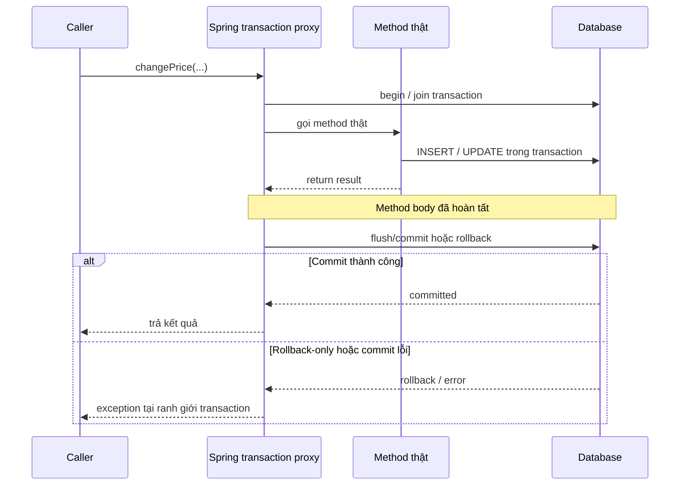
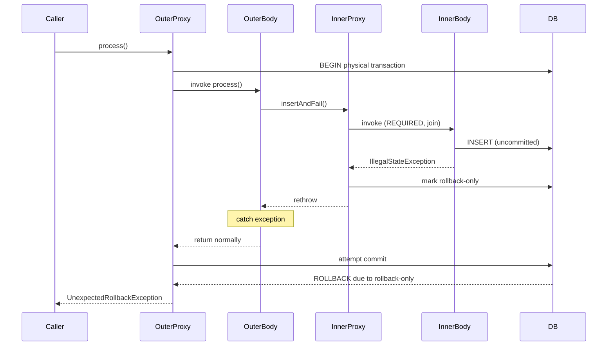

# Vì sao hoàn tất phương thức chưa đồng nghĩa commit thành công trong Spring Cache

> **Chủ đề:** Spring Framework – Cache · **Nhóm:** Giao dịch.  
> **Câu hỏi trọng tâm:** Vì sao một method có `@Transactional` hoặc `@CachePut`/`@CacheEvict` đã chạy hết thân hàm, thậm chí đã tính ra giá trị trả về, mà **database transaction vẫn có thể rollback hoặc commit thất bại**? Khi đó cache có thể khác nguồn dữ liệu ra sao, và thiết kế nào giúp gắn việc cập nhật cache với **commit thành công**?

## 1. Ba mốc thời gian rất dễ bị nhầm

Trong ứng dụng Spring, cần phân biệt ít nhất ba sự kiện:

1. **Thân method hoàn tất (method body completed):** Các dòng trong method đã thực thi xong và method chuẩn bị trả kết quả cho AOP interceptor, hoặc method ném exception.
2. **Ranh giới transaction hoàn tất:** `TransactionInterceptor` và `PlatformTransactionManager` đã quyết định commit/rollback, có thể flush dữ liệu xuống DB, gọi các callback rồi trả lại điều khiển. Đây là thời điểm xử lý bên **ngoài thân method** khi dùng Spring AOP declarative transaction.
3. **Thay đổi đã thực sự commit và có thể được quan sát theo mức isolation phù hợp:** Database xác nhận commit thành công; thao tác cache hoặc sự kiện hậu-commit mới có cơ sở để công bố kết quả đó.

**Method chạy đến dòng `return` không đồng nghĩa commit thành công.** Khi method nằm trong một transaction được proxy quản lý, phần thân method thường hoàn tất **trước** bước Spring transaction interceptor gọi commit. Nếu method chỉ tham gia transaction do caller mở, commit còn có thể diễn ra **muộn hơn**, ở ranh giới transaction ngoài cùng.

Ví dụ:

```java
@Transactional
public Product changePrice(String id, long newPrice) {
    repository.updatePrice(id, newPrice);
    System.out.println("Đã chạy đến cuối thân method");
    return repository.find(id);
}
```

Đây là **snippet minh họa trong Spring-managed service**, cần có `Product`, repository và transaction manager thật. Dòng log và `return` không phải biên bản xác nhận commit. Sau khi method trả kết quả cho Spring proxy, transaction manager vẫn có thể gặp lỗi ở thời điểm commit, hoặc phát hiện transaction đã bị đánh dấu rollback-only.

### Timeline cơ bản



Sơ đồ mô tả transaction **được mở bởi interceptor hiện tại**. Nếu lời gọi chỉ **tham gia transaction có sẵn**, interceptor của method đó không nhất thiết commit ngay; transaction thật kết thúc ở scope sở hữu nó.

## 2. Spring AOP là lý do method body và commit là hai bước riêng

### 2.1. `@Transactional` không phải phép biến đổi thân method

Trong proxy mode mặc định, `@Transactional` được Spring xử lý bằng một interceptor quanh lời gọi method. Đơn giản hóa:

```text
Caller
  -> Spring proxy
      -> TransactionInterceptor
          -> begin / join transaction
          -> invoke target method
          -> nếu method trả về: commit theo transaction status
          -> nếu method ném lỗi: đánh giá rollback rules
          -> trả kết quả hoặc ném exception cho caller
```

Một đoạn pseudocode minh họa, **không phải source của Spring**:

```java
TransactionStatus status = txManager.getTransaction(definition);
try {
    Object result = invokeTarget();   // Body method có thể đã return.
    txManager.commit(status);          // Bước này vẫn có thể thất bại.
    return result;
} catch (Throwable failure) {
    // Thực tế Spring phân biệt lỗi từ body, lỗi commit và rollback rules.
    handleFailure(failure, status);
    throw failure;
}
```

Điều quan trọng của pseudocode là **thứ tự**, không phải chính xác cách Spring xử lý exception trong nội bộ. Không copy pseudocode để tự triển khai transaction: `TransactionInterceptor` và `PlatformTransactionManager` có logic phức tạp hơn, đặc biệt với transaction tham gia, rollback-only và transaction synchronizations.

### 2.2. Log trong method không chứng minh commit

```java
@Transactional
public void saveOrder(Order order) {
    repository.save(order);
    log.info("saveOrder completed");
}
```

Dòng `saveOrder completed` chỉ chứng minh code đã chạy tới chỗ log, không bảo đảm:

- SQL đã được gửi xuống database hay chưa.
- Hibernate/JPA đã flush thành công hay chưa.
- Constraint, deadlock, optimistic-lock hoặc serialization check ở commit có thành công hay không.
- Transaction không bị một lời gọi bên trong đánh dấu rollback-only.
- Database đã xác nhận commit bền vững.
- Cache ở một manager/backend khác đã được cập nhật nhất quán.

Muốn audit nghiệp vụ, không ghi “committed” chỉ vì code chạy qua cuối method. Dựa vào **kết quả transaction thực**, callback `afterCommit` thích hợp hoặc cơ chế outbox/event có độ bền cần thiết.

### 2.3. Self-invocation và transaction scope

`@Transactional` cũng phụ thuộc việc lời gọi đi qua Spring proxy trong proxy mode. Nếu một method gọi `this.otherTransactionalMethod()` trong cùng instance, annotation trên method được gọi nội bộ có thể **không tạo transaction mới** như mong muốn.

Ví dụ:

```java
public void run() {
    this.changePrice("P42", 120);
}

@Transactional
public void changePrice(String id, long newPrice) {
    repository.updatePrice(id, newPrice);
}
```

Đây là snippet trong một service; nếu `run()` được gọi qua proxy nhưng không có transaction và bên trong gọi `this.changePrice(...)`, caching/transaction advice của `changePrice` không được áp dụng theo proxy mode thông thường. Khi phân tích “method đã return nhưng sao commit khác dự kiến”, bước đầu phải kiểm tra **transaction có thực sự được mở không**.

## 3. Những nguyên nhân thực tế khiến commit thất bại sau khi thân method hoàn tất

| Nguyên nhân | Điều xảy ra | Dấu hiệu cần điều tra |
|---|---|---|
| Transaction bị đánh dấu **rollback-only** | Target method return nhưng transaction không thể commit; có thể ném `UnexpectedRollbackException` | Method `@Transactional(REQUIRED)` bên trong ném exception đã bị catch |
| JPA/Hibernate trì hoãn SQL tới flush | Các lệnh trên entity chạy xong, constraint/SQL error chỉ xuất hiện khi flush ở commit | EntityManager flush mode, SQL logs, DB constraint |
| Unique/foreign-key/check constraint | Database từ chối ghi khi statement/flush/commit được thực hiện | Constraint violation, SQLSTATE |
| Optimistic locking | Version conflict chỉ được phát hiện ở thời điểm flush/update | `OptimisticLockException` hoặc exception đã được Spring translate |
| Serialization failure/deadlock | DB quyết định abort một transaction khi kiểm tra xung đột | SQLSTATE đặc thù, deadlock diagnostics |
| Transaction timeout | Transaction bị rollback-only hoặc từ chối commit | Logs transaction manager và timeout configuration |
| Resource commit failure | Network/driver/storage lỗi ngay tại commit | Exception từ transaction manager/driver; có thể không rõ outcome |
| Multiple resources/2PC/Saga | Một bước thành công nhưng bước khác thất bại hoặc outcome không chắc chắn | Cơ chế coordination, recovery, reconciliation |
| Outer transaction chưa kết thúc | Inner method return nhưng chỉ tham gia transaction chung; caller ngoài còn có thể rollback | Propagation chain và transaction ownership |
| Synchronization callback sau commit lỗi | DB có thể đã commit, nhưng caller vẫn nhìn thấy exception từ callback hậu-commit | Phân biệt `afterCommit` failure với DB commit failure |

**Ngoại lệ quan trọng ở chiều ngược lại:** Không phải **cứ caller nhận exception là DB đã rollback**. Nếu exception xuất hiện từ một callback **sau khi commit DB đã hoàn tất**, dữ liệu có thể đã được commit rồi. Cần nhận diện **thời điểm phát sinh lỗi**, không chỉ dựa trên việc method có exception hay không.

### 3.1. Flush không phải commit

Trong JPA, `repository.save(entity)` có thể chỉ cập nhật persistence context. SQL có thể được thực hiện khi `flush()` hoặc khi transaction sắp commit. Ngay cả khi `flush()` thành công, điều đó **chưa tương đương commit**: transaction vẫn có thể rollback về sau.

Mức độ trì hoãn SQL phụ thuộc ORM, ID strategy, statement và flush mode. Đừng khẳng định mọi lệnh `save` đều đợi tới commit; hãy theo dõi SQL thực và boundary.

### 3.2. Một exception bị catch không “xóa” rollback-only flag

Ví dụ nested service:

```java
@Service
public class InnerService {
    @Transactional(propagation = Propagation.REQUIRED)
    public void insertAndFail() {
        repository.insertSomething();
        throw new IllegalStateException("inner failure");
    }
}

@Service
public class OuterService {
    private final InnerService inner;

    public OuterService(InnerService inner) {
        this.inner = inner;
    }

    @Transactional
    public void process() {
        try {
            inner.insertAndFail();
        } catch (IllegalStateException e) {
            // Business đã bắt lỗi nhưng transaction chung vẫn có thể rollback-only.
        }
        System.out.println("Outer method reached end");
    }
}
```

Đây là **cấu trúc minh họa**, cần repository/configuration và imports đầy đủ. `Propagation.REQUIRED` cho phép inner tham gia **cùng physical transaction** của outer. Khi exception từ inner đi xuyên qua transaction interceptor của inner, Spring có thể đánh dấu transaction đó rollback-only theo rollback rules (với RuntimeException là mặc định). Outer bắt exception rồi return bình thường, nhưng lúc outer interceptor cố commit, có thể nhận `UnexpectedRollbackException`.

Bắt exception để tiếp tục business flow **không tự reset trạng thái rollback-only**. Nếu cần recovery, phải thiết kế propagation/đơn vị transaction riêng đúng nghiệp vụ, không dùng catch như một cách cưỡng ép commit.

## 4. `PROPAGATION_REQUIRED` và `UnexpectedRollbackException`

Spring phân biệt **logical transaction scope** của mỗi lời gọi `@Transactional` và **physical transaction** dùng chung của resource.

### 4.1. REQUIRED tham gia transaction chung

Với `PROPAGATION_REQUIRED`:

- Nếu chưa có transaction, lời gọi tạo transaction mới.
- Nếu đã có transaction phù hợp, lời gọi tham gia transaction đó.
- Inner và outer có thể có hai logical scopes nhưng **cùng một physical transaction**.
- Khi inner scope đánh dấu rollback-only trên transaction chung, outer có thể không biết ngay điều đó.
- Đến boundary commit ngoài cùng, Spring ném `UnexpectedRollbackException` để báo caller rằng **rollback đã xảy ra chứ không phải commit**.

Tài liệu chính thức của Spring mô tả đây là hành vi cố ý: caller không được bị đánh lừa rằng commit thành công khi thực tế transaction bị rollback.



### 4.2. `REQUIRES_NEW` không phải cách chữa mọi rollback

`PROPAGATION_REQUIRES_NEW` tạo physical transaction riêng, có thể commit/rollback độc lập. Nó phù hợp khi nghiệp vụ **thực sự muốn tách bền vững** một công việc, chẳng hạn ghi audit theo chính sách riêng. Tuy nhiên, nếu inner `REQUIRES_NEW` commit thành công mà outer sau đó rollback, kết quả inner **vẫn còn**. Đây có thể là chủ ý, cũng có thể phá vỡ tính nguyên tử của nghiệp vụ.

### 4.3. `NESTED` cần savepoint/support

`PROPAGATION_NESTED` có thể tạo savepoint trong một physical transaction (khi transaction manager và resource hỗ trợ). Inner rollback tới savepoint không nhất thiết đánh dấu toàn bộ outer rollback-only. Nhưng nó không phải lựa chọn tương đương cho mọi JPA/JTA application; cần kiểm tra manager/provider cụ thể.

**Tóm lại:** chọn propagation là quyết định transaction semantics, không nên thay đại chỉ để tránh `UnexpectedRollbackException`.

## 5. Vì sao Spring Cache dễ chịu ảnh hưởng của khoảng thời gian này?

Spring Cache cung cấp các annotation:

- `@Cacheable`: khi cache miss, method chạy và kết quả có thể được đưa vào cache.
- `@CachePut`: method chạy và kết quả được ghi vào cache.
- `@CacheEvict`: entry bị loại sau khi method thành công, hoặc trước method khi `beforeInvocation=true`.

Các annotation này **không tự động biến cache và database thành một transaction nguyên tử**. Một thao tác cache có thể được yêu cầu khi dữ liệu DB **chưa commit**, hoặc sau method body nhưng **trước commit**, tùy advice chain và cache manager.

Ví dụ rủi ro:

```java
@Transactional
@CachePut(cacheNames = "products", key = "#p0")
public Product updateProduct(String id, ProductPatch patch) {
    Product updated = repository.update(id, patch);
    return updated;
}
```

Đây là method minh họa với repository, `ProductPatch` và `Product` thực. Nó biểu đạt ý định “update rồi put cache”, **không bảo đảm** put luôn xảy ra đúng sau khi DB commit trong mọi cấu hình.

Một khả năng nguy hiểm là cache thấy bản mới trong khi database transaction sau đó rollback, dẫn tới dữ liệu cache “đi trước” database. Ở cấu hình advice khác, cache operation có thể không xảy ra khi commit fail. **Không dựa vào một thứ tự cố định khi chưa kiểm tra**.

### 5.1. Hai interceptors có thể bao nhau khác cách

Trong Spring proxy AOP, cả `@EnableCaching` và `@EnableTransactionManagement` đều có thuộc tính `order`; khi không thiết lập, chúng thường dùng `Ordered.LOWEST_PRECEDENCE`. Nếu nhiều advice cùng order, không nên suy luận thứ tự chỉ dựa vào vị trí annotation trên source.

Hai cách bao quanh khác nhau:

**Cache advice ngoài – transaction advice trong:**

```text
CacheInterceptor
  -> TransactionInterceptor
      -> target method body
      -> COMMIT hoặc ROLLBACK
  <- cache sees result/exception after transaction boundary
```

Trường hợp này, đường xử lý cache sau invocation có thể nhìn thấy **kết quả đã qua transaction interceptor**.

**Transaction advice ngoài – cache advice trong:**

```text
TransactionInterceptor
  -> CacheInterceptor
      -> target method body
      <- cache put/evict after method body
  -> COMMIT hoặc ROLLBACK
```

Trường hợp này, put/evict cache có thể được yêu cầu **trước** khi physical transaction commit, vì transaction advice vẫn bao ở ngoài.

**Cả hai sơ đồ chỉ là những cấu trúc khả dĩ**, không là lời khẳng định thứ tự trong mọi Spring version/configuration. Phải kiểm tra `@Order`/`@EnableCaching(order=...)`/`@EnableTransactionManagement(order=...)`, proxy chain, bean configuration và transaction propagation trong ứng dụng thực.

### 5.2. Cache hit có thể khiến method không chạy

Một method đồng thời có `@Cacheable` và `@Transactional` không đồng nghĩa mọi request đều vào transaction và gọi DB. Nếu cache advice intercept trước và hit, target method bị bỏ qua; hành vi transaction có thể khác so với miss. Đừng dùng log bên trong method để suy diễn toàn bộ traffic hoặc transaction boundaries khi cache đang bật.

### 5.3. Cần phân biệt thời điểm xóa với thời điểm commit

`@CacheEvict(beforeInvocation=false)` nghĩa là xóa khi **method invocation thành công theo logic cache**, không phải annotation tuyên bố “database đã commit”. `beforeInvocation=true` thậm chí yêu cầu xóa **trước method**, kể cả method sau đó ném exception, và có thể dùng immediate `evictIfPresent` hoặc `invalidate` tùy thao tác.

Sự khác biệt này rất quan trọng nếu user khác gặp cache miss rồi nạp lại giá trị cũ từ database trong lúc update còn chưa commit.

## 6. Timeline lỗi nhất quán: cache cập nhật trước khi DB rollback

Giả sử database đang giữ `price=100`, cache cũng có `100`. Người quản trị thay giá lên `120`:

| Thời điểm | Transaction update | Cache | Reader khác |
|---|---|---|---|
| t0 | DB committed `100` | Cache `100` | Đọc `100` |
| t1 | Transaction bắt đầu | `100` | — |
| t2 | SQL UPDATE `120`, **chưa commit** | `100` | — |
| t3 | Target method **return `120`** | Put cache `120` (nếu xảy ra trước commit) | Có thể thấy `120` |
| t4 | Transaction bị rollback do constraint/rollback-only | `120` còn trong cache | DB thực tế vẫn `100` |
| t5 | Request mới đến | Hit `120` | **Dữ liệu sai so với DB** |

Đây là một **interleaving có thể xảy ra**, không phải thứ tự mặc định được bảo đảm của mọi Spring proxy. Điểm quyết định là cache put đã hoàn tất trước khi commit DB được xác nhận.

Một vấn đề đối xứng xảy ra khi **xóa quá sớm**:

```text
t1: cache.evict("P42") trước DB commit
t2: reader khác cache miss, SELECT thấy committed-old=100
t3: reader put 100 vào cache
t4: writer commit giá mới=120
t5: cache đang giữ lại 100 (stale)
```

Khi đó ngay cả việc xóa sớm “thành công” cũng không đảm bảo cache tươi sau commit. Cần chiến lược **after-commit invalidation**, versioning hoặc coordination tùy mức nhất quán cần đạt.

## 7. `TransactionAwareCacheManagerProxy`: hoãn cache put/evict/clear tới sau commit

Spring Framework cung cấp `org.springframework.cache.transaction.TransactionAwareCacheManagerProxy`, bọc một `CacheManager` nguồn và trả về các cache có khả năng phối hợp với **Spring-managed transaction synchronization**.

```java
@Bean("rawCacheManager")
CacheManager rawCacheManager() {
    return new ConcurrentMapCacheManager("products");
}

@Bean("cacheManager")
@Primary
CacheManager cacheManager(
        @Qualifier("rawCacheManager") CacheManager raw) {
    return new TransactionAwareCacheManagerProxy(raw);
}
```

Đây là snippet thuộc `@Configuration` với imports Spring tương ứng; demo runnable ở mục 8.

### 7.1. Điều gì được hoãn?

Khi có transaction synchronization đang hoạt động, `TransactionAwareCacheDecorator` hoãn các thao tác **thông thường** sau tới **`afterCommit` của transaction thành công**:

| API | Hoãn đến after-commit? | Ghi chú |
|---|---|---|
| `Cache.put(key,value)` | **Có**, trong transaction sync hoạt động | Có thể không nhìn thấy value mới trước commit |
| `Cache.evict(key)` | **Có** | Thích hợp khi chỉ muốn xóa sau commit |
| `Cache.clear()` | **Có** | Làm trống vùng sau commit; có thể gây miss storm |
| `Cache.putIfAbsent(key,value)` | **Không** | Cần semantics immediate |
| `Cache.evictIfPresent(key)` | **Không** | Yêu cầu key không còn nhìn thấy ngay |
| `Cache.invalidate()` | **Không** | Yêu cầu toàn bộ mapping vô hình ngay |
| `Cache.get(key,Callable)` | **Không bảo đảm deferred put theo cơ chế put() thông thường** | Semantics callback/load tùy provider, phải kiểm tra đường sync |

Nếu không có transaction synchronization đang hoạt động, `put/evict/clear` vẫn được delegate ngay như thường lệ. Vì vậy việc chỉ thêm proxy **không có nghĩa mọi cache writes trên toàn ứng dụng luôn chờ một commit nào đó**.

### 7.2. Rollback làm gì với pending cache operation?

Nếu method có transaction bị rollback, các callback after-commit được đăng ký để `put/evict/clear` sẽ **không thực hiện** trên target cache. Đây là lợi ích quan trọng: một value tính trong transaction thất bại không tự bị put vào cache từ đường hoãn này.

Lưu ý:

- Hoãn write **không tạo atomic transaction giữa cache và DB**; cache update có thể lỗi sau khi DB commit.
- Nhiều request vẫn có thể gặp cửa sổ thời gian giữa commit và after-commit callback hoặc gặp race load/put trước commit từ nơi khác.
- Một ứng dụng có thể gọi nhầm cache manager gốc (`rawCacheManager`), bỏ qua decorator và ghi ngay.
- Các thao tác immediate (`putIfAbsent`, `evictIfPresent`, `invalidate`) không được hoãn.
- Với `@Cacheable(sync=true)`, provider có thể dùng `Cache.get(key,Callable)` và nạp entry theo semantics riêng; **đừng suy rằng mọi cache population đều deferred**.

### 7.3. Cache transaction-aware có thay thế distributed coordination không?

Không. Proxy chỉ móc cache operations vào lifecycle transaction **trong tiến trình Spring đang xử lý**. Nó không phải khóa phân tán, không bảo đảm đồng bộ DB/Redis như 2-phase commit, và không khiến nhiều JVM tự tham gia chung transaction. Khi có yêu cầu tính đúng mạnh, cần xét outbox/versioning/reconciliation và kiểm thử cross-node.

## 8. Ví dụ Java 17+ có database thật: method body return nhưng commit rollback

Ví dụ này dùng **Java 17+**, **Maven**, **Spring Framework 6.2.12**, **H2 2.3.232** và `DataSourceTransactionManager`. Khác ví dụ giả lập transaction bằng callback thủ công, ở đây thực sự có **database transaction JDBC**. Code cố ý tạo một inner method `REQUIRED` ném exception, outer bắt lỗi và chạy hết body, nhưng physical transaction đã rollback-only.

Ví dụ đồng thời cho thấy:

- Ghi trực tiếp vào `ConcurrentMapCache` không tự rollback cùng DB.
- Một cache được bọc bởi `TransactionAwareCacheManagerProxy` hoãn `put` tới sau commit thành công.
- Trong transaction thất bại, pending put ở cache transaction-aware không xảy ra.
- Trong transaction thành công, put được áp dụng after-commit và caller thấy value mới.

### 8.1. Cấu trúc

```text
spring-commit-vs-method-return/
├── pom.xml
└── src/main/java/dev/example/commit/CommitBoundaryDemo.java
```

### 8.2. `pom.xml`

```xml
<?xml version="1.0" encoding="UTF-8"?>
<project xmlns="http://maven.apache.org/POM/4.0.0"
         xmlns:xsi="http://www.w3.org/2001/XMLSchema-instance"
         xsi:schemaLocation="http://maven.apache.org/POM/4.0.0 https://maven.apache.org/xsd/maven-4.0.0.xsd">
    <modelVersion>4.0.0</modelVersion>

    <groupId>dev.example</groupId>
    <artifactId>spring-commit-vs-method-return</artifactId>
    <version>1.0.0</version>

    <properties>
        <maven.compiler.release>17</maven.compiler.release>
        <project.build.sourceEncoding>UTF-8</project.build.sourceEncoding>
    </properties>

    <dependencies>
        <dependency>
            <groupId>org.springframework</groupId>
            <artifactId>spring-context-support</artifactId>
            <version>6.2.12</version>
        </dependency>
        <dependency>
            <groupId>org.springframework</groupId>
            <artifactId>spring-jdbc</artifactId>
            <version>6.2.12</version>
        </dependency>
        <dependency>
            <groupId>com.h2database</groupId>
            <artifactId>h2</artifactId>
            <version>2.3.232</version>
        </dependency>
    </dependencies>

    <build>
        <plugins>
            <plugin>
                <groupId>org.apache.maven.plugins</groupId>
                <artifactId>maven-compiler-plugin</artifactId>
                <version>3.13.0</version>
            </plugin>
            <plugin>
                <groupId>org.codehaus.mojo</groupId>
                <artifactId>exec-maven-plugin</artifactId>
                <version>3.3.0</version>
                <configuration>
                    <mainClass>dev.example.commit.CommitBoundaryDemo</mainClass>
                </configuration>
            </plugin>
        </plugins>
    </build>
</project>
```

`spring-jdbc` cung cấp `JdbcTemplate` và `DataSourceTransactionManager`. `spring-context-support` chứa `TransactionAwareCacheManagerProxy`; Spring context và các thành phần `spring-tx` tương ứng được Maven kéo theo. H2 chạy in-memory, không cần server ngoài.

### 8.3. `src/main/java/dev/example/commit/CommitBoundaryDemo.java`

```java
package dev.example.commit;

import java.util.Objects;
import javax.sql.DataSource;

import org.springframework.beans.factory.annotation.Qualifier;
import org.springframework.cache.Cache;
import org.springframework.cache.CacheManager;
import org.springframework.cache.annotation.EnableCaching;
import org.springframework.cache.concurrent.ConcurrentMapCacheManager;
import org.springframework.cache.transaction.TransactionAwareCacheManagerProxy;
import org.springframework.context.annotation.AnnotationConfigApplicationContext;
import org.springframework.context.annotation.Bean;
import org.springframework.context.annotation.Configuration;
import org.springframework.context.annotation.Primary;
import org.springframework.jdbc.core.JdbcTemplate;
import org.springframework.jdbc.datasource.DataSourceTransactionManager;
import org.springframework.jdbc.datasource.DriverManagerDataSource;
import org.springframework.transaction.PlatformTransactionManager;
import org.springframework.transaction.UnexpectedRollbackException;
import org.springframework.transaction.annotation.EnableTransactionManagement;
import org.springframework.transaction.annotation.Propagation;
import org.springframework.transaction.annotation.Transactional;

public class CommitBoundaryDemo {

    private static Cache required(CacheManager manager, String name) {
        return Objects.requireNonNull(manager.getCache(name), name);
    }

    public static void main(String[] args) {
        try (AnnotationConfigApplicationContext context =
                new AnnotationConfigApplicationContext(AppConfig.class)) {

            JdbcTemplate jdbc = context.getBean(JdbcTemplate.class);
            jdbc.execute(
                "CREATE TABLE audit_log (" +
                "id INTEGER PRIMARY KEY, note VARCHAR(80) NOT NULL)");

            OuterService outer = context.getBean(OuterService.class);
            CacheManager raw = context.getBean(
                    "rawCacheManager", CacheManager.class);
            CacheManager aware = context.getBean(
                    "cacheManager", CacheManager.class);

            // TH1: body outer hoàn tất, nhưng commit transaction bị rollback.
            try {
                outer.returnsThenRollsBack();
                System.out.println("caller=unexpected-success");
            } catch (UnexpectedRollbackException e) {
                System.out.println("caller=UnexpectedRollbackException");
            }

            Integer countAfterRollback = jdbc.queryForObject(
                    "SELECT COUNT(*) FROM audit_log", Integer.class);
            System.out.println("dbAfterRollback=" + countAfterRollback);
            System.out.println("rawAfterRollback=" +
                    required(raw, "raw").get("K", String.class));
            System.out.println("awareAfterRollback=" +
                    required(aware, "aware").get("K", String.class));

            // TH2: commit thành công, put hoãn được áp dụng ở after-commit.
            outer.returnsAndCommits();

            Integer countAfterCommit = jdbc.queryForObject(
                    "SELECT COUNT(*) FROM audit_log", Integer.class);
            System.out.println("dbAfterCommit=" + countAfterCommit);
            System.out.println("awareAfterCommit=" +
                    required(aware, "aware").get("K", String.class));
        }
    }

    @Configuration(proxyBeanMethods = false)
    @EnableTransactionManagement
    @EnableCaching
    public static class AppConfig {
        @Bean
        public DataSource dataSource() {
            DriverManagerDataSource ds = new DriverManagerDataSource();
            ds.setDriverClassName("org.h2.Driver");
            ds.setUrl("jdbc:h2:mem:commit_demo;DB_CLOSE_DELAY=-1");
            ds.setUsername("sa");
            ds.setPassword("");
            return ds;
        }

        @Bean
        public JdbcTemplate jdbcTemplate(DataSource ds) {
            return new JdbcTemplate(ds);
        }

        @Bean
        public PlatformTransactionManager transactionManager(DataSource ds) {
            return new DataSourceTransactionManager(ds);
        }

        @Bean("rawCacheManager")
        public CacheManager rawCacheManager() {
            return new ConcurrentMapCacheManager("raw", "aware");
        }

        @Bean("cacheManager")
        @Primary
        public CacheManager cacheManager(
                @Qualifier("rawCacheManager") CacheManager raw) {
            return new TransactionAwareCacheManagerProxy(raw);
        }

        @Bean
        public InnerService innerService(JdbcTemplate jdbc) {
            return new InnerService(jdbc);
        }

        @Bean
        public OuterService outerService(
                InnerService inner,
                JdbcTemplate jdbc,
                @Qualifier("rawCacheManager") CacheManager raw,
                @Qualifier("cacheManager") CacheManager aware) {
            return new OuterService(inner, jdbc, raw, aware);
        }
    }

    public static class InnerService {
        private final JdbcTemplate jdbc;

        public InnerService(JdbcTemplate jdbc) {
            this.jdbc = jdbc;
        }

        @Transactional(propagation = Propagation.REQUIRED)
        public void insertAndFail() {
            jdbc.update(
                    "INSERT INTO audit_log(id,note) VALUES (?,?)",
                    1, "rollback-me");
            throw new IllegalStateException("inner-failure");
        }
    }

    public static class OuterService {
        private final InnerService inner;
        private final JdbcTemplate jdbc;
        private final CacheManager raw;
        private final CacheManager aware;

        public OuterService(InnerService inner,
                            JdbcTemplate jdbc,
                            CacheManager raw,
                            CacheManager aware) {
            this.inner = inner;
            this.jdbc = jdbc;
            this.raw = raw;
            this.aware = aware;
        }

        @Transactional
        public void returnsThenRollsBack() {
            // Direct put ngoài transaction-aware cache: ghi ngay.
            required(raw, "raw").put("K", "dirty");

            // Put qua decorator: đăng ký afterCommit.
            required(aware, "aware").put("K", "pending");

            try {
                inner.insertAndFail();
            } catch (IllegalStateException e) {
                System.out.println("innerErrorCaught=" + e.getMessage());
            }

            // Body method đi đến cuối, nhưng transaction đã rollback-only.
            System.out.println("methodBodyReachedReturn=true");
        }

        @Transactional
        public void returnsAndCommits() {
            jdbc.update(
                    "INSERT INTO audit_log(id,note) VALUES (?,?)",
                    2, "committed");

            Cache cache = required(aware, "aware");
            cache.put("K", "committed");

            // Giá trị mới chưa được put trước after-commit.
            System.out.println("deferredVisibleInside=" +
                    (cache.get("K", String.class) != null));
            System.out.println("successBodyReachedReturn=true");
        }
    }
}
```

Lưu ý:

- `OuterService` và `InnerService` là **hai Spring beans khác nhau**. Lời gọi `inner.insertAndFail()` đi qua proxy của inner, vì vậy `@Transactional(REQUIRED)` được áp dụng và có thể đánh dấu transaction chung rollback-only. Nếu viết `this.insertAndFail()` trong cùng bean, có thể bỏ qua proxy và kết quả khác.
- `cacheManager` ở đây **bọc** `rawCacheManager`. Hai vùng `raw` và `aware` đều nằm trong cùng native manager, nhưng chỉ vùng lấy qua wrapper `aware` được hoãn.
- Ví dụ chủ ý gọi **Cache API trực tiếp bên trong method transaction** để loại bỏ sự mơ hồ về thứ tự của cache advisor khi `@CachePut` và `@Transactional` cùng nằm trên một method. `@EnableCaching` được bật để thể hiện tích hợp chuẩn, nhưng demo không phụ thuộc cache annotation advisor.
- Đầu tiên chưa có entry `"K"` trong vùng `aware`. Vì vậy việc `put("K","committed")` bị hoãn làm `get("K")` trong cùng transaction vẫn trả null. Đây là hành vi của decorator, không phải một cơ chế “read your own pending cache writes”.
- `rawCacheManager` không phải một lựa chọn nên dùng để ghi dữ liệu nhạy cảm ở production; nó chỉ dùng để **đối chứng sự cố**.

### 8.4. Chạy ví dụ

Tại thư mục `spring-commit-vs-method-return` chứa `pom.xml`:

```bash
mvn -q compile exec:java
```

Các dòng do chương trình tự in với H2/cache mới, **không tính log phụ của Maven/Spring**:

```text
innerErrorCaught=inner-failure
methodBodyReachedReturn=true
caller=UnexpectedRollbackException
dbAfterRollback=0
rawAfterRollback=dirty
awareAfterRollback=null
deferredVisibleInside=false
successBodyReachedReturn=true
dbAfterCommit=1
awareAfterCommit=committed
```

### 8.5. Đọc kết quả một cách chính xác

**Transaction thứ nhất:**

1. Outer được gọi qua Spring proxy, transaction JDBC bắt đầu.
2. `raw.put` ghi ngay `"dirty"` vào vùng `raw`.
3. `aware.put` đăng ký cập nhật `"pending"` cho **after-commit**.
4. Inner `REQUIRED` tham gia transaction này, thực hiện INSERT chưa commit, rồi ném `IllegalStateException`.
5. Spring interceptor của inner đánh dấu transaction chung rollback-only, sau đó rethrow exception; outer bắt được và tiếp tục.
6. Outer in `methodBodyReachedReturn=true` rồi trả quyền điều khiển cho transaction interceptor của outer.
7. Tại commit, Spring thấy rollback-only, rollback DB và ném `UnexpectedRollbackException` cho caller.
8. `dbAfterRollback=0`: INSERT đã rollback.
9. `rawAfterRollback=dirty`: raw cache không tham gia DB transaction, vẫn giữ giá trị ghi từ transaction thất bại.
10. `awareAfterRollback=null`: pending `put` không chạy vì không có successful after-commit.

**Transaction thứ hai:**

1. Outer tạo transaction mới, INSERT id=2 và đăng ký `aware.put("K","committed")`.
2. Trong thân method, `deferredVisibleInside=false` vì pending put chưa được áp dụng.
3. Body return; transaction manager commit JDBC thành công, sau đó kích hoạt synchronization after-commit.
4. Lúc caller nhận lại điều khiển, `dbAfterCommit=1` và `awareAfterCommit=committed`.

**Bài học:** demo không cần đoán thứ tự advisor giữa `@CachePut` và `@Transactional`. Nó trực tiếp chứng minh **thời điểm method body return khác thời điểm transaction commit**, cùng tác dụng của Spring transaction-aware cache khi có transaction thật.

## 9. Cách gắn cache invalidation với sau commit thành công

### 9.1. Dùng transaction-aware manager cho các thao tác thích hợp

Khi những cache operations nên chỉ xảy ra sau commit, bọc manager:

```java
@Bean
@Primary
CacheManager cacheManager(
        @Qualifier("nativeCacheManager") CacheManager delegate) {
    return new TransactionAwareCacheManagerProxy(delegate);
}
```

Sau đó chỉ inject/use **bean wrapper** tại các nơi cần cache synchronized với transaction. Tuy nhiên, cần xét advice order: nếu cache operation được gọi khi không có synchronization đang active, decorator sẽ thực thi ngay.

### 9.2. Dùng `@TransactionalEventListener(phase = AFTER_COMMIT)`

Một phương án khác là publish một event trong transaction, xử lý invalidation **chỉ sau khi DB commit thành công**:

```java
public record ProductChanged(String id) { }

@Service
class ProductWriter {
    private final ProductRepository repository;
    private final ApplicationEventPublisher events;

    ProductWriter(ProductRepository repository,
                  ApplicationEventPublisher events) {
        this.repository = repository;
        this.events = events;
    }

    @Transactional
    public void update(String id, ProductPatch patch) {
        repository.update(id, patch);
        events.publishEvent(new ProductChanged(id));
    }
}

@Component
class ProductCacheInvalidator {
    private final CacheManager manager;

    ProductCacheInvalidator(CacheManager manager) {
        this.manager = manager;
    }

    @TransactionalEventListener(phase = TransactionPhase.AFTER_COMMIT)
    public void afterCommit(ProductChanged event) {
        Cache cache = manager.getCache("products");
        if (cache != null) {
            cache.evict(event.id());
        }
    }
}
```

Đây là **snippet kiến trúc**, không phải file Java độc lập: cần định nghĩa `ProductRepository`, `ProductPatch`, dependencies và imports Spring phù hợp. Khi không có transaction, listener `@TransactionalEventListener` mặc định **không thực thi event** trừ khi cấu hình fallback behavior phù hợp. Cần kiểm tra production code thật luôn publish trong đúng transaction.

**Đặc biệt:** Spring document lưu ý tại `AFTER_COMMIT`, transactional resources đôi khi vẫn còn bound/accessible dù commit đã hoàn tất. Nếu listener cần **ghi database mới**, nên mở transaction riêng (`REQUIRES_NEW`), không trông chờ thao tác ghi ấy tự commit trong transaction đã hoàn tất.

### 9.3. Event sau commit chưa đủ độ bền cho mọi hệ thống

Listener in-process không mặc nhiên bảo đảm event sẽ được xử lý nếu process chết ngay sau DB commit. Nếu invalidation là yêu cầu quan trọng, nhất là nhiều node, hãy cân nhắc:

- **Transactional outbox:** ghi DB change và outbox record trong cùng transaction; worker bền vững phát thông điệp sau commit.
- **Idempotent cache invalidation:** lặp lại event không làm sai dữ liệu; kết hợp key/version phù hợp.
- **Retry và dead-letter:** xử lý cache backend outage, queue unavailable và network failure.
- **Versioned keys hoặc generation numbers:** tránh late write ghi lại dữ liệu cũ sau khi invalidate.
- **Reconciliation:** kiểm tra định kỳ giữa nguồn và cache cho dữ liệu có mức nhất quán cao.

Không khẳng định after-commit event là atomic giữa database và Redis. Nó chỉ giúp định rõ **điều kiện kích hoạt** sau commit; reliability vẫn cần thiết kế riêng.

## 10. Những trường hợp cần phân biệt thêm

### 10.1. Method transaction con return, transaction ngoài vẫn đang chạy

`@Transactional(REQUIRED)` bên trong có thể trả về thành công, nhưng transaction ngoài vẫn chưa commit. Nếu caller ngoài sau đó gặp exception, cả thay đổi của inner có thể rollback. Vì vậy ngay cả **lời gọi proxy của inner đã return bình thường** cũng chưa bảo đảm DB commit nếu inner chỉ join physical transaction có sẵn.

### 10.2. `@Transactional(REQUIRES_NEW)` và tính độc lập

Một inner method `REQUIRES_NEW` mở transaction riêng, commit có thể hoàn tất trước khi inner proxy trả kết quả. Nhưng outer vẫn có thể rollback; các thay đổi đã commit của inner không tự rollback theo outer. Cần thiết kế theo yêu cầu nghiệp vụ, không suy rằng method cùng call stack nghĩa là cùng physical transaction.

### 10.3. Checked exception, rollback rules và `rollbackFor`

Spring declarative transactions mặc định rollback trên `RuntimeException` và `Error`. Với checked exceptions, mặc định có thể commit trừ khi cấu hình rollback rules khác (`rollbackFor`/`noRollbackFor`), hoặc hệ thống sử dụng chính sách transaction đặc biệt. Vì vậy **method ném exception** không phải bằng chứng đủ cho câu “transaction chắc chắn rollback”.

### 10.4. Transaction timeout và lazy flush

ORM có thể dồn SQL đến flush; transaction timeout và DB lock contention có thể khiến commit fail dù business code gần như không phát hiện dấu hiệu trước đó. Khi debug hãy đọc exception chain, SQLSTATE, transaction status và DB logs, không chỉ nhìn dòng `return`.

### 10.5. Commit chưa chắc chắn khi đứt kết nối

Trong một số sự cố mạng đúng lúc commit, ứng dụng có thể không biết chắc phía database đã commit hay chưa. Không tự động retry một thao tác không idempotent chỉ vì nhận exception. Dùng business idempotency key, reconciliation hoặc kiểm tra nguồn trước khi phát lại.

### 10.6. Commit thành công nhưng after-commit handler lỗi

DB có thể đã commit xong, sau đó `afterCommit` listener hoặc cache operation ném lỗi. Caller có thể nhìn thấy lỗi, nhưng **không được tự suy ra DB đã rollback**. Hãy phân biệt “transaction commit failure” với “post-commit side-effect failure” để tránh retry ghi dữ liệu lần nữa không an toàn.

### 10.7. `beforeInvocation=true` là hành vi immediate, không phải after-commit

`@CacheEvict(beforeInvocation=true)` đòi hỏi eviction trước method, bao gồm trường hợp method ném exception. Nó thường đi theo immediate APIs như `Cache.evictIfPresent`/`invalidate` và **không được deferred như `evict`/`clear` thông thường** bởi transaction-aware decorator. Đừng dùng nó như một cách “đảm bảo invalidate sau commit”.

### 10.8. Cache null và `@Cacheable(sync=true)`

`@Cacheable(sync=true)` dùng đường nạp kết hợp `Cache.get(key,Callable)` với semantics do provider hỗ trợ. Không suy rằng mọi update từ loader đều đi qua transaction-aware `put` để được hoãn; kiểm tra adapter cụ thể. Hơn nữa, `sync=true` có giới hạn: không dùng `unless`, chỉ một cache, không gộp cache operations trên cùng method.

## 11. So sánh lựa chọn thiết kế theo yêu cầu nhất quán

| Yêu cầu nghiệp vụ | Hướng lựa chọn | Điều phải kiểm tra |
|---|---|---|
| Đọc cache bình thường, chỉ muốn giảm DB calls | `@Cacheable` với key đúng | Cache hit có bypass method/transaction không? TTL/invalidation? |
| Sau UPDATE thành công mới xóa entry | `@CacheEvict` sau invocation **và** kiểm soát transaction boundary | Advice ordering, physical commit, manager |
| Chỉ ghi cache khi DB commit thành công | Transaction-aware `put` hoặc after-commit event | Có active transaction sync tại lúc put? |
| Rollback thì giữ nguyên cache | Transaction-aware `evict/clear` | Không dùng immediate APIs cho flow này |
| Xóa ngay vì trạng thái bảo mật phải ngừng dùng | `evictIfPresent`/`invalidate` có policy fail-closed phù hợp | Immediate visibility, latency, backend errors |
| Cần nhất quán nhiều node | After-commit invalidation + event/outbox/versioning | Delivery/retry/idempotency, cross-node races |
| Inner REQUIRED đã fail nhưng outer muốn tiếp tục | Xem lại ranh giới transaction, propagation/savepoint | Không đơn thuần catch rồi ép commit |
| Cần audit ngay cả khi outer rollback | `REQUIRES_NEW` trong một bean riêng nếu đúng nghiệp vụ | Audit commit độc lập, tránh dữ liệu mâu thuẫn |
| Cần biết transaction đã kết thúc thành công | Kiểm tra return của transaction proxy, after-commit phase, nguồn dữ liệu | Lỗi hậu-commit có thể xuất hiện sau DB commit |
| Muốn bảo vệ khỏi stale refill | Versioned keys, after-commit invalidate, concurrency tests | Không thể đảm bảo chỉ bằng evict sớm |

## 12. Kiểm thử đúng “method completed” và “commit completed”

Một bộ integration test tốt cần kiểm tra **cả database và cache**, không chỉ nhìn kết quả return của service.

### 12.1. Các kịch bản tối thiểu

1. **Method return bình thường, commit thành công:** kiểm tra dữ liệu đã có trong DB từ một transaction/connection khác và cache cập nhật đúng sau commit.
2. **Inner REQUIRED đánh dấu rollback-only:** outer catch rồi return; caller nhận `UnexpectedRollbackException`; DB rollback và cache transaction-aware không áp dụng pending put.
3. **Ghi raw cache trong transaction rollback:** xác nhận raw cache có thể giữ value không còn tương ứng DB.
4. **Ghi qua transaction-aware cache:** xác nhận pending put chỉ xuất hiện sau commit; rollback không áp dụng.
5. **Evict trước commit:** reader cạnh tranh miss và refill bằng giá trị DB cũ; kiểm tra phiên bản/key/after-commit strategy.
6. **JPA constraint tại flush/commit:** mô phỏng lỗi phát hiện muộn, không chỉ lỗi phát sinh ngay ở `save`.
7. **Rollback theo checked exception:** thử default và `rollbackFor` tùy cấu hình.
8. **REQUIRES_NEW:** inner commit độc lập rồi outer rollback; xác minh kết quả được mong đợi.
9. **Self-invocation:** method transactional gọi qua `this` để xác nhận nguy cơ bypass proxy, không nhầm với commit failure.
10. **After-commit side effect thất bại:** DB vẫn commit nhưng cache invalidation lỗi; kiểm tra recovery thay vì retry nghiệp vụ mù quáng.
11. **Cache backend outage:** Redis mất kết nối, transaction vẫn commit hoặc fail theo policy được định nghĩa rõ.
12. **Nhiều pod:** event/invalidation đến tất cả vùng cache cần thiết; late writer không tái tạo stale entry.
13. **Read-after-write:** sau caller nhận kết quả thành công, các reader có nhìn thấy dữ liệu mới theo SLA không?
14. **Transaction nesting:** xác định đâu là physical commit boundary; inner return không mặc định là commit.

### 12.2. Không viết test dựa trên một dòng log

Test không đủ:

```java
assertTrue(logs.contains("method completed"));
```

Một log như vậy không kiểm chứng transaction commit. Test tốt hơn xác minh trạng thái DB sau transaction boundary:

```java
assertEquals(0, jdbc.queryForObject(
        "SELECT COUNT(*) FROM audit_log WHERE id = 1",
        Integer.class));
assertNull(transactionAwareCache.get("K", String.class));
```

Đây là **snippet JUnit-style** cần imports `assertEquals`, `assertNull`, biến `jdbc` và cache được cấu hình; nó không phải chương trình độc lập. Demo mục 8 dùng `System.out.println` cùng các giá trị tương ứng để chạy không cần JUnit.

### 12.3. Điều cần quan sát trong production

- Mốc bắt đầu/hoàn tất **target method body**, và mốc transaction completion/commit từ tracing phù hợp.
- Transaction IDs/correlation IDs, propagation, rollback-only, exception chain.
- SQL statements và flush/commit diagnostics của ORM và database.
- Cache name, key class (không log raw sensitive key), hit/miss, put/evict/error.
- Thời điểm invalidate so với DB commit trên cùng business entity.
- Pending after-commit callbacks, kết quả xử lý event, retry/outbox lag.
- Số lần caller retry sau error, tránh double processing khi transaction outcome chưa chắc chắn.

Một metric “method latency” chỉ đo thân method có thể bỏ qua chi phí commit và callback; kiểm tra cách đặt tracing spans trước khi diễn giải hiệu năng.

## 13. Lỗi phổ biến và cách chẩn đoán

| Triệu chứng | Khả năng cao | Cách khắc phục |
|---|---|---|
| Log báo method đã chạy xong nhưng caller nhận `UnexpectedRollbackException` | Inner REQUIRED đặt transaction chung rollback-only | Kiểm tra propagation, inner exception và transaction logs |
| Đã `save` nhưng DB không có record | ORM chưa flush/transaction rollback/commit fail | Kiểm tra transaction boundary, SQL/flush và exception |
| Cache có value mới nhưng DB rollback | Cache write trước commit hoặc raw manager không transaction-aware | Dùng transaction-aware put hoặc after-commit invalidation |
| Cache không đổi dù method đã chạy | Put/evict được hoãn rồi transaction rollback | Đây có thể là hành vi đúng; xem rollback reason |
| `@CacheEvict` xóa ngay trước DB commit | `beforeInvocation=true` hoặc advice order gây early eviction | Xác minh yêu cầu và thiết kế after-commit |
| Đã bắt inner exception nhưng outer vẫn rollback | Rollback-only marker không bị reset bởi catch | Xem lại PROPAGATION_REQUIRED, NESTED/REQUIRES_NEW nếu phù hợp |
| Có `TransactionAwareCacheManagerProxy` nhưng put vẫn diễn ra ngay | Gọi raw manager, không có active sync, immediate API hoặc advice ngoài transaction | Kiểm tra bean, call stack, sync state và API thực sự dùng |
| Listener `AFTER_COMMIT` không chạy | Event ngoài transaction, listener không được register, rollback | Xem event publishing scope và fallbackExecution |
| `AFTER_COMMIT` chạy nhưng ghi DB mới không lưu | Transaction resource đã commit, không có commit tiếp theo | Dùng transaction `REQUIRES_NEW` cho ghi DB từ callback |
| Cache đã evict nhưng vẫn stale | Late reader nạp DB cũ rồi cache lại, hoặc multi-level invalidation thiếu | Versioning, concurrency tests, after-commit strategy |
| Caller nhận lỗi sau commit nhưng DB vẫn có record | Lỗi xảy ra ở after-commit callback hoặc response path | Phân loại outcome, không retry không idempotent |
| Test không tái hiện sự cố | Test gọi method bằng `new`/self-invocation hoặc không chạy commit thật | Integration test qua Spring proxy và transaction manager thật |

## 14. Checklist review cho method ghi dữ liệu có cache

1. **Transaction owner là ai?** Method tạo physical transaction mới hay chỉ tham gia caller?
2. **Lời gọi có đi qua proxy không?** Có self-invocation hoặc bean bị tạo ngoài Spring?
3. **Propagation là gì?** REQUIRED/REQUIRES_NEW/NESTED có đúng phạm vi nghiệp vụ?
4. **Exception rules nào áp dụng?** Checked/unchecked, `rollbackFor` và `noRollbackFor`?
5. **Có inner scope đã đặt rollback-only không?** Catch exception không tự xoá marker.
6. **Cập nhật cache diễn ra khi nào?** Trước body, sau body nhưng trước commit, hay after-commit?
7. **Cache manager có transaction-aware không?** Đúng bean wrapper và đúng vùng cache chưa?
8. **Có dùng immediate APIs không?** `putIfAbsent`, `evictIfPresent`, `invalidate` khác `put/evict/clear`.
9. **Có after-commit event không?** Nếu handler lỗi hoặc process chết, retry/outbox ra sao?
10. **Reader đồng thời có thể refill stale không?** Có version check/after-commit invalidation?
11. **Có nhiều cache layers/pod không?** Invalidation có tới tất cả nơi cần thiết?
12. **Đã test transaction commit lỗi thực chưa?** Đừng chỉ test exception trong body.
13. **Đã phân biệt DB committed với callback failure chưa?** Không retry mù một operation đã commit.
14. **Có metrics/tracing phân biệt body, commit, cache update không?** Khi debug cần biết mốc xảy ra lỗi.

### Kết luận

**Hoàn tất thân method chỉ có nghĩa business code đã chạy đến cuối; transaction commit thuộc một giai đoạn khác do Spring transaction infrastructure quản lý.** Transaction có thể rollback vì một inner `REQUIRED` đánh dấu rollback-only, một lỗi flush/constraint/deadlock/timeout, hoặc do owner bên ngoài chưa commit. Nếu put/evict cache quá sớm, cache có thể phản ánh trạng thái không bao giờ được commit hoặc bị refill bằng dữ liệu cũ.

Muốn cache chỉ thay đổi sau khi database commit thành công, có thể dùng `TransactionAwareCacheManagerProxy` cho `put/evict/clear` thích hợp, hoặc after-commit event/outbox. Tuy nhiên, cache và DB vẫn **không tự thành một giao dịch atomic**, các immediate APIs không hoãn, và concurrency giữa những reader/writer vẫn cần được kiểm thử.

### Tài liệu tham khảo chính thức

- Spring Framework 6.2 — Transaction propagation, `PROPAGATION_REQUIRED` và `UnexpectedRollbackException`: https://docs.spring.io/spring-framework/reference/6.2/data-access/transaction/declarative/tx-propagation.html
- Spring Framework 6.2 — Rolling Back a Declarative Transaction: https://docs.spring.io/spring-framework/reference/6.2/data-access/transaction/declarative/rolling-back.html
- Spring Framework 6.2 — TransactionAwareCacheDecorator Javadoc: https://docs.spring.io/spring-framework/docs/6.2.14/javadoc-api/org/springframework/cache/transaction/TransactionAwareCacheDecorator.html
- Spring Framework 6.2 — TransactionAwareCacheManagerProxy Javadoc: https://docs.spring.io/spring-framework/docs/6.2.18/javadoc-api/org/springframework/cache/transaction/TransactionAwareCacheManagerProxy.html
- Spring Framework — Annotation-based caching and cache advice: https://docs.spring.io/spring-framework/reference/integration/cache/annotations.html
- Spring Framework — Transaction-bound events: https://docs.spring.io/spring-framework/reference/data-access/transaction/event.html
- Spring Framework 6.2 — `TransactionSynchronization.afterCommit()`: https://docs.spring.io/spring-framework/docs/6.2.6/javadoc-api/org/springframework/transaction/support/TransactionSynchronization.html
