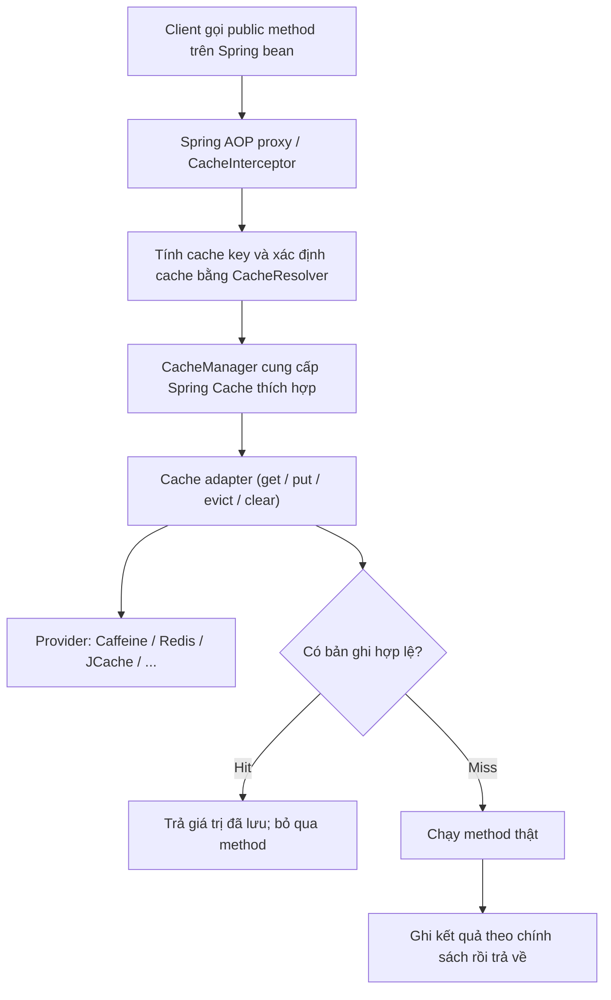

# Nhà cung cấp cache và bộ chuyển đổi sang Spring Cache

> **Ngữ cảnh:** Spring Framework → Cache → Kiến trúc. Bài này giải thích lớp trừu tượng Spring Cache kết nối với các nhà cung cấp lưu trữ như thế nào, cách cấu hình bộ chuyển đổi (adapter), và tiêu chí chọn giải pháp theo yêu cầu vận hành.

## 1. Tách ba khái niệm: Spring Cache, adapter và cache provider

**Spring Cache** là API trừu tượng để ứng dụng sử dụng cache thống nhất, chủ yếu qua `org.springframework.cache.Cache`, `CacheManager` và các annotation như `@Cacheable`, `@CachePut`, `@CacheEvict`. Nó **không tự cung cấp** mọi khả năng lưu trữ, TTL, giới hạn dung lượng hoặc đồng bộ dữ liệu giữa các máy.

- **Cache provider (backend):** nơi thật sự giữ dữ liệu và thực thi chính sách lưu trữ. Ví dụ: bộ nhớ JVM bằng `ConcurrentHashMap`, Caffeine, Redis, hoặc engine tương thích JCache như Ehcache 3.
- **Adapter:** lớp triển khai giao diện Spring `Cache` hoặc `CacheManager` và dịch các thao tác `get`/`put`/`evict`/`clear` thành lệnh của provider. Ví dụ: `CaffeineCacheManager` tạo các `CaffeineCache`; `RedisCacheManager` tạo `RedisCache`; `JCacheCacheManager` bọc `javax.cache.CacheManager`.
- **Spring Cache abstraction:** lớp gọi adapter từ logic khai báo cache. Business service chỉ cần biết tên cache và cách tạo key; chi tiết provider nằm ở cấu hình.

Tách lớp này giúp thay backend mà thường không cần sửa các annotation trên service. Tuy nhiên, **đổi provider không bảo đảm hành vi giống hệt**: cách lưu `null`, TTL, serialization, tính nguyên tử, tính nhất quán giữa node, khả năng chịu lỗi và hiệu năng vẫn khác nhau.

### Luồng xử lý một lời gọi `@Cacheable`



Mặc định, `CacheResolver` thường dùng `CacheManager` để tra cứu cache theo `cacheNames`. `CacheInterceptor` điều khiển việc thực thi method, còn adapter thực hiện I/O lên backend. Với `@Cacheable(cacheNames = "products", key = "#p0")`, hai lời gọi có cùng tham số đầu tiên thường truy cập cùng entry. Khi cache hit, code bên trong method không chạy.

`@CachePut` luôn chạy method rồi ghi kết quả; `@CacheEvict` xóa entry hoặc toàn cache theo chính sách. Cả hai vẫn phụ thuộc adapter/provider đã cấu hình.

## 2. Những hợp đồng Spring Cache mà adapter phải thực hiện

| Thành phần | Trách nhiệm | Điều cần phân biệt |
|---|---|---|
| `Cache` | Đại diện **một vùng cache có tên**; cung cấp `get`, `put`, `evict`, `clear` và các biến thể. | Chứa logic bridge đến provider; `getNativeCache()` có thể trả đối tượng backend. |
| `CacheManager` | `getCache(name)` và `getCacheNames()`; tạo, lưu hoặc tìm cache theo tên. | Không nhất thiết là chính server cache; nó có thể quản lý nhiều adapter. |
| `CacheResolver` | Quyết định dùng những cache nào cho một lần gọi, có thể dựa trên method/args. | Hữu ích khi routing động; mặc định thường dựa vào `CacheManager`. |
| `KeyGenerator` | Biến arguments của method thành key nếu không khai báo `key`. | Quy tắc key phải ổn định, tránh collision và phân biệt tenant. |
| `CacheErrorHandler` | Xử lý lỗi khi truy cập provider qua tầng Spring Cache. | Cách xử lý lỗi là quyết định nghiệp vụ; bỏ qua lỗi có thể làm tăng tải backend dữ liệu. |

`SimpleKeyGenerator` mặc định dùng `SimpleKey.EMPTY` cho không tham số, chính đối tượng tham số khi chỉ có một tham số, và `SimpleKey` gộp nhiều tham số khi có nhiều tham số. Đối tượng dùng làm key nên có `equals()`/`hashCode()` hợp lý. Với cache phân tán, phải xét thêm phép chuyển key thành chuỗi/byte và prefix để không xung đột.

Các annotation **không có thuộc tính TTL chung cho mọi provider**. Thời gian sống, giới hạn số entry, chiến lược eviction, persistence, replication và serializer được cấu hình qua backend/adapter cụ thể.

## 3. Những nhà cung cấp và bộ chuyển đổi thường gặp

| Provider / kiểu lưu trữ | Adapter/manager phía Spring | Đặc tính và trường hợp dùng |
|---|---|---|
| JDK `ConcurrentHashMap` (local) | `ConcurrentMapCache`, `ConcurrentMapCacheManager`; hoặc `SimpleCacheManager` cho danh sách cache cố định | Rất đơn giản, nhanh, phù hợp demo/test. Không có TTL, capacity eviction hay chia sẻ entry giữa JVM theo mặc định. |
| **Caffeine** (local, trong JVM) | `CaffeineCache`, `CaffeineCacheManager` (`spring-context-support`) | Hỗ trợ giới hạn dung lượng, expiry, chính sách eviction hiệu quả; phù hợp hot data và ứng dụng một instance hoặc chấp nhận cache mỗi node độc lập. |
| **Redis** (remote/shared) | `RedisCache`, `RedisCacheManager` từ **Spring Data Redis** | Các instance có thể dùng chung dữ liệu; hỗ trợ TTL, cấu hình key prefix và serialization. Có chi phí mạng, phụ thuộc Redis và cần quản lý phiên bản dữ liệu. |
| **JCache / JSR-107** | `JCacheCacheManager`, `JCacheCache` (`spring-context-support`) | Bridge từ API `javax.cache` sang Spring Cache; backend tùy provider, ví dụ Ehcache 3. TTL/eviction khai báo theo cấu hình JCache/provider. |
| **Hazelcast, Infinispan, Couchbase, Cache2k...** | Adapter tích hợp tương ứng hoặc qua JCache, tùy thư viện/phiên bản | Có thể phục vụ cache phân tán, memory grid hoặc nhu cầu provider riêng. Kiểm tra dependency và mức hỗ trợ của phiên bản đang dùng. |
| **No-op / kết hợp nhiều manager** | `NoOpCacheManager`, `CompositeCacheManager` | No-op luôn miss, hợp với kiểm thử/tắt cache. Composite tìm manager có cache theo thứ tự, **không tự biến thành cache hai tầng L1/L2**. |

**Phân biệt hai kiến trúc hay nhầm:**

- Caffeine của pod A và Caffeine của pod B là **hai cache khác nhau**; hai pod sẽ tự warm-up và có thể thấy giá trị khác nhau cho đến khi entry hết hạn/bị xóa. Dùng Redis làm shared store nếu cần các node cùng đọc một keyspace.
- `CompositeCacheManager` chỉ **chọn một `Cache` theo tên qua các manager**. Muốn cơ chế L1 Caffeine + L2 Redis đúng nghĩa cần thiết kế/cache implementation riêng: read-through từng tầng, cập nhật/invalidate xuyên node, xử lý race và quan sát hit rate từng tầng.

### Chọn provider theo yêu cầu thực tế

| Câu hỏi kiến trúc | Khi nên ưu tiên |
|---|---|
| Dữ liệu nhỏ, rất nóng, chi phí mạng phải thấp, có thể chấp nhận cache từng instance? | Caffeine; cấu hình `maximumSize`/expiry và theo dõi memory. |
| Nhiều instance cần cùng thấy dữ liệu cache, chia sẻ session-like data hoặc có yêu cầu TTL tập trung? | Redis hoặc hệ thống cache phân tán tương đương; chú ý latency và availability. |
| Đang sử dụng engine có khả năng on-heap/off-heap/disk theo JCache? | JCache bridge; kiểm tra provider tương thích JSR-107 và lifecycle. |
| Chỉ cần kiểm tra logic cache hoặc ứng dụng rất nhỏ? | `ConcurrentMapCacheManager`; đừng mặc định xem là lựa chọn production lâu dài. |
| Muốn đổi backend giữa môi trường? | Để annotation độc lập provider; khai báo `CacheManager`/`spring.cache.type` rõ ràng và kiểm thử khác biệt về key/TTL/null/serialization. |

Một cache nhanh chưa chắc tối ưu: đánh giá thêm tần suất miss, kích thước entry, độ trễ P95/P99, dữ liệu quá hạn có chấp nhận được hay không, chi phí invalidate, độ sẵn sàng provider và cách triển khai nhiều instance.

## 4. Cấu hình một provider local: Caffeine với Spring Boot

Ví dụ độc lập này chạy với **Java 17+**, **Maven** và **Spring Boot 3.5.7**. Spring Boot cung cấp auto-configuration cho cache; dependency `spring-boot-starter-cache` cùng Caffeine cho phép chọn `CaffeineCacheManager`. Phiên bản trong `pom.xml` được cố định để ví dụ tái lập được, không đại diện khuyến nghị giữ nguyên phiên bản ở mọi dự án.

Cấu trúc thư mục:

```text
spring-cache-demo/
├── pom.xml
└── src/main/
    ├── java/dev/example/cache/CacheDemoApplication.java
    └── resources/application.properties
```

**`pom.xml`**

```xml
<?xml version="1.0" encoding="UTF-8"?>
<project xmlns="http://maven.apache.org/POM/4.0.0"
         xmlns:xsi="http://www.w3.org/2001/XMLSchema-instance"
         xsi:schemaLocation="http://maven.apache.org/POM/4.0.0 https://maven.apache.org/xsd/maven-4.0.0.xsd">
    <modelVersion>4.0.0</modelVersion>
    <parent>
        <groupId>org.springframework.boot</groupId>
        <artifactId>spring-boot-starter-parent</artifactId>
        <version>3.5.7</version>
        <relativePath/>
    </parent>
    <groupId>dev.example</groupId>
    <artifactId>spring-cache-demo</artifactId>
    <version>1.0.0</version>
    <properties>
        <java.version>17</java.version>
    </properties>
    <dependencies>
        <dependency>
            <groupId>org.springframework.boot</groupId>
            <artifactId>spring-boot-starter-cache</artifactId>
        </dependency>
        <dependency>
            <groupId>com.github.ben-manes.caffeine</groupId>
            <artifactId>caffeine</artifactId>
        </dependency>
    </dependencies>
    <build>
        <plugins>
            <plugin>
                <groupId>org.springframework.boot</groupId>
                <artifactId>spring-boot-maven-plugin</artifactId>
            </plugin>
        </plugins>
    </build>
</project>
```

**`src/main/resources/application.properties`**

```properties
spring.main.web-application-type=none
spring.main.banner-mode=off
logging.level.root=OFF

spring.cache.type=caffeine
spring.cache.cache-names=products
spring.cache.caffeine.spec=maximumSize=1000,expireAfterWrite=10m
```

`maximumSize` giới hạn số entry ước lượng mà Caffeine giữ; `expireAfterWrite=10m` khiến entry hết hạn sau 10 phút kể từ lần ghi/cập nhật, không phải mười phút kể từ mỗi lần đọc. Cache `products` thuộc bộ nhớ JVM này.

**`src/main/java/dev/example/cache/CacheDemoApplication.java`**

```java
package dev.example.cache;

import java.util.concurrent.atomic.AtomicInteger;
import org.springframework.boot.CommandLineRunner;
import org.springframework.boot.SpringApplication;
import org.springframework.boot.autoconfigure.SpringBootApplication;
import org.springframework.cache.annotation.Cacheable;
import org.springframework.cache.annotation.EnableCaching;
import org.springframework.stereotype.Service;

@SpringBootApplication
@EnableCaching
public class CacheDemoApplication implements CommandLineRunner {
    private final ProductService products;

    public CacheDemoApplication(ProductService products) {
        this.products = products;
    }

    public static void main(String[] args) {
        SpringApplication.run(CacheDemoApplication.class, args);
    }

    @Override
    public void run(String... args) {
        System.out.println("first=" + products.getProduct("P42"));
        System.out.println("again=" + products.getProduct("P42"));
        System.out.println("other=" + products.getProduct("P99"));
        System.out.println("loadCount=" + products.loadCount());
    }
}

@Service
class ProductService {
    private final AtomicInteger counter = new AtomicInteger();

    @Cacheable(cacheNames = "products", key = "#p0")
    public String getProduct(String sku) {
        return "product-" + sku + "-load-" + counter.incrementAndGet();
    }

    public int loadCount() {
        return counter.get();
    }
}
```

Tại thư mục chứa `pom.xml`, chạy:

```bash
mvn -q spring-boot:run
```

Stdout của phần ứng dụng trên **một lần chạy với cache mới** (không tính thông báo của Maven):

```text
first=product-P42-load-1
again=product-P42-load-1
other=product-P99-load-2
loadCount=2
```

Vì lời gọi đi từ `CacheDemoApplication` sang bean `ProductService` qua proxy, `@Cacheable` có hiệu lực. Lần 2 với `P42` là hit nên bộ đếm không tăng. Nếu tạo `ProductService` bằng `new` hoặc gọi trực tiếp `this.getProduct(...)` từ một method khác trong chính bean, proxy thông thường không chặn được lời gọi đó.

Để cấu hình bằng Java thay vì properties, có thể tạo `@Bean CacheManager` kiểu `CaffeineCacheManager`, đặt danh sách tên cache và đối tượng builder Caffeine. Khi đã tự định nghĩa manager, kiểm tra vì auto-configuration của Boot có thể không còn chọn provider dựa trên `spring.cache.type` nữa.

## 5. Thay provider bằng Redis: annotation vẫn giữ nguyên

Khi muốn nhiều application instance chia sẻ cache, có thể thêm dependency sau vào `pom.xml`:

```xml
<dependency>
    <groupId>org.springframework.boot</groupId>
    <artifactId>spring-boot-starter-data-redis</artifactId>
</dependency>
```

Sau đó **thay** phần `spring.cache.*` dành cho Caffeine bằng cấu hình Redis; giữ nguyên Java service và `@Cacheable`:

```properties
spring.cache.type=redis
spring.data.redis.host=localhost
spring.data.redis.port=6379
spring.cache.redis.time-to-live=10m
spring.cache.redis.cache-null-values=false
spring.cache.redis.use-key-prefix=true
```

Cần một Redis server có thể truy cập tại `localhost:6379`. Boot cấu hình `RedisCacheManager` qua Spring Data Redis; các cache name và key được chuyển thành Redis keys, thông thường có prefix theo cache name (ví dụ dạng `products::P42` tùy cấu hình chuyển đổi key). `time-to-live=10m` là chính sách expiry của Redis cache. Không nên áp dụng mù quáng một TTL cho mọi dữ liệu: thông tin giá cả, quyền truy cập, catalog và cấu hình có chu kỳ thay đổi khác nhau.

**Lưu ý quan trọng khi chuyển local sang Redis:**

1. **Serialization.** Caffeine lưu object trong heap; Redis lưu bytes. Chọn serializer có chủ đích, kiểm tra object tương thích và phiên bản schema; cấu hình mặc định có thể dùng Java native serialization, thường không phù hợp khi trao đổi dữ liệu đa ngôn ngữ/đa phiên bản.
2. **Key ổn định.** Với key phức tạp, không dựa vào `toString()` tùy tiện; hãy quyết định namespace, tenant, version và dạng chuỗi xác định. Prefix tránh đụng tên giữa các loại cache.
3. **Tình trạng Redis.** Hit local rất nhanh; Redis có network latency, timeout và lỗi kết nối. Quyết định fail-fast, fallback hay bỏ qua cache lỗi dựa trên yêu cầu tính đúng của ứng dụng.
4. **Dữ liệu cũ sau deploy.** Cache chia sẻ có thể sống qua vòng đời process; đổi cấu trúc DTO hay cách tính key cần versioning/invalidate tương ứng.
5. **Tính nguyên tử.** Không giả định mọi thao tác multi-command trong adapter Redis tự động có lock toàn cục; đọc tài liệu `RedisCacheWriter` và kiểm thử race condition.

Ví dụ `Caffeine` và `Redis` minh họa **hai lựa chọn manager thay thế**, không phải hướng dẫn dùng đồng thời cả hai cho cùng cache name. Nếu chuyển môi trường liên tục, xác định rõ provider qua cấu hình và kiểm thử kết nối thật.

## 6. Bridge JCache (JSR-107) và trường hợp cần adapter tùy biến

**JCache** chuẩn hóa cách ứng dụng Java nói chuyện với các cache engine bằng API `javax.cache`. Spring cung cấp `JCacheCacheManager` để bridge API này sang `org.springframework.cache.CacheManager`. Đây là **hai kiểu có tên giống nhau nhưng khác package**.

Ví dụ tích hợp **khi ứng dụng đã có `javax.cache.CacheManager` của provider**:

```java
import org.springframework.cache.jcache.JCacheCacheManager;
import org.springframework.context.annotation.Bean;
import org.springframework.context.annotation.Configuration;

@Configuration
class CacheBridgeConfig {
    @Bean
    org.springframework.cache.CacheManager springCacheManager(
            javax.cache.CacheManager providerCacheManager) {
        return new JCacheCacheManager(providerCacheManager);
    }
}
```

Đoạn này là **cấu hình bridge**, không phải chương trình độc lập: phải thêm JCache API, implementation (chẳng hạn Ehcache 3), cấu hình provider và bean `javax.cache.CacheManager` tương ứng. Tên cache phía JCache có thể cần được tạo trước. Spring Cache annotation và JCache annotation (như `@CacheResult`) thuộc hai nhóm khác nhau; có thể tích hợp nhưng không nên trộn cú pháp khi chưa nắm quy tắc xử lý.

Nếu một cache engine **không có adapter sẵn**, cần thiết kế một lớp triển khai `org.springframework.cache.Cache` và một `CacheManager` trả về các instance đó. Bảng ánh xạ tối thiểu:

| Giao diện Spring | Tác vụ cần bridge xuống backend |
|---|---|
| `Cache.get(key)` | Đọc entry; trả `ValueWrapper` hoặc `null` khi miss, phân biệt nếu provider hỗ trợ cache giá trị null. |
| `Cache.get(key, Callable)` | Load giá trị khi miss; xem yêu cầu đồng bộ/tính nguyên tử của provider và xử lý `ValueRetrievalException`. |
| `Cache.put(key, value)` | Chuyển key/value theo codec thích hợp và ghi vào cache. |
| `Cache.evict(key)` / `clear()` | Xóa một entry / toàn vùng cache; để ý phạm vi xóa và hiệu năng. |
| `Cache.getName()` / `getNativeCache()` | Bộc lộ tên logic và backend object phù hợp. |
| `CacheManager.getCache(name)` | Tìm/tạo adapter theo tên hoặc trả `null` nếu không có cache phù hợp. |

Trước khi viết adapter mới, xác minh khả năng dùng provider có sẵn qua Spring Data hoặc JCache. Adapter tự viết phải giải quyết cả null semantics, key conversion, thread safety, loader, lỗi và observability; chỉ bọc `get`/`set` rồi gọi là tương thích là chưa đủ.

## 7. Những khác biệt có thể làm chương trình sai khi đổi provider

### 7.1. TTL và invalidation là hai việc khác nhau

TTL giới hạn thời gian dữ liệu có thể cũ; **nó không bảo đảm dữ liệu luôn mới**. Đọc dữ liệu từ DB qua `@Cacheable` rồi cập nhật DB từ luồng khác có thể khiến cache trả kết quả cũ đến khi hết hạn. Với đường ghi do chính service kiểm soát, có thể dùng `@CacheEvict` sau thao tác cập nhật để xóa entry. Ví dụ minh họa (giả định repository đã tồn tại):

```java
@Cacheable(cacheNames = "products", key = "#p0")
public Product find(String id) {
    return repository.findById(id).orElseThrow();
}

@CacheEvict(cacheNames = "products", key = "#p0")
public void update(String id, ProductUpdate change) {
    repository.update(id, change);
}
```

Đây là **hai method minh họa trong service đã cấu hình**, không phải một file Java độc lập. Cần cân nhắc thời điểm commit transaction, nhiều nguồn ghi khác và race giữa read/write; nếu cache invalidate trước khi DB commit, một reader khác có thể nạp giá trị cũ vào cache.

### 7.2. Null và cache stampede

Một số provider cho phép cache `null`, số khác không; các adapter cũng có cấu hình riêng. Cache kết quả “không tìm thấy” có thể giảm tải, nhưng nếu giữ lâu sẽ làm entity vừa được tạo vẫn bị báo thiếu. Cần nhất quán giữa `unless = "#result == null"`, cấu hình `allowNullValues`/`cache-null-values` và nghiệp vụ.

Khi nhiều request cùng miss một key, chúng có thể đồng thời truy vấn DB (**cache stampede**). `@Cacheable(sync = true)` yêu cầu cơ chế đồng bộ tải giá trị khi backend/adapter hỗ trợ; **không mặc định coi đó là distributed lock giữa mọi instance**. Spring hạn chế một số phối hợp khi `sync = true` (ví dụ chỉ một cache và không dùng `unless`). Với dữ liệu nóng trên nhiều node, đánh giá riêng request coalescing, jitter TTL và chiến lược làm mới.

### 7.3. Transaction, consistency và lỗi mạng

Spring Cache không tự làm cho DB và provider cache thành **một giao dịch nguyên tử**. Một số manager có chế độ transaction-aware để hoãn thao tác cache đến thời điểm phù hợp, nhưng vẫn cần thiết kế thứ tự cập nhật, khôi phục lỗi và sự kiện invalidate. Redis/cache cluster có thể chậm hoặc không truy cập được; mục tiêu vận hành là giữ ứng dụng có dữ liệu **đúng** khi cache không hoạt động, đồng thời tránh tạo thác tải xuống DB.

### 7.4. Giới hạn của proxy

`@EnableCaching` kích hoạt hạ tầng cache annotation (Spring Boot không tự suy ra mọi điều kiện). Proxy mode mặc định chỉ intercept lời gọi **đi qua Spring proxy**, thường là lời gọi ngoài bean vào public method. Self-invocation, method private, tạo object bằng `new` hoặc cấu hình proxy sai có thể khiến annotation dường như bị bỏ qua. Đừng ghi trực tiếp code phụ thuộc provider (`RedisTemplate`, Caffeine native cache) khắp service nếu mục tiêu là độc lập backend.

## 8. Kiểm thử và quan sát trong hệ thống thật

Để kiểm tra adapter và provider, cần nhiều hơn một lần “method chạy nhanh”:

1. **Hit/miss:** với key A gọi hai lần thì loader chỉ chạy một lần khi chưa hết hạn; key B độc lập. Đo hit rate theo cache name và chi phí miss.
2. **Expiry/eviction:** dùng clock hoặc thời gian chờ có kiểm soát để xác minh entry hết hạn đúng chính sách; thử giới hạn dung lượng với Caffeine.
3. **Cross-instance:** trên Redis, chạy hai process dùng cùng Redis, xác minh chia sẻ keyspace; với Caffeine, xác minh chúng độc lập.
4. **Write/invalidate:** cập nhật nguồn thật, kiểm tra `@CacheEvict` cho đúng key và thời điểm; thử lỗi/rollback transaction.
5. **Serializer và nâng cấp:** thử các DTO thực tế, null policy, định dạng key, thay schema, dữ liệu cache cũ sau deploy và class loading.
6. **Failure & concurrency:** mô phỏng Redis timeout, nhiều request đồng thời miss, hot keys và xóa cache lớn; đo latency P95/P99, error rate, memory/eviction.
7. **Rà soát cấu hình:** log/cache metrics chứng minh app đang dùng `CacheManager` nào. Đừng dựa vào sự có mặt của dependency để kết luận provider đã được chọn.

Khi dùng Spring Boot, auto-configuration phát hiện các provider có trên classpath nếu chưa có `CacheManager`/`CacheResolver` tự khai báo. Nếu có nhiều lựa chọn, **đặt `spring.cache.type` rõ ràng** và xác minh manager thực tế. Nếu muốn dùng nhiều backend với những cache name khác nhau, có thể định nghĩa nhiều manager và chọn bằng `cacheManager`/`cacheResolver` trên annotation hoặc cấu hình phù hợp; cần tránh tên cache trùng và lựa chọn khó quan sát.

## 9. Những lỗi phổ biến và cách chẩn đoán

| Hiện tượng | Nguyên nhân thường gặp | Hướng kiểm tra |
|---|---|---|
| `@Cacheable` không làm giảm số lần gọi method | Thiếu `@EnableCaching`; self-invocation; bean không do Spring quản lý | Kiểm tra proxy path và gọi từ bean khác, xác minh cache infrastructure bật. |
| Không tìm thấy tên cache hoặc không có manager | Sai `cacheNames`, cache name chưa đăng ký, auto-configuration không chọn backend mong muốn | Kiểm tra bean `CacheManager`, `getCacheNames()`, cache names trong config. |
| Node A hit, node B miss | Cache local Caffeine/ConcurrentMap theo từng JVM | Quyết định local cache có phù hợp không; cân nhắc shared provider. |
| Redis có key nhưng đọc lỗi | Serializer không tương thích, key prefix/format khác, DTO thay đổi | Kiểm tra codec, key naming, phiên bản schema, giá trị byte thực tế. |
| Dữ liệu trả về đã lỗi thời | TTL quá dài, thiếu invalidate, writer ngoài ứng dụng | Thiết kế cache invalidation và kiểm thử race khi update. |
| Cache ngày càng lớn | Dùng map không có eviction, hoặc cấu hình TTL/size chưa áp dụng | Xác minh provider và policy thực sự đang chạy; theo dõi memory. |
| Tải DB tăng đột ngột | Miss đồng thời, key không ổn định, backend cache lỗi | Đo hit/miss, timeout và nguyên nhân stampede; cấu hình fallback hợp lý. |

## 10. Quy trình ra quyết định khi tích hợp một backend

**Bước 1 — Xác định semantics.** Entry là gì, key gồm thuộc tính nào, TTL chấp nhận được bao lâu, null có ý nghĩa gì, ai chịu trách nhiệm invalidate, có nhiều node hay tenant không?

**Bước 2 — Chọn provider.** Chọn Caffeine cho local hot cache có kiểm soát dung lượng, Redis cho shared cache và TTL tập trung, JCache khi cần engine tương thích chuẩn; đánh giá latency, memory, consistency, vận hành và failure mode.

**Bước 3 — Chọn bridge.** Ưu tiên adapter có sẵn (`CaffeineCacheManager`, `RedisCacheManager`, `JCacheCacheManager`); chỉ viết `Cache`/`CacheManager` tùy biến khi không có đường tích hợp được hỗ trợ.

**Bước 4 — Cấu hình chính sách tại provider.** Quy định cache name, TTL, capacity, serialization, key prefix, error behavior, monitoring. Dùng `@Cacheable`/`@CacheEvict` ở ranh giới service và kiểm tra cơ chế proxy.

**Bước 5 — Xác minh bằng hành vi thật.** Chứng minh hit/miss, expire, invalidate, khác biệt giữa node, lỗi backend và dữ liệu cũ sau deploy; kiểm tra manager thực tế trong application context.

### Tài liệu chính thức để đối chiếu

- Spring Framework — Cache Abstraction: https://docs.spring.io/spring-framework/reference/integration/cache.html
- Spring Framework — Configuring the Cache Storage: https://docs.spring.io/spring-framework/reference/integration/cache/store-configuration.html
- Spring Framework — Declarative Annotation-based Caching: https://docs.spring.io/spring-framework/reference/integration/cache/annotations.html
- Spring Framework — Provider-specific TTL/eviction: https://docs.spring.io/spring-framework/reference/integration/cache/specific-config.html
- Spring Boot — Caching and supported providers: https://docs.spring.io/spring-boot/reference/io/caching.html
- Spring Data Redis — Redis Cache: https://docs.spring.io/spring-data/redis/reference/redis/redis-cache.html
