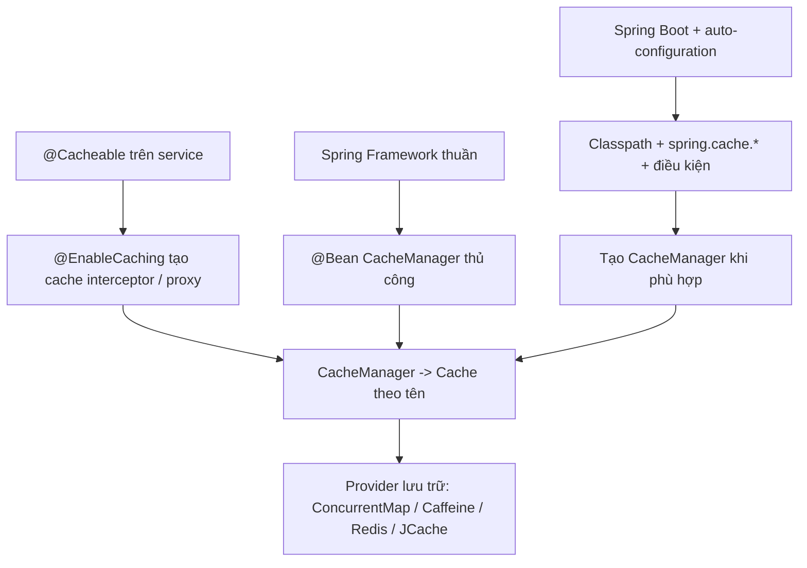

# Phân biệt cấu hình Spring Framework với tự động cấu hình của Spring Boot

> **Chủ đề:** Spring Framework – Cache · **Nhóm:** Thiết lập.  
> Mục tiêu: hiểu phần nào thuộc **Spring Framework Cache Abstraction**, phần nào do **Spring Boot Auto-configuration** cung cấp; tự cấu hình cache trong ứng dụng Spring thuần; sử dụng cấu hình tự động trong Spring Boot; và biết khi nào Boot nhường quyền cho cấu hình do lập trình viên khai báo.

## 1. Cùng một Spring Cache API, nhưng khác cách thiết lập

Spring Framework cung cấp **lớp trừu tượng caching**: các annotation `@Cacheable`, `@CachePut`, `@CacheEvict`, `@Caching`; SPI `org.springframework.cache.Cache` và `org.springframework.cache.CacheManager`; cùng hạ tầng AOP/interceptor để đánh chặn lời gọi method. Framework không buộc ứng dụng dùng một bộ lưu trữ cụ thể. Cần có một `CacheManager` thích hợp để tìm `Cache` theo tên.

**Spring Framework thuần**: ứng dụng phải tự khai báo hạ tầng cần thiết, thường là `@EnableCaching` và một bean `CacheManager`. Provider được chọn qua dependency và code cấu hình mà chính ứng dụng quản lý.

**Spring Boot**: vẫn dùng toàn bộ Spring Cache API nói trên nhưng bổ sung cơ chế **auto-configuration**. Sau khi bật annotation caching bằng `@EnableCaching`, Boot có thể tự tạo `CacheManager` từ những provider trên classpath và các property `spring.cache.*`, **nếu chưa có cấu hình tùy biến khiến auto-configuration phải lùi lại**.

Cần nhớ bốn điều độc lập nhau:

1. `@Cacheable` mô tả **hành vi cache** của một method; chỉ viết annotation này chưa kích hoạt caching.
2. `@EnableCaching` kích hoạt hạ tầng xử lý annotation; cả Spring thuần lẫn Boot đều cần nó khi dùng annotation-based caching.
3. `CacheManager` là đối tượng tra cứu các vùng `Cache`; nó có thể do ứng dụng khai báo thủ công hoặc do Boot tạo.
4. **Backend/provider** (ConcurrentMap, Caffeine, Redis, JCache, v.v.) quyết định dữ liệu được lưu ở đâu và có những giới hạn vận hành nào. Không có annotation Spring Cache chung để đặt TTL cho mọi provider.



**Điểm mấu chốt:** Boot tự động hóa phần *lắp ráp và cấu hình mặc định*, không thay thế Spring Cache API và cũng không tự biến `@Cacheable` thành một cache provider.

## 2. Bảng so sánh theo đúng trách nhiệm

| Nội dung | Spring Framework thuần | Spring Boot |
|---|---|---|
| Cache abstraction, `@Cacheable`, `@CacheEvict` | Do Spring Framework cung cấp | Vẫn là API của Spring Framework |
| Kích hoạt annotation-based caching | Thêm `@EnableCaching` vào `@Configuration` | Vẫn thêm `@EnableCaching`; `@SpringBootApplication` và starter riêng lẻ chưa đủ |
| Tạo `CacheManager` | Khai báo `@Bean` hoặc cấu hình tương đương | Boot có thể tạo tự động nếu các điều kiện thỏa |
| Chọn provider | Tự lựa chọn dependency + adapter + bean | Boot phát hiện qua classpath và thứ tự provider; có thể dùng `spring.cache.type` |
| Cache names | Truyền vào manager hoặc code cấu hình | Có thể dùng `spring.cache.cache-names` tùy provider |
| TTL, eviction, serialization | Cấu hình trong provider/manager | Property Boot cho provider phổ biến hoặc builder/customizer tương ứng |
| `spring.cache.*` trong `application.properties` | Không tự có ý nghĩa với Spring thuần | Được Boot đọc để tự cấu hình khi nhánh auto-config được áp dụng |
| Tùy biến sâu | Chủ yếu code `@Bean`, XML hoặc tự viết adapter | Dùng property, customizer, hoặc tự khai báo `@Bean` để thay auto-config |
| Tắt cache có điều kiện | Thay manager bằng `NoOpCacheManager` hoặc không bật caching | Có thể dùng `spring.cache.type=none` khi manager do Boot quản lý |
| Test & production | Tự tổ chức profiles, cấu hình và dependency | Profiles, properties, condition report và actuator hỗ trợ quan sát |

**Không đồng nhất `@SpringBootApplication` với `@EnableCaching`.** `@SpringBootApplication` tập hợp các tính năng của Boot như component scan và auto-configuration; `@EnableCaching` là tín hiệu riêng để xử lý annotation cache. Boot documentation cũng gợi ý đặt `@EnableCaching` trong một class cấu hình riêng để test có thể chủ động bật/tắt tính năng.

## 3. Bên trong một cache hit/miss: trách nhiệm của Framework không đổi

Giả sử service có:

```java
@Cacheable(cacheNames = "books", key = "#p0")
public Book findBook(String isbn) {
    return repository.findByIsbn(isbn).orElseThrow();
}
```

Đây là đoạn minh họa trong một bean có repository thật, **không phải chương trình độc lập**. Khi có `@EnableCaching` và một `CacheManager` đúng cấu hình:

1. Caller gọi method **thông qua Spring proxy**.
2. Cache interceptor xác định tên cache và key. `#p0` là đối số thứ nhất, không phụ thuộc tên parameter ở bytecode.
3. `CacheManager.getCache("books")` trả về đối tượng `Cache`.
4. Nếu hit thì proxy trả giá trị từ cache; body của method không chạy. Nếu miss thì method chạy và kết quả được ghi vào cache theo chính sách.
5. Lần gọi khác cùng key lại truy cập cache, bất kể manager được cấu hình bằng Framework thuần hay Boot.

Điều kiện proxy áp dụng cho cả hai cách: self-invocation (`this.findBook(...)`), object tạo bằng `new`, hoặc private method không đi qua Spring proxy theo cơ chế mặc định nên caching annotation có thể không hoạt động. Tương tự, `@CachePut` luôn gọi method rồi ghi kết quả, còn `@CacheEvict` xóa entry/cache theo cấu hình.

## 4. Thiết lập thủ công bằng Spring Framework thuần — ví dụ chạy được

Ví dụ dưới đây dùng **Java 17+**, **Maven** và **Spring Framework 6.2.12** được cố định để có thể tái lập. Không có `spring-boot-*`, không có `@SpringBootApplication`, không dùng Boot auto-configuration.

Cấu trúc dự án:

```text
framework-manual-cache/
├── pom.xml
└── src/main/java/dev/example/manual/ManualCacheApp.java
```

**`pom.xml`**

```xml
<?xml version="1.0" encoding="UTF-8"?>
<project xmlns="http://maven.apache.org/POM/4.0.0"
         xmlns:xsi="http://www.w3.org/2001/XMLSchema-instance"
         xsi:schemaLocation="http://maven.apache.org/POM/4.0.0 https://maven.apache.org/xsd/maven-4.0.0.xsd">
    <modelVersion>4.0.0</modelVersion>
    <groupId>dev.example</groupId>
    <artifactId>framework-manual-cache</artifactId>
    <version>1.0.0</version>

    <properties>
        <maven.compiler.release>17</maven.compiler.release>
        <project.build.sourceEncoding>UTF-8</project.build.sourceEncoding>
    </properties>

    <dependencies>
        <dependency>
            <groupId>org.springframework</groupId>
            <artifactId>spring-context</artifactId>
            <version>6.2.12</version>
        </dependency>
    </dependencies>

    <build>
        <plugins>
            <plugin>
                <groupId>org.apache.maven.plugins</groupId>
                <artifactId>maven-compiler-plugin</artifactId>
                <version>3.13.0</version>
            </plugin>
            <plugin>
                <groupId>org.codehaus.mojo</groupId>
                <artifactId>exec-maven-plugin</artifactId>
                <version>3.3.0</version>
                <configuration>
                    <mainClass>dev.example.manual.ManualCacheApp</mainClass>
                </configuration>
            </plugin>
        </plugins>
    </build>
</project>
```

**`src/main/java/dev/example/manual/ManualCacheApp.java`**

```java
package dev.example.manual;

import java.util.concurrent.atomic.AtomicInteger;
import org.springframework.cache.CacheManager;
import org.springframework.cache.annotation.Cacheable;
import org.springframework.cache.annotation.EnableCaching;
import org.springframework.cache.concurrent.ConcurrentMapCacheManager;
import org.springframework.context.annotation.AnnotationConfigApplicationContext;
import org.springframework.context.annotation.Bean;
import org.springframework.context.annotation.Configuration;

public class ManualCacheApp {
    public static void main(String[] args) {
        try (AnnotationConfigApplicationContext context =
                     new AnnotationConfigApplicationContext(CacheConfig.class)) {
            BookService books = context.getBean(BookService.class);
            CacheManager cacheManager = context.getBean(CacheManager.class);

            System.out.println("manager=" + cacheManager.getClass().getSimpleName());
            System.out.println("first=" + books.find("A"));
            System.out.println("again=" + books.find("A"));
            System.out.println("other=" + books.find("B"));
            System.out.println("loads=" + books.loadCount());
        }
    }

    @Configuration(proxyBeanMethods = false)
    @EnableCaching
    public static class CacheConfig {
        @Bean
        public CacheManager cacheManager() {
            return new ConcurrentMapCacheManager("books");
        }

        @Bean
        public BookService bookService() {
            return new BookService();
        }
    }

    public static class BookService {
        private final AtomicInteger loads = new AtomicInteger();

        @Cacheable(cacheNames = "books", key = "#p0")
        public String find(String isbn) {
            return "book-" + isbn + "#" + loads.incrementAndGet();
        }

        public int loadCount() {
            return loads.get();
        }
    }
}
```

Chạy trong thư mục `framework-manual-cache`:

```bash
mvn -q compile exec:java
```

Stdout do chương trình tự in khi bắt đầu với context/cache mới (không tính log của Maven nếu cấu hình máy có in thêm):

```text
manager=ConcurrentMapCacheManager
first=book-A#1
again=book-A#1
other=book-B#2
loads=2
```

**Giải thích:**

- `@EnableCaching` cài hạ tầng interceptor cho annotation. Nếu bỏ nó, `find("A")` chạy hai lần và `loads` tăng thêm, dù `CacheManager` vẫn là bean hợp lệ.
- `@Bean CacheManager` chỉ rõ adapter và tên cache `books`. Không cần Boot và không có thứ tự tự nhận diện provider.
- `ConcurrentMapCacheManager` giữ entry trong JVM; phù hợp để học hoặc test. Nó không tự cung cấp TTL, giới hạn số lượng, chia sẻ giữa process hoặc cơ chế invalidation đa node.
- Spring proxy nhận lời gọi từ `main` tới bean `BookService`; trả hit cho lần gọi thứ hai với A.

Muốn dùng Caffeine trong Spring thuần, phải thêm `spring-context-support` và dependency Caffeine, thay bean manager bằng `CaffeineCacheManager` rồi cấu hình `setCacheSpecification` hoặc builder. Muốn Redis phải thêm Spring Data Redis, kết nối Redis và tạo/configure `RedisCacheManager`. Chính các bean quản lý phần này; **thêm thư viện vào classpath thôi chưa tự tạo cấu hình provider** như Boot.

Một dạng cấu hình Caffeine **thay thế cho method `cacheManager()` ở ví dụ Spring thuần** (giả sử đã bổ sung `spring-context-support` và thư viện Caffeine):

```java
@Bean
public CacheManager cacheManager() {
    CaffeineCacheManager manager = new CaffeineCacheManager("books");
    manager.setCacheSpecification("maximumSize=500,expireAfterWrite=10m");
    return manager;
}
```

Class `CaffeineCacheManager` là `org.springframework.cache.caffeine.CaffeineCacheManager`. Đoạn trên là một method thay thế trong `@Configuration`, **không phải class độc lập**. Các annotation ở `BookService` không cần đổi. TTL và capacity thuộc chính sách Caffeine.

## 5. Thiết lập bằng Spring Boot — ví dụ chạy được với auto-configuration

Ví dụ sau dùng **Java 17+** và **Spring Boot 3.5.7**, một phiên bản cụ thể để thống nhất dependency trong bài. Boot quản lý phiên bản của Spring Framework và Caffeine; không tự đặt các phiên bản transitives khác. Đây là **một dự án riêng** với ví dụ ở mục 4.

Cấu trúc:

```text
boot-auto-cache/
├── pom.xml
└── src/main/
    ├── java/dev/example/bootcache/
    │   ├── BootCacheApplication.java
    │   ├── CachingConfiguration.java
    │   └── BookService.java
    └── resources/application.properties
```

**`pom.xml`**

```xml
<?xml version="1.0" encoding="UTF-8"?>
<project xmlns="http://maven.apache.org/POM/4.0.0"
         xmlns:xsi="http://www.w3.org/2001/XMLSchema-instance"
         xsi:schemaLocation="http://maven.apache.org/POM/4.0.0 https://maven.apache.org/xsd/maven-4.0.0.xsd">
    <modelVersion>4.0.0</modelVersion>
    <parent>
        <groupId>org.springframework.boot</groupId>
        <artifactId>spring-boot-starter-parent</artifactId>
        <version>3.5.7</version>
        <relativePath/>
    </parent>
    <groupId>dev.example</groupId>
    <artifactId>boot-auto-cache</artifactId>
    <version>1.0.0</version>
    <properties>
        <java.version>17</java.version>
    </properties>
    <dependencies>
        <dependency>
            <groupId>org.springframework.boot</groupId>
            <artifactId>spring-boot-starter-cache</artifactId>
        </dependency>
        <dependency>
            <groupId>com.github.ben-manes.caffeine</groupId>
            <artifactId>caffeine</artifactId>
        </dependency>
    </dependencies>
    <build>
        <plugins>
            <plugin>
                <groupId>org.springframework.boot</groupId>
                <artifactId>spring-boot-maven-plugin</artifactId>
            </plugin>
        </plugins>
    </build>
</project>
```

**`src/main/resources/application.properties`**

```properties
spring.main.web-application-type=none
spring.main.banner-mode=off
logging.level.root=OFF

spring.cache.type=caffeine
spring.cache.cache-names=books
spring.cache.caffeine.spec=maximumSize=500,expireAfterWrite=10m
```

Ba property `spring.cache.*` được Spring Boot đọc qua cache auto-configuration: chỉ định Caffeine, khởi tạo cache `books` và cấu hình capacity/expiry. `spring.cache.type=caffeine` cũng giúp tránh chọn nhầm provider khi classpath chứa nhiều cache libraries. TTL này là của Caffeine, **không phải thuộc tính trên `@Cacheable`**.

**`src/main/java/dev/example/bootcache/BootCacheApplication.java`**

```java
package dev.example.bootcache;

import org.springframework.boot.CommandLineRunner;
import org.springframework.boot.SpringApplication;
import org.springframework.boot.autoconfigure.SpringBootApplication;
import org.springframework.cache.CacheManager;

@SpringBootApplication
public class BootCacheApplication implements CommandLineRunner {
    private final BookService books;
    private final CacheManager cacheManager;

    public BootCacheApplication(BookService books, CacheManager cacheManager) {
        this.books = books;
        this.cacheManager = cacheManager;
    }

    public static void main(String[] args) {
        SpringApplication.run(BootCacheApplication.class, args);
    }

    @Override
    public void run(String... args) {
        System.out.println("manager=" + cacheManager.getClass().getSimpleName());
        System.out.println("first=" + books.find("A"));
        System.out.println("again=" + books.find("A"));
        System.out.println("other=" + books.find("B"));
        System.out.println("loads=" + books.loadCount());
    }
}
```

**`src/main/java/dev/example/bootcache/CachingConfiguration.java`**

```java
package dev.example.bootcache;

import org.springframework.cache.annotation.EnableCaching;
import org.springframework.context.annotation.Configuration;

@Configuration(proxyBeanMethods = false)
@EnableCaching
public class CachingConfiguration {
}
```

**`src/main/java/dev/example/bootcache/BookService.java`**

```java
package dev.example.bootcache;

import java.util.concurrent.atomic.AtomicInteger;
import org.springframework.cache.annotation.Cacheable;
import org.springframework.stereotype.Service;

@Service
public class BookService {
    private final AtomicInteger loads = new AtomicInteger();

    @Cacheable(cacheNames = "books", key = "#p0")
    public String find(String isbn) {
        return "book-" + isbn + "#" + loads.incrementAndGet();
    }

    public int loadCount() {
        return loads.get();
    }
}
```

Chạy:

```bash
mvn -q spring-boot:run
```

Stdout của phần chương trình (cache rỗng lúc khởi động):

```text
manager=CaffeineCacheManager
first=book-A#1
again=book-A#1
other=book-B#2
loads=2
```

Ở đây **không có bean `CacheManager` do ứng dụng khai báo**: Boot tạo `CaffeineCacheManager` vì caching đã bật, Caffeine có trên classpath, và cấu hình đã chọn `caffeine`. `@EnableCaching` vẫn xuất hiện trong `CachingConfiguration`. Việc tạo proxy/call interceptor vẫn là chức năng Spring Framework, nên hành vi hit/miss giống ví dụ Spring thuần.

Lưu ý: Spring Boot mặc định có thể chọn `ConcurrentMapCacheManager` kiểu `simple` nếu không có provider khác và điều kiện auto-configuration thỏa. **Chạy được không chứng minh production đang dùng Caffeine/Redis**; luôn kiểm tra manager thực tế.

## 6. Boot quyết định tự tạo hay không tạo `CacheManager` như thế nào?

### 6.1. Các điều kiện quan trọng

`CacheAutoConfiguration` thuộc Spring Boot. Để có manager từ nhánh auto-config, thông thường cần:

- Ứng dụng đang chạy với Boot auto-configuration, ví dụ `@SpringBootApplication` hoặc `@EnableAutoConfiguration`.
- Hạ tầng annotation caching đã bật bằng `@EnableCaching`.
- Có các dependency/provider cần thiết.
- Ứng dụng **chưa khai báo `CacheManager` riêng** và chưa cấu hình `CacheResolver` theo cách khiến auto-configuration lùi lại.
- Provider được nhận diện theo điều kiện classpath/configuration; property `spring.cache.type` có thể ép chọn loại phù hợp nếu Boot tự quản lý manager.

Theo tài liệu Spring Boot 3.5, khi không có manager do ứng dụng định nghĩa, Boot thử các lựa chọn theo thứ tự: **Generic → JCache → Hazelcast → Infinispan → Couchbase → Redis → Caffeine → Cache2k → Simple**. Thứ tự và điều kiện có thể thay đổi giữa các nhánh phiên bản; kiểm tra tài liệu khớp phiên bản đang chạy. `Generic` là trường hợp ứng dụng đã có các bean kiểu `Cache` để Boot gom thành manager. Thư viện có cả native adapter và JCache support có thể bị chọn qua JCache trước nếu đủ điều kiện.

Ví dụ: thêm đồng thời dependency Redis và Caffeine, đồng thời kết nối Redis được cấu hình hợp lệ, có thể khiến Boot chọn Redis thay cho Caffeine nếu để tự dò. Đặt `spring.cache.type=caffeine` (hoặc `redis`) và kiểm tra bean trong runtime giúp xác nhận ý định.

### 6.2. Phân biệt auto-config, property và bean thủ công

Ba kiểu sau **không tương đương**:

**Kiểu A — Để Boot chọn provider theo classpath:**

```properties
spring.cache.cache-names=books
```

Kiểu này dễ thử nghiệm nhưng kết quả có thể đổi khi thêm starter hoặc thư viện. `cache-names` đặt tên cache khi manager/provider hỗ trợ; không chỉ ra chắc chắn provider nào được chọn.

**Kiểu B — Để Boot tạo manager nhưng chọn provider rõ ràng:**

```properties
spring.cache.type=caffeine
spring.cache.cache-names=books
spring.cache.caffeine.spec=maximumSize=500,expireAfterWrite=10m
```

Cần Caffeine dependency. Boot kiểm soát việc tạo manager, nên các property chuyên biệt được áp dụng theo nhánh Caffeine auto-config.

**Kiểu C — Tự khai báo `CacheManager` trong ứng dụng Boot:**

```java
import org.springframework.cache.CacheManager;
import org.springframework.cache.caffeine.CaffeineCacheManager;
import org.springframework.context.annotation.Bean;
import org.springframework.context.annotation.Configuration;

@Configuration(proxyBeanMethods = false)
class ManualManagerConfiguration {
    @Bean
    CacheManager cacheManager() {
        CaffeineCacheManager manager = new CaffeineCacheManager("books");
        manager.setCacheSpecification("maximumSize=1000,expireAfterWrite=30m");
        return manager;
    }
}
```

Đây là **class bổ sung trong dự án Boot đã có Caffeine và `@EnableCaching`**. Khi bean do ứng dụng cung cấp tồn tại, Boot không tiếp tục tự tạo manager mặc định. Những property như `spring.cache.caffeine.spec` không tự đi sửa manager thủ công ở kiểu C; bạn phải cấu hình ngay trên bean hoặc có code customizer của mình. `spring.cache.type=none` cũng **không thể kỳ vọng thay thế** một manager người dùng đã khai báo sẵn.

### 6.3. Customizer khác với tự khai báo manager

Để giữ **manager do Boot tạo** nhưng điều chỉnh hành vi, dùng một `CacheManagerCustomizer` phù hợp provider:

```java
import org.springframework.boot.autoconfigure.cache.CacheManagerCustomizer;
import org.springframework.cache.caffeine.CaffeineCacheManager;
import org.springframework.context.annotation.Bean;
import org.springframework.context.annotation.Configuration;

@Configuration(proxyBeanMethods = false)
class CacheTuningConfiguration {
    @Bean
    CacheManagerCustomizer<CaffeineCacheManager> disableNullCaching() {
        return manager -> manager.setAllowNullValues(false);
    }
}
```

Đây là snippet bổ sung cho dự án Boot ở mục 5, **không phải chương trình độc lập**. Customizer này chỉ có ích khi manager đang được Boot tự cấu hình và đúng kiểu `CaffeineCacheManager`; nó không được gọi để tùy biến manager đã tự khai báo dưới dạng `@Bean`. Nếu ứng dụng chọn Redis hoặc Simple, customizer kiểu Caffeine không áp dụng.

Với nhu cầu nâng cao có thể dùng customizer builder đặc thù provider (ví dụ `RedisCacheManagerBuilderCustomizer`), hoặc đưa hẳn một manager bean vào context. Chọn một điểm chịu trách nhiệm cấu hình chính để việc bảo trì dễ kiểm soát.

## 7. Provider, dependency và property: ví dụ đổi môi trường

Spring Boot **không sinh ra storage engine Redis** và không tự biến Caffeine local cache thành shared cache. Boot chỉ thiết lập adapter đến provider đã có điều kiện phù hợp. Một số quy tắc thực tế:

| Mong muốn | Spring Framework thuần | Spring Boot |
|---|---|---|
| Cache trong heap đơn giản | `@Bean ConcurrentMapCacheManager("books")` | `spring.cache.type=simple` hoặc fallback simple khi hợp lệ |
| Cache local có giới hạn/TTL | Thêm Caffeine + `spring-context-support`; khai báo `CaffeineCacheManager` | Thêm `spring-boot-starter-cache` + Caffeine; `spring.cache.type=caffeine` và `spring.cache.caffeine.spec` |
| Cache chia sẻ giữa instance | Thêm Spring Data Redis, kết nối Redis, cấu hình `RedisCacheManager` | Thêm `spring-boot-starter-data-redis` và Redis server; đặt `spring.cache.type=redis`, connection và TTL |
| Backend JCache | Tạo/cache manager JSR-107; bridge sang `JCacheCacheManager` | Thêm provider JCache; có thể dùng `spring.cache.type=jcache` và `spring.cache.jcache.*` |
| Tắt lưu cache nhưng vẫn chạy ứng dụng | Chọn `NoOpCacheManager` hoặc bỏ `@EnableCaching` có chủ đích | `spring.cache.type=none` **nếu Boot đang tạo manager** |

Ví dụ Redis qua Spring Boot (chỉ là **đoạn cấu hình thay thế** cho phần Caffeine trong dự án có thêm dependency `spring-boot-starter-data-redis` và có Redis server thực sự):

```properties
spring.cache.type=redis
spring.data.redis.host=localhost
spring.data.redis.port=6379
spring.cache.cache-names=books
spring.cache.redis.time-to-live=10m
spring.cache.redis.cache-null-values=false
spring.cache.redis.use-key-prefix=true
```

Sang Redis, các annotation `@Cacheable` ở service thường giữ nguyên, nhưng cần xét serialization, key namespace, network latency, timeout, TTL, consistency và dữ liệu cũ sau deploy. Thêm `spring.cache.type=redis` **không thiết lập Redis server** và cũng không hợp lý nếu ứng dụng không truy cập được server.

Ngược lại, đưa `spring.cache.caffeine.spec=...` vào `application.properties` của ứng dụng Spring Framework **không dùng Boot** sẽ không tự có tác dụng. Nếu muốn đọc file cấu hình trong Spring thuần, bạn phải tự đưa property vào Environment và dùng nó để khởi tạo manager.

## 8. Cách xác minh ứng dụng đang dùng cấu hình nào

Hãy kiểm tra từ **ApplicationContext/runtime** thay vì đoán dựa vào file `pom.xml` hoặc tên biến.

**Kiểm tra trực tiếp manager trong Boot hoặc Framework:**

```java
@Autowired
CacheManager cacheManager;

@PostConstruct
void showCacheManager() {
    System.out.println(cacheManager.getClass().getName());
    System.out.println(cacheManager.getCacheNames());
}
```

Đây là một **đoạn minh họa trong Spring-managed bean**, cần import `org.springframework.beans.factory.annotation.Autowired`, `org.springframework.cache.CacheManager` và `jakarta.annotation.PostConstruct` (ứng dụng Spring Framework 6 / Boot 3). Cũng có thể in trực tiếp từ `CommandLineRunner` như ví dụ chạy được ở mục 5.

Trong Boot, chạy `java -jar app.jar --debug` (hoặc bật debug khi khởi chạy) có thể xem **Condition Evaluation Report** để biết vì sao `CacheAutoConfiguration` và các nhánh provider được áp dụng hoặc bị loại. Log debug có thể nhiều, nên xem các dòng liên quan `CacheAutoConfiguration`, `CaffeineCacheConfiguration`, `RedisCacheConfiguration`.

Trong các hệ thống đã có actuator, endpoint caches và metrics có thể giúp quan sát. Việc endpoint có được expose hay không phụ thuộc cấu hình; không suy ra cache đang khỏe chỉ từ sự tồn tại của endpoint.

### Phân biệt tình huống bằng triệu chứng

| Triệu chứng | Nên kiểm tra |
|---|---|
| Thêm `@Cacheable` nhưng loader luôn chạy | Có `@EnableCaching`? Caller có qua Spring proxy? Cache key có đổi không? |
| Spring Framework thuần báo thiếu `CacheManager` | Đã khai báo đúng một manager/`CacheResolver` chưa, dependency đúng chưa? |
| Boot tự tạo `ConcurrentMapCacheManager` ngoài ý muốn | Provider dependency có thật không; có đặt `spring.cache.type` rõ không? |
| Boot vẫn dùng manager tự viết dù đã đổi `spring.cache.type` | Có `@Bean CacheManager` khiến Boot back off? |
| `spring.cache.caffeine.spec` không đổi TTL | Có chắc đang dùng auto-configured `CaffeineCacheManager` hay manager thủ công/Redis? |
| Cache không chia sẻ giữa hai pod | `CaffeineCacheManager`/`ConcurrentMapCacheManager` là local JVM, không phải shared provider |
| `CacheManagerCustomizer` không chạy | Manager có do Boot tạo và đúng generic type của customizer không? |
| Không tìm thấy cache theo tên | `spring.cache.cache-names` có giới hạn danh sách? Manager có tạo động cache không? |
| Bật `spring.cache.type=none` nhưng vẫn cache | Có bean manager do người dùng tự khai báo hoặc cấu hình resolver khác không? |

Nếu có **nhiều bean `CacheManager`**, cần quyết định manager mặc định rõ ràng bằng `@Primary`, `CachingConfigurer` hoặc tên manager cụ thể trong annotation, ví dụ `@Cacheable(cacheNames = "books", cacheManager = "bookCacheManager")`. Dùng `cacheResolver` khi quyết định cache động; không coi một property Boot có thể thay thế toàn bộ logic routing tùy biến.

## 9. Những hiểu lầm hay gặp

**Hiểu lầm 1 — “Dùng Boot thì không cần `@EnableCaching`.”** Sai đối với annotation caching thông thường. Boot hỗ trợ cấu hình provider, nhưng chính `@EnableCaching` bật hạ tầng `@Cacheable`. Nếu chỉ thêm starter và annotation mà không bật, method có thể chạy bình thường nhưng không cache.

**Hiểu lầm 2 — “Có Caffeine dependency nghĩa là chắc chắn Caffeine được chọn.”** Sai khi có nhiều provider hoặc có manager thủ công. Boot xét điều kiện và thứ tự; chọn rõ `spring.cache.type=caffeine` rồi xác minh class manager.

**Hiểu lầm 3 — “`spring.cache.*` luôn ghi đè `@Bean CacheManager`.”** Không. Boot auto-configuration thường **lùi lại** khi ứng dụng cung cấp manager/resolver; property riêng cho nhánh auto-config có thể không còn tác động.

**Hiểu lầm 4 — “Boot thêm TTL cho `@Cacheable`.”** Không. Caching annotation không định nghĩa TTL chung; provider/configuration quyết định expiration/eviction.

**Hiểu lầm 5 — “ConcurrentMap/Caffeine tương đương Redis.”** Local cache nằm trong JVM riêng, trong khi Redis là store có thể chia sẻ giữa instance. Cần quyết định theo topology, consistency, sự cố mạng, serialization và invalidate.

**Hiểu lầm 6 — “Cùng một `@Cacheable` sẽ có hành vi hoàn toàn giống giữa provider.”** Hit/miss ở mức abstraction có thể giống, nhưng null handling, serialization, key conversion, transaction awareness, atomic loader, TTL và eviction có thể khác đáng kể.

**Hiểu lầm 7 — “`@Cacheable` áp dụng với mọi lời gọi bên trong class.”** Với proxy mặc định, lời gọi `this.method()` không đi qua proxy. Có thể tổ chức service tách bean hoặc dùng phương án AOP khác khi thực sự cần.

**Hiểu lầm 8 — “`spring.cache.type=none` luôn tắt mọi cache.”** Chỉ dựa vào property này khi Boot đang quản lý cache manager; một bean tùy biến, native cache truy cập trực tiếp hoặc caching code ngoài abstraction vẫn có thể hoạt động.

## 10. Checklist triển khai và lựa chọn mức cấu hình

1. **Xác định framework vận hành:** Spring Framework thuần hay Spring Boot, và phiên bản thực tế. Không sao chép một property Boot vào app Framework thuần rồi mong có auto-config.
2. **Kích hoạt annotation caching:** đặt `@EnableCaching` trong lớp `@Configuration` có thể kiểm soát trong test. Đảm bảo service là Spring-managed bean và lời gọi đi qua proxy.
3. **Quyết định ai sở hữu `CacheManager`:** Spring thuần tự khai báo; Boot ưu tiên property + auto-config khi nhu cầu phổ thông. Khi tạo bean thủ công, ứng dụng sở hữu toàn bộ cấu hình của bean đó.
4. **Chọn backend theo yêu cầu:** ConcurrentMap cho ví dụ/test; Caffeine cho cache local có TTL/size; Redis cho shared cache; JCache khi cần bridge tới engine tương thích. Kiểm tra dependencies và môi trường kết nối.
5. **Thiết lập semantics rõ ràng:** cache names, key, namespace/tenant, TTL, capacity, null, serializer, update/invalidation, lỗi backend. Không coi mọi backend có cùng mặc định.
6. **Kiểm thử hit/miss và invalidation:** cùng key gọi hai lần, key khác gọi riêng, xóa cache sau update, thử expired entries và nhiều instance nếu có.
7. **Quan sát runtime:** xác minh class `CacheManager`, cache names, metrics và Boot condition report khi cần; tránh phụ thuộc “trông giống đã bật”.
8. **Kiểm tra thay đổi cấu hình giữa môi trường:** thêm starter có thể đổi provider được auto-detect; bean mới có thể khiến Boot ngừng auto-config. Test cả dev, CI và production topology.

### Tài liệu tham khảo chính thức

- Spring Framework — Cache Abstraction: https://docs.spring.io/spring-framework/reference/integration/cache.html
- Spring Framework — Annotation-based Caching: https://docs.spring.io/spring-framework/reference/integration/cache/annotations.html
- Spring Framework — Configuring Cache Storage: https://docs.spring.io/spring-framework/reference/integration/cache/store-configuration.html
- Spring Boot — Caching, Auto-configuration và Supported Cache Providers: https://docs.spring.io/spring-boot/3.5/reference/io/caching.html
- Spring Boot — Auto-configuration: https://docs.spring.io/spring-boot/3.5/reference/using/auto-configuration.html
- Spring Boot — `spring.cache.*` Application Properties: https://docs.spring.io/spring-boot/3.5/appendix/application-properties/index.html
