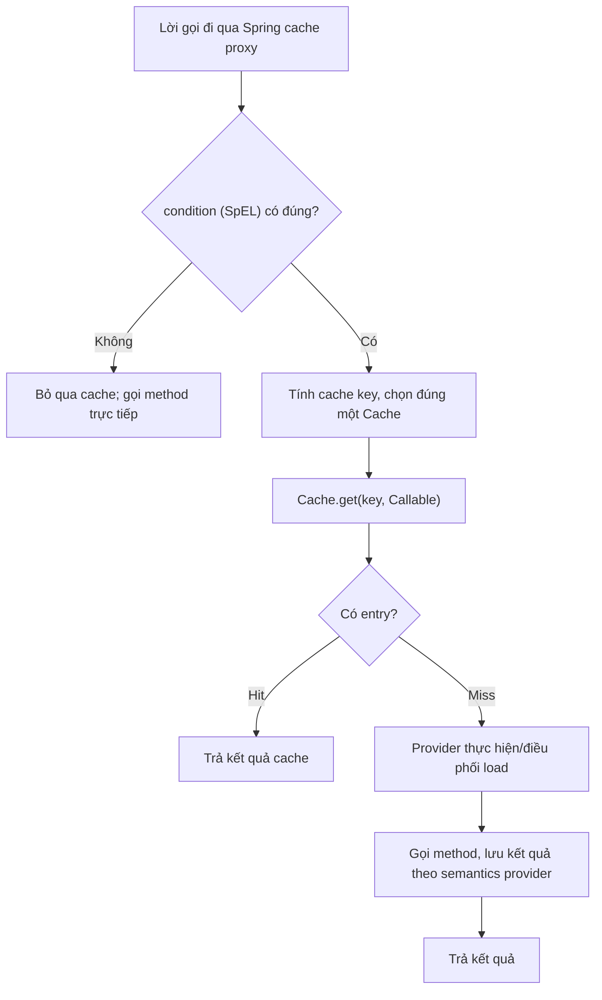

# Giới hạn kết hợp điều kiện với chế độ sync trong Spring Cache

> **Chủ đề:** Spring Framework – Cache · **Nhóm:** Điều kiện lưu.  
> Bài học giải thích chính xác quan hệ giữa `@Cacheable(condition = ...)`, `@Cacheable(unless = ...)` và `@Cacheable(sync = true)`; ba giới hạn bắt buộc của synchronized caching; cách chọn thiết kế phù hợp; và cách kiểm chứng trên Java 17+.

## 1. Ba thuộc tính giải quyết ba vấn đề khác nhau

Trên một method dùng Spring Cache, các thuộc tính sau thường xuất hiện cùng nhau trong thảo luận nhưng **không có cùng thời điểm đánh giá**:

| Thuộc tính | Thời điểm và đầu vào | Tác dụng |
|---|---|---|
| `condition` | **Trước** khi thực thi method, đánh giá SpEL chủ yếu dựa vào method arguments và ngữ cảnh gọi | Nếu `false`, bỏ qua cơ chế cache cho lời gọi đó; method vẫn được thực thi |
| `unless` | **Sau** khi method đã chạy và có kết quả; có thể đọc `#result` | Nếu `true`, **không ghi kết quả vừa tính** vào cache |
| `sync = true` | Tác động ở nhánh cache lookup/load khi điều kiện caching hợp lệ | Yêu cầu provider hỗ trợ đồng bộ việc nạp một key đang miss để hạn chế nhiều luồng cùng tính giá trị |

Ví dụ khai báo `condition` và `sync` là **hợp lệ**:

```java
@Cacheable(
    cacheNames = "products",
    key = "#p0",
    condition = "#p0 != null && #p0.length() <= 16",
    sync = true
)
public Product find(String sku) {
    return repository.findBySku(sku).orElseThrow();
}
```

Đây là method **minh họa trong một Spring-managed service** đã có `Product` và `repository`, không phải chương trình Java độc lập.

- Với SKU khác `null` và dài tối đa 16 ký tự, Spring có thể dùng cache; nếu nhiều thread cùng miss một key, `sync=true` yêu cầu cách load phối hợp theo semantics của provider.
- Với SKU `null` hoặc dài quá 16 ký tự, `condition` trả `false`: Spring bỏ qua cache, gọi method thật mỗi lần, **không được hưởng đồng bộ tải cache của `sync=true`**.
- `key="#p0"` có thể gây vấn đề nếu key null thực sự đi vào cache. Điều kiện `#p0 != null` tránh tình huống đó **cho nhánh được cache**.
- Nếu method ném exception (ví dụ không tìm thấy SKU), Spring Cache không mặc nhiên lưu exception như một giá trị thành công. Chính sách xử lý lỗi cần được quyết định riêng.

Đừng suy từ việc có `sync=true` rằng *mọi lần gọi method* đều bị khóa. Khả năng đồng bộ chỉ liên quan nhánh truy cập cache mà điều kiện thực sự cho phép.

## 2. Luồng xử lý khi có `condition` và `sync=true`



Ở mức SPI, đường đi đồng bộ dựa vào thao tác ghép **lookup + value loader** thông qua `Cache.get(Object key, Callable<T> valueLoader)`. Đây là điểm khác cách thông thường có các bước `Cache.get(key)`, gọi method, rồi `Cache.put(key, value)` tách rời.

**`condition` vẫn được hỗ trợ với `sync=true`.** Khi `condition=false`, việc có `sync=true` không thay đổi hành vi của method; kết quả không được đọc từ hoặc ghi vào cache thông qua annotation này.

Ngược lại, `unless` đòi hỏi quan sát kết quả **sau khi thực thi method** để quyết định có ghi hay không. Synchronized caching giao quá trình tính và lưu cho một callback gắn với cache, nên Spring Cache **không hỗ trợ `unless` trong cùng `@Cacheable(sync=true)`**.

## 3. Ba giới hạn bắt buộc của `@Cacheable(sync=true)`

Javadoc của Spring Framework quy định ba hạn chế sau, áp dụng cả khi biểu thức `condition` có thể `false` ở một số lời gọi.

### Giới hạn 1 — Không hỗ trợ `unless`

**Không hợp lệ:**

```java
@Cacheable(
    cacheNames = "products",
    key = "#p0",
    sync = true,
    unless = "#result == null"
)
public Product find(String sku) {
    return repository.findBySku(sku).orElse(null);
}
```

Dù `unless` có vẻ hợp lý để loại kết quả `null`, Spring không chấp nhận phối hợp này. Ngay cả `unless = "false"` cũng vẫn là một biểu thức `unless` không rỗng. Đừng trông chờ Spring âm thầm bỏ qua `unless`.

**Hợp lệ khi cần bỏ cache kết quả null:**

```java
@Cacheable(
    cacheNames = "products",
    key = "#p0",
    unless = "#result == null"
)
public Product find(String sku) {
    return repository.findBySku(sku).orElse(null);
}
```

Đoạn này **không bật `sync`**; nếu nhiều thread cùng miss, Spring Cache abstraction không đảm bảo chỉ một thread thực thi loader.

**Hợp lệ khi chỉ muốn lọc theo arguments và cần `sync`:**

```java
@Cacheable(
    cacheNames = "products",
    key = "#p0",
    condition = "#p0 != null",
    sync = true
)
public Product find(String sku) {
    return repository.findBySku(sku).orElse(null);
}
```

Nhưng lưu ý: đoạn thứ hai **không thể ngăn cache `null` theo `#result`**. Nếu provider cho phép null values, kết quả null có thể được lưu. Nếu không cho phép, provider có thể báo lỗi khi lưu. Hai đoạn giải quyết hai yêu cầu khác nhau; không thay `unless` bằng `condition` khi bài toán phụ thuộc **kết quả sau khi gọi method**.

### Giới hạn 2 — Chỉ một cache được dùng

**Không hợp lệ:**

```java
@Cacheable(
    cacheNames = {"productsLocal", "productsShared"},
    key = "#p0",
    sync = true
)
public Product find(String sku) {
    return repository.findBySku(sku).orElseThrow();
}
```

Chế độ đồng bộ yêu cầu **một cache duy nhất** để phối hợp lookup và load. Bình thường `@Cacheable` có thể tham chiếu nhiều cache, nhưng khi thêm `sync=true` thì không được. Không nên coi hai tên cache là cơ chế L1 Caffeine + L2 Redis tự động.

**Hợp lệ:**

```java
@Cacheable(cacheNames = "products", key = "#p0", sync = true)
public Product find(String sku) {
    return repository.findBySku(sku).orElseThrow();
}
```

Điểm cần kiểm tra thêm: nếu dùng một `CacheResolver` tùy biến, resolver đó cũng phải trả về **chính xác một đối tượng `Cache`** cho một thao tác synchronized. Chỉ ghi một tên cache trong annotation nhưng resolver trả hai đối tượng cache vẫn vi phạm giới hạn.

### Giới hạn 3 — Không kết hợp thêm cache operation trên **cùng method**

**Không hợp lệ về cấu hình caching:**

```java
@Caching(
    cacheable = @Cacheable(cacheNames = "products", sync = true),
    evict = @CacheEvict(cacheNames = "productSummary")
)
public Product loadAndInvalidate(String sku) {
    return repository.findBySku(sku).orElseThrow();
}
```

Ví dụ trên minh họa tổ hợp bị cấm; các import `@Caching`, `@Cacheable`, `@CacheEvict` và các type nghiệp vụ phải có trong ứng dụng thật. Tương tự, không gộp `@Cacheable(sync=true)` với `@CachePut` hoặc một `@Cacheable` khác trên chính method đó.

**Phân biệt phạm vi:** `@CacheEvict` ở **method khác** vẫn hoàn toàn có thể được dùng để xóa entry được tạo bởi method `@Cacheable(sync=true)`. Cấm *gộp các cache operations trên cùng một method*, chứ không cấm cả ứng dụng có nhiều loại annotation.

Một service điển hình có thể tách:

```java
@Cacheable(cacheNames = "products", key = "#p0", sync = true)
public Product read(String sku) {
    return repository.findBySku(sku).orElseThrow();
}

@CacheEvict(cacheNames = "products", key = "#p0")
public void update(String sku, UpdateCommand command) {
    repository.applyUpdate(sku, command);
}
```

Hai method trên là minh họa trong service đã có repository. Quy tắc key của read và evict phải tương đương. Với dữ liệu có transaction, còn phải xét thời điểm commit và đọc/ghi cạnh tranh.

### Bảng quyết định cấu hình nhanh

| Cấu hình | Hợp lệ với `sync=true`? | Vì sao |
|---|---|---|
| `@Cacheable(cacheNames="x", sync=true)` | **Có** | Một cache, không `unless`, không gộp operations |
| `@Cacheable(cacheNames="x", condition="#p0 > 0", sync=true)` | **Có** | `condition` là điều kiện trước khi cache lookup |
| `@Cacheable(cacheNames="x", key="#p0", condition="#p0 != null", sync=true)` | **Có** | Key và condition được hỗ trợ như thông thường |
| `@Cacheable(cacheNames="x", unless="#result == null", sync=true)` | **Không** | `unless` bị cấm khi synchronized |
| `@Cacheable(cacheNames={"x","y"}, sync=true)` | **Không** | Chỉ cho phép một cache |
| Một cache name nhưng resolver trả nhiều cache | **Không** | Vẫn có nhiều `Cache` ở runtime |
| `@Cacheable(sync=true)` và `@CachePut` trên cùng method | **Không** | Không kết hợp cache operations |
| `@Cacheable(sync=true)` và `@CacheEvict` trên hai method khác nhau | **Có** | Mỗi method có một cache operation độc lập |
| `@Cacheable(cacheNames="x", condition="#result != null", sync=true)` | **Sai ý tưởng** | `#result` không sẵn có ở giai đoạn đánh giá `condition` |
| `@Cacheable(cacheNames="x", sync=false, unless="#result == null")` | **Có** | Có thể veto sau lời gọi, đổi lại không có sync loading hint |

## 4. Phân biệt tỉ mỉ `condition` và `unless` trong chế độ đồng bộ

### 4.1. `condition` kiểm tra lời gọi, `unless` kiểm tra kết quả

Một ví dụ caching theo input:

```java
@Cacheable(
    cacheNames = "search",
    key = "#p0",
    condition = "#p0 != null && #p0.length() <= 40",
    sync = true
)
public String search(String query) {
    return slowBackend(query);
}
```

- Truy vấn ngắn được cache và có thể coalescing theo key.
- Truy vấn quá dài không cache; mọi request đều gọi backend.
- Truy vấn `null` không cache, đồng thời tránh tạo key `null` từ `#p0`.
- Đánh giá `condition` không có quyền truy cập kết quả `slowBackend(query)` vì chưa chạy.

Một ví dụ caching theo output:

```java
@Cacheable(
    cacheNames = "search",
    key = "#p0",
    unless = "#result == null || #result.isBlank()"
)
public String search(String query) {
    return slowBackend(query);
}
```

- `unless` kiểm tra được `#result` vì method đã chạy.
- Khi kết quả null/rỗng thì không ghi.
- Không có `sync=true`, nên với miss đồng thời có thể nạp trùng.

Đây đều là các method minh họa; cần service/repository và cấu hình Spring thật để chạy. Biểu thức `#result == null || #result.isBlank()` sử dụng short-circuit, tránh gọi `isBlank()` trên null.

### 4.2. Không thể mô phỏng post-filter bằng pre-filter nếu dữ liệu chưa biết

Ví dụ yêu cầu: “Chỉ lưu sản phẩm có `status=ACTIVE`, mà trạng thái chỉ biết sau khi truy vấn database.” `condition` không thể biết trước trạng thái để quyết định nên cache hay không. Đặt:

```java
@Cacheable(cacheNames = "products", sync = true,
           condition = "#result.status == 'ACTIVE'")
```

là **sai thời điểm**; `#result` không được định nghĩa như trong `unless`. Các phương án đúng tùy yêu cầu:

1. Bỏ `sync=true` và dùng `unless = "#result == null || #result.status != 'ACTIVE'"`.
2. Giữ `sync=true`, chấp nhận cache cả kết quả của loader theo semantics provider, kết hợp TTL ngắn/invalidation nếu dữ liệu không nên giữ lâu.
3. Nếu **bắt buộc đồng thời** chỉ cho một loader chạy và không lưu kết quả sau khi quan sát output, thiết kế phối hợp nạp ở tầng khác (ví dụ cơ chế single-flight/loader hoặc backend API chuyên dụng), cùng quy tắc invalidation và xử lý lỗi. Không khai báo tổ hợp annotation mà Spring không hỗ trợ.

Việc biến `null` thành `Optional.empty()` **không tự giải quyết** yêu cầu post-filter. Spring Cache thường unwrap `Optional` khi lưu; empty có thể tương ứng giá trị null, còn chính sách cache null phụ thuộc provider.

### 4.3. Điều kiện `false` làm mất cả lợi ích chống stampede của `sync`

Một yêu cầu có thể nhìn như “bật sync để chống gọi trùng”, nhưng thực tế:

```java
@Cacheable(
    cacheNames = "reports",
    condition = "#p0 != null && #p0.size() < 100",
    sync = true
)
public Report generate(List<String> ids) {
    return expensiveCalculation(ids);
}
```

Các request với 100 phần tử trở lên **đều bỏ qua cache** và có thể tính đồng thời, dù cùng arguments. Nếu nhóm request này mới là nguồn tải cao, `sync=true` trong nhánh cacheable không xử lý được. Cần đánh giá điều kiện nghiệp vụ, mức độ nóng của key và giải pháp giới hạn tải khác.

Trong ví dụ này, `condition` đọc argument. Nếu danh sách mutable, key mặc định có thể bị ảnh hưởng bởi thay đổi nội dung; với dữ liệu cache thật nên dùng giá trị/snapshot bất biến.

## 5. Chế độ sync thực sự đồng bộ đến đâu?

### 5.1. Đây là yêu cầu gửi đến Cache provider

Spring Framework cung cấp contract `Cache.get(key, Callable)`, nhưng Javadoc xác định `sync=true` là một **hint**: provider được chọn có thể không đảm bảo xử lý đồng bộ theo cách mong muốn.

- Với `ConcurrentMapCache` của Spring Framework, việc load một key có thể dựa trên cấu trúc concurrent map; đây là lựa chọn phù hợp để minh họa cách tránh gọi loader trùng trong **một JVM**.
- Với Caffeine local cache, backend có cơ chế compute/load được đồng bộ trong phạm vi cache instance theo API của provider.
- Với Redis hoặc cache cluster, kết quả phụ thuộc adapter, writer và cấu hình. Một số cơ chế có thao tác get/put không lock toàn cục; **không giả định `sync=true` tự tạo distributed lock** giữa mọi pod/JVM.
- Với cache tự viết hoặc wrapper, phải kiểm tra implementation của `Cache.get(Object, Callable)`. Nếu chỉ gọi `get` rồi tính `loader.call()` ngoài một vùng đảm bảo single load, có thể vẫn có nhiều lần tính.

**Không đồng nhất `sync=true` với Java `synchronized`.** Một method Java synchronized khóa monitor của object ở mỗi instance, trong khi caching sync là phối hợp theo *cache lookup/load và key* do provider thực hiện. Các key khác nhau thường có thể được tính song song; không có hứa hẹn một lock toàn ứng dụng hoặc một distributed lock.

### 5.2. Ngoại lệ và retry

Nếu loader ném exception, thao tác load có thể thất bại và những request chờ cũng có thể nhận lỗi hoặc thử lại theo semantics provider. Đừng giả định Spring Cache tự lưu exception để ngăn request tiếp theo. `Cache.get(key, Callable)` có thể bao bọc lỗi trong `ValueRetrievalException`; cần quan sát exception gốc và cấu hình xử lý lỗi phù hợp.

Với `sync=false`, luồng phổ biến là get, gọi method, rồi put. Với `sync=true`, lookup và loader được đưa vào một callback provider. Khi cấu hình `CacheErrorHandler` tùy chỉnh, đường đi lỗi của hai chế độ có thể khác; không nên xem `sync=true` như một thay đổi chỉ liên quan hiệu năng.

### 5.3. Null result và cache backend

`sync=true` **không ngăn việc lưu giá trị null**. Ví dụ `ConcurrentMapCacheManager` mặc định có thể lưu null thông qua đại diện nội bộ thay vì đặt Java null trực tiếp vào map. Một provider khác có thể không hỗ trợ hoặc bị cấu hình `allowNullValues=false`.

Nếu ứng dụng phải bỏ cache kết quả null, lựa chọn khai báo trực tiếp là `unless="#result == null"` và **không dùng `sync=true`**. Nếu vẫn cần chống stampede, xử lý ở tầng loader/infra theo API đã kiểm thử; tránh dùng sentinel trùng với dữ liệu thật.

## 6. Ví dụ chạy được: một project Spring Framework, bốn trường hợp

Ví dụ sử dụng **Java 17+**, **Maven**, **Spring Framework 6.2.12** và `ConcurrentMapCacheManager`. Không cần Spring Boot hay cơ sở dữ liệu. Nó chứng minh: `condition + sync` hoạt động; điều kiện `false` bypass; `unless` hoạt động khi không bật sync; và khi sync cho phép null thì kết quả null có thể được cache.

Cấu trúc:

```text
spring-sync-condition/
├── pom.xml
└── src/main/java/dev/example/synccondition/SyncConditionDemo.java
```

### 6.1. `pom.xml`

```xml
<?xml version="1.0" encoding="UTF-8"?>
<project xmlns="http://maven.apache.org/POM/4.0.0"
         xmlns:xsi="http://www.w3.org/2001/XMLSchema-instance"
         xsi:schemaLocation="http://maven.apache.org/POM/4.0.0 https://maven.apache.org/xsd/maven-4.0.0.xsd">
    <modelVersion>4.0.0</modelVersion>

    <groupId>dev.example</groupId>
    <artifactId>spring-sync-condition</artifactId>
    <version>1.0.0</version>

    <properties>
        <maven.compiler.release>17</maven.compiler.release>
        <project.build.sourceEncoding>UTF-8</project.build.sourceEncoding>
    </properties>

    <dependencies>
        <dependency>
            <groupId>org.springframework</groupId>
            <artifactId>spring-context</artifactId>
            <version>6.2.12</version>
        </dependency>
    </dependencies>

    <build>
        <plugins>
            <plugin>
                <groupId>org.apache.maven.plugins</groupId>
                <artifactId>maven-compiler-plugin</artifactId>
                <version>3.13.0</version>
            </plugin>
            <plugin>
                <groupId>org.codehaus.mojo</groupId>
                <artifactId>exec-maven-plugin</artifactId>
                <version>3.3.0</version>
                <configuration>
                    <mainClass>dev.example.synccondition.SyncConditionDemo</mainClass>
                </configuration>
            </plugin>
        </plugins>
    </build>
</project>
```

### 6.2. `src/main/java/dev/example/synccondition/SyncConditionDemo.java`

```java
package dev.example.synccondition;

import java.util.ArrayList;
import java.util.HashSet;
import java.util.List;
import java.util.Set;
import java.util.concurrent.CountDownLatch;
import java.util.concurrent.ExecutorService;
import java.util.concurrent.Executors;
import java.util.concurrent.Future;
import java.util.concurrent.atomic.AtomicInteger;

import org.springframework.cache.CacheManager;
import org.springframework.cache.annotation.Cacheable;
import org.springframework.cache.annotation.EnableCaching;
import org.springframework.cache.concurrent.ConcurrentMapCacheManager;
import org.springframework.context.annotation.AnnotationConfigApplicationContext;
import org.springframework.context.annotation.Bean;
import org.springframework.context.annotation.Configuration;

public class SyncConditionDemo {
    public static void main(String[] args) throws Exception {
        try (AnnotationConfigApplicationContext context =
                new AnnotationConfigApplicationContext(CacheConfig.class)) {

            ReportService service = context.getBean(ReportService.class);

            // condition=true: có cache và synchronized loading.
            System.out.println("short1=" + service.shortText("A"));
            System.out.println("short2=" + service.shortText("A"));

            // condition=false: bỏ qua cache; method chạy mỗi lần.
            System.out.println("long1=" + service.shortText("LONG"));
            System.out.println("long2=" + service.shortText("LONG"));
            System.out.println("nullInput1=" + service.shortText(null));
            System.out.println("nullInput2=" + service.shortText(null));
            System.out.println("shortLoads=" + service.shortLoadCount());

            // sync=false + unless: null result không được lưu.
            System.out.println("unless1=" + service.nullWithUnless("missing"));
            System.out.println("unless2=" + service.nullWithUnless("missing"));
            System.out.println("unlessLoads=" + service.unlessLoadCount());

            // sync=true: provider local mặc định cho phép cache null result.
            System.out.println("syncNull1=" + service.nullWithSync("missing"));
            System.out.println("syncNull2=" + service.nullWithSync("missing"));
            System.out.println("syncNullLoads=" + service.syncNullLoadCount());

            // Nhiều threads cùng gọi qua Spring proxy với đúng một key.
            ExecutorService pool = Executors.newFixedThreadPool(6);
            CountDownLatch go = new CountDownLatch(1);
            List<Future<String>> results = new ArrayList<>();

            try {
                for (int i = 0; i < 6; i++) {
                    results.add(pool.submit(() -> {
                        go.await();
                        return service.expensive("K");
                    }));
                }

                go.countDown();

                Set<String> uniqueResults = new HashSet<>();
                for (Future<String> future : results) {
                    uniqueResults.add(future.get());
                }

                System.out.println("parallelDistinct=" + uniqueResults.size());
                System.out.println("parallelLoads=" + service.expensiveLoadCount());
            } finally {
                pool.shutdownNow();
            }
        }
    }

    @Configuration(proxyBeanMethods = false)
    @EnableCaching
    public static class CacheConfig {
        @Bean
        public CacheManager cacheManager() {
            return new ConcurrentMapCacheManager(
                    "shortTexts", "nullDecisions", "syncNulls", "expensive");
        }

        @Bean
        public ReportService reportService() {
            return new ReportService();
        }
    }

    public static class ReportService {
        private final AtomicInteger shortLoads = new AtomicInteger();
        private final AtomicInteger unlessLoads = new AtomicInteger();
        private final AtomicInteger syncNullLoads = new AtomicInteger();
        private final AtomicInteger expensiveLoads = new AtomicInteger();

        @Cacheable(
                cacheNames = "shortTexts",
                key = "#p0",
                condition = "#p0 != null && #p0.length() <= 3",
                sync = true)
        public String shortText(String text) {
            return String.valueOf(text) + "#" + shortLoads.incrementAndGet();
        }

        @Cacheable(
                cacheNames = "nullDecisions",
                key = "#p0",
                unless = "#result == null")
        public String nullWithUnless(String key) {
            unlessLoads.incrementAndGet();
            return null;
        }

        @Cacheable(
                cacheNames = "syncNulls",
                key = "#p0",
                sync = true)
        public String nullWithSync(String key) {
            syncNullLoads.incrementAndGet();
            return null;
        }

        @Cacheable(
                cacheNames = "expensive",
                key = "#p0",
                sync = true)
        public String expensive(String key) {
            int attempt = expensiveLoads.incrementAndGet();
            try {
                Thread.sleep(150);
            } catch (InterruptedException e) {
                Thread.currentThread().interrupt();
                throw new IllegalStateException("Loader interrupted", e);
            }
            return "expensive-" + key + "#" + attempt;
        }

        public int shortLoadCount() {
            return shortLoads.get();
        }

        public int unlessLoadCount() {
            return unlessLoads.get();
        }

        public int syncNullLoadCount() {
            return syncNullLoads.get();
        }

        public int expensiveLoadCount() {
            return expensiveLoads.get();
        }
    }
}
```

Đi tới thư mục chứa `pom.xml` và chạy:

```bash
mvn -q compile exec:java
```

Các dòng do chương trình tự in khi tạo context/cache mới (không tính log phụ của môi trường):

```text
short1=A#1
short2=A#1
long1=LONG#2
long2=LONG#3
nullInput1=null#4
nullInput2=null#5
shortLoads=5
unless1=null
unless2=null
unlessLoads=2
syncNull1=null
syncNull2=null
syncNullLoads=1
parallelDistinct=1
parallelLoads=1
```

**Vì sao kết quả như vậy?**

- `shortText("A")` có `condition=true` và cache key `"A"`. Lần hai hit nên `shortLoads` không tăng.
- `shortText("LONG")` có độ dài 4 vượt ngưỡng 3, nên cả hai lời gọi chạy method. `shortText(null)` cũng bypass; `key="#p0"` không đưa null vào lookup vì condition đã loại lời gọi này.
- `nullWithUnless("missing")` luôn trả null và `unless` ngăn ghi, nên bộ đếm tăng tới 2.
- `nullWithSync("missing")` không có `unless`. `ConcurrentMapCache` mặc định hỗ trợ lưu null qua giá trị đại diện nội bộ, nên lần hai hit và bộ đếm chỉ bằng 1.
- Sáu tác vụ cùng truy cập cache `expensive` với key `"K"`. Với `ConcurrentMapCacheManager` trong ví dụ, loader được thực thi một lần, cả sáu futures thấy cùng kết quả. Latch giúp bắt đầu các tác vụ gần nhau; một lần thử thành công chưa thay thế kiểm thử tải lặp lại nếu muốn đánh giá một provider khác.

Ở đây service được lấy từ `AnnotationConfigApplicationContext` để lời gọi đi qua Spring proxy. Nếu tạo service trực tiếp bằng `new` hoặc gọi một method annotated bằng `this.method()` từ chính object đó, caching annotation mặc định không được áp dụng.

### 6.3. Vì sao không đưa ví dụ cấu hình sai vào project runnable?

Ba trường hợp **`sync + unless`**, **`sync + nhiều cache`** và **`sync + nhiều cache operations trên một method** thuộc nhóm cần trình bày như ví dụ **không hợp lệ**. Nếu đặt chúng vào bean thực sự được gọi trong chương trình kiểm thử, Spring có thể ném lỗi khi xử lý cache operation, làm hỏng luồng minh họa hợp lệ. Chúng được trình bày tách ở mục 3 và có thể dùng trong integration tests riêng để xác nhận ứng dụng báo lỗi cấu hình, nhưng không phải logic nên triển khai trong production.

## 7. Chọn thiết kế nào khi có nhiều yêu cầu?

| Yêu cầu nghiệp vụ | Cách khai báo hoặc kiến trúc phù hợp | Giới hạn cần chấp nhận |
|---|---|---|
| Chỉ cache khi arguments thỏa điều kiện; muốn hạn chế load trùng theo key | `@Cacheable(condition=..., sync=true)`, một cache | Các lời gọi condition=false bỏ qua cả cache lẫn lợi ích sync |
| Chỉ cache kết quả khác null hoặc đạt chuẩn sau khi xử lý | `@Cacheable(unless=...)`, `sync=false` | Miss đồng thời có thể tính lặp |
| Muốn cache null như một negative result, hạn chế miss lặp | `@Cacheable(sync=true)` với provider hỗ trợ null | Cần TTL hợp lý và invalidation khi dữ liệu xuất hiện |
| Một method phải cập nhật/xóa nhiều cache cùng lúc | Tách trách nhiệm vào các method, service hoặc sự kiện invalidation | Không gộp cache operations với `sync=true` trên cùng method |
| Muốn L1 và L2 cache | Thiết kế multi-level adapter/cache riêng được kiểm thử | `@Cacheable(cacheNames={"L1","L2"},sync=true)` bị cấm |
| Cần per-key single-flight **và** post-result filtering | Thiết kế loader/coordinator riêng, hoặc đổi tradeoff theo SLA | Annotation Spring Cache không kết hợp được `sync=true` với `unless` |
| Cần bảo vệ khỏi stampede trên nhiều JVM | Kiểm tra locking/distributed coordination của backend | Không suy ra distributed locking chỉ từ `sync=true` |
| Muốn có thể bỏ cache theo tenant/quyền | Thêm partition/tenant vào key; điều kiện chỉ để quyết định cache hay không | Điều kiện không thay thế việc tách key-space và kiểm soát quyền |

### Quy tắc thiết kế trên một method

Trước khi đặt `sync=true`, hãy kiểm tra:

1. Method có đúng **một** thao tác `@Cacheable`, không có thêm `@CachePut`/`@CacheEvict`/một `@Cacheable` khác cùng method?
2. Đường resolve chỉ đưa về **một** `Cache`?
3. Có cần nhìn `#result` để quyết định giữ cache không? Nếu **có**, `unless` cần hoạt động và phải thay đổi thiết kế.
4. `condition` chỉ dựa trên những biến có trước method invocation? Có `null` hoặc truy cập field dễ gây SpEL exception không?
5. Provider hỗ trợ `Cache.get(key, Callable)` theo mức đồng bộ nào? Test cần nằm trong một node hay nhiều node?
6. Key gồm những tham số thực sự quyết định kết quả? Các lời gọi cùng ý nghĩa tạo cùng key?
7. Khi loader trả null, ném exception, timeout hoặc dữ liệu đổi sau commit, hành vi có phù hợp SLA không?

## 8. Chẩn đoán lỗi cấu hình và hành vi khó hiểu

| Hiện tượng | Nguyên nhân thường gặp | Điều cần kiểm tra |
|---|---|---|
| Lỗi khi method có `sync=true, unless=...` | Cấu hình cache operation không hợp lệ | Bỏ `unless` hoặc bỏ `sync`; chọn phương án theo yêu cầu |
| Lỗi khi khai báo hai cache names | `sync=true` chỉ hỗ trợ một `Cache` | Dùng một manager/cache hoặc thiết kế multi-level cache riêng |
| Lỗi khi dùng `@Caching` ghép thêm evict/put | Không được kết hợp cache operations trên cùng method có sync | Tách thao tác sang method khác, thống nhất key |
| Có `sync=true` nhưng method vẫn chạy lặp khi input không hợp lệ | `condition=false` làm bypass cache | Kiểm tra SpEL condition và xem có cần hạn tải riêng |
| `condition="#result != null"` không hoạt động | Kết quả chưa có ở giai đoạn condition | Chuyển sang `unless` và không dùng `sync` nếu cần lọc output |
| Nhiều pod vẫn cùng gọi DB | Backend không cung cấp distributed single-flight | Kiểm tra provider, writer/lock và test cross-node |
| Sync local tốt nhưng Redis vẫn load trùng | Semantics load/lock của adapter Redis khác local | Đo concurrent miss theo key, xem implementation `get(key, Callable)` |
| Method được gọi từ cùng class nhưng không cache | Self-invocation bypass proxy mode mặc định | Gọi qua Spring-managed bean/proxy, tách trách nhiệm |
| Cache lưu null ngoài ý muốn | `sync=true` không hỗ trợ `unless`, provider có null caching | Xác định null policy, TTL, invalidation hoặc đổi design |
| Kết quả cached khác tenant/user | Key thiếu tenant/auth scope | Sửa key partition; sync không khắc phục collision |
| Hành vi khác khi thay provider | Provider khác mức atomicity, TTL, null/exception semantics | Test concurrency và integration trên backend thật |

## 9. Kiểm thử có mục tiêu cho `sync + condition`

Một kiểm thử tốt cần tách **đúng cú pháp**, **đúng ngữ nghĩa caching**, và **đúng đảm bảo đồng bộ của provider**.

**Nhóm A — Điều kiện trước khi cache:**

- Cùng key `A` với `condition=true`: gọi nhiều lần, loader chỉ chạy một lần sau khi entry có mặt.
- Cùng key `B` với `condition=false`: gọi nhiều lần, loader chạy mỗi lần; kiểm tra không có entry được tạo bởi annotation.
- Tham số null: điều kiện phải tránh tạo key null nếu có `key="#p0"`. Kiểm tra SpEL null-safe.
- Tham số là array/collection mutable: kiểm tra key ổn định nếu đối tượng bị sửa; xem xét tạo snapshot.

**Nhóm B — Các tổ hợp bị cấm:**

- Test riêng `sync=true` cùng `unless` không rỗng, mong ứng dụng phát hiện cấu hình không hợp lệ.
- Test hai cache names hoặc resolver trả hai cache, mong bị từ chối trong synchronized operation.
- Test cache annotations ghép bằng `@Caching` trên cùng method, mong bị từ chối.
- Test `@CacheEvict` ở **method khác** vẫn xóa đúng key của `@Cacheable(sync=true)`.

**Nhóm C — Concurrency thực:**

- Với 20–100 requests cùng key trên một instance, đo số lần đi vào loader, latency và số luồng chờ.
- Với nhiều key khác nhau, xác minh hệ thống không vô tình serialize toàn bộ tải do lock quá rộng.
- Với hai JVM/pod, test cùng key để biết backend có phối hợp phân tán hay chỉ trong mỗi process.
- Giả lập timeout, exception, cache outage; đảm bảo callback, fallback, transaction và metrics phù hợp.
- Kiểm tra kết quả null và exception: null có được cache không, entry hết hạn thế nào và loader có bị gọi lại không.
- Lặp bài kiểm thử trên chính provider, version và configuration dùng production; không suy diễn từ `ConcurrentMapCache` sang Redis.

Không đánh giá `sync` chỉ bằng hit rate sau cache warm-up: khi entry đã có, cả cấu hình `sync=false` cũng có thể trả hit mà không chạy method. Cần đo *đợt miss đồng thời* để thấy khác biệt.

## 10. Nguyên tắc sử dụng trong hệ thống thật

**Đặt `sync=true` khi:** một method có chi phí nạp dữ liệu cao, nhiều request có thể miss cùng key, kết quả cacheable dựa trên tham số và có thể chấp nhận chính sách lưu kết quả của provider. Hãy kiểm tra provider thật trước khi đặt kỳ vọng tránh stampede toàn cluster.

**Đặt `condition` khi:** biết trước từ arguments hoặc ngữ cảnh gọi rằng một số request không thích hợp với cache (ví dụ query quá lớn, chế độ đặc biệt, tenant chưa đủ thông tin). Điều kiện quyết định **có sử dụng cache hay không**, không veto sau khi đã có kết quả.

**Đặt `unless` khi:** chỉ sau khi chạy method mới biết kết quả có được phép lưu hay không, chẳng hạn kết quả null, trống hoặc không đạt trạng thái nghiệp vụ. Khi dùng `unless`, chấp nhận việc không thể bật `sync=true` ngay trên cùng `@Cacheable`; cần giải pháp concurrency riêng nếu có yêu cầu bắt buộc.

**Tách cache operations** khi một thao tác nghiệp vụ cần vừa nạp vừa xóa/ghi nhiều cache. Đồng nhất key và cân nhắc transaction/invalidation. Không chuyển một method xử lý nhiều hiệu ứng cache sang `sync=true` chỉ để chống miss lặp.

**Quan sát và kiểm thử**: ghi nhận cache name, effective key, loại `CacheManager`, provider thật, hit/miss, loader invocation count, latency P95/P99, exception và tính đúng giữa các node. Cache key không nên chứa dữ liệu nhạy cảm ở dạng thô nếu có thể tránh.

### Tài liệu đối chiếu

- Spring Framework — `@Cacheable` Javadoc, đặc biệt `sync` và `unless`: https://docs.spring.io/spring-framework/docs/6.2.16/javadoc-api/org/springframework/cache/annotation/Cacheable.html
- Spring Framework — Annotation-based Caching, Synchronized/Conditional Caching: https://docs.spring.io/spring-framework/reference/integration/cache/annotations.html
- Spring Framework — `Cache` interface và `get(Object, Callable)`: https://docs.spring.io/spring-framework/docs/6.2.16/javadoc-api/org/springframework/cache/Cache.html
- Spring Framework — Cache abstraction overview: https://docs.spring.io/spring-framework/reference/integration/cache.html
- Spring Boot — Cache provider configuration: https://docs.spring.io/spring-boot/reference/io/caching.html
