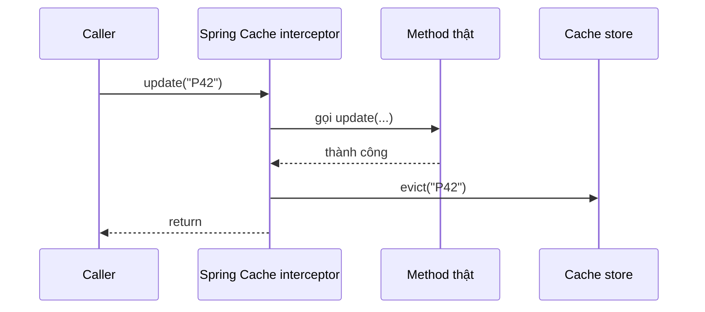
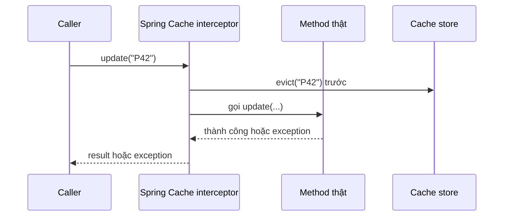

# @CacheEvict: beforeInvocation=true và xóa trước khi phương thức chạy

> **Chủ đề:** Spring Framework – Cache · **Nhóm:** `@CacheEvict`.  
> Mục tiêu: hiểu chính xác thời điểm Spring xóa cache khi khai báo `beforeInvocation=true`, sự khác nhau với mặc định `false`, tác động của exception, `condition`, `allEntries`, transaction và request đồng thời; vận dụng đúng cho hệ thống thực tế.

## 1. `@CacheEvict` làm gì?

`@CacheEvict` là annotation của Spring Cache dùng để **loại bỏ entry** khỏi một hoặc nhiều vùng cache. Nó thường gắn vào thao tác sửa/xóa dữ liệu để dữ liệu cũ trong cache không còn được trả cho lần đọc tiếp theo. Annotation tác động lên *cache store* qua `CacheManager`/`Cache`, không tự xóa bản ghi khỏi database.

Một ví dụ điển hình:

```java
@CacheEvict(cacheNames = "products", key = "#p0")
public void updateProduct(String productId, ProductUpdate input) {
    repository.update(productId, input);
}
```

Đây là **đoạn minh họa trong một Spring-managed service**, cần có `ProductUpdate` và repository thật. Spring xóa entry có key bằng tham số đầu tiên `productId` từ cache `products` **sau khi method hoàn thành thành công**, vì mặc định `beforeInvocation=false`.

Khi ghi:

```java
@CacheEvict(
    cacheNames = "products",
    key = "#p0",
    beforeInvocation = true
)
public void updateProduct(String productId, ProductUpdate input) {
    repository.update(productId, input);
}
```

Spring thực hiện yêu cầu xóa **trước khi** gọi phần thân `updateProduct`. Nếu phần thân method sau đó ném exception thì thao tác xóa đã được phát đi; không có cơ chế Spring Cache mặc định nào “hoàn tác” việc xóa đó. Điều này có thể phù hợp với một số nghiệp vụ nhưng cũng có thể tạo cửa sổ dữ liệu cũ nếu thao tác ghi chậm hoặc chưa commit.

**Điểm phân biệt chính:** `@CacheEvict` không quyết định có cập nhật database hay không; `beforeInvocation` chỉ thay đổi **thời điểm và sự phụ thuộc vào kết quả của cache eviction**.

## 2. So sánh `beforeInvocation=false` và `true`

| Tiêu chí | `beforeInvocation=false` (mặc định) | `beforeInvocation=true` |
|---|---|---|
| Thời điểm xóa | Sau khi method được thực thi thành công | Trước khi method được gọi |
| Method thành công | Xóa entry sau method | Entry đã bị xóa trước method |
| Method ném exception | Thông thường **không xóa** | Vẫn đã xóa, nếu cache operation ban đầu thành công |
| Trong thân method đọc lại cùng cache key | Thường vẫn thấy entry cũ trước khi xóa | Thường đã không còn entry tại thời điểm thân method bắt đầu |
| Có thể dùng trên method `void` | Có | Có |
| Có thể dùng `condition` | Có | Có, đánh giá trước invocation |
| Có thể dùng `allEntries=true` | Có | Có |
| Dùng `#result` trong biểu thức key/condition | Có thể với thao tác sau method, theo ngữ cảnh Spring hỗ trợ | **Không**: kết quả chưa tồn tại trước invocation |
| Tính nguyên tử với database | Không mặc nhiên được bảo đảm | Không mặc nhiên được bảo đảm |

Hai dạng thường gặp:

```java
// Mặc định: chỉ xóa sau khi method hoàn thành thành công.
@CacheEvict(cacheNames = "books", key = "#p0")
public void updateAfter(String isbn) {
    updateStorage(isbn);
}

// Trước: xóa rồi mới gọi method, kể cả method sau đó lỗi.
@CacheEvict(cacheNames = "books", key = "#p0", beforeInvocation = true)
public void updateBefore(String isbn) {
    updateStorage(isbn);
}
```

Đoạn trên mang tính minh họa, `updateStorage` cần được triển khai trong ứng dụng thật. Khi backend cache bị lỗi đúng lúc xóa, method có thể bị ảnh hưởng tùy `CacheErrorHandler`/provider; `beforeInvocation=true` không hứa rằng xóa cache *luôn thành công* dù backend không truy cập được.

### Thứ tự các bước

**Mặc định:**



Nếu method ở đường mặc định ném exception, bước `evict` sau thành công không diễn ra.

**`beforeInvocation=true`:**



Sơ đồ mô tả thứ tự logic ở tầng annotation. Với provider phân tán hoặc wrapper giao dịch, thời điểm entry thực sự biến mất phụ thuộc implementation; phải xác minh semantics và thứ tự advice trong hệ thống cụ thể.

## 3. Khi method thất bại: vì sao khác biệt này quan trọng?

Giả sử cache `products` đang có entry:

```text
cache["P42"] = "product-old"
```

Và ứng dụng gọi một method cập nhật dữ liệu:

```java
@CacheEvict(cacheNames = "products", key = "#p0", beforeInvocation = true)
public void changePrice(String id, long price) {
    database.updatePrice(id, price);
    externalService.publishChange(id); // có thể ném exception
}
```

Đây là code minh họa, không phải file độc lập.

### Trường hợp A — Xóa sau khi method hoàn thành

Với `beforeInvocation=false`, nếu `database.updatePrice` hoặc `publishChange` ném exception ra khỏi method, eviction sau invocation sẽ không chạy. Entry cũ có thể còn trong cache.

- Nếu database **chưa thay đổi**, giữ entry cũ có thể là hành vi mong muốn.
- Nếu database **đã thay đổi nhưng bước sau đó ném lỗi**, entry cũ có thể đã không đúng. Mặc định xóa sau thành công **không tự xử lý tình huống cập nhật một phần**.
- Nếu có `@Transactional` và rollback, còn phải xét dữ liệu đã commit/rollback thực tế, thứ tự AOP advice, và thao tác cache có gắn với thời điểm commit hay không.

### Trường hợp B — Xóa trước khi method chạy

Với `beforeInvocation=true`, entry bị loại khỏi cache trước lệnh database đầu tiên. Nếu method ném lỗi:

- Cache đã bị xóa, khiến lần đọc tiếp theo miss và có thể truy vấn lại nguồn dữ liệu.
- Nếu database rollback hoặc chưa đổi, lần đọc mới có thể nạp lại giá trị cũ. Điều đó làm tăng tải nhưng không nhất thiết tạo sai lệch lâu dài.
- Nếu database đã thay đổi một phần, việc đọc lại có thể nhìn thấy dữ liệu chưa đạt trạng thái nghiệp vụ mong muốn, tùy isolation và đường đọc.

**Không diễn giải “xóa trước” thành “thao tác nghiệp vụ chắc chắn thành công”**. Xóa cache là hiệu ứng độc lập với việc method thành công hay thất bại, và có thể làm tăng tỷ lệ cache miss.

### Ma trận sự cố

| Kết quả method | `beforeInvocation=false` | `beforeInvocation=true` | Câu hỏi cần hỏi |
|---|---|---|---|
| Thành công, dữ liệu mới đã sẵn sàng | Xóa sau; lần đọc tiếp theo miss | Xóa trước; có thể có refill trong lúc method chạy | Thời điểm DB commit so với thao tác evict? |
| Lỗi trước khi thay đổi DB | Giữ cache cũ | Đã evict, lần đọc sau phải load lại | Có chấp nhận mất hit rate khi lỗi? |
| Lỗi sau khi đã thay đổi dữ liệu bên ngoài | Có thể giữ stale cache | Cache đã evict | Có transaction hoặc cơ chế bù trừ nhất quán không? |
| Cache backend không thể xóa | Tùy thời điểm và error handler | Tùy thời điểm và error handler, có thể chặn method trước khi bắt đầu | Khi cache lỗi, write có được phép tiếp tục? |
| Nhiều request đọc/ghi cạnh tranh | Có thể thấy giá trị cũ trong lúc method chạy | Có thể miss rồi nạp giá trị DB cũ trước commit | Có cần after-commit invalidation hoặc versioning không? |

## 4. Cơ chế hoạt động: proxy, interceptor và Cache API

`@CacheEvict` chỉ có hiệu lực khi hạ tầng caching của Spring đã được bật (`@EnableCaching`) và lời gọi đi qua Spring proxy hoặc cơ chế AOP tương ứng. Quá trình thông thường:

1. Caller gọi method trên **Spring-managed bean**.
2. `CacheInterceptor` nhận metadata `@CacheEvict`, tìm cache thông qua `CacheManager`/`CacheResolver`, đánh giá điều kiện và tạo key nếu xóa theo key.
3. Nếu `beforeInvocation=true`, interceptor yêu cầu cache loại entry **trước** khi gọi method. Ở các triển khai Spring Cache hiện đại, đường xóa trước dùng thao tác có ý nghĩa loại bỏ ngay (ví dụ `Cache.evictIfPresent`/`invalidate`), tùy backend.
4. Spring gọi method thật; kết quả hoặc exception trả về caller.
5. Với mặc định `beforeInvocation=false`, cache được evict **sau khi method thành công** thay vì ở bước 3.

**Giới hạn proxy mode:** lời gọi từ một method vào `this.anotherAnnotatedMethod(...)` trong chính instance thường **không đi qua proxy**; do đó, annotation của method được gọi nội bộ không kích hoạt. Các method private hoặc đối tượng tạo bằng `new` ngoài container cũng không được proxy cache xử lý theo cách thông thường. Tách service qua bean khác hoặc thay đổi kiến trúc invocation nếu cần.

### Evict theo một key phải nhất quán với key của read

Xét method đọc:

```java
@Cacheable(cacheNames = "products", key = "#p0")
public Product get(String id) {
    return repository.find(id);
}
```

Khi cập nhật cũng phải xóa **đúng key**:

```java
@CacheEvict(
    cacheNames = "products",
    key = "#p0",
    beforeInvocation = true
)
public void change(String id, ProductPatch patch) {
    repository.change(id, patch);
}
```

Không nên để cập nhật tự dùng key mặc định nếu method có hai tham số: `change(id, patch)` mặc định có thể tạo `SimpleKey(id, patch)` trong khi đọc chỉ dùng `id`, dẫn đến xóa sai entry dù cấu hình thời điểm evict có đúng.

Tên cache cũng phải trùng với vùng đang chứa dữ liệu. Nếu nhiều method cùng dùng `cacheNames="products"`, `key` và cơ chế encode (đặc biệt với Redis) cần thống nhất. `beforeInvocation` không sửa được lỗi key mismatch.

## 5. Ví dụ Java 17+ chạy được: nhìn thấy eviction trong thân method

Ví dụ này dùng Spring Framework **6.2.12**, Java 17+ và Maven. `ConcurrentMapCacheManager` lưu cache trong JVM, vì vậy thứ tự xóa có thể quan sát rõ mà không cần Redis/database. Chương trình chứng minh các tình huống thành công, exception, `condition` và `allEntries=true`.

### 5.1. Cấu trúc dự án

```text
cache-evict-before/
├── pom.xml
└── src/main/java/dev/example/evict/EvictBeforeDemo.java
```

**`pom.xml`**

```xml
<?xml version="1.0" encoding="UTF-8"?>
<project xmlns="http://maven.apache.org/POM/4.0.0"
         xmlns:xsi="http://www.w3.org/2001/XMLSchema-instance"
         xsi:schemaLocation="http://maven.apache.org/POM/4.0.0 https://maven.apache.org/xsd/maven-4.0.0.xsd">
    <modelVersion>4.0.0</modelVersion>
    <groupId>dev.example</groupId>
    <artifactId>cache-evict-before</artifactId>
    <version>1.0.0</version>
    <properties>
        <maven.compiler.release>17</maven.compiler.release>
        <project.build.sourceEncoding>UTF-8</project.build.sourceEncoding>
    </properties>
    <dependencies>
        <dependency>
            <groupId>org.springframework</groupId>
            <artifactId>spring-context</artifactId>
            <version>6.2.12</version>
        </dependency>
    </dependencies>
    <build>
        <plugins>
            <plugin>
                <groupId>org.apache.maven.plugins</groupId>
                <artifactId>maven-compiler-plugin</artifactId>
                <version>3.13.0</version>
            </plugin>
            <plugin>
                <groupId>org.codehaus.mojo</groupId>
                <artifactId>exec-maven-plugin</artifactId>
                <version>3.3.0</version>
                <configuration>
                    <mainClass>dev.example.evict.EvictBeforeDemo</mainClass>
                </configuration>
            </plugin>
        </plugins>
    </build>
</project>
```

**`src/main/java/dev/example/evict/EvictBeforeDemo.java`**

```java
package dev.example.evict;

import java.util.Objects;
import org.springframework.cache.Cache;
import org.springframework.cache.CacheManager;
import org.springframework.cache.annotation.CacheEvict;
import org.springframework.cache.annotation.EnableCaching;
import org.springframework.cache.concurrent.ConcurrentMapCacheManager;
import org.springframework.context.annotation.AnnotationConfigApplicationContext;
import org.springframework.context.annotation.Bean;
import org.springframework.context.annotation.Configuration;

public class EvictBeforeDemo {
    private static boolean has(Cache cache, String key) {
        return cache.get(key) != null;
    }

    public static void main(String[] args) {
        try (AnnotationConfigApplicationContext context =
                new AnnotationConfigApplicationContext(CacheConfig.class)) {
            CacheManager manager = context.getBean(CacheManager.class);
            Cache cache = Objects.requireNonNull(manager.getCache("products"));
            ProductCommands commands = context.getBean(ProductCommands.class);

            cache.put("A", "old-A");
            commands.evictBefore("A", false);
            System.out.println("AExistsAfter=" + has(cache, "A"));

            cache.put("B", "old-B");
            commands.evictAfter("B", false);
            System.out.println("BExistsAfter=" + has(cache, "B"));

            cache.put("C", "old-C");
            try {
                commands.evictBefore("C", true);
            } catch (IllegalStateException e) {
                System.out.println("beforeError=" + e.getMessage());
            }
            System.out.println("CExistsAfterError=" + has(cache, "C"));

            cache.put("D", "old-D");
            try {
                commands.evictAfter("D", true);
            } catch (IllegalStateException e) {
                System.out.println("afterError=" + e.getMessage());
            }
            System.out.println("DExistsAfterError=" + has(cache, "D"));

            cache.put("X", "old-X");
            commands.conditional("X", false);
            System.out.println("XExistsWhenFalse=" + has(cache, "X"));
            commands.conditional("X", true);
            System.out.println("XExistsWhenTrue=" + has(cache, "X"));

            cache.put("E", "old-E");
            cache.put("Z", "old-Z");
            try {
                commands.clearAllBefore(true);
            } catch (IllegalStateException e) {
                System.out.println("clearError=" + e.getMessage());
            }
            System.out.println("EExistsAfterClear=" + has(cache, "E"));
            System.out.println("ZExistsAfterClear=" + has(cache, "Z"));
        }
    }

    @Configuration(proxyBeanMethods = false)
    @EnableCaching
    public static class CacheConfig {
        @Bean
        public CacheManager cacheManager() {
            return new ConcurrentMapCacheManager("products");
        }

        @Bean
        public ProductCommands productCommands(CacheManager manager) {
            return new ProductCommands(manager);
        }
    }

    public static class ProductCommands {
        private final Cache cache;

        public ProductCommands(CacheManager manager) {
            this.cache = Objects.requireNonNull(manager.getCache("products"));
        }

        @CacheEvict(cacheNames = "products", key = "#p0",
                    beforeInvocation = true)
        public void evictBefore(String id, boolean fail) {
            System.out.println("insideBefore[" + id + "]=" +
                    has(cache, id));
            if (fail) {
                throw new IllegalStateException("fail-" + id);
            }
        }

        @CacheEvict(cacheNames = "products", key = "#p0")
        public void evictAfter(String id, boolean fail) {
            System.out.println("insideAfter[" + id + "]=" +
                    has(cache, id));
            if (fail) {
                throw new IllegalStateException("fail-" + id);
            }
        }

        @CacheEvict(cacheNames = "products", key = "#p0",
                    condition = "#p1", beforeInvocation = true)
        public void conditional(String id, boolean shouldEvict) {
            System.out.println("insideConditional[" + id + "]=" +
                    has(cache, id));
        }

        @CacheEvict(cacheNames = "products", allEntries = true,
                    beforeInvocation = true)
        public void clearAllBefore(boolean fail) {
            System.out.println("insideClear[E]=" + has(cache, "E"));
            if (fail) {
                throw new IllegalStateException("fail-clear");
            }
        }
    }
}
```

Ở thư mục dự án chứa `pom.xml`, chạy:

```bash
mvn -q compile exec:java
```

Đầu ra từ các lệnh `System.out.println` của chương trình với context/cache mới (không tính log phụ do Maven hay môi trường):

```text
insideBefore[A]=false
AExistsAfter=false
insideAfter[B]=true
BExistsAfter=false
insideBefore[C]=false
beforeError=fail-C
CExistsAfterError=false
insideAfter[D]=true
afterError=fail-D
DExistsAfterError=true
insideConditional[X]=true
XExistsWhenFalse=true
insideConditional[X]=false
XExistsWhenTrue=false
insideClear[E]=false
clearError=fail-clear
EExistsAfterClear=false
ZExistsAfterClear=false
```

### 5.2. Đọc kết quả thí nghiệm

**A – Evict trước, method thành công:** Trong body của `evictBefore("A", false)`, lệnh `has(cache,"A")` trả `false` vì cache entry đã mất trước khi method chạy. Kết thúc method, entry vẫn không có.

**B – Evict sau, method thành công:** Trong body `evictAfter("B", false)`, entry vẫn có (`true`); sau khi method trả về thành công Spring mới evict, nên kết quả cuối cùng là `false`.

**C – Evict trước, method ném exception:** `evictBefore("C", true)` xóa entry rồi mới ném `IllegalStateException`. Caller bắt lỗi, nhưng entry C không được phục hồi.

**D – Evict sau, method ném exception:** `evictAfter("D", true)` thấy entry còn trong body, ném lỗi, nên Spring không thực hiện phần eviction sau thành công; D vẫn còn.

**X – Evict có điều kiện:** `condition="#p1"` sử dụng boolean argument `shouldEvict`. Khi `false`, Spring không xóa; khi `true`, xóa trước khi gọi body. Method vẫn được thực thi trong cả hai lời gọi; condition chỉ điều khiển cache operation.

**E/Z – Xóa toàn bộ trước khi method chạy:** `allEntries=true` và `beforeInvocation=true` xóa toàn vùng `products` trước body `clearAllBefore`. Method ném lỗi sau đó nhưng cả E lẫn Z đều không còn.

### 5.3. Vì sao ví dụ dùng một bean Spring thay vì `new ProductCommands`?

`@EnableCaching` cấu hình interceptor ở proxy; các lời gọi trong `main` lấy `ProductCommands` từ Spring container nên annotation có tác dụng. Nếu code dùng:

```java
new ProductCommands(manager).evictBefore("A", false);
```

thì lời gọi không đi qua cache proxy và `@CacheEvict` không được xử lý. Đó là lỗi thường gặp khi thấy eviction “không chạy”. Trong ứng dụng có nhiều Spring contexts, cấu hình `@EnableCaching` và các beans annotated cũng cần nằm đúng phạm vi component scanning/context.

## 6. Kết hợp `beforeInvocation` với `condition` và `allEntries`

### 6.1. `condition` vẫn dùng được

Ví dụ chỉ xóa cache khi caller thực sự yêu cầu refresh:

```java
@CacheEvict(
    cacheNames = "catalog",
    key = "#p0",
    condition = "#p1",
    beforeInvocation = true
)
public void refresh(String productId, boolean invalidateFirst) {
    performRefresh(productId);
}
```

Đây là method minh họa, cần `performRefresh` do ứng dụng cung cấp. Khi `invalidateFirst=false`, Spring **không xóa** nhưng method vẫn chạy. Khi `true`, Spring đánh giá condition và xóa trước khi chạy method. Không hiểu `condition=false` là “ngăn method chạy”.

### 6.2. `#result` chưa tồn tại ở giai đoạn xóa trước

Sai ý tưởng:

```java
@CacheEvict(
    cacheNames = "catalog",
    key = "#result.id",
    beforeInvocation = true
)
public Product update(ProductPatch patch) {
    return repository.update(patch);
}
```

Vì Spring cần xác định entry **trước khi** body chạy, nó không thể dùng `#result`. Với `beforeInvocation=false`, Spring có thể hỗ trợ `#result` trong các biểu thức `key`/`condition` của eviction sau method, bởi lúc đó đã có kết quả. Khi phải xóa trước, hãy lấy ID từ **arguments** hoặc từ ngữ cảnh có sẵn trước lời gọi.

Ví dụ hợp lệ:

```java
@CacheEvict(
    cacheNames = "catalog",
    key = "#p0.id()",
    beforeInvocation = true
)
public Product update(ProductPatch patch) {
    return repository.update(patch);
}
```

Ở đây giả định `ProductPatch` là Java record có accessor `id()`, và method nhận một object patch hợp lệ. Nếu input null, biểu thức có thể lỗi; cân nhắc validation hoặc `condition` null-safe.

### 6.3. `allEntries=true` xóa cả vùng cache

`allEntries` mặc định `false`: chỉ xóa entry khớp key. Khi đặt `true`, Spring xử lý toàn bộ các entry của cache được chỉ định.

```java
@CacheEvict(
    cacheNames = "catalog",
    allEntries = true,
    beforeInvocation = true
)
public void rebuildCatalogIndex() {
    // ...
}
```

Lệnh này hữu ích khi toàn vùng dữ liệu cache không còn hợp lệ ngay khi một công việc bắt đầu, ví dụ khởi động quá trình tái xây dựng bộ chỉ mục. Nó cũng có thể gây **cache miss storm**: nhiều request đồng thời phải nạp lại dữ liệu sau khi cache trống. Đánh giá chi phí và thời điểm invalidation.

**Không kết hợp `allEntries=true` với `key="..."`.** Khi xóa toàn cache, key riêng không có nghĩa và Javadoc `@CacheEvict` quy định khai báo đồng thời hai thuộc tính là không hợp lệ.

Các tham số `cacheNames`, `cacheManager`, `cacheResolver` có thể chọn cache/backend thích hợp. Chọn **đúng vùng cache** quan trọng hơn đổi `beforeInvocation`. Nếu cache chứa dữ liệu nhiều tenant, xóa toàn vùng có thể ảnh hưởng nhiều tenant cùng lúc.

### 6.4. Không được hiểu `beforeInvocation=true` là “always” vô điều kiện

Việc xóa còn phụ thuộc:

- Có lời gọi qua **Spring cache interceptor** hay không.
- `condition` được đánh giá có `true` hay không.
- Cache name/key được resolve thành công và adapter có thao tác xóa hay không.
- Provider có đáp ứng semantics xóa và tình trạng kết nối tại thời điểm đó hay không.
- Có cơ chế xử lý lỗi cache tùy biến hoặc proxy/advice thứ tự khác biệt hay không.

Tính chất “xóa dù method ném exception” có nghĩa **nếu eviction trước method đã được thực hiện**, nó không phụ thuộc thành bại của phần thân method. Điều đó không có nghĩa mọi sự cố hệ thống đều không ảnh hưởng việc xóa.

## 7. Rủi ro lớn nhất: request khác nạp lại dữ liệu cũ trong lúc cập nhật

Xóa trước nghe có vẻ “giữ cache mới hơn”, nhưng thời điểm xóa sớm có thể tạo ra **race condition**.

Giả sử database đang giữ `price=100`, cache cũng là `100`; T1 chuẩn bị cập nhật lên `120`. Với `beforeInvocation=true`:

| Thời điểm | Thread T1: update | Thread T2: read |
|---|---|---|
| t0 | Chuẩn bị cập nhật | — |
| t1 | Xóa entry cache ngay lập tức | — |
| t2 | Đang xử lý update, chưa commit DB | Cache miss |
| t3 | — | Đọc DB thấy giá cũ `100`, đưa `100` lại vào cache |
| t4 | Ghi và commit giá mới `120` | — |
| t5 | Method kết thúc; không có eviction sau invocation do annotation này | Các request tiếp theo có thể hit giá cũ `100` |

Vấn đề cốt lõi: **xóa trước không ngăn reader khác repopulate dữ liệu cũ** trong khoảng thời gian giữa eviction và database commit. Ngay cả khi database transaction bảo vệ dữ liệu chưa commit khỏi các reader, reader thường vẫn thấy giá trị **đã commit cũ**, rồi cache lại.

Các giải pháp tùy yêu cầu nhất quán:

1. **Xóa sau khi cập nhật và commit thành công**: ưu tiên when dữ liệu cache phải phản ánh kết quả ghi đã hoàn tất; dùng đường sau commit có chủ đích thay vì chỉ dựa vào vị trí annotation.
2. **Transaction-aware cache**: khi dùng Spring-managed transactions, có thể cấu hình `TransactionAwareCacheManagerProxy` hoặc manager có transaction awareness để hoãn `evict/put/clear` thông thường đến after-commit. Cần phân biệt thao tác xóa ngay khi `beforeInvocation=true`.
3. **Versioned keys hoặc version stamps**: cache key có phiên bản dữ liệu, yêu cầu đọc/ghi được thiết kế đồng bộ theo version.
4. **Invalidation dựa trên sự kiện sau commit**: publish event hoặc outbox sau commit để các node xóa entry; cần cơ chế retry/idempotency khi gửi sự kiện có thể lỗi.
5. **Kiểm soát hot key khi update**: khi nghiệp vụ bắt buộc xóa trước, cân nhắc phối hợp read/write tại layer phù hợp, stale-while-revalidate/lock hoặc tạm chặn loader theo state; phải đo contention và failure modes.

**Chỉ đổi `beforeInvocation=true` sang `false` chưa tạo bảo đảm transaction-safe tuyệt đối.** Thứ tự của caching advice và transaction advice có thể ảnh hưởng thời điểm eviction so với commit; nếu race read/write nghiêm trọng, cần test các tình huống interleaving thực và kiểm tra chính sách consistency.

## 8. Tương tác với `@Transactional` và transaction-aware cache

### 8.1. Điều gì xảy ra khi method rollback?

Ví dụ:

```java
@Transactional
@CacheEvict(
    cacheNames = "balances",
    key = "#p0",
    beforeInvocation = true
)
public void transfer(String accountId, long amount) {
    repository.adjust(accountId, amount);
    verifyLimit(accountId); // có thể ném exception và rollback
}
```

Đây là snippet minh họa trong một service transaction-enabled; không phải chương trình độc lập.

Nếu cache entry bị xóa **trước** khi method chạy, rollback database về sau không làm cache entry cũ “mọc lại”. Lần đọc sau thường phải load lại. Điều này có thể là mất hiệu năng vô ích, nhưng đôi khi là lựa chọn có chủ ý để invalidation xảy ra bất kể kết quả.

### 8.2. Transaction-aware manager có tự hoãn `beforeInvocation=true` đến commit?

Không nên giả định như vậy.

`TransactionAwareCacheDecorator` của Spring có khả năng hoãn những thao tác thông thường như `put`, `evict` và `clear` đến giai đoạn **after-commit** khi có Spring-managed transaction đang hoạt động. Tuy nhiên, những thao tác cần hiệu lực ngay như `evictIfPresent` và `invalidate` **không thể hoãn** theo cùng cơ chế. Đường xóa trước của Spring Cache sử dụng semantics immediate, nên cấu hình transaction awareness không biến `beforeInvocation=true` thành “xóa sau commit”.

Điểm cần nắm:

- `@Transactional` quản lý transaction của resource (ví dụ DB); Spring Cache không tự tham gia cùng database vào một atomic transaction.
- Khi manager/decorator transaction-aware được sử dụng và có transaction đang hoạt động tại thời điểm evict thông thường, một eviction sau lời gọi có thể được dời đến after-commit.
- Eviction xảy ra **trước** method là một yêu cầu loại entry ngay; nếu sau đó rollback, eviction không được rollback ngược lại.
- Nếu không có transaction đang hoạt động, transaction-aware decorator có thể thực hiện `evict` bình thường ngay lập tức.
- Thứ tự giữa cache advice và transaction advice cũng cần được kiểm tra; không nên khẳng định bất kỳ annotation order nào tự động đảm bảo after-commit.

### 8.3. Khi nào dùng event sau commit?

Nếu yêu cầu nghiệp vụ là “Chỉ invalidate khi transaction DB commit thành công”, có thể tách luồng phát sự kiện trong transaction và xử lý `@TransactionalEventListener(phase = TransactionPhase.AFTER_COMMIT)` để gọi cache eviction, với điều kiện bạn đã kiểm soát transactional event publishing. Lựa chọn này phải xét việc event in-process có thể mất khi node chết, và cần outbox hoặc message queue bền vững nếu cập nhật/invalidation là yêu cầu quan trọng giữa nhiều node.

**Ví dụ mô tả cấu trúc, không độc lập:**

```java
@Transactional
public void updateProduct(String id, ProductUpdate update) {
    repository.update(id, update);
    events.publishEvent(new ProductChanged(id));
}

@TransactionalEventListener(phase = TransactionPhase.AFTER_COMMIT)
public void afterCommit(ProductChanged event) {
    Cache cache = cacheManager.getCache("products");
    if (cache != null) {
        cache.evict(event.id());
    }
}
```

Cần khai báo bean listener do Spring quản lý, `ProductChanged`, transaction manager, repository và event publisher. Đây là **cách lựa chọn thời điểm theo commit**, không thuộc chức năng riêng của `beforeInvocation`.

## 9. Đặt `beforeInvocation=true` vào đúng trường hợp sử dụng

### 9.1. Trường hợp phù hợp

- **Invalidation phải xảy ra ngay khi bắt đầu tác vụ**, bất kể tác vụ thành công hay thất bại. Ví dụ công việc khởi động tái xây dựng dữ liệu cache có nội dung cũ không được phép sử dụng trong thời gian rebuild.
- **Hủy bỏ khả năng phục vụ của một entry ngay từ đầu** khi hệ thống đi vào trạng thái bảo trì có kiểm soát. Cần kết hợp state/flag/đường đọc riêng nếu không muốn reader tự nạp lại entry cũ.
- **Thao tác trigger không thay đổi DB theo transaction thông thường** và yêu cầu nghiệp vụ rõ rằng dữ liệu cache cần invalidated trước side effect tiếp theo. Ví dụ reset in-memory snapshot trước một công việc chẩn đoán.

Đừng xem đây là lựa chọn mặc định cho mọi method `update/delete` dữ liệu DB. Nếu update mất nhiều thời gian, cách xóa sớm có thể khiến cache bị refill bằng dữ liệu vẫn còn cũ.

### 9.2. Trường hợp thường nên ưu tiên xóa sau

- Method cập nhật database trong transaction và cần cache phản ánh giá trị **sau commit**.
- Lỗi thao tác không làm dữ liệu nguồn thay đổi; giữ entry cũ còn đúng và tránh cache miss.
- Chi phí nạp dữ liệu cao, và không muốn nhiều request đồng thời miss trong lúc update chưa hoàn tất.
- Hệ thống có nhiều node với shared cache và phải duy trì consistency; cần quy trình versioning/invalidation sau commit.

### 9.3. Chọn trước hay sau theo mục tiêu

| Mục tiêu chính | Lựa chọn ban đầu nên cân nhắc | Điều phải kiểm chứng |
|---|---|---|
| Cache không còn hợp lệ **ngay khi tác vụ bắt đầu** | `beforeInvocation=true` | Reader khác có thể refill lại không? |
| Xóa cache chỉ khi nghiệp vụ hoàn thành thành công | Mặc định `false` | Thành công method có đồng nghĩa transaction đã commit không? |
| Chỉ xóa cache nếu commit DB thành công | Invalidation after-commit được kiểm soát | Thứ tự advice, transaction-aware manager hoặc event/outbox |
| Xóa toàn cache trước một đợt rebuild | `allEntries=true, beforeInvocation=true` | Miss storm và tình trạng dữ liệu trong lúc rebuild |
| Khi operation bị lỗi vẫn muốn cache bị loại | `beforeInvocation=true` | Giá trị nguồn có thể bị partial update? |
| Muốn loại đúng một record sau cập nhật | `key` khớp với `@Cacheable` | Method update có thêm tham số khiến default key khác không? |

## 10. Lỗi phổ biến và cách chẩn đoán

| Hiện tượng | Khả năng gây ra | Cách kiểm tra và sửa |
|---|---|---|
| Method ném exception nhưng cache vẫn bị xóa | Có `beforeInvocation=true` | Đây là semantics mong đợi; chuyển sang after success nếu nghiệp vụ yêu cầu |
| Method ném exception mà cache không xóa | Dùng mặc định `false` | Xác minh cần eviction độc lập outcome hay không |
| Trong method nhìn thấy entry đã mất | Eviction trước invocation | Phân biệt với after-invocation; xem có code nào phụ thuộc cache cũ không |
| Sau cập nhật thành công vẫn đọc giá trị cũ | Request khác refill DB cũ giữa evict và commit | Xác minh timeline concurrency; đổi thời điểm hoặc versioning |
| `@CacheEvict` không hoạt động | Thiếu `@EnableCaching`, bean ngoài Spring hoặc self-invocation | Xác minh proxy path; tách bean hoặc cấu hình AOP thích hợp |
| Chỉ xóa sai một entry | Cache name/key không khớp với read | Dùng cùng `cacheNames` và key expression |
| Có `condition` nhưng không xóa | `condition=false` hoặc biểu thức SpEL sai | Xác minh arguments và biểu thức |
| Dùng `#result` trong eviction trước và lỗi | `#result` chưa có trước invocation | Tính key/condition từ args |
| Xóa hết dữ liệu cache ngoài dự kiến | `allEntries=true` hoặc trỏ nhầm cache | Dùng xóa theo key nếu đúng phạm vi |
| Cache xóa nhưng DB rollback | Eviction không gắn transaction DB | Dùng after-commit invalidation nếu cần |
| `@Transactional` rồi vẫn xóa cache quá sớm | Cache advice/transaction advice, immediate operations | Kiểm tra manager transaction-aware, thứ tự advice và transaction state |
| Đã xóa Redis nhưng node khác vẫn trả dữ liệu | Có tầng cache local khác hoặc invalidation chưa đến các tầng | Kiểm tra toàn topology, TTL, invalidation và version |
| Cache backend lỗi khiến update không chạy | Eviction trước có thể ném exception trước lời gọi method | Quyết định `CacheErrorHandler`/failure policy theo yêu cầu nghiệp vụ |

### Phân biệt `evict` và thao tác “clear”

- `@CacheEvict(cacheNames="x", key="#p0")` yêu cầu xóa **một entry**.
- `@CacheEvict(cacheNames="x", allEntries=true)` yêu cầu loại **toàn bộ entry trong cache x**.
- `beforeInvocation=true` thay đổi **thời điểm** của cả hai kiểu.
- `allEntries` không phải là “xóa toàn bộ caches trong application”; phạm vi luôn do `cacheNames`/resolver quyết định.

## 11. Checklist triển khai và test

Khi review một method có `@CacheEvict(beforeInvocation=true)`, hãy xác nhận:

1. **Ý định nghiệp vụ:** entry phải bị loại *trước khi* method bắt đầu, kể cả method lỗi? Nếu không, giữ default và kiểm soát thời điểm commit.
2. **Kết quả lỗi:** nếu method ném exception, cache miss sau đó có phải hành vi được chấp nhận? Có trường hợp partial update không?
3. **Phạm vi:** xóa một key hay toàn cache? `cacheNames` đã chính xác và `allEntries=true` có thật sự cần?
4. **Key:** biểu thức `key` có trùng với `@Cacheable`, bao gồm tenant, locale, version và các trường ảnh hưởng kết quả? Không dùng `#result` ở giai đoạn trước method.
5. **Condition:** chỉ xóa khi biểu thức đúng? Biểu thức null-safe? Có trường hợp `condition=false` mà method vẫn thay đổi dữ liệu khiến cache cũ bị stale?
6. **Proxy:** lời gọi đi qua Spring bean proxy? Có self-invocation hoặc method không được intercept?
7. **Transaction:** eviction xảy ra trước/giữa/sau transaction? Có cần after-commit event hoặc transaction-aware cache không?
8. **Concurrent reads:** request nào có thể miss rồi đọc lại dữ liệu cũ giữa invalidate và commit? Test interleaving với nguồn dữ liệu thật.
9. **Provider semantics:** cache local, Caffeine, Redis hay remote cache có đảm bảo loại entry tức thời ở node liên quan không? Khi provider lỗi thì policy là gì?
10. **Quan sát:** thu thập metrics hit/miss, loader count, latency, cache eviction count, update error và trace theo một key. Không đưa dữ liệu nhạy cảm vào log key.
11. **Kiểm thử độc lập:** tạo entry trước khi gọi, kiểm tra trạng thái bên trong method, sau thành công, sau exception, khi condition false/true, và với `allEntries=true`.
12. **Regression khi đổi provider:** không suy rằng kết quả của `ConcurrentMapCache` tự động chứng minh transaction/concurrency semantics của Redis hoặc multi-level cache.

### Tài liệu Spring chính thức

- `@CacheEvict` Javadoc (Spring 6.2.x): https://docs.spring.io/spring-framework/docs/6.2.18/javadoc-api/org/springframework/cache/annotation/CacheEvict.html
- Spring Framework — Annotation-based caching và Eviction: https://docs.spring.io/spring-framework/reference/integration/cache/annotations.html
- `TransactionAwareCacheDecorator` Javadoc: https://docs.spring.io/spring-framework/docs/6.2.18/javadoc-api/org/springframework/cache/transaction/TransactionAwareCacheDecorator.html
- `Cache` Javadoc, các phương thức `evict`, `evictIfPresent`, `clear` và `invalidate`: https://docs.spring.io/spring-framework/docs/6.2.18/javadoc-api/org/springframework/cache/Cache.html
- Spring Framework — Transaction-bound events: https://docs.spring.io/spring-framework/reference/data-access/transaction/event.html
