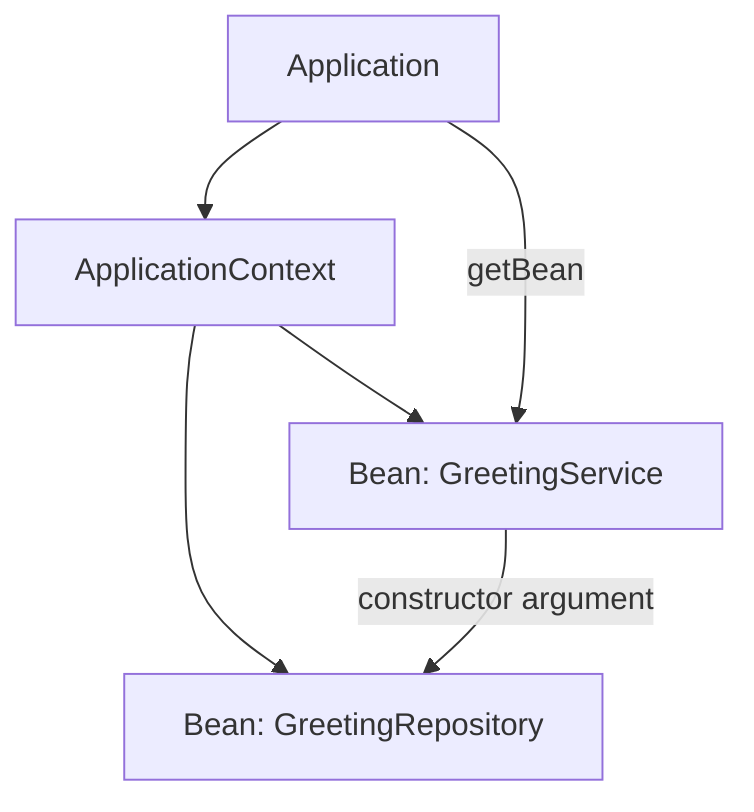

# Inversion of Control (IoC) and Dependency Injection (DI) in Spring Framework

## 1. Goals and the Big Picture

After this lesson, you should be able to distinguish **IoC (Inversion of Control)** from **DI (Dependency Injection)**, explain why a class should receive dependencies from outside rather than creating them itself, and use the Spring IoC container to assemble Java objects into an application. You will learn the roles of `BeanFactory`, `ApplicationContext`, beans, `@Configuration`, `@Bean`, and how to apply constructor injection in a runnable Java 17+ program.

Running example: `GreetingService` needs a `GreetingRepository` component to produce greetings. The service should only care about **using** the greeting-creation capability, without needing to know how to locate, instantiate, and manage a specific repository implementation.

### IoC and DI Are Not Synonyms

- **IoC** is the principle of **inverting control**: instead of an object coordinating everything itself (instantiation, lookup, wiring collaborators), an external component, such as the Spring container, takes over that coordination.
- **DI** is **one concrete way to implement IoC**: an object's dependencies are *provided from outside*, for example via constructors, factory method parameters, or setters.
- **Spring IoC container** is the mechanism by which Spring creates, configures, wires, and manages the lifecycle of **beans** according to bean definitions. It does not control every Java statement and does not automatically manage every object created with `new`.

`Dependency` here means **an object/capability another class needs to collaborate with**; do not confuse it with a Maven dependency (a library/JAR declared in `pom.xml`). Maven downloads Spring library code, whereas Spring DI connects **objects at runtime**.

## 2. From the IoC Principle to DI in Java Code

Suppose `GreetingService` keeps `new EnglishGreetingRepository()` internally. Then the service **both uses and chooses how to create** the repository; switching data sources or using a test fake requires editing the business class directly. DI separates that decision to the caller/container, for example:

```java
interface GreetingRepository {
    String message(String name);
}

final class GreetingService {
    private final GreetingRepository repository;

    GreetingService(GreetingRepository repository) {
        this.repository = java.util.Objects.requireNonNull(repository);
    }

    String greet(String name) {
        return repository.message(name);
    }
}
```

This is a **plain Java design pattern**, not yet a standalone Spring application. `GreetingService` exposes its required dependency in its constructor; callers can still use `new GreetingService(repository)`. When Spring manages these objects, the container locates a matching bean and passes the instance into the injection point. **IoC is the principle of shifting coordination control; DI is the mechanism for supplying collaborators from outside.**

```text
Caller/Container -> create GreetingRepository -> create GreetingService(repository)
```

Spring does not eliminate `new`: a factory/composition root still instantiates objects. What changes is that business code does not choose the implementation or how dependencies are configured.

## 3. What Does the Spring Container Do?

Inside the Spring Core Container:

1. **Reads metadata** registering beans (Java `@Configuration` / `@Bean`, component scanning, XML, or other registration forms).
2. **Creates bean definitions**, capturing names, types, scopes, factory methods, and initialization details.
3. **Resolves dependencies**: for example, a method creating `GreetingService` needs a `GreetingRepository`, so the container locates a compatible bean and supplies it.
4. **Instantiates and manages** beans within the container's scope; executes lifecycle steps and related extension mechanisms.
5. **Provides beans** when the application calls `getBean(...)` or when another bean needs them.

Two APIs to know:

| Component | Role |
| --- | --- |
| `BeanFactory` | Foundational interface for retrieving beans and basic configuration/DI |
| `ApplicationContext` | Extends `BeanFactory`: adds convenient lifecycle, events, message resources, and other integration capabilities; the usual choice for Spring applications |
| `AnnotationConfigApplicationContext` | An `ApplicationContext` implementation that can accept Java configuration classes, as in the example below |
| `Bean` | An object registered and managed by the container; not another name for every Java object |
| `Bean definition` | Metadata describing how Spring creates/manages that bean |

A container can exist on its own, **without Spring Boot, an HTTP server, or Spring MVC**. Spring Boot automates many configuration/startup tasks, but the IoC and DI principles live in **Spring Framework**.

### Dependency Flow



The arrow between the service and repository represents a **dependency to perform work**, not that the service should actively call `context.getBean`. In clean DI design, the service knows nothing about the container.

## 4. Standalone Java 17+ Program with Spring Context

This example uses **Spring Framework 6.2.19**, Java 17, Maven 3.9+, and `spring-context`. No Spring Boot or database is needed. On the first run, Maven needs access to the dependency repository to download JARs if they are not already cached.

Directory structure:

```text
ioc-di-demo/
├── pom.xml
└── src/
    └── main/
        └── java/
            └── demo/
                └── IocDiDemo.java
```

### 4.1. File `pom.xml`

```xml
<?xml version="1.0" encoding="UTF-8"?>
<project xmlns="http://maven.apache.org/POM/4.0.0"
         xmlns:xsi="http://www.w3.org/2001/XMLSchema-instance"
         xsi:schemaLocation="http://maven.apache.org/POM/4.0.0 https://maven.apache.org/xsd/maven-4.0.0.xsd">
    <modelVersion>4.0.0</modelVersion>
    <groupId>demo</groupId>
    <artifactId>ioc-di-demo</artifactId>
    <version>1.0.0</version>

    <properties>
        <maven.compiler.release>17</maven.compiler.release>
        <project.build.sourceEncoding>UTF-8</project.build.sourceEncoding>
    </properties>

    <dependencies>
        <dependency>
            <groupId>org.springframework</groupId>
            <artifactId>spring-context</artifactId>
            <version>6.2.19</version>
        </dependency>
    </dependencies>

    <build>
        <plugins>
            <plugin>
                <groupId>org.apache.maven.plugins</groupId>
                <artifactId>maven-compiler-plugin</artifactId>
                <version>3.14.1</version>
            </plugin>
            <plugin>
                <groupId>org.codehaus.mojo</groupId>
                <artifactId>exec-maven-plugin</artifactId>
                <version>3.5.1</version>
                <configuration>
                    <mainClass>demo.IocDiDemo</mainClass>
                </configuration>
            </plugin>
        </plugins>
    </build>
</project>
```

You only need to declare `spring-context`; Maven resolves the necessary transitive dependencies for this version. Do not manually copy a few individual JARs onto the classpath and forget their companion JARs.

### 4.2. File `src/main/java/demo/IocDiDemo.java`

```java
package demo;

import java.util.Objects;
import org.springframework.context.annotation.AnnotationConfigApplicationContext;
import org.springframework.context.annotation.Bean;
import org.springframework.context.annotation.Configuration;

public final class IocDiDemo {
    private IocDiDemo() {}

    // Contract needed by the service, decoupled from how greetings are created.
    public interface GreetingRepository {
        String message(String name);
    }

    public static final class EnglishGreetingRepository
            implements GreetingRepository {
        @Override
        public String message(String name) {
            return "Hello, " + name;
        }
    }

    public static final class GreetingService {
        private final GreetingRepository repository;

        public GreetingService(GreetingRepository repository) {
            this.repository = Objects.requireNonNull(
                    repository, "repository must not be null");
        }

        public String greet(String name) {
            if (name == null || name.isBlank()) {
                throw new IllegalArgumentException("name must not be blank");
            }
            return repository.message(name.strip());
        }
    }

    @Configuration(proxyBeanMethods = false)
    public static class AppConfig {
        @Bean
        public GreetingRepository greetingRepository() {
            return new EnglishGreetingRepository();
        }

        @Bean
        public GreetingService greetingService(GreetingRepository repository) {
            return new GreetingService(repository);
        }
    }

    public static void main(String[] args) {
        try (AnnotationConfigApplicationContext context =
                     new AnnotationConfigApplicationContext(AppConfig.class)) {
            GreetingService service = context.getBean(GreetingService.class);

            System.out.println("greeting=" + service.greet(" Lan "));
            System.out.println("singleton=" + (service ==
                    context.getBean(GreetingService.class)));
            System.out.println("repository=" +
                    context.getBean(GreetingRepository.class)
                           .getClass().getSimpleName());
        }

        // Testing with a fake via the same constructor: no Spring container needed.
        GreetingService fakeService = new GreetingService(
                name -> "Fake: " + name);
        System.out.println("fake=" + fakeService.greet("Minh"));
    }
}
```

This is a complete Java file: one `public` top-level class with supporting interfaces/classes nested inside. `@Configuration(proxyBeanMethods = false)` is appropriate because the configuration **does not directly call** another `@Bean` method; Spring supplies the dependency via **the `greetingService(...)` method parameter**.

### 4.3. Compiling and Running with Maven

From inside the `ioc-di-demo` directory, using JDK 17+ and Maven:

```bash
java -version
mvn -version
mvn -q clean compile exec:java
```

The Maven compiler plugin compiles the Java 17 sources; `exec:java` runs `demo.IocDiDemo.main`. Program output does not depend on the OS or external files.

**Exact stdout from the application:**

```text
greeting=Hello, Lan
singleton=true
repository=EnglishGreetingRepository
fake=Fake: Minh
```

The `java -version` / `mvn -version` commands and Maven output (if shown) **do not count** toward the application's four stdout lines. `-q` reduces Maven logging, though machines with custom logging configs may print info outside the application stdout.

### 4.4. Optional: Using `javac` and `java` Directly

If you want to observe the Java compiler/launcher commands directly instead of letting Maven manage the entire run step, first have Maven build a classpath containing Spring JARs and transitive dependencies:

```bash
mvn -q dependency:build-classpath -Dmdep.outputFile=classpath.txt
```

**Linux/macOS (bash/zsh)**, run from the project directory:

```bash
mkdir -p out
javac --release 17 -encoding UTF-8 -cp "$(cat classpath.txt)" \
  -d out src/main/java/demo/IocDiDemo.java
java -cp "out:$(cat classpath.txt)" demo.IocDiDemo
```

**Windows PowerShell**:

```powershell
$deps = (Get-Content -Raw classpath.txt).Trim()
New-Item -ItemType Directory -Force out | Out-Null
javac --release 17 -encoding UTF-8 -cp "$deps" -d out src/main/java/demo/IocDiDemo.java
java -cp "out;$deps" demo.IocDiDemo
```

The classpath separator differs: **`:` on Unix, `;` on Windows**. Both execution paths produce the exact same four output lines. Do not run `javac IocDiDemo.java` without specifying the classpath if Spring JARs are absent; `package org.springframework... does not exist` in that case is not an IoC/DI syntax error.

## 5. Step-by-Step Analysis: What Does Spring Actually Inject?

1. `new AnnotationConfigApplicationContext(AppConfig.class)` creates the context and loads the `AppConfig` configuration.
2. `@Bean greetingRepository()` provides **a bean named `greetingRepository`**, declared type `GreetingRepository`, runtime instance `EnglishGreetingRepository`.
3. Spring sees that `@Bean greetingService(GreetingRepository repository)` needs a dependency of that type. With **one matching candidate**, Spring passes the registered repository instance into the factory method parameter.
4. `new GreetingService(repository)` performs **constructor injection**. The service stores the dependency in a `final` field and interacts only through the interface.
5. Application code obtains the bean via `context.getBean(GreetingService.class)`. Two lookups of the same default `singleton` bean in the same context return `true` on reference comparison.
6. When the context closes (the `try-with-resources` block), Spring runs context shutdown and any applicable bean destruction callbacks. In this demo there are no external resources to clean up.
7. `fakeService` at the end of the program **is not a Spring bean**: it is a plain Java object passed a fake implementation via a lambda, illustrating that the business class can be tested **without depending on Spring**.

Key distinction: Spring does not automatically know how to pick a repository just because the service class declares an interface. **A bean must be registered**; if no candidate matches, creating the service fails. If multiple candidates exist, selection must be configured.

## 6. Three Dependency Injection Styles and Practical Choices

| Style | How it works | When appropriate |
| --- | --- | --- |
| **Constructor injection** | Dependencies are passed when creating the object | **Required** dependencies, keeps fields `final`, easy to validate and unit test; usually the best default |
| **Setter/method injection** | Calls setters or methods after the object is created | Optional dependencies or reconfiguration later; ensure valid state before use |
| **Field injection** | Container populates fields directly, often with `@Autowired` | May appear in legacy code/frameworks; hard to instantiate standalone, hides dependencies, and cannot easily use `final` |

In new applications, usually **prefer constructor injection** for required dependencies. Avoid turning a class into an object with dozens of dependencies just because the container wires them automatically; that is often a sign the class has taken on too many responsibilities.

Spring supports component scanning:

```java
@Component
class OrderService {
    private final OrderRepository repository;

    OrderService(OrderRepository repository) {
        this.repository = repository;
    }
}
```

This is an **illustration**, not runnable on its own because it needs `OrderRepository` and scan configuration. When a bean class has **only one constructor**, Spring can use that constructor for autowiring **without `@Autowired`**. `@ComponentScan` registers components within the scanned packages; `@Component` does not cause a class to be scanned automatically without the corresponding configuration. `@Service`, `@Repository`, and `@Controller` are specialized stereotypes; in this lesson you only need to understand the bean registration mechanism.

Two main styles:

- **JavaConfig `@Bean`:** suited when you want control over object creation, complex constructor setup, or integrating library classes where annotations cannot be added. The runnable demo above uses this approach.
- **Component scan + constructor injection:** suited for application classes that the container can instantiate via constructors. Pay attention to package scope, annotations, and available dependencies.

There is no need to declare both `@Bean` and `@Component` for **what is intended to be the same instance**; duplicate registration can create multiple beans of the same type and make autowiring ambiguous.

## 7. Common Design and Initialization Errors

| Situation | Consequence and resolution |
| --- | --- |
| Missing bean registration for a dependency | Spring cannot create the dependent bean; check `@Bean`, `@ComponentScan`, packages, and configuration conditions |
| Multiple beans of the same type | Type-based injection may be ambiguous; use `@Qualifier`, `@Primary`, or change the design/registration |
| Constructor circular dependency: A needs B, B needs A | Container usually cannot complete creating both beans; split responsibilities or redesign rather than hiding the cycle with field injection |
| Calling `new GreetingService(...)` somewhere and expecting Spring to auto-inject | This object is not container-managed; supply dependencies yourself or retrieve the bean from the context |
| Service calling `ApplicationContext.getBean(...)` everywhere | Turns dependencies into a service locator, hiding dependencies and hurting unit tests; prefer constructor declaration |
| Keeping unsafe mutable request state in a `singleton` bean | Multiple callers may share the bean; avoid storing per-request state in mutable fields of a singleton |
| Assuming `singleton` means one instance for the entire JVM | Default singleton is **one instance per bean definition within one container**, not inherently one instance for the whole JVM |
| Injecting a `prototype` bean into a singleton expecting a new object every call | Dependencies are typically resolved when creating the singleton; use an appropriate lookup mechanism when a fresh instance is truly needed |
| Calling a `@Bean` method directly inside `@Configuration(proxyBeanMethods=false)` | That is a plain Java call, not intercepted by the container to reuse scoped beans; use method parameters or get the bean from the container at the composition root |
| Catching all initialization errors and continuing with a null dependency | Causes the app to run in an invalid state; keep contracts explicit and fail fast on config errors |

### Scope Is Not an Access Modifier

Beans default to `singleton` scope. `prototype` requests a new object each time the container is asked for a bean of that scope. Web scopes like request/session require the corresponding web environment. Choose scopes based on data lifecycle, not because you assume `prototype` is always better.

Spring typically manages destroying **singletons** when the context closes. For prototypes, the container does not manage the full destruction process after handing the object to the caller; calling code must take care of its resources.

## 8. Testing, Swapping Dependencies, and the Real Value of DI

Because the service depends only on the `GreetingRepository` interface, you can test its logic without starting the container:

```java
IocDiDemo.GreetingService service = new IocDiDemo.GreetingService(
        name -> "TEST: " + name);
System.out.println(service.greet("An")); // TEST: An.
```

This snippet is an **illustration** placed in a class/method with access to `IocDiDemo`, not a standalone runnable file. In the actual demo, `fakeService` uses this exact technique.

In tests, you can create a fake implementation that records received arguments and verify whether the service called it properly. You do not need to bring Spring into every unit test. When the goal is to verify **real bean configuration**, starting an `ApplicationContext` in an integration test becomes useful.

Benefits come from **explicit dependency design**, not merely from adding annotations:

- Implementations can be swapped (in-memory vs. database, real service vs. fake) at the assembly point.
- Business logic depends less on instantiation and configuration mechanics.
- Constructors make required dependencies explicit; null checks can happen early.
- Unit tests are easier to isolate, and runtime configuration is easier to adjust.

There are real costs too: too many beans, overly broad component scans, unnecessary abstractions, ambiguous injections, or dependency cycles can make a program hard to follow. A small object with no collaborators usually **does not need** to become a Spring bean.

## 9. Self-Check Questions

1. **How does IoC differ from DI?** IoC is the principle of inverting control over assembly/management; DI is a way of providing dependencies from outside instead of having the class create/find them itself.
2. **Is `new GreetingService(new EnglishGreetingRepository())` DI?** Yes: the constructor receives its dependency from the caller even without Spring. Spring only automates wiring and lifecycle when objects are beans.
3. **What does `@Bean` mean?** It declares a factory method that provides a bean definition to the container; the default name is usually the method name.
4. **Why doesn't the service need `ApplicationContext`?** It only needs the `GreetingRepository` contract; direct dependency on the container inside domain/service classes is usually unnecessary.
5. **Why does calling `getBean(GreetingService.class)` twice return the same reference?** The bean in the example has the default singleton scope within the same context.
6. **What if another bean of type `GreetingRepository` is registered?** Resolution by type may become ambiguous; you need to choose a candidate explicitly using qualifiers/primary or appropriate configuration.
7. **When should constructor injection be used?** For essential dependencies so an object is always created in a valid state.
8. **Is Spring Boot required for this example?** No. `AnnotationConfigApplicationContext` belongs to Spring Context and runs in a plain Java application.

## 10. Project Application Checklist

- [ ] Identify which classes **use** dependencies and which are responsible for **creating/configuring** dependencies.
- [ ] Use interfaces/abstractions when they genuinely help swap implementations or isolate responsibilities.
- [ ] Pass required dependencies through constructors instead of calling concrete `new` inside services.
- [ ] Register bean definitions completely and verify component scanning scopes if used.
- [ ] Prefer `ApplicationContext` for Spring IoC examples; close contexts you create yourself when finished.
- [ ] Distinguish container-managed beans from Java objects created outside the container.
- [ ] Identify bean scopes and avoid unsafe shared mutable state.
- [ ] Check for missing/duplicate beans, constructor cycles, and initialization failures.
- [ ] Run the example on JDK 17+ and verify the four stdout lines.
- [ ] Test services with fake dependencies without Spring to see the value of DI.

**Remember:** The Spring IoC container **manages beans and wires dependencies**; DI lets a class receive collaborators from outside. The core value is **reducing coupling to creation and concrete implementations**, improving substitutability and testability — not simply replacing every `new` with an annotation.

### Further Official Reading

- [Spring IoC container and beans](https://docs.spring.io/spring-framework/reference/core/beans/introduction.html)
- [Dependency Injection](https://docs.spring.io/spring-framework/reference/core/beans/dependencies/factory-collaborators.html)
- [`@Bean` and `@Configuration`](https://docs.spring.io/spring-framework/reference/core/beans/java/basic-concepts.html)
