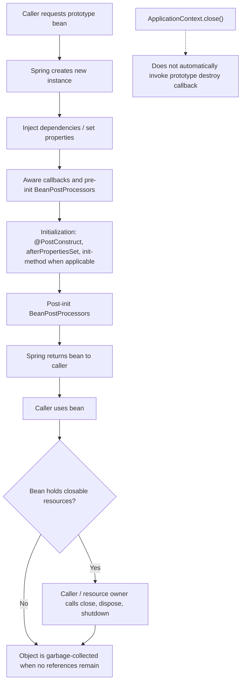

# Managing Initialization Without Automatic Destruction of Prototype Beans in Spring

## 1. Core of the lifecycle rule

In the Spring IoC container, a bean with `prototype` scope **gets a new instance created each time the container receives a request for that bean** (such as calling `getBean()`, or resolving a dependency when constructing another bean). Spring still performs the **initialization** phase of the bean: constructing the object, injecting dependencies, running bean lifecycle callbacks, and handing the ready bean to the requester.

However, after handing the prototype bean to the caller, Spring **does not continue tracking its lifecycle to automatically invoke destruction callbacks for that instance when the container closes**. This is a critical difference from singleton beans, whose full lifecycle is managed by the container. Code using a prototype must take responsibility for releasing resources if the object holds closable resources.

> **Rule to remember:** Spring performs **creation + dependency injection + initialization** for prototype beans, yet **does not automatically perform destruction** of prototypes upon `ApplicationContext.close()`. Therefore `@PreDestroy`, `DisposableBean.destroy()`, or a custom `destroy-method` will not be automatically called by Spring for prototype instances under the default lifecycle.

This should not be misunderstood as meaning prototypes *are forbidden from being destroyed*. The object can still have `close()`, `shutdown()`, or a cleanup method. The key point is that **the caller or an application-built resource tracking component must invoke it proactively**, rather than relying on Spring's context closing mechanism.

## 2. Prototype lifecycle timeline



The phrase "when applicable" matters because callbacks depend on how the bean is registered and which `BeanPostProcessor`s are present. For example, `@PostConstruct` is processed when the container has the corresponding annotation processor; `InitializingBean.afterPropertiesSet()` is directly supported by Spring. Spring runs the initialization callback group for each eligible prototype creation.

Steps to distinguish:

1. **Bean definition:** `@Scope("prototype")`, XML `scope="prototype"`, or equivalent configuration marks how Spring creates the bean. One bean definition is used to create *many* instances on demand.
2. **Construction:** Spring invokes the constructor or factory method each time a new instance is needed, then resolves and injects dependencies.
3. **Initialization:** `BeanPostProcessor`s and configured init callbacks run for the new instance, with the same initialization semantics as beans of other scopes.
4. **Handover:** Spring returns the instance to the requesting object or code. For prototypes, there is no contract that the container retains every instance for later destruction.
5. **Use and cleanup:** The object may live short or long depending on what references the application retains. If it holds connections, streams, sockets, executors, or other resources, the owning component must close them at the right time.
6. **Context shutdown:** Closing the context triggers destruction of beans whose destruction lifecycle is managed by Spring (notably singletons), yet **does not automatically iterate through every allocated prototype to destroy it**.

Do not confuse "Spring does not track destruction" with "Spring has nothing to do with a prototype after construction". Spring can still participate during creation via `BeanPostProcessor`s, injection, and proxies; only the **automatic destruction guarantee for prototypes** is absent from the default scope contract.

## 3. Direct comparison between prototype and singleton

| Question | Singleton scope | Prototype scope |
|---|---|---|
| Each `getBean()` call with the same name in the same container? | Normally returns the same bean instance | Creates a new instance on each request |
| Performs dependency injection? | Yes | Yes, for each created instance |
| Runs initialization callbacks? | Yes | Yes, for each instance |
| Runs `@PostConstruct` when configured/supported? | Yes | Yes, per instance |
| Runs `InitializingBean.afterPropertiesSet()`? | Yes | Yes, per instance |
| Container automatically calls destruction on close? | Yes, for beans with matching destruction callbacks | **No**, under the default prototype lifecycle |
| `@PreDestroy` / `DisposableBean.destroy()` / custom destroy method? | Spring can invoke as configured when the container closes | **Spring does not invoke automatically** |
| Who decides when to release resources? | Typically the container through singleton lifecycle | The caller or an application-managed resource owner |
| Object automatically disappears after each method/request? | No | **No**; prototype does not mean request scope or immediate GC |

A prototype created via `getBean()` and then dereferenced can be reclaimed later by the garbage collector, yet **garbage collection does not replace `close()`** for sockets, file handles, native resources, or transaction handles. Do not rely on `finalize()` for cleanup; that mechanism is unreliable and marked for removal in modern Java.

## 4. Declaring prototype beans

### 4.1. Using `@Bean` and `@Scope`

```java
@Configuration
public class SessionConfiguration {

    @Bean
    @Scope(ConfigurableBeanFactory.SCOPE_PROTOTYPE)
    ProcessingSession processingSession() {
        return new ProcessingSession();
    }
}
```

This is a *configuration illustration*, assuming a `ProcessingSession` class and imports for `@Configuration`, `@Bean`, `@Scope`, and `ConfigurableBeanFactory`. Spring creates a new instance when the `processingSession` bean is requested. The constant `ConfigurableBeanFactory.SCOPE_PROTOTYPE` equals the string `"prototype"`; both configuration forms are valid.

### 4.2. Using component scanning

```java
@Component
@Scope("prototype")
public class ReportBuilder {
    public ReportBuilder() {
        // Initialize state specific to each report build.
    }
}
```

This snippet is illustrative code in a project with component scanning enabled. The `ReportBuilder` object is not required to have a destroy method; if it uses only plain Java memory and holds no external resources, sometimes **there is nothing to close manually**.

### 4.3. Using XML

```xml
<bean id="reportBuilder" class="example.ReportBuilder" scope="prototype"/>
```

The XML simply illustrates the same scope mechanism if the class exists and the XML is loaded into a context; it is not a standalone compilable example. You can configure `init-method` and `destroy-method` on the bean definition, yet declaring `destroy-method` **does not make Spring automatically destroy prototypes**.

## 5. Standalone runnable Java 17+ experiment with Spring Context

The following experiment clearly shows: each `getBean()` creates an instance, the **init** callback runs twice, the **destroy** callback does not run when the context closes, and only a manual `close()` actually releases the resource as programmed.

Requirements: JDK 17+ and Maven 3.9+. The example uses Spring Framework 6.2.0, requiring no Spring Boot or web server.

Directory structure:

```text
prototype-lifecycle/
├── pom.xml
└── src/main/java/example/PrototypeLifecycleDemo.java
```

**`pom.xml`**

```xml
<project xmlns="http://maven.apache.org/POM/4.0.0"
         xmlns:xsi="http://www.w3.org/2001/XMLSchema-instance"
         xsi:schemaLocation="http://maven.apache.org/POM/4.0.0
                             https://maven.apache.org/xsd/maven-4.0.0.xsd">
    <modelVersion>4.0.0</modelVersion>
    <groupId>example</groupId>
    <artifactId>prototype-lifecycle</artifactId>
    <version>1.0.0</version>

    <properties>
        <maven.compiler.release>17</maven.compiler.release>
        <project.build.sourceEncoding>UTF-8</project.build.sourceEncoding>
    </properties>

    <dependencies>
        <dependency>
            <groupId>org.springframework</groupId>
            <artifactId>spring-context</artifactId>
            <version>6.2.0</version>
        </dependency>
    </dependencies>

    <build>
        <plugins>
            <plugin>
                <groupId>org.apache.maven.plugins</groupId>
                <artifactId>maven-compiler-plugin</artifactId>
                <version>3.13.0</version>
            </plugin>
            <plugin>
                <groupId>org.codehaus.mojo</groupId>
                <artifactId>exec-maven-plugin</artifactId>
                <version>3.5.0</version>
            </plugin>
        </plugins>
    </build>
</project>
```

**`src/main/java/example/PrototypeLifecycleDemo.java`**

```java
package example;

import java.util.concurrent.atomic.AtomicInteger;
import org.springframework.beans.factory.DisposableBean;
import org.springframework.beans.factory.InitializingBean;
import org.springframework.beans.factory.config.ConfigurableBeanFactory;
import org.springframework.context.annotation.AnnotationConfigApplicationContext;
import org.springframework.context.annotation.Bean;
import org.springframework.context.annotation.Configuration;
import org.springframework.context.annotation.Scope;

public class PrototypeLifecycleDemo {

    public static void main(String[] args) {
        ResourceSession second;

        try (var context = new AnnotationConfigApplicationContext(Config.class)) {
            ResourceSession first = context.getBean(ResourceSession.class);
            second = context.getBean(ResourceSession.class);

            System.out.println("Different instances: " + (first != second));
            System.out.println("Scope is prototype: "
                    + context.isPrototype("resourceSession"));

            first.close(); // Caller decides to close the first instance.
        } // Closes the Spring context without destroying the second prototype.

        System.out.println("Second closed after context.close(): "
                + second.isClosed());
        second.close(); // Resource owner must close the second instance manually.
    }

    @Configuration(proxyBeanMethods = false)
    public static class Config {
        @Bean
        @Scope(ConfigurableBeanFactory.SCOPE_PROTOTYPE)
        public ResourceSession resourceSession() {
            return new ResourceSession();
        }
    }

    public static final class ResourceSession
            implements InitializingBean, DisposableBean, AutoCloseable {

        private static final AtomicInteger NEXT_ID = new AtomicInteger();
        private final int id = NEXT_ID.incrementAndGet();
        private boolean closed;

        public ResourceSession() {
            System.out.println("Construct session " + id);
        }

        @Override
        public void afterPropertiesSet() {
            System.out.println("Initialize session " + id);
        }

        @Override
        public void destroy() {
            // If Spring automatically destroyed this bean, the following line would appear.
            System.out.println("Spring destroy callback " + id);
            close();
        }

        public boolean isClosed() {
            return closed;
        }

        @Override
        public void close() {
            if (!closed) {
                closed = true;
                System.out.println("Manual close session " + id);
            }
        }
    }
}
```

In the directory containing `pom.xml`, run:

```bash
mvn -q compile exec:java -Dexec.mainClass=example.PrototypeLifecycleDemo
```

**Stdout from the program** (excluding Maven logs if displayed by your environment):

```text
Construct session 1
Initialize session 1
Construct session 2
Initialize session 2
Different instances: true
Scope is prototype: true
Manual close session 1
Second closed after context.close(): false
Manual close session 2
```

From the output:

- The constructor and `afterPropertiesSet()` run for **both session 1 and session 2**: Spring initializes every prototype.
- `first != second` is `true`, and `isPrototype("resourceSession")` is `true`: each lookup creates a distinct object.
- After closing the context, `second.isClosed()` is still `false`. **There is no `Spring destroy callback 1/2` line**: Spring does not automatically trigger `DisposableBean.destroy()` for prototypes.
- `first.close()` and `second.close()` are both proactively called by caller code. This is `AutoCloseable.close()`; it is **not** an automatic Spring callback under prototype scope.
- `AtomicInteger` is only used to generate stable instance labels and keep it safe if later changed to a multithreaded demo. In this lesson all calls run sequentially on the main thread.

This example uses `InitializingBean`/`DisposableBean` to avoid depending on annotation libraries outside Spring. When using `@PostConstruct`/`@PreDestroy`, the rule remains the same: `@PostConstruct` can run for each prototype when supported, whereas `@PreDestroy` will **not be automatically called by Spring** when closing the context for prototypes.

## 6. Why doesn't `@PreDestroy` run for prototypes?

`@PreDestroy` merely marks a destruction callback. Whether Spring automatically runs that callback depends on the lifecycle management mechanism and scope. For a typical singleton, Spring retains the bean and registers a destruction hook when the context closes, so matching callbacks are invoked. For a prototype, the container creates the bean on demand, completes initialization, and hands the instance to the caller; the container does not retain every prototype to orchestrate destruction later.

Example in an application with a Jakarta lifecycle annotation processor (illustrative code requiring `jakarta.annotation-api` and appropriate Spring configuration):

```java
public class ExportJob implements AutoCloseable {
    @jakarta.annotation.PostConstruct
    public void init() {
        System.out.println("initialized");
    }

    @jakarta.annotation.PreDestroy
    public void destroy() {
        System.out.println("pre-destroy");
        close();
    }

    @Override
    public void close() {
        // Release actual resources.
    }
}
```

If the class above is registered as a prototype, putting `@PostConstruct` and `@PreDestroy` on **the same class** does not make the two callbacks symmetrical: init can run automatically, while destroy is not run automatically by the container by default. Even if a prototype bean has `@Bean(destroyMethod = "close")`, declaring a destroy method does not transfer cleanup responsibility to Spring.

An object **with no closable resources** can simply stop being referenced and later be reclaimed by GC. Therefore, what must be prevented is leaking file/socket/database/native handles, not forcing `destroy()` to be called on every prototype at all costs.

## 7. Proper ways to manage cleanup in an application

### 7.1. Use `try-with-resources` where the prototype is actually owned

This is usually the clearest option when a task obtains a prototype, uses it briefly, and finishes:

```java
@Service
public class ExportService {
    private final ObjectProvider<ExportSession> sessions;

    public ExportService(ObjectProvider<ExportSession> sessions) {
        this.sessions = sessions;
    }

    public void export(long jobId) throws Exception {
        try (ExportSession session = sessions.getObject()) {
            session.run(jobId);
        } // close() is always called even if run() throws an exception.
    }
}
```

**The snippet above is Spring integration code, not a standalone runnable program.** It requires an `ExportSession` bean with prototype scope, and that class must implement `AutoCloseable` with `close()` actually releasing resources. Typical imports are `org.springframework.stereotype.Service` and `org.springframework.beans.factory.ObjectProvider`. `throws Exception` simply represents the illustrative contract of `run()`/`close()`.

`ObjectProvider.getObject()` asks Spring to supply an instance **at call time**; if the bean definition is prototype, each call receives a new prototype. The `try-with-resources` block clearly defines the owner and cleanup point. If `getObject()` or initialization throws an error before returning the object, the bean has not yet been received by the caller; design the factory/init carefully to clean up partially allocated resources during initialization itself.

### 7.2. Reclaim resources through an owner with its own lifecycle

If a resource is used longer than a single method, designate a clear owning component: for example, a session registry, job coordinator, or service managing all live sessions. That component tracks allocated instances, unregisters them on close, and proactively calls `close()` upon task completion or shutdown.

A simple conceptual approach:

```java
ExportSession session = provider.getObject();
try {
    registry.register(session);
    // Use session during the work phase.
} finally {
    registry.unregister(session);
    session.close();
}
```

This is **Java pseudocode assuming existing `provider` and `registry`**, not a standalone runnable program. For asynchronous tasks, do not use `finally` to close immediately once the task has only been submitted and not yet finished: cleanup must occur **when the task actually completes** or inside a safe cancellation flow.

A custom `BeanPostProcessor` can be used to record prototypes requiring destruction, yet this is a self-implemented responsibility and must avoid holding long-lived references that cause memory leaks. Spring does not build that registry automatically for all prototypes.

### 7.3. Use an appropriate scope if the lifecycle is inherently an HTTP request or session

If the object is genuinely per-HTTP-request data, consider `request` scope. If its lifecycle matches an HTTP session, consider `session` scope. These scopes depend on a web environment and have mechanisms tied to when the scope ends.

**Prototype does not mean "one bean per request"**: one HTTP request calling `getBean()` five times can receive five prototypes. Conversely, a singleton injected directly with a prototype can retain **a single prototype** across many requests. Scope selection must be based on ownership and lifecycle end points, not merely the desire for an "unshared object".

## 8. Pitfall: injecting a prototype into a singleton

Consider the configuration:

```java
@Component
@Scope("prototype")
public class JobContext {
    // Per-job isolated state.
}

@Service
public class JobService {
    private final JobContext context;

    public JobService(JobContext context) {
        this.context = context;
    }
}
```

**Illustrative code**, assuming Spring component scanning and the required annotation imports.

Spring creates a singleton `JobService` by default; it resolves the `JobContext` dependency **once while constructing the singleton**. That prototype is stored in the `context` field; every use of `JobService` still goes through that same field instance. Putting `@Scope("prototype")` on `JobContext` does not automatically turn the injected field into "one instance per call".

If a fresh context is needed for each execution, request an instance on each use:

```java
@Service
public class JobService {
    private final ObjectProvider<JobContext> contexts;

    public JobService(ObjectProvider<JobContext> contexts) {
        this.contexts = contexts;
    }

    public void runJob() {
        JobContext context = contexts.getObject();
        try {
            // Use context for exactly one job.
        } finally {
            // Call close() here if JobContext holds resources.
        }
    }
}
```

The two snippets above are **illustrative integration code**; do not place both in the same source file if the `JobService` class name collides. Other ways to fetch beans on demand include `Provider<T>` (when using the corresponding `jakarta.inject` dependency), `@Lookup` method injection, or a scoped proxy for specific needs. Whichever approach is used, the prototype cleanup rule **does not change automatically**: create fresh on demand and release resources when done using them.

## 9. Real-world failure modes and how to fix them

| Situation | Wrong Assumption | Consequence and Fix |
|---|---|---|
| Prototype holds an `InputStream`/file handle | "Closing the context will call `@PreDestroy`." | Handle may stay open; call `close()` at the usage site, preferring `try-with-resources`. |
| Prototype is an HTTP/DB client holding connections | "Spring retains and cleans up every allocated instance." | Loss of control over open connection count; establish an owner and explicit release, or consider a pooled singleton client if appropriate. |
| Singleton directly injects a prototype | "Each method run gets a new prototype." | Dependency is resolved only when creating the singleton; use `ObjectProvider.getObject()` on each execution. |
| Using `prototype` to get a new object per HTTP request | "Prototype scope equals request scope." | One request can get multiple prototypes; choose request scope when exactly one instance per request is needed. |
| Calling `context.getBean()` and dropping the reference | "GC will definitely close files/sockets in time." | GC has no deadline and does not guarantee resource cleanup; use explicit `close()`. |
| Creating prototypes in bulk and keeping them in an unbounded registry | "Prototypes are always short-lived." | Objects stay alive if the registry holds references; remove and close per task lifecycle. |
| Using a singleton service with mutable per-task state | "Switching to prototype makes it automatically thread-safe." | Instances can still be shared via injection/registries; manage ownership, concurrency, and bean lookup timing. |
| Calling `@PreDestroy` manually as a business method | "The annotation turns the method into automatic cleanup." | The annotation is only recognized by the container in supported lifecycles; define a clear `close()` API for callers. |

For underlying resources with specific rules (JDBC connections returned to a pool, transactional resources managed by a transaction manager, executors requiring policy-compliant shutdown), `close()` must perform the action matching that resource's contract; do not apply a generic closing function without confirming who truly owns it.

## 10. Verifying lifecycle in practice

When suspecting a prototype is leaking resources, check in order:

1. **Actual scope:** `applicationContext.isPrototype("beanName")`, or inspect the bean definition via `BeanFactory`. Do not infer solely from annotations if configuration overrides the scope.
2. **Bean creation points:** How many calls to `getBean()`, `ObjectProvider.getObject()`, or injections into other beans exist? A prototype pre-injected into a singleton may not be recreated on each method run.
3. **Init callbacks:** Add logs with an instance ID in the constructor, `@PostConstruct`, or `afterPropertiesSet()`; verify it runs on every creation.
4. **Resource ownership:** List which objects open streams/connections and which code guarantees closing along success, failure, and cancellation paths.
5. **Shutdown:** Confirm proactive cleanup for prototypes that live across multiple tasks. Do not treat `context.close()` as proof that prototypes were released.
6. **Tests:** Intentionally test the exception-throwing branch as well; verify a mocked `close()` is called exactly once if the contract requires it, rather than only checking `@PreDestroy` on the prototype.

A useful unit/integration test should distinguish **creation/init count** from **close count** and assert cleanup in the code owning the instance. A difference in these counts is not automatically a Spring bug; it is a prototype scope characteristic that must be handled at the application layer.

## 11. Self-Check Questions

**Question 1.** Calling `context.getBean("reportBuilder")` twice for a prototype bean—how many times does `afterPropertiesSet()` run?  
**Answer:** Normally twice, once for each successfully created instance.

**Question 2.** Does calling `context.close()` guarantee `@PreDestroy` is invoked on already-issued prototypes?  
**Answer:** No. Cleanup must happen where the prototype is owned or via a dedicated tracking/cleanup mechanism.

**Question 3.** Why is `try-with-resources` suitable for a prototype holding resources?  
**Answer:** It ties closing `AutoCloseable` to the exact scope of use, including exception paths.

**Question 4.** Does injecting a `prototype` directly into a singleton always create a new prototype on every call to the singleton's method?  
**Answer:** No. Normal dependencies are resolved when the singleton is created; you need `ObjectProvider`, method injection, or an on-demand retrieval mechanism.

**Question 5.** Must every prototype implement `DisposableBean` or `AutoCloseable`?  
**Answer:** No. Cleanup is only needed for resources that actually require releasing; even if a destroy callback is declared, Spring does not automatically invoke it when prototype usage ends.

## References

- [Spring Framework Reference — Bean Scopes](https://docs.spring.io/spring-framework/reference/core/beans/factory-scopes.html), especially the **The Prototype Scope** section: prototype initialization mechanism and destruction responsibilities.
- [Spring Framework Reference — Lifecycle Callbacks](https://docs.spring.io/spring-framework/reference/core/beans/factory-nature.html): initialization, destruction, and lifecycle callbacks.
- [Spring Framework Reference — Scoped Beans as Dependencies](https://docs.spring.io/spring-framework/reference/core/beans/factory-scopes.html#beans-factory-scopes-sing-prot-interaction): interactions when injecting a prototype into a singleton.
