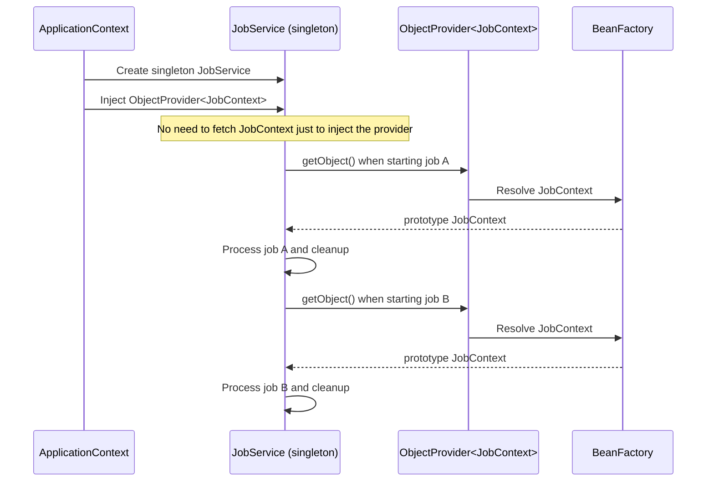

# Obtaining Objects at the Right Time with ObjectProvider in Spring

## 1. The Problem: A Dependent Bean Has a Different Lifecycle from Its Consumer

In the Spring Core Container, dependency injection usually resolves dependencies when Spring **creates the object receiving the dependency**. That works well for services sharing the same lifecycle, but requires care when a **singleton** bean needs to use a new **prototype** bean for each task.

Suppose `ReportService` is a singleton, while `ReportContext` has `prototype` scope. If you inject `ReportContext` directly via constructor, Spring creates one `ReportContext` when constructing `ReportService`. The singleton holds onto this reference; **subsequent method calls do not automatically create another prototype**.

```java
@Service
public class ReportService {
    private final ReportContext context;

    public ReportService(ReportContext context) {
        this.context = context; // Resolved once when creating ReportService.
    }

    public void generate() {
        context.write(); // Reuses the injected instance.
    }
}
```

This is **illustrative code within a Spring application**, assuming `ReportContext` exists, is a prototype bean, and has a `write()` method. It requires importing `@Service`; this snippet is not a standalone program. If `context` holds state for the report currently being processed, reusing it across multiple tasks can cause data corruption and concurrency issues.

A common solution: **inject an `ObjectProvider<ReportContext>` into the singleton**, then call `getObject()` right at the start of the task. Spring then resolves the target object only at the moment it is actually needed.

```java
@Service
public class ReportService {
    private final ObjectProvider<ReportContext> contexts;

    public ReportService(ObjectProvider<ReportContext> contexts) {
        this.contexts = contexts;
    }

    public void generate() {
        ReportContext context = contexts.getObject(); // Resolved here.
        context.write();
    }
}
```

This snippet is also an integration illustration; it requires importing `org.springframework.beans.factory.ObjectProvider` and `org.springframework.stereotype.Service`. If `ReportContext` holds resources that must be closed, the actual method must handle cleanup appropriately, as shown in the complete runnable example below.

**Key idea:** `ObjectProvider<T>` is a lookup point for retrieving objects of type `T` through the Spring `BeanFactory`. Spring supplies a provider that can be injected into other beans, allowing **lookup of the target object to be deferred** until each call to the provider API. Whether each lookup creates a new instance or returns the same instance **is still determined by the target bean's scope**.

## 2. On-Demand Resolution Mechanism



There are two separate moments:

1. **Injecting the provider:** Spring creates the singleton `JobService` and provides an `ObjectProvider<JobContext>` object. Injecting the provider itself does not require constructing `JobContext` immediately.
2. **Obtaining the target object:** When `provider.getObject()` runs, the provider asks the container to resolve a bean of type `JobContext`. The container applies the bean definition, dependency injection, scope, and initialization just like a normal bean lookup.

With `prototype`, each `getObject()` normally creates a new instance. With `singleton`, multiple calls to the provider return the same container-managed singleton. With `request` or another scope, lookup follows that scope's lifecycle; calling it outside an active scope can throw an exception. A provider **does not turn a singleton bean into a prototype** and **does not automatically make each object thread-safe**.

One subtlety about "lazy": injecting a provider defers **the consumer bean's request to obtain the object**. That does not necessarily prevent Spring from eagerly creating a *non-lazy target singleton* at context startup: singleton eager initialization may still happen independently. If you also need to defer creation of the target singleton itself, you must consider `@Lazy` or appropriate initialization configuration.

## 3. Which ObjectProvider API Should You Use?

`ObjectProvider<T>` belongs to the `org.springframework.beans.factory` package, extends `ObjectFactory<T>`, and implements `Iterable<T>`. It supports required lookups, optional dependencies, and candidate selection.

| API | Use case | When no target bean exists | When multiple matching beans exist without a unique choice |
|---|---|---|---|
| `getObject()` | Dependency required at call time | Throws `NoSuchBeanDefinitionException` (under `BeansException`) | Usually throws `NoUniqueBeanDefinitionException` |
| `getIfAvailable()` | Bean may be absent | Returns `null` | May still throw `NoUniqueBeanDefinitionException` |
| `getIfAvailable(defaultSupplier)` | Default value available when bean is absent | Uses `Supplier` to create fallback | May still fail with non-unique error |
| `ifAvailable(consumer)` | Process only if the bean exists | Does not invoke `Consumer` | May still fail with non-unique error |
| `getIfUnique()` | Retrieve only when a single unique candidate can be chosen | Returns `null` | Returns `null` if a single candidate truly cannot be determined |
| `getIfUnique(defaultSupplier)` | Fallback when a unique candidate is missing | Uses fallback | Uses fallback if there is no unique candidate |
| `ifUnique(consumer)` | Process only when a unique candidate is chosen | Does not invoke `Consumer` | Not invoked when uniqueness cannot be determined |
| `stream()` / iterator | Iterate over all beans matching the provider | Empty stream/iterator | Iterates over multiple instances; does not require picking one |
| `orderedStream()` | Iterate over multiple beans in Spring-defined order | Empty stream | Iterates using comparator, considering `Ordered`/`@Order` where applicable |
| `getObject(args)` | Request creation/resolution with explicit initialization arguments where supported | Still errors if bean is missing | Still must resolve candidate |

The overloads accepting `Supplier<T>`/`Consumer<T>` use Java 8 functional interfaces. The provider looks up objects each time these APIs are used; they do not hold a fixed snapshot of all results from the moment of injection. Exact results also depend on qualifiers, `@Primary`, autowire candidate rules, and the current container state.

### 3.1. Object Must Exist: getObject()

```java
TaskContext current = contexts.getObject();
```

Choose this when each execution definitely needs a bean matching the requested type/qualifier. Do not swallow `NoSuchBeanDefinitionException` or `NoUniqueBeanDefinitionException` to hide core configuration errors: declare the appropriate bean or disambiguate candidates using `@Qualifier`/`@Primary` as required by your design.

### 3.2. Optional Dependency: getIfAvailable() and ifAvailable()

```java
public final class MetricsReporter {
    private final ObjectProvider<MetricsClient> metrics;

    public MetricsReporter(ObjectProvider<MetricsClient> metrics) {
        this.metrics = metrics;
    }

    public void record(String event) {
        metrics.ifAvailable(client -> client.record(event));
    }
}
```

This is **illustrative code**: it requires importing `ObjectProvider` and a `MetricsClient` interface/class with a `record(String)` method, and registering `MetricsReporter` as a Spring bean if you want the container to inject its constructor. If no `MetricsClient` exists, recording metrics can be skipped. If there are *multiple* candidates and none can be uniquely selected, `ifAvailable` is not a "just pick any one" mechanism.

A fallback can be used:

```java
MetricsClient client = metrics.getIfAvailable(() -> new NoopMetricsClient());
```

This code is an example assuming valid `MetricsClient` and `NoopMetricsClient` types exist in context. **A fallback created by `Supplier` is not automatically a container-managed bean**: if the fallback needs Spring DI/lifecycle, declare/configure it appropriately.

### 3.3. Dependency Valid Only When One Candidate Is Identified: getIfUnique()

```java
NotificationChannel channel = channels.getIfUnique();
if (channel != null) {
    channel.send("Ready");
}
```

This illustrates having an `ObjectProvider<NotificationChannel> channels`. If there is no candidate, it returns `null`. If there are multiple candidates but one is selected as unique by resolution rules (such as a valid `@Primary`), the provider can still return that instance. If the candidates remain ambiguous, `getIfUnique()` returns `null`, unlike `getIfAvailable()` which may throw a non-unique exception.

**Do not use `getIfUnique()` to silently skip a truly mandatory dependency**: missing a unique candidate should usually be detected, fixed in configuration, and covered by tests.

### 3.4. Needing Multiple Beans: stream() and orderedStream()

```java
public final class DispatchPipeline {
    private final ObjectProvider<DispatchHandler> handlers;

    public DispatchPipeline(ObjectProvider<DispatchHandler> handlers) {
        this.handlers = handlers;
    }

    public void dispatch(Message message) {
        handlers.orderedStream().forEach(handler -> handler.handle(message));
    }
}
```

The code above is an integration illustration: it requires a `DispatchHandler` type with `handle(Message)` and corresponding imports. `orderedStream()` follows Spring's standard comparator, so `@Order` or `Ordered` can control ordering when configured. `stream()` and iterator **do not guarantee business order**; do not rely on registration order if the pipeline requires deterministic ordering.

Note when iterating a provider containing prototypes: iterating to retrieve instances can **create new prototypes**. If each instance holds resources, they must be closed accordingly; do not treat `stream()` as a harmless metadata listing.

## 4. Runnable Example: Singleton Obtaining a New Prototype per Job

The following example uses **plain Spring Framework Core Container**, with no Spring Boot, servlets, or database required. A singleton `JobService` uses `ObjectProvider<WorkSession>` to create a separate prototype `WorkSession` for each execution, then closes it via `try-with-resources`.

**Requirements:** Java 17+, Maven 3.9+.

Structure:

```text
object-provider-demo/
├── pom.xml
└── src/main/java/example/ObjectProviderDemo.java
```

File `pom.xml`:

```xml
<project xmlns="http://maven.apache.org/POM/4.0.0"
         xmlns:xsi="http://www.w3.org/2001/XMLSchema-instance"
         xsi:schemaLocation="http://maven.apache.org/POM/4.0.0
                             https://maven.apache.org/xsd/maven-4.0.0.xsd">
    <modelVersion>4.0.0</modelVersion>
    <groupId>example</groupId>
    <artifactId>object-provider-demo</artifactId>
    <version>1.0.0</version>
    <properties>
        <maven.compiler.release>17</maven.compiler.release>
        <project.build.sourceEncoding>UTF-8</project.build.sourceEncoding>
    </properties>
    <dependencies>
        <dependency>
            <groupId>org.springframework</groupId>
            <artifactId>spring-context</artifactId>
            <version>6.2.0</version>
        </dependency>
    </dependencies>
    <build>
        <plugins>
            <plugin>
                <groupId>org.apache.maven.plugins</groupId>
                <artifactId>maven-compiler-plugin</artifactId>
                <version>3.13.0</version>
            </plugin>
            <plugin>
                <groupId>org.codehaus.mojo</groupId>
                <artifactId>exec-maven-plugin</artifactId>
                <version>3.5.0</version>
            </plugin>
        </plugins>
    </build>
</project>
```

File `src/main/java/example/ObjectProviderDemo.java`:

```java
package example;

import java.util.concurrent.atomic.AtomicInteger;
import org.springframework.beans.factory.ObjectProvider;
import org.springframework.beans.factory.config.ConfigurableBeanFactory;
import org.springframework.context.annotation.AnnotationConfigApplicationContext;
import org.springframework.context.annotation.Bean;
import org.springframework.context.annotation.Configuration;
import org.springframework.context.annotation.Scope;

public class ObjectProviderDemo {
    public static void main(String[] args) {
        try (var context = new AnnotationConfigApplicationContext(Config.class)) {
            JobService jobs = context.getBean(JobService.class);

            jobs.execute("job-A");
            jobs.execute("job-B");

            System.out.println("Same JobService: "
                    + (jobs == context.getBean(JobService.class)));
            System.out.println("Sessions created: "
                    + WorkSession.NEXT_ID.get());
        }
    }

    @Configuration(proxyBeanMethods = false)
    public static class Config {
        @Bean
        @Scope(ConfigurableBeanFactory.SCOPE_PROTOTYPE)
        public WorkSession workSession() {
            return new WorkSession();
        }

        @Bean
        public JobService jobService(ObjectProvider<WorkSession> sessions) {
            return new JobService(sessions);
        }
    }

    public static final class JobService {
        private final ObjectProvider<WorkSession> sessions;

        public JobService(ObjectProvider<WorkSession> sessions) {
            this.sessions = sessions;
        }

        public void execute(String jobName) {
            try (WorkSession session = sessions.getObject()) {
                session.run(jobName);
            }
        }
    }

    public static final class WorkSession implements AutoCloseable {
        private static final AtomicInteger NEXT_ID = new AtomicInteger();
        private final int id = NEXT_ID.incrementAndGet();

        public WorkSession() {
            System.out.println("create session " + id);
        }

        public void run(String jobName) {
            System.out.println("run " + jobName + " using " + id);
        }

        @Override
        public void close() {
            System.out.println("close session " + id);
        }
    }
}
```

Run in the directory containing `pom.xml`:

```bash
mvn -q compile exec:java -Dexec.mainClass=example.ObjectProviderDemo
```

Program stdout (excluding Maven logs if printed by the environment):

```text
create session 1
run job-A using 1
close session 1
create session 2
run job-B using 2
close session 2
Same JobService: true
Sessions created: 2
```

**Why does this output make sense?**

1. `JobService` is registered via `@Bean` without another scope specified, so it defaults to singleton in this context. The subsequent `getBean(JobService.class)` receives the same reference.
2. When creating `JobService`, Spring injects `ObjectProvider<WorkSession>`, rather than pre-injecting a `WorkSession` into a field.
3. `execute("job-A")` calls `sessions.getObject()`, creating `WorkSession` #1. `execute("job-B")` calls the provider again and creates #2 because `workSession` has prototype scope.
4. Each session has `close()` called by `try-with-resources` when the block completes. Cleanup is handled by the code owning the prototype; Spring does not automatically destroy prototypes when `ApplicationContext` closes.
5. `AtomicInteger` generates stable IDs for illustration. The two jobs run sequentially; the program does not perform multithreaded processing.

If `@Scope(PROTOTYPE)` were replaced with singleton for `workSession`, the provider would look up the same singleton across calls; the example would also become invalid in terms of **ownership** because `try-with-resources` would close a shared object after the first job. Therefore, **never change only the scope while keeping all lifecycle assumptions unchanged**.

## 5. Using ObjectProvider for Dependencies with Different Scopes

### 5.1. Singleton Using a Prototype

This is the classic scenario:

```text
Singleton JobService
  -> ObjectProvider<WorkSession>
     -> getObject() when starting Job 1 -> WorkSession #1
     -> getObject() when starting Job 2 -> WorkSession #2
     -> getObject() when starting Job 3 -> WorkSession #3
```

Holding a provider in a singleton is valid; the provider is responsible for looking up in `BeanFactory` on each call. Storing **the result** of `getObject()` in a singleton field for the application's lifetime defeats the benefit of per-task creation.

For prototypes holding external resources (files, sockets, clients, or internal resources), Spring performs creation/injection/initialization, **but does not automatically call destruction callbacks when the container closes**. Therefore, the code consuming the bean must call `close()` or organize cleanup according to the task lifecycle. Do not equate `@PreDestroy` with automatic release of prototypes.

### 5.2. Singleton Using a Request-Scoped Bean

In a web application, a singleton service may need information belonging to each HTTP request. `ObjectProvider<RequestInfo>` allows the singleton to ask for the request-scoped bean in the current request context:

```java
@Service
public class RequestLogger {
    private final ObjectProvider<RequestInfo> info;

    public RequestLogger(ObjectProvider<RequestInfo> info) {
        this.info = info;
    }

    public void log() {
        RequestInfo current = info.getObject();
        current.writeLog();
    }
}
```

This is **illustrative code** for a web application with `RequestInfo` registered in `request` scope, not a standalone program. Within a valid request, multiple lookups of a request-scoped bean usually reference the same instance belonging to that request. Outside an active request, `getObject()` can throw an error like `ScopeNotActiveException`; `getIfAvailable()` is not a guarantee that all scope errors turn into `null` either.

If a service needs to access request scope across layers, scoped proxies are another option. Choose a provider when retrieving at a **specific point in a method** makes the behavior explicit; choose a proxy if you want to invoke the interface almost like a regular dependency and the environment supports it. Both approaches still depend on the scope being active at call time.

### 5.3. Environment-Specific Optional Beans

An application might install an audit/metrics plugin only in certain environments. Injecting `ObjectProvider<AuditClient>` allows code to use `ifAvailable()` or `getIfAvailable()` when the audit module provides the bean, while still working when no such bean exists.

However, **optional** dependencies must be clearly established by business requirements. If payment, authorization, or transaction persistence requires a dedicated component, using optional APIs to silently skip it can cause the application to misbehave in hard-to-detect ways.

## 6. Controlling Multiple Beans of the Same Type: @Qualifier and @Primary

Suppose an application has two implementations of `Sender`: `EmailSender` and `SmsSender`. An injection point of type `ObjectProvider<Sender>` does not automatically know which one to pick. Depending on configuration, calling `getObject()` may fail with a non-unique error.

If you need to specify the target by name/qualifier:

```java
@Service
public class AlertService {
    private final ObjectProvider<Sender> email;

    public AlertService(@Qualifier("emailSender") ObjectProvider<Sender> email) {
        this.email = email;
    }

    public void send(String message) {
        email.getObject().send(message);
    }
}
```

This example **only illustrates how to inject**: it requires an `emailSender` bean, a `Sender` interface with `send(String)`, and imports for `@Service`, `@Qualifier`, and `ObjectProvider`. The qualifier at the injection point restricts the candidates considered by the provider. Calling `getObject()` multiple times on a singleton `emailSender` still retrieves that same singleton; qualifiers **do not create a new scope**.

In cases with multiple beans where one candidate is marked `@Primary`, the candidate selection algorithm can identify a single bean according to autowiring rules. `getIfUnique()` handles this situation more flexibly than assuming "more than one bean => always null". Conversely, if **no single candidate is uniquely selected**, `getIfUnique()` returns `null`, whereas `getObject()`/`getIfAvailable()` may throw a non-unique error.

If you need to process **all** implementations rather than one, use `stream()` or `orderedStream()`. Often injecting `List<Sender>` is sufficient if the dependency set can be determined at bean creation time; a provider is appropriate when you want to defer retrieval or need dynamism based on the container's current state.

## 7. getObject(Object... args): Initialization Arguments at Lookup Time

The `getObject(args)` API supports passing explicit initialization arguments similar to `BeanFactory.getBean(name, args)`. A commonly considered scenario is a prototype bean whose constructor or factory method accepts parameters supplied by the caller at runtime.

```java
InvoiceDraft draft = drafts.getObject(invoiceNumber);
```

This is **contextual illustrative code** assuming an `ObjectProvider<InvoiceDraft> drafts` and a bean definition capable of receiving `invoiceNumber` during instantiation. You must verify that the actual creation method supports runtime arguments; not every bean can accept arbitrary args. For an already-created singleton, you cannot expect each `getObject(args)` call to alter constructor state or re-initialize an existing singleton.

Use this API when the number/types of constructor arguments are clearly designed. If most of the data consists of constantly changing business parameters, an ordinary factory service accepting those parameters may also express the intent better.

## 8. Comparison with Other Dependency Retrieval Approaches

| Approach | When dependency is resolved | Common use cases |
|---|---|---|
| Direct injection of `T` | When creating the consumer bean (excluding lazy/proxy mechanisms) | Same lifecycle, dependency always exists |
| Inject `ObjectProvider<T>` | Every time code calls a provider lookup method | Need object at the right time, optional bean, prototype/request scope lookup, retrieving multiple beans |
| Inject `ObjectFactory<T>` | When calling `getObject()` | Minimal factory contract, without needing provider's optional/stream APIs |
| Inject `jakarta.inject.Provider<T>` | When calling `get()` | Want standard Jakarta Inject, requires matching dependency |
| `@Lookup` method injection | When Spring overrides the lookup method and code calls it | Want to abstract bean lookup; has limitations on final classes/methods and bean creation methods |
| Scoped proxy | When invoked via the proxy within an active scope | Want dependency to look normal in code, e.g., request scope |
| Calling `ApplicationContext.getBean(...)` manually | Each time explicitly called | Specific integration points; couples business code directly to the container |

`ObjectProvider` is often sensible when the requirement is simply to obtain a dependency *at the time of use* while keeping all dependencies explicitly declared in the constructor. That preserves a DI-based design without turning the service into a service locator calling `ApplicationContext` everywhere.

Not every dependency needs a provider. If `OrderService` uses a singleton `OrderRepository` with no optional/lazy/dynamic lookup requirement, direct constructor injection is easier to read and test.

## 9. Lifecycle, Concurrency, and Transactions with Late Resolution

**ObjectProvider does not manage automatic prototype destruction.** For an `AutoCloseable` prototype, `try-with-resources` at the call site makes intent clear. For a request-scoped bean, do not manually close resources owned by the request scope/container if the contract assigns that responsibility to the scope. For singletons, avoid calling `close()` after each lookup as it can break the shared instance.

**ObjectProvider does not automatically guarantee thread safety.** Two threads using the same `ObjectProvider<WorkSession>` to fetch prototypes may receive two distinct objects according to scope, but shared dependencies may still not be thread-safe. With a singleton target, both threads normally receive the same object.

**On-time resolution does not mean propagating transaction context to another thread.** If `getObject()` is called on a different thread, request scope, security context, and thread-bound transactions may no longer be active. You must design thread boundaries, propagation, and context activation explicitly for asynchronous tasks.

**Instantiating with `new` is not a complete substitute for a provider.** `new WorkSession()` does not automatically receive dependency injection, `BeanPostProcessor`s, configuration, or lifecycle initialization that Spring applies to beans. When you need Spring to manage creation while the caller manages resource usage, looking up via provider and closing deliberately is usually appropriate.

## 10. Common Mistakes and How to Fix Them

| Mistake | Why it is wrong | How to fix |
|---|---|---|
| Injecting a prototype directly into a singleton and expecting it to change on every call | Injection is normally resolved once when creating the singleton | Inject `ObjectProvider<Prototype>` and call `getObject()` in each task |
| Calling the provider once in the constructor and saving the result in a field | Turns dynamic lookup back into a fixed dependency | Store the provider, keeping the instance only within the actual unit of work |
| Assuming calling `getObject()` always yields a new object | Target bean scope decides; singletons are still shared | Check `@Scope`/bean definition and lookup timing |
| Using `getIfAvailable()` to avoid multiple-candidate errors | Optional does not mean auto-selecting among ambiguous beans | Add `@Qualifier`/`@Primary`, or use `getIfUnique()`/stream appropriately |
| Using `getIfUnique()` to skip a mandatory dependency | Configuration errors are masked as `null` | Use `getObject()` and fix configuration when mandatory |
| Treating `ObjectProvider` as making all singletons completely lazy | Other singletons can still eager-init on context refresh | Combine with `@Lazy` when creation genuinely must be deferred |
| Obtaining a prototype holding a connection without closing it | Spring does not automatically invoke prototype destruction callbacks | Assign an owner and use `try-with-resources`/lifecycle cleanup |
| Fetching a request-scoped bean outside an HTTP request | There is no active scope to resolve | Call only within a valid scope context or design explicit data passing |
| Iterating `stream()` when expecting fixed ordering | Default stream does not guarantee business order | Use `orderedStream()` with `@Order`/`Ordered` when needed |
| Overusing providers for every constructor dependency | Harder to read and obscures the class's required dependencies | Use only when lifecycle/timing/optionality truly requires it |

### 10.1. Verifying in a Running Application

If the application is not producing the expected objects, verify each point:

1. **Bean definition:** `context.isPrototype("beanName")` and `context.isSingleton("beanName")` tell you the scope the factory determined for the bean name; for custom scopes, inspect the corresponding definition.
2. **Injection point:** is the code truly holding `ObjectProvider<T>`, or did it call `getObject()` early and cache the resulting object?
3. **Timing:** log constructors/initialization to distinguish when the singleton is created versus when the prototype is resolved.
4. **Candidates:** check beans of the same type, qualifiers, `@Primary`, bean definition status, and component scanning if you encounter `NoSuchBeanDefinitionException`/`NoUniqueBeanDefinitionException`.
5. **Active scope:** verify that request/session scope is active when calling the provider, especially when running async or from a scheduler.
6. **Cleanup:** test success, failure, and cancellation paths so prototypes holding resources do not leak.

Focus on verifying **which instance each provider call leads to**, rather than merely counting instances of a bean class across the entire JVM.

## 11. Self-Practice Questions

**1. Why does a singleton with a directly injected prototype still usually reuse the same prototype?**  
Because constructor/field injection for the singleton is resolved when constructing the singleton; the prototype bean is created for that resolution and retained in the field.

**2. Does calling `ObjectProvider<Prototype>.getObject()` twice always return the same object?**  
For an ordinary Spring prototype bean, two separate resolutions create two distinct instances. Resolution also depends on the bean definition, factory method, and actual scope.

**3. What about calling `ObjectProvider<Singleton>.getObject()` twice?**  
Normally returns the same container-managed singleton. A provider defers lookup; it does not change the scope itself.

**4. When no bean exists, how does `getObject()` differ from `getIfAvailable()`?**  
`getObject()` throws a missing-bean error, whereas `getIfAvailable()` returns `null` or invokes the fallback `Supplier` if using the corresponding overload.

**5. When there are two candidates with no preferred candidate, does `getIfAvailable()` return null?**  
Do not expect that: it can still throw `NoUniqueBeanDefinitionException`. `getIfUnique()` is the one that handles the case where a single unique candidate cannot be determined.

**6. Can `ObjectProvider` be relied upon to have Spring automatically close prototypes?**  
No. A provider helps obtain the bean at the right time; code owning a prototype with resources must still manage closing it according to its lifecycle.

## Official Documentation

- [Spring Framework 6.2 API — ObjectProvider](https://docs.spring.io/spring-framework/docs/6.2.0/javadoc-api/org/springframework/beans/factory/ObjectProvider.html): contract and APIs for required, optional, unique, and stream lookups.
- [Spring Reference — Bean Scopes](https://docs.spring.io/spring-framework/reference/core/beans/factory-scopes.html): singleton, prototype, and web scopes.
- [Spring Reference — Scoped Beans as Dependencies](https://docs.spring.io/spring-framework/reference/core/beans/factory-scopes.html#beans-factory-scopes-sing-prot-interaction): the issue of injecting a prototype into a singleton.
- [Spring Reference — Using JSR-330 Standard Annotations](https://docs.spring.io/spring-framework/reference/core/beans/standard-annotations.html): how to use providers following standard injection conventions.
