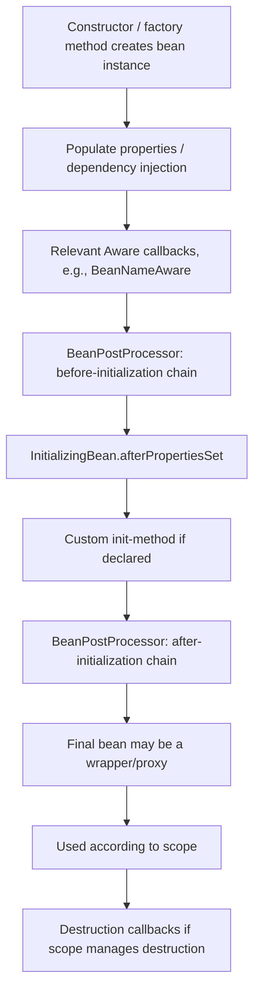

# BeanPostProcessor Before and After Initialization Callbacks in Spring Core Container

## 1. Purpose and Position in the Bean Lifecycle

**BeanPostProcessor** (BPP) is a Spring IoC container extension point for processing **a bean instance** during initialization. Rather than merely invoking a constructor and injecting dependencies, Spring lets processors observe, validate, customize, or return a wrapper/proxy of the bean before handing it to consumer code.

The two most important methods are:

- **`postProcessBeforeInitialization(Object bean, String beanName)`**: runs before `InitializingBean.afterPropertiesSet()` and standard custom `init-method` callbacks.
- **`postProcessAfterInitialization(Object bean, String beanName)`**: runs after those initialization callbacks, before the final bean is delivered to callers.

These two methods are invoked **around initialization callbacks**, not "before constructor" and "after the program finishes running". Each method returns an object reference for Spring to use in the next step. A logging-only processor normally returns `bean` itself; a processor handling proxies can return a valid replacement object.

A particularly important point is that **`@PostConstruct` is invoked by a dedicated `BeanPostProcessor` during the before-initialization phase**. Therefore, do not assume all BPP-before callbacks finish before Spring invokes `@PostConstruct`; the relative position of `@PostConstruct` and a custom BPP depends on the registration order of the processors.

For Spring-managed beans, this processing typically runs each time a bean instance is created: a standard singleton goes through initialization once, whereas a prototype can go through initialization **once per container-created instance**. Calling `getBean()` again on an existing singleton does not re-run BPPs.

## 2. Overall Lifecycle Model



**`@PostConstruct` sits inside step D**, executed by the processor managing lifecycle annotations; it cannot be treated as a block that always comes after **the entire** D chain. This is the distinction between the concept of a "phase" and "the specific order of multiple processors".

Explanation of the steps:

1. **Instantiation**: Spring calls a constructor or factory method to obtain an instance. `BeanPostProcessor.before` is not a pre-constructor callback. Other SPIs such as `InstantiationAwareBeanPostProcessor` have earlier hooks, which is a separate topic.
2. **Dependency resolution/injection**: Spring resolves constructor dependencies and populates fields/setters/properties according to configured mechanisms. `@Autowired` is usually handled by an infrastructure post-processor at the appropriate moment; that does not mean every BPP-before performs injection itself.
3. **Aware callbacks**: callbacks such as `BeanNameAware`, `BeanClassLoaderAware`, and `BeanFactoryAware` are executed at the appropriate point before the standard BPP-before chain. Some other Aware interfaces are handled by dedicated processors.
4. **BPP before-initialization**: Spring invokes `postProcessBeforeInitialization` sequentially on processors. `@PostConstruct` can be invoked within this chain.
5. **Bean contract initialization**: `InitializingBean.afterPropertiesSet()`, then a custom init method such as `@Bean(initMethod = "initialize")`, if each callback is configured.
6. **BPP after-initialization**: processors receive the bean after standard init; they can return the original bean or a replacement object such as a proxy.
7. **Delivering the bean to callers**: dependency injection and `ApplicationContext.getBean()` receive the final bean reference. If proxied, callers may not hold a direct reference to the raw target.
8. **Scope-based destruction**: when the lifecycle ends, Spring invokes appropriate destruction callbacks if the scope/container manages destruction. An after-initialization callback is **not** a destruction callback.

The flow above is the standard model to help understand applications; advanced mechanisms such as early references for circular dependencies and specialized BeanPostProcessors may add steps or alternate paths.

## 3. BeanPostProcessor API and Returning Results

The interface's full name is `org.springframework.beans.factory.config.BeanPostProcessor`. The core signatures (excerpted for learning—**do not redeclare this interface in your project**) are:

```java
public interface BeanPostProcessor {
    default Object postProcessBeforeInitialization(
            Object bean, String beanName) {
        return bean;
    }

    default Object postProcessAfterInitialization(
            Object bean, String beanName) {
        return bean;
    }
}
```

This snippet illustrates **the primary API shape**, not the full Spring library source. When using it in real code, import the existing interface from Spring.

Two parameters:

- `bean`: the object **currently being processed at this step**, which may be the original object or a wrapper returned by an earlier processor.
- `beanName`: the bean identifier in the container. Useful to avoid applying logic to all infrastructure beans.

Return value:

- **Return `bean`**: the right choice when you do not want to replace the object.
- **Return a valid proxy/wrapper**: allowed if the object is compatible with the type, DI semantics, lifecycle, and subsequent processors.
- **Return `null`**: by the BPP contract, subsequent post-processors in the corresponding phase will not be called. Do not use `null` as a way to "remove a bean" or intentionally skip without understanding the consequences.

A simple logging processor:

```java
public final class TraceProcessor implements BeanPostProcessor {

    @Override
    public Object postProcessBeforeInitialization(
            Object bean, String beanName) {
        if ("customerService".equals(beanName)) {
            System.out.println("before: " + beanName);
        }
        return bean;
    }

    @Override
    public Object postProcessAfterInitialization(
            Object bean, String beanName) {
        if ("customerService".equals(beanName)) {
            System.out.println("after: " + beanName);
        }
        return bean;
    }
}
```

This is an **illustrative integration class**, requiring importing `BeanPostProcessor` and registering the processor as a Spring bean in the corresponding context. The code does not declare `customerService`, so the snippet alone is not a complete application. It shows how to filter by `beanName` and return the original object so identity is not accidentally changed.

If the class has `@Component` but is instantiated via `new TraceProcessor()` and used only as an ordinary Java object, it does **not automatically become** a registered BPP in the container. Spring must have a bean definition for the processor or have it registered via the corresponding API.

## 4. Complete Experiment: Observing Callback Order

The program below uses the **Spring Framework Core Container**, requiring no Spring Boot, servlet container, or database. A `Widget` implements `BeanNameAware`, `InitializingBean`, `DisposableBean`, plus custom init/destroy. A `TraceProcessor` prints the exact points before and after initialization.

**Requirements**: JDK 17+ and Maven 3.9+. Structure:

```text
bpp-lifecycle/
├── pom.xml
└── src/main/java/example/BppLifecycleDemo.java
```

File `pom.xml`:

```xml
<project xmlns="http://maven.apache.org/POM/4.0.0"
         xmlns:xsi="http://www.w3.org/2001/XMLSchema-instance"
         xsi:schemaLocation="http://maven.apache.org/POM/4.0.0
                             https://maven.apache.org/xsd/maven-4.0.0.xsd">
    <modelVersion>4.0.0</modelVersion>
    <groupId>example</groupId>
    <artifactId>bpp-lifecycle</artifactId>
    <version>1.0.0</version>

    <properties>
        <maven.compiler.release>17</maven.compiler.release>
        <project.build.sourceEncoding>UTF-8</project.build.sourceEncoding>
    </properties>

    <dependencies>
        <dependency>
            <groupId>org.springframework</groupId>
            <artifactId>spring-context</groupId>
            <version>6.2.0</version>
        </dependency>
    </dependencies>

    <build>
        <plugins>
            <plugin>
                <groupId>org.apache.maven.plugins</groupId>
                <artifactId>maven-compiler-plugin</artifactId>
                <version>3.13.0</version>
            </plugin>
            <plugin>
                <groupId>org.codehaus.mojo</groupId>
                <artifactId>exec-maven-plugin</artifactId>
                <version>3.5.0</version>
            </plugin>
        </plugins>
    </build>
</project>
```

File `src/main/java/example/BppLifecycleDemo.java`:

```java
package example;

import org.springframework.beans.factory.BeanNameAware;
import org.springframework.beans.factory.DisposableBean;
import org.springframework.beans.factory.InitializingBean;
import org.springframework.beans.factory.config.BeanPostProcessor;
import org.springframework.context.annotation.AnnotationConfigApplicationContext;
import org.springframework.context.annotation.Bean;
import org.springframework.context.annotation.Configuration;

public class BppLifecycleDemo {

    public static void main(String[] args) {
        try (var context =
                     new AnnotationConfigApplicationContext(AppConfig.class)) {
            Widget widget = context.getBean("widget", Widget.class);
            System.out.println("07 application: " + widget.render());
        } // Closes context -> destruction callbacks for singleton Widget.
    }

    @Configuration(proxyBeanMethods = false)
    public static class AppConfig {

        // Register BPP early enough without instantiating AppConfig first.
        @Bean
        public static TraceProcessor traceProcessor() {
            return new TraceProcessor();
        }

        @Bean(name = "widget",
              initMethod = "customInit",
              destroyMethod = "customDestroy")
        public Widget widget() {
            return new Widget();
        }
    }

    public static final class TraceProcessor implements BeanPostProcessor {
        @Override
        public Object postProcessBeforeInitialization(
                Object bean, String beanName) {
            if ("widget".equals(beanName)) {
                System.out.println("03 BPP.before");
            }
            return bean;
        }

        @Override
        public Object postProcessAfterInitialization(
                Object bean, String beanName) {
            if ("widget".equals(beanName)) {
                System.out.println("06 BPP.after");
            }
            return bean;
        }
    }

    public static final class Widget
            implements BeanNameAware, InitializingBean, DisposableBean {

        public Widget() {
            System.out.println("01 constructor");
        }

        @Override
        public void setBeanName(String beanName) {
            System.out.println("02 BeanNameAware: " + beanName);
        }

        @Override
        public void afterPropertiesSet() {
            System.out.println("04 InitializingBean.afterPropertiesSet");
        }

        public void customInit() {
            System.out.println("05 custom init");
        }

        public String render() {
            return "ready";
        }

        @Override
        public void destroy() {
            System.out.println("08 DisposableBean.destroy");
        }

        public void customDestroy() {
            System.out.println("09 custom destroy");
        }
    }
}
```

In the directory containing `pom.xml`, run:

```bash
mvn -q compile exec:java -Dexec.mainClass=example.BppLifecycleDemo
```

**Stdout from the program** (excluding separate Maven logs from the environment):

```text
01 constructor
02 BeanNameAware: widget
03 BPP.before
04 InitializingBean.afterPropertiesSet
05 custom init
06 BPP.after
07 application: ready
08 DisposableBean.destroy
09 custom destroy
```

### 4.1. Why is this the order?

- **01**: Spring invokes the factory method `widget()`; that method creates the object via `new Widget()`.
- **02**: Spring recognizes `BeanNameAware` and invokes `setBeanName("widget")` before the BPP-before chain.
- **03**: `TraceProcessor.postProcessBeforeInitialization()` is applied to the bean named `widget`.
- **04**: Spring calls `InitializingBean.afterPropertiesSet()` after the before-init phase.
- **05**: `@Bean(initMethod = "customInit")` causes Spring to invoke the custom init method after `afterPropertiesSet()`.
- **06**: Spring calls `TraceProcessor.postProcessAfterInitialization()` after both initialization callbacks.
- **07**: The caller invokes `getBean("widget")` and calls `render()` on the bean that has finished initialization.
- **08**: When the `try` block exits, `AnnotationConfigApplicationContext.close()` runs; `DisposableBean.destroy()` is called for the singleton.
- **09**: The custom destroy method `customDestroy()` is invoked after `DisposableBean.destroy()` under this configuration contract.

This is a sequential output that can be verified visually, not the accidental result of thread scheduling. The code runs single-threaded and uses a single application bean for logging. The BPP only prints if `beanName` is `widget`, because the container may initialize additional configuration/infrastructure beans unrelated to the exercise.

**Why can `Widget` be `final`?** The program only needs the BPP to observe and return the object as-is; there is no requirement for Spring to subclass `Widget` as with `@Lookup` methods. Class-based subclass/proxy limitations are a separate issue when actually creating a proxy type that requires subclassing, not a rule forbidding `final` for every BPP.

**Why did the example omit `@PostConstruct`?** Because that callback is executed by its own processor in the before phase; adding both at once without controlling processor ordering can create a false expectation that a custom BPP's log always precedes `@PostConstruct`. The next section explains the exact relationship.

## 5. @PostConstruct Lives Inside the Before-Initialization Chain

In a Spring context supporting Jakarta lifecycle annotations, `CommonAnnotationBeanPostProcessor` (based on `InitDestroyAnnotationBeanPostProcessor`) manages callbacks such as `@PostConstruct` and `@PreDestroy`. For a method annotated with `@PostConstruct`, that processor invokes the method **within its own before-initialization callback**.

Illustrative snippet:

```java
public class CacheService {
    private Cache cache;

    @jakarta.annotation.PostConstruct
    public void initialize() {
        cache = new Cache();
    }
}
```

This is **not standalone runnable code**; it needs a `Cache` class, the annotation dependency, and a bean definition in a Spring context supporting annotation processing. The snippet shows the annotation placed on the method to be called after dependency injection.

If both `CommonAnnotationBeanPostProcessor` and `TraceProcessor` exist, then:

```text
bean has been injected
  |
  +--> BPP.before #1
  |
  +--> BPP.before #2 (a processor here may invoke @PostConstruct)
  |
  +--> InitializingBean.afterPropertiesSet()
  |
  +--> custom init-method
  |
  +--> BPP.after #1
  |
  +--> BPP.after #2
  |
  v
final bean
```

The exact order of `#1` and `#2` depends on registration/ordering. If `CommonAnnotationBeanPostProcessor` comes before `TraceProcessor`, the `@PostConstruct` method can run **before** `TraceProcessor`'s BPP-before log. If positions differ, the log order differs. Therefore, saying "before always runs before PostConstruct" is **inaccurate**.

In a typical lifecycle configuration, if the same bean has `@PostConstruct`, `InitializingBean.afterPropertiesSet()`, and a custom init method, the typical callback order is:

1. `@PostConstruct` (in the before phase of the annotation-managing processor).
2. `InitializingBean.afterPropertiesSet()`.
3. Custom init method.

If multiple mechanisms are configured pointing to **the exact same method**, the framework has deduplication checks in appropriate cases; you should not design side effects relying on calling one method multiple times. For init logic involving I/O or resource registration, add idempotency/appropriate cleanup mechanisms.

On another note: `@PreDestroy` is a **destruction callback**, not an action performed by `postProcessAfterInitialization()`. The two words "post" and "after" make it very easy for learners to confuse their timing.

## 6. Registering a BeanPostProcessor at the Right Time

A BPP is only useful when Spring knows about it **before creating the beans it needs to process**. Typical options:

- Register a class implementing `BeanPostProcessor` via component scanning or directly as a bean definition.
- Create the BPP via a `@Bean` factory method as in the demo above.
- In lower-level configurations, register programmatically via `ConfigurableBeanFactory.addBeanPostProcessor(...)`.

In the demo example:

```java
@Bean
public static TraceProcessor traceProcessor() {
    return new TraceProcessor();
}
```

The factory method is declared **static** so Spring can create the BPP without having to instantiate the `@Configuration` class just to call it. This is an important practice for `@Bean` factory methods returning BPPs and `BeanFactoryPostProcessor`s: creating infrastructure beans **early**, avoiding missing post-processing on beans initialized too early.

A common mistake is writing a non-`static` BPP `@Bean` method and injecting complex dependencies into the configuration class. When Spring needs the BPP, it may be forced to instantiate the configuration class or dependencies before all processors are ready, producing warnings that beans are not eligible for getting processed by all BPPs.

Let the `@Bean` return type clearly reflect the BPP, such as `TraceProcessor` implementing `BeanPostProcessor`, rather than returning an overly generic type that makes early processor detection harder for the container.

**Important:** BPPs and certain infrastructure beans that Spring must initialize very early **are not necessarily processed fully by the entire set of BPPs themselves**. Do not rely on BPP A's callback to "guarantee" BPP B is also processed by A like a business bean.

## 7. Multiple Processors in the Same Context

With BPP A and BPP B, the processing chain can be pictured as:

```text
bean is created and dependencies injected
     |
     v
A.before(bean) -> object1
     |
     v
B.before(object1) -> object2
     |
     v
afterPropertiesSet / custom init of the bean being processed
     |
     v
A.after(object2) -> object3
     |
     v
B.after(object3) -> object4
     |
     v
container delivers object4 to caller
```

This is an **explanatory model**, not a guarantee that `object1`–`object4` are four distinct instances. Most BPPs return the same input object; creating a proxy requires valid requirements and mechanisms.

For BPPs auto-detected by Spring from bean definitions, the container has ordering rules involving `PriorityOrdered`, `Ordered`, and `@Order`, depending on processor type and registration method. When adding BPPs programmatically via `addBeanPostProcessor(...)`, **registration order** governs processing order under that mechanism; you cannot assume implementing `Ordered` will automatically reorder all manually added processors.

Do not guess ordering from class names or the source position of `@Bean` methods. If ordering is critical for correctness, make BPP ordering explicit and verify it with an integration test using a real context.

Considerations when a BPP applies to many beans:

- Do not store "the bean just processed" in a single mutable field if the container may instantiate multiple instances or process concurrently.
- Avoid calling `ApplicationContext.getBean()` indiscriminately inside callbacks; that can force other beans to be created too early or cause circular dependencies.
- If logging is needed, use `beanName`/class in a controlled way. Calling `bean.toString()` can sometimes trigger logic or touch a lazy proxy.
- Do not assume a BPP only processes `@Component` beans: container-managed beans from `@Bean`, XML, or suitable bean definitions also pass through the BPP chain.
- Do not assume a BPP in one container applies to beans belonging to another independent container.

## 8. Proxies May Be Created After Initialization

An important function of Spring's infrastructure is returning a **proxy** instead of a reference to the original target. The after-initialization phase is a common place to create wrappers.

```java
@Override
public Object postProcessAfterInitialization(Object bean, String beanName) {
    if ("paymentService".equals(beanName)) {
        // Pseudocode: in practice create a valid proxy via Spring AOP.
        return createProxyFor(bean);
    }
    return bean;
}
```

This is **illustrative pseudocode**, not standalone Java code; `createProxyFor` is a symbolic placeholder name, not a built-in Spring API method. For real implementations, use components such as `ProxyFactory` or framework-supported Spring AOP/declarative mechanisms.

Consequences:

1. **The initialized instance does not always have the same identity as the final bean the caller gets.** Init callbacks may run on the target, while callers receive a proxy.
2. **Later processors may receive a proxy from an earlier processor.** They must remain compatible with the type and characteristics of the forwarded object.
3. **AOP proxies have their own limitations** regarding `final` methods, class subclassability vs interface proxies, self-invocation, and how methods are called. Do not conflate every proxy limitation with every BPP implementation.
4. **BPP callbacks do not run on every business method call.** They participate in **the bean creation lifecycle**. If a proxy is successfully created, it is the proxy that intercepts method calls at runtime.
5. **Circular dependencies can complicate the flow**, because Spring has early bean reference mechanisms and specialized extension interfaces. Do not assume every configuration follows a single path without exceptions.

Do not arbitrarily return a proxy of a completely incompatible type relative to the dependency injection contract. A BPP that "swaps objects arbitrarily" can cause `getBean(SomeConcreteClass.class)` to fail or break beans using constructor injection.

## 9. Distinguishing Easily Confused Hooks

| Mechanism | Primary operation | Timing |
|---|---|---|
| `BeanFactoryPostProcessor` | Modifies/reads **bean definitions**, before application instances are needed | Before the standard bean instantiation/initialization phase |
| `BeanDefinitionRegistryPostProcessor` | Registers/modifies bean definitions in the registry | Very early, before application singletons |
| `BeanPostProcessor.postProcessBeforeInitialization` | Processes a **bean instance** | After creation/injection, before `InitializingBean` and custom init |
| `@PostConstruct` | Bean's initialization method | Invoked by lifecycle annotation processor during BPP-before phase |
| `InitializingBean.afterPropertiesSet` | Interface-level init callback | After the standard BPP-before phase |
| Custom `init-method` | Bean-configured init callback | After `afterPropertiesSet` in the standard init chain |
| `BeanPostProcessor.postProcessAfterInitialization` | Processes bean after init, may return a wrapper | After standard init callbacks |
| `DisposableBean.destroy` / `@PreDestroy` | Cleans up resources when bean is destroyed | When the scope/container actually manages destruction |
| `SmartInitializingSingleton.afterSingletonsInstantiated` | Callback after standard singletons have been pre-instantiated | End of the singleton bootstrap phase |

**`BeanFactoryPostProcessor` and `BeanPostProcessor` differ in what they operate on**: one typically works on metadata/bean definitions; the other works on actual bean instances. Do not use a BPP to arbitrarily alter registry-wide metadata while beans have already begun being created.

**BPP-after and destruction differ in timing**: after-initialization occurs before the bean is used; destruction belongs to the end of the lifecycle. For prototype beans, Spring creates and initializes each instance on demand, but by default **does not automatically invoke destruction callbacks on prototype instances when the context closes**. The caller/resource owner must proactively close resources that need closing.

## 10. When Should You Implement a Custom BeanPostProcessor?

It makes sense when building **shared infrastructure**: a processor for a custom annotation used across many beans, adding validation after dependency injection, standardizing bean state against a public contract, container-wide instrumentation, or wrapping/proxying with a clear requirement.

Example of a simple rule:

```java
public class ValidationBpp implements BeanPostProcessor {
    @Override
    public Object postProcessBeforeInitialization(
            Object bean, String name) {
        if (bean instanceof ConfigurableEndpoint endpoint) {
            endpoint.validateConfiguration();
        }
        return bean;
    }
}
```

This is an **illustrative snippet**, requiring a `ConfigurableEndpoint` interface with `validateConfiguration()`, importing `BeanPostProcessor`, and registering `ValidationBpp` in the context. BPP-before can fit if validation only needs dependencies already injected; if validation requires the bean to have completed `afterPropertiesSet()`, look to the after phase or a different lifecycle structure.

Do not use a BPP for local setup needed by **just one bean**; in many cases `@PostConstruct`, a custom init method, or constructor validation is simpler and easier to test. If the goal is intercepting runtime method calls, consider Spring AOP before hand-rolling a proxy in a BPP. If you want something to "run once when the application is ready", use an appropriate application startup hook rather than assuming a single bean's callback equals whole-application readiness.

## 11. Common Mistakes, Causes, and Fixes

| Symptom / misconception | Cause | Resolution |
|---|---|---|
| Thinking `BPP.before` runs before the constructor | Confusing before-*initialization* with before-*instantiation* | Clarify the order: constructor → injection → before → init |
| Thinking `BPP.after` runs at shutdown | Confusing after-init with destruction | Use `@PreDestroy`, `DisposableBean`, or custom destroy properly |
| `@PostConstruct` logs before custom BPP.before | `@PostConstruct` is invoked by another BPP in the before chain | Check registration/ordering; do not enforce an invalid assumption |
| Returning `null` from a BPP to drop a bean | `null` stops the current BPP chain, it does not delete the bean | Return the original bean or a valid wrapper |
| Bean created with `new` gets no callbacks | Object is not managed by Spring | Obtain the bean via DI/container if lifecycle is needed |
| Singleton `getBean()` called many times but BPP logs once | Singleton was already initialized and is reused | Distinguish lookup count from instance creation count |
| Prototype shows multiple init callbacks | Container creates a new prototype instance per request | Verify bean scope and actual number of requests |
| BPP does not affect early infrastructure beans | Processor was not registered early enough | Check BPP registration and dependencies |
| BPP registered via non-static `@Bean` causes warnings | May initialize configuration/dependencies too early | Prefer static `@Bean` with a recognizable return type |
| BPP-after returns proxy breaking concrete class cast | Proxy has a different type from target depending on proxy strategy | Design appropriate interface/type contracts |
| Circular dependency when BPP calls `getBean()` | Pulling in new beans before context is ready | Reduce nested lookups, minimize dependencies |
| Mixing up `BeanFactoryPostProcessor` and BPP | Confusing metadata and instance lifecycles | Choose the hook for the right extension point |
| Using BPP on prototype expecting Spring to auto-destroy it | BPP init does not change prototype destruction contract | Ensure caller/resource owner handles cleanup |

### 11.1. How to debug when callback order differs from expectations

Check in order:

1. **Who actually created the bean?** Manually `new`-ed objects will not automatically receive Spring's lifecycle.
2. **What is the bean's scope?** `context.isSingleton(beanName)`/`isPrototype(beanName)` helps identify the lifecycle known to the container.
3. **Is the BPP registered in the right context?** Processor bean name, `@Bean` return type, component scanning setup, and initialization timing can all affect it.
4. **Are there multiple BPPs?** `@PostConstruct`, autowiring, and AOP have dedicated processors; different extension hooks sit at different points.
5. **Did an earlier callback throw an error?** If `afterPropertiesSet()` throws an exception, the init chain does not complete normally; you cannot expect after logs to appear.
6. **Is the received bean a proxy?** You can inspect runtime class/identity, but avoid indiscriminately printing `toString()` on lazy proxies.
7. **Is there early initialization?** Infrastructure beans can be created before all processors are ready.
8. **Is the test targeting the right thing?** Assert ordering based on the contract of a specific bean and actual processors, not accidental ordering across unrelated beans.

You can log using `beanName` and a context ID instead of logging bean internals, because processors may encounter configuration objects containing sensitive references. For multi-threaded beans or prototypes created concurrently, any shared counter needs synchronization if reliable sequence numbers are truly needed.

## 12. Before and After Scenarios: Explaining Lifecycle Bugs

**Before:** a team wanted to validate a configuration field after Spring injected it. They put the check in the constructor, when field injection had not run yet, hit `null`, and thought Spring was not injecting the dependency.

**After:** move validation into `@PostConstruct` if it only concerns one bean; or into a shared BPP-before if enforcing the same contract across many injected beans. If the rule needs the object after custom init, move to a post-init lifecycle point while checking proxy behavior.

**Before:** a BPP-after called a business API and wrote to the DB each time a bean initialized, and the team expected it to call that API on every HTTP request.

**After:** leave the BPP responsible for configuration/wrapping during **the bean creation phase**. If execution is needed per request or per method call, use the appropriate controller/service/interceptor/AOP layer. For singletons, BPP-after does not re-run per request.

**Before:** a `@PreDestroy` callback was not called on a prototype and the team thought BPP.after could substitute for it.

**After:** define a clear cleanup contract on the resource owner, such as `AutoCloseable` paired with `try-with-resources`. If the bean genuinely has a lifecycle managed by another scope, choose the appropriate scope. Destruction is a responsibility separate from initialization.

## 13. Knowledge Check Exercises

**1. Does a `BeanPostProcessor` process a bean before the constructor or before `afterPropertiesSet()`?**  
Before `afterPropertiesSet()`, after the object has been created and gone through the appropriate injection phase.

**2. When a bean has `BeanNameAware`, `InitializingBean`, custom init, BPP-before, and BPP-after, what is the typical order?**  
Constructor/factory, dependency injection, `BeanNameAware`, BPP-before, `afterPropertiesSet()`, custom init, BPP-after, caller uses bean.

**3. Where does `@PostConstruct` sit in the sequence?**  
Inside the BPP-before phase via an annotation processor. You cannot assume it always runs after every custom BPP-before.

**4. Can a proxy be returned from `postProcessAfterInitialization()`?**  
Yes, if implemented properly respecting type contracts, lifecycle, and other processors. Normal BPPs simply return the bean.

**5. Is `postProcessAfterInitialization()` a bean destruction method?**  
No. Destruction callbacks handle cleanup at the appropriate end of the lifecycle, e.g., `DisposableBean.destroy()`.

**6. How many times does BPP run if `getBean()` is called twice on the same singleton?**  
Normally BPP init runs only once when the singleton instance is created, and then the container reuses it.

**7. For a prototype, how many before/after init callback cycles can two bean creations receive?**  
Normally two cycles if the container actually creates two instances. That does not automatically trigger destruction callbacks.

**8. Is returning `null` from a BPP a valid way to skip a bean?**  
No. It short-circuits subsequent BPPs in the current phase and can cause unexpected consequences.

**9. Why is `static @Bean` recommended for BPPs?**  
It allows registering the processor early without needing to instantiate the `@Configuration` instance just to invoke the BPP factory method.

**10. How does `BeanFactoryPostProcessor` differ from `BeanPostProcessor`?**  
One processes bean definitions/metadata, while the other processes bean instances during bean creation.

## Official Documentation

- [Spring Framework Reference — BeanPostProcessor](https://docs.spring.io/spring-framework/reference/core/beans/factory-extension.html#beans-factory-extension-bpp): callback mechanism, ordering, and processor registration.
- [Spring Framework Reference — Lifecycle Callbacks](https://docs.spring.io/spring-framework/reference/core/beans/factory-nature.html): `@PostConstruct`, `InitializingBean`, custom init, and destruction.
- [Spring Framework 6.2 API — BeanPostProcessor](https://docs.spring.io/spring-framework/docs/6.2.0/javadoc-api/org/springframework/beans/factory/config/BeanPostProcessor.html): both callbacks, return value semantics, and processor chain handling.
- [Spring Framework API — CommonAnnotationBeanPostProcessor](https://docs.spring.io/spring-framework/docs/6.2.0/javadoc-api/org/springframework/context/annotation/CommonAnnotationBeanPostProcessor.html): processor handling lifecycle annotations.
- [Spring Framework Reference — Bean Scopes](https://docs.spring.io/spring-framework/reference/core/beans/factory-scopes.html): singleton and prototype scopes and bean lifecycle.
