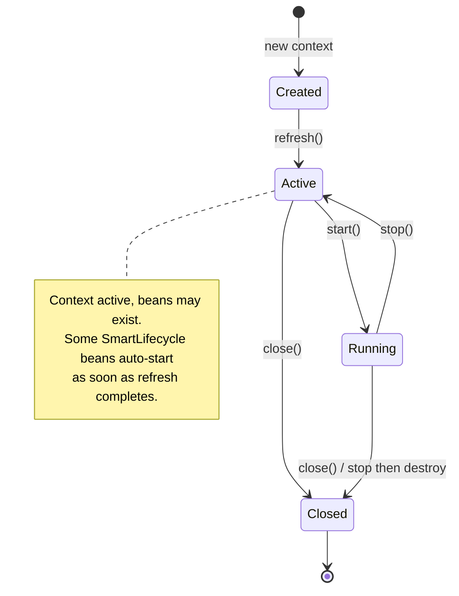

# Distinguishing refresh, start, stop, and close in the Spring ApplicationContext Lifecycle

## 1. Four operations with four distinct responsibilities

`ApplicationContext` is Spring's IoC container. When you want to actively manage the context lifecycle, the API to look at is `ConfigurableApplicationContext`, because this interface declares the operations `refresh()`, `start()`, `stop()`, `close()` and state checks such as `isActive()`, `isRunning()`.

Key points to remember:

- **`refresh()`**: prepares and activates a context according to Spring's initialization workflow: processing bean definitions and infrastructure, registering `BeanPostProcessor`s, instantiating non-lazy singletons, finishing refresh, and publishing `ContextRefreshedEvent`. For contexts supporting `LifecycleProcessor`, refresh also performs auto-startup for `SmartLifecycle` beans with `isAutoStartup() == true`.
- **`start()`**: asks `LifecycleProcessor` to start beans participating in `Lifecycle`, then publishes `ContextStartedEvent`. It does not rebuild the container and does not re-run dependency injection for all singletons.
- **`stop()`**: asks `LifecycleProcessor` to stop active `Lifecycle` beans, then publishes `ContextStoppedEvent`. The context remains active, and bean definitions and regular singletons still exist; `start()` can be called again after `stop()`.
- **`close()`**: closes the context, publishes `ContextClosedEvent`, stops lifecycle components, destroys beans with Spring-managed destruction lifecycles, closes the bean factory if applicable, and releases container resources. This is the **end of the context lifecycle**, not a pause that can be resumed with `start()`.

Summary in four clauses:

> **refresh = initialize/configure context; start = let lifecycle components run; stop = pause lifecycle components; close = shutdown and container cleanup.**

Distinguish `context.isActive()` from `context.isRunning()`: a context can be **active yet not running** after calling `stop()`; the "active" state clarifies that stop is not close. `isRunning()` reflects the state reported by `LifecycleProcessor` per Spring's contract, not a measurement of every actual thread or task in the JVM.

## 2. Semantic comparison table

| Criterion | `refresh()` | `start()` | `stop()` | `close()` |
|---|---|---|---|---|
| Goal | Build/activate context and beans needing early creation | Start operation of `Lifecycle` beans | Stop operation of `Lifecycle` beans | Terminate context and clean up |
| Process/register container infrastructure | Yes, main part of refresh | Does not re-run refresh | Does not re-run refresh | Closes/releases created infrastructure |
| Create regular non-lazy singletons | Yes, in finish bean initialization phase | Not primary responsibility | No | No |
| Call `Lifecycle.start()` | Possible, for auto-start `SmartLifecycle` on refresh | Yes, via `LifecycleProcessor` | No | Not a start operation |
| Call `Lifecycle.stop()` | Not general goal; may stop old instances depending on refreshable context type | No | Yes, for running beans | Yes during shutdown, for running beans |
| Primary event published | `ContextRefreshedEvent` | `ContextStartedEvent` | `ContextStoppedEvent` | `ContextClosedEvent` |
| Run destruction callbacks automatically? | Not a normal destruction operation; re-refresh on supporting contexts may replace/destroy old beans | No | No | Yes, per scope and callback rules |
| Context still usable after call? | Yes if refresh succeeds | Yes | Yes; `start()` can be called again | Context is closed; do not continue using as active |
| Can be called multiple times? | **Depends on implementation**; many contexts like `GenericApplicationContext` only allow one refresh | Can be called after refresh to control lifecycle | Can be called after refresh to control lifecycle | Closing again usually does not trigger a new shutdown; not a recovery capability |
| Nature of operation | Bootstrap/re-bootstrap if implementation allows | Runtime lifecycle transition | Runtime lifecycle transition | Terminal cleanup |

The table describes Spring's contract and typical behavior. It does not guarantee `stop()` will halt every thread the application created manually: only components with an appropriate lifecycle mechanism are orchestrated by the container.

## 3. State machine for understanding refresh, start, stop, close



The diagram shows the **typical path**, without forcing `Active` and `Running` to be completely mutually exclusive states at the Java API level. In practice `isActive()` can be `true` even while `isRunning()` is also `true`; "Running" can be understood as **Active + lifecycle processor started**. With auto-start `SmartLifecycle`, refresh can cause certain lifecycle beans to run immediately without a separate `context.start()` call.

Practical conditions:

1. **Created → refreshed:** with the no-arg `AnnotationConfigApplicationContext()`, after `register(...)` you usually must call `refresh()` explicitly. With the `new AnnotationConfigApplicationContext(AppConfig.class)` constructor, Spring **already called refresh inside the constructor**.
2. **Active → running:** `start()` uses `LifecycleProcessor` to invoke non-running `Lifecycle` beans per contract. It does not "revive" already-destroyed singletons.
3. **Running → active:** `stop()` turns off/suspends the activity of `Lifecycle` beans. There is no step closing the bean factory or destroying all singletons.
4. **Active/running → closed:** `close()` executes context destruction. Do not assume `start()` can be used afterward to resume as before.
5. **Another refresh:** not valid by default. `GenericApplicationContext` and its subclasses (like `AnnotationConfigApplicationContext`) **support only one refresh**; some `AbstractRefreshableApplicationContext` implementations can refresh again, rebuilding the bean factory. Check the exact concrete class.

## 4. What specific steps does refresh execute?

Conceptually, `AbstractApplicationContext.refresh()` runs a multi-step process. Core steps typically include:

```text
refresh()
  prepareRefresh()
  obtainFreshBeanFactory()
  prepareBeanFactory(beanFactory)
  postProcessBeanFactory(beanFactory)
  invokeBeanFactoryPostProcessors(beanFactory)
  registerBeanPostProcessors(beanFactory)
  initMessageSource()
  initApplicationEventMulticaster()
  onRefresh()                           // context subclass hook
  registerListeners()
  finishBeanFactoryInitialization()     // non-lazy singletons
  finishRefresh()                       // lifecycle onRefresh + ContextRefreshedEvent
```

This is a **condensed flow diagram** of `AbstractApplicationContext` intended to explain `refresh()`'s responsibilities; it is not application code that manually invokes internal methods. Actual behavior and hooks depend on the context type, Spring version, and registered extensions.

### 4.1. Processing bean definitions and processors

Spring prepares the bean factory, runs `BeanFactoryPostProcessor`/registry extensions (including processing `@Configuration`, `@Bean`, and component scanning in appropriate setups), and then registers `BeanPostProcessor`s. Processors for dependency injection, `@PostConstruct`, and many other infrastructure capabilities can participate in the bean creation chain.

This explains why `refresh()` is usually where most configuration and bean errors are discovered, while `start()` is not an API to "re-run" the entire configuration-reading or dependency-injection process.

### 4.2. Initializing non-lazy singletons

In the finish bean factory step, Spring **pre-instantiates eligible non-lazy singleton beans**. Constructors, dependency injection, initialization callbacks like `@PostConstruct`, `InitializingBean.afterPropertiesSet()`, and custom init methods may run here.

Do not assume **every bean must be created right during refresh**: `@Lazy` can defer singletons; prototypes are created on each actual lookup; other scopes follow their own mechanisms. Some dependency or infrastructure beans may be created earlier than this step.

### 4.3. Finishing refresh and notifications

Upon completion, Spring initializes or uses `LifecycleProcessor` to invoke the `onRefresh()` hook, thereby **auto-starting `SmartLifecycle` beans configured for auto-start**, and then publishes `ContextRefreshedEvent`. This means a message consumer or background component implementing `SmartLifecycle` can start working **as soon as context refresh finishes**, before the program explicitly calls `context.start()`.

Key reminder: `ContextRefreshedEvent` differs from `ContextStartedEvent`. A normal refresh **is not equivalent** to the application explicitly calling `start()`, even with the auto-start mechanism for SmartLifecycle.

### 4.4. A second refresh is not a harmless reload

Some contexts have a refreshable bean factory design, such as the `AbstractRefreshableApplicationContext` branch, which may support creating a new bean factory on refresh. That can cause old instances to be replaced, destruction callbacks to run for old beans, and state held by callers to become invalid.

Conversely, `AnnotationConfigApplicationContext` extends `GenericApplicationContext`, whose internal bean factory only supports a single refresh. A second refresh will not be a guaranteed way to reload annotation configuration; do not call it in production expecting beans to update automatically.

If the goal is dynamic config updates, design a dedicated refreshable property/config mechanism matching your library and application scope rather than using `refresh()` as a universal runtime reload solution for all contexts.

## 5. Start and stop control Lifecycle beans

`ConfigurableApplicationContext`'s `start()` and `stop()` delegate to `LifecycleProcessor`. The default processor (typically `DefaultLifecycleProcessor`) finds beans participating in the `Lifecycle` interface and invokes the corresponding callbacks.

A bean must actively declare how to start/stop:

```java
import org.springframework.context.Lifecycle;

public class PollingWorker implements Lifecycle {
    private volatile boolean running;

    @Override
    public void start() {
        running = true;
    }

    @Override
    public void stop() {
        running = false;
    }

    @Override
    public boolean isRunning() {
        return running;
    }
}
```

This is an **illustrative Java class** and does not spawn a real polling thread. In production applications, merely setting a boolean is insufficient to stop a thread: `stop()` must signal shutdown, stop accepting work, handle in-flight tasks per policy, and release or complete resources appropriately.

### 5.1. Not every bean receives start/stop

A regular service:

```java
@Service
public class PricingService {
    public long priceInCents(long base) {
        return base;
    }
}
```

This is illustrative code requiring `@Service` import. It **does not implement `Lifecycle`**, so `context.start()` and `context.stop()` do not automatically invoke any special method on this service. The service can still be retrieved via `getBean()` and execute methods after the context has called `stop()` unless another policy prevents it.

Therefore, do not use `stop()` as a global kill switch to block all requests or close all connections. What actually stops depends on beans with lifecycle interfaces, the context hierarchy, and implementations.

### 5.2. start can be called again after stop

For a properly implemented `Lifecycle` bean, the common flow is:

```text
context.refresh()
context.start()    -> Lifecycle.start()
context.stop()     -> Lifecycle.stop()
context.start()    -> Lifecycle.start() again
context.close()    -> stop running beans, then destroy eligible beans
```

`start()`/`stop()` operations **do not mean the context recreates beans**. If a worker needs pause/resume support, the implementation itself must guarantee state, idempotency, and concurrency safety. For example, an executor that has been permanently `shutdown()` cannot be brought back to life by `start()` unless `start()` properly creates a new executor.

## 6. SmartLifecycle: why refresh can auto-start beans

`SmartLifecycle` is an interface extending `Lifecycle` for components needing advanced startup/shutdown orchestration. It provides additional contracts such as:

- **`isAutoStartup()`**: indicates whether the bean should auto-start during the refresh step. In standard `SmartLifecycle` implementations, the default is **auto-start enabled**.
- **`getPhase()`**: specifies a phase to order start/stop across lifecycle beans. Lower phases generally start before higher phases; on shutdown they stop in reverse order. Do not rely on `@Bean` declaration order as a startup policy.
- **`stop(Runnable callback)`**: callback supporting potentially asynchronous stop mechanisms. The bean must **invoke `callback.run()` when stopping is actually complete**; forgetting this may force the processor to wait until the configured timeout.
- **`isRunning()`**: accurately reflects whether the component is currently running so the processor can decide which callbacks to invoke.

Illustrative `SmartLifecycle` example with auto-start **disabled** so the reader sees the difference:

```java
@Component
public class OptionalPoller implements SmartLifecycle {
    private volatile boolean running;

    @Override
    public boolean isAutoStartup() {
        return false;
    }

    @Override
    public void start() {
        running = true;
    }

    @Override
    public void stop() {
        running = false;
    }

    @Override
    public boolean isRunning() {
        return running;
    }

    @Override
    public void stop(Runnable callback) {
        try {
            stop();
        } finally {
            callback.run();
        }
    }
}
```

This is an **integration snippet**, requiring `@Component` and `SmartLifecycle` imports. `OptionalPoller` must be registered in the context; the snippet is not a standalone program. With `isAutoStartup() == false`, `refresh()` does not automatically start this poller. After the context has refreshed, `context.start()` **can still start** it because explicit start differs from auto-start decision at refresh. If you omit overriding `isAutoStartup()` and leave the auto-start default, it may start during the finish-refresh phase.

`stop(Runnable)` here stops synchronously for clarity; with genuinely asynchronous shutdown, only invoke the callback **after the worker has stopped**, not immediately upon sending the stop signal. Choosing a phase requires understanding dependency relationships: a consumer normally needs to stop accepting new work before the resources it depends on are destroyed.

**Note on the context's `isRunning()`:** it is tied to `LifecycleProcessor`'s lifecycle and does not guarantee every `SmartLifecycle` shares the same state. If you need to verify a specific worker, check `worker.isRunning()` or the worker's metrics rather than inferring from a context-level flag.

## 7. Hands-on Java 17+ example: refresh → start → stop → start → close

The following experiment uses the **Spring Framework Core Container**, without Spring Boot, servlets, or a database. The goal is to separate the active context phase, a `Lifecycle` bean starting/stopping, and the destruction callback when closing the container.

To keep output predictable, the `Worker` bean implements only **regular `Lifecycle`** (not auto-starting `SmartLifecycle`); thus refreshing the context creates the bean but **does not automatically invoke `Worker.start()`**. The bean also implements `DisposableBean` to distinguish `stop()` and `destroy()`.

Requirements: JDK 17+ and Maven 3.9+.

Structure:

```text
context-lifecycle-demo/
├── pom.xml
└── src/main/java/example/ContextLifecycleDemo.java
```

**File `pom.xml`:**

```xml
<project xmlns="http://maven.apache.org/POM/4.0.0"
         xmlns:xsi="http://www.w3.org/2001/XMLSchema-instance"
         xsi:schemaLocation="http://maven.apache.org/POM/4.0.0
                             https://maven.apache.org/xsd/maven-4.0.0.xsd">
    <modelVersion>4.0.0</modelVersion>
    <groupId>example</groupId>
    <artifactId>context-lifecycle-demo</artifactId>
    <version>1.0.0</version>

    <properties>
        <maven.compiler.release>17</maven.compiler.release>
        <project.build.sourceEncoding>UTF-8</project.build.sourceEncoding>
    </properties>

    <dependencies>
        <dependency>
            <groupId>org.springframework</groupId>
            <artifactId>spring-context</artifactId>
            <version>6.2.19</version>
        </dependency>
    </dependencies>

    <build>
        <plugins>
            <plugin>
                <groupId>org.apache.maven.plugins</groupId>
                <artifactId>maven-compiler-plugin</artifactId>
                <version>3.13.0</version>
            </plugin>
            <plugin>
                <groupId>org.codehaus.mojo</groupId>
                <artifactId>exec-maven-plugin</artifactId>
                <version>3.5.0</version>
            </plugin>
        </plugins>
    </build>
</project>
```

**File `src/main/java/example/ContextLifecycleDemo.java`:**

```java
package example;

import org.springframework.beans.factory.DisposableBean;
import org.springframework.context.Lifecycle;
import org.springframework.context.annotation.AnnotationConfigApplicationContext;
import org.springframework.context.annotation.Bean;
import org.springframework.context.annotation.Configuration;

public class ContextLifecycleDemo {

    public static void main(String[] args) {
        var context = new AnnotationConfigApplicationContext();
        try {
            context.register(AppConfig.class);
            System.out.println("before refresh: active=" + context.isActive());

            context.refresh();

            Worker worker = context.getBean(Worker.class);
            System.out.println("after refresh: active=" + context.isActive()
                    + ", running=" + worker.isRunning());

            context.start();
            System.out.println("after start: running=" + worker.isRunning());

            context.stop();
            System.out.println("after stop: active=" + context.isActive()
                    + ", running=" + worker.isRunning());

            context.start();
            System.out.println("after restart: running=" + worker.isRunning());

            context.close();
            System.out.println("after close: active=" + context.isActive()
                    + ", running=" + worker.isRunning()
                    + ", destroyed=" + worker.isDestroyed());
        } finally {
            context.close(); // Safe when the execution block ends abnormally.
        }
    }

    @Configuration(proxyBeanMethods = false)
    public static class AppConfig {
        @Bean
        public Worker worker() {
            return new Worker();
        }
    }

    public static final class Worker implements Lifecycle, DisposableBean {
        private boolean running;
        private boolean destroyed;

        public Worker() {
            System.out.println("construct worker");
        }

        @Override
        public void start() {
            running = true;
            System.out.println("Lifecycle.start");
        }

        @Override
        public void stop() {
            running = false;
            System.out.println("Lifecycle.stop");
        }

        @Override
        public boolean isRunning() {
            return running;
        }

        @Override
        public void destroy() {
            destroyed = true;
            System.out.println("DisposableBean.destroy");
        }

        public boolean isDestroyed() {
            return destroyed;
        }
    }
}
```

Inside the directory containing `pom.xml`, execute:

```bash
mvn -q compile exec:java -Dexec.mainClass=example.ContextLifecycleDemo
```

Expected stdout of the snippet (ignoring environment-specific Maven logs):

```text
before refresh: active=false
construct worker
after refresh: active=true, running=false
Lifecycle.start
after start: running=true
Lifecycle.stop
after stop: active=true, running=false
Lifecycle.start
after restart: running=true
Lifecycle.stop
DisposableBean.destroy
after close: active=false, running=false, destroyed=true
```

### 7.1. Why do these exact lines appear?

1. The context is created from the empty constructor; `register(AppConfig.class)` registers the configuration class without auto-refreshing. `isActive()` remains `false`.
2. During `refresh()`, the container processes configuration and then creates the non-lazy singleton bean `worker`; constructor prints `construct worker`.
3. Because `Worker` only implements `Lifecycle`, not auto-starting `SmartLifecycle`, `worker.isRunning()` remains `false` right after refresh.
4. `context.start()` causes the lifecycle processor to call `worker.start()`; the worker transitions to running. There is no second constructor call.
5. `context.stop()` calls `worker.stop()`. `context.isActive()` stays `true`, and `destroy()` has not run yet.
6. The next `context.start()` call can re-run `worker.start()` because the worker is stopped.
7. `context.close()` executes shutdown: stopping the running worker before destroying singletons, hence logging `Lifecycle.stop` then `DisposableBean.destroy`. The context becomes inactive and the object still referenced by local variable `worker` reflects its own flags.
8. `finally` closes the context again defensively; an already-closed Spring context does not re-execute the shutdown sequence above. Closing again **does not** bring beans back to life.

The example illustrates the exact boundary between `stop` and `close`: both can invoke `Lifecycle.stop`, yet **only close leads to singleton destruction callbacks**.

### 7.2. Intentionally testing variations

- **Variation A:** omit the first `context.start()` and then call `stop()`. The worker was never running so Spring has no reason to call `Worker.stop()` on that worker; do not expect stdout to remain identical.
- **Variation B:** make `Worker` implement `SmartLifecycle` with `isAutoStartup()==true`. On refresh, the worker can be auto-started; the state after refresh changes. Expected output must be updated and `stop(Runnable)` handled per contract.
- **Variation C:** annotate worker with `@Bean @Lazy`. When no dependency forces worker creation, it may not be initialized during singleton pre-instantiation. Calling `getBean(Worker.class)` can create the instance later.
- **Variation D:** call `context.refresh()` a second time on `AnnotationConfigApplicationContext`. This is an **unsupported** scenario for this context type; do not use it to "restart the worker."
- **Variation E:** after `context.stop()`, calling `context.getBean(Worker.class)` usually still retrieves the bean from the active context; after `close()`, `getBean()` should not be treated as a normally supported operation.

## 8. Four event types and related ordering

Spring publishes context-level events that listeners can observe:

| Event | Typical direct trigger | Meaning |
|---|---|---|
| `ContextRefreshedEvent` | `ApplicationContext.refresh()` completes the refresh step | Context was successfully initialized or refreshed |
| `ContextStartedEvent` | `ApplicationContext.start()` | Context was instructed to start lifecycle components |
| `ContextStoppedEvent` | `ApplicationContext.stop()` | Context was instructed to stop lifecycle components |
| `ContextClosedEvent` | `ApplicationContext.close()` | Context is entering shutdown |

In a standard Spring `AbstractApplicationContext`, when `close()` runs, `ContextClosedEvent` is published during shutdown **before** stopping the lifecycle processor and destroying singleton beans. Therefore a `ContextClosedEvent` listener must not assume all beans have already been destroyed; this is an opportunity to handle shutdown notification while most infrastructure is still available. For other extensions, verify the specific ordering.

A listener receiving these events:

```java
@Component
public class LifecycleEventLogger {
    @EventListener
    public void onRefreshed(ContextRefreshedEvent event) {
        System.out.println("context refreshed");
    }

    @EventListener
    public void onStarted(ContextStartedEvent event) {
        System.out.println("context started");
    }

    @EventListener
    public void onStopped(ContextStoppedEvent event) {
        System.out.println("context stopped");
    }

    @EventListener
    public void onClosed(ContextClosedEvent event) {
        System.out.println("context closed");
    }
}
```

This is **illustrative integration code**, requiring imports for `@Component` (`org.springframework.stereotype.Component`), `@EventListener` (`org.springframework.context.event.EventListener`), and the four event classes from `org.springframework.context.event`. The listener must be registered in the context (for example via component scanning); it is not part of the runnable program in section 7 and is not included in stdout there.

**Note:** a lifecycle event is not synonymous with "beans have successfully executed business work." `ContextStartedEvent` means the context invoked the start processor and published the event, not a guarantee that an external pipeline, network connection, or background task has completed full independent readiness. Depending on the application, additional readiness/liveness/health checks are needed.

A listener should not arbitrarily call `refresh()` or `close()` from inside a callback because that can create re-entrant lifecycle loops or disrupt the ongoing process.

## 9. Distinguishing context lifecycle and bean lifecycle

Learners commonly encounter two groups of callbacks:

1. **Context lifecycle**: `refresh()`, `start()`, `stop()`, `close()`, context events, and lifecycle processor orchestration.
2. **Bean lifecycle**: constructor, dependency injection, `BeanPostProcessor` before/after init, `@PostConstruct`, `InitializingBean`, `@PreDestroy`, `DisposableBean`, custom init/destroy.

A regular singleton service is typically **created and initialized at refresh**, yet `context.start()` does not re-invoke `@PostConstruct`. Similarly, `context.stop()` does not run `@PreDestroy`; destruction belongs to conditional shutdown, on `close()` or when a bean is destroyed along a separate path.

### 9.1. Singleton and prototype on close

For singletons with destruction callbacks managed by the container, close typically triggers `@PreDestroy`, `DisposableBean.destroy()`, or custom destroy per contract. However, for prototypes, Spring manages creation, injection, and initialization and then hands the bean to the caller; the container **does not automatically invoke destruction callbacks for allocated prototypes when the context closes**.

For example, if a `prototype` returns an `AutoCloseable`, the caller must have a convention to call `close()` or delegate responsibility to an appropriate resource owner. Do not wait for `context.stop()` or `context.close()` to clean up prototypes whose destruction is not managed by Spring.

### 9.2. Context.close is not System.exit

`context.close()` cleans up container resources. It does not terminate the JVM itself. If the application still has non-daemon threads created by non-Spring code that are left open, the process can stay alive. Properly implement `Lifecycle`, `SmartLifecycle`, `DisposableBean`, or resource shutdown APIs to ensure threads/clients stop safely.

Conversely, abrupt JVM termination does not guarantee complete ordered cleanup. For long-running applications, a shutdown hook is typically registered via `ConfigurableApplicationContext.registerShutdownHook()` (or managed by Spring Boot) when appropriate for the environment; the container can then be closed when the JVM runs shutdown hooks. This is a supporting mechanism and does not guarantee handling situations where the process is forcibly killed.

## 10. Start and stop ordering of multiple Lifecycle beans

If component A depends on B already running, normally B must start before A; on shutdown, A should stop before B. Spring provides **phases** and dependency relationships to support `SmartLifecycle` lifecycle ordering.

Example:

```text
B = message transport / network client
A = message consumer depending on B

Start: B ready -> A receives messages
Stop:  A stops receiving messages -> B closes connection
```

With `SmartLifecycle.getPhase()`, beans with lower phases generally start first; higher phases stop first. Spring also considers known dependency relationships to ensure a depended-upon bean starts before its dependent and stops after its dependent in supported cases. Do not try to rely on alphabetical bean name ordering.

If a SmartLifecycle performs an asynchronous stop, `stop(Runnable callback)` must invoke the callback upon completion so the lifecycle processor can proceed. Failure to invoke the callback can lead to shutdown timeouts, affecting subsequent stages.

**Note on real workloads:** `stop()` does not automatically abort all background tasks. A proper implementation requires a policy: stop accepting new requests/jobs, allow running tasks to finish or cancel in a controlled manner, handle timeouts, and close resources. Merely assigning `running=false` as in a learning example illustrates the contract, not a production worker.

## 11. Clear distinctions in Spring Boot

Spring Boot creates and refreshes the `ApplicationContext` during `SpringApplication.run(...)`, then publishes Boot-level events and runs startup callbacks such as `ApplicationRunner`/`CommandLineRunner`. Those steps **do not imply** the program must manually call `context.start()` after `SpringApplication.run()`.

Auto-start `SmartLifecycle` components may have already started during refresh. Runners are triggered by Spring Boot's own startup mechanism, not automatically driven by `ContextStartedEvent`. Distinguish Boot readiness from the two core context flags `isActive()` and `isRunning()`.

Long-lived context control cases (Spring Boot web/server) are usually managed by the framework; do not call `stop()` or `close()` from every HTTP request. If controlled application shutdown is needed, use lifecycle/actuator/shutdown orchestration fitting the architecture and ensure in-flight requests are handled per policy.

## 12. Common misconceptions

| Misconception | Correct fact and handling |
|---|---|
| "`start()` is what makes Spring create beans" | `refresh()` performs most bootstrap work and creates non-lazy singletons; `start()` orchestrates `Lifecycle` beans. |
| "`refresh()` is always equivalent to `start()`" | Some `SmartLifecycle` beans auto-start during refresh, but the context does not automatically publish `ContextStartedEvent`. |
| "`stop()` closes connections and deletes all beans" | It calls lifecycle stop on participating beans, without destroying all singletons and the bean factory. |
| "`stop()` then `start()` creates new singleton beans" | No. Beans generally keep the same identity; only lifecycle state changes if the implementation supports it. |
| "After `close()`, you can call `start()` again" | Do not use a closed context as an active context; create a new context or use an appropriate reload mechanism. |
| "Every `ApplicationContext` can `refresh()` multiple times" | No. `GenericApplicationContext` and `AnnotationConfigApplicationContext` support only one refresh. |
| "The `AnnotationConfigApplicationContext(Config.class)` constructor has not refreshed yet" | This constructor automatically registers and refreshes; the empty constructor lets you register first and call refresh manually. |
| "`ContextClosedEvent` means all singletons have finished destroying" | The event is typically published **before** lifecycle stop and destroyBeans during close. |
| "`close()` always cleans up all prototypes" | By default, Spring does not manage destruction of prototypes already handed to callers. |
| "`stop()` guarantees no business methods can be called" | A bean not implementing `Lifecycle` can still operate; the application itself must gate traffic/work. |
| "`isRunning()` means the system is ready to serve requests" | That is the lifecycle processor's state; readiness also depends on specific components and health checks. |
| "`close()` definitely terminates the process immediately" | The JVM may still have non-daemon threads created by other components. |
| "`@PreDestroy` runs on `stop()`" | Regular destruction callbacks belong to bean/container destruction, not a lifecycle stop. |

### 12.1. Calling refresh at the wrong time

If you use `new AnnotationConfigApplicationContext()` and call `getBean()` before `refresh()`, the context does not yet have a fully initialized bean factory and will usually report an unrefreshed-state error. You must `register(...)` and `refresh()` before requesting beans.

Do not write:

```java
var context = new AnnotationConfigApplicationContext();
context.register(AppConfig.class);
context.start(); // Wrong purpose: start does not replace refresh.
```

The snippet above **illustrates an incorrect design**, assuming `AppConfig` exists. `start()` is not an API replacing bean factory initialization; call `context.refresh()` first and then manage lifecycle.

### 12.2. Do not use refresh as a restart button for AnnotationConfigApplicationContext

Another incorrect pattern:

```java
var ctx = new AnnotationConfigApplicationContext(AppConfig.class);
ctx.stop();
ctx.refresh(); // Not supported with GenericApplicationContext.
```

This is also **intentionally wrong code** for learning, not a runnable program. `AnnotationConfigApplicationContext(AppConfig.class)` already refreshed once in the constructor. You cannot expect a subsequent `refresh()` call to mean "start again." If only pausing lifecycle beans, use `stop()` then `start()`. If you want to change bean definitions after the container is running, you need a strategy to create a new context or an appropriate dynamic configuration mechanism.

## 13. Checklist when debugging context lifecycle

When a service does not start/stop as expected, check in order:

1. **What is the concrete context class?** `AnnotationConfigApplicationContext`, `ClassPathXmlApplicationContext`, web context, or custom subclass? Refresh limits differ.
2. **Who performs refresh?** Did the context constructor already refresh or does code call `refresh()` explicitly? Avoid duplicate calls.
3. **What scope does the bean have?** Eager/lazy singleton, prototype, or request scope affects initialization timing.
4. **Does the bean implement `Lifecycle` or `SmartLifecycle`?** If not, context start/stop will not automatically call start/stop methods on that bean.
5. **What does `SmartLifecycle.isAutoStartup()` return?** An auto-start bean can start running right from refresh.
6. **How are phases and dependencies configured?** A producer/consumer may fail to start/stop in the required order if misconfigured.
7. **On stop, what state actually changes?** Check bean `isRunning()`, in-flight tasks, thread pools, sockets, and restartability.
8. **On close, which callbacks run?** Verify `ContextClosedEvent`, lifecycle stop, `@PreDestroy`/`DisposableBean`, and actual resource cleanup.
9. **Are there unclosed prototypes?** `close()` does not automatically clean up resources of prototypes handed to callers.
10. **Is there a shutdown hook?** If relying on JVM shutdown, confirm it is registered and suitable for the runtime environment.
11. **Are bean references still held after close?** A surviving Java reference does not mean the bean is still valid for business calls; resources may already be destroyed.
12. **Do tests isolate each state?** Write assertions on active/running/destroyed and events where meaningful, avoiding tests tied to random timing.

For accurate debugging, log two groups separately: **context-level events** and **bean-level callbacks**. Mixing constructors, startup listeners, HTTP requests, shutdown hooks, and async jobs in one log stream makes it very easy to confuse a refresh with a start.

## 14. Self-check questions

**1. What is the core difference between `refresh()` and `start()`?**  
`refresh()` initializes/configures the container and creates eligible beans; `start()` instructs the lifecycle processor to start `Lifecycle` beans. Refresh can auto-start `SmartLifecycle` beans, but is not equivalent to an explicit start.

**2. After `stop()`, must `context.isActive()` become false?**  
No. Stop usually keeps the context active; singletons still exist and can be started again.

**3. Is `close()` the same as `stop()`?**  
No. Close stops lifecycle components and then destroys container-managed beans/resources; stop only performs lifecycle stopping.

**4. Do regular `Lifecycle` beans always auto-start during `refresh()`?**  
No. Auto-starting during refresh is tied to `SmartLifecycle.isAutoStartup()`. Only an explicit `context.start()` drives regular `Lifecycle` beans.

**5. Why can a `SmartLifecycle` be active right after refresh?**  
Because the lifecycle processor handles auto-start at the end of refresh for beans with `isAutoStartup()==true`.

**6. Does `@PostConstruct` run again when calling `stop()` then `start()`?**  
Normally no. These two operations do not recreate singletons, so singleton initialization callbacks do not re-run.

**7. Can `AnnotationConfigApplicationContext` refresh twice to reload configuration?**  
No. It is a subclass of `GenericApplicationContext` with a single-refresh contract.

**8. Does `ContextClosedEvent` mean destruction is finished?**  
No. In the standard close workflow, the event is published before stopping the lifecycle processor and destroying singletons.

**9. If a prototype bean holds a socket that needs closing, does calling `context.close()` automatically close each instance?**  
Not under the default prototype mechanism. The caller/resource owner must have its own cleanup.

**10. Can overall application readiness be checked using `context.isRunning()`?**  
It should not be. It does not replace readiness/health checks or the concrete status of external components.

## Official reference documentation

- [Spring Framework API — ConfigurableApplicationContext](https://docs.spring.io/spring-framework/docs/6.2.19/javadoc-api/org/springframework/context/ConfigurableApplicationContext.html): refresh/start/stop/close operations and context state.
- [Spring Framework API — AbstractApplicationContext](https://docs.spring.io/spring-framework/docs/6.2.19/javadoc-api/org/springframework/context/support/AbstractApplicationContext.html): refresh and close workflows.
- [Spring Framework API — Lifecycle](https://docs.spring.io/spring-framework/docs/6.2.19/javadoc-api/org/springframework/context/Lifecycle.html): start/stop/isRunning contract.
- [Spring Framework API — SmartLifecycle](https://docs.spring.io/spring-framework/docs/6.2.19/javadoc-api/org/springframework/context/SmartLifecycle.html): autoStartup, phase, and asynchronous stop callback.
- [Spring Framework Reference — Bean Scopes](https://docs.spring.io/spring-framework/reference/core/beans/factory-scopes.html): singleton and prototype lifecycles.
- [Spring Framework Reference — Lifecycle Callbacks](https://docs.spring.io/spring-framework/reference/core/beans/factory-nature.html): bean-level initialization and destruction.
