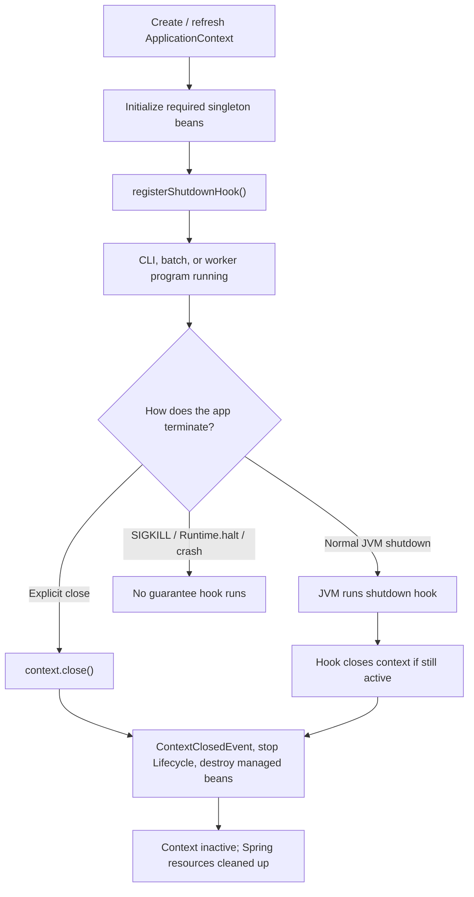

# registerShutdownHook and Terminating Non-Web Spring Applications

## 1. The problem: when main finishes, who closes the ApplicationContext?

In a Spring Framework application **without a web server** — such as a CLI command, batch program, file processing job, command-line tool, or background process — the program itself typically creates and manages an `ApplicationContext`. That container may hold singleton beans, worker threads, connections, buffers, executors, or resources needing cleanup when the application exits.

If you simply create the context and let the JVM exit **without closing the context**, Spring-managed destruction callbacks (such as `@PreDestroy`, `DisposableBean.destroy()`, or custom destroy methods) are not guaranteed to run. For proper lifecycle shutdown, there must be a **path calling `context.close()`**.

Spring provides the method:

```java
context.registerShutdownHook();
```

This method belongs to `ConfigurableApplicationContext` and registers **a JVM shutdown hook for the context**. When the JVM begins a normal shutdown sequence, the hook asks Spring to close the context **if the context has not already been closed**. This gives Spring-managed components the opportunity to stop and release resources.

**Key points to remember:**

- `registerShutdownHook()` **registers a deferred action to close the context later**; this call does not close the context immediately.
- `close()` **closes the context immediately at the point code calls it**, synchronously per normal lifecycle contract; it can be used in `finally` or `try-with-resources` when the completion point of the work is known.
- For CLI applications with a clear completion point, **explicit closing is the primary choice**; a shutdown hook is a useful fallback for JVM shutdown paths.
- A shutdown hook **is not guaranteed to run** if the process is forcibly killed, the JVM encounters a fatal error, or the OS does not grant enough shutdown time.
- A shutdown hook **does not automatically stop all non-daemon threads**, and registering a hook by itself **does not make a running program terminate immediately**.

These points belong to the **context lifecycle** and have no mandatory link to servlets, HTTP requests, or Spring MVC. In Spring Boot applications, the framework typically already coordinates context shutdown; do not mechanically register an extra hook when the framework mechanism already meets requirements.

## 2. API and flow diagram

`registerShutdownHook()`, `close()`, `isActive()`, and other configuration operations belong to the interface:

```java
org.springframework.context.ConfigurableApplicationContext
```

`AnnotationConfigApplicationContext` is an implementation usable for programs without a web server:

```java
AnnotationConfigApplicationContext context =
        new AnnotationConfigApplicationContext(AppConfig.class);

context.registerShutdownHook();
// Begin working with beans...
```

This is an **illustrative integration snippet**, requiring imports for `AnnotationConfigApplicationContext` and configuration class `AppConfig`. The constructor taking `AppConfig.class` **already invokes `refresh()` automatically**. You do not need to call `refresh()` again, and for this context type, a second refresh is not supported.

Main timeline:



The diagram depicts general semantics, not a promise that every component has a destruction callback or every OS form emits a controlled shutdown event. If a resource is not owned by Spring, the program must have its own cleanup mechanism.

### 2.1. When does the JVM invoke the hook?

According to the `Runtime.addShutdownHook(Thread)` contract in Java 17, scenarios where the JVM normally starts shutdown include:

1. **Normal program termination**: no non-daemon threads remain running (e.g., `main` returns and no non-daemon thread keeps the process alive).
2. **A call to `System.exit(status)`** or `Runtime.getRuntime().exit(status)`.
3. **Appropriate external termination signals**: on supporting operating systems and environments, actions such as Ctrl+C/SIGINT or SIGTERM can trigger the JVM shutdown sequence.

When shutdown begins, the JVM runs registered hooks as threads. If **multiple hooks** exist, the JVM **does not guarantee execution order** among them; hooks can run concurrently. Therefore, do not design "hook A always closes the logger first, hook B always commits the transaction later" based on registration order.

A shutdown hook must be concise and able to finish. It should not block indefinitely, wait for keyboard interaction, or strictly depend on a service that another shutdown hook is simultaneously closing.

### 2.2. When is the hook not guaranteed?

- **SIGKILL** (`kill -9` on Unix/Linux), `Runtime.halt(...)`, and forced process termination methods bypass orderly shutdown.
- Fatal JVM crashes, native errors, or power loss can prevent hooks from running or completing.
- Containers/orchestrators may grant a process only a short **grace period** before forcibly killing it if shutdown drags on.
- If the JVM still has an **infinitely running non-daemon thread**, `main` returning is not enough for the JVM to enter shutdown; hooks will not run merely because `main` ended.
- Once shutdown has started, code cannot register or remove hooks in the usual way: `Runtime.addShutdownHook`/`removeShutdownHook` may throw `IllegalStateException` if the JVM is shutting down.

**Do not rely on a shutdown hook to guarantee critical data has been durably persisted.** For batch/jobs, commit/flush/checkpoint during processing, with appropriate retry or transaction policies. A hook is a cleanup latch, not a system guaranteeing completion of interrupted work.

## 3. How does registerShutdownHook differ from close, stop, and refresh?

| Operation | Purpose | Context still usable after call? | Relationship to bean lifecycle |
|---|---|---|---|
| `refresh()` | Initialize/finalize context, process config, create non-lazy singletons, and publish refresh event | Yes if successful | Executes bean initialization steps; may auto-start `SmartLifecycle` |
| `start()` | Invoke eligible `Lifecycle` beans to start operating | Yes | Does not recreate all singletons or re-run `@PostConstruct` |
| `stop()` | Instruct `Lifecycle` beans to stop | Yes; context stays active | Does not automatically destroy all singletons |
| `close()` | Close container according to managed lifecycle | No longer an active context | Publishes shutdown event, stops lifecycle components, destroys beans within destruction scope |
| `registerShutdownHook()` | Register callback so JVM can call close later | Yes; registering does not shut down context | Does not directly run `@PreDestroy`/`destroy()` at registration time |

**`registerShutdownHook()` is not another form of `close()`.** It merely sets up a mechanism so `close()` happens at JVM shutdown if the context is still open.

Different context types have their own refresh limits. With `AnnotationConfigApplicationContext` (extending `GenericApplicationContext`), refreshing multiple times is not a valid restart technique; restarting a CLI process normally means creating a new context or reorganizing lifecycle. `stop()`/`start()` manage active lifecycle components; they do not revive a `close()`d context.

### 3.1. What does closing a context do?

On a standard `AbstractApplicationContext`, the closing sequence includes:

1. Mark and begin valid shutdown handling, publishing `ContextClosedEvent` while necessary components are still available.
2. Ask `LifecycleProcessor` to stop running `Lifecycle`/`SmartLifecycle` components.
3. Destroy singleton beans whose destruction the context is responsible for managing; e.g., running `@PreDestroy`, `DisposableBean.destroy()`, and custom `destroy-method` under matching conditions.
4. Release/close the bean factory and infrastructure resources per implementation, transitioning the context to inactive.

Order depends on the specific context type and extensions; with standard `AbstractApplicationContext`, `ContextClosedEvent` is published **before** stopping `LifecycleProcessor` and destroying singletons. Do not assume listeners receive this event after every bean has already been destroyed.

**Prototypes are an important exception:** Spring manages creation/injection/initialization of prototypes, yet **does not automatically invoke destruction callbacks for prototypes already handed to callers** when closing the context. If a prototype holds a stream/connection/socket, the caller or resource owner must `close()` it at the right time.

### 3.2. Does calling close before JVM shutdown destroy things twice?

`ConfigurableApplicationContext.close()` is designed so repeated calls do not re-run the entire shutdown of an already-closed context. In the `AbstractApplicationContext` implementation, an explicit `close()` also has a mechanism to remove the registered JVM shutdown hook when possible, since the hook is no longer needed.

Consequently, a context can register a hook **and still close explicitly** in `finally`. Do not expect the later JVM shutdown to re-run `@PreDestroy` of already-destroyed singletons, and certainly do not write multiple custom shutdown hooks calling cleanup on the same resource through different paths without duplicate-close protection.

## 4. Practical Java 17+ example running in its own JVM

We will build a small CLI application with a Spring bean `Worker`:

- The bean is created when the context refreshes.
- `Worker` implements `Lifecycle` and is started by `context.start()`.
- `Worker` implements `DisposableBean` to clearly print the destruction callback.
- The context calls `registerShutdownHook()`.
- Run default mode so `main` returns and the JVM invokes the hook automatically.
- Run `manual` mode to compare against explicit `context.close()`.

To avoid differences when a build tool runs `main` inside the build tool's own JVM, the demo packages into a JAR with a main class and runs with **`java -jar`**. This creates an independent JVM process to observe the shutdown hook accurately.

**Requirements:** JDK 17+ and Maven 3.9+.

Structure:

```text
shutdown-hook-demo/
├── pom.xml
└── src/main/java/example/ShutdownHookDemo.java
```

File `pom.xml`:

```xml
<project xmlns="http://maven.apache.org/POM/4.0.0"
         xmlns:xsi="http://www.w3.org/2001/XMLSchema-instance"
         xsi:schemaLocation="http://maven.apache.org/POM/4.0.0
                             https://maven.apache.org/xsd/maven-4.0.0.xsd">
    <modelVersion>4.0.0</modelVersion>
    <groupId>example</groupId>
    <artifactId>shutdown-hook-demo</artifactId>
    <version>1.0.0</version>

    <properties>
        <maven.compiler.release>17</maven.compiler.release>
        <project.build.sourceEncoding>UTF-8</project.build.sourceEncoding>
    </properties>

    <dependencies>
        <dependency>
            <groupId>org.springframework</groupId>
            <artifactId>spring-context</artifactId>
            <version>6.2.19</version>
        </dependency>
    </dependencies>

    <build>
        <plugins>
            <plugin>
                <groupId>org.apache.maven.plugins</groupId>
                <artifactId>maven-compiler-plugin</artifactId>
                <version>3.13.0</version>
            </plugin>
            <plugin>
                <groupId>org.apache.maven.plugins</groupId>
                <artifactId>maven-shade-plugin</artifactId>
                <version>3.6.0</version>
                <executions>
                    <execution>
                        <phase>package</phase>
                        <goals><goal>shade</goal></goals>
                        <configuration>
                            <transformers>
                                <transformer implementation="org.apache.maven.plugins.shade.resource.ManifestResourceTransformer">
                                    <mainClass>example.ShutdownHookDemo</mainClass>
                                </transformer>
                            </transformers>
                        </configuration>
                    </execution>
                </executions>
            </plugin>
        </plugins>
    </build>
</project>
```

File `src/main/java/example/ShutdownHookDemo.java`:

```java
package example;

import org.springframework.beans.factory.DisposableBean;
import org.springframework.context.Lifecycle;
import org.springframework.context.annotation.AnnotationConfigApplicationContext;
import org.springframework.context.annotation.Bean;
import org.springframework.context.annotation.Configuration;

public class ShutdownHookDemo {

    public static void main(String[] args) {
        var context = new AnnotationConfigApplicationContext(Config.class);

        context.registerShutdownHook();
        context.start();

        System.out.println("context active: " + context.isActive());
        System.out.println("main completed work");

        if (args.length > 0 && "manual".equals(args[0])) {
            context.close();
            System.out.println("manual close completed");
        }
        // Without "manual", main returns.
        // Once no other non-daemon threads remain, the JVM shuts down and
        // the Spring hook closes the unclosed context.
    }

    @Configuration(proxyBeanMethods = false)
    public static class Config {
        @Bean
        public Worker worker() {
            return new Worker();
        }
    }

    public static final class Worker implements Lifecycle, DisposableBean {
        private boolean running;

        public Worker() {
            System.out.println("construct worker");
        }

        @Override
        public void start() {
            running = true;
            System.out.println("Lifecycle.start");
        }

        @Override
        public void stop() {
            running = false;
            System.out.println("Lifecycle.stop");
        }

        @Override
        public boolean isRunning() {
            return running;
        }

        @Override
        public void destroy() {
            System.out.println("DisposableBean.destroy");
        }
    }
}
```

Build the JAR:

```bash
mvn -q clean package
```

### 4.1. Path A: main finishes, JVM triggers shutdown hook

```bash
java -jar target/shutdown-hook-demo-1.0.0.jar
```

In a simple CLI environment like the example, stdout from the **program** looks like:

```text
construct worker
Lifecycle.start
context active: true
main completed work
Lifecycle.stop
DisposableBean.destroy
```

Explanation:

1. The `AnnotationConfigApplicationContext(Config.class)` constructor performs refresh immediately; singleton `Worker` is created and prints `construct worker`.
2. `registerShutdownHook()` **does not** print any line or stop any bean.
3. `context.start()` causes `LifecycleProcessor` to invoke `Worker.start()`.
4. `main` reports completion and returns. Because the demo creates no infinitely running non-daemon threads, the JVM can begin normal shutdown.
5. Spring's shutdown hook invokes context-closing logic; `Lifecycle.stop()` runs, then Spring invokes the singleton's `DisposableBean.destroy()`.

Spring or libraries on the classpath may also write separate logs depending on configuration. The stdout table above describes only the `System.out.println` lines explicitly printed by the demo. If a real program registers additional hooks, log ordering from **other hooks** is not guaranteed; the demo does not rely on their presence.

### 4.2. Path B: explicit close before main returns

```bash
java -jar target/shutdown-hook-demo-1.0.0.jar manual
```

Lines printed by the program:

```text
construct worker
Lifecycle.start
context active: true
main completed work
Lifecycle.stop
DisposableBean.destroy
manual close completed
```

This time `context.close()` is called **inside main**, so stop/destroy lines appear **before** the `manual close completed` message. The context is already closed; there is no duplicate destroy when the JVM shuts down.

The visible difference is **cleanup timing**: the hook cleans up during the JVM shutdown phase, whereas explicit close cleans up right at the call site. In real batch/CLI programs where work completion and the need to release locks/files are clearly known, do not delay cleanup until JVM exit if the process still needs to keep working.

### 4.3. How to verify the code meets expectations

- `Worker` is a default singleton via `@Bean`; refresh creates one instance.
- Plain `Lifecycle` **does not auto-start on refresh**; hence `context.start()` is what prints `Lifecycle.start`. If changed to `SmartLifecycle` with auto-start, startup timing can shift to refresh.
- `DisposableBean.destroy()` runs when the context is closed, not when only `context.stop()` is called.
- There is no `System.exit()`, `Runtime.halt()`, or sleep/timer, so the demo does not obscure closing timing.
- `context.registerShutdownHook()` is called **after context refresh**. It can be called before a `Lifecycle` bean `start()`s; registering the hook does not dictate whether beans are running.

The practical example does not simulate SIGKILL: there is no way to guarantee printing `destroy` after the JVM is forcibly killed. Do not use dangerous signals just to test this mechanism; observing the normal shutdown path is enough for learning.

## 5. For finite CLI apps, prefer try-with-resources

A data import, report export, or batch processing command has a deterministic endpoint. In such cases, `AnnotationConfigApplicationContext` implements `AutoCloseable` and can be placed in `try-with-resources` to close the container even when the job throws an error.

```java
public static void main(String[] args) {
    try (var context =
                 new AnnotationConfigApplicationContext(BatchConfig.class)) {
        ImportJob job = context.getBean(ImportJob.class);
        job.run();
    } // Spring context.close() is automatically called when exiting the block.
}
```

This is **contextual illustrative code**, needing `BatchConfig` and an `ImportJob` bean with a `run()` method. This snippet is not a standalone program. A key property of `try-with-resources`: whether the block completes normally or throws an exception, Java invokes `close()` for successfully initialized resources, as long as the process is still executing normal Java code.

When error handling and returning an exit code are needed, you can write:

```java
public static int executeBatch() {
    try (var context =
                 new AnnotationConfigApplicationContext(BatchConfig.class)) {
        return context.getBean(ImportJob.class).run();
    }
}
```

This example assumes `ImportJob.run()` returns an `int`. `return` inside the block does not skip cleanup: `context.close()` is invoked before the method actually returns the result. If destruction also throws an exception, Java applies try-with-resources suppressed exception rules so the primary error information is not lost.

If a program simply runs to completion and exits, **there is no need to add `registerShutdownHook()` to compensate for not closing the context**. Once the context is placed in `try-with-resources`, the normal close path is crystal clear. You can combine a shutdown hook when there is a need to catch external JVM shutdown signals while a task is running, but keep cleanup idempotent and avoid relying on the hook as the sole data-safety mechanism.

### 5.1. Why is finally also suitable?

```java
AnnotationConfigApplicationContext context =
        new AnnotationConfigApplicationContext(BatchConfig.class);
try {
    context.getBean(ImportJob.class).run();
} finally {
    context.close();
}
```

This is an **integration snippet** requiring `BatchConfig` and `ImportJob`. When the context is created in an initializer before `try`, if the constructor throws an error the assignment does not complete; consider the lifecycle and cleanup of previously created resources. When possible, `try-with-resources` is usually cleaner and easier to control.

**Note:** if code calls `System.exit(...)` directly **inside** a `try` block, do not assume `finally`/`try-with-resources` will always execute as in a normal return or throw. `System.exit` starts JVM shutdown rather than unwinding out of the block normally. To ensure explicit `close()`, **return the exit status to the main layer**, let the closing block finish, and only then consider calling `System.exit(status)` at the outer layer when necessary.

## 6. A background application needs additional stop and timeout rules

For long-running non-web workers, there may be queue consumers, polling threads, timers, or executors. Registering a hook only ensures **asking Spring to close the context when the JVM begins shutting down**. To actually stop cleanly, the worker component must integrate lifecycle:

- **`Lifecycle`**: provides `start()`, `stop()`, `isRunning()`. The container can call stop when the context closes. Implementations must stop accepting work and wait/cancel tasks per policy.
- **`SmartLifecycle`**: adds auto-start, phase ordering, and `stop(Runnable callback)` for potentially asynchronous shutdown. The callback must be invoked **when stopping finishes**, so the lifecycle processor can proceed.
- **Destruction callbacks**: use `@PreDestroy`, `DisposableBean.destroy()`, or custom destroy methods for resources belonging to singleton/context lifecycles.
- **Resource owner**: manually created resources or allocated prototype beans need an owner, because Spring does not automatically destroy every prototype instance.

Example skeleton of a worker:

```java
public final class QueueConsumer implements Lifecycle, DisposableBean {
    private volatile boolean running;

    @Override
    public void start() {
        running = true;
        // Start appropriate consumer / worker thread.
    }

    @Override
    public void stop() {
        running = false;
        // Stop pulling new jobs, wait for or cancel in-flight jobs
        // per application timeout/policy.
    }

    @Override
    public boolean isRunning() {
        return running;
    }

    @Override
    public void destroy() {
        // Close clients, file handles, executors, and resources owned by the bean.
    }
}
```

This is an **illustrative skeleton**, requiring `Lifecycle` and `DisposableBean` imports; it does not run a real consumer itself. In production code, a boolean is not enough to stop a thread blocked reading a socket/queue. You must interrupt/cancel/close via the proper APIs, drain queues, and avoid deadlocks between `stop()`, `destroy()`, and event listeners.

### 6.1. The non-daemon thread problem

Suppose a `@Bean` creates an `ExecutorService` with non-daemon threads and never shuts it down. When `main` returns, the thread pool still exists; the JVM **has not begun shutting down just because main finished**, so the shutdown hook has **not run either**. If you rely solely on the hook to close the very executor keeping the JVM alive, the application can enter a circular wait: the hook waits for JVM shutdown, while the JVM waits for non-daemon threads to exit.

The proper design ensures an explicit path to stop workers/executors when jobs finish or a shutdown signal is handled; support cancellation/timeouts or explicit `context.close()` from the orchestration layer. With daemon threads, the JVM can shut down as soon as non-daemon threads finish, yet daemon tasks can also be terminated before finishing; do not use daemon threads as a way to guarantee business work completes.

Also avoid spawning unbounded non-daemon threads inside a shutdown hook or awaiting a task that depends on the very context already being closed.

## 7. Running under systemd, Docker, and cloud environments

Even when an application does not serve HTTP, it may run as a service in an OS or container. Shutdown mechanisms must be coordinated with the process manager:

1. **Receiving termination signals**: process managers usually send a graceful signal like SIGTERM when requesting a stop. The JVM can trigger shutdown hooks if the signal is processed through the normal shutdown mechanism.
2. **Time limit**: after a grace period, the manager may use a forced kill. Hooks must complete within the allotted time.
3. **Actual PID of the JVM**: if a shell entrypoint does not `exec` the Java process or fails to forward signals, the JVM might not directly receive the signal you expect.
4. **Stop order**: work-accepting components should stop accepting new items before databases/clients/dependencies are destroyed; with `SmartLifecycle`, check phases and dependency ordering.
5. **Persistence**: critical data must be committed/checkpointed during processing; avoid relying on shutdown hooks during forced termination.
6. **Observability**: log/emit metrics for stop state, remaining unfinished jobs, and shutdown reason; separate job failures from cleanup failures.

Conceptual Docker entrypoint example:

```dockerfile
ENTRYPOINT ["java", "-jar", "/app/app.jar"]
```

This is a **Dockerfile snippet** assuming `/app/app.jar` already exists. The direct exec form ensures the JVM is usually the main process in the container and receives signals from the runtime more reliably than a complex shell wrapper chain. However, how signals are sent/forwarded and grace periods still depend on orchestrator config, OS, and stop policies.

If the program runs inside a job scheduler/cloud function, the lifecycle may be controlled by the platform. Do not claim shutdown hooks are always invoked in every case where the platform terminates instances or reclaims resources.

## 8. Comparing Spring's hook with a custom Runtime.addShutdownHook

You can register one manually:

```java
Runtime.getRuntime().addShutdownHook(new Thread(() -> {
    System.out.println("JVM is shutting down");
}));
```

This is a Java 17 snippet runnable in `main` of a regular Java program. However, if the goal is specifically to close an `ApplicationContext`, usually prefer:

```java
context.registerShutdownHook();
```

Spring already provides a way to attach a hook to context closing, coordinating closed state and the container's lifecycle steps. Writing a custom hook solely to call `context.close()` can create unnecessary structure or overlapping cleanup paths.

**When should a custom hook still be used?** When cleaning up non-Spring resources, emitting an independent signal, or handling special process-level logic. In that case, treat hooks as running concurrently in an unspecified order; a custom hook **must not assume** it can access all singletons after Spring's hook begins closing the context.

If cleanup truly depends on Spring beans, it is usually better to put cleanup into `Lifecycle`, `SmartLifecycle`, `@PreDestroy`, or a custom destroy method on a Spring-managed bean. Then Spring orchestrates it within **a single context-closing path** rather than competing hooks.

### 8.1. What if registered multiple times?

The `ConfigurableApplicationContext.registerShutdownHook()` contract permits calling it multiple times; Spring registers at most **one shutdown hook per context instance**. That does not mean at most one hook for the entire JVM: different contexts or other libraries can still register their own hooks.

If there is a **parent/child context**, each context has its own lifecycle. `close()` on a child context **does not automatically close the parent** per `ConfigurableApplicationContext`'s contract. You must establish context ownership and proper closing order; registering hooks on all contexts and hoping the JVM picks the right order is a fragile design.

## 9. Differences when using Spring Boot without a web server

A Spring Boot CLI application can declare `WebApplicationType.NONE`:

```java
SpringApplication app = new SpringApplication(BatchApplication.class);
app.setWebApplicationType(WebApplicationType.NONE);
ConfigurableApplicationContext context = app.run(args);
```

This is **Boot integration illustrative code**, requiring imports for `SpringApplication`, `WebApplicationType`, `ConfigurableApplicationContext`, a `BatchApplication` class, and Spring Boot dependencies. `NONE` prevents Boot from creating a web application context/server, yet does not automatically solve all resource-closing and batch-termination policies.

Spring Boot has built-in shutdown hook management at the `SpringApplication` layer according to configuration; many Boot apps do not need to manually call `registerShutdownHook()` like pure Spring Context apps. You must still ensure worker threads terminate, critical resources are committed/closed, and the application has a clear exit point.

In a Boot CLI using `ApplicationRunner` or `CommandLineRunner`, do not assume that a runner finishing means every JVM component shuts down automatically. If non-daemon threads remain, the process may continue. If you need to exit the application with an exit code, you can use `SpringApplication.exit(context)` to close the context and obtain the exit code per Boot's contract, followed by `System.exit(code)` when appropriate for the host environment. Distinguish Boot-specific APIs from Spring Framework's `ConfigurableApplicationContext.registerShutdownHook()`.

Boot code is omitted from the Maven example in section 4; that example depends only on `spring-context` because the topic addresses context lifecycles outside web environments.

## 10. Common mistakes and consequences

| Mistake | Consequence | Fix |
|---|---|---|
| Creating context in main without `close()` or registering hook | Destruction callbacks are not guaranteed to run | Use `try-with-resources`, `finally`, or `registerShutdownHook` appropriately |
| Calling `registerShutdownHook()` and thinking the context is already closed | Resources remain open and beans stay active | Distinguish **registering a hook** from **calling close now** |
| Calling `stop()` instead of `close()` | Context stays active; singletons are not destroyed | Call `close()` when truly terminating the context |
| Expecting the hook to run on `kill -9` | No normal JVM shutdown sequence occurs | Design crash recovery, checkpoint/retry, and timeouts |
| Waiting for hook after main returns while an infinite non-daemon thread exists | JVM has not shut down so hook has not run | Actively shut down executors/workers or close context via owner |
| Writing multiple hooks and depending on order between them | JVM runs hooks with no guaranteed order, risking races | Move dependent cleanup into a single clear lifecycle/owner |
| Hook waits indefinitely to finish all jobs | Process may be killed before completion | Bounded graceful shutdown, idempotent jobs, retry/checkpoint |
| Calling `System.exit()` inside try and expecting finally | Not a normal block exit flow | Close context first, then return exit status/exit when truly needed |
| Calling hook and also calling `close()` repeatedly out of fear of missing cleanup | Multi-path cleanup is hard to reason about; risk of non-idempotent resource code | Use one clear context owner; Spring close guards already-closed contexts |
| Assuming closing context auto-closes allocated prototypes | Spring does not track prototype destruction by default | Caller/resource owner actively cleans up each prototype |
| Calling `@PreDestroy` on a bean and thinking the whole context closed | Bean-level callback is not a context shutdown API | Use `ConfigurableApplicationContext.close()` |
| Writing a shutdown hook that makes HTTP calls through another bean being destroyed | Race/deadlock if Spring's hook runs concurrently | Put logic inside lifecycle callbacks within the context |
| Forgetting the difference between refresh and start | Lifecycle control operations do not rebuild the context | Refresh to bootstrap; start/stop to control Lifecycle beans |
| Creating multiple application contexts and registering a hook on only one | Other contexts may not get closed | Clarify ownership and configure shutdown for each context |

### 10.1. Shutdown time is not safe for everything

During a shutdown hook, any other component may be stopping simultaneously. Avoid waiting on a thread pool you just shut down, accessing already-destroyed beans, calling `System.exit()` again, or starting a new workflow that requires a fully alive container.

In particular, **do not use a shutdown hook to compensate for missing transaction boundaries**. Committing critical data, saving checkpoints, and releasing locks should happen at points where the program is still in control. When graceful shutdown arrives, prioritize stopping new work, completing or cancelling in-flight work within bounds, and releasing resources.

### 10.2. What if close can also fail?

A destruction callback written in user code can throw an exception; errors may be logged/handled by Spring depending on the hook. Never assume every resource will always close successfully merely because `close()` was called. When building lifecycle handlers, design for:

- **Idempotent cleanup:** closing multiple times does not corrupt state or cause unnecessary errors.
- **Bounded waiting:** do not keep the JVM waiting indefinitely.
- **Clear ownership:** only one component is responsible for closing a resource.
- **Observability:** log cleanup errors thoroughly without exposing sensitive data.
- **Recoverability:** data and jobs can retry after an abnormal shutdown.

Spring provides the lifecycle invocation; the application itself decides how safe it is when external resources are unavailable.

## 11. Design checklist for a non-web application

Before putting a Spring CLI, batch, or worker into production, check:

1. **Where is the context created?** `new AnnotationConfigApplicationContext(Config.class)` is already refreshed; the empty constructor needs `register(...)` and `refresh()` before fetching beans.
2. **Who owns the context?** Is there one top-level location responsible for `close()`?
3. **Does the app have a deterministic endpoint?** If so, prefer `try-with-resources` or `finally`.
4. **Does it need to react to JVM shutdown outside the main flow?** Consider `registerShutdownHook()`, avoiding duplicate shutdown paths.
5. **Are there background workers?** Check `Lifecycle`, `SmartLifecycle`, and stop timeouts.
6. **Do threads/executors keep the JVM alive?** If yes, there must be an active stop mechanism rather than waiting for the hook when the JVM shuts down on its own.
7. **Which resources are Spring-managed and which are caller-managed?** Prototypes and manually `new`ed objects may need separate cleanup.
8. **Is there a SIGTERM/grace period from the host?** Allocate appropriate stop durations; do not treat SIGKILL as graceful.
9. **Can jobs be interrupted mid-flight?** Use idempotency, transactions, checkpoints, and retries.
10. **Are there multiple hooks/contexts?** Do not rely on JVM-chosen shutdown hook ordering.
11. **Have both normal and manual close paths been tested?** Observe `Lifecycle.stop()`, destruction callbacks, and context state.
12. **Was the program run in a standalone JVM?** When testing JVM hooks, use `java -jar` or an independent Java process so you do not confuse it with Maven/IDE JVM lifecycles.

### 11.1. Simple test scenarios

For the section 4 example:

| Scenario | Expected observation | What not to expect |
|---|---|---|
| `java -jar ...` with no args | After `main completed work`, hook closes context, stops then destroys | No `context.close()` call in main |
| `java -jar ... manual` | Stop/destroy run before `manual close completed` | No second destroy at JVM exit |
| Calling only `context.stop()` (if modifying demo) | `Lifecycle.stop()`, context stays active | No `DisposableBean.destroy()` merely from stop |
| Worker holds unshut-down non-daemon thread | JVM may keep running after main | Not guaranteed hook runs right when main returns |
| Forced process kill | No guaranteed cleanup stdout | Cannot use hook as a guaranteed commit transaction |

Do not try to reproduce a SIGKILL failure just to "test callbacks"; for abnormal shutdowns, what needs testing at the business level is **the ability to recover work and data after interruption**.

## 12. Self-check questions

**1. Does `registerShutdownHook()` close the context immediately?**  
No. It registers a hook so the JVM asks the context to close when normal JVM shutdown begins, if the context is not already closed.

**2. For a CLI that knows exactly when it finishes, should you choose `close()` or only a hook?**  
Prefer explicit closing via `try-with-resources`/`finally`; use a hook additionally when a JVM/host-triggered shutdown path is needed.

**3. When the JVM runs multiple shutdown hooks, does registration order decide execution order?**  
No. The JVM does not guarantee order and hooks may run concurrently. Interdependent cleanups should be coordinated by one clear owner/lifecycle.

**4. If a worker uses an infinitely running non-daemon thread, is main returning enough to trigger the hook?**  
No. The JVM does not exit normally while non-daemon threads remain; an active shutdown mechanism is needed for the process to reach shutdown.

**5. Does `System.exit(0)` trigger the hook? What about `Runtime.halt(0)`?**  
`System.exit(0)` initiates the normal shutdown sequence where hooks are run. `Runtime.halt(0)` forcibly terminates the VM and does not run hooks per contract.

**6. Can `registerShutdownHook()` be called multiple times on the same context?**  
Yes; Spring registers at most one shutdown hook per context instance.

**7. Does calling `stop()` make Spring run `@PreDestroy` on all singletons?**  
No. Stop controls lifecycle components; destruction belongs to appropriate close/destroy paths.

**8. At JVM shutdown, does Spring automatically destroy every prototype ever retrieved?**  
No. For prototypes, the caller/resource owner must clean up allocated resources.

**9. Does a parent context close automatically when a child context closes?**  
Not per `ConfigurableApplicationContext.close()`'s contract; the parent has its own lifecycle, needing an owner to ensure appropriate closing.

**10. Why should you not call `System.exit()` inside a try block and rely on `finally` to close the context?**  
Because `System.exit` initiates JVM shutdown instead of exiting the block via normal Java flow; close the context before calling exit or let a shutdown hook coordinate if needed.

## Official reference documentation

- [Spring Framework 6.2 — ConfigurableApplicationContext](https://docs.spring.io/spring-framework/docs/6.2.19/javadoc-api/org/springframework/context/ConfigurableApplicationContext.html): `registerShutdownHook`, `close`, repeated-call contract, and parent context management.
- [Spring Framework 6.2 — AbstractApplicationContext](https://docs.spring.io/spring-framework/docs/6.2.19/javadoc-api/org/springframework/context/support/AbstractApplicationContext.html): shutdown hook implementation, `doClose`, and destruction.
- [Spring Framework — Lifecycle Callbacks](https://docs.spring.io/spring-framework/reference/core/beans/factory-nature.html): initialization/destruction callbacks and Spring-managed bean lifecycle.
- [Spring Framework 6.2 — SmartLifecycle](https://docs.spring.io/spring-framework/docs/6.2.19/javadoc-api/org/springframework/context/SmartLifecycle.html): auto-start, phase, and stop callback.
- [Oracle Java 17 — Runtime.addShutdownHook](https://docs.oracle.com/en/java/javase/17/docs/api/java.base/java/lang/Runtime.html#addShutdownHook(java.lang.Thread)): JVM shutdown events, hook ordering, and scenarios where hooks are not guaranteed to run.
