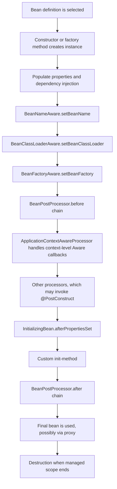

# Aware Callback Ordering in the Spring Bean Creation Lifecycle

## 1. What Is Aware and Why Does Ordering Matter?

In the Spring Framework Core Container, interfaces with the **`Aware`** suffix allow a Spring-managed bean to be notified of a container infrastructure object, such as the bean name, `BeanFactory`, `ApplicationContext`, `Environment`, `ResourceLoader`, or `ApplicationEventPublisher`. A bean declares this need by implementing the interface and providing a callback method like `setBeanName(...)` or `setApplicationContext(...)`.

Example:

```java
public class AuditCoordinator implements BeanNameAware {
    private String beanName;

    @Override
    public void setBeanName(String beanName) {
        this.beanName = beanName;
    }
}
```

This is an **illustrative snippet**; you must import `org.springframework.beans.factory.BeanNameAware` and register the class as a Spring bean for the container to invoke the callback; this snippet is not a standalone runnable application.

Key takeaway of this lesson:

> **In the standard bean initialization lifecycle, Aware callbacks run after the bean is instantiated and properties/dependencies are populated, but before initialization callbacks such as `InitializingBean.afterPropertiesSet()` and custom `init-method`. Not all Aware callbacks execute at a single point: one group is invoked directly by `BeanFactory`, while another is invoked by dedicated `BeanPostProcessor` implementations.**

Therefore, you must distinguish **the order guaranteed by Spring in the standard path**, **the order among `BeanPostProcessor`s**, and **the point when dependencies are already supplied via constructor injection**.

## 2. Timeline of a Normal Bean

A typical singleton bean created by an `ApplicationContext` has a simplified timeline:



The diagram depicts the typical sequence in a default `ApplicationContext`. **Blocks H and I sit within the same before-initialization chain**: if custom-registered `BeanPostProcessor`s or specialized processors exist, the relative order among processors can change. Do not turn an illustrative diagram into a promise that every kind of `Aware` and every custom processor in every application has one absolute global order.

A useful order to remember is:

1. Object creation: constructor or factory method.
2. Complete appropriate dependency injection/property population.
3. Callbacks handled directly by the bean factory: `BeanNameAware` → `BeanClassLoaderAware` → `BeanFactoryAware`.
4. ApplicationContext-level callbacks via `ApplicationContextAwareProcessor` inside the `postProcessBeforeInitialization` chain.
5. Lifecycle annotation callbacks such as `@PostConstruct`, handled by another `BeanPostProcessor` during the before-initialization phase.
6. `InitializingBean.afterPropertiesSet()`.
7. Configured custom init method.
8. `BeanPostProcessor.postProcessAfterInitialization()` chain, which may return a wrapper/proxy.
9. Bean is used; later, destruction callbacks run when the lifecycle warrants it.

`@Autowired` is not an Aware interface. `@Autowired`-based injection can occur at the constructor or during property population via infrastructure post-processing; do not assume you must wait until `setApplicationContext()` before dependencies are injected.

## 3. Three Aware Callbacks Handled Directly by BeanFactory

In the standard bean creation path of `AbstractAutowireCapableBeanFactory`, Spring executes callbacks for the following three Aware interfaces in a specific order when the bean implements them:

| Order | Interface | Callback | Value Received | Meaning |
|---|---|---|---|---|
| 1 | `BeanNameAware` | `setBeanName(String name)` | Bean name in the bean factory | Lets the bean know its registered name |
| 2 | `BeanClassLoaderAware` | `setBeanClassLoader(ClassLoader loader)` | Class loader used by the bean factory | Supports infrastructure needing to load classes |
| 3 | `BeanFactoryAware` | `setBeanFactory(BeanFactory beanFactory)` | `BeanFactory` owning the bean | Grants access to factory APIs when genuinely needed |

These three callbacks are invoked by Spring inside `invokeAwareMethods(...)` of `AbstractAutowireCapableBeanFactory`, after property population and before applying `BeanPostProcessor.postProcessBeforeInitialization()` in the normal initialization path.

The "when the bean implements them" condition is crucial. A bean implementing only `BeanFactoryAware` will **not** receive the other callbacks merely because they precede it in the table. Spring never invokes methods named `setBeanName` on a class that does not implement the corresponding interface.

### 3.1. BeanNameAware

```java
public class NamedComponent implements BeanNameAware {
    @Override
    public void setBeanName(String name) {
        System.out.println("BeanNameAware: " + name);
    }
}
```

This is an **integration snippet**, requiring `BeanNameAware` to be imported and the class registered as a bean. The passed name is the bean name used when creating the instance, **not necessarily the Java class name**. For a bean declared with `@Bean("primaryLedger")`, the callback can receive `primaryLedger`. Bean name aliases, inner beans, or framework-generated names must be interpreted according to the actual bean definition; do not use callback values as immutable business keys across contexts.

### 3.2. BeanClassLoaderAware

```java
public class PluginBridge implements BeanClassLoaderAware {
    private ClassLoader beanClassLoader;

    @Override
    public void setBeanClassLoader(ClassLoader beanClassLoader) {
        this.beanClassLoader = beanClassLoader;
    }
}
```

This is an **integration snippet**, requiring `BeanClassLoaderAware` to be imported. The callback receives the loader used by the factory to load bean classes; it is useful for libraries, plugins, instrumentation, and class-loading infrastructure. Regular business applications should not load classes manually just because Spring provides the class loader.

### 3.3. BeanFactoryAware

```java
public class FactoryInspector implements BeanFactoryAware {
    private BeanFactory factory;

    @Override
    public void setBeanFactory(BeanFactory beanFactory) {
        this.factory = beanFactory;
    }
}
```

This is an **integration snippet**, requiring `BeanFactoryAware` and `BeanFactory` from `org.springframework.beans.factory` to be imported. The callback supplies the factory creating the bean, but **calling `getBean()` arbitrarily inside the callback is not recommended**. At this point the current bean has not completed full initialization; requesting other beans can trigger premature dependency chains, create circular references, or expose an unready object.

Most applications should use constructor injection for mandatory dependencies or `ObjectProvider<T>` when timely lookup is needed, rather than retaining the whole `BeanFactory` in business code.

## 4. Aware Callbacks Handled by ApplicationContextAwareProcessor

`ApplicationContextAware` and several other context-related interfaces **are not invoked in the `invokeAwareMethods` trio above**. When using an `ApplicationContext`, Spring adds `ApplicationContextAwareProcessor` to the `BeanPostProcessor` list. This processor invokes the corresponding callbacks during the **`postProcessBeforeInitialization()` phase**.

In the standard Spring Framework 6.x implementation, `ApplicationContextAwareProcessor` checks interfaces in the following order for a bean implementing multiple interfaces:

| Position in Processor | Interface | Callback | Supplied Value |
|---|---|---|---|
| 1 | `EnvironmentAware` | `setEnvironment(Environment)` | `Environment` of the context |
| 2 | `EmbeddedValueResolverAware` | `setEmbeddedValueResolver(StringValueResolver)` | Resolver for embedded value placeholders/expressions per configuration |
| 3 | `ResourceLoaderAware` | `setResourceLoader(ResourceLoader)` | Loader for Spring resources |
| 4 | `ApplicationEventPublisherAware` | `setApplicationEventPublisher(ApplicationEventPublisher)` | Event publisher of the application context |
| 5 | `MessageSourceAware` | `setMessageSource(MessageSource)` | Message/i18n resolution infrastructure |
| 6 | `ApplicationContextAware` | `setApplicationContext(ApplicationContext)` | The context enclosing the bean |

This is the internal order of **one specific processor** on the default path, not a list of every `Aware` interface that exists in Spring. Interfaces such as `ServletContextAware`, `ServletConfigAware`, `LoadTimeWeaverAware`, `ImportAware`, or `NotificationPublisherAware` belong to other environments or processors, so do not apply this table's ordering to them.

**Example of the gap between BeanFactoryAware and ApplicationContextAware:**

```java
public class ContextInspector
        implements BeanFactoryAware, ApplicationContextAware {

    @Override
    public void setBeanFactory(BeanFactory beanFactory) {
        System.out.println("1 - BeanFactoryAware");
    }

    @Override
    public void setApplicationContext(ApplicationContext applicationContext) {
        System.out.println("2 - ApplicationContextAware");
    }
}
```

This snippet is **integration code**, requiring imports for `BeanFactoryAware`, `BeanFactory`, `ApplicationContextAware`, and `ApplicationContext`, along with a matching bean definition. In a default `ApplicationContext`, `BeanFactoryAware` is invoked in `invokeAwareMethods` and then `ApplicationContextAware` is invoked by `ApplicationContextAwareProcessor` in the before-init chain.

### 4.1. How Does ApplicationContextAware Differ from BeanFactoryAware?

`BeanFactory` is the core interface for managing/retrieving beans; `ApplicationContext` extends the IoC environment with resources, events, messages, environment, and built-in conveniences. A bean receiving both can use them for different needs, yet keeping a context in a field directly couples the bean to the Spring container.

If you only need to publish events, inject `ApplicationEventPublisher`. If you only need to read configuration, inject `Environment` or `@Value`. If you only need a prototype bean at work time, inject `ObjectProvider<T>`. Those choices narrow the dependency and are usually easier to test than calling `applicationContext.getBean(...)` everywhere.

### 4.2. Aware Callbacks and @PostConstruct

`@PostConstruct` is handled by Spring through a lifecycle annotation `BeanPostProcessor` (commonly `CommonAnnotationBeanPostProcessor`, based on `InitDestroyAnnotationBeanPostProcessor`). For standard annotation contexts, the Aware callbacks above occur before init callbacks like `afterPropertiesSet()` or custom init; `@PostConstruct` also belongs to the BPP-before chain.

In a default setup, `ApplicationContextAwareProcessor` is registered early, so `ApplicationContextAware` is normally seen running **before** `@PostConstruct`. However, do not generalize this into a rule that **every custom `BeanPostProcessor.before` always runs before `@PostConstruct`**. That depends on processor ordering. If an application has custom BPPs with special ordering, verify the actual execution order.

### 4.3. What Happens If You Only Implement Aware?

The root interface `org.springframework.beans.factory.Aware` is a marker interface. Implementing **only `Aware`** provides no standard callback method for Spring to call:

```java
public class MarkerOnly implements Aware {
    // No setSomething(...) is defined by Aware itself.
}
```

This is an **illustrative snippet** requiring `Aware` to be imported. To receive a concrete callback, implement the corresponding sub-interface, such as `BeanNameAware` or `EnvironmentAware`. Some interfaces in the Aware family require specialized infrastructure and `BeanPostProcessor`s, so implementing an interface does not guarantee the callback runs in every kind of `BeanFactory`.

## 5. Standalone Runnable Java 17+ Example: Observing Aware Callback Order

This lab uses `AnnotationConfigApplicationContext` to instantiate a bean registered via `@Bean`. The bean implements **many Aware interfaces simultaneously** alongside initialization/destruction callbacks. A custom `BeanPostProcessor` logs markers immediately **before** and **after** init.

The goal is to prove via stdout order that:

- Constructor runs first.
- The `BeanNameAware`, `BeanClassLoaderAware`, `BeanFactoryAware` trio is called in order.
- The six context-related callbacks handled by `ApplicationContextAwareProcessor` sit between the preceding trio and the normally registered custom `before` processor in the example.
- `InitializingBean.afterPropertiesSet()` and custom init follow.
- Custom `BeanPostProcessor.after` runs before application code; destruction only happens when closing the context.

The example omits `@PostConstruct` to keep the demo's log count and order focused purely on the Aware family. `@PostConstruct` mechanics are explained separately in other sections.

**Requirements:** Java 17+, Maven 3.9+, Spring Framework 6.2.0 dependency. No Spring Boot, server, or database needed.

Structure:

```text
aware-order-demo/
├── pom.xml
└── src/main/java/example/AwareOrderDemo.java
```

**File `pom.xml`:**

```xml
<project xmlns="http://maven.apache.org/POM/4.0.0"
         xmlns:xsi="http://www.w3.org/2001/XMLSchema-instance"
         xsi:schemaLocation="http://maven.apache.org/POM/4.0.0
                             https://maven.apache.org/xsd/maven-4.0.0.xsd">
    <modelVersion>4.0.0</modelVersion>
    <groupId>example</groupId>
    <artifactId>aware-order-demo</artifactId>
    <version>1.0.0</version>
    <properties>
        <maven.compiler.release>17</maven.compiler.release>
        <project.build.sourceEncoding>UTF-8</project.build.sourceEncoding>
    </properties>
    <dependencies>
        <dependency>
            <groupId>org.springframework</groupId>
            <artifactId>spring-context</artifactId>
            <version>6.2.0</version>
        </dependency>
    </dependencies>
    <build>
        <plugins>
            <plugin>
                <groupId>org.apache.maven.plugins</groupId>
                <artifactId>maven-compiler-plugin</artifactId>
                <version>3.13.0</version>
            </plugin>
            <plugin>
                <groupId>org.codehaus.mojo</groupId>
                <artifactId>exec-maven-plugin</artifactId>
                <version>3.5.0</version>
            </plugin>
        </plugins>
    </build>
</project>
```

**File `src/main/java/example/AwareOrderDemo.java`:**

```java
package example;

import org.springframework.beans.factory.BeanClassLoaderAware;
import org.springframework.beans.factory.BeanFactory;
import org.springframework.beans.factory.BeanFactoryAware;
import org.springframework.beans.factory.BeanNameAware;
import org.springframework.beans.factory.DisposableBean;
import org.springframework.beans.factory.InitializingBean;
import org.springframework.beans.factory.config.BeanPostProcessor;
import org.springframework.context.ApplicationContext;
import org.springframework.context.ApplicationContextAware;
import org.springframework.context.ApplicationEventPublisher;
import org.springframework.context.ApplicationEventPublisherAware;
import org.springframework.context.EmbeddedValueResolverAware;
import org.springframework.context.EnvironmentAware;
import org.springframework.context.MessageSource;
import org.springframework.context.MessageSourceAware;
import org.springframework.context.ResourceLoaderAware;
import org.springframework.context.annotation.AnnotationConfigApplicationContext;
import org.springframework.context.annotation.Bean;
import org.springframework.context.annotation.Configuration;
import org.springframework.core.env.Environment;
import org.springframework.core.io.ResourceLoader;
import org.springframework.util.StringValueResolver;

public class AwareOrderDemo {

    public static void main(String[] args) {
        try (var context = new AnnotationConfigApplicationContext(Config.class)) {
            TracedBean bean = context.getBean(TracedBean.class);
            System.out.println("15 application: " + bean.status());
        }
    }

    @Configuration(proxyBeanMethods = false)
    public static class Config {

        // Use static @Bean so the processor is registered early enough.
        @Bean
        public static LoggingProcessor loggingProcessor() {
            return new LoggingProcessor();
        }

        @Bean(name = "tracedBean",
              initMethod = "customInit",
              destroyMethod = "customDestroy")
        public TracedBean tracedBean() {
            return new TracedBean();
        }
    }

    public static final class LoggingProcessor implements BeanPostProcessor {
        @Override
        public Object postProcessBeforeInitialization(
                Object bean, String beanName) {
            if ("tracedBean".equals(beanName)) {
                System.out.println("11 BPP.before");
            }
            return bean;
        }

        @Override
        public Object postProcessAfterInitialization(
                Object bean, String beanName) {
            if ("tracedBean".equals(beanName)) {
                System.out.println("14 BPP.after");
            }
            return bean;
        }
    }

    public static final class TracedBean implements
            BeanNameAware,
            BeanClassLoaderAware,
            BeanFactoryAware,
            EnvironmentAware,
            EmbeddedValueResolverAware,
            ResourceLoaderAware,
            ApplicationEventPublisherAware,
            MessageSourceAware,
            ApplicationContextAware,
            InitializingBean,
            DisposableBean {

        public TracedBean() {
            System.out.println("01 constructor");
        }

        @Override
        public void setBeanName(String name) {
            System.out.println("02 BeanNameAware: " + name);
        }

        @Override
        public void setBeanClassLoader(ClassLoader classLoader) {
            System.out.println("03 BeanClassLoaderAware");
        }

        @Override
        public void setBeanFactory(BeanFactory beanFactory) {
            System.out.println("04 BeanFactoryAware");
        }

        @Override
        public void setEnvironment(Environment environment) {
            System.out.println("05 EnvironmentAware");
        }

        @Override
        public void setEmbeddedValueResolver(StringValueResolver resolver) {
            System.out.println("06 EmbeddedValueResolverAware");
        }

        @Override
        public void setResourceLoader(ResourceLoader resourceLoader) {
            System.out.println("07 ResourceLoaderAware");
        }

        @Override
        public void setApplicationEventPublisher(
                ApplicationEventPublisher publisher) {
            System.out.println("08 ApplicationEventPublisherAware");
        }

        @Override
        public void setMessageSource(MessageSource messageSource) {
            System.out.println("09 MessageSourceAware");
        }

        @Override
        public void setApplicationContext(ApplicationContext context) {
            System.out.println("10 ApplicationContextAware");
        }

        @Override
        public void afterPropertiesSet() {
            System.out.println("12 InitializingBean.afterPropertiesSet");
        }

        public void customInit() {
            System.out.println("13 custom init");
        }

        public String status() {
            return "ready";
        }

        @Override
        public void destroy() {
            System.out.println("16 DisposableBean.destroy");
        }

        public void customDestroy() {
            System.out.println("17 custom destroy");
        }
    }
}
```

From the directory containing `pom.xml`, run:

```bash
mvn -q compile exec:java -Dexec.mainClass=example.AwareOrderDemo
```

**Program stdout**, excluding Maven logs if shown by the environment:

```text
01 constructor
02 BeanNameAware: tracedBean
03 BeanClassLoaderAware
04 BeanFactoryAware
05 EnvironmentAware
06 EmbeddedValueResolverAware
07 ResourceLoaderAware
08 ApplicationEventPublisherAware
09 MessageSourceAware
10 ApplicationContextAware
11 BPP.before
12 InitializingBean.afterPropertiesSet
13 custom init
14 BPP.after
15 application: ready
16 DisposableBean.destroy
17 custom destroy
```

### 5.1. Exact Phase-by-Phase Explanation

**Line 01:** `AnnotationConfigApplicationContext(Config.class)` refreshes the context right inside the constructor, reads `@Configuration`, and creates the singleton `tracedBean` per the bean definition. The factory method invokes `new TracedBean()`.

**Lines 02–04:** Spring directly invokes the three `BeanFactory`-managed callbacks in the order `BeanNameAware`, `BeanClassLoaderAware`, `BeanFactoryAware`. Because of `@Bean(name="tracedBean")`, the printed name is `tracedBean`, not `TracedBean`.

**Lines 05–10:** `ApplicationContextAwareProcessor` invokes context-level callbacks during the before-initialization chain. Because this example implements all six interfaces, we observe the processor's internal order in Spring 6.2.0.

**Line 11:** `LoggingProcessor` is also a `BeanPostProcessor`. The processor is registered by Spring in the context and prints when the bean name is `tracedBean`. In standard setups, `ApplicationContextAwareProcessor` is registered early and applied before the custom `LoggingProcessor`.

**Lines 12–13:** `InitializingBean.afterPropertiesSet()` runs followed by custom `@Bean(initMethod="customInit")`. These are two standard initialization callbacks, not Aware callbacks.

**Line 14:** `LoggingProcessor.postProcessAfterInitialization()` runs after init and returns the same `TracedBean`. Since the example creates no proxy, the caller receives the exact initialized object.

**Line 15:** Application code calls `status()` after the context has fully initialized.

**Lines 16–17:** Upon exiting the `try-with-resources` block, `AnnotationConfigApplicationContext.close()` runs; Spring invokes `DisposableBean.destroy()` then custom `destroyMethod="customDestroy"` for the singleton. These lines belong to destruction, **not** `Aware` callbacks or `BeanPostProcessor.after`.

**Distinction to keep in mind:** the ordered list in the demo is intentionally designed to illustrate **Spring 6.2.0 + AnnotationConfigApplicationContext + these selected interfaces**. It does not mean a plain `BeanFactory` always calls the entire context-aware group, nor does it guarantee that every other custom `BeanPostProcessor` falls at step 11 when an application alters registration order.

## 6. Two Different Aware Invocation Mechanisms

Understanding the internal mechanism avoids rote memorization of tables.

### 6.1. BeanFactory Handles the Core Trio

Code equivalent to the logic of `AbstractAutowireCapableBeanFactory.invokeAwareMethods` (purely explanatory, **not verbatim Spring source code**):

```java
// Pseudocode, illustrating conditional order only.
if (bean instanceof BeanNameAware a) {
    a.setBeanName(beanName);
}
if (bean instanceof BeanClassLoaderAware a) {
    a.setBeanClassLoader(beanClassLoader);
}
if (bean instanceof BeanFactoryAware a) {
    a.setBeanFactory(beanFactory);
}
```

These three callbacks occur after object instantiation and property population, yet before the BPP-before chain in the normal bean creation path. Because they belong to the bean factory, even without an `ApplicationContextAwareProcessor`, a `BeanFactory` supporting the standard lifecycle can invoke this Aware trio.

### 6.2. ApplicationContextAwareProcessor Handles the Context-Level Group

Similar conceptual code:

```java
// Pseudocode inside a BeanPostProcessor.before.
if (bean instanceof EnvironmentAware a) {
    a.setEnvironment(context.getEnvironment());
}
if (bean instanceof EmbeddedValueResolverAware a) {
    a.setEmbeddedValueResolver(valueResolver);
}
if (bean instanceof ResourceLoaderAware a) {
    a.setResourceLoader(context);
}
if (bean instanceof ApplicationEventPublisherAware a) {
    a.setApplicationEventPublisher(context);
}
if (bean instanceof MessageSourceAware a) {
    a.setMessageSource(context);
}
if (bean instanceof ApplicationContextAware a) {
    a.setApplicationContext(context);
}
```

This is **pseudocode**, not standalone compilable code: variables `bean`, `context`, and `valueResolver` illustrate the internal context. In a real `ApplicationContext`, Spring manages infrastructure and dependencies per its implementation. The key takeaway is not for callers to write this logic, but that **this group of callbacks is executed by a `BeanPostProcessor`**.

### 6.3. What About Other Aware Interfaces?

`Aware` is the root interface used as a marker. Spring has many branches such as:

| Interface | Environment or Target | Belongs to Either Demo Group? |
|---|---|---|
| `ServletContextAware` | Access `ServletContext` of a Servlet application | No; requires web-aware context/corresponding processor |
| `ServletConfigAware` | Access `ServletConfig` | No; only meaningful in an appropriate servlet environment |
| `ImportAware` | Receive metadata about the declared `@Import` annotation | No; tied to Spring configuration processing |
| `LoadTimeWeaverAware` | Receive `LoadTimeWeaver` when load-time weaving is configured | No; has a dedicated processor/infrastructure |
| `NotificationPublisherAware` | JMX notifications infrastructure | No; requires an appropriate Spring JMX exporter |
| `ApplicationStartupAware` | Participate in application startup observation infrastructure | Do not generalize into the demo sequence |
| `BeanNameAware` | Bean name | BeanFactory group |
| `ApplicationContextAware` | Context enclosing the bean | ApplicationContextAwareProcessor group |

Do not try to assign positions 7, 8, 9... to every Aware interface in existence. Each extension has its own activation contract. Specifically, merely implementing `ServletContextAware` in a context lacking web infrastructure will not cause Spring to fabricate a dummy servlet context for the callback.

## 7. Relationship with @PostConstruct and BeanPostProcessor

A simplified diagram including `@PostConstruct`:

```text
Constructor / factory method
    |
Populate dependencies
    |
BeanNameAware
BeanClassLoaderAware
BeanFactoryAware
    |
BeanPostProcessor.before chain
    |-- ApplicationContextAwareProcessor -> context-level Aware group
    |-- CommonAnnotationBeanPostProcessor -> may invoke @PostConstruct
    |-- other BPPs by registration/order
    |
InitializingBean.afterPropertiesSet
    |
Custom init-method
    |
BeanPostProcessor.after chain
    |
Final bean (possibly proxied)
```

`CommonAnnotationBeanPostProcessor` contains lifecycle annotation handling based on `InitDestroyAnnotationBeanPostProcessor`. `@PostConstruct` belongs to the before-init phase because this callback is handled inside that processor's `postProcessBeforeInitialization`. BPP-after runs **after** `afterPropertiesSet` and custom init; it **does not mean `@PreDestroy`**.

When a bean is wrapped with a Spring AOP proxy, a BPP-after may return the proxy; the final caller receives the proxy instead of the raw target instance on which the Aware callbacks were invoked. Do not rely on `getClass() == SomeClass.class` or object identity at an arbitrary point to conclude there is no wrapper anywhere in the pipeline.

**Order of Aware callbacks vs. @PostConstruct:** under a standard `AnnotationConfigApplicationContext`, the context-aware processor is registered early so context-aware callbacks normally run before `@PostConstruct`. Still, other processors can exist in the before phase, and the API does not promise that every user-added processor will always sit after or before the `@PostConstruct` processor.

## 8. Plain BeanFactory, ApplicationContext, and Child Contexts

### 8.1. A BeanFactory Is Not an ApplicationContext

`DefaultListableBeanFactory` can instantiate beans with many lifecycle mechanisms and handle the trio `BeanNameAware`, `BeanClassLoaderAware`, `BeanFactoryAware`. However, `ApplicationContextAwareProcessor` is infrastructure configured by `ApplicationContext`. If you only build a `BeanFactory` manually without registering the proper processor, `ApplicationContextAware` will not automatically receive a reference as in a full context.

Therefore, the claim "every `Aware` implementation is guaranteed to be called" is false. Callbacks depend on the **container type** and **registered processors**.

### 8.2. Parent and Child Contexts

In systems with multiple contexts, each bean belongs to an owning context/factory. `ApplicationContextAware` supplies a reference to the context **associated with that bean**, not automatically the "root context" regardless of where the bean was declared. A bean in a child context can reference the child context, while a bean in the parent follows the parent's lifecycle.

A parent bean looked up from a child does not mean the bean is recreated in the child or that `setApplicationContext(child)` runs again. Callbacks are tied to the moment **the bean instance is created and initialized by its owning container**. Distinguish cross-hierarchy lookup flows from bean ownership lifecycles.

### 8.3. ApplicationContextAware vs. Constructor Injection

If you only need `ApplicationContext` or a narrow piece of it, you can inject it directly into the constructor because Spring supports resolving appropriate infrastructure dependencies:

```java
public class MetadataReader {
    private final Environment environment;

    public MetadataReader(Environment environment) {
        this.environment = environment;
    }
}
```

This is **illustrative code**: import `org.springframework.core.env.Environment` and manage the bean via Spring constructor injection. `Environment` here is available from construction time; there is no need to wait for `EnvironmentAware.setEnvironment`.

If a class genuinely needs `ApplicationContext`, constructor injection can also receive `ApplicationContext` directly in many setups. Still, from a design standpoint, passing narrow dependencies like `Environment`, `ResourceLoader`, or `ApplicationEventPublisher` is usually easier to read and test.

## 9. Safety and Design Considerations

### 9.1. Aware Couples Code to Spring

A class implementing `BeanFactoryAware` or `ApplicationContextAware` depends on Spring interfaces. That makes sense for infrastructure libraries, framework integrations, bean factory utilities, or plugin loaders, but most business services do not need exposure to the whole container.

Example to avoid overusing:

```java
public class PaymentService implements ApplicationContextAware {
    private ApplicationContext context;

    @Override
    public void setApplicationContext(ApplicationContext context) {
        this.context = context;
    }

    public void pay() {
        PaymentGateway gateway = context.getBean(PaymentGateway.class);
        gateway.charge();
    }
}
```

This is **illustrative code depending** on a `PaymentGateway` class with a `charge()` method, plus the necessary Spring imports. It works conceptually yet turns a domain class into a service locator. If `PaymentGateway` is required, direct constructor injection is usually clearer. If a fresh prototype is needed each time, `ObjectProvider<PaymentGateway>` expresses deferred lookup intent without dragging in the entire context.

### 9.2. Do Not Call getBean Too Early Inside Aware

When `setBeanFactory()`/`setApplicationContext()` is called, **the current bean has not passed through all initialization callbacks yet**. Another `getBean()` call can trigger premature creation of a second bean, circular dependencies, or access to unready state. This becomes especially hard to debug if an Aware callback performs network I/O or spawns a parallel job.

Use callbacks mainly to **store the required infrastructure reference**. Starting work that relies on fully initialized beans belongs in an appropriate init/lifecycle hook or a business method invoked after startup. For operations requiring all singletons to be ready, consider `SmartInitializingSingleton` or an appropriate startup/application event rather than forcing it into `setApplicationContext`.

### 9.3. Do Not Confuse Aware with Thread Safety or Destroy Lifecycle

Aware callbacks do not make a bean thread-safe, do not create a new scope, do not turn a bean into a singleton, and **are not destruction callbacks**. For prototype beans, Aware callbacks can run each time the container creates an instance. Yet when `ApplicationContext.close()` runs, Spring does not automatically destroy every prototype already handed out; the caller remains responsible for cleaning up prototypes holding resources.

For singleton beans, Aware callbacks normally run once when the singleton is created; calling `context.getBean()` repeatedly does not re-run `setBeanName()` or `setApplicationContext()`, because the object is already initialized.

## 10. Common Misconceptions

| Misconception | Reality | How to Handle |
|---|---|---|
| "All Aware interfaces are called by Spring in one pass" | Multiple mechanisms exist: directly by BeanFactory and via dedicated BPPs | Distinguish the three BeanFactory Aware callbacks from the context-aware group |
| "`ApplicationContextAware` always runs before `BeanNameAware`" | In standard Spring contexts `BeanNameAware` is called by BeanFactory before context-level BPPs | Observe the demo order |
| "Implementing `Aware` is enough" | `Aware` is a marker; it declares no concrete callback | Implement the specific sub-interface needed |
| "`setApplicationContext` runs before the constructor" | The callback happens after object creation and appropriate DI | Distinguish construction, population, and initialization |
| "`BeanFactoryAware` and `ApplicationContextAware` pass the same parameter" | One receives `BeanFactory`, the other receives `ApplicationContext` | Pick the right contract; avoid unwarranted casts |
| "`@PostConstruct` is always after every BPP.before" | `@PostConstruct` is invoked by a processor **inside the before chain** | Consider processor registration/ordering |
| "Spring invokes `ServletContextAware` in a CLI context" | Requires web-specific infrastructure | Do not expect Servlet context in a CLI app |
| "All callbacks run on every `getBean()`" | Singletons are reused, not re-initialized per lookup | Distinguish scope and instantiation count |
| "Having an Aware callback lets you auto-start workers" | Aware only supplies infrastructure; `Lifecycle`/`SmartLifecycle` manages start/stop | Choose the right extension point |
| "`setBeanFactory()` is a good place to call every `getBean` immediately" | Risks early bean creation/circular dependencies | Avoid early lookups; use DI/providers |
| "`ApplicationContextAware` is always supplied in a plain BeanFactory" | Requires `ApplicationContextAwareProcessor` or equivalent | Check container and registered BPPs |
| "Aware callbacks are `@PreDestroy`" | Aware belongs to setup/initialization, not cleanup | Use scope-appropriate destruction callbacks |

## 11. Verification Checklist When Callbacks Run Out of Expected Order

When Aware logs look different from expectations, check:

1. **What is the actual container?** Is it a fully refreshed `ApplicationContext`, or just a manually constructed `DefaultListableBeanFactory`?
2. **Who created the bean?** Created by the container (via constructor/`@Bean`) or instantiated via `new` outside Spring?
3. **Which interfaces does the bean implement?** Callbacks only fire for the matching sub-interfaces and when the right processor is active.
4. **Are there custom BeanPostProcessors?** Context-level callbacks run in the BPP-before phase; order relative to custom processors depends on registration/ordering.
5. **Is `@PostConstruct` present?** That callback sits inside the annotation processor's before phase. Do not apply an oversimplified BPP ordering rule.
6. **Is the bean singleton or prototype?** Count actual instances created, rather than how many times code calls `getBean`.
7. **Is there a proxy?** Callbacks may run on the target while callers receive a post-init wrapper.
8. **Are there parent/child contexts?** A parent bean does not automatically re-receive Aware callbacks for a child context.
9. **Did a callback request another bean too early?** Calling `getBean()` from Aware can alter when beans are created and interleave logs.
10. **Did a listener or infrastructure bean initialize earlier?** Do not infer global order across all beans from one bean's log; many beans initialize along the dependency graph.

**The most useful way to test** is to add logging or sequence recording inside the Aware callbacks of **a single bean**, rather than comparing stdout numbers across hundreds of unrelated beans. If strict verification is needed, use a minimal context, clear bean names, and register only the required processors.

### 11.1. Simulating Data Enough to Test Without Spring

In plain Java unit tests, you can call Aware setters directly like normal Java methods, though that **does not test** whether Spring invokes them in the right order. Such a test only verifies code inside the callback. To test real lifecycle ordering, you must boot a Spring `ApplicationContext` and obtain the bean from the container.

Do not write tests mocking `ApplicationContext` with dozens of APIs just to call `setApplicationContext` if the class can accept a narrower dependency in its constructor. When design permits, switching to constructor injection generally eliminates the need for specialized lifecycle testing.

## 12. Self-Check Exercises

**1. Does `BeanNameAware` run before or after the constructor and dependency injection?**  
In the normal bean creation path, the callback runs after the object is instantiated and appropriate properties/dependencies are populated; before init callbacks.

**2. What is the order of `BeanNameAware`, `BeanClassLoaderAware`, and `BeanFactoryAware`?**  
In that exact order inside `AbstractAutowireCapableBeanFactory.invokeAwareMethods` in Spring Framework 6.x.

**3. Is `ApplicationContextAware` handled in the same method as the three interfaces above?**  
No. In an `ApplicationContext`, it is handled by `ApplicationContextAwareProcessor` during the `BeanPostProcessor.before` phase.

**4. If a bean implements `EnvironmentAware`, `ResourceLoaderAware`, and `ApplicationContextAware`, which callback runs first in the standard processor?**  
`EnvironmentAware`, then `ResourceLoaderAware`, then `ApplicationContextAware` (considering only those three). If the bean also implements other interfaces in the table, their corresponding callbacks appear in between according to their positions.

**5. Is `@PostConstruct` an Aware method?**  
No. It is a lifecycle annotation callback triggered by Spring through a dedicated `BeanPostProcessor` in the before-init phase.

**6. Why can a custom BPP log `after` before a client uses the bean?**  
Because `postProcessAfterInitialization` is a hook that processes the bean after regular initialization yet before the final bean reference is handed to the caller.

**7. Does `BeanFactoryAware` make a good universal replacement for constructor injection in business services?**  
No. It increases coupling to the Spring container and can cause premature lookups. Prefer direct dependency injection or `ObjectProvider` when needed.

**8. Does `BeanNameAware` run when calling `new YourClass()` outside the container?**  
Not automatically. Java only executes the constructor; Spring must create/manage the bean for callbacks to run.

**9. For a prototype bean, how many times do Aware callbacks run?**  
Normally once each time Spring creates a corresponding prototype instance; not on every method call against an existing instance.

**10. If a bean implements `ApplicationContextAware`, is `@PreDestroy` called when closing the context across all scopes?**  
No. Destruction depends on scope; Spring does not automatically manage destruction for already-issued prototypes.

## Official References

- [Spring Framework Reference — ApplicationContextAware and BeanNameAware](https://docs.spring.io/spring-framework/reference/core/beans/factory-nature.html#beans-factory-aware): meaning of Aware callbacks and timing relative to initialization.
- [Spring Framework Reference — Other Aware Interfaces](https://docs.spring.io/spring-framework/reference/core/beans/factory-nature.html): Aware interfaces and container-supplied resources.
- [Spring Framework API — AbstractAutowireCapableBeanFactory](https://docs.spring.io/spring-framework/docs/6.2.0/javadoc-api/org/springframework/beans/factory/support/AbstractAutowireCapableBeanFactory.html): `initializeBean` mechanics and core Aware callbacks.
- [Spring Framework API — ApplicationContextAwareProcessor](https://docs.spring.io/spring-framework/docs/6.2.0/javadoc-api/org/springframework/context/support/ApplicationContextAwareProcessor.html): post-processor coordinating context-level Aware callbacks.
- [Spring Framework API — BeanPostProcessor](https://docs.spring.io/spring-framework/docs/6.2.0/javadoc-api/org/springframework/beans/factory/config/BeanPostProcessor.html): before/after initialization callbacks and object return contract.
- [Spring Framework Reference — Lifecycle Callbacks](https://docs.spring.io/spring-framework/reference/core/beans/factory-nature.html#beans-factory-lifecycle): order of `@PostConstruct`, `afterPropertiesSet()`, custom init, and destruction.
