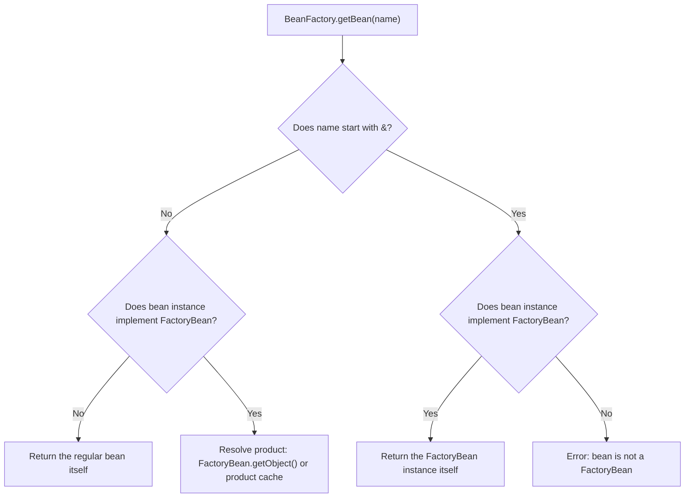

# Retrieving the Product by Name and the Factory via & Prefix in Spring FactoryBean

## 1. Two objects behind one bean name

In the Spring Core Container, `FactoryBean<T>` is a mechanism that lets **a bean act as a factory producing another object**. When the container has a bean named `greeting` that implements `FactoryBean<Greeting>`, there are two objects to distinguish:

1. **FactoryBean (the factory)**: the instance implementing `FactoryBean<Greeting>`; Spring manages it as a bean and uses it to create the product.
2. **Product**: the object of type `Greeting` returned from `FactoryBean.getObject()` via the container's mechanism.

Unlike ordinary bean lookups, Spring interprets the name `greeting` as **the logical name to retrieve the product** of the `FactoryBean`. To request **that factory instance itself**, the caller prepends the **`&` prefix** to the bean name.

```java
Object product = context.getBean("greeting");
Object factory = context.getBean("&greeting");
```

This is a **contextual snippet**: `context` must be a Spring `ApplicationContext` containing a `FactoryBean` named `greeting`. The rule is not special Java syntax; `"&greeting"` is simply a string passed to the Spring `BeanFactory.getBean(...)` API.

> **Remember:** `getBean("name")` retrieves the **product** if bean `name` is a `FactoryBean`; `getBean("&name")` retrieves the **FactoryBean itself**, i.e., the factory. If `name` is an ordinary bean, `getBean("name")` retrieves the bean itself and `&name` does not turn it into a factory.

The `&` sign is part of **how the bean name is interpreted at the lookup point**, not a requirement to change the ID in `@Bean`, `@Component`, or XML to a name starting with `&`.

## 2. FactoryBean is not BeanFactory

The names are very easy to confuse:

| Concept | Role | Typical API |
|---|---|---|
| `BeanFactory` | **Container** managing bean definitions, scopes, lookup, and lifecycle | `getBean(...)`, `containsBean(...)` |
| `FactoryBean<T>` | **A special bean** that the container calls to create a product of type `T` | `getObject()`, `getObjectType()`, `isSingleton()` |
| `@Bean` factory method | **A way to declare beans via Java configuration** | A `@Bean` method returning a bean instance |
| Product of `FactoryBean` | The object published under the factory's bean name | Usually retrieved with `getBean("name")` |

A `BeanFactory` can manage many `FactoryBean`s. A `@Bean` method may return a `FactoryBean<T>`, but **not every `@Bean` method creates a FactoryBean**. Most `@Bean` methods return business objects directly and do not need the `&` syntax.

Example:

```java
@Configuration
class FactoryConfiguration {
    @Bean("greeting")
    GreetingFactoryBean greetingFactory() {
        return new GreetingFactoryBean();
    }
}
```

This is **illustrative configuration code**, requiring imports for `@Configuration`, `@Bean`, and a `GreetingFactoryBean` class implementing `FactoryBean<Greeting>`. Even though the method name is `greetingFactory`, the assigned bean name is **`greeting`**: looking up `"greeting"` retrieves the product, and looking up `"&greeting"` retrieves the factory. Do not add `&` to `@Bean("...")`.

## 3. Lookup mechanism behind getBean("name") and getBean("&name")



With a `FactoryBean` named `greeting`, each call has a different meaning:

```java
Greeting a = context.getBean("greeting", Greeting.class);
FactoryBean<?> maker = context.getBean("&greeting", FactoryBean.class);
```

This is an illustrative integration snippet, assuming the `greeting` bean is registered and Spring imports are present. The `getBean(String, Class<T>)` overload checks the type of the object **returned by Spring for that lookup name**:

- `getBean("greeting", Greeting.class)`: requests the **product** as `Greeting`.
- `getBean("&greeting", FactoryBean.class)`: requests the **factory** as a `FactoryBean`.
- `getBean("greeting", GreetingFactoryBean.class)`: will fail to get the factory when the bean name follows FactoryBean rules; the requested type does not match the **product** and may cause `BeanNotOfRequiredTypeException`.
- `getBean("&greeting", Greeting.class)`: also a type mismatch, because `&` requests the factory rather than the product.

If the object behind the name `ordinary` is a regular bean, `context.getBean("&ordinary")` is invalid for retrieving a factory, because Spring sees that the bean **does not implement `FactoryBean`**. The typical exception for this situation is `BeanIsNotAFactoryException`.

### 3.1. & is a lookup prefix, not a second bean name

For the same bean definition, `"greeting"` and `"&greeting"` **do not create two independent bean definitions**. Spring knows the canonical name of the factory is `greeting` and interprets `&` as a "factory dereference" request.

`BeanFactory.FACTORY_BEAN_PREFIX` is the string constant `"&"`. Spring also provides utilities for handling bean names and factory dereferencing in internal/support APIs, though business code usually only needs to pass `"&name"` or prepend the prefix to an application-controlled name.

If the configuration defines an alias for a FactoryBean, Spring resolves aliases according to the container's bean naming rules. Developers still must use the valid **effective name in the container** and not assume that prepending `&` to any arbitrary string will find the right factory.

### 3.2. Spring can call getObjectType without creating the product

When `getBean("greeting")` is called, Spring must resolve the factory and then obtain the product. However, in other operations—such as **type-based lookup** or preparing autowiring—Spring can query `FactoryBean.getObjectType()` to learn the product type **without calling `getObject()`**.

Therefore `getObjectType()` should return a meaningful `Class<?>` when determinable early, avoid side effects, and not depend on state set only after the factory has completely initialized. If it returns `null` when the type is still unknown, some type-based discovery/autowiring operations will not find that product.

You should not use `getObjectType()` to open network connections, build expensive products, or mutate state just to guess the type; the container may query this method multiple times at different points.

## 4. Three important methods of FactoryBean

The full interface name is `org.springframework.beans.factory.FactoryBean<T>`. It defines three methods for the container to work with the factory:

```java
public interface FactoryBean<T> {
    T getObject() throws Exception;

    Class<?> getObjectType();

    default boolean isSingleton() {
        return true;
    }
}
```

This is an **excerpt for learning**, not code to copy as a redefinition of Spring's interface. `getObjectType()` may return `null` when the type is undetermined (nullability annotations are omitted here). In modern Spring Framework, `isSingleton()` has a default implementation returning `true`; you should still override it explicitly when the product contract means otherwise.

### 4.1. getObject(): creating or supplying the product

`getObject()` returns the object users see when looking up by name **without `&`**. Depending on the contract, the factory may build the product on the spot or hold an already-created instance. If creation fails, the factory can throw an appropriate exception; the container surfaces the error via bean creation/lookup mechanisms.

```java
@Override
public Greeting getObject() {
    return new Greeting("hello");
}
```

This is an illustrative method inside a class implementing `FactoryBean<Greeting>` with a corresponding `Greeting` class and constructor. If `isSingleton() == true`, the factory must honor the contract of supplying a shared object; unconditionally returning a new object in `getObject()` while declaring singleton is not a sound design.

### 4.2. getObjectType(): the advertised product type

```java
@Override
public Class<?> getObjectType() {
    return Greeting.class;
}
```

The `Greeting.class` type enables the container to handle lookups by `Greeting.class`, resolve dependencies, and check types without always building the product. If the factory returns `null`, type-based autowiring may skip the factory because the product type is unknown.

Clearly distinguish the **factory type** (e.g., `GreetingFactoryBean.class`) from the **product type** (`Greeting.class`). `getObjectType()` provides the **product type**, not the type of the `FactoryBean` itself.

### 4.3. isSingleton(): is the product shared?

`FactoryBean.isSingleton()` returns `true` when the factory advertises **a shared product**, allowing the container to cache the product reference under appropriate conditions. If it returns `false`, the container does not treat the `getObject()` result as a cached singleton product; subsequent lookups may call the factory again for another result.

Specifically:

- **Scope of the FactoryBean instance** and **singleton contract of the product** are two different conceptual dimensions. A factory can be a container-managed singleton bean while its product is **not a singleton**.
- `isSingleton() == false` **does not by itself guarantee** the factory returns a brand-new object on every call: that remains the responsibility of the `getObject()` implementation. `SmartFactoryBean` provides additional information about prototype products.
- `isSingleton() == true` does not mean the product is a "JVM-wide GoF Singleton"; it refers to sharing/caching within the bean factory/container model and the corresponding factory instance.
- `getBean("&name")` looks up the factory instance according to the **scope of the factory bean definition**, not merely based on the product's `isSingleton()`.

A singleton factory can be used for multiple new products as long as the product contract is declared accordingly. The practical example below intentionally makes the factory singleton while `TicketFactoryBean.isSingleton() == false`, so two `getBean("ticket")` calls show different products while the factory remains a single bean.

## 5. Complete Spring Java 17+ example: product and factory under the same name

The experiment has three bean names:

1. `greeting`: a `FactoryBean<Greeting>` with a shared product (`isSingleton() == true`).
2. `ticket`: a `FactoryBean<Ticket>` where **each product lookup creates a new ticket** (`isSingleton() == false`).
3. `ordinary`: a regular `String` bean, **not a FactoryBean**.

We will retrieve the product by name, retrieve the factory with `&`, check object identity, fetch the product by type, and test using `&` improperly on a regular bean.

**Requirements:** Java 17+, Maven 3.9+; the example uses Spring Framework 6.2.0, with no Spring Boot, web server, or database needed.

Structure:

```text
factorybean-dereference/
├── pom.xml
└── src/main/java/example/FactoryBeanDemo.java
```

File `pom.xml`:

```xml
<project xmlns="http://maven.apache.org/POM/4.0.0"
         xmlns:xsi="http://www.w3.org/2001/XMLSchema-instance"
         xsi:schemaLocation="http://maven.apache.org/POM/4.0.0
                             https://maven.apache.org/xsd/maven-4.0.0.xsd">
    <modelVersion>4.0.0</modelVersion>
    <groupId>example</groupId>
    <artifactId>factorybean-dereference</artifactId>
    <version>1.0.0</version>

    <properties>
        <maven.compiler.release>17</maven.compiler.release>
        <project.build.sourceEncoding>UTF-8</project.build.sourceEncoding>
    </properties>

    <dependencies>
        <dependency>
            <groupId>org.springframework</groupId>
            <artifactId>spring-context</artifactId>
            <version>6.2.0</version>
        </dependency>
    </dependencies>

    <build>
        <plugins>
            <plugin>
                <groupId>org.apache.maven.plugins</groupId>
                <artifactId>maven-compiler-plugin</artifactId>
                <version>3.13.0</version>
            </plugin>
            <plugin>
                <groupId>org.codehaus.mojo</groupId>
                <artifactId>exec-maven-plugin</artifactId>
                <version>3.5.0</version>
            </plugin>
        </plugins>
    </build>
</project>
```

File `src/main/java/example/FactoryBeanDemo.java`:

```java
package example;

import java.util.concurrent.atomic.AtomicInteger;
import org.springframework.beans.factory.BeanIsNotAFactoryException;
import org.springframework.beans.factory.FactoryBean;
import org.springframework.context.annotation.AnnotationConfigApplicationContext;
import org.springframework.context.annotation.Bean;
import org.springframework.context.annotation.Configuration;

public class FactoryBeanDemo {

    public static void main(String[] args) {
        try (var context = new AnnotationConfigApplicationContext(Config.class)) {

            Greeting first = context.getBean("greeting", Greeting.class);
            Greeting again = context.getBean("greeting", Greeting.class);
            GreetingFactoryBean factory =
                    context.getBean("&greeting", GreetingFactoryBean.class);

            System.out.println("greeting product: " + first.message());
            System.out.println("greeting product cached: " + (first == again));
            System.out.println("greeting by type: "
                    + (first == context.getBean(Greeting.class)));
            System.out.println("greeting factory different: " + (factory != first));
            System.out.println("greeting factory same: "
                    + (factory == context.getBean("&greeting")));
            System.out.println("factory built products: " + factory.builds());

            Ticket firstTicket = context.getBean("ticket", Ticket.class);
            Ticket secondTicket = context.getBean("ticket", Ticket.class);
            TicketFactoryBean ticketFactory =
                    context.getBean("&ticket", TicketFactoryBean.class);

            System.out.println("tickets different: " + (firstTicket != secondTicket));
            System.out.println("ticket factory same: "
                    + (ticketFactory == context.getBean("&ticket")));
            System.out.println("ticket product singleton: "
                    + context.isSingleton("ticket"));

            System.out.println("ordinary bean: " + context.getBean("ordinary"));
            try {
                context.getBean("&ordinary");
                System.out.println("unexpected factory");
            } catch (BeanIsNotAFactoryException ex) {
                System.out.println("ordinary has no FactoryBean");
            }
        }
    }

    @Configuration(proxyBeanMethods = false)
    public static class Config {

        @Bean("greeting")
        public GreetingFactoryBean greetingFactory() {
            return new GreetingFactoryBean();
        }

        @Bean("ticket")
        public TicketFactoryBean ticketFactory() {
            return new TicketFactoryBean();
        }

        @Bean("ordinary")
        public String ordinary() {
            return "plain";
        }
    }

    public record Greeting(String message) {
    }

    public static final class GreetingFactoryBean implements FactoryBean<Greeting> {
        private Greeting cached;
        private int created;

        @Override
        public synchronized Greeting getObject() {
            if (cached == null) {
                cached = new Greeting("Hello from product");
                created++;
            }
            return cached;
        }

        @Override
        public Class<?> getObjectType() {
            return Greeting.class;
        }

        @Override
        public boolean isSingleton() {
            return true;
        }

        public int builds() {
            return created;
        }
    }

    public record Ticket(int number) {
    }

    public static final class TicketFactoryBean implements FactoryBean<Ticket> {
        private final AtomicInteger sequence = new AtomicInteger();

        @Override
        public Ticket getObject() {
            return new Ticket(sequence.incrementAndGet());
        }

        @Override
        public Class<?> getObjectType() {
            return Ticket.class;
        }

        @Override
        public boolean isSingleton() {
            return false;
        }
    }
}
```

Run command in the directory containing `pom.xml`:

```bash
mvn -q compile exec:java -Dexec.mainClass=example.FactoryBeanDemo
```

Expected stdout counting only the `System.out.println` lines in the program (excluding Maven's own logs):

```text
greeting product: Hello from product
greeting product cached: true
greeting by type: true
greeting factory different: true
greeting factory same: true
factory built products: 1
tickets different: true
ticket factory same: true
ticket product singleton: false
ordinary bean: plain
ordinary has no FactoryBean
```

### 5.1. Explanation of each result

- `greeting product`: `getBean("greeting", Greeting.class)` asks Spring for the **product** from `GreetingFactoryBean.getObject()`.
- `greeting product cached: true`: `GreetingFactoryBean.isSingleton()` returns `true`. The container can cache the product; `GreetingFactoryBean.getObject()` itself in the example also returns the same cached object, adhering to the singleton factory contract.
- `greeting by type: true`: `getObjectType()` returns `Greeting.class`, allowing Spring to determine the product type when looking up by type. There is only one product bean of this type in the demo.
- `greeting factory different: true`: the factory differs from the product in identity and responsibility; `GreetingFactoryBean` creates `Greeting`, and is not a `Greeting` itself.
- `greeting factory same: true`: both `getBean("&greeting")` calls access the same singleton factory declared by `@Bean`.
- `factory built products: 1`: `getObject()` has its own cache, creating the `Greeting` object at most once; repeated lookups do not create extra products.
- `tickets different: true`: `TicketFactoryBean.getObject()` creates a `Ticket` each time, and `isSingleton() == false` stops Spring from caching a singleton product for this name.
- `ticket factory same: true`: `TicketFactoryBean` is still a regular **singleton factory**. The product being non-singleton **does not turn the factory into a prototype**.
- `ticket product singleton: false`: `context.isSingleton("ticket")` inspects the bean name representing the product through the FactoryBean; in the demo the product is non-singleton.
- `ordinary bean: plain`: a regular `String` returns the exact value created by the `@Bean` method.
- `ordinary has no FactoryBean`: `&ordinary` is a factory dereference request, yet bean `ordinary` does not implement `FactoryBean`, so Spring throws `BeanIsNotAFactoryException` and the code catches it intentionally.

**An important note:** two `getBean("ticket")` calls do not mean two **factory bean instances** were created; only the product is new. Only changing the scope of `ticketFactory` itself with `@Scope("prototype")` affects the **factory instance** created by the container on demand, carrying different caching/lifecycle consequences.

### 5.2. Why use record for the products?

`Greeting` and `Ticket` are Java records (available since Java 16), running on Java 17. They are simple immutable data types suited for demonstrating object identity and separating the factory from the product.

The `message()` and `number()` methods are generated automatically by the record. `GreetingFactoryBean` and `TicketFactoryBean` are separate classes implementing `FactoryBean`; they do not inherit from the product and you do not cast the factory to the product.

### 5.3. Why is component scanning unnecessary?

All bean definitions in the demo come from `Config.class` passed to `AnnotationConfigApplicationContext`. Two `@Bean` methods return two FactoryBean instances and one method returns an ordinary `String`. `AnnotationConfigApplicationContext(Config.class)` refreshes the context right inside the constructor.

As a result, the example has minimal extra configuration dependencies, making it easy to verify the difference between the name and the `&` prefix. Neither Spring Boot, `@ComponentScan`, nor classpath scanning is required for factory/product behavior to work.

## 6. Retrieving the FactoryBean when configuring, diagnosing, or controlling the factory

The `&` syntax is useful when you **genuinely want to work with the factory object**: inspecting product initialization statistics, reading factory configuration, testing product caching, or accessing a special API provided by the factory.

```java
GreetingFactoryBean factory =
        context.getBean("&greeting", GreetingFactoryBean.class);

int createdSoFar = factory.builds();
```

This is a contextual snippet with `context` and `GreetingFactoryBean` as in the demo. If business code only wants to send a greeting, **do not retrieve `&greeting` and call `factory.getObject()` yourself**. Calling the factory method directly can bypass part of the orchestration/caching the container applies during a `getBean("greeting")` lookup, causing unexpected semantics.

The point to remember is to **use the product via the container path** to preserve proper scope, post-processing, and lookup contracts. Retrieving the factory directly is for special requirements, not routine operations of a business service.

### 6.1. Type-based lookup and autowiring

When a factory declares:

```java
@Override
public Class<?> getObjectType() {
    return Greeting.class;
}
```

the container can handle injection/lookup of type `Greeting` through the product advertised by the factory. If multiple FactoryBeans share `getObjectType() == Greeting.class`, type-based lookup can be ambiguous, just like other beans of the same type; resolve via `@Qualifier`, `@Primary`, or collecting matching beans.

Do not declare `getObjectType() == GreetingFactoryBean.class` if `getObject()` actually returns `Greeting`: wrong type metadata causes the container to misinfer dependencies. If the factory does not yet know the type at the start and returns `null`, keep in mind that many type-based autowiring operations may **fail to discover** the product. Prefer designing the factory to know the product type from configuration, avoiding expensive product lookups just to learn the type.

If you want to inject **the factory itself**, Spring has autowiring rules matching the FactoryBean type. However, when the goal is to clearly express factory dereferencing by name, `getBean("&name", FactoryType.class)` is the most intuitive approach to learn and test.

### 6.2. Retrieving the factory with XML

A bean implementing `FactoryBean` can also be declared in XML:

```xml
<beans xmlns="http://www.springframework.org/schema/beans"
       xmlns:xsi="http://www.w3.org/2001/XMLSchema-instance"
       xsi:schemaLocation="http://www.springframework.org/schema/beans
          https://www.springframework.org/schema/beans/spring-beans.xsd">

    <bean id="greeting" class="example.GreetingFactoryBean" />
</beans>
```

This is an **illustrative configuration**, assuming `example.GreetingFactoryBean` is a real class on the classpath (not the nested class from the demo). With the `greeting` bean definition, `getBean("greeting")` is still the product and `getBean("&greeting")` is still the factory.

Inside an XML attribute containing `&` as a **literal character**, XML escaping (such as `&amp;`) must be followed depending on where it is used. That is different from the Java string syntax `"&greeting"` and different from setting the bean ID: do not write `id="&greeting"` to "enable" FactoryBean dereferencing.

## 7. Distinguishing FactoryBean.isSingleton from @Scope on the factory

Both mechanisms contain the word "singleton", yet they ask about **two different objects**.

A `FactoryBean` bean definition declared as:

```java
@Bean("ticket")
public TicketFactoryBean ticketFactory() {
    return new TicketFactoryBean();
}
```

Since there is no other `@Scope`, `TicketFactoryBean` itself is a **singleton bean instance** in the context. However, the factory can declare:

```java
@Override
public boolean isSingleton() {
    return false;
}
```

Thus `getBean("&ticket")` normally retrieves the same factory again, whereas `getBean("ticket")` can retrieve different products. This is precisely what the full example demonstrates.

Conversely, a `FactoryBean` with `isSingleton() == true` is not enough to conclude that **any way of registering the factory** causes every product access across the entire application to share a single instance. You must consider which context manages the factory, the scope of the factory itself, and the product caching mechanism. Do not equate "singleton in BeanFactory" with "only one object across the entire JVM".

A FactoryBean producing multiple distinct objects can return `isSingleton() == false`. Yet "false" does not mean it is forced to return a different object on every call in every scenario: the `FactoryBean` contract lets the factory control the product; `SmartFactoryBean` also has an `isPrototype()` method to declare independence more explicitly.

## 8. When FactoryBean fails to create a product or returns null

`FactoryBean.getObject()` can declare `throws Exception`, and there are cases where the bean is not yet ready to create the product, such as when the factory sits in a circular reference. Spring provides `FactoryBeanNotInitializedException` for appropriate situations.

```java
@Override
public Client getObject() throws Exception {
    if (!ready) {
        throw new FactoryBeanNotInitializedException(
                "Client factory is not initialized");
    }
    return existingClient;
}
```

This is an **illustrative snippet**, requiring a `Client` class, `ready` and `existingClient` variables, an import for `FactoryBeanNotInitializedException`, and placement inside a `FactoryBean<Client>` implementation. It is not a standalone runnable class.

A factory may return `null` under conditions permitted by the API. The container has an internal representation for a null product, so do not assume `getBean("name")` will return an ordinary null reference or that Spring always throws `FactoryBeanNotInitializedException` instead of null. For a required dependency, a clearer approach is to configure the factory to produce a valid product per contract or throw an explicit error when not ready.

If `getObjectType()` returns `null`, that indicates **unknown type**, not a guarantee that `getObject()` will return null. The two methods have different responsibilities; do not conflate them.

## 9. Lifecycle: factory bean and product differ

When Spring creates `GreetingFactoryBean`, **the factory itself** is a Spring bean, eligible for dependency injection, `BeanPostProcessor`s, `InitializingBean`/`@PostConstruct` as configured, and destruction callbacks in the appropriate scope.

**The product** is supplied via `FactoryBean.getObject()`. Spring may apply some post-initialization `BeanPostProcessor`s to the product exposed by the FactoryBean, and applies caching when the product is a singleton. However, do not infer that a product created with `new` inside the factory automatically goes through **the entire** lifecycle of an independent bean definition with its own container-managed constructor injection, `@PostConstruct`, `@PreDestroy`, and custom destroy methods.

For objects holding resources (client/network/socket/executor), the factory must design ownership and cleanup very clearly:

- The factory can hold the resource and close it in the **factory bean's** destruction callback if that resource belongs to the factory.
- If the factory returns a product that manages its own resources, establish responsibility for closing the product: the factory, the caller, a resource manager, or another bean scope itself.
- Do not call `close()` on a shared singleton product after each use if multiple consumers still need it.
- Especially with prototype products or custom factories, do not assume all products will be destroyed automatically by Spring just because the context closes.

The principle to uphold is: **factory lifecycle, product lifecycle, and caching contract are not automatically the same thing**. Without explicit design, resource leaks and double-closes easily occur.

## 10. Common misconceptions

| Misconception / error | Reality | How to fix |
|---|---|---|
| "The name `greeting` is the factory's bean name, so `getBean("greeting")` returns the factory" | When that bean implements `FactoryBean`, unprefixed lookup returns the **product** | Use `&greeting` if you actually want the factory |
| "Must declare `@Bean("&greeting")`" | `&` is a **lookup-time** prefix | Keep the bean name `greeting`, call `getBean("&greeting")` |
| "Every `@Bean` method needs `&` to get the factory" | An ordinary `@Bean` method does not imply `FactoryBean` | Check whether the registered object implements `FactoryBean` |
| "`getBean("greeting", GreetingFactoryBean.class)` gets the factory" | The second argument checks the object Spring returns from the unprefixed lookup | Use `getBean("&greeting", GreetingFactoryBean.class)` |
| "`getBean("&ordinary")` creates a factory" | An ordinary bean is not a `FactoryBean` | Do not use `&` with ordinary beans |
| "`isSingleton() == true` means the factory bean scope is singleton" | That is the **product's** contract; the factory has its own scope | Check `@Scope` and `FactoryBean.isSingleton()` independently |
| "`isSingleton() == false` definitely means GoF Prototype" | The product contract does not assert a Java design pattern | Inspect `getObject()` and `SmartFactoryBean.isPrototype()` if needed |
| "`getObjectType()` returns the factory class" | The method reports the **product type** | Return the class of the object created by `getObject()` |
| "Getting `NoSuchBeanDefinitionException` when injecting the product means the factory does not exist" | The factory may exist while `getObjectType()` fails to declare the type, scanning missed it, or candidates are invalid | Check bean name, type metadata, and autowiring |
| "Getting `&name` and calling `getObject()` is identical in every way to `getBean("name")`" | It can bypass container caching/post-processing semantics | Look up the product through the container path in normal usage |
| "FactoryBean automatically closes every product it ever created" | There is no such general contract | Design clear ownership and cleanup |
| "Two `getBean("ticket")` calls mean two factory instances exist" | The factory can be a singleton, creating a new product each time | Compare `&ticket` and the products separately |
| "`FactoryBean` is `BeanFactory`" | One is a factory bean, the other is the container | Distinguish their roles by interface and API |

### 10.1. How to debug when Spring returns the wrong type of object

1. Check the actual bean name: `@Bean("greeting")`, default method name, XML ID, or alias.
2. Check whether the object produced by the bean definition implements `FactoryBean<T>`.
3. Try looking up by name: `getBean("greeting")`; verify the **product's** class rather than assuming the factory's class.
4. Try `getBean("&greeting")` with the matching **factory type**.
5. If type-based lookup finds no bean, check whether `getObjectType()` returns the right type early.
6. If the product is cached unexpectedly, check `FactoryBean.isSingleton()` and how the factory caches internally.
7. If the factory is re-created unexpectedly, check the **factory's** bean definition scope, not just the product's `isSingleton()`.
8. If proxies are present, check which path processors/lifecycle wrapped—the product or the factory—rather than inferring directly from `getClass()` in all cases.
9. If multiple products share a type, examine qualifier/primary/candidate resolution instead of renaming randomly.
10. When cleanup fails, determine who owns the resource and which callbacks belong to the factory or the product.

### 10.2. Unit tests and integration tests

A unit test for `GreetingFactoryBean` can call `getObject()` directly to verify how the factory caches objects internally, but it **cannot** prove Spring interprets `&` properly with plain Java tests alone. To test dereferencing, you need a real Spring `BeanFactory`/`ApplicationContext` and a `FactoryBean` bean definition.

A typical assertion in an integration test:

```java
Greeting product = context.getBean("greeting", Greeting.class);
GreetingFactoryBean factory =
        context.getBean("&greeting", GreetingFactoryBean.class);
boolean correct = product != null && factory != null;
```

This is a **contextual verification snippet** from the section 5 example. In real tests, also assert the required identity/behavior—for example, two lookups of a singleton product return the same reference, two lookups of a non-singleton product differ, and `&` always returns the factory per its bean definition scope.

## 11. Self-check questions

**1. A bean `shipping` implements `FactoryBean<ShippingClient>`. What does `context.getBean("shipping")` return?**  
It returns the **product** of type `ShippingClient` exposed by the factory, not the FactoryBean itself.

**2. How do you write a call to get the FactoryBean registered under the name `shipping`?**  
`context.getBean("&shipping")`; you can use the typed overload `context.getBean("&shipping", ShippingFactoryBean.class)` if you know the factory type.

**3. Why do you not set the bean ID to `&shipping`?**  
The `&` sign is a special prefix interpreted by Spring at **lookup time**, not a requirement for naming the factory's ID.

**4. Does `isSingleton()` report the scope of the factory or of the product?**  
It is the **product** contract of `FactoryBean`; the factory bean instance has its own bean definition/scope.

**5. Can a singleton factory with `isSingleton() == false` create two different products?**  
Yes. The factory itself can be a single instance, while two `getBean("name")` calls receive new products per `getObject()`'s implementation.

**6. Which type should `getObjectType()` return?**  
The product type exposed by `getObject()`, not the class of the FactoryBean itself.

**7. What happens when calling `getBean("&plain")` if `plain` is an ordinary `String` bean?**  
The factory dereference request is invalid; Spring normally throws `BeanIsNotAFactoryException`.

**8. When should you use `getBean("&name")` directly?**  
When you need to work with the factory itself: diagnostics, specialized configuration, testing, or accessing factory APIs. Regular business code uses `getBean("name")`/dependency injection to obtain the product.

**9. Is `FactoryBean` another name for `@Bean`?**  
No. `FactoryBean` is an interface for a bean acting as a factory; `@Bean` is an annotation declaring a bean via a method.

**10. If `getObjectType()` returns `null`, must `getBean("name")` necessarily fail to work?**  
Not necessarily. `null` means the product type is unknown, which affects type-based discovery/autowiring; a name-based lookup can still invoke `getObject()` if the factory is ready.

## Official references

- [Spring Framework Reference — Customizing Instantiation Logic with a FactoryBean](https://docs.spring.io/spring-framework/reference/core/beans/factory-extension.html#beans-factory-extension-factorybean): describes `getBean("name")` as the product and `getBean("&name")` as the factory.
- [Spring Framework 6.2 API — FactoryBean](https://docs.spring.io/spring-framework/docs/6.2.0/javadoc-api/org/springframework/beans/factory/FactoryBean.html): contract of `getObject()`, `getObjectType()`, `isSingleton()`, and factory/product lifecycle.
- [Spring Framework 6.2 API — BeanFactory](https://docs.spring.io/spring-framework/docs/6.2.0/javadoc-api/org/springframework/beans/factory/BeanFactory.html): lookup and the `FACTORY_BEAN_PREFIX` constant.
- [Spring Framework Reference — Container Extension Points](https://docs.spring.io/spring-framework/reference/core/beans/factory-extension.html): distinguishes `FactoryBean`, `BeanPostProcessor`, and other extensions.
- [Spring Framework Reference — Bean Scopes](https://docs.spring.io/spring-framework/reference/core/beans/factory-scopes.html): singleton/prototype and container lifecycle.
