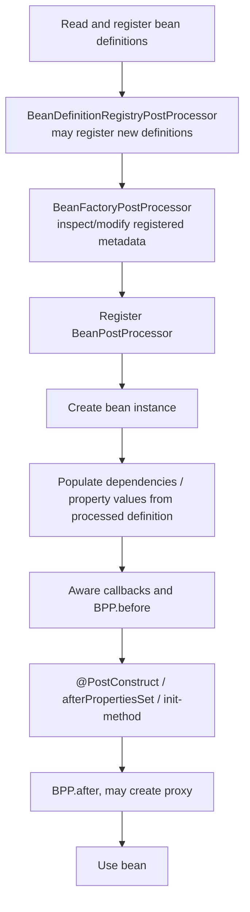

# BeanFactoryPostProcessor and Metadata Intervention Timing in Spring Core Container

## 1. Why Intervene in Metadata Before a Bean Is Created?

The Spring IoC container does not only hold already-created Java objects. Before instantiating application beans, the container holds a set of **bean definitions** describing how to create and configure those beans: class, scope, constructor arguments, property values, lazy initialization, dependencies to resolve, factory method, and other attributes.

`BeanFactoryPostProcessor` (**BFPP** for short) is an extension point for **reading or adjusting the configuration of the bean factory and bean definitions before regular application beans are instantiated**. This is the ideal time to standardize or transform **metadata**, rather than modifying an already-created business object.

For example, an initial definition states:

```text
Bean name       : greeting
Bean class      : Greeting
property message: "default value"
scope           : singleton
```

A BFPP can modify the `message` metadata to `"value after BFPP"` in the bean definition. When Spring **later** creates the `greeting` bean, the container uses the modified configuration to invoke the setter or perform the corresponding property population process.

Three key points to grasp:

1. **BFPP processes definitions/configuration (metadata)**, not individual bean instances. It has access to `ConfigurableListableBeanFactory` and thereby the appropriate `BeanDefinition` objects.
2. **BFPP runs during the container preparation phase**, before regular non-lazy singletons are pre-instantiated and before the `BeanPostProcessor.before/after` callbacks for those beans.
3. **BFPP is not a mechanism for automatically updating every existing instance**. If code has already created a bean early, modifying the definition afterward does not turn back time to change the constructor or initialization of the old object.

Placed in a concrete problem context: when configuration needs to influence **how Spring will create a bean**, BFPP may be appropriate. When an extension needs to affect **an instance after it is created**, the option to consider is `BeanPostProcessor`.

## 2. The Concept of BeanDefinition vs. Bean Instance

`BeanDefinition` is the metadata model Spring uses to manage how a bean is created. It is not synonymous with a business object.

| Attribute / concept | Metadata in bean definition | State on bean instance |
|---|---|---|
| Bean class or factory method | How Spring will create the object | Actual object that has been created |
| Scope | Singleton, prototype, or another scope | Number/timing of instances created |
| Constructor arguments | Values/bean references to pass upon instantiation | Constructor has run; state may already be fixed |
| Property values | Values that will be populated before initialization | Field/setter state after Spring populates properties |
| Lazy-init | Whether to defer singleton creation | Whether the instance already exists or not |
| Init method | Callback name Spring will call during creation lifecycle | Whether the callback has run or not |
| Depends-on | Metadata specifying startup/destruction dependency ordering | Actual dependencies that have been resolved |
| Role, description, attributes | Definition/infrastructure information | Not necessarily properties on the object |

A BFPP calls:

```java
BeanDefinition definition = beanFactory.getBeanDefinition("greeting");
definition.getPropertyValues().add("message", "modified by BFPP");
```

This is a **snippet inside the `postProcessBeanFactory` method**, requiring a `beanFactory` variable of type `ConfigurableListableBeanFactory`, an import for `BeanDefinition`, and a definition named `greeting`. It does not directly call `greeting.setMessage(...)`: the `Greeting` object may not even exist yet.

Spring consumes bean definitions from multiple sources: XML, `@Component` scanning, `@Configuration`/`@Bean`, or programmatic registration. How a definition is created may differ, yet a BFPP can still work with metadata once the appropriate definitions appear in the registry.

## 3. Exact Timing in ApplicationContext.refresh()

The key milestone is the sequence of `AbstractApplicationContext.refresh()`. Below is a **simplified diagram**, not code the user needs to run manually:

```text
1. prepareRefresh()
2. obtainFreshBeanFactory() / prepare bean factory
3. prepareBeanFactory(...)
4. postProcessBeanFactory(...)
5. invokeBeanFactoryPostProcessors(...)    <-- BeanDefinitionRegistryPostProcessor + BFPP
6. registerBeanPostProcessors(...)          <-- register BeanPostProcessor
7. initMessageSource(), initApplicationEventMulticaster(), ...
8. registerListeners()
9. finishBeanFactoryInitialization(...)     <-- pre-instantiate non-lazy singletons
10. finishRefresh()                          <-- lifecycle processor / context event
```

Internal steps, context types, and extensions may add other behavior, yet the **critical timeline remains unchanged**: processing bean definition metadata must take place before the step that bulk-creates regular singleton application beans.



The diagram separates the BFPP phase from the bean creation phase. With **prototype** or `@Lazy` beans, instance creation can happen even later, upon an actual lookup. A BFPP does not force all prototypes to be created during `refresh()`.

### 3.1. Does BFPP Run Before or After BeanPostProcessor?

**BFPP runs before the container registers the automatic BPP set for regular application beans.** Only after BFPPs finish does Spring enter the phase of creating and initializing eligible application beans through the `BeanPostProcessor` chain.

The two extensions differ in timing:

```text
[Bean definitions]
       |
       v
BeanFactoryPostProcessor.postProcessBeanFactory(...)
       |
       v
Create object → Dependency injection → Aware
       |
       v
BeanPostProcessor.postProcessBeforeInitialization(...)
       |
       v
InitializingBean / custom init
       |
       v
BeanPostProcessor.postProcessAfterInitialization(...)
       |
       v
[Final bean]
```

Therefore, do not invoke `BeanPostProcessor` to alter a batch of constructor/property definitions if you truly want to intervene before instantiation. Conversely, BFPP is not passed individual bean instances, so it is unsuitable for creating a proxy around an initialized object.

### 3.2. Note: It Is Not Strictly "No Bean Is Created Before BFPP"

Certain **infrastructure beans**, such as factories/post-processors and the dependencies strictly needed to run them, may have to be instantiated early. Hence, the accurate statement is: BFPP runs **before the instantiation of regular application beans**, not a guarantee that in the JVM absolutely no Spring object has been created yet.

This explains the documentation warning: **do not interact with bean instances inside a BFPP, especially do not proactively call `getBean()` to instantiate application beans**. Doing so can cause those beans to be created **too early**, before they are eligible to receive the full set of post-processors such as auto-proxying or annotation-based processing per application configuration.

## 4. BeanFactoryPostProcessor API

The interface resides in package `org.springframework.beans.factory.config`:

```java
public interface BeanFactoryPostProcessor {
    void postProcessBeanFactory(
            ConfigurableListableBeanFactory beanFactory)
            throws BeansException;
}
```

This is a **shortened signature for learning**, not full source code to redefine in an application. When writing real code, import the existing interface from Spring.

The `ConfigurableListableBeanFactory` parameter allows inspecting registered definitions and relevant configuration information. Common operations include:

```java
String[] names = beanFactory.getBeanDefinitionNames();
BeanDefinition bd = beanFactory.getBeanDefinition("myBean");
bd.setScope("prototype");
bd.getPropertyValues().add("timeoutMillis", 5000);
bd.setLazyInit(true);
```

This is an **integration snippet**, only illustrating the API; it requires being inside `postProcessBeanFactory(...)`, that bean `myBean` exists, and that the target class has a suitable `timeoutMillis` property. It is not a standalone program. Setting scope, lazy-init, or property/constructor metadata must respect the specific bean definition contract and be checked for compatibility with the component in use.

A BFPP can be **read-only**, for example detecting bean definitions with invalid metadata before creating singletons. When metadata adjustments are needed, modify **purposefully, conditionally, and before the bean is created**; do not blindly overwrite values intentionally configured by the user.

### 4.1. Mutation Does Not Alter Existing Objects

Suppose singleton bean `myBean` has already been created beforehand. Calling `bd.getPropertyValues().add(...)` does not re-invoke the setter on that instance and does not re-run the constructor. For an already-existing mutable instance, if runtime changes are needed, use a dedicated dynamic state/config management mechanism.

In particular, `@ConfigurationProperties` or runtime refresh from other libraries **does not mean** BFPP re-runs whenever a configuration changes. A typical BFPP executes when the bean factory is prepared; inside an already-refreshed `ApplicationContext`, it is not a listener that automatically tracks new environment variables.

## 5. Java 17 + Maven Example: BFPP Modifying a Property Before Constructor/Initialization

The goal is to prove via stdout:

1. BFPP sees the `greeting` bean definition and **sets property `message`**.
2. Spring **only then** creates the `Greeting` object.
3. Spring populates property `message` via the setter according to the modified definition.
4. `InitializingBean.afterPropertiesSet()` sees the new value.
5. Application code retrieves and uses the bean; when closing the context, the singleton's destruction callback runs.

**Requirements:** Java 17+, Maven 3.9+, and `spring-context` 6.2.0; no Spring Boot, web server, or database needed.

Structure:

```text
bfpp-metadata-demo/
├── pom.xml
└── src/main/java/example/BfppMetadataDemo.java
```

**File `pom.xml`:**

```xml
<project xmlns="http://maven.apache.org/POM/4.0.0"
         xmlns:xsi="http://www.w3.org/2001/XMLSchema-instance"
         xsi:schemaLocation="http://maven.apache.org/POM/4.0.0
                             https://maven.apache.org/xsd/maven-4.0.0.xsd">
    <modelVersion>4.0.0</modelVersion>
    <groupId>example</groupId>
    <artifactId>bfpp-metadata-demo</artifactId>
    <version>1.0.0</version>
    <properties>
        <maven.compiler.release>17</maven.compiler.release>
        <project.build.sourceEncoding>UTF-8</project.build.sourceEncoding>
    </properties>
    <dependencies>
        <dependency>
            <groupId>org.springframework</groupId>
            <artifactId>spring-context</artifactId>
            <version>6.2.0</version>
        </dependency>
    </dependencies>
    <build>
        <plugins>
            <plugin>
                <groupId>org.apache.maven.plugins</groupId>
                <artifactId>maven-compiler-plugin</artifactId>
                <version>3.13.0</version>
            </plugin>
            <plugin>
                <groupId>org.codehaus.mojo</groupId>
                <artifactId>exec-maven-plugin</artifactId>
                <version>3.5.0</version>
            </plugin>
        </plugins>
    </build>
</project>
```

**File `src/main/java/example/BfppMetadataDemo.java`:**

```java
package example;

import org.springframework.beans.factory.DisposableBean;
import org.springframework.beans.factory.InitializingBean;
import org.springframework.beans.factory.config.BeanDefinition;
import org.springframework.beans.factory.config.BeanFactoryPostProcessor;
import org.springframework.context.annotation.AnnotationConfigApplicationContext;
import org.springframework.context.annotation.Bean;
import org.springframework.context.annotation.Configuration;

public class BfppMetadataDemo {

    public static void main(String[] args) {
        try (var context = new AnnotationConfigApplicationContext(Config.class)) {
            Greeting greeting = context.getBean("greeting", Greeting.class);
            System.out.println("05 application: " + greeting.getMessage());
        }
    }

    @Configuration(proxyBeanMethods = false)
    public static class Config {

        // Static @Bean: BFPP is created early without instantiating Config.
        @Bean
        public static BeanFactoryPostProcessor updateGreetingDefinition() {
            return beanFactory -> {
                BeanDefinition bd = beanFactory.getBeanDefinition("greeting");
                bd.getPropertyValues().add(
                        "message", "hello from bean definition");
                System.out.println("01 BFPP: set message metadata");
            };
        }

        @Bean("greeting")
        public Greeting greeting() {
            return new Greeting();
        }
    }

    public static final class Greeting
            implements InitializingBean, DisposableBean {

        private String message = "default";

        public Greeting() {
            System.out.println("02 constructor");
        }

        public void setMessage(String message) {
            this.message = message;
            System.out.println("03 setter: " + message);
        }

        public String getMessage() {
            return message;
        }

        @Override
        public void afterPropertiesSet() {
            System.out.println("04 init: " + message);
        }

        @Override
        public void destroy() {
            System.out.println("06 destroy");
        }
    }
}
```

Run from the directory containing `pom.xml`:

```bash
mvn -q compile exec:java -Dexec.mainClass=example.BfppMetadataDemo
```

**Expected stdout** from the program's `System.out.println` (excluding Maven logs if the environment prints them):

```text
01 BFPP: set message metadata
02 constructor
03 setter: hello from bean definition
04 init: hello from bean definition
05 application: hello from bean definition
06 destroy
```

### 5.1. Why Is This Order Correct?

- The constructor `new AnnotationConfigApplicationContext(Config.class)` creates and **refreshes the context immediately**. It parses `Config`, registers bean definitions from `@Bean` methods, and proceeds to invoke BFPPs.
- `updateGreetingDefinition()` is a **static `@Bean`** returning `BeanFactoryPostProcessor`, so Spring recognizes and creates the processor early, avoiding instantiating the configuration object just to call the processor's factory method.
- Inside `postProcessBeanFactory`, `getBeanDefinition("greeting")` retrieves the metadata of bean `greeting`. `getPropertyValues().add(...)` adds property `message`, **without creating a `Greeting` instance yet**.
- After BFPPs complete, Spring registers BPPs and creates singleton `greeting`. The factory method `greeting()` calls the constructor and prints line 02.
- Spring applies `MutablePropertyValues` in the bean definition onto the object via setter `setMessage(String)`; line 03 occurs before the init callback.
- `afterPropertiesSet()` sees `message` already populated, printing line 04.
- The application retrieves the initialized singleton and prints line 05. The `try-with-resources` block calls `context.close()`, causing `DisposableBean.destroy()` to print line 06.

This example demonstrates that **metadata influences how Spring creates the object**, rather than the BFPP directly manipulating the `Greeting` instance. Attempting `beanFactory.getBean("greeting")` from a BFPP to force immediate creation of `Greeting` can disrupt the lifecycle and is **something not to do**.

### 5.2. Notes on @Bean Factory Methods and Property Values

Even though `greeting` is declared via a `@Bean` factory method, it still has a **bean definition** in the container. Spring calls the factory method to obtain the instance and then processes property values declared on the definition during the population phase, so `setMessage(...)` receives the value set by the BFPP.

If `Greeting` only had a constructor accepting `message` and no matching setter/property, adding `"message"` via `getPropertyValues().add(...)` as above **does not automatically turn the property into a constructor argument**. In that case, you must edit constructor-argument/factory-method metadata or adjust the design so the bean receives the dependency appropriately. Do not attempt to change a value already passed to a constructor parameter once the instance has been created.

In addition, if `message` is a read-only property with no setter, Spring will encounter a population error such as `NotWritablePropertyException` (possibly wrapped inside a bean creation exception). A BFPP has the authority to edit metadata, yet **cannot turn invalid metadata into a valid configuration**.

## 6. Comparing BeanFactoryPostProcessor and BeanPostProcessor

Similar names, yet **two different extension layers**.

| Criterion | BeanFactoryPostProcessor (BFPP) | BeanPostProcessor (BPP) |
|---|---|---|
| Input | `ConfigurableListableBeanFactory` | An `Object bean`, `String beanName` |
| Primary impact | Bean definitions and container configuration | Bean instance during initialization |
| Typical timing | During `refresh()`, **before** creating non-lazy application singletons | Whenever **each eligible bean instance** is created |
| Method(s) | `postProcessBeanFactory(...)` | `postProcessBeforeInitialization(...)`, `postProcessAfterInitialization(...)` |
| Used to edit property metadata | Yes | Not its primary purpose |
| Used to return a proxy instead of the instance | Not under the standard contract | Yes, if returning a valid wrapper/proxy |
| Execution frequency | Per preparation pass of the bean factory/context | Per creation of each eligible bean instance |
| Behavior with prototype | Modifies the definition used for subsequent creations | BPP is called on each prototype instance when it is created |
| Interaction with `@PostConstruct` | BFPP precedes regular bean initialization | Lifecycle annotations are handled via a BPP during the before-init phase |
| Typical risk | Forcing early bean creation or writing invalid metadata | Replacing with an incompatible object or causing side effects during init |

Example use cases:

- Want to change `BeanDefinition.scope` by infrastructure policy **before instantiation**: BFPP.
- Want to inspect `BeanDefinition.propertyValues` from configuration: BFPP.
- Want to detect a custom annotation on an **instance** after DI and perform state validation: BPP or an appropriate init callback.
- Want to create an AOP proxy for method invocations: a Spring-supported proxy/BPP mechanism, not changing scope metadata via BFPP.
- Want a single bean to load a cache after DI: `@PostConstruct`/custom init, no need to build a container-wide BFPP.

Do not use BFPP just because you see "PostProcessor" and mistakenly assume it receives bean objects at the after-init moment.

## 7. How Does BeanDefinitionRegistryPostProcessor Differ from BFPP?

`BeanDefinitionRegistryPostProcessor` (BDRPP) is an **interface extending `BeanFactoryPostProcessor`**. Besides `postProcessBeanFactory(...)`, it adds:

```java
void postProcessBeanDefinitionRegistry(BeanDefinitionRegistry registry)
        throws BeansException;
```

This is a shortened signature; the standard interface resides in package `org.springframework.beans.factory.support`. Purpose: to allow **registering new bean definitions before regular BFPPs are invoked**.

```text
parse / register initial definitions
    |
    v
BDRPP.postProcessBeanDefinitionRegistry(...)
    |  create additional definitions, may discover further new BDRPPs
    v
BDRPP.postProcessBeanFactory(...)
    |
    v
BFPP.postProcessBeanFactory(...)
    |
    v
register BPP / instantiate application beans
```

The diagram illustrates phase relationships; in runtime details, Spring applies `PriorityOrdered`/`Ordered` ordering, handles iterative discovery when additional registry processors are registered, and distinguishes manually registered processors from those discovered from bean definitions.

### 7.1. When to Use BDRPP Instead of BFPP?

If the task is to **add a new bean definition into the registry** before the container creates singletons, BDRPP is the dedicated extension point. If you only need to **modify existing definitions**, BFPP is usually simpler.

Illustrative BDRPP code:

```java
public final class AddProbeDefinition
        implements BeanDefinitionRegistryPostProcessor {

    @Override
    public void postProcessBeanDefinitionRegistry(
            BeanDefinitionRegistry registry) {
        if (!registry.containsBeanDefinition("auditProbe")) {
            BeanDefinition definition =
                    BeanDefinitionBuilder
                            .genericBeanDefinition(AuditProbe.class)
                            .getBeanDefinition();
            registry.registerBeanDefinition("auditProbe", definition);
        }
    }

    @Override
    public void postProcessBeanFactory(
            ConfigurableListableBeanFactory beanFactory) {
        // No further metadata changes needed in this example.
    }
}
```

This is an **integration snippet**, not standalone runnable: it requires imports for `BeanDefinitionRegistryPostProcessor`, `BeanDefinitionRegistry`, `BeanDefinitionBuilder`, `BeanDefinition`, `ConfigurableListableBeanFactory`, an instantiable `AuditProbe` class, and a way to register the processor early enough. If registering BDRPP via Java configuration, pay attention to `static @Bean` where appropriate.

**Do not do the reverse:** avoid grabbing `DefaultListableBeanFactory` and casting from every `ConfigurableListableBeanFactory` just to register new definitions inside a BFPP; not all implementations guarantee that cast. BDRPP provides the exact `BeanDefinitionRegistry` needed for adding definitions.

### 7.2. ConfigurationClassPostProcessor Is an Important Infrastructure Example

Spring uses `ConfigurationClassPostProcessor` to process configuration classes, `@ComponentScan`, `@Import`, and `@Bean` definitions. It is a BDRPP; this processing occurs during the metadata preparation phase before regular application beans are created.

This explains why the static `@Bean` BFPP in the example **can see** the `greeting` definition: Spring has already processed the configuration and registered the definition before invoking BFPPs that edit metadata. However, if an application heavily customizes registry processing, you must understand definition discovery order and not assume every definition from dynamically loaded plugins is present from the start.

## 8. Registering a BFPP Properly

There are several ways to register:

1. Declare a class implementing `BeanFactoryPostProcessor` as a bean definition (for example, a component within a suitable scan scope).
2. Declare a `@Bean` returning a BFPP inside a `@Configuration` class; **prefer static `@Bean`**.
3. Register programmatically via `ConfigurableApplicationContext.addBeanFactoryPostProcessor(...) ` **before `refresh()`**.
4. With a plain `BeanFactory` container that is not an `ApplicationContext`, instantiate the BFPP yourself and **manually call** `postProcessBeanFactory(beanFactory)` at the appropriate time; do not assume `DefaultListableBeanFactory` will automatically discover and invoke all BFPP definitions like `ApplicationContext.refresh()`.

### 8.1. Why Is static @Bean Important?

A BFPP is an **infrastructure bean that must be ready early** to participate in processing definitions before the application. If you declare:

```java
@Configuration
class BrokenConfig {
    @Bean
    BeanFactoryPostProcessor processor() {
        return beanFactory -> { /* metadata mutation */ };
    }
}
```

This is **code illustrating a non-recommended configuration**; it does not necessarily always throw an error, yet it can force Spring to instantiate `BrokenConfig` too early just to call `processor()`, before the configuration class and its dependencies are fully processed by infrastructure.

A clearer approach:

```java
@Configuration(proxyBeanMethods = false)
class CorrectConfig {
    @Bean
    static BeanFactoryPostProcessor processor() {
        return beanFactory -> { /* metadata mutation */ };
    }
}
```

Both snippets only illustrate registration and require appropriate imports; they are not standalone programs. A `static` method does not need a `CorrectConfig` instance to create the BFPP, thereby reducing the risk of instantiating the configuration bean early and missing certain bean lifecycle/post-processing steps. This is a particularly important practical rule for `BeanFactoryPostProcessor` and `BeanPostProcessor` declared via `@Bean`.

**Do not inject business services into a BFPP** just to compute a property metadata value, because that dependency injection can force business bean creation before the processing pipeline is complete. When configuration is needed, prefer `Environment`, property sources, or definition data readable without instantiating business objects.

### 8.2. Programmatic Registration Before Refresh

```java
var context = new AnnotationConfigApplicationContext();
context.register(AppConfig.class);
context.addBeanFactoryPostProcessor(
        beanFactory -> beanFactory.getBeanDefinition("greeting")
                .setLazyInit(true));
context.refresh();
```

This is an **illustrative snippet**, requiring `AppConfig` registering the `greeting` bean definition, plus Spring and context imports; this fragment is not a standalone program. A processor added with `addBeanFactoryPostProcessor` must be present **before refresh**; if added afterward, do not expect Spring to re-run refresh steps automatically.

With `new AnnotationConfigApplicationContext(AppConfig.class)`, the constructor already refreshes the context, so there is no "window before refresh" to add a BFPP as shown above. If manual registration is needed, use the empty constructor, then register definitions and call refresh explicitly.

## 9. Ordering Multiple BFPPs and Impact on Conflicts

When multiple processors edit metadata, for instance A sets `message="A"` and B sets `message="B"`, **application order determines the final value** if both write the same property. You should not rely on class name ordering or method declaration order in source code.

In a standard `ApplicationContext`, Spring supports `PriorityOrdered`, `Ordered`, and sorting rules for auto-detected processors. BDRPPs have their own registry phase, processed before regular BFPPs. BFPPs added programmatically via `addBeanFactoryPostProcessor` are processed through their own mechanism/registration path; annotation ordering should not be mechanically assumed across all registration types.

If a metadata mutation must happen **after** bean registration or `@Configuration` processing, verify that the processor is invoked in the appropriate phase. When multiple independent extensions edit definitions, instead of hoping "whoever writes last wins," you should:

- Establish a clear single owner for that metadata, or separate responsibilities to avoid overlap.
- Use the proper ordering contract and test with a complete context.
- Inspect bean definitions before and after the processor in integration tests.
- Only modify values under an explicit condition; avoid overwriting values intentionally declared by the application.
- Throw an exception reporting conflicting configuration if the system cannot allow two policies simultaneously.

A BFPP should be fast, have minimal side effects, and avoid calling external network services. Because it runs at bootstrap, errors can prevent the context from refreshing.

## 10. PropertySourcesPlaceholderConfigurer: A Familiar BFPP Case

`PropertySourcesPlaceholderConfigurer` is a processor that supports resolving placeholders like `${...}` in bean definition property values and registers an appropriate embedded value resolver mechanism for Spring configuration. It clearly exemplifies the mindset of "processing metadata before creating beans."

Traditional XML example:

```xml
<beans xmlns="http://www.springframework.org/schema/beans"
       xmlns:xsi="http://www.w3.org/2001/XMLSchema-instance"
       xsi:schemaLocation="http://www.springframework.org/schema/beans
                           https://www.springframework.org/schema/beans/spring-beans.xsd">

    <bean class="org.springframework.context.support.PropertySourcesPlaceholderConfigurer" />

    <bean id="serviceConfig" class="example.ServiceConfig">
        <property name="endpoint" value="${service.endpoint}" />
    </bean>
</beans>
```

This is **illustrative XML**, assuming `example.ServiceConfig` has a writable property `endpoint` and `service.endpoint` is configured via property sources. In a complete XML configuration file, namespace/resource loading also depends on application setup.

The BFPP resolves the placeholder in the `endpoint` definition so Spring uses the resolved value when creating `serviceConfig`. In modern Java config applications, you can register a static `@Bean` returning `PropertySourcesPlaceholderConfigurer` if configuration demands it, though a default `ApplicationContext` also has its own embedded value resolution mechanism. Do not automatically assume "every `@Value` forces you to register this BFPP" in all Spring/Spring Boot configurations.

Other common infrastructure components also manipulate metadata, such as `ConfigurationClassPostProcessor` in the registry phase; that does not mean a custom BFPP should re-implement Spring's annotation parsing.

## 11. Notes on Lazy/Prototype and Post-Refresh Intervention

### 11.1. Metadata Modified at Bootstrap Applies to Subsequent Bean Creations

When a BFPP modifies a bean definition before the bean is created:

- **Eager singleton**: the modified definition is used when the container pre-instantiates singletons during `refresh()`.
- **Lazy singleton**: the modified definition will still be used when the singleton is resolved for the first time later.
- **Prototype**: the modified definition is used each time the container creates a new instance under prototype scope.

Conversely, once a bean instance already exists, modifying the definition does not automatically update that instance. That differs from a dedicated runtime configuration refresh mechanism with reactive/rebinding semantics.

### 11.2. Do Not Use BFPP as a Dynamic Feature Toggle

An anti-pattern is storing a `BeanDefinition` inside a BFPP, and then after refresh continuing to mutate `propertyValues` upon admin UI commands expecting the singleton service to change immediately. The singleton already holds its own state; Spring does not automatically re-populate it from new metadata.

If the goal is runtime configuration that changes frequently, use a dynamic configuration service/wrapper, `AtomicReference`, an interface reading configuration at point of use, or an appropriate framework-supported solution. Do not abuse BFPP to reconfigure already-initialized objects.

### 11.3. Do Not Instantiate Application Beans Inside a BFPP

```java
@Override
public void postProcessBeanFactory(
        ConfigurableListableBeanFactory beanFactory) {
    Object bean = beanFactory.getBean("paymentService"); // Anti-pattern
    // ...
}
```

This is **code illustrating an error**, inside a BFPP class. It can create `paymentService` early before enough `BeanPostProcessor` instances are registered, causing it to miss processing such as AOP auto-proxying or other extensions, especially when other beans participate in the dependency chain.

If you only need to inspect types or metadata, prefer `getBeanDefinition`, `getBeanDefinitionNames`, or `getBeanNamesForType` with care regarding eager initialization and `FactoryBean`; do not use `getBean` just to inspect configuration. Even type lookups can trigger certain factory initializations depending on overloads/configuration, so read the API and weigh safe bootstrap operations.

## 12. Two-Layer Testing for BFPP

### 12.1. Unit Test Checking Only Metadata

You can create a `DefaultListableBeanFactory` with a `BeanDefinition` and invoke the BFPP manually. The assertion to check is **that metadata changed**; this test does not assert that the bean has been instantiated.

Abbreviated Java code:

```java
DefaultListableBeanFactory factory = new DefaultListableBeanFactory();
RootBeanDefinition bd = new RootBeanDefinition(Greeting.class);
factory.registerBeanDefinition("greeting", bd);

BeanFactoryPostProcessor processor = beanFactory ->
        beanFactory.getBeanDefinition("greeting")
                .getPropertyValues()
                .add("message", "test");

processor.postProcessBeanFactory(factory);

Object value = factory.getBeanDefinition("greeting")
        .getPropertyValues().get("message");
System.out.println(value); // test
```

This is an **illustrative snippet**, requiring imports from `org.springframework.beans.factory.support` for `DefaultListableBeanFactory`, `RootBeanDefinition`, and `BeanFactoryPostProcessor` from `config`. Additionally, class `Greeting` must exist; it can be taken from the section 5 example. This fragment is not a standalone program because the class containing `main` is omitted.

Expectation: the `greeting` definition has property `message = "test"`. In a lifecycle-oriented test, you can prove the `Greeting` constructor **has not** run until the test actually calls `factory.getBean("greeting")`.

### 12.2. Integration Test Observing Actual Order

A Spring integration test can:

- Register the BFPP from `@Configuration` via static `@Bean`.
- Register regular application bean definitions.
- Record an event trace for `BFPP`, `constructor`, `setter`, `afterPropertiesSet`, `BeanPostProcessor.before/after`.
- Refresh the context and assert that the BFPP trace appears before the application bean's constructor.
- Verify state after init and destruction callbacks on close.
- Test invalid metadata configuration to verify that failure occurs with a clear message.

Do not merely look at a "BFPP called" log and conclude the entire application is safe. The value of the test is proving **that the definition was modified before the relevant object was created** and that no application bean was unintentionally pre-instantiated.

## 13. Common Pitfalls and How to Avoid Them

| Misconception / Error | Why It Is Wrong | Fix |
|---|---|---|
| "BFPP receives each bean object to edit" | It receives `ConfigurableListableBeanFactory`, processing metadata/container | Use BPP or an init callback if you want to process instances |
| "BFPP runs after `@PostConstruct`" | BFPP occurs before initialization of regular application beans | Read the `refresh()` sequence carefully |
| "BFPP is called on every `getBean()`" | BFPP belongs to the factory/context processing phase, not per bean lookup | Use BPP for each instance if that is the intent |
| "You can freely call `getBean()` in a BFPP" | Forces early bean creation, potentially losing post-processing/AOP | Only manipulate bean definitions whenever possible |
| "Modifying a definition updates an already-created singleton" | The instance already has its own state | Design a dedicated dynamic configuration mechanism |
| "A non-static `@Bean` BFPP is always safe" | May force early instantiation of `@Configuration` | Prefer a static factory method |
| "`BeanFactoryPostProcessor` and `BeanPostProcessor` are equivalent" | One is metadata, the other is instance | Choose the extension by timing and target |
| "BFPP should register new bean definitions by casting to registry" | Not every factory guarantees a suitable cast | Use `BeanDefinitionRegistryPostProcessor` |
| "`PriorityOrdered` gives all registration types the same ordering" | Processors discovered from bean definitions and manually registered ones follow different paths | Test ordering in a real context |
| "Adding any arbitrary property name to a definition is accepted by Spring" | The property may not exist or lack a setter | Check JavaBeans properties and conversion |
| "`@Lazy` means BFPP runs when looking up the lazy bean" | BFPP runs at factory bootstrap; only lazy bean creation is deferred | Distinguish definition processing from instance creation |
| "BFPP is a good place to call a network service for configuration" | Introduces external side effects/timing dependencies during refresh | Use pre-prepared property sources/config caches |
| "A plain BeanFactory always auto-invokes all registered BFPPs" | Auto-discovery and invocation is ApplicationContext bootstrap's responsibility | With a plain BeanFactory, invoke processors manually at the right time |
| "To replace `@Autowired`, edit every bean with a BFPP" | Autowiring also has its own processor SPI and dependency graph | Intervene only within proper bean definition semantics; avoid tampering with framework internals arbitrarily |

### 13.1. Do Not Underestimate the Complexity of Metadata Mutation

A bean definition has many interrelated fields: parent/child inheritance, constructor arguments, property values, scope, role, bean class, factory method, and attributes. Modifying an incompatible field can prevent the context from refreshing or cause errors to surface only later when a lazy/prototype bean is created.

For custom BFPPs in shared libraries, you should:
- Apply only to target bean definitions by name, role, metadata marker, or explicit condition.
- Not overwrite user-provided configuration without reason.
- Throw a clear error message naming the bean and invalid attribute.
- Write integration tests for at least eager singleton, lazy singleton, and prototype when the extension alters lifecycle attributes.
- Document the exact Spring version/contract the extension depends on.
- Avoid arbitrarily mutating `BeanDefinition` after the container has already started using it to create multiple beans.

## 14. When Should You Use BFPP in Real-World Architecture?

BFPP is useful for **Spring integration libraries** or **infrastructure configuration** needing to read/modify an entire group of bean definitions before startup: for example, applying default policies to beans in a module, normalizing metadata, resolving placeholders, validating configuration, or deliberately adjusting lazy/scopes before initialization.

In regular application services, needs such as "when building a service, inject dependency X" are better solved by constructor injection. "After DI, open resource Y" may belong to `@PostConstruct` or custom init. "Every method call must have a transaction" belongs to Spring AOP/declarative infrastructure. "Each HTTP request must have its own state" belongs to bean scope/proxy or a provider.

Decision table:

| Primary Question | Solution to Consider |
|---|---|
| Need to modify a bean **definition** before Spring creates instances? | `BeanFactoryPostProcessor` |
| Need to **add definitions** during the registry bootstrap phase? | `BeanDefinitionRegistryPostProcessor` |
| Need to process **each bean instance** before/after initialization? | `BeanPostProcessor` |
| Need a bean to know when **it itself** has been injected? | `@PostConstruct`, `InitializingBean`, custom init |
| Need start/stop lifecycle for a worker? | `Lifecycle` or `SmartLifecycle` |
| Need a fresh object on every use inside a singleton? | Prototype scope combined with `ObjectProvider<T>` or an appropriate factory |
| Need to close resources on context shutdown? | Destruction callbacks and appropriate scope ownership |

Not every change in initialization requires a BFPP; a properly declared bean definition from the start is usually easier to understand and less risky than an implicit post-processor intervention.

## 15. Self-Check Questions

**1. Does `BeanFactoryPostProcessor` process bean instances or bean definitions?**  
It processes `ConfigurableListableBeanFactory` configuration and bean definition metadata; it does not receive a specific bean instance as a callback input.

**2. In `ApplicationContext.refresh()`, does BFPP run before or after pre-instantiation of non-lazy singletons?**  
Before. Spring invokes BFPPs during the `invokeBeanFactoryPostProcessors` phase, then registers BPPs and pre-instantiates regular singletons.

**3. Does `BeanPostProcessor.before` serve the same role as BFPP?**  
No. `BeanPostProcessor.before` receives an **already-created object** and runs before that object's initialization callbacks.

**4. Why should you not call `beanFactory.getBean("service")` from a BFPP?**  
It can create the service early, before required BPPs/infrastructure are registered, causing the service to miss post-processing or trigger dependency chains prematurely.

**5. How does `BeanDefinitionRegistryPostProcessor` differ from BFPP?**  
It extends BFPP with a callback on the registry so additional bean definitions can be registered before regular BFPPs.

**6. With Java configuration, why is static `@Bean` recommended for BFPP?**  
It allows Spring to create the processor early without instantiating the `@Configuration` object just to invoke the processor factory method.

**7. If a BFPP modifies property `message`, what values do the constructor and setter see in the demo?**  
The constructor creates the object with its initial state; during property population, Spring invokes the setter according to the modified definition. Init callbacks and application code see the new value.

**8. Does modifying a bean definition after a singleton is created automatically re-invoke `afterPropertiesSet()`?**  
No. Metadata mutation is not runtime reinitialization.

**9. Can BFPP be used to modify metadata of a prototype bean?**  
Yes, if the definition exists and is modified before instances are created; subsequent prototype creations use the processed definition.

**10. If you want to change the configuration of a running application in real time, is BFPP the default choice?**  
No. You need a dynamic configuration/state mechanism with its own contract; BFPP is a factory-bootstrap extension.

## Official Documentation

- [Spring Framework Reference — Customizing Configuration Metadata with a BeanFactoryPostProcessor](https://docs.spring.io/spring-framework/reference/core/beans/factory-extension.html#beans-factory-extension-factory-postprocessors): purpose of processing metadata and warning against interacting with bean instances.
- [Spring Framework Reference — Container Extension Points](https://docs.spring.io/spring-framework/reference/core/beans/factory-extension.html): comparing BFPP, BPP, and FactoryBean.
- [Spring Framework 6.2 API — BeanFactoryPostProcessor](https://docs.spring.io/spring-framework/docs/6.2.0/javadoc-api/org/springframework/beans/factory/config/BeanFactoryPostProcessor.html): callback contract and processing phase.
- [Spring Framework 6.2 API — BeanDefinitionRegistryPostProcessor](https://docs.spring.io/spring-framework/docs/6.2.0/javadoc-api/org/springframework/beans/factory/support/BeanDefinitionRegistryPostProcessor.html): registering definitions before regular BFPPs.
- [Spring Framework 6.2 API — ConfigurableListableBeanFactory](https://docs.spring.io/spring-framework/docs/6.2.0/javadoc-api/org/springframework/beans/factory/config/ConfigurableListableBeanFactory.html): accessing bean definitions and factory metadata.
- [Spring Framework 6.2 API — AbstractApplicationContext](https://docs.spring.io/spring-framework/docs/6.2.0/javadoc-api/org/springframework/context/support/AbstractApplicationContext.html): `refresh()` order and extensions.
