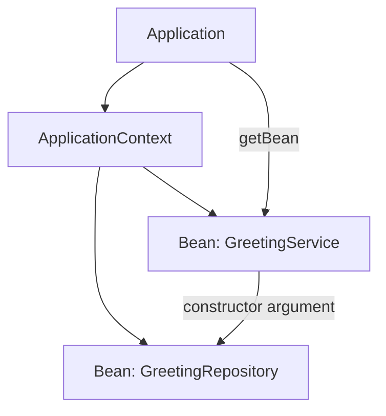

# Đảo ngược điều khiển (IoC) và tiêm phụ thuộc (DI) trong Spring Framework

## 1. Mục tiêu và bức tranh tổng thể

Sau bài này, bạn cần phân biệt được **IoC (Inversion of Control)** và **DI (Dependency Injection)**, giải thích vì sao một lớp nên nhận dependency từ bên ngoài thay vì tự tạo, và dùng Spring IoC container để lắp ghép các đối tượng Java thành một ứng dụng. Bạn sẽ biết vai trò của `BeanFactory`, `ApplicationContext`, bean, `@Configuration`, `@Bean` và cách áp dụng constructor injection với chương trình Java 17+ chạy được.

Ví dụ xuyên suốt: `GreetingService` cần một thành phần `GreetingRepository` để tạo lời chào. Service chỉ nên quan tâm **dùng** khả năng tạo lời chào, không cần biết cách tìm, khởi tạo và quản lý triển khai cụ thể của repository.

### IoC và DI không phải hai tên đồng nghĩa

- **IoC** là nguyên lý **đảo chiều quyền kiểm soát**: thay vì một đối tượng tự điều phối mọi thứ (khởi tạo, tra cứu, lắp ghép collaborator), một thành phần bên ngoài, chẳng hạn Spring container, đảm nhận phần kiểm soát đó.
- **DI** là **một cách cụ thể hiện thực IoC**: dependency của đối tượng được *cung cấp từ bên ngoài*, chẳng hạn qua constructor, tham số factory method hoặc setter.
- **Spring IoC container** là cơ chế Spring tạo, cấu hình, liên kết và quản lý vòng đời của các **bean** theo các bean definition. Nó không điều khiển mọi câu lệnh Java và cũng không tự động quản lý mọi đối tượng được tạo bằng `new`.

`Dependency` ở đây là **một đối tượng/chức năng mà lớp khác cần hợp tác**; đừng nhầm với Maven dependency (thư viện/JAR được khai báo trong `pom.xml`). Maven tải mã thư viện Spring, còn Spring DI kết nối các **đối tượng lúc runtime**.

## 2. Từ nguyên lý IoC đến DI trong mã Java

Giả sử `GreetingService` tự giữ `new EnglishGreetingRepository()`. Khi đó service **vừa dùng vừa chọn cách tạo** repository; đổi nguồn dữ liệu hoặc dùng fake kiểm thử đòi thay trực tiếp lớp nghiệp vụ. DI tách quyết định đó sang caller/container, ví dụ:

```java
interface GreetingRepository {
    String message(String name);
}

final class GreetingService {
    private final GreetingRepository repository;

    GreetingService(GreetingRepository repository) {
        this.repository = java.util.Objects.requireNonNull(repository);
    }

    String greet(String name) {
        return repository.message(name);
    }
}
```

Đây là **mẫu thiết kế Java thuần**, chưa phải một ứng dụng Spring độc lập. `GreetingService` công khai dependency bắt buộc trong constructor; caller vẫn có thể dùng `new GreetingService(repository)`. Khi Spring quản lý các object này, container tìm bean phù hợp và truyền instance vào đúng điểm injection. **IoC là nguyên lý chuyển quyền điều phối; DI là cơ chế cung cấp collaborator từ bên ngoài.**

```text
Caller/Container -> tạo GreetingRepository -> tạo GreetingService(repository)
```

Spring không xóa `new`: factory/composition root vẫn tạo đối tượng. Điểm thay đổi là mã nghiệp vụ không tự chọn implementation và cách cấu hình dependency.

## 3. Spring container làm gì?

Trong Spring Core Container:

1. **Đọc metadata** đăng ký bean (Java `@Configuration` / `@Bean`, component scanning, XML hoặc các hình thức đăng ký khác).
2. **Tạo bean definitions**, hiểu tên, loại, scope, factory method và các thông tin khởi tạo.
3. **Giải quyết dependency**: ví dụ method tạo `GreetingService` cần một `GreetingRepository`, container tìm một bean tương thích và cung cấp nó.
4. **Khởi tạo và quản lý** bean trong phạm vi của container; xử lý các bước lifecycle và cơ chế mở rộng liên quan.
5. **Cung cấp bean** khi ứng dụng gọi `getBean(...)` hoặc khi một bean khác cần nó.

Hai API cần biết:

| Thành phần | Vai trò |
| --- | --- |
| `BeanFactory` | Giao diện nền tảng để truy xuất bean và cấu hình/DI cơ bản |
| `ApplicationContext` | Mở rộng `BeanFactory`: thêm lifecycle thuận tiện, event, message resource và khả năng tích hợp khác; lựa chọn thông thường khi dùng ứng dụng Spring |
| `AnnotationConfigApplicationContext` | Một triển khai `ApplicationContext` có thể nhận Java configuration class, như trong ví dụ bên dưới |
| `Bean` | Đối tượng được đăng ký và quản lý bởi container; không phải tên khác của mọi object Java |
| `Bean definition` | Metadata mô tả cách Spring tạo/quản lý bean đó |

Một container có thể tồn tại độc lập, **không cần Spring Boot, server HTTP hay Spring MVC**. Spring Boot giúp tự động hóa nhiều phần cấu hình/khởi chạy, nhưng nguyên lý IoC và DI nằm trong **Spring Framework**.

### Đường đi của dependency



Mũi tên giữa service và repository biểu diễn **phụ thuộc để thực hiện nhiệm vụ**, không có nghĩa service phải chủ động gọi `context.getBean`. Trong thiết kế DI sạch, service không biết container.

## 4. Chương trình Java 17+ chạy độc lập với Spring Context

Ví dụ dùng **Spring Framework 6.2.19**, Java 17, Maven 3.9+ và `spring-context`. Không cần Spring Boot hay database. Khi chạy lần đầu, Maven cần kết nối tới kho phụ thuộc để tải JAR nếu chưa có trong cache.

Cấu trúc thư mục:

```text
ioc-di-demo/
├── pom.xml
└── src/
    └── main/
        └── java/
            └── demo/
                └── IocDiDemo.java
```

### 4.1. File `pom.xml`

```xml
<?xml version="1.0" encoding="UTF-8"?>
<project xmlns="http://maven.apache.org/POM/4.0.0"
         xmlns:xsi="http://www.w3.org/2001/XMLSchema-instance"
         xsi:schemaLocation="http://maven.apache.org/POM/4.0.0 https://maven.apache.org/xsd/maven-4.0.0.xsd">
    <modelVersion>4.0.0</modelVersion>
    <groupId>demo</groupId>
    <artifactId>ioc-di-demo</artifactId>
    <version>1.0.0</version>

    <properties>
        <maven.compiler.release>17</maven.compiler.release>
        <project.build.sourceEncoding>UTF-8</project.build.sourceEncoding>
    </properties>

    <dependencies>
        <dependency>
            <groupId>org.springframework</groupId>
            <artifactId>spring-context</artifactId>
            <version>6.2.19</version>
        </dependency>
    </dependencies>

    <build>
        <plugins>
            <plugin>
                <groupId>org.apache.maven.plugins</groupId>
                <artifactId>maven-compiler-plugin</artifactId>
                <version>3.14.1</version>
            </plugin>
            <plugin>
                <groupId>org.codehaus.mojo</groupId>
                <artifactId>exec-maven-plugin</artifactId>
                <version>3.5.1</version>
                <configuration>
                    <mainClass>demo.IocDiDemo</mainClass>
                </configuration>
            </plugin>
        </plugins>
    </build>
</project>
```

Chỉ cần khai báo `spring-context`; Maven giải quyết các phụ thuộc transitively cần thiết của phiên bản này. Đừng tự chép một vài JAR rời vào classpath rồi quên các JAR liên quan.

### 4.2. File `src/main/java/demo/IocDiDemo.java`

```java
package demo;

import java.util.Objects;
import org.springframework.context.annotation.AnnotationConfigApplicationContext;
import org.springframework.context.annotation.Bean;
import org.springframework.context.annotation.Configuration;

public final class IocDiDemo {
    private IocDiDemo() {}

    // Hợp đồng mà service cần, không gắn với cách tạo lời chào.
    public interface GreetingRepository {
        String message(String name);
    }

    public static final class EnglishGreetingRepository
            implements GreetingRepository {
        @Override
        public String message(String name) {
            return "Hello, " + name;
        }
    }

    public static final class GreetingService {
        private final GreetingRepository repository;

        public GreetingService(GreetingRepository repository) {
            this.repository = Objects.requireNonNull(
                    repository, "repository must not be null");
        }

        public String greet(String name) {
            if (name == null || name.isBlank()) {
                throw new IllegalArgumentException("name must not be blank");
            }
            return repository.message(name.strip());
        }
    }

    @Configuration(proxyBeanMethods = false)
    public static class AppConfig {
        @Bean
        public GreetingRepository greetingRepository() {
            return new EnglishGreetingRepository();
        }

        @Bean
        public GreetingService greetingService(GreetingRepository repository) {
            return new GreetingService(repository);
        }
    }

    public static void main(String[] args) {
        try (AnnotationConfigApplicationContext context =
                     new AnnotationConfigApplicationContext(AppConfig.class)) {
            GreetingService service = context.getBean(GreetingService.class);

            System.out.println("greeting=" + service.greet(" Lan "));
            System.out.println("singleton=" + (service ==
                    context.getBean(GreetingService.class)));
            System.out.println("repository=" +
                    context.getBean(GreetingRepository.class)
                           .getClass().getSimpleName());
        }

        // Kiểm thử bằng fake qua cùng constructor: không cần Spring container.
        GreetingService fakeService = new GreetingService(
                name -> "Fake: " + name);
        System.out.println("fake=" + fakeService.greet("Minh"));
    }
}
```

Đây là một file Java đầy đủ: một lớp top-level `public`, các interface/class phụ được đặt lồng bên trong. `@Configuration(proxyBeanMethods = false)` phù hợp vì cấu hình **không gọi trực tiếp** method `@Bean` khác; Spring cung cấp dependency qua **tham số của method `greetingService(...)`**.

### 4.3. Biên dịch/chạy bằng Maven

Đứng trong thư mục `ioc-di-demo`, dùng JDK 17+ và Maven:

```bash
java -version
mvn -version
mvn -q clean compile exec:java
```

Lệnh Maven compiler thực hiện biên dịch nguồn Java 17; plugin `exec:java` gọi `demo.IocDiDemo.main`. Output chương trình không phụ thuộc hệ điều hành hay file ngoài.

**Stdout chính xác từ ứng dụng:**

```text
greeting=Hello, Lan
singleton=true
repository=EnglishGreetingRepository
fake=Fake: Minh
```

Các lệnh `java -version` / `mvn -version` và thông tin Maven (nếu hiện ra) **không tính** vào bốn dòng stdout của ứng dụng. `-q` giảm log Maven, nhưng máy có cấu hình logging riêng có thể in thông tin ngoài stdout ứng dụng.

### 4.4. Tùy chọn dùng trực tiếp `javac` và `java`

Nếu muốn quan sát lệnh Java compiler/launcher thay vì để Maven quản lý toàn bộ bước chạy, trước hết nhờ Maven tạo classpath chứa các JAR Spring và dependency transitively:

```bash
mvn -q dependency:build-classpath -Dmdep.outputFile=classpath.txt
```

**Linux/macOS (bash/zsh)**, chạy từ thư mục dự án:

```bash
mkdir -p out
javac --release 17 -encoding UTF-8 -cp "$(cat classpath.txt)" \
  -d out src/main/java/demo/IocDiDemo.java
java -cp "out:$(cat classpath.txt)" demo.IocDiDemo
```

**Windows PowerShell**:

```powershell
$deps = (Get-Content -Raw classpath.txt).Trim()
New-Item -ItemType Directory -Force out | Out-Null
javac --release 17 -encoding UTF-8 -cp "$deps" -d out src/main/java/demo/IocDiDemo.java
java -cp "out;$deps" demo.IocDiDemo
```

Dấu phân cách classpath khác nhau: **dấu `:` trên Unix, `;` trên Windows**. Cả hai đường chạy sinh bốn dòng output như nhau. Đừng chạy `javac IocDiDemo.java` mà không chỉ định classpath nếu Spring JAR chưa có; lỗi `package org.springframework... does not exist` lúc đó không phải lỗi cú pháp IoC/DI.

## 5. Phân tích từng bước: Spring thực sự tiêm gì?

1. `new AnnotationConfigApplicationContext(AppConfig.class)` tạo context và nạp cấu hình `AppConfig`.
2. `@Bean greetingRepository()` cung cấp **bean định danh `greetingRepository`**, kiểu khai báo `GreetingRepository`, instance thực tế `EnglishGreetingRepository`.
3. Spring thấy `@Bean greetingService(GreetingRepository repository)` cần một dependency cùng kiểu. Với **một ứng viên phù hợp**, Spring chuyển instance repository đã đăng ký vào tham số factory method.
4. `new GreetingService(repository)` thực thi **constructor injection**. Service lưu phụ thuộc trong trường `final` và chỉ làm việc qua interface.
5. Mã ứng dụng nhận bean qua `context.getBean(GreetingService.class)`. Hai lần lấy cùng bean mặc định `singleton` trong cùng context, vì vậy phép so sánh reference cho `true`.
6. Khi context đóng (khối `try-with-resources`), Spring thực hiện quy trình đóng context và callback hủy bean phù hợp nếu có. Trong demo không có tài nguyên bên ngoài cần dọn.
7. `fakeService` cuối chương trình **không phải Spring bean**: đó là một object Java thuần được truyền implementation giả qua lambda, minh họa khả năng test class nghiệp vụ **không phụ thuộc Spring**.

Điểm cần phân biệt: Spring không tự biết chọn repository chỉ vì lớp service khai báo một interface. **Phải có bean được đăng ký**; nếu không có ứng viên thỏa mãn, quá trình tạo service thất bại. Nếu có nhiều ứng viên, cần cấu hình cách chọn.

## 6. Ba hình thức dependency injection và lựa chọn thực tế

| Hình thức | Cách hoạt động | Khi nào thích hợp |
| --- | --- | --- |
| **Constructor injection** | Dependency được truyền vào lúc tạo object | Phụ thuộc **bắt buộc**, giữ trường `final`, dễ kiểm tra và unit test; thường là mặc định tốt |
| **Setter/method injection** | Gọi setter hoặc phương thức sau khi object đã được tạo | Phụ thuộc tùy chọn hoặc cần thay đổi cấu hình về sau; bảo đảm trạng thái hợp lệ trước khi dùng |
| **Field injection** | Container điền trực tiếp field, thường với `@Autowired` | Có thể gặp trong code cũ/khung framework; khó tạo object độc lập, khó thấy dependency và không đặt `final` dễ dàng |

Trong ứng dụng mới, thường **ưu tiên constructor injection** cho dependency bắt buộc. Không nên biến một lớp thành đối tượng có hàng chục dependency chỉ vì container tự nối được; đó có thể là dấu hiệu lớp nhận quá nhiều trách nhiệm.

Spring hỗ trợ component scanning:

```java
@Component
class OrderService {
    private final OrderRepository repository;

    OrderService(OrderRepository repository) {
        this.repository = repository;
    }
}
```

Đây là **minh họa**, chưa tự chạy vì cần `OrderRepository` và cấu hình scan. Với một lớp bean chỉ có **một constructor**, Spring có thể dùng constructor ấy để autowire mà **không cần đặt `@Autowired`**. `@ComponentScan` đăng ký các component thuộc package được quét; `@Component` không tự làm lớp được quét nếu không có cấu hình tương ứng. `@Service`, `@Repository` và `@Controller` là các stereotype chuyên biệt; bài này chỉ cần hiểu cơ chế đăng ký bean.

Hai cách chủ yếu:

- **JavaConfig `@Bean`:** thích hợp khi muốn kiểm soát cách tạo object, cấu hình constructor phức tạp hoặc tích hợp lớp thư viện không thể gắn annotation. Demo runnable ở trên dùng cách này.
- **Component scan + constructor injection:** thích hợp với các lớp ứng dụng mà container có thể khởi tạo qua constructor. Cần chú ý phạm vi package, annotation và dependency có sẵn.

Không cần vừa khai báo `@Bean` vừa `@Component` cho **cùng một instance theo ý định**; đăng ký trùng có thể tạo nhiều bean cùng loại và làm việc autowire bị mơ hồ.

## 7. Các lỗi thiết kế/khởi tạo thường gặp

| Tình huống | Hậu quả và cách xử lý |
| --- | --- |
| Không đăng ký bean của dependency | Spring không thể tạo bean cần dependency; kiểm tra `@Bean`, `@ComponentScan`, package và điều kiện cấu hình |
| Có nhiều bean cùng kiểu | Injection theo kiểu có thể mơ hồ; dùng `@Qualifier`, `@Primary` hoặc thay đổi thiết kế/cách đăng ký |
| Vòng phụ thuộc qua constructor: A cần B, B cần A | Container thường không thể hoàn tất việc tạo hai bean; nên tách trách nhiệm hoặc thiết kế lại, không dùng field injection để che vòng |
| `new GreetingService(...)` ở một nơi rồi mong Spring inject tự động | Đối tượng này không do container quản lý; DI do tự bạn truyền hoặc cần lấy bean từ context |
| Service gọi `ApplicationContext.getBean(...)` ở khắp nơi | Chuyển phụ thuộc thành service locator, che dependency và khó unit test; ưu tiên khai báo qua constructor |
| Giữ bean `singleton` có trạng thái request mutable không an toàn | Nhiều caller có thể dùng chung bean; tránh để trạng thái theo request trong trường mutable của singleton |
| Cho rằng `singleton` là một instance cho toàn JVM | Singleton mặc định là **một instance mỗi bean definition trong một container**, không mặc nhiên một instance cho cả JVM |
| Inject bean `prototype` vào singleton rồi mong mỗi lần gọi đều có object mới | Dependency thường được giải quyết lúc tạo singleton; cần cơ chế lấy đối tượng mới phù hợp khi thực sự cần |
| Tự gọi `@Bean` method trong `@Configuration(proxyBeanMethods=false)` | Đó là lời gọi Java thông thường, không được container chặn để tái dùng scoped bean; dùng tham số method hoặc lấy bean qua container ở composition root |
| Bắt mọi lỗi khởi tạo rồi tiếp tục với dependency null | Làm ứng dụng hoạt động ở trạng thái sai; giữ hợp đồng rõ và xử lý lỗi cấu hình từ đầu |

### Scope không phải mức truy cập

Bean có scope mặc định `singleton`. `prototype` yêu cầu tạo object mới cho mỗi lần container được yêu cầu tạo bean theo scope đó. Các scope web như request/session cần môi trường web tương ứng. Chọn scope theo vòng đời dữ liệu, không phải chỉ vì nghĩ `prototype` luôn tốt hơn.

Spring thường quản lý việc hủy **singleton** khi context đóng. Với prototype, container không tự quản lý toàn bộ quá trình hủy sau khi giao object cho caller; mã sử dụng phải quan tâm tới tài nguyên của nó.

## 8. Kiểm thử, thay thế dependency và lợi ích thật sự của DI

Nhờ service chỉ phụ thuộc interface `GreetingRepository`, bạn có thể kiểm thử logic mà không khởi động container:

```java
IocDiDemo.GreetingService service = new IocDiDemo.GreetingService(
        name -> "TEST: " + name);
System.out.println(service.greet("An")); // TEST: An.
```

Đoạn này là **minh họa** đặt trong class/phương thức có thể truy cập `IocDiDemo`, không phải tệp chạy độc lập. Trong demo thực tế, `fakeService` dùng đúng kỹ thuật này.

Trong test, có thể tạo fake implementation ghi lại đối số nhận được rồi kiểm tra service có gọi đúng hay không. Không nhất thiết đưa Spring vào mọi unit test. Nếu mục tiêu là kiểm tra **cấu hình bean thật**, khi đó khởi động một `ApplicationContext` trong integration test mới hữu ích.

Ưu điểm đạt được từ **thiết kế dependency rõ ràng**, không phải chỉ từ việc thêm annotation:

- Có thể đổi triển khai (in-memory sang database, dịch vụ thật sang fake) ở nơi lắp ghép.
- Logic nghiệp vụ ít phụ thuộc vào cơ chế khởi tạo/cấu hình.
- Constructor biểu thị rõ dependency bắt buộc; có thể kiểm tra null sớm.
- Unit test dễ cô lập hơn, cấu hình runtime dễ thay đổi hơn.

Chi phí cũng có thật: quá nhiều bean, cấu hình scan rộng, abstraction không cần thiết, injection mơ hồ hoặc vòng dependency có thể làm chương trình khó theo dõi. Một đối tượng nhỏ không cần collaborator thường **không bắt buộc** phải trở thành Spring bean.

## 9. Câu hỏi tự kiểm tra

1. **IoC khác DI?** IoC là nguyên lý đảo quyền kiểm soát lắp ghép/quản lý; DI là cách cung cấp dependency từ ngoài thay vì class tự tạo/tìm.
2. **Một `new GreetingService(new EnglishGreetingRepository())` có phải DI không?** Có: constructor nhận dependency từ caller dù không dùng Spring. Spring chỉ tự động hóa phần wiring/lifecycle khi object là bean.
3. **`@Bean` có ý nghĩa gì?** Khai báo factory method cung cấp một bean definition cho container; tên mặc định thường là tên method.
4. **Tại sao service không cần `ApplicationContext`?** Nó chỉ cần hợp đồng `GreetingRepository`; phụ thuộc trực tiếp vào container trong domain/service thường không cần thiết.
5. **Vì sao `getBean(GreetingService.class)` gọi hai lần cho cùng reference?** Bean của ví dụ có scope mặc định singleton trong cùng context.
6. **Nếu đăng ký thêm một bean cùng kiểu `GreetingRepository`?** Phân giải theo kiểu có thể mơ hồ; cần chọn rõ ứng viên bằng qualifier/primary hoặc cấu hình phù hợp.
7. **Khi nào dùng constructor injection?** Với dependency thiết yếu để object luôn được tạo ở trạng thái hợp lệ.
8. **Có cần Spring Boot cho ví dụ này?** Không. `AnnotationConfigApplicationContext` thuộc Spring Context, chạy bằng ứng dụng Java thuần.

## 10. Checklist áp dụng vào dự án

- [ ] Xác định class nào **dùng** dependency và class nào chịu trách nhiệm **tạo/cấu hình** dependency.
- [ ] Dùng interface/abstraction khi thực sự giúp thay thế triển khai hoặc cô lập trách nhiệm.
- [ ] Đưa dependency bắt buộc vào constructor thay vì `new` cụ thể trong service.
- [ ] Đăng ký đầy đủ bean definition và kiểm tra đúng phạm vi component scanning nếu dùng.
- [ ] Ưu tiên `ApplicationContext` cho ví dụ IoC Spring; đóng context do chính mình tạo khi kết thúc.
- [ ] Phân biệt bean do container quản lý với đối tượng Java tạo ngoài container.
- [ ] Xác định scope của bean và tránh trạng thái dùng chung không an toàn.
- [ ] Kiểm tra trường hợp thiếu/trùng bean, vòng constructor, lỗi khởi tạo.
- [ ] Chạy ví dụ trên JDK 17+ và đối chiếu bốn dòng stdout.
- [ ] Kiểm thử service bằng fake dependency mà không cần Spring để thấy giá trị của DI.

**Ghi nhớ:** Spring IoC container **quản lý bean và lắp ghép dependency**; DI giúp lớp nhận collaborator từ bên ngoài. Giá trị cốt lõi là **giảm phụ thuộc vào cách tạo và triển khai**, tăng khả năng thay thế/kiểm thử — không phải chỉ đổi mọi lệnh `new` thành annotation.

### Tài liệu chính thức đọc thêm

- [Spring IoC container and beans](https://docs.spring.io/spring-framework/reference/core/beans/introduction.html)
- [Dependency Injection](https://docs.spring.io/spring-framework/reference/core/beans/dependencies/factory-collaborators.html)
- [`@Bean` and `@Configuration`](https://docs.spring.io/spring-framework/reference/core/beans/java/basic-concepts.html)
