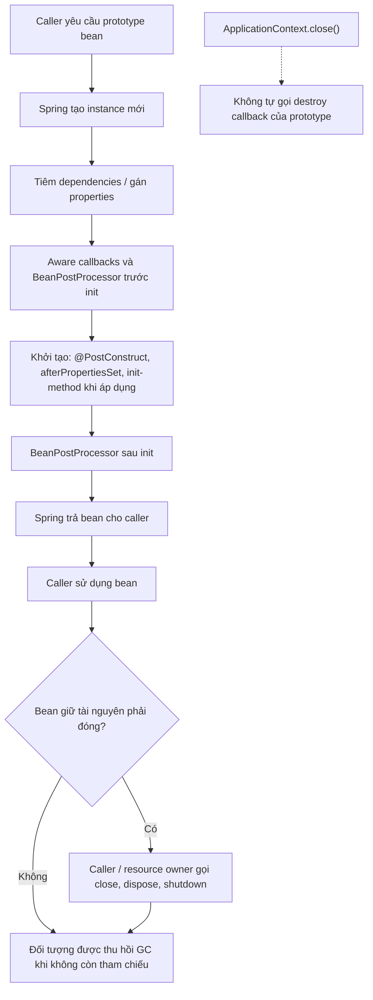

# Quản lý khởi tạo nhưng không tự hủy bean prototype trong Spring

## 1. Cốt lõi của quy tắc vòng đời

Trong Spring IoC container, bean có scope `prototype` được **tạo một instance mới mỗi lần container nhận yêu cầu lấy bean** (chẳng hạn gọi `getBean()`, hoặc giải quyết một dependency tại thời điểm tạo bean khác). Spring vẫn thực hiện phần **khởi tạo** của bean: xây dựng đối tượng, tiêm dependency, xử lý các bean lifecycle callback và đưa bean đã sẵn sàng cho bên yêu cầu.

Tuy nhiên, sau khi giao prototype bean cho caller, Spring **không tiếp tục theo dõi vòng đời để tự gọi destruction callbacks của instance đó khi container đóng**. Đây là điểm khác biệt trọng yếu so với singleton bean do container quản lý đầy đủ. Code sử dụng prototype phải chịu trách nhiệm giải phóng tài nguyên nếu đối tượng giữ tài nguyên cần đóng.

> **Quy tắc cần nhớ:** Spring thực hiện **creation + dependency injection + initialization** cho prototype bean, nhưng **không tự động thực hiện destruction** của prototype khi `ApplicationContext.close()`. Vì vậy `@PreDestroy`, `DisposableBean.destroy()` hoặc custom `destroy-method` sẽ không được Spring tự gọi cho các prototype instance theo vòng đời mặc định.

Không nên hiểu câu trên là prototype *không được phép hủy*. Đối tượng vẫn có thể có `close()`, `shutdown()` hay phương thức dọn dẹp. Điểm mấu chốt là **caller hoặc một thành phần theo dõi tài nguyên do ứng dụng xây dựng phải chủ động gọi**, thay vì trông đợi cơ chế đóng context của Spring.

## 2. Dòng thời gian vòng đời prototype



Cụm “khi áp dụng” quan trọng vì callback phụ thuộc cách bean được đăng ký và các `BeanPostProcessor` có mặt. Ví dụ, `@PostConstruct` được xử lý khi container có bộ xử lý annotation tương ứng; `InitializingBean.afterPropertiesSet()` là callback được Spring hỗ trợ trực tiếp. Spring gọi nhóm callback khởi tạo cho mỗi lần tạo prototype đủ điều kiện.

Các bước cần phân biệt:

1. **Bean definition:** `@Scope("prototype")`, XML `scope="prototype"`, hoặc cấu hình tương đương đánh dấu cách Spring tạo bean. Một bean definition được dùng để tạo *nhiều* instance theo yêu cầu.
2. **Construction:** Spring gọi constructor hoặc factory method mỗi lần cần instance mới, sau đó resolve và tiêm dependencies.
3. **Initialization:** `BeanPostProcessor` và những callback init được cấu hình chạy cho instance mới, giống ý nghĩa khởi tạo bean thuộc các scope khác.
4. **Handover:** Spring trả instance cho đối tượng hoặc đoạn mã đã yêu cầu. Với prototype, không có hợp đồng container sẽ giữ mọi instance để hủy về sau.
5. **Use and cleanup:** Đối tượng có thể sống lâu hoặc ngắn tùy tham chiếu mà ứng dụng đang giữ. Nếu chứa connection, stream, socket, executor hoặc các tài nguyên khác, thành phần sở hữu phải đóng đúng thời điểm.
6. **Context shutdown:** Việc đóng context kích hoạt destruction của các bean được Spring quản lý vòng đời hủy (đặc biệt singleton), nhưng **không tự động duyệt qua mọi prototype từng cấp phát để hủy**.

Đừng nhầm “Spring không theo dõi destruction” với “Spring hoàn toàn không có liên hệ gì với prototype sau tạo”. Spring vẫn có thể can thiệp trong lúc tạo thông qua `BeanPostProcessor`, injection và proxy; chỉ **cam kết destruction tự động cho prototype** là không có trong hợp đồng scope mặc định.

## 3. So sánh trực tiếp prototype với singleton

| Câu hỏi | Singleton scope | Prototype scope |
|---|---|---|
| Mỗi lần `getBean()` cùng tên trong cùng container? | Thường trả cùng bean instance | Tạo một instance mới mỗi lần yêu cầu |
| Có thực hiện dependency injection? | Có | Có cho mỗi instance được tạo |
| Có callback initialization? | Có | Có cho mỗi instance |
| Có `@PostConstruct` khi được cấu hình hỗ trợ? | Có | Có, cho từng instance |
| Có `InitializingBean.afterPropertiesSet()`? | Có | Có, cho từng instance |
| Container tự gọi destruction khi đóng? | Có với bean/callback destruction phù hợp | **Không**, theo prototype lifecycle mặc định |
| `@PreDestroy` / `DisposableBean.destroy()` / custom destroy method? | Spring có thể gọi theo cấu hình khi container đóng | **Spring không tự gọi** |
| Ai phải quyết định thời điểm giải phóng resource? | Thường container thông qua lifecycle của singleton | Caller hoặc resource owner do ứng dụng quản lý |
| Đối tượng tự biến mất sau mỗi method/request? | Không | **Không**; prototype không đồng nghĩa request scope hoặc GC tức thì |

Một prototype được tạo từ `getBean()` rồi bỏ tham chiếu có thể được garbage collector thu hồi sau này, nhưng **garbage collection không thay thế `close()`** đối với socket, file handle, native resource hay transaction handle. Không dựa vào `finalize()` để dọn dẹp; cơ chế đó không đáng tin cậy và đã bị đánh dấu để loại bỏ trong Java hiện đại.

## 4. Khai báo bean prototype

### 4.1. Dùng `@Bean` và `@Scope`

```java
@Configuration
public class SessionConfiguration {

    @Bean
    @Scope(ConfigurableBeanFactory.SCOPE_PROTOTYPE)
    ProcessingSession processingSession() {
        return new ProcessingSession();
    }
}
```

Đây là *minh họa cấu hình*, giả định có class `ProcessingSession` và import `@Configuration`, `@Bean`, `@Scope`, `ConfigurableBeanFactory` tương ứng. Spring sẽ tạo instance mới khi có yêu cầu lấy bean `processingSession`. Hằng `ConfigurableBeanFactory.SCOPE_PROTOTYPE` bằng chuỗi `"prototype"`; cả hai cách cấu hình đều hợp lệ.

### 4.2. Dùng component scanning

```java
@Component
@Scope("prototype")
public class ReportBuilder {
    public ReportBuilder() {
        // Khởi tạo trạng thái riêng của mỗi lần xây dựng báo cáo.
    }
}
```

Đoạn này là mã minh họa trong dự án đã bật component scanning. Đối tượng `ReportBuilder` không bắt buộc phải có phương thức hủy; nếu chỉ dùng bộ nhớ Java thuần và không nắm tài nguyên bên ngoài, đôi khi **không có gì cần đóng thủ công**.

### 4.3. Dùng XML

```xml
<bean id="reportBuilder" class="example.ReportBuilder" scope="prototype"/>
```

XML chỉ minh họa cùng cơ chế scope nếu class tồn tại và XML được nạp vào context; không phải ví dụ biên dịch độc lập. Có thể cấu hình `init-method` và `destroy-method` trên bean definition, nhưng việc khai báo `destroy-method` **không làm Spring tự hủy prototype**.

## 5. Thí nghiệm Java 17+ chạy độc lập với Spring Context

Thí nghiệm sau cho thấy rõ: mỗi `getBean()` tạo một instance, callback **khởi tạo** chạy hai lần, callback **hủy** không chạy lúc context đóng, và `close()` thủ công mới thực sự giải phóng tài nguyên theo cách ta lập trình.

Yêu cầu: JDK 17+ và Maven 3.9+. Ví dụ dùng Spring Framework 6.2.0, không cần Spring Boot hoặc máy chủ web.

Cấu trúc thư mục:

```text
prototype-lifecycle/
├── pom.xml
└── src/main/java/example/PrototypeLifecycleDemo.java
```

**`pom.xml`**

```xml
<project xmlns="http://maven.apache.org/POM/4.0.0"
         xmlns:xsi="http://www.w3.org/2001/XMLSchema-instance"
         xsi:schemaLocation="http://maven.apache.org/POM/4.0.0
                             https://maven.apache.org/xsd/maven-4.0.0.xsd">
    <modelVersion>4.0.0</modelVersion>
    <groupId>example</groupId>
    <artifactId>prototype-lifecycle</artifactId>
    <version>1.0.0</version>

    <properties>
        <maven.compiler.release>17</maven.compiler.release>
        <project.build.sourceEncoding>UTF-8</project.build.sourceEncoding>
    </properties>

    <dependencies>
        <dependency>
            <groupId>org.springframework</groupId>
            <artifactId>spring-context</artifactId>
            <version>6.2.0</version>
        </dependency>
    </dependencies>

    <build>
        <plugins>
            <plugin>
                <groupId>org.apache.maven.plugins</groupId>
                <artifactId>maven-compiler-plugin</artifactId>
                <version>3.13.0</version>
            </plugin>
            <plugin>
                <groupId>org.codehaus.mojo</groupId>
                <artifactId>exec-maven-plugin</artifactId>
                <version>3.5.0</version>
            </plugin>
        </plugins>
    </build>
</project>
```

**`src/main/java/example/PrototypeLifecycleDemo.java`**

```java
package example;

import java.util.concurrent.atomic.AtomicInteger;
import org.springframework.beans.factory.DisposableBean;
import org.springframework.beans.factory.InitializingBean;
import org.springframework.beans.factory.config.ConfigurableBeanFactory;
import org.springframework.context.annotation.AnnotationConfigApplicationContext;
import org.springframework.context.annotation.Bean;
import org.springframework.context.annotation.Configuration;
import org.springframework.context.annotation.Scope;

public class PrototypeLifecycleDemo {

    public static void main(String[] args) {
        ResourceSession second;

        try (var context = new AnnotationConfigApplicationContext(Config.class)) {
            ResourceSession first = context.getBean(ResourceSession.class);
            second = context.getBean(ResourceSession.class);

            System.out.println("Different instances: " + (first != second));
            System.out.println("Scope is prototype: "
                    + context.isPrototype("resourceSession"));

            first.close(); // Caller quyết định đóng instance thứ nhất.
        } // Đóng Spring context, không hủy prototype thứ hai.

        System.out.println("Second closed after context.close(): "
                + second.isClosed());
        second.close(); // Resource owner phải tự đóng instance thứ hai.
    }

    @Configuration(proxyBeanMethods = false)
    public static class Config {
        @Bean
        @Scope(ConfigurableBeanFactory.SCOPE_PROTOTYPE)
        public ResourceSession resourceSession() {
            return new ResourceSession();
        }
    }

    public static final class ResourceSession
            implements InitializingBean, DisposableBean, AutoCloseable {

        private static final AtomicInteger NEXT_ID = new AtomicInteger();
        private final int id = NEXT_ID.incrementAndGet();
        private boolean closed;

        public ResourceSession() {
            System.out.println("Construct session " + id);
        }

        @Override
        public void afterPropertiesSet() {
            System.out.println("Initialize session " + id);
        }

        @Override
        public void destroy() {
            // Nếu Spring tự hủy bean này, sẽ thấy dòng sau.
            System.out.println("Spring destroy callback " + id);
            close();
        }

        public boolean isClosed() {
            return closed;
        }

        @Override
        public void close() {
            if (!closed) {
                closed = true;
                System.out.println("Manual close session " + id);
            }
        }
    }
}
```

Trong thư mục chứa `pom.xml`, chạy:

```bash
mvn -q compile exec:java -Dexec.mainClass=example.PrototypeLifecycleDemo
```

**Stdout từ chương trình** (không tính log Maven nếu môi trường hiển thị):

```text
Construct session 1
Initialize session 1
Construct session 2
Initialize session 2
Different instances: true
Scope is prototype: true
Manual close session 1
Second closed after context.close(): false
Manual close session 2
```

Từ kết quả:

- Constructor và `afterPropertiesSet()` chạy cho **cả session 1 lẫn 2**: Spring thực hiện khởi tạo mỗi prototype.
- `first != second` là `true`, `isPrototype("resourceSession")` là `true`: mỗi lần lookup tạo đối tượng riêng.
- Sau khi đóng context, `second.isClosed()` vẫn là `false`. **Không có dòng `Spring destroy callback 1/2`**: Spring không tự kích hoạt `DisposableBean.destroy()` cho prototype.
- `first.close()` và `second.close()` đều do mã caller chủ động gọi. Đây là phương thức `AutoCloseable.close()`; nó **không phải** callback tự động của Spring ở scope prototype.
- `AtomicInteger` chỉ dùng để tạo nhãn instance ổn định và an toàn nếu sau này thay đổi sang demo đa luồng. Trong bài này tất cả lời gọi chạy tuần tự trên main thread.

Đây là ví dụ dùng `InitializingBean`/`DisposableBean` để không phải phụ thuộc vào thư viện annotation ngoài Spring. Khi dùng `@PostConstruct`/`@PreDestroy`, quy tắc vẫn giống nhau: `@PostConstruct` có thể chạy cho từng prototype khi được hỗ trợ, còn `@PreDestroy` sẽ **không được Spring gọi tự động** khi đóng context cho prototype.

## 6. Vì sao `@PreDestroy` không chạy cho prototype?

`@PreDestroy` chỉ đánh dấu một callback hủy. Việc Spring có tự chạy callback đó hay không phụ thuộc cơ chế quản lý vòng đời và scope. Với singleton thông thường, Spring giữ bean và đăng ký đường hủy khi context đóng, nên callback phù hợp được gọi. Với prototype, container chủ động tạo bean theo yêu cầu, hoàn tất initialization và giao instance cho caller; container không lưu mọi prototype để điều phối destruction sau đó.

Ví dụ trong ứng dụng có bộ xử lý Jakarta lifecycle annotations (mã minh họa, cần `jakarta.annotation-api` và cấu hình Spring phù hợp):

```java
public class ExportJob implements AutoCloseable {
    @jakarta.annotation.PostConstruct
    public void init() {
        System.out.println("initialized");
    }

    @jakarta.annotation.PreDestroy
    public void destroy() {
        System.out.println("pre-destroy");
        close();
    }

    @Override
    public void close() {
        // Giải phóng resource thực tế.
    }
}
```

Nếu class trên được đăng ký là prototype, việc dùng `@PostConstruct` và `@PreDestroy` trên **cùng một class** không làm hai callback có tính đối xứng: init có thể tự chạy, destroy không được container tự chạy theo mặc định. Thậm chí nếu prototype bean có `@Bean(destroyMethod = "close")`, cách khai báo destroy method không tự chuyển trách nhiệm dọn dẹp sang Spring.

Một đối tượng **không có resource cần đóng** có thể đơn giản ngừng được tham chiếu và về sau được GC thu hồi. Vì vậy điều cần tránh là rò rỉ file/socket/database/native handles, không phải việc mỗi prototype chưa được gọi hàm `destroy()` bằng mọi giá.

## 7. Những cách quản lý cleanup đúng trong ứng dụng

### 7.1. Dùng `try-with-resources` ở nơi thực sự sở hữu prototype

Đây thường là lựa chọn rõ ràng nhất khi một tác vụ lấy prototype, sử dụng trong thời gian ngắn, rồi kết thúc:

```java
@Service
public class ExportService {
    private final ObjectProvider<ExportSession> sessions;

    public ExportService(ObjectProvider<ExportSession> sessions) {
        this.sessions = sessions;
    }

    public void export(long jobId) throws Exception {
        try (ExportSession session = sessions.getObject()) {
            session.run(jobId);
        } // close() luôn được gọi kể cả khi run() ném exception.
    }
}
```

**Đoạn trên là code tích hợp Spring, không phải chương trình độc lập.** Cần một bean `ExportSession` mang scope prototype và class đó phải triển khai `AutoCloseable` với `close()` thực sự giải phóng tài nguyên. Các import tiêu biểu là `org.springframework.stereotype.Service` và `org.springframework.beans.factory.ObjectProvider`. `throws Exception` chỉ biểu diễn hợp đồng minh họa của `run()`/`close()`.

`ObjectProvider.getObject()` yêu cầu Spring cung cấp instance **tại thời điểm gọi**; nếu định nghĩa bean là prototype, mỗi lần này nhận một prototype mới. Khối `try-with-resources` xác định chủ sở hữu và thời điểm dọn dẹp rõ ràng. Nếu `getObject()` hoặc bước khởi tạo ném lỗi trước khi trả object, bean chưa được caller nhận; cần thiết kế factory/init cẩn thận để dọn resource cấp phát dở dang ngay trong quá trình khởi tạo.

### 7.2. Thu hồi tài nguyên qua chủ sở hữu có vòng đời riêng

Nếu resource được dùng lâu hơn một method, hãy chọn một thành phần chịu trách nhiệm rõ ràng: ví dụ session registry, job coordinator hoặc service quản lý toàn bộ phiên còn sống. Thành phần đó ghi nhận những instance được cấp phát, gỡ đăng ký khi đóng và chủ động gọi `close()` vào lúc hoàn thành công việc hoặc shutdown.

Một cách đơn giản về ý tưởng:

```java
ExportSession session = provider.getObject();
try {
    registry.register(session);
    // Sử dụng session trong giai đoạn công việc.
} finally {
    registry.unregister(session);
    session.close();
}
```

Đây là **pseudocode Java theo ngữ cảnh có sẵn `provider` và `registry`**, không phải chương trình chạy độc lập. Với tác vụ bất đồng bộ, không được dùng `finally` đóng ngay khi task mới được submit mà chưa hoàn thành: cleanup phải nằm tại **thời điểm tác vụ thực sự kết thúc** hoặc trong quy trình hủy/cancel an toàn.

Có thể dùng một custom `BeanPostProcessor` để ghi nhận prototype cần hủy, nhưng đây là trách nhiệm tự triển khai và cần tránh giữ tham chiếu lâu gây memory leak. Spring không tự làm registry đó cho toàn bộ prototype.

### 7.3. Dùng scope phù hợp nếu bản chất vòng đời là HTTP request hoặc session

Nếu đối tượng thực sự là dữ liệu của mỗi HTTP request, cân nhắc `request` scope. Nếu vòng đời theo phiên HTTP, cân nhắc `session` scope. Những scope này phụ thuộc môi trường web và có cơ chế gắn với thời điểm kết thúc scope.

**Prototype không đồng nghĩa “mỗi request một bean”**: một HTTP request gọi `getBean()` năm lần có thể nhận năm prototype. Ngược lại, một singleton được inject một prototype thông thường có thể giữ đúng **một prototype** qua nhiều request. Chọn scope phải dựa vào chủ sở hữu và điểm kết thúc vòng đời, không chỉ dựa vào mong muốn “object không dùng chung”.

## 8. Cạm bẫy: inject prototype vào singleton

Xét cấu hình:

```java
@Component
@Scope("prototype")
public class JobContext {
    // State riêng của mỗi công việc.
}

@Service
public class JobService {
    private final JobContext context;

    public JobService(JobContext context) {
        this.context = context;
    }
}
```

**Code minh họa**, giả định Spring component scanning và những import annotation cần thiết.

Spring mặc định tạo một `JobService` singleton; nó giải quyết dependency `JobContext` **một lần khi đang dựng singleton**. Prototype đó được gắn vào field `context`; mọi lần sử dụng `JobService` vẫn đi qua cùng instance field này. Việc đặt `@Scope("prototype")` lên `JobContext` không tự biến field đã inject thành “mỗi lời gọi một instance”.

Nếu cần một context mới cho mỗi lần thực hiện, hãy yêu cầu instance mỗi lần dùng:

```java
@Service
public class JobService {
    private final ObjectProvider<JobContext> contexts;

    public JobService(ObjectProvider<JobContext> contexts) {
        this.contexts = contexts;
    }

    public void runJob() {
        JobContext context = contexts.getObject();
        try {
            // Dùng context cho đúng một công việc.
        } finally {
            // Gọi close() tại đây nếu JobContext giữ resource.
        }
    }
}
```

Hai đoạn trên là **mã minh họa tích hợp**, không đặt chung vào cùng source file nếu trùng tên class `JobService`. Các cách lấy bean khi cần khác gồm `Provider<T>` (khi dùng dependency `jakarta.inject` tương ứng), `@Lookup` method injection, hoặc scoped proxy cho những nhu cầu cụ thể. Dù dùng cách nào, quy tắc cleanup prototype **không tự thay đổi**: tạo mới theo yêu cầu và giải phóng resource khi hoàn tất sử dụng.

## 9. Các tình huống lỗi thực tế và cách sửa

| Tình huống | Nhận định sai | Hậu quả và cách xử lý |
|---|---|---|
| Prototype nắm `InputStream`/file handle | “Đóng context sẽ gọi `@PreDestroy`.” | Handle có thể không đóng; thực hiện `close()` ở nơi sử dụng, ưu tiên `try-with-resources`. |
| Prototype là HTTP/DB client giữ connection | “Spring giữ và dọn tất cả instance đã cấp.” | Mất khả năng kiểm soát số connection đang mở; xác lập owner và release riêng, hoặc cân nhắc dùng pooled singleton client nếu phù hợp. |
| Singleton inject trực tiếp prototype | “Mỗi lần chạy method sẽ có prototype mới.” | Chỉ resolve dependency lúc tạo singleton; dùng `ObjectProvider.getObject()` trong mỗi lần thực hiện. |
| Dùng `prototype` để có đối tượng mới mỗi HTTP request | “Scope prototype bằng request scope.” | Một request có thể có nhiều prototype; chọn request scope nếu cần đúng một instance theo request. |
| Gọi `context.getBean()` rồi bỏ tham chiếu | “GC chắc chắn tự đóng file/socket đúng lúc.” | GC không có thời hạn và không bảo đảm cleanup tài nguyên; dùng `close()` rõ ràng. |
| Tạo prototype hàng loạt và giữ trong registry vô hạn | “Prototype luôn sống ngắn.” | Đối tượng vẫn sống nếu registry giữ tham chiếu; xóa và đóng theo lifecycle công việc. |
| Dùng singleton service có mutable state cho từng tác vụ | “Chuyển sang prototype sẽ tự thread-safe.” | Instance có thể vẫn bị chia sẻ do injection/registry; kiểm soát ownership, concurrency và thời điểm lấy bean. |
| Tự gọi `@PreDestroy` như một phương thức nghiệp vụ | “Annotation biến phương thức thành cleanup tự động.” | Annotation chỉ được container nhận diện trong lifecycle phù hợp; định nghĩa API `close()` rõ ràng để caller gọi. |

Với các resource bên dưới có quy tắc riêng (JDBC connection trả về pool, transactional resource do transaction manager quản lý, executor phải shutdown đúng policy), `close()` cần thực hiện thao tác đúng với hợp đồng của resource đó; không tự áp dụng một hàm đóng chung khi chưa xác định ai đang sở hữu thật sự.

## 10. Kiểm tra vòng đời trong thực tế

Khi nghi ngờ một prototype đang rò rỉ resource, kiểm tra theo thứ tự:

1. **Scope thực tế:** `applicationContext.isPrototype("beanName")`, hoặc xem bean definition qua `BeanFactory`. Đừng suy chỉ từ annotation nếu configuration ghi đè scope.
2. **Điểm tạo bean:** Có bao nhiêu lời gọi `getBean()`, `ObjectProvider.getObject()` hoặc injection vào bean khác? Một prototype được tiêm sẵn vào singleton có thể không được tạo lại mỗi lần phương thức chạy.
3. **Init callback:** Gắn log có định danh instance ở constructor, `@PostConstruct` hoặc `afterPropertiesSet()`; xem có chạy đúng mỗi lần tạo.
4. **Resource ownership:** Liệt kê đối tượng nào mở stream/connection và đoạn mã nào đảm bảo đóng trong cả đường thành công, lỗi và hủy tác vụ.
5. **Shutdown:** Xác nhận có cleanup chủ động cho những prototype sống qua nhiều tác vụ. Không coi `context.close()` là bằng chứng đã giải phóng prototype.
6. **Test:** Test có chủ đích cả nhánh ném exception; xác minh mock `close()` được gọi đúng một lần nếu contract yêu cầu, không chỉ kiểm tra `@PreDestroy` trên prototype.

Một unit/integration test hữu ích nên phân biệt **số lần tạo/init** với **số lần đóng** và xác nhận cleanup ở code sở hữu instance. Khác biệt số đếm này không tự động là lỗi của Spring; nó là đặc trưng scope prototype cần xử lý ở tầng ứng dụng.

## 11. Câu hỏi tự kiểm tra

**Câu 1.** Gọi `context.getBean("reportBuilder")` hai lần với một prototype bean, callback `afterPropertiesSet()` chạy mấy lần?  
**Đáp:** Thường hai lần, một lần cho mỗi instance được tạo thành công.

**Câu 2.** Gọi `context.close()` có bảo đảm gọi `@PreDestroy` trên các prototype đã cấp không?  
**Đáp:** Không. Phải dọn dẹp ở nơi sở hữu prototype hoặc qua cơ chế tracking/cleanup riêng.

**Câu 3.** Vì sao `try-with-resources` phù hợp với prototype có tài nguyên?  
**Đáp:** Nó gắn việc đóng `AutoCloseable` với chính phạm vi sử dụng, bao gồm cả đường ném exception.

**Câu 4.** Inject `prototype` trực tiếp vào singleton có luôn tạo prototype mới mỗi lần gọi method của singleton không?  
**Đáp:** Không. Dependency thông thường được resolve khi singleton được tạo; cần `ObjectProvider`, method injection hoặc cách truy xuất lại theo nhu cầu.

**Câu 5.** Có bắt buộc mọi prototype đều phải triển khai `DisposableBean` hoặc `AutoCloseable` không?  
**Đáp:** Không. Chỉ cần cleanup cho tài nguyên thực sự phải giải phóng; callback destroy dù có khai báo cũng không được Spring tự gọi khi prototype kết thúc.

## Tài liệu tham khảo

- [Spring Framework Reference — Bean Scopes](https://docs.spring.io/spring-framework/reference/core/beans/factory-scopes.html), nhất là mục **The Prototype Scope**: cơ chế khởi tạo và trách nhiệm destruction của prototype.
- [Spring Framework Reference — Lifecycle Callbacks](https://docs.spring.io/spring-framework/reference/core/beans/factory-nature.html): initialization, destruction và callback lifecycle.
- [Spring Framework Reference — Scoped Beans as Dependencies](https://docs.spring.io/spring-framework/reference/core/beans/factory-scopes.html#beans-factory-scopes-sing-prot-interaction): tương tác khi inject prototype vào singleton.
