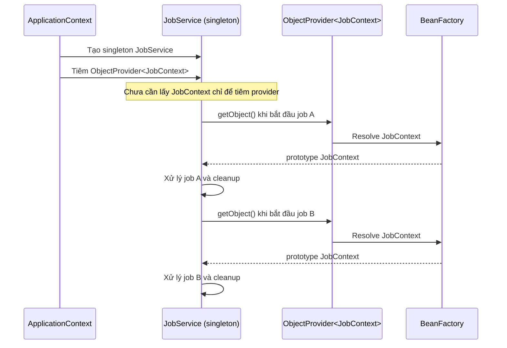

# Lấy đối tượng đúng thời điểm bằng ObjectProvider trong Spring

## 1. Vấn đề: bean phụ thuộc có vòng đời khác bean đang sử dụng

Trong Spring Core Container, dependency injection thường giải quyết phụ thuộc khi Spring **tạo đối tượng nhận dependency**. Cách đó phù hợp với những dịch vụ có cùng vòng đời, nhưng cần chú ý khi một bean **singleton** muốn sử dụng một bean **prototype** mới cho từng tác vụ.

Giả sử `ReportService` là singleton, còn `ReportContext` có scope `prototype`. Nếu tiêm trực tiếp `ReportContext` qua constructor, Spring tạo một `ReportContext` khi xây dựng `ReportService`. Singleton giữ lại tham chiếu này; **các lần gọi method về sau không tự động tạo prototype khác**.

```java
@Service
public class ReportService {
    private final ReportContext context;

    public ReportService(ReportContext context) {
        this.context = context; // Resolve một lần khi tạo ReportService.
    }

    public void generate() {
        context.write(); // Dùng lại instance đã tiêm.
    }
}
```

Đây là **mã minh họa trong ứng dụng Spring**, giả định `ReportContext` tồn tại, là prototype bean và có method `write()`. Cần import `@Service`; đoạn này không phải chương trình độc lập. Nếu `context` chứa trạng thái của báo cáo đang xử lý, việc tái sử dụng nó cho nhiều công việc có thể gây sai dữ liệu và vấn đề đồng thời.

Giải pháp thường dùng: **tiêm một `ObjectProvider<ReportContext>` vào singleton**, rồi gọi `getObject()` ngay tại điểm bắt đầu công việc. Khi đó Spring chỉ resolve đối tượng đích ở thời điểm thật sự cần.

```java
@Service
public class ReportService {
    private final ObjectProvider<ReportContext> contexts;

    public ReportService(ObjectProvider<ReportContext> contexts) {
        this.contexts = contexts;
    }

    public void generate() {
        ReportContext context = contexts.getObject(); // Resolve tại đây.
        context.write();
    }
}
```

Đoạn mã này cũng là minh họa tích hợp; cần import `org.springframework.beans.factory.ObjectProvider` và `org.springframework.stereotype.Service`. Nếu `ReportContext` nắm tài nguyên cần đóng, method thực tế phải có trách nhiệm cleanup phù hợp, như ví dụ chạy đầy đủ ở dưới.

**Ý chính:** `ObjectProvider<T>` là một điểm truy xuất đối tượng theo kiểu `T` thông qua Spring `BeanFactory`. Spring cung cấp một provider có thể được tiêm vào các bean khác, cho phép **trì hoãn lookup của đối tượng đích** đến mỗi lần gọi API provider. Việc mỗi lookup tạo mới hay trả cùng instance **vẫn do scope của bean đích quyết định**.

## 2. Cơ chế resolve theo thời điểm



Có hai thời điểm riêng:

1. **Tiêm provider:** Spring tạo singleton `JobService` và cung cấp đối tượng `ObjectProvider<JobContext>`. Việc tiêm provider bản thân nó không đòi phải dựng `JobContext` ngay.
2. **Lấy object đích:** Khi chạy `provider.getObject()`, provider hỏi container để giải quyết bean kiểu `JobContext`. Container áp dụng bean definition, dependency injection, scope và initialization như một lần lấy bean thông thường.

Với `prototype`, mỗi `getObject()` thông thường tạo một instance mới. Với `singleton`, nhiều lần gọi provider trả về cùng singleton do container quản lý. Với `request` hoặc scope khác, lookup tuân theo vòng đời scope đó; gọi ngoài một scope đang hoạt động có thể gây lỗi. Provider **không biến một bean singleton thành prototype** và **không làm mỗi object tự động thread-safe**.

Một điểm tinh tế về “lazy”: tiêm provider trì hoãn **việc chính bean dùng provider yêu cầu lấy đối tượng**. Điều đó không nhất thiết ngăn Spring tạo sẵn một *singleton đích không được đánh dấu lazy* khi context khởi động: singleton eager initialization có thể vẫn diễn ra độc lập. Nếu cần trì hoãn cả việc tạo singleton đích, phải xét `@Lazy` hoặc cấu hình initialization tương ứng.

## 3. Sử dụng API nào của ObjectProvider?

`ObjectProvider<T>` thuộc package `org.springframework.beans.factory`, mở rộng `ObjectFactory<T>` và triển khai `Iterable<T>`. Nó hỗ trợ lookup bắt buộc, dependency tùy chọn và lựa chọn ứng viên.

| API | Trường hợp sử dụng | Khi không có bean đích | Khi có nhiều bean phù hợp mà không chọn được duy nhất |
|---|---|---|---|
| `getObject()` | Phụ thuộc bắt buộc tại thời điểm gọi | Ném `NoSuchBeanDefinitionException` (thuộc nhóm `BeansException`) | Thường ném `NoUniqueBeanDefinitionException` |
| `getIfAvailable()` | Bean có thể vắng mặt | Trả `null` | Vẫn có thể ném `NoUniqueBeanDefinitionException` |
| `getIfAvailable(defaultSupplier)` | Có giá trị mặc định khi vắng bean | Dùng `Supplier` tạo fallback | Vẫn có thể lỗi không duy nhất |
| `ifAvailable(consumer)` | Chỉ xử lý nếu bean tồn tại | Không gọi `Consumer` | Vẫn có thể lỗi không duy nhất |
| `getIfUnique()` | Chỉ lấy khi có ứng viên chọn được duy nhất | Trả `null` | Trả `null` nếu thực sự không thể xác định một ứng viên |
| `getIfUnique(defaultSupplier)` | Fallback khi thiếu ứng viên duy nhất | Dùng fallback | Dùng fallback nếu không có ứng viên duy nhất |
| `ifUnique(consumer)` | Chỉ xử lý khi lựa chọn được duy nhất | Không gọi `Consumer` | Không gọi khi không xác định được duy nhất |
| `stream()` / iterator | Duyệt tất cả bean phù hợp với provider | Stream/iterator rỗng | Duyệt nhiều instance; không bắt buộc chọn một |
| `orderedStream()` | Duyệt nhiều bean theo thứ tự Spring xác định | Stream rỗng | Duyệt theo comparator, có xét `Ordered`/`@Order` khi thích hợp |
| `getObject(args)` | Yêu cầu tạo/resolve với tham số khởi tạo truyền tường minh trong trường hợp được hỗ trợ | Vẫn báo lỗi nếu thiếu bean | Vẫn phải phân giải ứng viên |

Các overload nhận `Supplier<T>`/ `Consumer<T>` thuộc Java 8 functional interfaces. Provider sẽ tra cứu đối tượng mỗi lần dùng các API này; chúng không giữ một bản snapshot cố định của toàn bộ kết quả ngay từ lúc injection. Kết quả cụ thể còn phụ thuộc qualifier, `@Primary`, quy tắc autowire candidate và trạng thái hiện tại của container.

### 3.1. Bắt buộc phải có đối tượng: getObject()

```java
TaskContext current = contexts.getObject();
```

Chọn khi mỗi lần xử lý chắc chắn cần một bean ứng với kiểu/qualifier đang yêu cầu. Không nên nuốt `NoSuchBeanDefinitionException` hay `NoUniqueBeanDefinitionException` để che lỗi cấu hình cốt lõi: hãy khai báo bean phù hợp hoặc làm rõ ứng viên bằng `@Qualifier`/`@Primary` theo yêu cầu thiết kế.

### 3.2. Phụ thuộc tùy chọn: getIfAvailable() và ifAvailable()

```java
public final class MetricsReporter {
    private final ObjectProvider<MetricsClient> metrics;

    public MetricsReporter(ObjectProvider<MetricsClient> metrics) {
        this.metrics = metrics;
    }

    public void record(String event) {
        metrics.ifAvailable(client -> client.record(event));
    }
}
```

Đây là **mã minh họa**: cần import `ObjectProvider` và một interface/class `MetricsClient` có method `record(String)`, đồng thời phải đăng ký `MetricsReporter` dưới dạng Spring bean nếu muốn container inject constructor. Nếu không có `MetricsClient`, có thể bỏ qua việc ghi metric. Nếu có *nhiều* ứng viên mà không chọn được một, `ifAvailable` không phải cơ chế “lấy đại một cái”.

Có thể dùng fallback:

```java
MetricsClient client = metrics.getIfAvailable(() -> new NoopMetricsClient());
```

Mã này là ví dụ theo ngữ cảnh có sẵn kiểu `MetricsClient` và `NoopMetricsClient` hợp lệ. **Fallback tự tạo bởi `Supplier` không mặc nhiên là bean được container quản lý**: nếu fallback cần Spring DI/lifecycle, hãy khai báo/cấu hình theo cách phù hợp.

### 3.3. Phụ thuộc chỉ hợp lệ khi xác định một ứng viên: getIfUnique()

```java
NotificationChannel channel = channels.getIfUnique();
if (channel != null) {
    channel.send("Ready");
}
```

Đây là minh họa khi có `ObjectProvider<NotificationChannel> channels`. Nếu không có ứng viên thì trả `null`. Nếu có nhiều ứng viên nhưng một ứng viên được chọn là duy nhất theo quy tắc resolution (chẳng hạn một `@Primary` hợp lệ), provider vẫn có thể trả instance đó. Nếu các ứng viên vẫn nhập nhằng, `getIfUnique()` trả `null`, khác với `getIfAvailable()` có thể ném lỗi không duy nhất.

**Không dùng `getIfUnique()` để âm thầm bỏ qua một dependency thực sự bắt buộc**: thiếu ứng viên duy nhất thường nên được phát hiện, sửa cấu hình và có test.

### 3.4. Cần nhiều bean: stream() và orderedStream()

```java
public final class DispatchPipeline {
    private final ObjectProvider<DispatchHandler> handlers;

    public DispatchPipeline(ObjectProvider<DispatchHandler> handlers) {
        this.handlers = handlers;
    }

    public void dispatch(Message message) {
        handlers.orderedStream().forEach(handler -> handler.handle(message));
    }
}
```

Mã trên là minh họa tích hợp: cần kiểu `DispatchHandler` với `handle(Message)` và các import tương ứng. `orderedStream()` theo comparator thông dụng của Spring, nên `@Order` hoặc `Ordered` có thể điều khiển thứ tự nếu được cấu hình. `stream()` và iterator **không cam kết thứ tự nghiệp vụ**; đừng dựa vào thứ tự đăng ký nếu yêu cầu chạy pipeline có thứ tự ổn định.

Lưu ý khi duyệt provider chứa prototype: việc duyệt để lấy instance có thể **tạo các prototype mới**. Nếu mỗi instance nắm tài nguyên, cần đóng chúng tương ứng; không xem `stream()` là phép liệt kê metadata vô hại.

## 4. Ví dụ chạy được: singleton lấy một prototype mới cho từng công việc

Ví dụ sau dùng **Spring Framework Core Container thuần**, không cần Spring Boot, servlet hay database. Một `JobService` singleton dùng `ObjectProvider<WorkSession>` để tạo một `WorkSession` prototype riêng cho từng lần thực thi, rồi đóng nó bằng `try-with-resources`.

**Yêu cầu:** Java 17+, Maven 3.9+.

Cấu trúc:

```text
object-provider-demo/
├── pom.xml
└── src/main/java/example/ObjectProviderDemo.java
```

Tệp `pom.xml`:

```xml
<project xmlns="http://maven.apache.org/POM/4.0.0"
         xmlns:xsi="http://www.w3.org/2001/XMLSchema-instance"
         xsi:schemaLocation="http://maven.apache.org/POM/4.0.0
                             https://maven.apache.org/xsd/maven-4.0.0.xsd">
    <modelVersion>4.0.0</modelVersion>
    <groupId>example</groupId>
    <artifactId>object-provider-demo</artifactId>
    <version>1.0.0</version>
    <properties>
        <maven.compiler.release>17</maven.compiler.release>
        <project.build.sourceEncoding>UTF-8</project.build.sourceEncoding>
    </properties>
    <dependencies>
        <dependency>
            <groupId>org.springframework</groupId>
            <artifactId>spring-context</artifactId>
            <version>6.2.0</version>
        </dependency>
    </dependencies>
    <build>
        <plugins>
            <plugin>
                <groupId>org.apache.maven.plugins</groupId>
                <artifactId>maven-compiler-plugin</artifactId>
                <version>3.13.0</version>
            </plugin>
            <plugin>
                <groupId>org.codehaus.mojo</groupId>
                <artifactId>exec-maven-plugin</artifactId>
                <version>3.5.0</version>
            </plugin>
        </plugins>
    </build>
</project>
```

Tệp `src/main/java/example/ObjectProviderDemo.java`:

```java
package example;

import java.util.concurrent.atomic.AtomicInteger;
import org.springframework.beans.factory.ObjectProvider;
import org.springframework.beans.factory.config.ConfigurableBeanFactory;
import org.springframework.context.annotation.AnnotationConfigApplicationContext;
import org.springframework.context.annotation.Bean;
import org.springframework.context.annotation.Configuration;
import org.springframework.context.annotation.Scope;

public class ObjectProviderDemo {
    public static void main(String[] args) {
        try (var context = new AnnotationConfigApplicationContext(Config.class)) {
            JobService jobs = context.getBean(JobService.class);

            jobs.execute("job-A");
            jobs.execute("job-B");

            System.out.println("Same JobService: "
                    + (jobs == context.getBean(JobService.class)));
            System.out.println("Sessions created: "
                    + WorkSession.NEXT_ID.get());
        }
    }

    @Configuration(proxyBeanMethods = false)
    public static class Config {
        @Bean
        @Scope(ConfigurableBeanFactory.SCOPE_PROTOTYPE)
        public WorkSession workSession() {
            return new WorkSession();
        }

        @Bean
        public JobService jobService(ObjectProvider<WorkSession> sessions) {
            return new JobService(sessions);
        }
    }

    public static final class JobService {
        private final ObjectProvider<WorkSession> sessions;

        public JobService(ObjectProvider<WorkSession> sessions) {
            this.sessions = sessions;
        }

        public void execute(String jobName) {
            try (WorkSession session = sessions.getObject()) {
                session.run(jobName);
            }
        }
    }

    public static final class WorkSession implements AutoCloseable {
        private static final AtomicInteger NEXT_ID = new AtomicInteger();
        private final int id = NEXT_ID.incrementAndGet();

        public WorkSession() {
            System.out.println("create session " + id);
        }

        public void run(String jobName) {
            System.out.println("run " + jobName + " using " + id);
        }

        @Override
        public void close() {
            System.out.println("close session " + id);
        }
    }
}
```

Chạy tại thư mục chứa `pom.xml`:

```bash
mvn -q compile exec:java -Dexec.mainClass=example.ObjectProviderDemo
```

Stdout của chương trình (không tính log Maven nếu môi trường hiển thị):

```text
create session 1
run job-A using 1
close session 1
create session 2
run job-B using 2
close session 2
Same JobService: true
Sessions created: 2
```

**Vì sao output này hợp lý?**

1. `JobService` được đăng ký bằng `@Bean` mà không đặt scope khác, nên mặc định là singleton trong context này. Lần `getBean(JobService.class)` sau vẫn nhận cùng tham chiếu.
2. Lúc tạo `JobService`, Spring tiêm `ObjectProvider<WorkSession>`, không tiêm sẵn một `WorkSession` vào field.
3. `execute("job-A")` gọi `sessions.getObject()`, nên tạo `WorkSession` số 1. `execute("job-B")` gọi lại provider và tạo số 2 vì `workSession` thuộc scope prototype.
4. Mỗi session được `try-with-resources` gọi `close()` khi khối hoàn tất. Việc cleanup do code sở hữu prototype đảm nhiệm; Spring không tự destroy prototype khi `ApplicationContext` đóng.
5. `AtomicInteger` tạo ID ổn định để minh họa. Hai job chạy tuần tự; chương trình không thực hiện xử lý đa luồng.

Nếu thay `@Scope(PROTOTYPE)` bằng singleton cho `workSession`, provider sẽ tra cứu cùng singleton giữa các lần gọi; ví dụ cũng không còn phù hợp về **ownership** vì `try-with-resources` sẽ đóng một đối tượng dùng chung sau công việc đầu tiên. Do đó, **không được chỉ đổi scope mà giữ nguyên mọi giả định lifecycle**.

## 5. Dùng ObjectProvider cho dependency có scope khác

### 5.1. Singleton sử dụng prototype

Đây là tình huống tiêu biểu:

```text
Singleton JobService
  -> ObjectProvider<WorkSession>
     -> getObject() khi bắt đầu Job 1 -> WorkSession #1
     -> getObject() khi bắt đầu Job 2 -> WorkSession #2
     -> getObject() khi bắt đầu Job 3 -> WorkSession #3
```

Giữ provider trong singleton là hợp lệ; provider chịu trách nhiệm lookup vào `BeanFactory` mỗi lần gọi. Giữ **kết quả** `getObject()` trong một field singleton suốt vòng đời ứng dụng lại dễ làm mất lợi ích tạo mới theo từng công việc.

Với prototype có tài nguyên bên ngoài (file, socket, client hoặc tài nguyên nội bộ), Spring thực hiện creation/injection/initialization nhưng **không tự gọi destruction callback khi container đóng**. Vì vậy code sử dụng bean phải gọi `close()` hoặc tổ chức cleanup theo đúng vòng đời tác vụ. Không đồng nhất `@PreDestroy` với việc prototype sẽ tự được giải phóng.

### 5.2. Singleton sử dụng request-scoped bean

Trong ứng dụng web, có thể có singleton service cần thông tin thuộc mỗi HTTP request. `ObjectProvider<RequestInfo>` cho phép singleton hỏi bean request scope trong ngữ cảnh request hiện tại:

```java
@Service
public class RequestLogger {
    private final ObjectProvider<RequestInfo> info;

    public RequestLogger(ObjectProvider<RequestInfo> info) {
        this.info = info;
    }

    public void log() {
        RequestInfo current = info.getObject();
        current.writeLog();
    }
}
```

Đây là **mã minh họa** cho ứng dụng web đã đăng ký `RequestInfo` với scope `request`, không phải chương trình độc lập. Trong request hợp lệ, nhiều lookup của request-scoped bean thường tham chiếu cùng instance thuộc request đó. Ngoài phạm vi request đang hoạt động, thao tác `getObject()` có thể ném lỗi kiểu `ScopeNotActiveException`; `getIfAvailable()` cũng không phải cách bảo đảm mọi lỗi scope trở thành `null`.

Nếu service cần truy cập request scope xuyên suốt các tầng, còn có scoped proxy. Chọn provider khi việc truy xuất tại một **điểm cụ thể trong method** làm hành vi rõ ràng; chọn proxy nếu muốn gọi giao diện gần như dependency thông thường và môi trường cho phép. Cả hai giải pháp vẫn phụ thuộc scope đúng lúc được gọi.

### 5.3. Bean tùy chọn theo môi trường

Một ứng dụng có thể cài plugin audit/metrics chỉ ở một số môi trường. Tiêm `ObjectProvider<AuditClient>` cho phép code sử dụng `ifAvailable()` hoặc `getIfAvailable()` khi module audit có bean, đồng thời hoạt động được nếu không có bean tương ứng.

Tuy nhiên, phụ thuộc **không bắt buộc** cần được xác định rõ từ yêu cầu nghiệp vụ. Nếu thanh toán, quyền truy cập hoặc lưu giao dịch bắt buộc phải có thành phần chuyên trách, việc dùng API optional để bỏ qua silently có thể khiến ứng dụng chạy sai mà khó phát hiện.

## 6. Kiểm soát nhiều bean cùng kiểu: @Qualifier và @Primary

Giả sử ứng dụng có hai implementation của `Sender`: `EmailSender` và `SmsSender`. Injection point kiểu `ObjectProvider<Sender>` không chỉ tự động biết nên lấy cái nào. Tùy cấu hình, gọi `getObject()` có thể báo không duy nhất.

Nếu cần rõ đích theo tên/qualifier:

```java
@Service
public class AlertService {
    private final ObjectProvider<Sender> email;

    public AlertService(@Qualifier("emailSender") ObjectProvider<Sender> email) {
        this.email = email;
    }

    public void send(String message) {
        email.getObject().send(message);
    }
}
```

Ví dụ này **chỉ minh họa cách injection**: cần bean `emailSender`, interface `Sender` có `send(String)` và import `@Service`, `@Qualifier`, `ObjectProvider`. Qualifier tại injection point sẽ giới hạn ứng viên được provider xem xét. Nếu gọi `getObject()` nhiều lần trên một `emailSender` singleton, vẫn lấy lại singleton đó; qualifier **không tạo scope mới**.

Với trường hợp nhiều bean nhưng một ứng viên được đánh dấu `@Primary`, thuật toán chọn ứng viên có thể xác định một bean duy nhất theo quy tắc autowiring. `getIfUnique()` xử lý tình huống này linh hoạt hơn suy luận “có hơn một bean => luôn null”. Ngược lại, nếu **không có một ứng viên được chọn duy nhất**, `getIfUnique()` trả `null`, còn `getObject()`/ `getIfAvailable()` có thể ném lỗi không duy nhất.

Nếu cần xử lý **mọi** implementation thay vì một, hãy dùng `stream()` hoặc `orderedStream()`. Thường injection `List<Sender>` là đủ nếu tập dependency cần được xác định ngay lúc tạo bean; provider thích hợp khi muốn trì hoãn truy xuất hoặc cần tính động theo trạng thái hiện tại của container.

## 7. getObject(Object... args): tham số khởi tạo tại thời điểm lookup

API `getObject(args)` hỗ trợ truyền các đối số khởi tạo tường minh tương tự `BeanFactory.getBean(name, args)`. Tình huống thường được cân nhắc là prototype bean có constructor hoặc factory method nhận tham số do caller cung cấp lúc chạy.

```java
InvoiceDraft draft = drafts.getObject(invoiceNumber);
```

Đây là **mã minh họa theo ngữ cảnh** có `ObjectProvider<InvoiceDraft> drafts` và một bean definition có khả năng nhận `invoiceNumber` trong quá trình tạo instance. Phải kiểm chứng phương thức tạo thực tế có hỗ trợ runtime arguments; không phải bean nào cũng có thể nhận args tùy ý. Với singleton đã được tạo sẵn, không thể kỳ vọng mỗi `getObject(args)` thay đổi lại constructor state hoặc tái khởi tạo một singleton có sẵn.

Dùng API này khi số lượng/kiểu constructor arguments được thiết kế rõ ràng. Nếu phần lớn dữ liệu là tham số nghiệp vụ thay đổi liên tục, một factory service thông thường nhận các tham số đó cũng có thể biểu đạt ý định tốt hơn.

## 8. So sánh với các cách lấy dependency khác

| Cách | Khi dependency được resolve | Trường hợp thường dùng |
|---|---|---|
| Inject trực tiếp `T` | Khi tạo bean nhận dependency (trừ cơ chế lazy/proxy) | Cùng lifecycle, dependency luôn tồn tại |
| Inject `ObjectProvider<T>` | Mỗi khi code gọi phương thức lookup của provider | Cần đối tượng đúng thời điểm, optional bean, lookup prototype/request scope, truy xuất nhiều bean |
| Inject `ObjectFactory<T>` | Khi gọi `getObject()` | Hợp đồng factory gọn, không cần các API optional/stream của provider |
| Inject `jakarta.inject.Provider<T>` | Khi gọi `get()` | Muốn dùng chuẩn Jakarta Inject, cần dependency tương ứng |
| `@Lookup` method injection | Khi Spring ghi đè method lookup và code gọi method đó | Muốn trừu tượng hóa việc tìm bean; có hạn chế đối với final class/method và cách khởi tạo bean |
| Scoped proxy | Khi gọi qua proxy trong scope đang hoạt động | Muốn dependency trông như bình thường trong code, ví dụ request scope |
| Tự gọi `ApplicationContext.getBean(...)` | Mỗi lúc tự gọi | Một số điểm tích hợp đặc biệt; khiến code nghiệp vụ phụ thuộc trực tiếp container |

`ObjectProvider` thường hợp lý khi yêu cầu chỉ là lấy dependency *tại thời điểm sử dụng* và muốn constructor vẫn khai báo rõ mọi phụ thuộc. Điều đó giữ thiết kế dựa trên DI mà không phải biến service thành một service locator gọi `ApplicationContext` ở khắp nơi.

Không nhất thiết mọi dependency đều cần provider. Nếu `OrderService` dùng `OrderRepository` singleton và không có yêu cầu tùy chọn/lazy/dynamic lookup, constructor injection trực tiếp dễ đọc và dễ kiểm thử hơn.

## 9. Vòng đời, concurrency và transaction khi resolve muộn

**ObjectProvider không quản lý việc tự hủy prototype.** Với một prototype `AutoCloseable`, `try-with-resources` ở nơi sử dụng sẽ rõ nghĩa. Với một bean scope request, đừng tự đóng resource do request scope/container sở hữu nếu hợp đồng đã giao trách nhiệm cho scope đó. Với singleton, tránh gọi `close()` sau mỗi lookup vì có thể làm hỏng instance chung.

**ObjectProvider không tự bảo đảm thread safety.** Hai thread cùng dùng một `ObjectProvider<WorkSession>` để lấy prototype có thể nhận hai đối tượng khác nhau theo scope, nhưng các shared dependencies vẫn có thể không an toàn đồng thời. Với singleton đích, cả hai thread có thể được trả cùng object như bình thường.

**Resolve đúng thời điểm không có nghĩa truyền transaction context sang thread khác.** Nếu `getObject()` được gọi trong một thread khác, request scope, security context và transaction thread-bound có thể không còn hiệu lực. Cần thiết kế thread boundary, propagation và context activation rõ ràng cho các tác vụ bất đồng bộ.

**Tự tạo object bằng `new` không thay thế hoàn toàn provider.** `new WorkSession()` không mặc nhiên có dependency injection, BeanPostProcessor, configuration hay lifecycle initialization mà Spring áp dụng cho bean. Nếu cần Spring quản lý creation nhưng caller quản lý resource usage, lookup qua provider và close có chủ đích thường thích hợp.

## 10. Lỗi phổ biến và cách xử lý

| Sai lầm | Vì sao sai | Cách sửa |
|---|---|---|
| Inject prototype trực tiếp vào singleton rồi mong nó đổi sau mỗi lần gọi | Injection thường được giải quyết một lần lúc tạo singleton | Inject `ObjectProvider<Prototype>` và gọi `getObject()` trong từng tác vụ |
| Gọi provider một lần trong constructor rồi lưu kết quả vào field | Đã biến dynamic lookup thành một dependency cố định | Lưu provider, chỉ giữ instance trong phạm vi công việc thực tế |
| Cứ gọi `getObject()` là sẽ có object mới | Scope bean đích quyết định; singleton vẫn dùng chung | Kiểm tra `@Scope`/bean definition và thời điểm lookup |
| Dùng `getIfAvailable()` để tránh lỗi nhiều ứng viên | Optional không có nghĩa tự lựa chọn giữa các bean nhập nhằng | Thêm `@Qualifier`/`@Primary`, hoặc dùng `getIfUnique()`/stream phù hợp |
| Dùng `getIfUnique()` để bỏ qua dependency bắt buộc | Lỗi cấu hình bị che bằng `null` | Dùng `getObject()` và sửa cấu hình khi bắt buộc |
| Coi `ObjectProvider` làm mọi singleton hoàn toàn lazy | Singleton khác có thể eager-init khi context refresh | Kết hợp `@Lazy` khi thật sự cần trì hoãn khởi tạo |
| Lấy prototype có connection nhưng không đóng | Spring không tự gọi destruction callbacks của prototype | Chỉ định owner và dùng `try-with-resources`/cleanup đúng vòng đời |
| Lấy request-scoped bean ngoài HTTP request | Không có active scope để resolve | Chỉ gọi trong ngữ cảnh scope hợp lệ hoặc thiết kế truyền dữ liệu rõ ràng |
| Duyệt `stream()` khi mong thứ tự cố định | Stream mặc định không đảm bảo thứ tự nghiệp vụ | Dùng `orderedStream()` với `@Order`/`Ordered` khi cần |
| Lạm dụng provider cho mọi constructor dependency | Khó đọc và che phụ thuộc cần thiết của lớp | Chỉ dùng khi lifecycle/timing/optionality thực sự yêu cầu |

### 10.1. Kiểm tra trong ứng dụng đang chạy

Nếu ứng dụng không tạo đúng đối tượng mong đợi, hãy xác nhận từng điểm:

1. **Bean definition:** `context.isPrototype("beanName")` và `context.isSingleton("beanName")` cho biết scope mà factory xác định cho tên bean; với các custom scope, cần xem định nghĩa tương ứng.
2. **Injection point:** code đang giữ `ObjectProvider<T>` thật sự, hay đã gọi `getObject()` sớm và cache object kết quả?
3. **Thời điểm:** log constructor/initialization để phân biệt lúc singleton được tạo với lúc prototype được resolve.
4. **Ứng viên:** đối chiếu các bean cùng kiểu, qualifier, `@Primary`, trạng thái bean definition và component scanning nếu gặp `NoSuchBeanDefinitionException`/`NoUniqueBeanDefinitionException`.
5. **Scope active:** kiểm tra request/session scope có đang hoạt động khi gọi provider, nhất là khi chạy async hoặc gọi từ scheduler.
6. **Cleanup:** test cả nhánh thành công, thất bại và cancellation để không rò rỉ prototype có tài nguyên.

Tập trung xác nhận **từng lần gọi provider dẫn đến instance nào**, thay vì chỉ đếm số lượng bean class trong toàn JVM.

## 11. Câu hỏi tự luyện

**1. Vì sao singleton inject trực tiếp prototype vẫn thường dùng lại cùng prototype?**  
Vì constructor/field injection cho singleton được giải quyết lúc xây dựng singleton; bean prototype được tạo cho lần resolution đó và được giữ lại trong field.

**2. `ObjectProvider<Prototype>.getObject()` hai lần có luôn cùng object?**  
Với một prototype bean Spring thông thường, hai lần resolve riêng sẽ tạo hai instance khác nhau. Cách phân giải còn phụ thuộc bean definition, factory method và scope thực tế.

**3. `ObjectProvider<Singleton>.getObject()` hai lần thì sao?**  
Thường nhận cùng singleton do container quản lý. Provider trì hoãn lookup, không tự thay scope.

**4. Khi không có bean, `getObject()` khác `getIfAvailable()` thế nào?**  
`getObject()` báo lỗi thiếu bean, còn `getIfAvailable()` trả `null` hoặc dùng `Supplier` fallback nếu sử dụng overload tương ứng.

**5. Khi có hai ứng viên không có ứng viên ưu tiên, `getIfAvailable()` có trả null không?**  
Không nên kỳ vọng như vậy: nó vẫn có thể ném `NoUniqueBeanDefinitionException`. `getIfUnique()` mới hỗ trợ trường hợp không xác định được một ứng viên duy nhất.

**6. Có thể coi `ObjectProvider` là cách để Spring tự đóng prototype không?**  
Không. Provider giúp lấy bean đúng lúc; code sở hữu prototype có tài nguyên vẫn phải quản lý việc đóng đúng vòng đời.

## Tài liệu chính thức

- [Spring Framework 6.2 API — ObjectProvider](https://docs.spring.io/spring-framework/docs/6.2.0/javadoc-api/org/springframework/beans/factory/ObjectProvider.html): hợp đồng và API lookup bắt buộc, tùy chọn, duy nhất và stream.
- [Spring Reference — Bean Scopes](https://docs.spring.io/spring-framework/reference/core/beans/factory-scopes.html): scope singleton, prototype và các web scope.
- [Spring Reference — Scoped Beans as Dependencies](https://docs.spring.io/spring-framework/reference/core/beans/factory-scopes.html#beans-factory-scopes-sing-prot-interaction): vấn đề inject prototype vào singleton.
- [Spring Reference — Using JSR-330 Standard Annotations](https://docs.spring.io/spring-framework/reference/core/beans/standard-annotations.html): cách dùng provider theo chuẩn injection.
