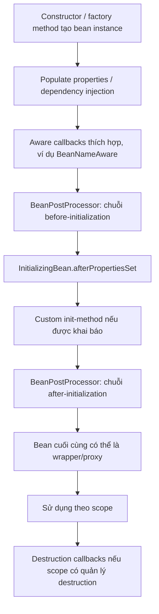

# BeanPostProcessor trước và sau callback khởi tạo trong Spring Core Container

## 1. Mục đích và vị trí trong vòng đời bean

**BeanPostProcessor** (BPP) là điểm mở rộng của Spring IoC container để xử lý **một bean instance** trong quá trình khởi tạo. Thay vì chỉ gọi constructor và tiêm dependency, Spring cho phép các processor quan sát, xác thực, điều chỉnh hoặc trả về wrapper/proxy của bean trước khi đưa nó tới code sử dụng.

Hai phương thức quan trọng nhất là:

- **`postProcessBeforeInitialization(Object bean, String beanName)`**: chạy trước `InitializingBean.afterPropertiesSet()` và custom `init-method` thông thường.
- **`postProcessAfterInitialization(Object bean, String beanName)`**: chạy sau các initialization callbacks đó, trước khi bean cuối cùng được đưa tới nơi sử dụng.

Hai phương thức này được gọi **quanh initialization callbacks**, không phải “before constructor” và “after khi chương trình đã chạy xong”. Mỗi phương thức trả về tham chiếu object để Spring dùng ở bước tiếp theo. Một processor chỉ ghi log thường trả về chính `bean`; một processor chuyên xử lý proxy có thể trả về một đối tượng thay thế hợp lệ.

Điểm đặc biệt quan trọng là **`@PostConstruct` được một `BeanPostProcessor` chuyên trách gọi trong pha before-initialization**. Vì vậy không được dạy rằng tất cả BPP-before chạy xong rồi Spring mới gọi `@PostConstruct`; vị trí tương đối của `@PostConstruct` và một BPP tự viết phụ thuộc vào thứ tự các processor đã được đăng ký.

Đối với bean do Spring quản lý, xử lý này thường diễn ra mỗi lần bean instance được tạo: singleton thông thường trải qua một lần khởi tạo, còn prototype có thể trải qua một lần khởi tạo **trên mỗi lần container tạo instance**. Một lần `getBean()` trên singleton đã có không tự làm BPP chạy lại.

## 2. Mô hình vòng đời tổng quát



**`@PostConstruct` nằm trong bước D**, do processor quản lý lifecycle annotations thực hiện; không thể coi nó là một khối luôn đứng sau **toàn bộ** chuỗi D. Đây là sự khác biệt giữa khái niệm “pha” và “thứ tự cụ thể của nhiều processor”.

Giải thích các bước:

1. **Instantiation**: Spring gọi constructor hoặc một factory method để có instance. `BeanPostProcessor.before` không phải callback trước constructor. Các SPI khác như `InstantiationAwareBeanPostProcessor` có hook sớm hơn, nhưng đó là chủ đề khác.
2. **Dependency resolution/injection**: Spring resolve constructor dependencies và điền field/setter/properties theo cơ chế đã cấu hình. `@Autowired` thường được xử lý bởi infrastructure post-processor ở thời điểm phù hợp; không vì thế mà mọi BPP-before tự thực hiện injection.
3. **Aware callbacks**: các callback kiểu `BeanNameAware`, `BeanClassLoaderAware`, `BeanFactoryAware` được thực hiện trong giai đoạn thích hợp trước chuỗi BPP-before chuẩn. Một số Aware khác do processor chuyên trách đảm nhiệm.
4. **BPP before-initialization**: Spring lần lượt gọi `postProcessBeforeInitialization` trên các processor. `@PostConstruct` có thể được gọi ngay trong chuỗi này.
5. **Khởi tạo theo contract bean**: `InitializingBean.afterPropertiesSet()`, sau đó custom init method như `@Bean(initMethod = "initialize")`, nếu mỗi callback có cấu hình tương ứng.
6. **BPP after-initialization**: các processor nhận bean đã qua init thông thường; chúng có thể trả lại bean gốc hoặc đối tượng thay thế như proxy.
7. **Đưa bean cho caller**: dependency injection và `ApplicationContext.getBean()` nhận tham chiếu bean cuối cùng. Nếu có proxy, caller có thể không cầm tham chiếu target gốc.
8. **Destruction theo scope**: khi vòng đời kết thúc, Spring sử dụng destruction callbacks phù hợp, nếu scope/container có quản lý bước hủy. Callback after-initialization **không phải** destruction callback.

Quy trình trên là mô hình chuẩn giúp hiểu ứng dụng; các cơ chế nâng cao như early references để xử lý vòng phụ thuộc và các BeanPostProcessor chuyên biệt có thể bổ sung bước hoặc đường xử lý.

## 3. API BeanPostProcessor và cách trả kết quả

Interface có tên đầy đủ `org.springframework.beans.factory.config.BeanPostProcessor`. Các chữ ký trọng tâm (trích lược để học, **không tự định nghĩa lại interface này trong dự án**) là:

```java
public interface BeanPostProcessor {
    default Object postProcessBeforeInitialization(
            Object bean, String beanName) {
        return bean;
    }

    default Object postProcessAfterInitialization(
            Object bean, String beanName) {
        return bean;
    }
}
```

Mã này mô tả **hình dạng API chính**, không phải source đầy đủ của thư viện Spring. Khi dùng trong code thực tế, import interface đã có từ Spring.

Hai tham số:

- `bean`: object **đang được xử lý tại bước này**, có thể là object gốc hoặc wrapper mà một processor đi trước trả về.
- `beanName`: định danh bean trong container. Hữu ích để tránh áp dụng logic vào toàn bộ infrastructure beans.

Giá trị trả về:

- **Trả lại `bean`**: cách đúng khi không muốn thay thế đối tượng.
- **Trả proxy/wrapper hợp lệ**: được phép nếu object tương thích type, semantic DI, lifecycle và các processor tiếp theo.
- **Trả `null`**: theo hợp đồng BPP, các post-processors kế tiếp trong pha tương ứng sẽ không tiếp tục được gọi. Không dùng `null` như cách “loại bỏ bean” hoặc skip có chủ đích nếu không hiểu rõ hậu quả.

Một processor ghi log đơn giản:

```java
public final class TraceProcessor implements BeanPostProcessor {

    @Override
    public Object postProcessBeforeInitialization(
            Object bean, String beanName) {
        if ("customerService".equals(beanName)) {
            System.out.println("before: " + beanName);
        }
        return bean;
    }

    @Override
    public Object postProcessAfterInitialization(
            Object bean, String beanName) {
        if ("customerService".equals(beanName)) {
            System.out.println("after: " + beanName);
        }
        return bean;
    }
}
```

Đây là **class minh họa tích hợp**, cần import `BeanPostProcessor` và đăng ký processor dưới dạng bean Spring trong context tương ứng. Mã chưa khai báo `customerService`, nên bản thân snippet không phải ứng dụng hoàn chỉnh. Nó cho thấy cách lọc theo `beanName` và trả nguyên object để không vô tình đổi identity.

Nếu class có annotation `@Component` nhưng được tạo bằng `new TraceProcessor()` rồi chỉ dùng như object Java bình thường, nó **không tự trở thành** BPP đã đăng ký với container. Spring phải có bean definition của processor hoặc được đăng ký bằng API tương ứng.

## 4. Thí nghiệm hoàn chỉnh: quan sát thứ tự callback

Chương trình dưới đây dùng **Spring Framework Core Container**, không cần Spring Boot, servlet hoặc database. Một `Widget` implement `BeanNameAware`, `InitializingBean`, `DisposableBean`, thêm custom init/destroy. Một `TraceProcessor` in ra chính xác điểm trước và sau initialization.

**Yêu cầu**: JDK 17+ và Maven 3.9+. Cấu trúc:

```text
bpp-lifecycle/
├── pom.xml
└── src/main/java/example/BppLifecycleDemo.java
```

Tệp `pom.xml`:

```xml
<project xmlns="http://maven.apache.org/POM/4.0.0"
         xmlns:xsi="http://www.w3.org/2001/XMLSchema-instance"
         xsi:schemaLocation="http://maven.apache.org/POM/4.0.0
                             https://maven.apache.org/xsd/maven-4.0.0.xsd">
    <modelVersion>4.0.0</modelVersion>
    <groupId>example</groupId>
    <artifactId>bpp-lifecycle</artifactId>
    <version>1.0.0</version>

    <properties>
        <maven.compiler.release>17</maven.compiler.release>
        <project.build.sourceEncoding>UTF-8</project.build.sourceEncoding>
    </properties>

    <dependencies>
        <dependency>
            <groupId>org.springframework</groupId>
            <artifactId>spring-context</artifactId>
            <version>6.2.0</version>
        </dependency>
    </dependencies>

    <build>
        <plugins>
            <plugin>
                <groupId>org.apache.maven.plugins</groupId>
                <artifactId>maven-compiler-plugin</artifactId>
                <version>3.13.0</version>
            </plugin>
            <plugin>
                <groupId>org.codehaus.mojo</groupId>
                <artifactId>exec-maven-plugin</artifactId>
                <version>3.5.0</version>
            </plugin>
        </plugins>
    </build>
</project>
```

Tệp `src/main/java/example/BppLifecycleDemo.java`:

```java
package example;

import org.springframework.beans.factory.BeanNameAware;
import org.springframework.beans.factory.DisposableBean;
import org.springframework.beans.factory.InitializingBean;
import org.springframework.beans.factory.config.BeanPostProcessor;
import org.springframework.context.annotation.AnnotationConfigApplicationContext;
import org.springframework.context.annotation.Bean;
import org.springframework.context.annotation.Configuration;

public class BppLifecycleDemo {

    public static void main(String[] args) {
        try (var context =
                     new AnnotationConfigApplicationContext(AppConfig.class)) {
            Widget widget = context.getBean("widget", Widget.class);
            System.out.println("07 application: " + widget.render());
        } // Đóng context -> destruction callbacks của singleton Widget.
    }

    @Configuration(proxyBeanMethods = false)
    public static class AppConfig {

        // Đăng ký BPP đủ sớm mà không phải tạo AppConfig trước.
        @Bean
        public static TraceProcessor traceProcessor() {
            return new TraceProcessor();
        }

        @Bean(name = "widget",
              initMethod = "customInit",
              destroyMethod = "customDestroy")
        public Widget widget() {
            return new Widget();
        }
    }

    public static final class TraceProcessor implements BeanPostProcessor {
        @Override
        public Object postProcessBeforeInitialization(
                Object bean, String beanName) {
            if ("widget".equals(beanName)) {
                System.out.println("03 BPP.before");
            }
            return bean;
        }

        @Override
        public Object postProcessAfterInitialization(
                Object bean, String beanName) {
            if ("widget".equals(beanName)) {
                System.out.println("06 BPP.after");
            }
            return bean;
        }
    }

    public static final class Widget
            implements BeanNameAware, InitializingBean, DisposableBean {

        public Widget() {
            System.out.println("01 constructor");
        }

        @Override
        public void setBeanName(String beanName) {
            System.out.println("02 BeanNameAware: " + beanName);
        }

        @Override
        public void afterPropertiesSet() {
            System.out.println("04 InitializingBean.afterPropertiesSet");
        }

        public void customInit() {
            System.out.println("05 custom init");
        }

        public String render() {
            return "ready";
        }

        @Override
        public void destroy() {
            System.out.println("08 DisposableBean.destroy");
        }

        public void customDestroy() {
            System.out.println("09 custom destroy");
        }
    }
}
```

Tại thư mục chứa `pom.xml`, chạy:

```bash
mvn -q compile exec:java -Dexec.mainClass=example.BppLifecycleDemo
```

**Stdout từ chương trình** (không tính log Maven riêng của môi trường):

```text
01 constructor
02 BeanNameAware: widget
03 BPP.before
04 InitializingBean.afterPropertiesSet
05 custom init
06 BPP.after
07 application: ready
08 DisposableBean.destroy
09 custom destroy
```

### 4.1. Vì sao có thứ tự này?

- **01**: Spring gọi factory method `widget()`; phương thức đó tạo object bằng constructor `new Widget()`.
- **02**: Spring nhận biết `BeanNameAware` và gọi `setBeanName("widget")` trước chuỗi BPP-before.
- **03**: `TraceProcessor.postProcessBeforeInitialization()` được áp dụng trên bean có tên `widget`.
- **04**: Spring gọi `InitializingBean.afterPropertiesSet()` sau pha before-init.
- **05**: Thuộc tính `@Bean(initMethod = "customInit")` khiến Spring gọi custom init method sau `afterPropertiesSet()`.
- **06**: Spring gọi `TraceProcessor.postProcessAfterInitialization()` sau hai callback khởi tạo.
- **07**: Caller `getBean("widget")` và gọi `render()` trên bean đã hoàn tất initialization.
- **08**: Khi khối `try` kết thúc, `AnnotationConfigApplicationContext.close()` chạy; `DisposableBean.destroy()` được gọi cho singleton.
- **09**: Custom destroy method `customDestroy()` được gọi sau `DisposableBean.destroy()` trong hợp đồng cấu hình này.

Đây là chuỗi in tuần tự có thể đối chiếu bằng mắt, không phải kết quả may rủi của thread scheduling. Mã chạy một thread và dùng một bean ứng dụng duy nhất để log. BPP chỉ in nếu `beanName` là `widget`, vì container có thể khởi tạo thêm bean cấu hình/infrastructure mà không liên quan đến bài thực hành.

**Vì sao `Widget` có thể `final`?** Chương trình chỉ cần BPP quan sát và trả object nguyên trạng; không có yêu cầu Spring subclass class `Widget` theo phương thức `@Lookup`. Giới hạn subclass/proxy class-based là vấn đề riêng khi thật sự tạo loại proxy cần kế thừa class, không phải quy tắc cấm `final` đối với mọi BPP.

**Vì sao ví dụ không thêm `@PostConstruct`?** Vì callback đó chạy bằng processor riêng trong pha before; nếu thêm cùng một lúc và không kiểm soát thứ tự processor, có thể tạo kỳ vọng sai về việc log của một custom BPP luôn đứng trước `@PostConstruct`. Phần tiếp theo giải thích chính xác mối quan hệ.

## 5. @PostConstruct nằm trong chính chuỗi before-initialization

Trong một Spring context có hỗ trợ các lifecycle annotations từ Jakarta, `CommonAnnotationBeanPostProcessor` (dựa trên `InitDestroyAnnotationBeanPostProcessor`) quản lý callbacks như `@PostConstruct` và `@PreDestroy`. Đối với method được đánh dấu `@PostConstruct`, processor đó thực hiện việc gọi method **trong callback before-initialization của chính nó**.

Đoạn mã minh họa:

```java
public class CacheService {
    private Cache cache;

    @jakarta.annotation.PostConstruct
    public void initialize() {
        cache = new Cache();
    }
}
```

Đây **không phải mã chạy độc lập**; cần class `Cache`, dependency annotation và bean definition trong Spring context hỗ trợ xử lý annotation. Cách viết nhằm cho thấy annotation nằm trên method cần được gọi sau dependency injection.

Nếu có hai processor `CommonAnnotationBeanPostProcessor` và `TraceProcessor`, thì:

```text
bean đã được inject
  |
  +--> BPP.before #1
  |
  +--> BPP.before #2 (một processor tại đây có thể gọi @PostConstruct)
  |
  +--> InitializingBean.afterPropertiesSet()
  |
  +--> custom init-method
  |
  +--> BPP.after #1
  |
  +--> BPP.after #2
  |
  v
bean cuối cùng
```

Thứ tự cụ thể của `#1` và `#2` tùy registration/ordering. Nếu `CommonAnnotationBeanPostProcessor` đứng trước `TraceProcessor`, phương thức `@PostConstruct` có thể chạy **trước** log BPP-before của `TraceProcessor`. Nếu vị trí khác, log sẽ khác. Vì vậy câu “before luôn chạy trước PostConstruct” là **thiếu chính xác**.

Trong cấu hình lifecycle thông dụng, nếu trên cùng một bean có cả `@PostConstruct`, `InitializingBean.afterPropertiesSet()` và custom init method thì thứ tự callback điển hình là:

1. `@PostConstruct` (trong pha before của processor quản lý annotation).
2. `InitializingBean.afterPropertiesSet()`.
3. Custom init method.

Nếu cấu hình nhiều cơ chế trỏ vào **chính cùng một method**, framework có các điều kiện tránh gọi trùng ở những trường hợp phù hợp; không nên thiết kế side effects dựa vào việc gọi một method nhiều lần. Với init chứa I/O hoặc đăng ký resource, cần thêm tính idempotent/cơ chế cleanup phù hợp.

Một mặt khác: `@PreDestroy` là **destruction callback**, không phải hành động thực hiện bởi `postProcessAfterInitialization()`. Hai chữ “post” và “after” rất dễ khiến người học nhầm thời điểm.

## 6. Đăng ký BeanPostProcessor cho đúng thời điểm

Một BPP chỉ hữu ích khi Spring biết về nó **trước lúc tạo những bean cần xử lý**. Các lựa chọn tiêu biểu:

- Đăng ký class triển khai `BeanPostProcessor` qua component scanning hoặc trực tiếp bean definition.
- Tạo BPP bằng một factory method `@Bean` như demo phía trên.
- Với những cấu hình thấp hơn, đăng ký chương trình vào `ConfigurableBeanFactory.addBeanPostProcessor(...)`.

Trong ví dụ demo:

```java
@Bean
public static TraceProcessor traceProcessor() {
    return new TraceProcessor();
}
```

Phương thức factory được khai báo **static** để Spring có thể tạo BPP mà không phải khởi tạo instance class `@Configuration` chỉ để gọi nó. Đây là thực hành quan trọng với `@Bean` factory methods cho BPP và `BeanFactoryPostProcessor`: tạo infrastructure bean **sớm**, tránh làm mất cơ hội post-processing của những bean bị khởi tạo quá sớm.

Một sai lầm là viết method tạo BPP không `static`, rồi inject nhiều dependencies phức tạp vào class cấu hình. Khi Spring cần BPP, nó có thể buộc phải dựng cả class cấu hình hoặc những dependency chưa kịp đi qua toàn bộ processor; khi đó xuất hiện cảnh báo bean không đủ điều kiện được tất cả BPP xử lý.

Nên để return type của `@Bean` phản ánh rõ BPP, ví dụ `TraceProcessor` implements `BeanPostProcessor`, thay vì trả một kiểu quá chung khiến container khó nhận biết loại processor ở giai đoạn phát hiện sớm.

**Quan trọng:** BPP và một số infrastructure beans do Spring phải khởi tạo rất sớm **không nhất thiết được chính toàn bộ tập BPP xử lý đầy đủ**. Không dựa vào callback của BPP A để “đảm bảo” BPP B cũng được A xử lý như một bean nghiệp vụ.

## 7. Nhiều processor trong cùng context

Với BPP A và BPP B, chuỗi xử lý có thể được hình dung:

```text
bean được tạo và tiêm dependency
     |
     v
A.before(bean) -> object1
     |
     v
B.before(object1) -> object2
     |
     v
afterPropertiesSet / custom init của bean đang được xử lý
     |
     v
A.after(object2) -> object3
     |
     v
B.after(object3) -> object4
     |
     v
container đưa object4 cho caller
```

Đây là **mô hình giải thích**, không bảo đảm object1–object4 là bốn instances khác nhau. Phần lớn BPP trả lại chính object đầu vào; trường hợp tạo proxy phải có yêu cầu và cơ chế hợp lệ.

Với các BPP được Spring tự phát hiện từ bean definitions, container có quy tắc sắp xếp liên quan `PriorityOrdered`, `Ordered` và `@Order`, tùy loại processor và cách đăng ký. Khi thêm BPP theo chương trình bằng `addBeanPostProcessor(...)`, **thứ tự đăng ký** chi phối thứ tự xử lý theo cơ chế đó; không thể mặc định việc implementing `Ordered` sẽ tự sắp lại tất cả processor đã thêm bằng tay.

Không suy đoán thứ tự từ tên class hoặc từ vị trí `@Bean` methods trong source. Nếu thứ tự quan trọng cho tính đúng đắn, hãy làm rõ thứ tự BPP và kiểm chứng bằng integration test với context thực tế.

Các cân nhắc khi BPP được áp dụng cho nhiều bean:

- Không lưu “bean vừa xử lý” trong field mutable đơn lẻ nếu container có thể khởi tạo nhiều instance hoặc xử lý đồng thời.
- Tránh truy cập `ApplicationContext.getBean()` bừa bãi bên trong callback; điều đó có thể làm bean khác bị tạo quá sớm hoặc tạo vòng phụ thuộc.
- Nếu cần log, dùng `beanName`/class một cách có kiểm soát. Gọi `bean.toString()` đôi khi kích hoạt logic hoặc đụng proxy lazy.
- Đừng giả định BPP chỉ xử lý `@Component`: những bean được container quản lý từ `@Bean`, XML hay bean definitions phù hợp cũng có thể đi qua chuỗi BPP.
- Không mặc định BPP của một container áp dụng cho bean thuộc một container độc lập khác.

## 8. Sau initialization có thể sinh proxy

Một chức năng quan trọng của hạ tầng Spring là trả về **proxy** thay vì reference đến target ban đầu. Pha after-initialization là một vị trí thường dùng để tạo wrapper.

```java
@Override
public Object postProcessAfterInitialization(Object bean, String beanName) {
    if ("paymentService".equals(beanName)) {
        // Pseudocode: thực tế cần tạo proxy hợp lệ bằng Spring AOP.
        return createProxyFor(bean);
    }
    return bean;
}
```

Đây là **pseudocode minh họa**, không phải Java code độc lập; `createProxyFor` là tên tượng trưng, không phải method API Spring có sẵn. Muốn làm thật, cần dùng các thành phần như `ProxyFactory` hoặc cơ chế Spring AOP/declarative đã được framework hỗ trợ.

Những hệ quả:

1. **Instance đã init không luôn cùng identity với bean cuối cùng mà caller lấy.** Callback init có thể chạy trên target, còn caller được cấp proxy.
2. **Processor sau có thể nhận proxy của processor trước.** Chúng phải tương thích với type và đặc tính object đang được chuyển tiếp.
3. **Proxy AOP có các giới hạn riêng** liên quan method `final`, khả năng subclass class hoặc interface proxy, self-invocation và cách method được gọi. Không đồng nhất mọi giới hạn proxy với mọi cách cài BPP.
4. **BPP callbacks không chạy trên mọi lời gọi nghiệp vụ.** Chúng tham gia **vòng đời tạo bean**. Nếu proxy được tạo thành công, chính proxy mới có thể can thiệp method calls ở runtime.
5. **Vòng phụ thuộc có thể làm quá trình phức tạp hơn**, vì Spring có cơ chế early bean reference và các extension interfaces chuyên biệt. Đừng cho rằng mọi cấu hình luôn là một đường duy nhất không có ngoại lệ.

Không tự ý trả về proxy kiểu khác hoàn toàn so với dependency injection contract. Một BPP “thay object bất kỳ” có thể khiến `getBean(SomeConcreteClass.class)` không còn hợp lệ hoặc làm các bean dùng constructor injection thất bại.

## 9. Phân biệt những hook dễ nhầm

| Cơ chế | Thao tác chủ yếu | Thời điểm |
|---|---|---|
| `BeanFactoryPostProcessor` | Chỉnh/đọc **bean definitions**, chưa cần instance ứng dụng | Trước giai đoạn khởi tạo bean thông thường |
| `BeanDefinitionRegistryPostProcessor` | Đăng ký/chỉnh các bean definitions trong registry | Rất sớm, trước các singleton ứng dụng |
| `BeanPostProcessor.postProcessBeforeInitialization` | Xử lý **bean instance** | Sau tạo/injection, trước `InitializingBean` và custom init |
| `@PostConstruct` | Initialization method của bean | Do lifecycle annotation processor gọi trong pha BPP-before |
| `InitializingBean.afterPropertiesSet` | Callback init cấp interface | Sau pha BPP-before thông thường |
| Custom `init-method` | Callback init cấu hình trên bean | Sau `afterPropertiesSet` trong chuỗi init thông thường |
| `BeanPostProcessor.postProcessAfterInitialization` | Xử lý bean sau init, có thể trả wrapper | Sau các init callbacks thông thường |
| `DisposableBean.destroy` / `@PreDestroy` | Dọn dẹp tài nguyên khi bean được hủy | Khi scope/container thực sự quản lý destruction |
| `SmartInitializingSingleton.afterSingletonsInstantiated` | Callback sau khi các singleton thông thường đã được pre-instantiate | Cuối giai đoạn singleton bootstrap |

**BeanFactoryPostProcessor và BeanPostProcessor khác nhau ở đối tượng xử lý**: một cái thường làm việc với metadata/bean definitions; cái kia làm việc với actual bean instance. Không dùng BPP để tùy tiện sửa metadata của cả registry trong khi bean đã bắt đầu được tạo.

**BPP-after và destruction khác nhau ở thời điểm**: after-initialization diễn ra trước khi sử dụng bean; destruction thuộc kết thúc vòng đời. Với prototype bean, Spring tạo và khởi tạo mỗi instance theo yêu cầu nhưng mặc định **không tự gọi destruction callbacks của instance prototype khi context đóng**. Caller/resource owner phải chủ động dọn tài nguyên cần đóng.

## 10. Khi nào tự triển khai BeanPostProcessor?

Hợp lý khi xây dựng **hạ tầng chung**: processor cho một custom annotation được nhiều bean sử dụng, bổ sung validation sau dependency injection, chuẩn hóa trạng thái bean theo một contract công khai, instrumentation toàn container, hoặc wrapper/proxy có yêu cầu rõ ràng.

Ví dụ một rule đơn giản:

```java
public class ValidationBpp implements BeanPostProcessor {
    @Override
    public Object postProcessBeforeInitialization(
            Object bean, String name) {
        if (bean instanceof ConfigurableEndpoint endpoint) {
            endpoint.validateConfiguration();
        }
        return bean;
    }
}
```

Đây là **snippet minh họa**, cần interface `ConfigurableEndpoint` có method `validateConfiguration()`, import `BeanPostProcessor` và đăng ký `ValidationBpp` vào context. BPP-before có thể thích hợp nếu validation chỉ yêu cầu các dependencies đã được inject; nếu validation cần bean đã hoàn thành `afterPropertiesSet()`, phải xem pha after hoặc cấu trúc lifecycle khác.

Không nên dùng BPP cho việc chỉ riêng **một bean** cần setup local; trong nhiều trường hợp `@PostConstruct`, custom init method hoặc constructor validation đơn giản hơn và dễ test hơn. Nếu mục tiêu là chặn lời gọi method runtime, hãy cân nhắc Spring AOP trước khi tự viết một proxy từ BPP. Nếu muốn “chạy một lần khi ứng dụng sẵn sàng”, cần hook application startup phù hợp thay vì mặc định callback của một bean tương đương lúc toàn ứng dụng đã sẵn sàng.

## 11. Lỗi phổ biến, nguyên nhân và hướng sửa

| Hiện tượng / hiểu nhầm | Nguyên nhân | Cách xử lý |
|---|---|---|
| Tưởng `BPP.before` chạy trước constructor | Nhầm before-*initialization* với before-*instantiation* | Xác định rõ thứ tự constructor → injection → before → init |
| Tưởng `BPP.after` chạy lúc shutdown | Nhầm after-init với destruction | Dùng `@PreDestroy`, `DisposableBean`, custom destroy phù hợp |
| `@PostConstruct` log trước custom BPP.before | `@PostConstruct` do một BPP khác gọi trong chuỗi before | Xem registration/ordering, không áp đặt thứ tự sai |
| Trả `null` từ BPP để loại bỏ bean | `null` dừng chuỗi BPP hiện tại, không phải xóa bean | Trả bean gốc hoặc wrapper hợp lệ |
| Bean tự `new` không có callback | Object không do Spring quản lý | Lấy bean qua DI/container nếu cần lifecycle |
| Singleton `getBean()` nhiều lần nhưng BPP chỉ log một lần | Singleton đã được khởi tạo và tái sử dụng | Phân biệt số lần lookup với số lần tạo instance |
| Prototype xuất hiện nhiều callback init | Container tạo instance prototype mới mỗi yêu cầu | Xác nhận bean scope và số lần thực sự yêu cầu |
| BPP không tác động bean hạ tầng tạo quá sớm | Processor chưa đăng ký đủ sớm | Kiểm tra BPP registration và dependencies |
| BPP đăng ký bằng non-static `@Bean` gây warning | Có thể khởi tạo configuration/dependency quá sớm | Ưu tiên static `@Bean`, return type nhận diện được |
| BPP-after trả proxy làm cast concrete class thất bại | Proxy có type khác target theo chiến lược đang dùng | Thiết kế interface/type contract phù hợp |
| Vòng phụ thuộc khi BPP gọi `getBean()` | Kéo bean mới vào khi context chưa sẵn sàng | Giảm lookup lồng nhau, phụ thuộc tối thiểu |
| Trộn `BeanFactoryPostProcessor` với BPP | Nhầm metadata và instance lifecycle | Chọn hook đúng điểm mở rộng |
| Dùng BPP trên prototype rồi nghĩ Spring sẽ auto-destroy nó | BPP init không đổi destruction contract của prototype | Xác định caller/resource owner có cleanup |

### 11.1. Cách debug khi thứ tự callback không như kỳ vọng

Kiểm tra theo thứ tự:

1. **Bean thực sự do ai tạo?** Đối tượng `new` thủ công sẽ không tự nhận lifecycle của Spring.
2. **Bean scope nào?** `context.isSingleton(beanName)`/`isPrototype(beanName)` giúp nhận diện vòng đời do container biết.
3. **BPP có được đăng ký đúng context?** Tên bean processor, return type của `@Bean`, cách component scanning và thời điểm khởi tạo có thể ảnh hưởng.
4. **Có nhiều BPP không?** `@PostConstruct`, autowiring và AOP có processor chuyên biệt; những extension hooks khác nhau không có cùng vị trí.
5. **Callback trước đó có ném lỗi không?** Nếu `afterPropertiesSet()` ném exception, chuỗi khởi tạo không hoàn thành như trường hợp bình thường; không thể kỳ vọng log after xuất hiện.
6. **Bean nhận được có là proxy?** Có thể quan sát runtime class/identity nhưng không in `toString()` vô tội vạ trên proxy lazy.
7. **Có early initialization không?** Những bean infrastructure có thể được tạo trước khi mọi processor sẵn sàng.
8. **Test có đúng đích không?** Assert thứ tự dựa trên contract của bean cụ thể và processor thực tế, không trên thứ tự ngẫu nhiên giữa nhiều bean không liên quan.

Có thể gắn log bằng `beanName` và một ID thuộc context thay vì log dữ liệu thuộc bean, bởi processor có thể gặp configuration object và chứa các tham chiếu nhạy cảm. Với bean đa luồng hoặc prototype được tạo song song, bộ đếm chung cần có chiến lược đồng bộ nếu thật sự cần số thứ tự tin cậy.

## 12. Tình huống trước và sau: giải thích lỗi lifecycle

**Trước:** đội ngũ muốn kiểm tra một trường cấu hình sau khi Spring inject. Họ đưa kiểm tra vào constructor, khi field injection chưa diễn ra, nên gặp `null` và tưởng Spring không tiêm dependency.

**Sau:** chuyển validation vào `@PostConstruct` nếu chỉ liên quan một bean; hoặc một BPP-before chung nếu cần thực thi cùng một contract trên nhiều bean đã được inject. Nếu rule cần object sau custom init, chuyển sang điểm lifecycle sau init, đồng thời kiểm tra khả năng proxy.

**Trước:** một BPP-after gọi API công việc và ghi DB mỗi lần bean khởi tạo, rồi đội ngũ kỳ vọng sẽ gọi API đó cho mỗi HTTP request.

**Sau:** để BPP chịu trách nhiệm cấu hình/wrapper trong **giai đoạn tạo bean**. Nếu yêu cầu chạy với mỗi request hoặc mỗi lời gọi method, dùng tầng controller/service/interceptor/AOP phù hợp. Với singleton, BPP-after không tự chạy lại cho mỗi request.

**Trước:** một callback `@PreDestroy` không được gọi trên prototype và đội ngũ cho rằng BPP.after có thể thay thế.

**Sau:** tạo contract cleanup rõ ràng ở resource owner, ví dụ `AutoCloseable` kết hợp `try-with-resources`. Nếu bean thực sự có vòng đời do scope khác quản lý, chọn scope tương ứng. Đây là trách nhiệm destruction tách biệt initialization.

## 13. Bài tập kiểm tra kiến thức

**1. Một `BeanPostProcessor` xử lý bean trước constructor hay trước `afterPropertiesSet()`?**  
Trước `afterPropertiesSet()`, sau khi object đã được tạo và đi qua giai đoạn injection thích hợp.

**2. Khi bean có `BeanNameAware`, `InitializingBean`, custom init, BPP-before và BPP-after, thứ tự điển hình thế nào?**  
Constructor/factory, dependency injection, `BeanNameAware`, BPP-before, `afterPropertiesSet()`, custom init, BPP-after, caller dùng bean.

**3. `@PostConstruct` đứng ở đâu trong chuỗi?**  
Bên trong pha BPP-before thông qua annotation processor. Không được khẳng định nó luôn chạy sau tất cả custom BPP-before.

**4. Có thể tạo proxy từ `postProcessAfterInitialization()` không?**  
Có, nếu triển khai đúng hợp đồng về type, lifecycle và các processor khác. BPP thông thường chỉ trả lại bean.

**5. `postProcessAfterInitialization()` có phải hàm hủy bean không?**  
Không. Destruction callbacks xử lý lúc kết thúc vòng đời phù hợp, ví dụ `DisposableBean.destroy()`.

**6. Hai lần `getBean()` trên cùng singleton làm BPP chạy bao nhiêu lần?**  
Thông thường BPP init chỉ chạy khi singleton instance được tạo, rồi container tái sử dụng nó.

**7. Với prototype, hai lần tạo bean có thể nhận mấy lần callback trước/sau init?**  
Thường hai chu kỳ nếu cả hai lần container thực sự tạo hai instance. Điều đó không tự động tạo destruction callback.

**8. Trả `null` từ BPP để bỏ qua một bean có hợp lý?**  
Không. Nó chặn các BPP tiếp theo trong pha đang xử lý và có thể gây hệ quả bất ngờ.

**9. Vì sao `static @Bean` được khuyến nghị cho BPP?**  
Giúp đăng ký processor sớm mà không cần khởi tạo instance `@Configuration` chỉ để gọi factory method của BPP.

**10. `BeanFactoryPostProcessor` khác `BeanPostProcessor` ở đâu?**  
Một bên xử lý bean definition/metadata, bên còn lại xử lý bean instance trong quá trình tạo bean.

## Tài liệu chính thức

- [Spring Framework Reference — BeanPostProcessor](https://docs.spring.io/spring-framework/reference/core/beans/factory-extension.html#beans-factory-extension-bpp): cơ chế callback, thứ tự và đăng ký processor.
- [Spring Framework Reference — Lifecycle Callbacks](https://docs.spring.io/spring-framework/reference/core/beans/factory-nature.html): `@PostConstruct`, `InitializingBean`, custom init và destruction.
- [Spring Framework 6.2 API — BeanPostProcessor](https://docs.spring.io/spring-framework/docs/6.2.0/javadoc-api/org/springframework/beans/factory/config/BeanPostProcessor.html): hai callback, ý nghĩa trả về và xử lý chuỗi processor.
- [Spring Framework API — CommonAnnotationBeanPostProcessor](https://docs.spring.io/spring-framework/docs/6.2.0/javadoc-api/org/springframework/context/annotation/CommonAnnotationBeanPostProcessor.html): processor xử lý lifecycle annotations.
- [Spring Framework Reference — Bean Scopes](https://docs.spring.io/spring-framework/reference/core/beans/factory-scopes.html): scope singleton, prototype và vòng đời bean.
