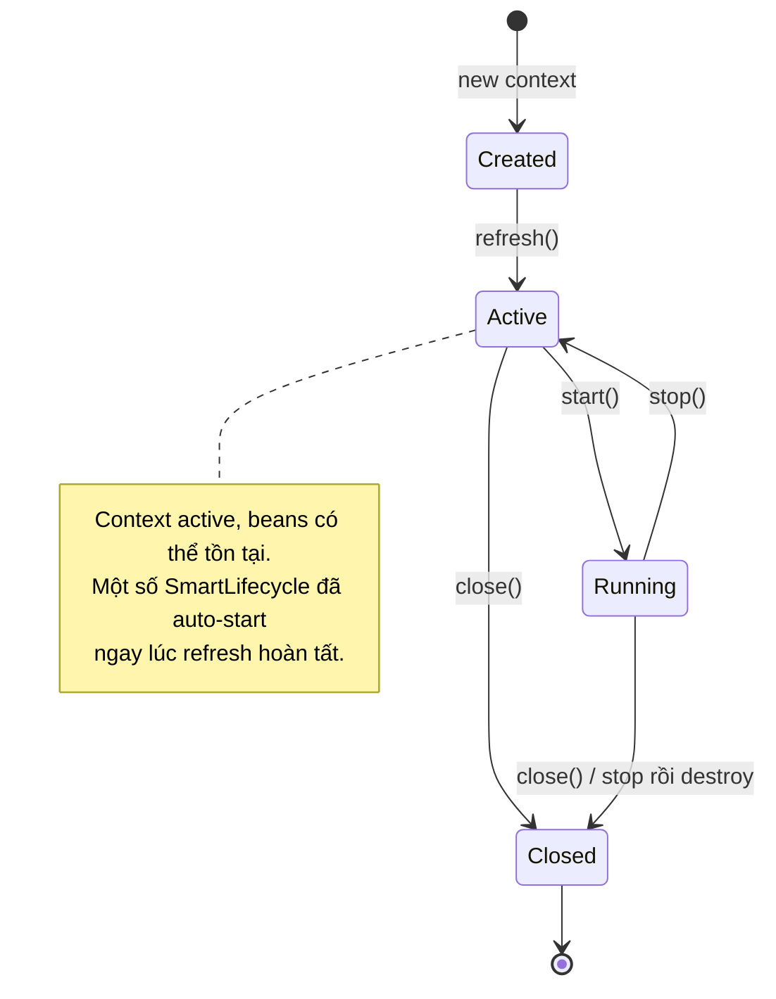

# Phân biệt refresh, start, stop và close trong vòng đời Spring ApplicationContext

## 1. Bốn thao tác có bốn trách nhiệm khác nhau

`ApplicationContext` là container IoC của Spring. Khi muốn chủ động quản lý vòng đời context, API cần xem là `ConfigurableApplicationContext`, vì interface này khai báo các thao tác `refresh()`, `start()`, `stop()`, `close()` và trạng thái như `isActive()`, `isRunning()`.

Điểm cần nhớ:

- **`refresh()`**: chuẩn bị và kích hoạt một context theo quy trình khởi tạo Spring: xử lý bean definitions và hạ tầng, đăng ký `BeanPostProcessor`, khởi tạo những singleton không lazy, hoàn tất refresh và phát `ContextRefreshedEvent`. Với context hỗ trợ `LifecycleProcessor`, refresh cũng thực hiện bước khởi động tự động những `SmartLifecycle` có `isAutoStartup() == true`.
- **`start()`**: yêu cầu `LifecycleProcessor` khởi động các bean tham gia `Lifecycle`, rồi phát `ContextStartedEvent`. Nó không tạo lại container và không chạy lại toàn bộ dependency injection của mọi singleton.
- **`stop()`**: yêu cầu `LifecycleProcessor` dừng các bean `Lifecycle` đang hoạt động, rồi phát `ContextStoppedEvent`. Context vẫn còn hoạt động, bean definitions và các singleton thông thường vẫn tồn tại; có thể gọi `start()` sau `stop()`.
- **`close()`**: đóng context, phát `ContextClosedEvent`, dừng lifecycle components, hủy các bean có destruction lifecycle được Spring quản lý, đóng bean factory nếu phù hợp và giải phóng tài nguyên container. Đây là **kết thúc vòng đời context**, không phải một lần pause có thể `start()` để tiếp tục.

Tóm tắt bằng bốn câu:

> **refresh = khởi tạo/thiết lập context; start = cho lifecycle components chạy; stop = cho lifecycle components tạm dừng; close = shutdown và cleanup container.**

Cần phân biệt `context.isActive()` với `context.isRunning()`: một context có thể **active nhưng không running** sau khi gọi `stop()`; chính trạng thái “active” làm rõ stop không phải close. `isRunning()` phản ánh trạng thái do `LifecycleProcessor` báo cáo theo contract của Spring, không phải phép đo mọi thread hoặc task thực tế trong JVM.

## 2. Bảng đối chiếu ngữ nghĩa

| Tiêu chí | `refresh()` | `start()` | `stop()` | `close()` |
|---|---|---|---|---|
| Mục tiêu | Xây dựng/kích hoạt context và các bean cần tạo sớm | Bắt đầu hoạt động của `Lifecycle` beans | Dừng hoạt động của `Lifecycle` beans | Kết thúc context và dọn dẹp |
| Xử lý/đăng ký hạ tầng container | Có, là phần chính của refresh | Không làm lại refresh | Không làm lại refresh | Đóng/giải phóng hạ tầng đã tạo |
| Tạo singleton non-lazy thông thường | Có, ở pha hoàn tất tạo bean | Không phải trách nhiệm chính | Không | Không |
| Gọi `Lifecycle.start()` | Có thể, với `SmartLifecycle` auto-start khi refresh | Có, qua `LifecycleProcessor` | Không | Không phải thao tác start |
| Gọi `Lifecycle.stop()` | Không phải mục tiêu chung; có thể dừng instance cũ theo từng loại refreshable context | Không | Có, với bean đang running | Có trong quá trình shutdown, với bean đang running |
| Phát sự kiện chính | `ContextRefreshedEvent` | `ContextStartedEvent` | `ContextStoppedEvent` | `ContextClosedEvent` |
| Tự chạy destruction callbacks? | Không phải thao tác hủy thông thường; refresh lại trên context hỗ trợ có thể thay thế/hủy bean cũ | Không | Không | Có, theo quy tắc scope và callback |
| Context còn dùng được sau lời gọi? | Có nếu refresh thành công | Có | Có; có thể `start()` lại | Context đã đóng; không tiếp tục dùng như đang active |
| Có thể gọi nhiều lần? | **Phụ thuộc implementation**; nhiều context như `GenericApplicationContext` chỉ cho refresh một lần | Có thể gọi sau refresh để điều khiển lifecycle | Có thể gọi sau refresh để điều khiển lifecycle | Đóng lần nữa thường không tạo shutdown mới; không coi là khả năng khôi phục |
| Bản chất thao tác | Bootstrap/re-bootstrap nếu implementation cho phép | Runtime lifecycle transition | Runtime lifecycle transition | Terminal cleanup |

Bảng mô tả contract và hành vi thông thường của Spring. Nó không bảo đảm `stop()` sẽ dừng mọi thread mà ứng dụng tự tạo: chỉ các thành phần có cơ chế lifecycle tương ứng mới được container điều phối.

## 3. Máy trạng thái để hiểu refresh, start, stop, close



Sơ đồ chỉ ra **đường đi điển hình**, không ép `Active` và `Running` là hai trạng thái loại trừ hoàn toàn ở mức Java API. Trong thực tế `isActive()` có thể là `true` ngay cả khi `isRunning()` cũng là `true`; “Running” có thể hiểu là **Active + đã start lifecycle processor**. Khi có `SmartLifecycle` auto-start, refresh có thể làm một số lifecycle beans chạy ngay mà không cần lời gọi `context.start()` riêng.

Các điều kiện thực tế:

1. **Created → refreshed:** với `AnnotationConfigApplicationContext()` không tham số, sau khi `register(...)` thường phải gọi `refresh()` tường minh. Với constructor `new AnnotationConfigApplicationContext(AppConfig.class)`, Spring **đã gọi refresh trong constructor**.
2. **Active → running:** `start()` sử dụng `LifecycleProcessor` để gọi các bean `Lifecycle` chưa running theo contract. Nó không “bật lại” singleton đã bị destroy.
3. **Running → active:** `stop()` tắt/đình chỉ hoạt động của những `Lifecycle` beans. Không có bước đóng bean factory hoặc hủy tất cả singleton.
4. **Active/running → closed:** `close()` thực hiện quá trình hủy context. Không giả định có thể dùng `start()` sau đó để tiếp tục như trước.
5. **Một lần refresh khác:** không mặc định hợp lệ. `GenericApplicationContext` và các biến thể kế thừa (như `AnnotationConfigApplicationContext`) **chỉ hỗ trợ một lần refresh**; một số `AbstractRefreshableApplicationContext` có thể refresh lại, tái xây dựng bean factory. Cần xét đúng concrete class.

## 4. Refresh cụ thể thực hiện những bước nào?

Ở mức khái niệm, `AbstractApplicationContext.refresh()` tiến hành một quy trình nhiều bước. Những bước trọng tâm thường gồm:

```text
refresh()
  prepareRefresh()
  obtainFreshBeanFactory()
  prepareBeanFactory(beanFactory)
  postProcessBeanFactory(beanFactory)
  invokeBeanFactoryPostProcessors(beanFactory)
  registerBeanPostProcessors(beanFactory)
  initMessageSource()
  initApplicationEventMulticaster()
  onRefresh()                           // hook của context subclass
  registerListeners()
  finishBeanFactoryInitialization()     // non-lazy singletons
  finishRefresh()                       // lifecycle onRefresh + ContextRefreshedEvent
```

Đây là **sơ đồ luồng rút gọn** của `AbstractApplicationContext`, nhằm giải thích trách nhiệm `refresh()`; không phải mã ứng dụng cần tự gọi các method nội bộ. Hành vi và các hook thực tế phụ thuộc loại context, phiên bản Spring và các extension đã đăng ký.

### 4.1. Xử lý bean definitions và các processor

Spring chuẩn bị bean factory, chạy `BeanFactoryPostProcessor`/registry extensions (bao gồm cơ chế xử lý cấu hình `@Configuration`, `@Bean`, component scanning trong cấu hình thích hợp), rồi đăng ký `BeanPostProcessor`. Các processor phục vụ dependency injection, `@PostConstruct` và nhiều khả năng hạ tầng khác có thể tham gia chuỗi tạo bean.

Điều này lý giải vì sao `refresh()` thường là lúc phần lớn cấu hình và lỗi bean được phát hiện, còn `start()` không phải API dùng để “chạy lại” toàn bộ quy trình đọc configuration hoặc inject dependency.

### 4.2. Khởi tạo singleton không lazy

Ở bước hoàn tất bean factory, Spring **pre-instantiate các non-lazy singleton beans** thích hợp. Constructor, dependency injection, initialization callbacks như `@PostConstruct`, `InitializingBean.afterPropertiesSet()` và custom init method có thể chạy tại đây.

Không suy rằng **mọi bean đều phải được tạo ngay trong refresh**: `@Lazy` có thể trì hoãn singleton; prototype được tạo mỗi lần có lookup thực sự; các scope khác tuân theo cơ chế riêng. Một số dependency hoặc infrastructure bean có thể được tạo sớm hơn bước này.

### 4.3. Kết thúc refresh và thông báo

Khi hoàn tất, Spring khởi tạo hoặc sử dụng `LifecycleProcessor` để gọi hook `onRefresh()`, qua đó **auto-start các `SmartLifecycle` được cấu hình auto-start**, rồi công bố `ContextRefreshedEvent`. Có nghĩa một message consumer hoặc thành phần nền cài `SmartLifecycle` có thể bắt đầu làm việc **ngay khi context refresh hoàn tất**, trước khi chương trình tự gọi `context.start()`.

Điểm cần nhớ: `ContextRefreshedEvent` khác `ContextStartedEvent`. Một refresh thông thường **không tương đương** với việc ứng dụng đã gọi `start()` tường minh, dù có cơ chế auto-start cho SmartLifecycle.

### 4.4. Refresh lần thứ hai không phải reload vô hại

Một số context có bean factory được thiết kế refreshable, chẳng hạn nhánh `AbstractRefreshableApplicationContext`, có thể hỗ trợ tạo bean factory mới khi refresh. Điều đó có thể làm instance cũ bị thay thế, callback hủy chạy cho bean cũ và state đang giữ ở phía caller trở nên không phù hợp.

Ngược lại, `AnnotationConfigApplicationContext` kế thừa `GenericApplicationContext` vốn có bean factory nội bộ chỉ hỗ trợ refresh một lần. Lần refresh thứ hai sẽ không phải một cách reload annotation configuration được bảo đảm; đừng gọi thử trên production với kỳ vọng tự cập nhật bean.

Nếu mục tiêu là cập nhật config động, hãy thiết kế cơ chế refreshable property/config riêng theo thư viện và phạm vi của ứng dụng, không dùng `refresh()` như một giải pháp runtime reload chung cho tất cả context.

## 5. Start và stop điều khiển Lifecycle beans

`start()` và `stop()` của `ConfigurableApplicationContext` được ủy quyền tới `LifecycleProcessor`. Processor mặc định (thường là `DefaultLifecycleProcessor`) tìm các bean tham gia interface `Lifecycle` và gọi callback phù hợp.

Một bean cần chủ động khai báo cách bắt đầu/dừng:

```java
import org.springframework.context.Lifecycle;

public class PollingWorker implements Lifecycle {
    private volatile boolean running;

    @Override
    public void start() {
        running = true;
    }

    @Override
    public void stop() {
        running = false;
    }

    @Override
    public boolean isRunning() {
        return running;
    }
}
```

Đây là **class Java minh họa**, không tạo thread poll thật. Trong ứng dụng production, chỉ đặt boolean không đủ dừng một thread: `stop()` phải báo dừng, ngừng nhận việc, xử lý task đang chạy theo chính sách, và giải phóng hoặc hoàn tất tài nguyên phù hợp.

### 5.1. Không phải mọi bean đều nhận start/stop

Một service thông thường:

```java
@Service
public class PricingService {
    public long priceInCents(long base) {
        return base;
    }
}
```

Đây là mã minh họa cần import `@Service`. Nó **không implement `Lifecycle`**, nên `context.start()` và `context.stop()` không tự gọi method đặc biệt nào trên service này. Service có thể vẫn được lấy qua `getBean()` và thực thi method sau khi context đã `stop()` nếu không có chính sách khác ngăn điều đó.

Vì thế, đừng dùng `stop()` như công tắc toàn cục để chặn mọi request hoặc đóng tất cả connection. Những gì thực sự được dừng phụ thuộc các bean có lifecycle interface, context hierarchy và implementation.

### 5.2. Có thể gọi start lại sau stop

Với một bean `Lifecycle` có implementation đúng, luồng thông dụng là:

```text
context.refresh()
context.start()    -> Lifecycle.start()
context.stop()     -> Lifecycle.stop()
context.start()    -> Lifecycle.start() lần nữa
context.close()    -> stop bean đang running, sau đó hủy bean phù hợp
```

Các thao tác `start()`/`stop()` **không có nghĩa context khởi tạo lại bean**. Nếu worker cần hỗ trợ pause/resume, implementation phải tự bảo đảm trạng thái, idempotency và an toàn đồng thời. Ví dụ, một executor đã bị `shutdown()` vĩnh viễn không thể gọi `start()` để sống lại nếu `start()` không tạo executor mới đúng cách.

## 6. SmartLifecycle: vì sao refresh có thể tự khởi động bean?

`SmartLifecycle` là interface mở rộng `Lifecycle` dành cho thành phần cần điều phối startup/shutdown nâng cao. Nó cung cấp thêm các contract như:

- **`isAutoStartup()`**: cho biết bean có nên tự khởi động trong bước refresh hay không. Trong triển khai `SmartLifecycle` thông thường, default là **auto-start enabled**.
- **`getPhase()`**: xác định phase để sắp thứ tự start/stop giữa các lifecycle beans. Phase thấp thường start trước phase cao; khi shutdown stop theo chiều ngược lại. Không dựa vào thứ tự khai báo `@Bean` làm chính sách startup.
- **`stop(Runnable callback)`**: callback phục vụ cơ chế stop có thể bất đồng bộ. Bean phải **gọi `callback.run()` khi thực sự hoàn thành việc dừng**; nếu quên, processor có thể phải chờ đến timeout theo cấu hình.
- **`isRunning()`**: phản ánh đúng trạng thái thành phần đang chạy để processor quyết định gọi callback phù hợp.

Ví dụ minh họa `SmartLifecycle` với auto-start **tắt** để người đọc thấy sự khác biệt:

```java
@Component
public class OptionalPoller implements SmartLifecycle {
    private volatile boolean running;

    @Override
    public boolean isAutoStartup() {
        return false;
    }

    @Override
    public void start() {
        running = true;
    }

    @Override
    public void stop() {
        running = false;
    }

    @Override
    public boolean isRunning() {
        return running;
    }

    @Override
    public void stop(Runnable callback) {
        try {
            stop();
        } finally {
            callback.run();
        }
    }
}
```

Đây là **snippet tích hợp**, cần import `@Component`, `SmartLifecycle`. `OptionalPoller` phải được đăng ký trong context; snippet không phải chương trình độc lập. Với `isAutoStartup() == false`, `refresh()` không tự khởi động poller này. Sau khi context đã refresh, `context.start()` **vẫn có thể khởi động** nó vì explicit start khác quyết định auto-start lúc refresh. Nếu bỏ override `isAutoStartup()` và để default auto-start, nó có thể bắt đầu từ pha finish-refresh.

`stop(Runnable)` ở đây dừng đồng bộ để dễ hiểu; với shutdown thực sự bất đồng bộ, chỉ gọi callback **sau khi worker đã dừng**, không gọi ngay lúc mới gửi tín hiệu stop. Chọn phase cần hiểu quan hệ phụ thuộc: một consumer thường phải dừng nhận thêm công việc trước khi các tài nguyên mà nó phụ thuộc bị hủy.

**Lưu ý về `isRunning()` của context:** nó gắn với vòng đời của `LifecycleProcessor`, không cam kết mọi `SmartLifecycle` có trạng thái trùng nhau. Nếu cần kiểm chứng một worker cụ thể, hãy kiểm tra `worker.isRunning()` hoặc metric của worker, thay vì suy từ một cờ cấp context.

## 7. Ví dụ thực hành Java 17+: refresh → start → stop → start → close

Thí nghiệm sau dùng **Spring Framework Core Container**, không cần Spring Boot, servlet hoặc database. Mục tiêu là tách bạch giai đoạn context đang active, một `Lifecycle` bean chạy/dừng, và destruction callback khi đóng container.

Để output dễ dự đoán, bean `Worker` chỉ implement **`Lifecycle` thông thường** (không phải `SmartLifecycle` auto-start); do đó việc refresh context sẽ tạo bean nhưng **không tự gọi `Worker.start()`**. Bean cũng implement `DisposableBean` để phân biệt `stop()` và `destroy()`.

Yêu cầu: JDK 17+ và Maven 3.9+.

Cấu trúc:

```text
context-lifecycle-demo/
├── pom.xml
└── src/main/java/example/ContextLifecycleDemo.java
```

**Tệp `pom.xml`:**

```xml
<project xmlns="http://maven.apache.org/POM/4.0.0"
         xmlns:xsi="http://www.w3.org/2001/XMLSchema-instance"
         xsi:schemaLocation="http://maven.apache.org/POM/4.0.0
                             https://maven.apache.org/xsd/maven-4.0.0.xsd">
    <modelVersion>4.0.0</modelVersion>
    <groupId>example</groupId>
    <artifactId>context-lifecycle-demo</artifactId>
    <version>1.0.0</version>

    <properties>
        <maven.compiler.release>17</maven.compiler.release>
        <project.build.sourceEncoding>UTF-8</project.build.sourceEncoding>
    </properties>

    <dependencies>
        <dependency>
            <groupId>org.springframework</groupId>
            <artifactId>spring-context</artifactId>
            <version>6.2.19</version>
        </dependency>
    </dependencies>

    <build>
        <plugins>
            <plugin>
                <groupId>org.apache.maven.plugins</groupId>
                <artifactId>maven-compiler-plugin</artifactId>
                <version>3.13.0</version>
            </plugin>
            <plugin>
                <groupId>org.codehaus.mojo</groupId>
                <artifactId>exec-maven-plugin</artifactId>
                <version>3.5.0</version>
            </plugin>
        </plugins>
    </build>
</project>
```

**Tệp `src/main/java/example/ContextLifecycleDemo.java`:**

```java
package example;

import org.springframework.beans.factory.DisposableBean;
import org.springframework.context.Lifecycle;
import org.springframework.context.annotation.AnnotationConfigApplicationContext;
import org.springframework.context.annotation.Bean;
import org.springframework.context.annotation.Configuration;

public class ContextLifecycleDemo {

    public static void main(String[] args) {
        var context = new AnnotationConfigApplicationContext();
        try {
            context.register(AppConfig.class);
            System.out.println("before refresh: active=" + context.isActive());

            context.refresh();

            Worker worker = context.getBean(Worker.class);
            System.out.println("after refresh: active=" + context.isActive()
                    + ", running=" + worker.isRunning());

            context.start();
            System.out.println("after start: running=" + worker.isRunning());

            context.stop();
            System.out.println("after stop: active=" + context.isActive()
                    + ", running=" + worker.isRunning());

            context.start();
            System.out.println("after restart: running=" + worker.isRunning());

            context.close();
            System.out.println("after close: active=" + context.isActive()
                    + ", running=" + worker.isRunning()
                    + ", destroyed=" + worker.isDestroyed());
        } finally {
            context.close(); // An toàn khi đoạn chạy kết thúc bất thường.
        }
    }

    @Configuration(proxyBeanMethods = false)
    public static class AppConfig {
        @Bean
        public Worker worker() {
            return new Worker();
        }
    }

    public static final class Worker implements Lifecycle, DisposableBean {
        private boolean running;
        private boolean destroyed;

        public Worker() {
            System.out.println("construct worker");
        }

        @Override
        public void start() {
            running = true;
            System.out.println("Lifecycle.start");
        }

        @Override
        public void stop() {
            running = false;
            System.out.println("Lifecycle.stop");
        }

        @Override
        public boolean isRunning() {
            return running;
        }

        @Override
        public void destroy() {
            destroyed = true;
            System.out.println("DisposableBean.destroy");
        }

        public boolean isDestroyed() {
            return destroyed;
        }
    }
}
```

Trong thư mục có `pom.xml`, thực thi:

```bash
mvn -q compile exec:java -Dexec.mainClass=example.ContextLifecycleDemo
```

Stdout dự kiến của đoạn mã (bỏ qua log Maven riêng của môi trường):

```text
before refresh: active=false
construct worker
after refresh: active=true, running=false
Lifecycle.start
after start: running=true
Lifecycle.stop
after stop: active=true, running=false
Lifecycle.start
after restart: running=true
Lifecycle.stop
DisposableBean.destroy
after close: active=false, running=false, destroyed=true
```

### 7.1. Vì sao có đúng những dòng này?

1. Context được tạo từ constructor rỗng; `register(AppConfig.class)` đăng ký class cấu hình, chưa tự refresh. `isActive()` vẫn `false`.
2. Khi `refresh()`, container xử lý configuration rồi tạo singleton bean `worker` không lazy; constructor in `construct worker`.
3. Vì `Worker` chỉ implement `Lifecycle`, không phải `SmartLifecycle` tự động khởi động, `worker.isRunning()` vẫn `false` ngay sau refresh.
4. `context.start()` khiến lifecycle processor gọi `worker.start()`; worker chuyển thành running. Không có constructor thứ hai.
5. `context.stop()` gọi `worker.stop()`. `context.isActive()` vẫn `true`, `destroy()` chưa chạy.
6. Lời gọi `context.start()` tiếp theo có thể chạy lại `worker.start()` vì worker đang stopped.
7. `context.close()` thực hiện shutdown: dừng worker đang running trước khi destroy singleton, nên log `Lifecycle.stop` rồi `DisposableBean.destroy`. Context thành inactive và object còn được biến local `worker` tham chiếu vẫn phản ánh cờ của bản thân nó.
8. `finally` đóng context lần nữa theo kiểu phòng vệ; Spring context đã đóng không thực hiện lại chuỗi shutdown trên. Việc đóng lại **không** khiến bean sống lại.

Ví dụ thể hiện đúng ranh giới `stop` so với `close`: cả hai có thể gọi `Lifecycle.stop` nhưng **chỉ close mới dẫn tới destruction callback của singleton**.

### 7.2. Thử nghiệm biến thể một cách có chủ đích

- **Biến thể A:** bỏ `context.start()` đầu tiên rồi gọi `stop()`. Worker vốn không running nên Spring không có lý do gọi `Worker.stop()` cho worker đó; đừng mong stdout giữ nguyên.
- **Biến thể B:** cho `Worker` implement `SmartLifecycle` với `isAutoStartup()==true`. Khi refresh, worker có thể được start tự động; trạng thái sau refresh thay đổi. Cần cập nhật expected output và xử lý `stop(Runnable)` đúng contract.
- **Biến thể C:** đánh dấu `@Bean @Lazy` cho worker. Khi không có dependency nào buộc tạo worker, nó có thể chưa được khởi tạo lúc pre-instantiate singletons. Việc gọi `getBean(Worker.class)` có thể tạo instance muộn hơn.
- **Biến thể D:** gọi `context.refresh()` lần thứ hai trên `AnnotationConfigApplicationContext`. Đây là tình huống **không được hỗ trợ** của loại context này; không sử dụng để “restart worker”.
- **Biến thể E:** sau `context.stop()`, gọi `context.getBean(Worker.class)` vẫn thường lấy bean từ context active; sau `close()`, không nên xem `getBean()` là thao tác bình thường được hỗ trợ.

## 8. Bốn loại sự kiện và thứ tự liên quan

Spring công bố các event ở cấp context mà listener có thể quan sát:

| Sự kiện | Trigger trực tiếp điển hình | Ý nghĩa |
|---|---|---|
| `ContextRefreshedEvent` | `ApplicationContext.refresh()` hoàn thành bước refresh | Context đã được khởi tạo hoặc làm mới thành công |
| `ContextStartedEvent` | `ApplicationContext.start()` | Context được yêu cầu start lifecycle components |
| `ContextStoppedEvent` | `ApplicationContext.stop()` | Context được yêu cầu stop lifecycle components |
| `ContextClosedEvent` | `ApplicationContext.close()` | Context đang đi vào shutdown |

Trong Spring `AbstractApplicationContext` thông thường, khi `close()`, `ContextClosedEvent` được phát trong quá trình shutdown, **trước** bước dừng lifecycle processor và hủy singleton beans. Do đó listener của `ContextClosedEvent` không nên giả định tất cả bean đã bị destroy; đây là một dịp xử lý shutdown notification khi phần lớn infrastructure còn khả dụng. Với các extension khác, hãy kiểm chứng thứ tự cụ thể.

Một listener nhận các event:

```java
@Component
public class LifecycleEventLogger {
    @EventListener
    public void onRefreshed(ContextRefreshedEvent event) {
        System.out.println("context refreshed");
    }

    @EventListener
    public void onStarted(ContextStartedEvent event) {
        System.out.println("context started");
    }

    @EventListener
    public void onStopped(ContextStoppedEvent event) {
        System.out.println("context stopped");
    }

    @EventListener
    public void onClosed(ContextClosedEvent event) {
        System.out.println("context closed");
    }
}
```

Đây là **mã minh họa tích hợp**, cần import `@Component` (`org.springframework.stereotype.Component`), `@EventListener` (`org.springframework.context.event.EventListener`) và bốn lớp event từ `org.springframework.context.event`. Listener phải được đăng ký trong context (ví dụ qua component scanning); nó không thuộc chương trình chạy phần 7 và không được tính vào stdout ở đó.

**Chú ý:** lifecycle event không đồng nhất với “bean đã chạy thành công nghiệp vụ”. `ContextStartedEvent` nghĩa là context đã gọi start processor và phát event, nhưng không phải lời cam kết một pipeline bên ngoài, kết nối mạng hoặc tác vụ nền đã hoàn tất toàn bộ readiness riêng. Tùy ứng dụng, cần readiness/liveness/health checks bổ sung.

Một listener không nên gọi `refresh()` hoặc `close()` bừa bãi từ bên trong callback vì có thể tạo vòng đời tái nhập hoặc gián đoạn quá trình hiện tại.

## 9. Phân biệt context lifecycle và bean lifecycle

Người học thường gặp hai nhóm callback:

1. **Context lifecycle**: `refresh()`, `start()`, `stop()`, `close()`, context events và điều phối lifecycle processor.
2. **Bean lifecycle**: constructor, dependency injection, `BeanPostProcessor` before/after init, `@PostConstruct`, `InitializingBean`, `@PreDestroy`, `DisposableBean`, custom init/destroy.

Một singleton service thông thường thường được **tạo và init lúc refresh**, nhưng `context.start()` không gọi lại `@PostConstruct`. Tương tự, `context.stop()` không chạy `@PreDestroy`; destruction thuộc shutdown có điều kiện, khi `close()` hoặc khi một bean được hủy theo một đường riêng.

### 9.1. Singleton và prototype khi close

Với singleton có destruction callbacks và được quản lý theo container, close thường kích hoạt `@PreDestroy`, `DisposableBean.destroy()` hoặc custom destroy theo hợp đồng. Nhưng với prototype, Spring quản lý creation, injection và initialization rồi giao bean cho caller; container **không tự gọi destruction callbacks của các prototype đã cấp phát khi context close**.

Ví dụ, nếu `prototype` trả `AutoCloseable`, caller phải có quy tắc gọi `close()` hoặc giao trách nhiệm cho resource owner phù hợp. Đừng chờ `context.stop()` hoặc `context.close()` để dọn toàn bộ prototype không do Spring quản lý hủy.

### 9.2. Context.close không phải System.exit

`context.close()` dọn tài nguyên container. Nó không tự kết thúc JVM. Nếu ứng dụng còn non-daemon threads do code ngoài Spring tạo và không đóng, process vẫn có thể tồn tại. Hãy triển khai đúng `Lifecycle`, `SmartLifecycle`, `DisposableBean` hoặc API resource shutdown để bảo đảm threads/clients dừng an toàn.

Ngược lại, việc kết thúc JVM bất ngờ không bảo đảm toàn bộ cleanup theo thứ tự. Với ứng dụng chạy dài hạn, thường đăng ký shutdown hook qua `ConfigurableApplicationContext.registerShutdownHook()` (hoặc để Spring Boot điều phối) nếu phù hợp môi trường; sau đó container có thể được đóng khi JVM thực thi shutdown hooks. Đây là cơ chế hỗ trợ, không bảo đảm xử lý được tình huống process bị kill cưỡng bức.

## 10. Thứ tự start và stop của nhiều Lifecycle beans

Nếu thành phần A phụ thuộc B đã chạy, thường B phải start trước A; khi shutdown thì A nên stop trước B. Spring cung cấp **phase** và quan hệ dependency để hỗ trợ thứ tự lifecycle của `SmartLifecycle`.

Ví dụ:

```text
B = message transport / network client
A = message consumer phụ thuộc B

Start: B sẵn sàng -> A nhận message
Stop:  A ngừng nhận message -> B đóng kết nối
```

Với `SmartLifecycle.getPhase()`, các bean có phase thấp thường được start trước; phase cao được stop trước. Spring cũng xem xét những quan hệ dependency được biết để bảo đảm bean dependency được start trước dependent và dừng sau dependent trong các trường hợp hỗ trợ. Không cố gắng phụ thuộc thứ tự alphabet của bean name.

Nếu một SmartLifecycle thực hiện stop bất đồng bộ, `stop(Runnable callback)` phải gọi callback đúng lúc hoàn tất để lifecycle processor có thể tiếp tục. Việc callback không được gọi có thể dẫn đến timeout khi shutdown, ảnh hưởng các giai đoạn tiếp theo.

**Lưu ý về tải thực tế:** `stop()` không tự abort tất cả tác vụ nền. Một implementation đúng cần chính sách: ngừng nhận request/job mới, cho task đang chạy hoàn tất hay hủy có kiểm soát, xử lý timeout và đóng resource. Việc chỉ gán `running=false` như ví dụ học tập là minh họa contract, chưa phải một worker production.

## 11. Phân biệt rõ trong Spring Boot

Spring Boot tạo và refresh `ApplicationContext` trong quy trình `SpringApplication.run(...)`, sau đó phát các sự kiện và chạy startup callbacks ở mức Boot như `ApplicationRunner`/`CommandLineRunner`. Những bước đó **không đồng nghĩa** chương trình phải chủ động gọi `context.start()` sau `SpringApplication.run()`.

Những thành phần `SmartLifecycle` auto-start có thể đã bắt đầu trong refresh. Các runner được Spring Boot kích hoạt bởi cơ chế startup riêng, không phải do `ContextStartedEvent` mặc nhiên chạy. Cần phân biệt readiness của Boot với hai cờ `isActive()` và `isRunning()` của core context.

Các trường hợp điều khiển context sống lâu (Spring Boot web/server) thường do framework quản lý; đừng gọi `stop()` hoặc `close()` từ mỗi HTTP request. Nếu cần tắt ứng dụng có kiểm soát, dùng lifecycle/actuator/shutdown orchestration phù hợp kiến trúc và bảo đảm request in-flight được xử lý theo chính sách.

## 12. Các hiểu nhầm phổ biến

| Hiểu nhầm | Điều đúng và cách xử lý |
|---|---|
| “`start()` mới làm Spring tạo bean” | `refresh()` thực hiện phần lớn bootstrap và tạo singleton non-lazy; `start()` điều phối `Lifecycle` beans. |
| “`refresh()` luôn tương đương `start()`” | Một số `SmartLifecycle` được auto-start trong refresh, nhưng context không mặc nhiên phát `ContextStartedEvent`. |
| “`stop()` đóng connection và xóa mọi bean” | Nó gọi lifecycle stop trên các beans tham gia, không tự hủy tất cả singleton và bean factory. |
| “`stop()` rồi `start()` tạo bean singleton mới” | Không. Bean thường giữ nguyên identity; chỉ lifecycle state thay đổi nếu implementation hỗ trợ. |
| “`close()` xong có thể `start()` lại” | Không dùng context đã đóng như context active; tạo context mới hoặc dùng cơ chế reload phù hợp. |
| “Mọi `ApplicationContext` có thể `refresh()` nhiều lần” | Không. `GenericApplicationContext` và `AnnotationConfigApplicationContext` chỉ hỗ trợ một lần refresh. |
| “Constructor `AnnotationConfigApplicationContext(Config.class)` chưa refresh” | Constructor này tự đăng ký và refresh; constructor rỗng thì có thể register trước rồi gọi refresh thủ công. |
| “`ContextClosedEvent` nghĩa là tất cả singleton đã destroy xong” | Sự kiện thường được phát **trước** lifecycle stop và destroyBeans trong quá trình close. |
| “`close()` luôn dọn mọi prototype” | Spring mặc định không quản lý destruction của prototype đã được giao cho caller. |
| “`stop()` bảo đảm mọi business method không thể được gọi” | Một bean không implement `Lifecycle` vẫn có thể hoạt động; chính ứng dụng phải kiểm soát traffic/công việc. |
| “`isRunning()` là hệ thống đã sẵn sàng phục vụ request” | Đây là trạng thái của lifecycle processor; readiness còn phụ thuộc thành phần cụ thể và health checks. |
| “`close()` chắc chắn kết thúc process ngay” | JVM có thể còn non-daemon threads do các thành phần khác tạo. |
| “`@PreDestroy` chạy khi `stop()`” | Destruction callback thông thường gắn với hủy bean/container, không phải một lần lifecycle stop. |

### 12.1. Gọi refresh sai thời điểm

Nếu dùng `new AnnotationConfigApplicationContext()` rồi gọi `getBean()` trước `refresh()`, context chưa có bean factory được khởi tạo đầy đủ và thường sẽ báo lỗi trạng thái chưa refresh. Phải `register(...)` và `refresh()` trước khi yêu cầu bean.

Đừng lập trình:

```java
var context = new AnnotationConfigApplicationContext();
context.register(AppConfig.class);
context.start(); // Sai mục đích: start không thay thế refresh.
```

Đoạn trên là **minh họa một thiết kế sai**, giả định có `AppConfig`. `start()` không phải API thay cho khởi tạo bean factory; cần gọi `context.refresh()` rồi mới quản lý lifecycle.

### 12.2. Không dùng refresh như nút restart cho AnnotationConfigApplicationContext

Một cách viết sai khác:

```java
var ctx = new AnnotationConfigApplicationContext(AppConfig.class);
ctx.stop();
ctx.refresh(); // Không được hỗ trợ với GenericApplicationContext.
```

Đây cũng là **mã sai có chủ đích** để học, không phải chương trình chạy. `AnnotationConfigApplicationContext(AppConfig.class)` đã refresh một lần từ constructor. Không thể kỳ vọng gọi `refresh()` tiếp sẽ là “start again”. Nếu chỉ pause lifecycle beans, dùng `stop()` rồi `start()`. Nếu muốn thay đổi bean definitions sau khi container đã chạy, cần một phương án tạo context mới hoặc cơ chế cấu hình động phù hợp.

## 13. Checklist khi debug vòng đời context

Khi một service khởi động/dừng không đúng như mong muốn, hãy xem theo thứ tự:

1. **Context concrete class** là gì? `AnnotationConfigApplicationContext`, `ClassPathXmlApplicationContext`, web context hay custom subclass? Giới hạn refresh khác nhau.
2. **Ai thực hiện refresh?** Constructor context đã refresh hay code sẽ gọi `refresh()` tường minh? Tránh gọi lặp.
3. **Bean có scope nào?** Singleton eager/lazy, prototype hoặc request scope ảnh hưởng thời điểm khởi tạo.
4. **Bean implement `Lifecycle` hay `SmartLifecycle`?** Nếu không thì context start/stop không tự động gọi method start/stop của bean đó.
5. **`SmartLifecycle.isAutoStartup()` trả gì?** Một bean auto-start có thể chạy từ refresh.
6. **Phase và dependencies thế nào?** Một producer/consumer có thể không start/stop theo thứ tự cần thiết nếu cấu hình sai.
7. **Khi stop, trạng thái nào thực sự thay đổi?** Kiểm tra bean `isRunning()`, task in-flight, thread pool, socket và khả năng restart.
8. **Khi close, callback nào chạy?** Xác minh `ContextClosedEvent`, lifecycle stop, `@PreDestroy`/`DisposableBean` và cleanup tài nguyên thực.
9. **Có prototype chưa được đóng?** `close()` không tự dọn resource của prototype đã giao cho caller.
10. **Có shutdown hook không?** Nếu dựa vào JVM shutdown, phải xác nhận nó được đăng ký và phù hợp với môi trường vận hành.
11. **Sau close còn giữ reference bean?** Reference Java còn tồn tại không có nghĩa bean vẫn hợp lệ để gọi nghiệp vụ; resource có thể đã hủy.
12. **Test tách biệt từng trạng thái?** Viết assertion về active/running/destroyed và sự kiện khi có ý nghĩa, tránh test phụ thuộc timing ngẫu nhiên.

Để debug chính xác, log riêng hai nhóm: **context-level events** và **bean-level callbacks**. Nếu trộn constructor, startup listener, HTTP request, shutdown hook và async job trong một luồng log, rất dễ nhầm một lần refresh với một lần start.

## 14. Câu hỏi tự kiểm tra

**1. `refresh()` và `start()` khác nhau cốt lõi ở đâu?**  
`refresh()` khởi tạo/configure container và tạo bean thích hợp; `start()` yêu cầu lifecycle processor khởi động các `Lifecycle` beans. Refresh có thể auto-start `SmartLifecycle` nhưng không tương đương explicit start.

**2. Sau `stop()`, `context.isActive()` có bắt buộc thành false không?**  
Không. Stop thường giữ context active; singleton vẫn tồn tại và có thể start lại.

**3. `close()` có giống `stop()` không?**  
Không. Close dừng lifecycle components rồi hủy beans/resources do container quản lý; stop chỉ thực hiện lifecycle stopping.

**4. `Lifecycle` thông thường có luôn tự start trong `refresh()` không?**  
Không. Việc auto-start trong refresh gắn với `SmartLifecycle.isAutoStartup()`. Explicit `context.start()` mới điều khiển các `Lifecycle` beans thích hợp.

**5. Vì sao một `SmartLifecycle` có thể hoạt động ngay sau refresh?**  
Vì lifecycle processor xử lý auto-start ở cuối refresh đối với bean có `isAutoStartup()==true`.

**6. `@PostConstruct` có chạy lại khi `stop()` rồi `start()` không?**  
Thông thường không. Hai thao tác này không tái tạo singleton, nên không chạy lại initialization callbacks của singleton.

**7. `AnnotationConfigApplicationContext` có thể refresh hai lần để nạp lại cấu hình không?**  
Không. Đây là biến thể kế thừa `GenericApplicationContext` với hợp đồng refresh một lần.

**8. `ContextClosedEvent` có nghĩa destruction hoàn thành không?**  
Không. Trong quy trình close tiêu chuẩn, event được phát trước việc dừng lifecycle processor và hủy singleton.

**9. Nếu bean prototype có socket cần đóng, gọi `context.close()` có tự đóng từng instance không?**  
Không theo cơ chế prototype mặc định. Caller/resource owner phải có cleanup riêng.

**10. Có thể kiểm tra toàn bộ ứng dụng sẵn sàng bằng `context.isRunning()` không?**  
Không nên. Nó không thay thế readiness/health checks hoặc trạng thái cụ thể của các thành phần bên ngoài.

## Tài liệu tham khảo chính thức

- [Spring Framework API — ConfigurableApplicationContext](https://docs.spring.io/spring-framework/docs/6.2.19/javadoc-api/org/springframework/context/ConfigurableApplicationContext.html): các thao tác refresh/start/stop/close và trạng thái context.
- [Spring Framework API — AbstractApplicationContext](https://docs.spring.io/spring-framework/docs/6.2.19/javadoc-api/org/springframework/context/support/AbstractApplicationContext.html): quy trình refresh và close.
- [Spring Framework API — Lifecycle](https://docs.spring.io/spring-framework/docs/6.2.19/javadoc-api/org/springframework/context/Lifecycle.html): contract start/stop/isRunning.
- [Spring Framework API — SmartLifecycle](https://docs.spring.io/spring-framework/docs/6.2.19/javadoc-api/org/springframework/context/SmartLifecycle.html): autoStartup, phase và callback stop bất đồng bộ.
- [Spring Framework Reference — Bean Scopes](https://docs.spring.io/spring-framework/reference/core/beans/factory-scopes.html): lifecycle singleton và prototype.
- [Spring Framework Reference — Lifecycle Callbacks](https://docs.spring.io/spring-framework/reference/core/beans/factory-nature.html): initialization và destruction ở cấp bean.
