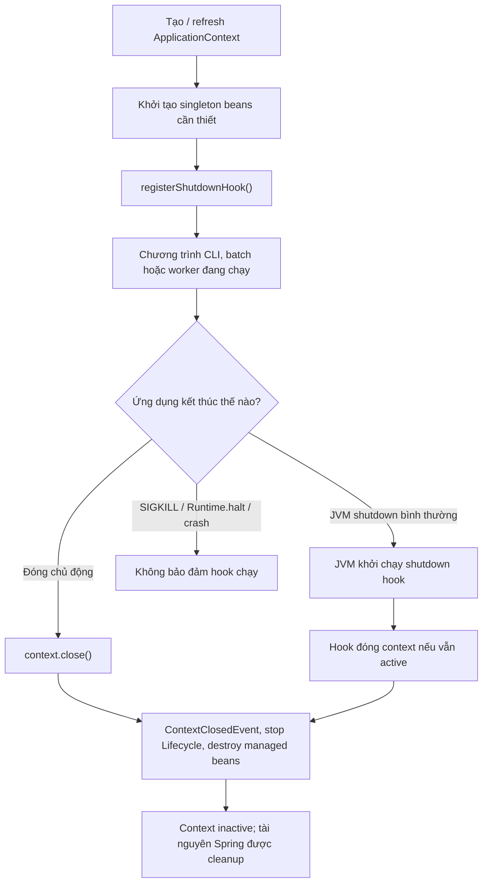

# registerShutdownHook và kết thúc ứng dụng Spring ngoài môi trường web

## 1. Bài toán: khi hàm main kết thúc, ai đóng ApplicationContext?

Trong một ứng dụng Spring Framework **không chạy web server** — chẳng hạn lệnh CLI, chương trình batch, job xử lý tệp, command-line tool hoặc tiến trình chạy nền — chính chương trình thường tạo và quản lý một `ApplicationContext`. Container đó có thể giữ singleton beans, luồng làm việc, kết nối, bộ đệm, executor hoặc những tài nguyên cần dọn dẹp khi ứng dụng kết thúc.

Nếu chỉ tạo context rồi để tiến trình JVM thoát mà **không đóng context**, các callback hủy do Spring quản lý (như `@PreDestroy`, `DisposableBean.destroy()` hoặc custom destroy method) không được bảo đảm chạy. Để có shutdown đúng vòng đời, cần một **đường gọi `context.close()`**.

Spring cung cấp phương thức:

```java
context.registerShutdownHook();
```

Phương thức thuộc `ConfigurableApplicationContext` và đăng ký **một JVM shutdown hook cho context**. Khi JVM bắt đầu quá trình shutdown bình thường, hook yêu cầu Spring đóng context **nếu context chưa được đóng**. Nhờ đó, các thành phần được Spring quản lý có cơ hội dừng và giải phóng tài nguyên.

**Ý chính cần nhớ:**

- `registerShutdownHook()` **đăng ký hành động đóng context về sau**; lệnh này không đóng context ngay.
- `close()` **đóng context ngay tại thời điểm code gọi**, đồng bộ theo hợp đồng lifecycle thông thường; có thể dùng trong `finally` hoặc `try-with-resources` khi đã xác định được thời điểm công việc kết thúc.
- Với ứng dụng CLI có thời điểm hoàn tất rõ ràng, **đóng tường minh là lựa chọn chủ đạo**; shutdown hook là cơ chế dự phòng hữu ích cho đường JVM shutdown.
- Shutdown hook **không bảo đảm chạy** nếu process bị kill cưỡng bức, JVM gặp lỗi nghiêm trọng, hoặc hệ điều hành không cho đủ thời gian shutdown.
- Shutdown hook **không tự dừng mọi non-daemon thread**, và việc đăng ký hook tự nó **không làm một chương trình đang chạy lập tức kết thúc**.

Các điểm này thuộc **vòng đời context**, không có liên quan bắt buộc đến servlet, HTTP request hay Spring MVC. Trong ứng dụng Spring Boot, framework thường đã điều phối context shutdown; không nên máy móc đăng ký thêm hook khi cơ chế framework đã đáp ứng yêu cầu.

## 2. API và sơ đồ đường đi

`registerShutdownHook()`, `close()`, `isActive()` và các thao tác cấu hình khác thuộc interface:

```java
org.springframework.context.ConfigurableApplicationContext
```

`AnnotationConfigApplicationContext` là một implementation dùng được cho chương trình không có web server:

```java
AnnotationConfigApplicationContext context =
        new AnnotationConfigApplicationContext(AppConfig.class);

context.registerShutdownHook();
// Bắt đầu làm việc với các bean...
```

Đây là đoạn mã **minh họa tích hợp**, cần import `AnnotationConfigApplicationContext` và class cấu hình `AppConfig`. Constructor nhận `AppConfig.class` **đã tự gọi `refresh()`**. Bạn không cần tự gọi `refresh()` lần nữa, và với loại context này, refresh lần hai không được hỗ trợ.

Dòng thời gian chính:



Sơ đồ mô tả ý nghĩa chung, không phải cam kết rằng mọi component đều có destruction callback hoặc mọi dạng hệ điều hành đều phát sự kiện tắt có kiểm soát. Nếu một resource không do Spring sở hữu, chương trình phải có cơ chế dọn riêng.

### 2.1. JVM gọi hook khi nào?

Theo hợp đồng của `Runtime.addShutdownHook(Thread)` trong Java 17, các tình huống JVM thường bắt đầu shutdown gồm:

1. **Chương trình kết thúc bình thường**: không còn non-daemon thread đang chạy (ví dụ `main` trở về và không có thread không-daemon giữ tiến trình sống).
2. **Lời gọi `System.exit(status)`** hoặc `Runtime.getRuntime().exit(status)`.
3. **Tín hiệu kết thúc phù hợp từ bên ngoài**: trên các hệ điều hành và môi trường hỗ trợ, thao tác như Ctrl+C/SIGINT hoặc SIGTERM có thể kích hoạt trình tự shutdown JVM.

Khi shutdown bắt đầu, JVM chạy các hook đã đăng ký dưới dạng threads. Nếu có **nhiều hook**, JVM **không cam kết thứ tự thực thi** giữa chúng; các hook có thể chạy đồng thời. Vì vậy, không nên thiết kế “hook A luôn đóng logger trước, hook B luôn commit transaction sau” bằng cách dựa vào thứ tự đăng ký.

Shutdown hook phải ngắn gọn và có thể hoàn thành. Không nên khóa vô hạn, chờ tương tác bàn phím, hoặc phụ thuộc cứng vào một dịch vụ mà một shutdown hook khác cũng đang đóng.

### 2.2. Khi nào hook không được bảo đảm?

- **SIGKILL** (`kill -9` trên Unix/Linux), `Runtime.halt(...)` và các cách terminate process cưỡng bức bỏ qua quá trình shutdown có trật tự.
- Crash nghiêm trọng của JVM, lỗi native hoặc mất điện có thể khiến hook không chạy hoặc không hoàn tất.
- Container/orchestrator có thể cho tiến trình một **grace period** ngắn rồi kill cưỡng bức nếu shutdown kéo dài.
- Nếu JVM còn một **non-daemon thread chạy mãi**, việc `main` trả về không đủ để JVM bước vào shutdown; hook sẽ chưa chạy chỉ vì main đã kết thúc.
- Khi shutdown đã bắt đầu, code không được đăng ký hoặc gỡ hook mới theo cách thông thường: `Runtime.addShutdownHook`/`removeShutdownHook` có thể ném `IllegalStateException` nếu JVM đang shutdown.

**Không dựa vào shutdown hook để bảo đảm dữ liệu quan trọng đã được ghi bền vững.** Với batch/job, cần commit/flush/checkpoint trong quá trình xử lý, chính sách retry hoặc transaction phù hợp. Hook là chốt cleanup, không phải hệ thống bảo đảm hoàn tất công việc bị gián đoạn.

## 3. registerShutdownHook khác gì close, stop và refresh?

| Thao tác | Mục đích | Context còn dùng sau lời gọi? | Quan hệ với bean lifecycle |
|---|---|---|---|
| `refresh()` | Khởi tạo/hoàn thiện context, xử lý cấu hình, tạo các singleton non-lazy và phát sự kiện refresh | Có nếu thành công | Thực hiện các bước khởi tạo bean; có thể auto-start `SmartLifecycle` |
| `start()` | Gọi các `Lifecycle` beans thích hợp bắt đầu hoạt động | Có | Không tái tạo toàn bộ singleton hoặc chạy lại `@PostConstruct` |
| `stop()` | Yêu cầu các `Lifecycle` beans dừng | Có; context vẫn active | Không tự destroy tất cả singleton |
| `close()` | Đóng container theo vòng đời đã được quản lý | Không còn là active context | Phát event shutdown, dừng lifecycle components, destroy các bean thuộc phạm vi quản lý hủy |
| `registerShutdownHook()` | Đăng ký callback để JVM có thể gọi close về sau | Có; lệnh đăng ký không tắt context | Không trực tiếp chạy `@PreDestroy`/`destroy()` tại thời điểm đăng ký |

**`registerShutdownHook()` không phải dạng khác của `close()`.** Nó chỉ sắp đặt một cơ chế để `close()` xảy ra vào lúc JVM shutdown nếu context còn mở.

Các loại ngữ cảnh khác nhau có giới hạn refresh riêng. Với `AnnotationConfigApplicationContext` (kế thừa `GenericApplicationContext`), việc refresh nhiều lần không phải kỹ thuật restart hợp lệ; cách restart một tiến trình CLI thường là tạo context mới hoặc tổ chức lại lifecycle. `stop()`/ `start()` quản lý các lifecycle components còn hoạt động, không hồi sinh context đã `close()`.

### 3.1. Context đóng sẽ thực hiện những gì?

Trên `AbstractApplicationContext` thông thường, tiến trình đóng bao gồm:

1. Đánh dấu và bắt đầu xử lý shutdown hợp lệ, phát `ContextClosedEvent` khi các thành phần cần thiết còn sẵn.
2. Yêu cầu `LifecycleProcessor` dừng những thành phần `Lifecycle`/`SmartLifecycle` đang chạy.
3. Hủy những singleton beans mà context có trách nhiệm quản lý destruction; ví dụ chạy `@PreDestroy`, `DisposableBean.destroy()`, custom `destroy-method` trong điều kiện tương ứng.
4. Giải phóng/đóng bean factory và tài nguyên hạ tầng theo implementation, chuyển context sang inactive.

Thứ tự phụ thuộc loại context và extension cụ thể; với `AbstractApplicationContext` phổ biến, `ContextClosedEvent` được công bố **trước** bước dừng `LifecycleProcessor` và hủy singleton. Không suy rằng listener nhận sự kiện này khi mọi bean đã bị hủy xong.

**Prototype là ngoại lệ quan trọng:** Spring quản lý creation/injection/initialization của prototype, nhưng **không tự gọi destruction callbacks cho các prototype đã giao cho caller** khi đóng context. Nếu prototype giữ stream/connection/socket, caller hoặc resource owner phải `close()` đúng thời điểm.

### 3.2. Gọi close trước khi JVM shutdown có bị destroy hai lần?

`ConfigurableApplicationContext.close()` được thiết kế để có thể gọi lặp mà không làm lại toàn bộ shutdown của context đã đóng. Với triển khai `AbstractApplicationContext`, `close()` chủ động cũng có cơ chế gỡ JVM shutdown hook đã đăng ký khi còn có thể, vì hook không còn cần thiết.

Do đó, một context có thể đăng ký hook **và vẫn đóng chủ động** trong `finally`. Không nên kỳ vọng lần JVM shutdown sau đó sẽ chạy lại `@PreDestroy` của singleton đã hủy, và càng không nên tự viết nhiều shutdown hooks cùng gọi cleanup một resource theo các đường khác nhau mà không có cơ chế chống đóng trùng.

## 4. Ví dụ Java 17+ chạy thực tế trong JVM riêng

Ta sẽ xây dựng ứng dụng CLI nhỏ với một Spring bean `Worker`:

- Bean được tạo khi context refresh.
- `Worker` implement `Lifecycle` và được `context.start()` khởi động.
- `Worker` implement `DisposableBean` để in rõ destruction callback.
- Context đăng ký `registerShutdownHook()`.
- Chạy chế độ mặc định để `main` trả về và JVM tự gọi hook.
- Chạy chế độ `manual` để so sánh với `context.close()` chủ động.

Để tránh khác biệt khi một công cụ build chạy main trong chính JVM của công cụ đó, demo đóng gói thành JAR với main class và chạy bằng lệnh **`java -jar`**. Việc này tạo một tiến trình JVM độc lập để quan sát shutdown hook chính xác hơn.

**Yêu cầu:** JDK 17+ và Maven 3.9+.

Cấu trúc:

```text
shutdown-hook-demo/
├── pom.xml
└── src/main/java/example/ShutdownHookDemo.java
```

Tệp `pom.xml`:

```xml
<project xmlns="http://maven.apache.org/POM/4.0.0"
         xmlns:xsi="http://www.w3.org/2001/XMLSchema-instance"
         xsi:schemaLocation="http://maven.apache.org/POM/4.0.0
                             https://maven.apache.org/xsd/maven-4.0.0.xsd">
    <modelVersion>4.0.0</modelVersion>
    <groupId>example</groupId>
    <artifactId>shutdown-hook-demo</artifactId>
    <version>1.0.0</version>

    <properties>
        <maven.compiler.release>17</maven.compiler.release>
        <project.build.sourceEncoding>UTF-8</project.build.sourceEncoding>
    </properties>

    <dependencies>
        <dependency>
            <groupId>org.springframework</groupId>
            <artifactId>spring-context</artifactId>
            <version>6.2.19</version>
        </dependency>
    </dependencies>

    <build>
        <plugins>
            <plugin>
                <groupId>org.apache.maven.plugins</groupId>
                <artifactId>maven-compiler-plugin</artifactId>
                <version>3.13.0</version>
            </plugin>
            <plugin>
                <groupId>org.apache.maven.plugins</groupId>
                <artifactId>maven-shade-plugin</artifactId>
                <version>3.6.0</version>
                <executions>
                    <execution>
                        <phase>package</phase>
                        <goals><goal>shade</goal></goals>
                        <configuration>
                            <transformers>
                                <transformer implementation="org.apache.maven.plugins.shade.resource.ManifestResourceTransformer">
                                    <mainClass>example.ShutdownHookDemo</mainClass>
                                </transformer>
                            </transformers>
                        </configuration>
                    </execution>
                </executions>
            </plugin>
        </plugins>
    </build>
</project>
```

Tệp `src/main/java/example/ShutdownHookDemo.java`:

```java
package example;

import org.springframework.beans.factory.DisposableBean;
import org.springframework.context.Lifecycle;
import org.springframework.context.annotation.AnnotationConfigApplicationContext;
import org.springframework.context.annotation.Bean;
import org.springframework.context.annotation.Configuration;

public class ShutdownHookDemo {

    public static void main(String[] args) {
        var context = new AnnotationConfigApplicationContext(Config.class);

        context.registerShutdownHook();
        context.start();

        System.out.println("context active: " + context.isActive());
        System.out.println("main completed work");

        if (args.length > 0 && "manual".equals(args[0])) {
            context.close();
            System.out.println("manual close completed");
        }
        // Nếu không có "manual", main trả về.
        // Khi không còn non-daemon thread khác, JVM shutdown và
        // hook Spring đóng context chưa đóng.
    }

    @Configuration(proxyBeanMethods = false)
    public static class Config {
        @Bean
        public Worker worker() {
            return new Worker();
        }
    }

    public static final class Worker implements Lifecycle, DisposableBean {
        private boolean running;

        public Worker() {
            System.out.println("construct worker");
        }

        @Override
        public void start() {
            running = true;
            System.out.println("Lifecycle.start");
        }

        @Override
        public void stop() {
            running = false;
            System.out.println("Lifecycle.stop");
        }

        @Override
        public boolean isRunning() {
            return running;
        }

        @Override
        public void destroy() {
            System.out.println("DisposableBean.destroy");
        }
    }
}
```

Xây JAR:

```bash
mvn -q clean package
```

### 4.1. Đường A: main kết thúc, JVM kích hoạt shutdown hook

```bash
java -jar target/shutdown-hook-demo-1.0.0.jar
```

Với môi trường CLI đơn giản như ví dụ, stdout từ **chương trình** có dạng:

```text
construct worker
Lifecycle.start
context active: true
main completed work
Lifecycle.stop
DisposableBean.destroy
```

Giải thích:

1. Constructor `AnnotationConfigApplicationContext(Config.class)` thực hiện refresh ngay; singleton `Worker` được tạo và in `construct worker`.
2. `registerShutdownHook()` **không** tạo dòng in hay dừng bean.
3. `context.start()` làm `LifecycleProcessor` gọi `Worker.start()`.
4. `main` thông báo hoàn thành, sau đó trả về. Vì demo không tự tạo non-daemon thread khác chạy vô hạn, JVM có thể bắt đầu quá trình shutdown bình thường.
5. Shutdown hook của Spring gọi logic đóng context; `Lifecycle.stop()` chạy, rồi Spring gọi `DisposableBean.destroy()` của singleton.

Spring hoặc thư viện trên classpath cũng có thể ghi logging riêng tùy cấu hình. Bảng stdout trên chỉ mô tả các dòng `System.out.println` do demo chủ động in. Nếu chương trình thực tế đăng ký thêm hook khác, thứ tự log từ **các hook khác** không được bảo đảm; demo không dựa vào sự có mặt của chúng.

### 4.2. Đường B: đóng chủ động trước khi main trả về

```bash
java -jar target/shutdown-hook-demo-1.0.0.jar manual
```

Các dòng do chương trình in:

```text
construct worker
Lifecycle.start
context active: true
main completed work
Lifecycle.stop
DisposableBean.destroy
manual close completed
```

Lần này `context.close()` được gọi **trong main**, nên các dòng stop/destroy xuất hiện **trước** thông báo `manual close completed`. Context đã đóng, không có một lần destroy lặp nữa khi JVM shutdown.

Điểm khác biệt trực quan là **thời điểm cleanup**: hook dọn ở pha shutdown của JVM, còn close chủ động dọn ngay tại điểm được gọi. Trong batch/CLI thực tế, nơi hoàn tất công việc và cần release locks/files đã biết rõ, không nên trì hoãn cleanup đến lúc JVM kết thúc nếu đang còn cần tiến trình làm việc tiếp.

### 4.3. Cách kiểm tra mã đúng kỳ vọng

- `Worker` là singleton mặc định qua `@Bean`; trong refresh tạo một instance.
- `Lifecycle` thường **không auto-start khi refresh**; do đó chính `context.start()` làm in `Lifecycle.start`. Nếu đổi sang `SmartLifecycle` với auto-start, thời điểm start có thể chuyển về lúc refresh.
- `DisposableBean.destroy()` chạy khi context được đóng, không chạy khi chỉ gọi `context.stop()`.
- Không có `System.exit()`, `Runtime.halt()` hoặc sleep/đếm thời gian nên demo không che giấu thời điểm đóng.
- `context.registerShutdownHook()` được gọi **sau context refresh**. Có thể gọi trước khi một `Lifecycle` bean `start()`; việc đăng ký hook không quyết định bean có running hay không.

Ví dụ thực hành không mô phỏng SIGKILL: không có cách nào bảo đảm in `destroy` sau khi JVM bị kill cưỡng bức. Không cần dùng tín hiệu nguy hiểm chỉ để kiểm thử cơ chế này; quan sát đường normal shutdown là đủ để học.

## 5. Với ứng dụng CLI hữu hạn, ưu tiên try-with-resources

Một lệnh nhập dữ liệu, xuất báo cáo hoặc xử lý batch có điểm kết thúc xác định. Khi đó, `AnnotationConfigApplicationContext` implement `AutoCloseable`, có thể đặt trong `try-with-resources` để đóng container kể cả khi job báo lỗi.

```java
public static void main(String[] args) {
    try (var context =
                 new AnnotationConfigApplicationContext(BatchConfig.class)) {
        ImportJob job = context.getBean(ImportJob.class);
        job.run();
    } // Spring context.close() tự được gọi khi thoát khối.
}
```

Đây là **mã minh họa theo ngữ cảnh**, cần `BatchConfig` và bean `ImportJob` với method `run()`. Đoạn này không phải chương trình độc lập. Đặc tính quan trọng của `try-with-resources`: khi khối hoàn tất bình thường hay ném exception, Java gọi `close()` cho resource đã khởi tạo thành công, trong giới hạn process vẫn đang thực thi code Java bình thường.

Khi cần xử lý lỗi và trả exit code, có thể viết:

```java
public static int executeBatch() {
    try (var context =
                 new AnnotationConfigApplicationContext(BatchConfig.class)) {
        return context.getBean(ImportJob.class).run();
    }
}
```

Ví dụ này giả định `ImportJob.run()` trả `int`. `return` bên trong khối không bỏ qua cleanup: `context.close()` được gọi trước khi method thực sự trả kết quả. Nếu destruction cũng ném exception, Java áp dụng quy tắc suppressed exception của try-with-resources để tránh mất thông tin lỗi chính.

Nếu chương trình chỉ chạy xong rồi thoát, **không cần thêm `registerShutdownHook()` để bù cho việc không đóng context**. Khi đã đặt context trong `try-with-resources`, đường đóng bình thường rất rõ ràng. Có thể kết hợp shutdown hook khi có nhu cầu bắt các đường JVM shutdown bên ngoài trong lúc tác vụ đang chạy, nhưng phải giữ cleanup idempotent và tránh dựa vào hook như nguồn duy nhất bảo đảm dữ liệu.

### 5.1. Vì sao finally cũng phù hợp?

```java
AnnotationConfigApplicationContext context =
        new AnnotationConfigApplicationContext(BatchConfig.class);
try {
    context.getBean(ImportJob.class).run();
} finally {
    context.close();
}
```

Đây là **snippet tích hợp** yêu cầu `BatchConfig`, `ImportJob`. Với context được tạo bên trong biểu thức khởi tạo trước `try`, nếu constructor ném lỗi thì lệnh gán không hoàn tất; hãy cân nhắc vòng đời và cleanup của các tài nguyên được tạo trước đó. Khi có thể, `try-with-resources` thường gọn và dễ kiểm soát.

**Lưu ý:** nếu code gọi `System.exit(...)` trực tiếp **bên trong** khối `try`, không được coi `finally`/`try-with-resources` sẽ luôn được thực hiện như một phép return hoặc throw thông thường. `System.exit` bắt đầu shutdown JVM, không thực hiện luồng rời block theo cách thông thường. Để bảo đảm `close()` chủ động, nên **trả exit status về lớp main**, để khối đóng hoàn tất, rồi mới cân nhắc gọi `System.exit(status)` ở lớp ngoài khi cần.

## 6. Một ứng dụng chạy nền cần thêm quy tắc stop và timeout

Đối với worker chạy dài hạn ngoài web, có thể có queue consumer, polling thread, timer hoặc executor. Đăng ký hook chỉ bảo đảm **yêu cầu Spring đóng context khi JVM bắt đầu shutdown**. Để dừng được thực tế, thành phần worker phải tích hợp lifecycle:

- **`Lifecycle`**: cung cấp `start()`, `stop()`, `isRunning()`. Container có thể gọi stop khi context đóng. Implementation phải dừng nhận việc và chờ/cancel task theo chính sách.
- **`SmartLifecycle`**: bổ sung auto-start, phase ordering và `stop(Runnable callback)` cho shutdown có thể bất đồng bộ. Callback phải được gọi **khi việc dừng đã hoàn tất**, để lifecycle processor có thể tiến tiếp.
- **Destruction callbacks**: dùng `@PreDestroy`, `DisposableBean.destroy()` hoặc custom destroy method cho resource thuộc vòng đời singleton/context.
- **Resource owner**: các resources tạo thủ công hoặc prototype beans đã cấp cần có owner, vì Spring không tự destroy mọi prototype instance.

Ví dụ skeleton một worker:

```java
public final class QueueConsumer implements Lifecycle, DisposableBean {
    private volatile boolean running;

    @Override
    public void start() {
        running = true;
        // Khởi động consumer / worker thread phù hợp.
    }

    @Override
    public void stop() {
        running = false;
        // Ngừng lấy job mới, đợi hoặc hủy in-flight jobs
        // theo timeout/policy của ứng dụng.
    }

    @Override
    public boolean isRunning() {
        return running;
    }

    @Override
    public void destroy() {
        // Đóng client, file handle, executor và resource do bean sở hữu.
    }
}
```

Đây là **skeleton minh họa**, cần import `Lifecycle` và `DisposableBean`; nó không tự chạy một consumer thật. Với mã production, boolean không đủ để dừng thread đang block đọc socket/queue. Cần interrupt/cancel/close đúng API, drain queue, và tránh deadlock giữa `stop()`, `destroy()`, event listeners.

### 6.1. Vấn đề non-daemon thread

Giả sử một `@Bean` tạo `ExecutorService` với non-daemon threads và không đóng nó. Khi `main` trả về, thread pool vẫn tồn tại; JVM **chưa bắt đầu shutdown chỉ vì main đã hết**, nên shutdown hook cũng **chưa chạy**. Nếu chỉ trông chờ hook để đóng chính executor đang giữ JVM sống, ứng dụng có thể mắc vòng chờ: hook đợi JVM shutdown, nhưng JVM đợi non-daemon threads kết thúc.

Cách thiết kế là đảm bảo một đường chủ động dừng worker/executor khi job hoàn tất hoặc có tín hiệu shutdown được xử lý; hỗ trợ cancel/timeout hoặc explicit `context.close()` từ tầng điều phối. Với daemon threads, JVM có thể shutdown ngay khi hết non-daemon threads nhưng các daemon tasks cũng có thể bị ngừng trước khi làm xong; không dùng daemon như biện pháp bảo đảm business work hoàn tất.

Cũng không nên mở vô hạn các non-daemon threads trong shutdown hook hoặc chờ một tác vụ phụ thuộc chính context đã bị đóng.

## 7. Khi chạy trong systemd, Docker và môi trường cloud

Dù ứng dụng không phục vụ HTTP, nó có thể chạy như một service trong OS hoặc container. Cần phối hợp cơ chế shutdown với trình quản lý tiến trình:

1. **Nhận tín hiệu kết thúc**: process manager thường gửi một tín hiệu graceful như SIGTERM khi yêu cầu dừng. JVM có thể kích hoạt shutdown hooks nếu tín hiệu được xử lý theo cơ chế shutdown bình thường.
2. **Giới hạn thời gian**: sau một khoảng grace period, manager có thể dùng kill cưỡng bức. Hook phải hoàn tất trong khoảng được cho.
3. **PID thực sự của JVM**: nếu entrypoint shell không `exec` tiến trình Java hoặc không forward signal, JVM có thể không nhận trực tiếp tín hiệu mà bạn tưởng.
4. **Stop order**: thành phần nhận việc nên dừng nhận thêm trước khi database/client/dependency bị destroy; với `SmartLifecycle`, xem phase và dependency ordering.
5. **Persistence**: dữ liệu quan trọng cần commit/checkpoint khi xử lý, tránh dựa vào shutdown hook lúc system bị cưỡng bức.
6. **Quan sát**: log/metric trạng thái stop, số job chưa hoàn tất và nguyên nhân shutdown; tách failure của job khỏi failure cleanup.

Ví dụ lệnh Docker entrypoint theo ý tưởng:

```dockerfile
ENTRYPOINT ["java", "-jar", "/app/app.jar"]
```

Đây là **Dockerfile snippet** giả định `/app/app.jar` đã tồn tại. Dạng exec trực tiếp giúp JVM thường là tiến trình chính trong container và nhận tín hiệu từ runtime phù hợp hơn một chuỗi shell wrapper phức tạp. Tuy nhiên, cách gửi/forward signal và grace period vẫn phụ thuộc cấu hình orchestrator, OS và chính sách stop.

Nếu chương trình đang chạy trong job scheduler/cloud function, lifecycle có thể do nền tảng điều khiển. Không khẳng định shutdown hook luôn được gọi trong mọi trường hợp nền tảng hủy instance hoặc thu hồi tài nguyên.

## 8. So sánh hook của Spring với Runtime.addShutdownHook tự viết

Có thể tự đăng ký:

```java
Runtime.getRuntime().addShutdownHook(new Thread(() -> {
    System.out.println("JVM is shutting down");
}));
```

Đây là snippet Java 17 chạy được trong `main` một chương trình Java thông thường. Nhưng nếu mục tiêu là đóng đúng một `ApplicationContext`, thường nên dùng:

```java
context.registerShutdownHook();
```

Spring đã cung cấp cách gắn hook vào việc đóng context, phối hợp trạng thái đã đóng và các bước lifecycle của container. Viết một hook riêng chỉ để gọi `context.close()` có thể tạo cấu trúc không cần thiết hoặc nhiều đường cleanup chồng nhau.

**Khi nào vẫn dùng hook riêng?** Khi cần cleanup resource không thuộc Spring, phát một signal độc lập hoặc có logic process-level đặc biệt. Khi đó cần coi các hook chạy song song không thứ tự xác định; một hook riêng **không được giả định** có thể truy cập tất cả các singleton sau khi hook Spring bắt đầu đóng context.

Nếu cleanup thật sự phụ thuộc Spring beans, thường tốt hơn đưa cleanup vào `Lifecycle`, `SmartLifecycle`, `@PreDestroy` hoặc custom destroy method của bean được Spring quản lý. Khi đó Spring điều phối trong **một đường đóng context** thay vì các hook cạnh tranh.

### 8.1. Đăng ký nhiều lần thì sao?

Hợp đồng `ConfigurableApplicationContext.registerShutdownHook()` cho phép gọi nhiều lần; Spring đăng ký tối đa **một shutdown hook cho mỗi context instance**. Điều đó không có nghĩa có tối đa một hook cho toàn JVM: các context khác nhau hoặc thư viện khác vẫn có thể đăng ký hook riêng.

Nếu có **parent/child context**, mỗi context có vòng đời của riêng mình. `close()` trên một child context **không tự đóng parent** theo hợp đồng của `ConfigurableApplicationContext`. Phải xác định nơi sở hữu các context và thứ tự đóng phù hợp; đăng ký hook trên tất cả context rồi trông đợi JVM tự chọn đúng thứ tự là thiết kế mong manh.

## 9. Khác biệt khi dùng Spring Boot không có web server

Một ứng dụng Spring Boot CLI có thể khai báo `WebApplicationType.NONE`:

```java
SpringApplication app = new SpringApplication(BatchApplication.class);
app.setWebApplicationType(WebApplicationType.NONE);
ConfigurableApplicationContext context = app.run(args);
```

Đây là **mã minh họa tích hợp Boot**, cần các import `SpringApplication`, `WebApplicationType`, `ConfigurableApplicationContext`, một class `BatchApplication` và dependency Spring Boot. `NONE` ngăn Boot tạo web application context/server, nhưng không tự giải quyết toàn bộ chính sách đóng tài nguyên và kết thúc batch.

Spring Boot có cơ chế quản lý shutdown hook tích hợp ở tầng `SpringApplication` theo cấu hình tương ứng; nhiều ứng dụng Boot không cần tự gọi `registerShutdownHook()` như ứng dụng Spring Context thuần. Vẫn phải bảo đảm worker threads kết thúc, tài nguyên quan trọng được commit/close và ứng dụng có một điểm kết thúc rõ ràng.

Trong Boot CLI dùng `ApplicationRunner` hoặc `CommandLineRunner`, đừng tự giả định một runner kết thúc là mọi phần tử JVM tự shutdown. Nếu còn non-daemon threads, process có thể tiếp tục. Nếu cần kết thúc ứng dụng bằng exit code, có thể dùng `SpringApplication.exit(context)` để đóng context và lấy exit code theo contract Boot rồi `System.exit(code)` sau đó, khi phù hợp với môi trường host. Cần phân biệt API Boot-specific với `ConfigurableApplicationContext.registerShutdownHook()` của Spring Framework.

Không đưa mã Boot vào ví dụ Maven ở phần 4; ví dụ đó chỉ phụ thuộc `spring-context`, vì đề bài nói đến vòng đời context ngoài môi trường web.

## 10. Lỗi thường gặp và hậu quả

| Sai lầm | Hậu quả | Cách xử lý |
|---|---|---|
| Tạo context trong main nhưng không `close()` hoặc đăng ký hook | Destruction callbacks không được bảo đảm chạy | Dùng `try-with-resources`, `finally` hoặc `registerShutdownHook` phù hợp |
| Gọi `registerShutdownHook()` rồi nghĩ context đã đóng | Resource vẫn mở và bean còn hoạt động | Phân biệt **đăng ký hook** với **gọi close ngay** |
| Gọi `stop()` thay cho `close()` | Context vẫn active, singleton chưa được destroy | Gọi `close()` khi thực sự kết thúc context |
| Mong hook chạy khi `kill -9` | Không có trình tự shutdown JVM bình thường | Thiết kế crash recovery, checkpoint/retry và timeout |
| Trông chờ hook sau khi main về nhưng có non-daemon thread vô hạn | JVM chưa shutdown nên hook chưa chạy | Chủ động shutdown executor/worker hoặc đóng context theo owner |
| Viết nhiều hooks và phụ thuộc thứ tự giữa chúng | JVM chạy hooks không bảo đảm thứ tự, có thể cạnh tranh | Đưa cleanup phụ thuộc vào cùng một lifecycle/owner |
| Hook chờ vô hạn để xử lý nốt mọi job | Process có thể bị kill trước khi hoàn tất | Bounded graceful shutdown, idempotent job, retry/checkpoint |
| Gọi `System.exit()` bên trong try và chờ finally | Không phải luồng thoát block thông thường | Đóng context trước, rồi trả exit status/exit khi thật cần |
| Gọi hook rồi gọi `close()` nhiều lần vì sợ bỏ sót | Cleanup nhiều đường khó lý giải, nguy cơ resource code không idempotent | Dùng một context owner rõ ràng; Spring close có bảo vệ context đã đóng |
| Cho rằng close context tự đóng prototype đã cấp | Spring mặc định không theo dõi destruction của prototype | Caller/resource owner chủ động dọn từng prototype |
| Gọi `@PreDestroy` trên bean rồi nghĩ toàn context đã đóng | Callback cấp bean không phải API shutdown context | Dùng `ConfigurableApplicationContext.close()` |
| Viết shutdown hook làm HTTP call qua bean khác đang bị hủy | Race/deadlock nếu hook Spring chạy đồng thời | Đưa logic vào lifecycle callback bên trong context |
| Quên khác biệt giữa refresh và start | Thao tác điều khiển lifecycle không tạo lại context | Refresh để bootstrap, start/stop để điều khiển Lifecycle beans |
| Tạo nhiều application contexts và chỉ đăng ký hook cho một context | Context khác có thể không được đóng | Xác định rõ ownership và cấu hình shutdown cho từng context |

### 10.1. Thời điểm shutdown không phải lúc an toàn để làm mọi việc

Trong shutdown hook, có thể có bất kỳ component khác đang dừng. Tránh chờ một thread pool mà bạn vừa shutdown, truy xuất bean đã hủy, gọi lại `System.exit()` hoặc bắt đầu một luồng công việc mới cần container sống đầy đủ.

Đặc biệt, **không dùng shutdown hook để bù cho việc thiếu transaction boundaries**. Commit dữ liệu quan trọng, lưu checkpoints và giải phóng lock nên nằm ở các điểm mà chương trình còn kiểm soát được. Khi graceful shutdown đến, hãy ưu tiên ngừng nhận việc mới, hoàn tất hoặc hủy in-flight work theo giới hạn và giải phóng tài nguyên.

### 10.2. Nếu close cũng có thể lỗi?

Một destruction callback do user code viết có thể ném exception; lỗi có thể được Spring log/điều phối tùy hook. Không được giả định mọi resource sẽ luôn được đóng thành công chỉ vì `close()` đã được gọi. Khi xây lifecycle handler, nên thiết kế:

- **Idempotent cleanup:** đóng nhiều lần không phá trạng thái hoặc gây lỗi không cần thiết.
- **Bounded waiting:** không giữ JVM chờ vô hạn.
- **Ownership rõ ràng:** chỉ một thành phần chịu trách nhiệm đóng resource.
- **Quan sát được:** log lỗi cleanup đầy đủ nhưng không tiết lộ dữ liệu nhạy cảm.
- **Khôi phục được:** dữ liệu và job có khả năng retry sau shutdown bất thường.

Spring cung cấp lời gọi lifecycle; chính ứng dụng quyết định mức độ an toàn khi resource bên ngoài không sẵn sàng.

## 11. Checklist thiết kế một ứng dụng không có web server

Trước khi đưa một Spring CLI, batch hoặc worker vào vận hành, hãy kiểm tra:

1. **Context được tạo ở đâu?** `new AnnotationConfigApplicationContext(Config.class)` đã refresh; constructor rỗng cần `register(...)` và `refresh()` trước khi lấy bean.
2. **Ai sở hữu context?** Có một vị trí top-level chịu trách nhiệm `close()` không?
3. **Ứng dụng có điểm kết thúc xác định?** Nếu có, ưu tiên `try-with-resources` hoặc `finally`.
4. **Có cần phản ứng với JVM shutdown ngoài luồng chính?** Cân nhắc `registerShutdownHook()`, tránh đăng ký nhiều đường shutdown trùng nhau.
5. **Có background workers không?** Xem `Lifecycle`, `SmartLifecycle` và stop timeout.
6. **Các thread/executors có giữ JVM sống không?** Nếu có, phải có cơ chế chủ động dừng, không chỉ trông đợi hook khi JVM tự shutdown.
7. **Resource nào do Spring quản lý, resource nào do caller quản lý?** Prototype và các object tự `new` có thể cần cleanup riêng.
8. **Có SIGTERM/grace period từ host không?** Bố trí thời gian dừng phù hợp; không coi SIGKILL là graceful.
9. **Job có thể bị ngắt giữa chừng?** Dùng idempotency, transaction, checkpoint và retry.
10. **Có nhiều hook/context không?** Đừng dựa vào thứ tự shutdown hook do JVM tự chọn.
11. **Test hai đường bình thường và manual close chưa?** Quan sát `Lifecycle.stop()`, destruction callbacks và trạng thái context.
12. **Đã chạy chương trình trong JVM riêng chưa?** Khi kiểm thử JVM hook, dùng `java -jar` hoặc một Java process độc lập để không nhầm với vòng đời JVM của Maven/IDE.

### 11.1. Kịch bản kiểm tra đơn giản

Với ví dụ phần 4:

| Kịch bản | Quan sát cần có | Điều không nên kỳ vọng |
|---|---|---|
| `java -jar ...` không tham số | Sau dòng `main completed work`, hook đóng context, stop rồi destroy | Không có lệnh `context.close()` trong main |
| `java -jar ... manual` | Stop/destroy chạy trước `manual close completed` | Không destroy lần hai lúc JVM tắt |
| Chỉ gọi `context.stop()` (nếu tự sửa demo) | `Lifecycle.stop()`, context vẫn active | Không có `DisposableBean.destroy()` chỉ vì stop |
| Worker giữ non-daemon thread chưa được shutdown | JVM có thể tiếp tục chạy sau main | Không được bảo đảm hook chạy ngay lúc main trả về |
| Cưỡng bức kill process | Không bảo đảm có cleanup stdout | Không thể dùng hook như giao dịch hoàn tất chắc chắn |

Không cần cố tái hiện sự cố SIGKILL để “kiểm tra callback”; đối với shutdown bất thường, điều cần test ở cấp nghiệp vụ là **khả năng khôi phục công việc và dữ liệu sau khi bị gián đoạn**.

## 12. Câu hỏi tự kiểm tra

**1. `registerShutdownHook()` có đóng context ngay không?**  
Không. Nó đăng ký hook để JVM yêu cầu context đóng khi JVM bắt đầu shutdown bình thường, nếu context chưa đóng.

**2. Với một CLI biết chính xác lúc hoàn tất, nên chọn `close()` hay chỉ hook?**  
Ưu tiên đóng tường minh qua `try-with-resources`/`finally`; dùng hook bổ sung khi cần một đường shutdown do JVM/host kích hoạt.

**3. Khi JVM chạy nhiều shutdown hooks, thứ tự đăng ký có quyết định thứ tự chạy không?**  
Không. JVM không bảo đảm thứ tự và hooks có thể chạy đồng thời. Các cleanup phụ thuộc nhau nên được điều phối bởi một owner/lifecycle rõ ràng.

**4. Nếu worker dùng non-daemon thread chạy vô hạn, main trả về có đủ kích hoạt hook không?**  
Không. JVM chưa thoát bình thường khi còn non-daemon threads; cần cơ chế shutdown chủ động để tiến trình đi tới shutdown.

**5. `System.exit(0)` có kích hoạt hook không? `Runtime.halt(0)` thì sao?**  
`System.exit(0)` bắt đầu trình tự shutdown bình thường, nơi hooks được chạy. `Runtime.halt(0)` cưỡng bức kết thúc VM và không khởi chạy hooks theo hợp đồng.

**6. Có thể gọi `registerShutdownHook()` nhiều lần trên cùng context không?**  
Có; Spring đăng ký tối đa một shutdown hook cho mỗi context instance.

**7. Gọi `stop()` có làm Spring chạy `@PreDestroy` của mọi singleton không?**  
Không. Stop điều khiển lifecycle components; destroy thuộc đường close/destroy thích hợp.

**8. Khi JVM shutdown, Spring có tự hủy mọi prototype từng lấy không?**  
Không. Với prototype, caller/resource owner cần dọn resource đã được cấp phát.

**9. Context parent có tự đóng khi child context đóng không?**  
Không theo hợp đồng `ConfigurableApplicationContext.close()`; parent có lifecycle riêng, cần owner bảo đảm đóng phù hợp.

**10. Vì sao không nên gọi `System.exit()` trong một khối try rồi dựa vào `finally` để đóng context?**  
Vì `System.exit` bắt đầu shutdown JVM thay vì thoát khối theo luồng Java thông thường; đóng context trước khi gọi exit hoặc để shutdown hook điều phối nếu cần.

## Tài liệu tham khảo chính thức

- [Spring Framework 6.2 — ConfigurableApplicationContext](https://docs.spring.io/spring-framework/docs/6.2.19/javadoc-api/org/springframework/context/ConfigurableApplicationContext.html): `registerShutdownHook`, `close`, contract lặp lời gọi và quản lý parent context.
- [Spring Framework 6.2 — AbstractApplicationContext](https://docs.spring.io/spring-framework/docs/6.2.19/javadoc-api/org/springframework/context/support/AbstractApplicationContext.html): triển khai shutdown hook, `doClose` và destruction.
- [Spring Framework — Lifecycle Callbacks](https://docs.spring.io/spring-framework/reference/core/beans/factory-nature.html): initialization/destruction callbacks và Spring-managed bean lifecycle.
- [Spring Framework 6.2 — SmartLifecycle](https://docs.spring.io/spring-framework/docs/6.2.19/javadoc-api/org/springframework/context/SmartLifecycle.html): auto-start, phase và stop callback.
- [Oracle Java 17 — Runtime.addShutdownHook](https://docs.oracle.com/en/java/javase/17/docs/api/java.base/java/lang/Runtime.html#addShutdownHook(java.lang.Thread)): sự kiện JVM shutdown, thứ tự hooks và tình huống không bảo đảm hook chạy.
